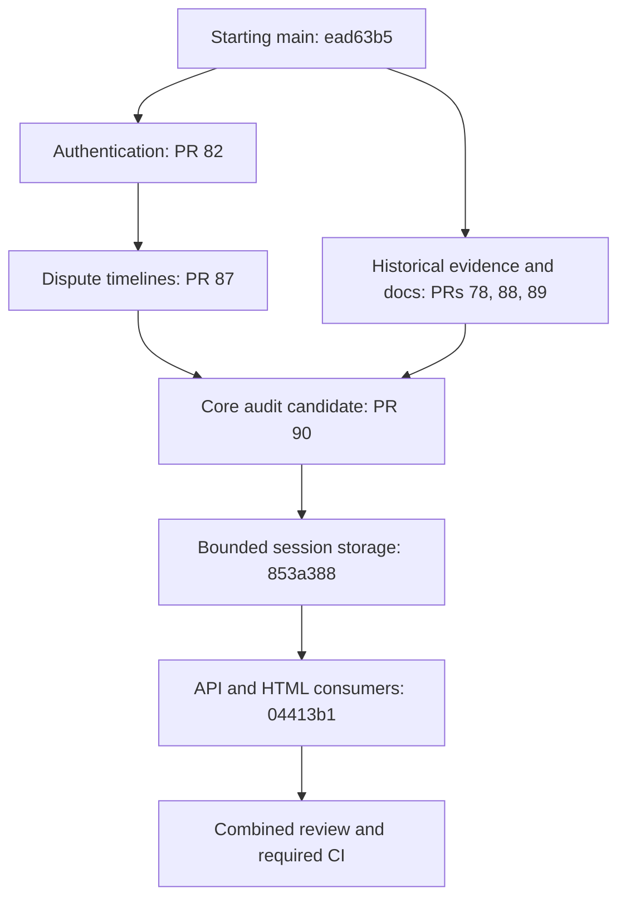
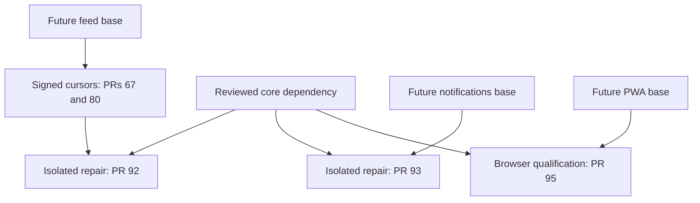

# Branch consolidation dependency graph

Snapshot: main `ead63b5ce24b2bcf8352d75fd0d1ff7be711f625`; core foundation `244e1356201e6477eab4694d82947f2058f3b0d8`. Full commit and branch ancestry edges are in [BRANCH_INVENTORY_2026-11-19.json](BRANCH_INVENTORY_2026-11-19.json). The compact diagrams show active integration relationships; the table below covers every remote branch. Arrows represent dependency or intended integration, not authorization or test success.

## Core recovery sequence

PR #87 is completed in the candidate with immutable dispute-policy binding; the diagram preserves its source dependency. The bounded-session source has an equivalent adapter head `8461711`; only one copy should be integrated. The final report supplies reviewed follow-up and integration commit hashes.

## Separate policy and future paths

GOV-021 PR #85 receives fixture-only PR #91 and remains decision-gated. Original SEC-026 PR #86 depends on GOV-021; PR #94 independently recovers its signals implementation on reviewed core, with policy decisions still open. PR #83 reviewer-reset policy and the future CLI draft remain separate. None of these relationships permits adding unfinished future runtime to core.

## Nearest remote ancestry for every branch

Each row lists the nearest strict ancestor tips among the 113 advertised branches. Earlier ancestors are recoverable transitively from these rows and explicitly recorded in JSON. Equal-tip aliases would be listed separately. Root/old branches may have no advertised ancestor even though their Git commits have parents.

| Branch | Head | Nearest advertised ancestor branches |
|---|---|---|
| `audit/future-feed-cursors-20261119` | `8638f3d30f27` | `claude/fnet-204-signed-cursors` (`0952c94a5dba`); `integration/comprehensive-audit-20261119` (`244e1356201e`) |
| `audit/future-notifications-binding-20261119` | `9c794a5b9e6f` | `future/fux-104-notifications-20261116` (`3bdf8e92d84a`); `integration/comprehensive-audit-20261119` (`244e1356201e`) |
| `audit/future-pwa-browser-20261119` | `f25d037c3cc5` | `future/fux-101-pwa-20261116` (`a6326b8725fe`); `integration/comprehensive-audit-20261119` (`244e1356201e`) |
| `audit/gov021-fixture-20261119` | `d922d4f88005` | `claude/ux-047-auth-catalogue` (`dd3e82e27ddb`); `integration/backup-private-staging-20261117` (`faed4906f541`); `integration/store-untrusted-schema-20261117` (`b1cd8f38450a`) |
| `audit/sec026-independent-20261119` | `26f350b8aa43` | `integration/comprehensive-audit-20261119` (`244e1356201e`) |
| `chatgpt/circula-consolidation-review-20261111` | `02f9f0a7bb87` | `haiku/circula-consolidation` (`6fbfa13fb696`) |
| `chatgpt/circula-departure-pagination-20261115` | `8abff32c1b4a` | `docs/fnet-203-optional-trade-receipts` (`3d6ed55b2e44`) |
| `chatgpt/circula-erasure-notification-20261115` | `26b57163d965` | `docs/fnet-203-optional-trade-receipts` (`3d6ed55b2e44`) |
| `chatgpt/circula-expiry-starvation-20261115` | `2eacf7718f5b` | `docs/fnet-203-optional-trade-receipts` (`3d6ed55b2e44`) |
| `chatgpt/circula-ledger-auth-guard-20261115` | `29e46e5016a0` | `docs/fnet-203-optional-trade-receipts` (`3d6ed55b2e44`) |
| `chatgpt/circula-mfa-decider-20261115` | `4ffb5c78d6b4` | `docs/fnet-203-optional-trade-receipts` (`3d6ed55b2e44`) |
| `chatgpt/circula-qa042-traceability-audit-20261114` | `fe832faced82` | `claude/charming-gauss-19fbfa` (`8b4c8ba23c99`) |
| `chatgpt/circula-secure-json-write-20261115` | `e02085a6aa1a` | `docs/fnet-203-optional-trade-receipts` (`3d6ed55b2e44`) |
| `chatgpt/circula-security-audit-20261115` | `36a80335abf5` | `claude/cool-ramanujan-n2peag` (`c033cfa448fb`) |
| `chatgpt/consolidation-delta-qualification-20261114` | `8f742877fb53` | `claude/charming-gauss-19fbfa` (`8b4c8ba23c99`) |
| `chatgpt/favorites-owner-scoped-collection-20261116` | `372a8f97ae01` | `chatgpt/circula-expiry-starvation-20261115` (`2eacf7718f5b`) |
| `chatgpt/feed-signed-cursors-20261116` | `7a528c611bff` | `future/fnet-204-feed-20261116` (`5d3819c3b3af`) |
| `chatgpt/zero-codex-continuation-spec-20261109` | `3d9c56196625` | No other advertised branch tip is an ancestor |
| `chatgpt/zero-codex/audit-20261110-a` | `2e729346d629` | `codex/circula-noscript-qa` (`ba5751291819`) |
| `chatgpt/zero-codex/ci-macos-race-budget-20261110` | `2078bf096435` | `chatgpt/zero-codex/ci-macos15-retirement-20261110` (`1760551f5b03`) |
| `chatgpt/zero-codex/ci-macos15-retirement-20261110` | `1760551f5b03` | `chatgpt/zero-codex/terms-return-20261110-b` (`7620d7f51913`) |
| `chatgpt/zero-codex/cookie-policy-adapter-20261110-b` | `7e8481004801` | `chatgpt/zero-codex/decidable-expiry-20261110-a` (`b61a8e719030`) |
| `chatgpt/zero-codex/decidable-expiry-20261110-a` | `b61a8e719030` | `chatgpt/zero-codex/ci-macos-race-budget-20261110` (`2078bf096435`) |
| `chatgpt/zero-codex/docs-20261110-a` | `a376a4ed5924` | `codex/circula-noscript-qa` (`ba5751291819`) |
| `chatgpt/zero-codex/qualify-pr19-20261110-a` | `63b033d842a2` | `codex/circula-noscript-qa` (`ba5751291819`) |
| `chatgpt/zero-codex/terms-return-20261110-b` | `7620d7f51913` | `codex/circula-noscript-qa` (`ba5751291819`) |
| `checkpoint/circula-handoff-20261025` | `3d0080a9c436` | `work/spec-completion` (`d39bfef12d4a`) |
| `claude/aud4-auth-fixes` | `82dc18e07f6b` | `main` (`ead63b5ce24b`) |
| `claude/aud4-f02-reviewer-reset-policy` | `af54887aa0cd` | `claude/ux-047-auth-catalogue` (`dd3e82e27ddb`); `integration/backup-private-staging-20261117` (`faed4906f541`); `integration/store-untrusted-schema-20261117` (`b1cd8f38450a`) |
| `claude/aud4-f03-dispute-timelines` | `b6275747df66` | `claude/aud4-auth-fixes` (`82dc18e07f6b`) |
| `claude/awesome-darwin-y6eaiz` | `827e651fe151` | `codex/circula-support-boundaries-20261028` (`837d51b0d537`) |
| `claude/backup-path-hardening` | `09ef8a5aa25f` | `integration/backup-private-staging-20261117` (`faed4906f541`); `integration/store-untrusted-schema-20261117` (`b1cd8f38450a`) |
| `claude/charming-gauss-19fbfa` | `8b4c8ba23c99` | `claude/circula-beta-completion-1npjw6` (`bffcede8c7dc`) |
| `claude/circula-beta-completion-1npjw6` | `bffcede8c7dc` | `chatgpt/zero-codex/audit-20261110-a` (`2e729346d629`); `chatgpt/zero-codex/cookie-policy-adapter-20261110-b` (`7e8481004801`); `chatgpt/zero-codex/docs-20261110-a` (`a376a4ed5924`); `chatgpt/zero-codex/qualify-pr19-20261110-a` (`63b033d842a2`); `claude/happy-noether-444cum` (`34ccb81a54ab`) |
| `claude/circula-build` | `fc488445af5f` | `claude/circula-security-features` (`f8278a047392`) |
| `claude/circula-completeness` | `fcd9fc587848` | `claude/circula-build` (`fc488445af5f`) |
| `claude/circula-consolidation-audit-0sydm1` | `0e5296a71f3f` | `main` (`ead63b5ce24b`) |
| `claude/circula-finish` | `d350474e4952` | `claude/circula-security-features` (`f8278a047392`) |
| `claude/circula-pr-consolidation-q6q18n` | `163fe1596bd7` | `consolidation/http-persistence-regressions-20261116` (`050798c9cf94`); `dependabot/go_modules/github.com/getkin/kin-openapi-0.153.0` (`3fa76cdb5901`) |
| `claude/circula-security-features` | `f8278a047392` | No other advertised branch tip is an ancestor |
| `claude/compassionate-cannon-txdlz1` | `047e92e88a0c` | `codex/dashboard-amounts-meter-20261116` (`d53196cc6907`); `consolidation/http-persistence-regressions-20261116` (`050798c9cf94`); `dependabot/go_modules/github.com/getkin/kin-openapi-0.153.0` (`3fa76cdb5901`) |
| `claude/cool-gauss-vdxlod` | `64fa4f685780` | `chatgpt/circula-expiry-starvation-20261115` (`2eacf7718f5b`) |
| `claude/cool-ramanujan-n2peag` | `c033cfa448fb` | `chatgpt/circula-qa042-traceability-audit-20261114` (`fe832faced82`) |
| `claude/fnet-204-signed-cursors` | `0952c94a5dba` | `chatgpt/feed-signed-cursors-20261116` (`7a528c611bff`) |
| `claude/gov-021-admin-recovery` | `0d480a5b348f` | `audit/gov021-fixture-20261119` (`d922d4f88005`) |
| `claude/gracious-ptolemy-dscc7v` | `1d165989e217` | `claude/happy-noether-444cum` (`34ccb81a54ab`) |
| `claude/happy-babbage-dcumwz` | `dc97f7d5b0ae` | `chatgpt/circula-expiry-starvation-20261115` (`2eacf7718f5b`); `claude/quirky-einstein-l9ni8m` (`4a8db9e80509`) |
| `claude/happy-noether-444cum` | `34ccb81a54ab` | `codex/circula-noscript-qa` (`ba5751291819`) |
| `claude/kind-einstein-v5ycss` | `3bfb2f78fb0a` | No other advertised branch tip is an ancestor |
| `claude/lucid-archimedes-upisa8` | `d2c1c6090a05` | No other advertised branch tip is an ancestor |
| `claude/quirky-babbage-y9fpmm` | `af69702be08a` | `chatgpt/circula-qa042-traceability-audit-20261114` (`fe832faced82`) |
| `claude/quirky-einstein-l9ni8m` | `4a8db9e80509` | `claude/charming-gauss-19fbfa` (`8b4c8ba23c99`) |
| `claude/relaxed-hopper-8q4vhq` | `2da1a293ebf2` | No other advertised branch tip is an ancestor |
| `claude/sec-026-abuse-signals` | `4d349c4d03bf` | `claude/backup-path-hardening` (`09ef8a5aa25f`); `claude/ux-047-auth-catalogue` (`dd3e82e27ddb`) |
| `claude/sharp-archimedes-tu76rh` | `eb4bb08b15d4` | `claude/ux-047-auth-catalogue` (`dd3e82e27ddb`); `integration/backup-private-staging-20261117` (`faed4906f541`); `integration/store-untrusted-schema-20261117` (`b1cd8f38450a`) |
| `claude/sweet-turing-m3ftja` | `01b6e5c7cfc5` | No other advertised branch tip is an ancestor |
| `claude/ux-047-auth-catalogue` | `dd3e82e27ddb` | `integration/admin-grant-notice-pagination-20261117` (`cb25b41febd4`); `integration/erasure-fixture-stability-20261117` (`fc31dc9a6b8c`); `integration/release-threshold-check-20261117` (`ec98caba7328`); `integration/throttle-documentation-20261117` (`83de536ee373`) |
| `claude/vibrant-brahmagupta-3uofnj` | `33b200e00c08` | No other advertised branch tip is an ancestor |
| `codex/circula-checkpoint-recovery-20261116` | `12175ec348d5` | `codex/circula-evidence-20261116` (`f6ea3213e663`) |
| `codex/circula-common-ui-catalog-20261116` | `a112c979932b` | `codex/circula-financial-messages-20261116` (`cf5abf5cfb00`) |
| `codex/circula-consolidate-20261030` | `7643fb616208` | `claude/awesome-darwin-y6eaiz` (`827e651fe151`); `claude/vibrant-brahmagupta-3uofnj` (`33b200e00c08`); `codex/circula-resume-20261024` (`f4bfe6bc3f81`) |
| `codex/circula-core-checkpoint-20261116` | `15375a8dc875` | `claude/cool-gauss-vdxlod` (`64fa4f685780`); `claude/happy-babbage-dcumwz` (`dc97f7d5b0ae`) |
| `codex/circula-core-completion-20261116` | `e3c60a62c065` | `codex/circula-core-checkpoint-20261116` (`15375a8dc875`) |
| `codex/circula-evidence-20261116` | `f6ea3213e663` | `codex/circula-qualification-20261116` (`dc89212a8bf1`) |
| `codex/circula-financial-messages-20261116` | `cf5abf5cfb00` | `codex/circula-message-catalogs-20261116` (`96059bb4b8ae`) |
| `codex/circula-integration-plan-20261030` | `127943ba7aa2` | `claude/vibrant-brahmagupta-3uofnj` (`33b200e00c08`) |
| `codex/circula-message-catalogs-20261116` | `96059bb4b8ae` | `codex/circula-checkpoint-recovery-20261116` (`12175ec348d5`) |
| `codex/circula-noscript-qa` | `ba5751291819` | `codex/circula-responsive-qa` (`04e11989b811`) |
| `codex/circula-qualification-20261116` | `dc89212a8bf1` | `codex/circula-core-completion-20261116` (`e3c60a62c065`) |
| `codex/circula-responsive-qa` | `04e11989b811` | `codex/circula-staging-refresh-docs` (`9c0bc500cb19`) |
| `codex/circula-resume-20261024` | `f4bfe6bc3f81` | `codex/circula-support-boundaries-20261028` (`837d51b0d537`) |
| `codex/circula-staging-refresh-docs` | `9c0bc500cb19` | `codex/circula-consolidate-20261030` (`7643fb616208`) |
| `codex/circula-support-boundaries-20261028` | `837d51b0d537` | `work/spec-completion` (`d39bfef12d4a`) |
| `codex/dashboard-amounts-meter-20261116` | `d53196cc6907` | `codex/circula-common-ui-catalog-20261116` (`a112c979932b`) |
| `consolidation/http-persistence-regressions-20261116` | `050798c9cf94` | `consolidation/recover-future-specifications` (`3a776e630455`) |
| `consolidation/recover-future-specifications` | `3a776e630455` | `codex/circula-common-ui-catalog-20261116` (`a112c979932b`); `docs/future-usability-network-specs-20261111` (`f4a051c1c1af`) |
| `dependabot/go_modules/github.com/getkin/kin-openapi-0.153.0` | `3fa76cdb5901` | `docs/fnet-203-optional-trade-receipts` (`3d6ed55b2e44`) |
| `dependabot/go_modules/golang.org/x/text-0.44.0` | `4a6ea9ab3dff` | `consolidation/http-persistence-regressions-20261116` (`050798c9cf94`); `dependabot/go_modules/github.com/getkin/kin-openapi-0.153.0` (`3fa76cdb5901`) |
| `docs/fnet-203-optional-trade-receipts` | `3d6ed55b2e44` | `claude/charming-gauss-19fbfa` (`8b4c8ba23c99`) |
| `docs/foundational-spec-shells` | `d96f2e75634b` | No other advertised branch tip is an ancestor |
| `docs/foundational-specifications` | `22e9202f19f5` | No other advertised branch tip is an ancestor |
| `docs/future-usability-network-specs-20261111` | `f4a051c1c1af` | `claude/circula-beta-completion-1npjw6` (`bffcede8c7dc`) |
| `docs/readme-and-wiki` | `db7826495ec2` | No other advertised branch tip is an ancestor |
| `future/fnet-201-matching-20261116` | `12850290c6bc` | `chatgpt/circula-expiry-starvation-20261115` (`2eacf7718f5b`) |
| `future/fnet-202-favorites-20261116` | `efc9d696eea2` | `chatgpt/favorites-owner-scoped-collection-20261116` (`372a8f97ae01`) |
| `future/fnet-203-receipts-20261116` | `bd2fbdbd3adf` | `chatgpt/circula-expiry-starvation-20261115` (`2eacf7718f5b`) |
| `future/fnet-204-feed-20261116` | `5d3819c3b3af` | `chatgpt/circula-expiry-starvation-20261115` (`2eacf7718f5b`) |
| `future/fnet-205-analytics-20261116` | `0b2965101e1d` | `chatgpt/circula-expiry-starvation-20261115` (`2eacf7718f5b`) |
| `future/fnet-206-areas-20261116` | `8b444b20139e` | `chatgpt/circula-expiry-starvation-20261115` (`2eacf7718f5b`) |
| `future/fnet-207-recurring-20261116` | `0437e54897c6` | `chatgpt/circula-expiry-starvation-20261115` (`2eacf7718f5b`) |
| `future/fnet-208-governance-20261116` | `b4f511372ec2` | `chatgpt/circula-expiry-starvation-20261115` (`2eacf7718f5b`) |
| `future/fnet-209-federation-20261116` | `1b3c92e03007` | `chatgpt/circula-expiry-starvation-20261115` (`2eacf7718f5b`) |
| `future/fux-101-pwa-20261116` | `a6326b8725fe` | `chatgpt/circula-expiry-starvation-20261115` (`2eacf7718f5b`) |
| `future/fux-102-qr-20261116` | `9db8a323d7dc` | `chatgpt/circula-expiry-starvation-20261115` (`2eacf7718f5b`) |
| `future/fux-103-discovery-20261116` | `34d0f889631e` | `chatgpt/circula-expiry-starvation-20261115` (`2eacf7718f5b`) |
| `future/fux-104-notifications-20261116` | `3bdf8e92d84a` | `chatgpt/circula-expiry-starvation-20261115` (`2eacf7718f5b`) |
| `future/fux-105-messaging-20261116` | `7f92251cdb0d` | `chatgpt/circula-expiry-starvation-20261115` (`2eacf7718f5b`) |
| `future/fux-106-onboarding-20261116` | `473cab2fb45a` | `chatgpt/circula-expiry-starvation-20261115` (`2eacf7718f5b`) |
| `future/module-catalog-20261116` | `dfa4779d05a4` | `chatgpt/circula-expiry-starvation-20261115` (`2eacf7718f5b`) |
| `haiku/circula-consolidation` | `6fbfa13fb696` | `chatgpt/zero-codex/audit-20261110-a` (`2e729346d629`); `chatgpt/zero-codex/cookie-policy-adapter-20261110-b` (`7e8481004801`); `chatgpt/zero-codex/docs-20261110-a` (`a376a4ed5924`); `chatgpt/zero-codex/qualify-pr19-20261110-a` (`63b033d842a2`); `claude/happy-noether-444cum` (`34ccb81a54ab`) |
| `integration/admin-grant-notice-pagination-20261117` | `cb25b41febd4` | `claude/circula-pr-consolidation-q6q18n` (`163fe1596bd7`) |
| `integration/backup-private-staging-20261117` | `faed4906f541` | `integration/browser-parity-clock-20261117` (`2f6b3e4f1b70`); `integration/throttle-documentation-20261117` (`83de536ee373`) |
| `integration/browser-parity-clock-20261117` | `2f6b3e4f1b70` | `integration/admin-grant-notice-pagination-20261117` (`cb25b41febd4`); `integration/erasure-fixture-stability-20261117` (`fc31dc9a6b8c`); `integration/release-threshold-check-20261117` (`ec98caba7328`) |
| `integration/comprehensive-audit-20261119` | `244e1356201e` | `claude/aud4-f03-dispute-timelines` (`b6275747df66`); `claude/circula-consolidation-audit-0sydm1` (`0e5296a71f3f`); `integration/consolidation-execution-record-20261118` (`73244357ca13`); `nodata/doc-sweep-20261118` (`866adc8f2c30`) |
| `integration/consolidation-execution-record-20261118` | `73244357ca13` | `claude/backup-path-hardening` (`09ef8a5aa25f`); `claude/ux-047-auth-catalogue` (`dd3e82e27ddb`) |
| `integration/erasure-fixture-stability-20261117` | `fc31dc9a6b8c` | `claude/circula-pr-consolidation-q6q18n` (`163fe1596bd7`) |
| `integration/release-threshold-check-20261117` | `ec98caba7328` | `claude/circula-pr-consolidation-q6q18n` (`163fe1596bd7`) |
| `integration/store-untrusted-schema-20261117` | `b1cd8f38450a` | `integration/browser-parity-clock-20261117` (`2f6b3e4f1b70`); `integration/throttle-documentation-20261117` (`83de536ee373`) |
| `integration/throttle-documentation-20261117` | `83de536ee373` | `claude/circula-pr-consolidation-q6q18n` (`163fe1596bd7`) |
| `main` | `ead63b5ce24b` | `claude/backup-path-hardening` (`09ef8a5aa25f`); `claude/sharp-archimedes-tu76rh` (`eb4bb08b15d4`) |
| `nodata/doc-sweep-20261118` | `866adc8f2c30` | `main` (`ead63b5ce24b`) |
| `planning/future-cli-specs-20261110` | `8e2372c06425` | No other advertised branch tip is an ancestor |
| `work/spec-completion` | `d39bfef12d4a` | `claude/circula-build` (`fc488445af5f`); `claude/circula-finish` (`d350474e4952`) |

## Declared targets of open PRs

| PR | Source | Target |
|---|---|---|
| [#67](https://github.com/djshellshoxxx/circula/pull/67) | `chatgpt/feed-signed-cursors-20261116` (`7a528c611bff`) | `future/fnet-204-feed-20261116` |
| [#78](https://github.com/djshellshoxxx/circula/pull/78) | `claude/circula-consolidation-audit-0sydm1` (`0e5296a71f3f`) | `main` |
| [#80](https://github.com/djshellshoxxx/circula/pull/80) | `claude/fnet-204-signed-cursors` (`0952c94a5dba`) | `chatgpt/feed-signed-cursors-20261116` |
| [#82](https://github.com/djshellshoxxx/circula/pull/82) | `claude/aud4-auth-fixes` (`82dc18e07f6b`) | `main` |
| [#83](https://github.com/djshellshoxxx/circula/pull/83) | `claude/aud4-f02-reviewer-reset-policy` (`af54887aa0cd`) | `main` |
| [#85](https://github.com/djshellshoxxx/circula/pull/85) | `claude/gov-021-admin-recovery` (`0d480a5b348f`) | `main` |
| [#86](https://github.com/djshellshoxxx/circula/pull/86) | `claude/sec-026-abuse-signals` (`4d349c4d03bf`) | `claude/gov-021-admin-recovery` |
| [#87](https://github.com/djshellshoxxx/circula/pull/87) | `claude/aud4-f03-dispute-timelines` (`b6275747df66`) | `claude/aud4-auth-fixes` |
| [#88](https://github.com/djshellshoxxx/circula/pull/88) | `nodata/doc-sweep-20261118` (`866adc8f2c30`) | `main` |
| [#89](https://github.com/djshellshoxxx/circula/pull/89) | `integration/consolidation-execution-record-20261118` (`73244357ca13`) | `main` |
| [#90](https://github.com/djshellshoxxx/circula/pull/90) | `integration/comprehensive-audit-20261119` (`244e1356201e`) | `main` |
| [#92](https://github.com/djshellshoxxx/circula/pull/92) | `audit/future-feed-cursors-20261119` (`8638f3d30f27`) | `future/fnet-204-feed-20261116` |
| [#93](https://github.com/djshellshoxxx/circula/pull/93) | `audit/future-notifications-binding-20261119` (`9c794a5b9e6f`) | `future/fux-104-notifications-20261116` |
| [#94](https://github.com/djshellshoxxx/circula/pull/94) | `audit/sec026-independent-20261119` (`26f350b8aa43`) | `integration/comprehensive-audit-20261119` |
| [#95](https://github.com/djshellshoxxx/circula/pull/95) | `audit/future-pwa-browser-20261119` (`f25d037c3cc5`) | `future/fux-101-pwa-20261116` |

A declared PR base is an intended target, not proof that the source is fully based on the latest target or compatible with it. Merge-base and conflict evidence remain authoritative for the pinned source comparisons.
