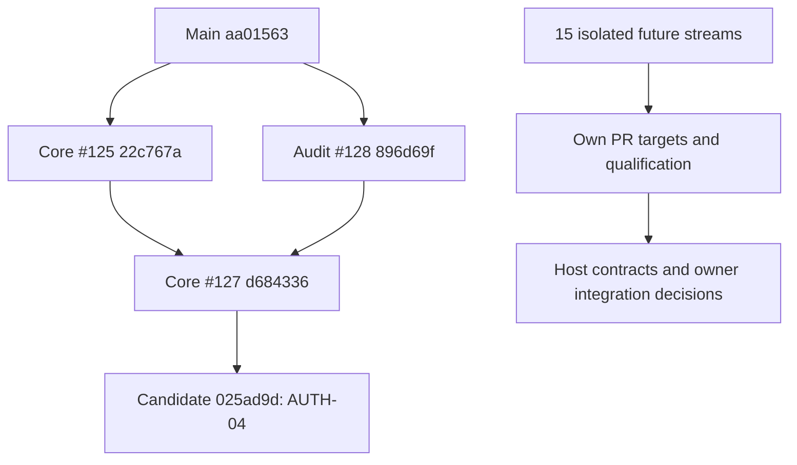

# Branch consolidation refresh — 2026-11-20

This report covers **148 remote branch heads**, **128 pull requests** and **752 recorded provider workflow runs** against fixed Core candidate **`025ad9d3b23abd29c99dbe3ea376ff1622844313`**. Remote main remains **`aa01563fcc891da60fefebb8335eca27855678e8`**. The candidate is a source pin for this inventory; subsequent combined-source repairs and validation are recorded separately by the consolidation owner.

The preserved 145-branch baseline has **137 unchanged heads, eight moved heads and three new branch names** in this refresh. **No prior branch name was removed, and every prior head remains available as a Git object.** All 15 original future-module development streams remain present, disabled and on integration HOLD.

The [complete machine-readable inventory](evidence/branch-refresh-20261120.json) retains every head, full divergence/unique-commit and changed-path list against both main and the candidate, non-merge patch equivalence, merge simulation, conflicts, exact-head workflow observations, manifest contents and complete dependency graph. This report changes documentation only.

## Observation boundaries and preservation

The inputs are separate observations, not one atomic provider snapshot. In particular, the workflow collection already describes the new federation/onboarding heads while the supplied ref and PR collections still name their predecessors. The later analytics publication is recorded as a third overlay and has no exact-head run in the supplied collection. File modification times below are **local receipt metadata**, not provider snapshot timestamps.

| Supplied input | Records | Local receipt modification time (UTC) |
|---|---:|---|
| Remote refs | 148 | `2026-11-20T16:32:15.582363+00:00` |
| Pull requests | 128 | `2026-11-20T16:31:34.265169+00:00` |
| Workflow runs | 752 | `2026-11-20T16:35:27.704001+00:00` |

The JSON embeds all three supplied record collections and their original file hashes. It separately records later fetched ref/object observations. The supplied advertisement and fetched local tag refs contain **zero tags**. The symbolic `origin/HEAD` alias is excluded from the 148-head count; supplementary local branch refs are listed separately.

| Later overlay | Supplied ref/PR head | Refreshed head | Scope |
|---|---|---|---|
| `master/recover-federation-20261119` | [`bb8d113d3a8e`](https://github.com/djshellshoxxx/circula/commit/bb8d113d3a8e80597f611417410e7d78151247e2) | [`267aa7d08bbc`](https://github.com/djshellshoxxx/circula/commit/267aa7d08bbc41e89a429eec7a077c5c0b1f9778) | PR #117; one documentation file |
| `master/fux106-retention-20261119` | [`1c4b03f5383f`](https://github.com/djshellshoxxx/circula/commit/1c4b03f5383fdffa9a30f6393159b41b85cd2e24) | [`20e6c8479459`](https://github.com/djshellshoxxx/circula/commit/20e6c8479459f837915eb31a5d668e2bd470e5a8) | PR #121; one documentation file |
| `master/recover-analytics-20261119` | [`9eb06fc9b569`](https://github.com/djshellshoxxx/circula/commit/9eb06fc9b56905133aa9ec2d2786b8f80dbcf94c) | [`0b67eb448111`](https://github.com/djshellshoxxx/circula/commit/0b67eb44811165e947d8db5ba25a3d868af892ff) | PR #108; two fuzz commands and five receipt files |

The earlier [145-head inventory](evidence/unique-core-20261119/branches.json), observed at `2026-11-20T06:10:10.674254+00:00` against candidate `22c767a90f69d286642ef96e6b3c174836637a3c`, remains byte-for-byte unchanged. Its SHA-256 is `9be6b78c47737b33dd43b5950b2549819d7320a2b011e611b6bdb99fafdc3e2c`. Every inherited entry links its original JSON pointer, old head and disposition; unchanged-head linkage is explicit. This preserves the complete prior evidence without overwriting its older conclusions or qualification dates.

## Mechanical comparison and human disposition

| Comparison result | Heads |
|---|---:|
| Already ancestors of remote main | 60 |
| Already ancestors of candidate | 68 |
| Clean candidate merge simulations | 102 |
| Clean simulations whose result tree equals candidate | 71 |
| Clean simulations with changes | 31 |
| Simulated merges with textual conflicts | 46 |

These are different measurements, not additive readiness classes. A clean merge does not establish correctness, current CI or product acceptance. `git cherry` compares non-merge patch IDs; a non-equivalent patch can still be a superseded implementation or an intentionally preserved alternative. The original human dispositions therefore remain separate from the refreshed mechanical results.

| Preserved/reviewed disposition | Heads |
|---|---:|
| Independent future module — HOLD | 44 |
| Policy or interface decision — HOLD | 7 |
| Historical audit record already contained | 1 |
| Historically recovered or superseded | 23 |
| Patch-equivalent historical implementation | 1 |
| Previously contained history plus published Core parent | 67 |
| Historical exact no-op disposition | 3 |
| Core peer recovered with documented/test alternative | 2 |

No new head is left unclassified. The seven policy/interface holds retain their earlier decision requirements: governance administrator recovery, reviewer reset authority, abuse-signal visibility/retention and the competing CLI contract. This refresh does not decide those policies. No future branch is promoted to Core because its source merged cleanly or its isolated workflow passed.

## New and moved heads explicitly reviewed

### `audit/future-feed-cursors-20261119`

**Feed qualification lineage consolidated in its own target.** [`5f46b0cfeadd`](https://github.com/djshellshoxxx/circula/commit/5f46b0cfeadda140b1b29d120766100d7e3da735); moved since baseline. PR #126 adds the preserved fixture/evidence qualification changes. The carried keyboard and WAL fixture files are byte-identical to the current Core candidate. The Core recovery fault wrapper is a prior alternative; the candidate retains additional read, migration and commit-acknowledgment coverage. Its wholesale merge conflicts in three documented paths and is not selected for Core. PR #92 already moved the feed work to its independent target.

The complete delta from `db80ed34af09ad6b28e533da6d4b82b8250f3711` contains 4 commits and 11 changed paths, recorded in `reviewed_deltas`. Relevant source: `e2e/kbd.js`, `internal/service/sqlite_ioerr_linux_test.go`, `internal/store/recovery_internal_test.go`, `future/feed/feature.json`.

### `audit/read-only-security-20261119`

**Read-only security audit; already contained.** [`896d69f47265`](https://github.com/djshellshoxxx/circula/commit/896d69f472652ed54c051ec82efcb7f162d1d2c4); new since baseline. PR #128 adds 23 audit/evidence documents relative to its main base. Its exact commit is an ancestor of candidate 025ad9d, and its simulated merge is a no-op. Preserve the dated findings and original evidence; current remediation status belongs in the separate reconciliation, not edits to the historical audit.

The complete delta from `aa01563fcc891da60fefebb8335eca27855678e8` contains 1 commit and 23 changed paths, recorded in `reviewed_deltas`. Relevant source: `docs/audits/read-only-security-2026-11-19/README.md`, `docs/consolidation/SECURITY_HANDOFF_RECONCILIATION_20261120.md`.

### `future/fnet-204-feed-20261116`

**Accepted independent feed target advanced.** [`108107435645`](https://github.com/djshellshoxxx/circula/commit/108107435645db687f8ac380e6571319f419fa32); moved since baseline. PR #92 merged the cursor/pagination and qualification lineage into the existing feed development branch. The source manifest describes isolated pagination/security implementation, remains enabled=false and integration=HOLD, and lists the unresolved host, policy, key-management and UI contracts. This is an independent-module merge, not a Core merge.

The complete delta from `5d3819c3b3af031b75eceb5251da0226a4ecee77` contains 211 commits and 1063 changed paths, recorded in `reviewed_deltas`. Relevant source: `future/feed/feature.json`, `future/feed/COMPLETION-2026-11-19.md`.

### `integration/unique-core-completion-20261120`

**Published Core contribution; already contained.** [`d6843366dc06`](https://github.com/djshellshoxxx/circula/commit/d6843366dc06d723f8d9efe07242997c858a6b3f); new since baseline. PR #127 at d684336 is the direct parent of local candidate 025ad9d. Its reviewed Core security, integrity, report/credit, UI, metrics and qualification work is already included. This report does not replace the existing implementation reviews or claim its queued provider workflows passed.

The complete delta from `22c767a90f69d286642ef96e6b3c174836637a3c` contains 57 commits and 413 changed paths, recorded in `reviewed_deltas`. Relevant source: `docs/consolidation/UNIQUE_CORE_CONTINUATION_20261119.md`.

### `master/fux106-retention-20261119`

**Post-snapshot onboarding prose qualification repair.** [`20e6c8479459`](https://github.com/djshellshoxxx/circula/commit/20e6c8479459f837915eb31a5d668e2bd470e5a8); moved since baseline. Only future/onboarding/RETENTION-20261119.md changes. The workflow prose and scan receipt preserve the existing permissions, deadlines and disabled/HOLD boundary. Runtime, tests, dependencies, workflow and feature manifest retain their predecessor blobs.

The complete delta from `1c4b03f5383fdffa9a30f6393159b41b85cd2e24` contains 1 commit and 1 changed path, recorded in `reviewed_deltas`. Relevant source: `future/onboarding/RETENTION-20261119.md`.

### `master/messaging-windows-private-storage-20261119`

**Messaging Windows path validation repair.** [`ef4a11975ab9`](https://github.com/djshellshoxxx/circula/commit/ef4a11975ab9159f44bcb8fa10fa6d2a1d585c45); moved since baseline. The three-path delta validates raw Windows path spelling before normalization, adds ordinary-navigation compatibility checks and records the qualification boundary. The original rejection/no-file-creation test remains. Its receipt explicitly does not claim a successful local cross-compile or native Windows run; current-head provider qualification remains separate. Runtime change belongs only to isolated messaging.

The complete delta from `28b707433a55ca27345cf08a39b999925882f51c` contains 1 commit and 3 changed paths, recorded in `reviewed_deltas`. Relevant source: `future/messaging/storage_windows.go`, `future/messaging/storage_windows_test.go`, `future/messaging/PATH-NORMALIZATION-20261120.md`.

### `master/notification-transport-tests-20261119`

**Notification native qualification composed with its accepted target.** [`66b23f8e9e37`](https://github.com/djshellshoxxx/circula/commit/66b23f8e9e37ce6efddf56c0215c6f29f741d489); moved since baseline. The merge preserves both histories and reconciles the transport qualification with the notification target already containing the runtime/tests/dependencies. The qualification note records the remaining unique native workflow and documentation. The module stays disabled/HOLD; exact-head native/module successes are retained separately from the queued Core workflow. Core merge simulation still conflicts with three inherited evidence/fixture paths.

The complete delta from `f831c45de9137b20abe3d31590433bda6348112b` contains 21 commits and 250 changed paths, recorded in `reviewed_deltas`. Relevant source: `.github/workflows/notification-transport-native.yml`, `future/notifications/TRANSPORT-QUALIFICATION-20261119.md`, `future/notifications/feature.json`.

### `master/recover-analytics-20261119`

**Later analytics branch fuzz qualification repair.** [`0b67eb448111`](https://github.com/djshellshoxxx/circula/commit/0b67eb44811165e947d8db5ba25a3d868af892ff); moved since baseline. The later published head changes the two existing shared-workflow fuzz invocations to bounded execution counts and adds five receipt files. The receipt records 1,200,000 amount and 100,000 strict-JSON executions; this refresh did not execute them. Analytics runtime/tests, original feature manifest and dependencies are unchanged. The exact published tree matches 8b0496cbd61f059f20e2a7b67b88ad42077ecdfd. It is absent from the supplied workflow-run collection; the owner separately reported fresh CI pending. Its shared-workflow edit conflicts with Core and remains an isolated branch qualification change.

The complete delta from `9eb06fc9b56905133aa9ec2d2786b8f80dbcf94c` contains 1 commit and 6 changed paths, recorded in `reviewed_deltas`. Relevant source: `.github/workflows/ci.yml`, `future/analytics/CORE-FUZZ-QUALIFICATION-20261120.md`, `future/analytics/qualification-evidence-20261120/qualification.json`.

### `master/recover-federation-20261119`

**Post-snapshot federation prose qualification repair.** [`267aa7d08bbc`](https://github.com/djshellshoxxx/circula/commit/267aa7d08bbc41e89a429eec7a077c5c0b1f9778); moved since baseline. Only future/federation/RECOVERY-20261119.md changes. The text makes the existing peer/key-lifecycle and workflow-permission statements explicit and retains its scan receipt. All other tracked files, including runtime, tests, workflows, dependencies and HOLD manifest, retain their predecessor blobs.

The complete delta from `bb8d113d3a8e80597f611417410e7d78151247e2` contains 1 commit and 1 changed path, recorded in `reviewed_deltas`. Relevant source: `future/federation/RECOVERY-20261119.md`.

### `repair/fnet204-feed-final-ci-20261119`

**Isolated feed fixture repair, subsequently merged upstream.** [`80c76940ce8c`](https://github.com/djshellshoxxx/circula/commit/80c76940ce8c38226e8b917bf840541f2d845f9c); moved since baseline. The sole commit since its baseline head changes only cursor_hardening_test.go. The fixed fixture bytes and equality assertions remain. PR #126 merged this tip into audit/future-feed-cursors; PR #92 then merged that lineage into the independent future feed branch. No Core activation follows from these merges.

The complete delta from `6c49dbccc90c1a2be03fec05fe6e5fa9292d801c` contains 1 commit and 1 changed path, recorded in `reviewed_deltas`. Relevant source: `future/feed/cursor_hardening_test.go`.

### `repair/fnet204-feed-golden-scanner-20261119`

**Identical-tip alias of preserved feed repair.** [`80c76940ce8c`](https://github.com/djshellshoxxx/circula/commit/80c76940ce8c38226e8b917bf840541f2d845f9c); new since baseline. This newly observed branch points to the same commit and tree as repair/fnet204-feed-final-ci-20261119. The test-only change splits a pre-existing fixed cursor fixture into shorter literals; independent concatenation confirms all 139 bytes remain identical. No duplicate integration is needed. The work remains in the isolated feed lineage.

The complete delta from `6c49dbccc90c1a2be03fec05fe6e5fa9292d801c` contains 1 commit and 1 changed path, recorded in `reviewed_deltas`. Relevant source: `future/feed/cursor_hardening_test.go`.

## Exact-head workflow observations

**110** branch names have at least one workflow record matching both their refreshed head SHA and branch name; **38** have none in the supplied collection. The absence of a record is unknown qualification, not a failure or a pass. The JSON keeps every exact-SHA record, separate same-branch matches, and the latest observed run per workflow/event. Repeated workflows and old failures are not collapsed into a fabricated check count.

Main has successful exact-head [push CI](https://github.com/djshellshoxxx/circula/actions/runs/44613721224) and [scheduled CI](https://github.com/djshellshoxxx/circula/actions/runs/44728309016) records. These workflow-level observations do not enumerate required checks, skipped jobs or repository protection rules. They do not qualify the newer candidate.

| Focus head | Latest exact-branch/head workflow records in the supplied collection |
|---|---|
| `integration/unique-core-completion-20261120` / `d6843366dc06` | [Native export reader / pull_request](https://github.com/djshellshoxxx/circula/actions/runs/44772250070): **queued**; [ci / pull_request](https://github.com/djshellshoxxx/circula/actions/runs/44772250184): **queued** |
| `audit/read-only-security-20261119` / `896d69f47265` | [ci / pull_request](https://github.com/djshellshoxxx/circula/actions/runs/44688441673): **success** |
| `master/notification-transport-tests-20261119` / `66b23f8e9e37` | [future notifications module / push](https://github.com/djshellshoxxx/circula/actions/runs/44770524095): **success**; [ci / pull_request](https://github.com/djshellshoxxx/circula/actions/runs/44770537562): **queued**; [future notifications module / pull_request](https://github.com/djshellshoxxx/circula/actions/runs/44770537542): **success**; [Native notification transports / pull_request](https://github.com/djshellshoxxx/circula/actions/runs/44770537665): **success** |
| `master/messaging-windows-private-storage-20261119` / `ef4a11975ab9` | [future messaging module / pull_request](https://github.com/djshellshoxxx/circula/actions/runs/44772604977): **queued**; [ci / pull_request](https://github.com/djshellshoxxx/circula/actions/runs/44772605082): **queued** |
| `master/recover-federation-20261119` / `267aa7d08bbc` | [ci / pull_request](https://github.com/djshellshoxxx/circula/actions/runs/44774573070): **queued**; [future federation module / pull_request](https://github.com/djshellshoxxx/circula/actions/runs/44774573379): **queued** |
| `master/fux106-retention-20261119` / `20e6c8479459` | [future onboarding retention / pull_request](https://github.com/djshellshoxxx/circula/actions/runs/44774607182): **queued**; [ci / pull_request](https://github.com/djshellshoxxx/circula/actions/runs/44774607439): **queued** |
| `master/recover-analytics-20261119` / `0b67eb448111` | No exact-head workflow record; later owner message reports new CI pending. |
| `audit/future-feed-cursors-20261119` / `5f46b0cfeadd` | [future feed module / push](https://github.com/djshellshoxxx/circula/actions/runs/44714937982): **success**; [future feed module / pull_request](https://github.com/djshellshoxxx/circula/actions/runs/44715092710): **success**; [ci / pull_request](https://github.com/djshellshoxxx/circula/actions/runs/44715092592): **success** |
| `future/fnet-204-feed-20261116` / `108107435645` | [future feed module / push](https://github.com/djshellshoxxx/circula/actions/runs/44728778942): **success** |

Local candidate `025ad9d` has no provider run in this supplied collection. Its AUTH-04 focused receipts and [independent review](evidence/password-admission-20261120/independent-review.md) remain source-specific evidence; full combined-branch gates are owned and reported separately. The PR collection contains **29 open, 62 merged and 37 closed-unmerged** requests, with all PR numbers 1–128 represented. An open PR can already be contained by ancestry, as #128 illustrates; it is not automatically missing work.

## Dependency graph

The machine graph contains **148 tip groups**: 147 distinct remote tip commits representing all 148 remote branches, plus the local candidate. Its **206 transitive-reduction edges** preserve all **4,637 ancestor/descendant tip relations**, verified by reconstructing reachability. The two feed-repair names sharing `80c76940` are represented in one node. All 128 snapshot PR target edges and declared future-module dependencies are separate graph layers; PR targets are not treated as product approval or as proof of current-tip ancestry.

The compact integration view below shows the Core ancestry that matters for this source pin and the independently held future path. The complete graph remains in JSON, including historical branches.

No edge from the future decision node to Core is an approved integration. The candidate tree contains no `future/` paths. The original 15 branch manifests all declare `enabled: false`, `integration: HOLD` and no required future-module dependency. Development/recovery branches may be more advanced than their original target branch; every observed manifest remains attached to its own exact head in the machine inventory.

| Module | Original independent development branch | Refreshed target head | Gate |
|---|---|---|---|
| FNET-201 | `future/fnet-201-matching-20261116` | `12850290c6bc` | Disabled / HOLD |
| FNET-202 | `future/fnet-202-favorites-20261116` | `efc9d696eea2` | Disabled / HOLD |
| FNET-203 | `future/fnet-203-receipts-20261116` | `bd2fbdbd3adf` | Disabled / HOLD |
| FNET-204 | `future/fnet-204-feed-20261116` | `108107435645` | Disabled / HOLD |
| FNET-205 | `future/fnet-205-analytics-20261116` | `0b2965101e1d` | Disabled / HOLD |
| FNET-206 | `future/fnet-206-areas-20261116` | `8b444b20139e` | Disabled / HOLD |
| FNET-207 | `future/fnet-207-recurring-20261116` | `94deb0a20df0` | Disabled / HOLD |
| FNET-208 | `future/fnet-208-governance-20261116` | `b4f511372ec2` | Disabled / HOLD |
| FNET-209 | `future/fnet-209-federation-20261116` | `1b3c92e03007` | Disabled / HOLD |
| FUX-101 | `future/fux-101-pwa-20261116` | `3415fe24df7b` | Disabled / HOLD |
| FUX-102 | `future/fux-102-qr-20261116` | `9db8a323d7dc` | Disabled / HOLD |
| FUX-103 | `future/fux-103-discovery-20261116` | `34d0f889631e` | Disabled / HOLD |
| FUX-104 | `future/fux-104-notifications-20261116` | `9d861d51b6ca` | Disabled / HOLD |
| FUX-105 | `future/fux-105-messaging-20261116` | `7f92251cdb0d` | Disabled / HOLD |
| FUX-106 | `future/fux-106-onboarding-20261116` | `473cab2fb45a` | Disabled / HOLD |

## Outstanding simulated conflicts and preservation

The **46** conflicting branch simulations comprise **18 future-module**, **6 policy/interface**, **19 historically recovered/superseded**, **1 patch-equivalent-history**, and **2 recovered-peer-alternative** heads. No merge is in progress in this report worktree. These are predicted conflicts if those entire branches were merged into the fixed candidate, not unresolved edits left by this task. Each conflict path and Git message is retained in the JSON.

The feed and notification lineages conflict at `docs/TRACEABILITY.md`, the historical post-snapshot `SHA256SUMS`, and `internal/store/recovery_internal_test.go`; retaining current Core history and the richer fault wrapper is deliberate. The later analytics qualification has a shared-workflow conflict in `.github/workflows/ci.yml`. Historical specification/UI branches also conflict with current accepted behavior. No wholesale replacement or forced merge was performed.

All remote branch names and commits remain preserved. This task performs no remote mutation, shared-history rewrite, branch deletion, release or deployment. It runs no Go build/test campaign and makes no fresh runtime or vulnerability qualification claim. Reporting validation checked record uniqueness/completeness, exact-head correlations, commit-list counts, graph reachability, manifest gates and the unchanged historical baseline. Every reviewed source path and all five local report links resolve. A Gitleaks directory scan of these three new documentation files completed with exit zero and zero findings; the JSON records the exact scanner/config hashes and narrow scope. Future implementation estimates and broader Core acceptance remain in the separately maintained engineering reports; this inventory does not invent new requirements or reset their scope.

## Complete branch ledger

`C / + / =` means branch-only commits against candidate / non-merge patches without a candidate equivalent / non-merge patches with a candidate equivalent. “Contained” and “no-op” describe Git history/tree results. CI summaries count latest **workflow/event observations**, not jobs or required checks. All full hashes, path lists, exact commands and run IDs are in the machine inventory.

| Branch | Head | C / + / = | Merge simulation | Human disposition | CI observations |
|---|---|---:|---|---|---|
| `audit/federation-readme-20261119` | `d55554408ef5` | 4 / 4 / 0 | clean; 10 paths | Future HOLD | 1 failure |
| `audit/future-feed-cursors-20261119` | `5f46b0cfeadd` | 16 / 10 / 0 | conflicts: 3 | Future HOLD | 3 success |
| `audit/future-notifications-binding-20261119` | `9c794a5b9e6f` | 6 / 4 / 0 | conflicts: 1 | Future HOLD | 2 success |
| `audit/future-notifications-bounded-core-20261119` | `3bdef17a87b4` | 13 / 7 / 0 | conflicts: 3 | Future HOLD | 2 success |
| `audit/future-pwa-browser-20261119` | `0b2bb7a4dea1` | 14 / 10 / 0 | conflicts: 2 | Future HOLD | 2 success |
| `audit/gov021-final-core-refresh-20261119` | `b8cb63bfc6d2` | 11 / 8 / 0 | conflicts: 2 | Policy/interface HOLD | 1 failure |
| `audit/gov021-fixture-20261119` | `d922d4f88005` | 9 / 8 / 0 | conflicts: 3 | Policy/interface HOLD | 1 success |
| `audit/read-only-security-20261119` | `896d69f47265` | 0 / 0 / 0 | contained | Audit preserved | 1 success |
| `audit/sec026-independent-20261119` | `45b596f12876` | 3 / 1 / 0 | conflicts: 8 | Policy/interface HOLD | 1 failure |
| `chatgpt/circula-consolidation-review-20261111` | `02f9f0a7bb87` | 22 / 10 / 5 | conflicts: 27 | Recovered/superseded | 1 failure |
| `chatgpt/circula-departure-pagination-20261115` | `8abff32c1b4a` | 4 / 4 / 0 | conflicts: 1 | Recovered/superseded | 1 failure |
| `chatgpt/circula-erasure-notification-20261115` | `26b57163d965` | 1 / 0 / 1 | conflicts: 1 | Equivalent history | 1 failure |
| `chatgpt/circula-expiry-starvation-20261115` | `2eacf7718f5b` | 0 / 0 / 0 | contained | Contained history | unobserved |
| `chatgpt/circula-ledger-auth-guard-20261115` | `29e46e5016a0` | 3 / 3 / 0 | no-op | Prior no-op | 1 failure |
| `chatgpt/circula-mfa-decider-20261115` | `4ffb5c78d6b4` | 4 / 4 / 0 | no-op | Prior no-op | 1 failure |
| `chatgpt/circula-qa042-traceability-audit-20261114` | `fe832faced82` | 37 / 28 / 8 | conflicts: 66 | Recovered/superseded | 1 success |
| `chatgpt/circula-secure-json-write-20261115` | `e02085a6aa1a` | 8 / 8 / 0 | conflicts: 1 | Recovered/superseded | 1 failure |
| `chatgpt/circula-security-audit-20261115` | `36a80335abf5` | 45 / 35 / 8 | conflicts: 66 | Recovered/superseded | 1 success |
| `chatgpt/consolidation-delta-qualification-20261114` | `8f742877fb53` | 1 / 1 / 0 | clean; 1 paths | Recovered/superseded | 1 success |
| `chatgpt/favorites-owner-scoped-collection-20261116` | `372a8f97ae01` | 4 / 4 / 0 | clean; 10 paths | Future HOLD | 1 failure |
| `chatgpt/feed-signed-cursors-20261116` | `7a528c611bff` | 4 / 4 / 0 | clean; 10 paths | Future HOLD | 1 failure |
| `chatgpt/zero-codex-continuation-spec-20261109` | `3d9c56196625` | 1 / 1 / 0 | clean; 1 paths | Recovered/superseded | unobserved |
| `chatgpt/zero-codex/audit-20261110-a` | `2e729346d629` | 0 / 0 / 0 | contained | Contained history | 2 cancelled |
| `chatgpt/zero-codex/ci-macos-race-budget-20261110` | `2078bf096435` | 0 / 0 / 0 | contained | Contained history | 2 success |
| `chatgpt/zero-codex/ci-macos15-retirement-20261110` | `1760551f5b03` | 0 / 0 / 0 | contained | Contained history | 2 failure |
| `chatgpt/zero-codex/cookie-policy-adapter-20261110-b` | `7e8481004801` | 0 / 0 / 0 | contained | Contained history | 2 success |
| `chatgpt/zero-codex/decidable-expiry-20261110-a` | `b61a8e719030` | 0 / 0 / 0 | contained | Contained history | 2 success |
| `chatgpt/zero-codex/docs-20261110-a` | `a376a4ed5924` | 0 / 0 / 0 | contained | Contained history | 2 cancelled |
| `chatgpt/zero-codex/qualify-pr19-20261110-a` | `63b033d842a2` | 0 / 0 / 0 | contained | Contained history | 2 cancelled |
| `chatgpt/zero-codex/terms-return-20261110-b` | `7620d7f51913` | 0 / 0 / 0 | contained | Contained history | 2 cancelled |
| `checkpoint/circula-handoff-20261025` | `3d0080a9c436` | 6 / 6 / 0 | conflicts: 6 | Recovered/superseded | unobserved |
| `claude/aud4-auth-fixes` | `82dc18e07f6b` | 0 / 0 / 0 | contained | Contained history | 1 success |
| `claude/aud4-f02-reviewer-reset-policy` | `af54887aa0cd` | 2 / 2 / 0 | conflicts: 2 | Policy/interface HOLD | 1 success |
| `claude/aud4-f03-dispute-timelines` | `b6275747df66` | 0 / 0 / 0 | contained | Contained history | 1 success |
| `claude/awesome-darwin-y6eaiz` | `827e651fe151` | 0 / 0 / 0 | contained | Contained history | 1 success |
| `claude/backup-path-hardening` | `09ef8a5aa25f` | 0 / 0 / 0 | contained | Contained history | 1 success |
| `claude/charming-gauss-19fbfa` | `8b4c8ba23c99` | 0 / 0 / 0 | contained | Contained history | unobserved |
| `claude/circula-beta-completion-1npjw6` | `bffcede8c7dc` | 0 / 0 / 0 | contained | Contained history | 2 failure |
| `claude/circula-build` | `fc488445af5f` | 0 / 0 / 0 | contained | Contained history | 2 success |
| `claude/circula-completeness` | `fcd9fc587848` | 1 / 1 / 0 | clean; 1 paths | Recovered/superseded | 2 cancelled |
| `claude/circula-consolidation-audit-0sydm1` | `0e5296a71f3f` | 0 / 0 / 0 | contained | Contained history | 1 success |
| `claude/circula-finish` | `d350474e4952` | 0 / 0 / 0 | contained | Contained history | 2 success |
| `claude/circula-pr-consolidation-q6q18n` | `163fe1596bd7` | 0 / 0 / 0 | contained | Contained history | 2 success |
| `claude/circula-security-features` | `f8278a047392` | 0 / 0 / 0 | contained | Contained history | 2 success |
| `claude/compassionate-cannon-txdlz1` | `047e92e88a0c` | 6 / 4 / 0 | conflicts: 3 | Recovered/superseded | 1 success |
| `claude/cool-gauss-vdxlod` | `64fa4f685780` | 0 / 0 / 0 | contained | Contained history | 1 failure |
| `claude/cool-ramanujan-n2peag` | `c033cfa448fb` | 40 / 30 / 8 | conflicts: 66 | Recovered/superseded | 1 success |
| `claude/fnet-204-signed-cursors` | `0952c94a5dba` | 5 / 5 / 0 | clean; 11 paths | Future HOLD | 1 failure |
| `claude/gov-021-admin-recovery` | `0d480a5b348f` | 10 / 8 / 0 | conflicts: 3 | Policy/interface HOLD | unobserved |
| `claude/gracious-ptolemy-dscc7v` | `1d165989e217` | 3 / 1 / 2 | conflicts: 1 | Recovered/superseded | 1 failure, 1 success |
| `claude/happy-babbage-dcumwz` | `dc97f7d5b0ae` | 0 / 0 / 0 | contained | Contained history | unobserved |
| `claude/happy-noether-444cum` | `34ccb81a54ab` | 0 / 0 / 0 | contained | Contained history | 1 cancelled, 1 failure |
| `claude/kind-einstein-v5ycss` | `3bfb2f78fb0a` | 1 / 1 / 0 | clean; 1 paths | Recovered/superseded | unobserved |
| `claude/lucid-archimedes-upisa8` | `d2c1c6090a05` | 15 / 15 / 0 | conflicts: 5 | Recovered/superseded | unobserved |
| `claude/quirky-babbage-y9fpmm` | `af69702be08a` | 41 / 30 / 8 | conflicts: 66 | Recovered/superseded | unobserved |
| `claude/quirky-einstein-l9ni8m` | `4a8db9e80509` | 0 / 0 / 0 | contained | Contained history | 1 success |
| `claude/relaxed-hopper-8q4vhq` | `2da1a293ebf2` | 22 / 22 / 0 | conflicts: 4 | Recovered/superseded | unobserved |
| `claude/sec-026-abuse-signals` | `4d349c4d03bf` | 13 / 9 / 0 | conflicts: 12 | Policy/interface HOLD | 1 failure |
| `claude/sharp-archimedes-tu76rh` | `eb4bb08b15d4` | 0 / 0 / 0 | contained | Contained history | 1 success |
| `claude/sweet-turing-m3ftja` | `01b6e5c7cfc5` | 13 / 13 / 0 | conflicts: 4 | Recovered/superseded | unobserved |
| `claude/ux-047-auth-catalogue` | `dd3e82e27ddb` | 0 / 0 / 0 | contained | Contained history | 1 success |
| `claude/vibrant-brahmagupta-3uofnj` | `33b200e00c08` | 0 / 0 / 0 | contained | Contained history | unobserved |
| `codex/api036-completion-20261119` | `f7ac6d22a1bd` | 0 / 0 / 0 | contained | Contained history | 1 failure |
| `codex/api036-cursor-hardening-20261119` | `94fcd018ac42` | 0 / 0 / 0 | contained | Contained history | 1 failure |
| `codex/api036-qualification-20261119` | `45356ca10e1e` | 3 / 2 / 0 | conflicts: 1 | Recovered alternative | 1 failure |
| `codex/circula-checkpoint-recovery-20261116` | `12175ec348d5` | 0 / 0 / 0 | contained | Contained history | 1 success |
| `codex/circula-common-ui-catalog-20261116` | `a112c979932b` | 0 / 0 / 0 | contained | Contained history | 1 success |
| `codex/circula-consolidate-20261030` | `7643fb616208` | 0 / 0 / 0 | contained | Contained history | 2 success |
| `codex/circula-core-checkpoint-20261116` | `15375a8dc875` | 0 / 0 / 0 | contained | Contained history | unobserved |
| `codex/circula-core-completion-20261116` | `e3c60a62c065` | 0 / 0 / 0 | contained | Contained history | 1 success |
| `codex/circula-evidence-20261116` | `f6ea3213e663` | 0 / 0 / 0 | contained | Contained history | 1 success |
| `codex/circula-financial-messages-20261116` | `cf5abf5cfb00` | 0 / 0 / 0 | contained | Contained history | 1 success |
| `codex/circula-integration-plan-20261030` | `127943ba7aa2` | 1 / 1 / 0 | conflicts: 2 | Recovered/superseded | unobserved |
| `codex/circula-message-catalogs-20261116` | `96059bb4b8ae` | 0 / 0 / 0 | contained | Contained history | 1 success |
| `codex/circula-noscript-qa` | `ba5751291819` | 0 / 0 / 0 | contained | Contained history | unobserved |
| `codex/circula-qualification-20261116` | `dc89212a8bf1` | 0 / 0 / 0 | contained | Contained history | 1 success |
| `codex/circula-responsive-qa` | `04e11989b811` | 0 / 0 / 0 | contained | Contained history | unobserved |
| `codex/circula-resume-20261024` | `f4bfe6bc3f81` | 0 / 0 / 0 | contained | Contained history | 1 success |
| `codex/circula-staging-refresh-docs` | `9c0bc500cb19` | 0 / 0 / 0 | contained | Contained history | unobserved |
| `codex/circula-support-boundaries-20261028` | `837d51b0d537` | 0 / 0 / 0 | contained | Contained history | unobserved |
| `codex/dashboard-amounts-meter-20261116` | `d53196cc6907` | 1 / 1 / 0 | no-op | Prior no-op | 1 success |
| `consolidation/http-persistence-regressions-20261116` | `050798c9cf94` | 0 / 0 / 0 | contained | Contained history | 1 failure |
| `consolidation/recover-future-specifications` | `3a776e630455` | 0 / 0 / 0 | contained | Contained history | 1 success |
| `dependabot/go_modules/github.com/getkin/kin-openapi-0.153.0` | `3fa76cdb5901` | 0 / 0 / 0 | contained | Contained history | 1 success |
| `dependabot/go_modules/golang.org/x/text-0.44.0` | `4a6ea9ab3dff` | 1 / 1 / 0 | conflicts: 2 | Recovered/superseded | 1 failure |
| `docs/fnet-203-optional-trade-receipts` | `3d6ed55b2e44` | 0 / 0 / 0 | contained | Contained history | 1 success |
| `docs/foundational-spec-shells` | `d96f2e75634b` | 1 / 1 / 0 | conflicts: 1 | Recovered/superseded | unobserved |
| `docs/foundational-specifications` | `22e9202f19f5` | 31 / 31 / 0 | conflicts: 11 | Recovered/superseded | unobserved |
| `docs/future-usability-network-specs-20261111` | `f4a051c1c1af` | 0 / 0 / 0 | contained | Contained history | 2 failure |
| `docs/readme-and-wiki` | `db7826495ec2` | 1 / 1 / 0 | conflicts: 2 | Recovered/superseded | unobserved |
| `feature/core-catalogue-continuation-20261119` | `5db3efc084e6` | 0 / 0 / 0 | contained | Contained history | 1 failure |
| `feature/fnet-204-completion-parallel` | `a8aecfe8782d` | 9 / 7 / 0 | conflicts: 1 | Future HOLD | 1 failure, 2 success |
| `fix/fnet207-ci-proven-20261119` | `ccf30e6a819d` | 11 / 11 / 0 | conflicts: 1 | Future HOLD | 1 success |
| `future/fnet-201-matching-20261116` | `12850290c6bc` | 2 / 2 / 0 | clean; 8 paths | Future HOLD | unobserved |
| `future/fnet-202-favorites-20261116` | `efc9d696eea2` | 9 / 9 / 0 | clean; 42 paths | Future HOLD | unobserved |
| `future/fnet-203-receipts-20261116` | `bd2fbdbd3adf` | 2 / 2 / 0 | clean; 10 paths | Future HOLD | unobserved |
| `future/fnet-204-feed-20261116` | `108107435645` | 17 / 10 / 0 | conflicts: 3 | Future HOLD | 1 success |
| `future/fnet-205-analytics-20261116` | `0b2965101e1d` | 2 / 2 / 0 | clean; 8 paths | Future HOLD | unobserved |
| `future/fnet-206-areas-20261116` | `8b444b20139e` | 2 / 2 / 0 | clean; 8 paths | Future HOLD | unobserved |
| `future/fnet-207-recurring-20261116` | `94deb0a20df0` | 13 / 11 / 0 | conflicts: 1 | Future HOLD | unobserved |
| `future/fnet-208-governance-20261116` | `b4f511372ec2` | 2 / 2 / 0 | clean; 8 paths | Future HOLD | unobserved |
| `future/fnet-209-federation-20261116` | `1b3c92e03007` | 2 / 2 / 0 | clean; 8 paths | Future HOLD | unobserved |
| `future/fux-101-pwa-20261116` | `3415fe24df7b` | 15 / 10 / 0 | conflicts: 2 | Future HOLD | 1 success |
| `future/fux-102-qr-20261116` | `9db8a323d7dc` | 8 / 8 / 0 | clean; 58 paths | Future HOLD | unobserved |
| `future/fux-103-discovery-20261116` | `34d0f889631e` | 7 / 7 / 0 | clean; 56 paths | Future HOLD | unobserved |
| `future/fux-104-notifications-20261116` | `9d861d51b6ca` | 14 / 7 / 0 | conflicts: 3 | Future HOLD | 1 success |
| `future/fux-105-messaging-20261116` | `7f92251cdb0d` | 2 / 2 / 0 | clean; 8 paths | Future HOLD | unobserved |
| `future/fux-106-onboarding-20261116` | `473cab2fb45a` | 6 / 6 / 0 | clean; 35 paths | Future HOLD | unobserved |
| `future/module-catalog-20261116` | `dfa4779d05a4` | 3 / 3 / 0 | clean; 5 paths | Future HOLD | unobserved |
| `haiku/circula-consolidation` | `6fbfa13fb696` | 16 / 4 / 5 | conflicts: 26 | Recovered/superseded | unobserved |
| `integration/admin-grant-notice-pagination-20261117` | `cb25b41febd4` | 0 / 0 / 0 | contained | Contained history | 1 success |
| `integration/backup-private-staging-20261117` | `faed4906f541` | 0 / 0 / 0 | contained | Contained history | 1 success |
| `integration/browser-parity-clock-20261117` | `2f6b3e4f1b70` | 0 / 0 / 0 | contained | Contained history | 1 success |
| `integration/circula-master-consolidation-20261119` | `bcdc569cbc48` | 2 / 2 / 0 | conflicts: 2 | Recovered alternative | 1 failure, 1 success |
| `integration/comprehensive-audit-20261119` | `839e86935767` | 0 / 0 / 0 | contained | Contained history | 1 failure |
| `integration/consolidation-execution-record-20261118` | `73244357ca13` | 0 / 0 / 0 | contained | Contained history | 1 success |
| `integration/core-completion-audits-20261119` | `22c767a90f69` | 0 / 0 / 0 | contained | Contained history | 1 failure, 1 success |
| `integration/core-consolidation-20261119` | `9674b1a9d86d` | 0 / 0 / 0 | contained | Contained history | 1 success |
| `integration/core-recovery-20261119` | `f29ebb01ff68` | 0 / 0 / 0 | contained | Contained history | 1 failure |
| `integration/core-ui-completion-20261119` | `7462138fb4f7` | 0 / 0 / 0 | contained | Contained history | 1 failure, 1 success |
| `integration/erasure-fixture-stability-20261117` | `fc31dc9a6b8c` | 0 / 0 / 0 | contained | Contained history | 1 success |
| `integration/release-threshold-check-20261117` | `ec98caba7328` | 0 / 0 / 0 | contained | Contained history | 1 success |
| `integration/store-untrusted-schema-20261117` | `b1cd8f38450a` | 0 / 0 / 0 | contained | Contained history | 1 success |
| `integration/throttle-documentation-20261117` | `83de536ee373` | 0 / 0 / 0 | contained | Contained history | 1 success |
| `integration/unique-core-completion-20261120` | `d6843366dc06` | 0 / 0 / 0 | contained | Contained history | 2 queued |
| `main` | `aa01563fcc89` | 0 / 0 / 0 | contained | Contained history | 3 success |
| `master/fnet207-recurring-remote-20261119` | `9bf260d63f45` | 12 / 11 / 0 | conflicts: 1 | Future HOLD | 2 success |
| `master/fnet209-utf8-20261119` | `059b0e4508a6` | 3 / 3 / 0 | clean; 10 paths | Future HOLD | 1 failure, 1 success |
| `master/fux102-camera-lifecycle-20261119` | `a91bb5fdc97f` | 10 / 10 / 0 | clean; 61 paths | Future HOLD | 2 success |
| `master/fux106-retention-20261119` | `20e6c8479459` | 9 / 9 / 0 | clean; 39 paths | Future HOLD | 2 queued |
| `master/messaging-windows-private-storage-20261119` | `ef4a11975ab9` | 7 / 6 / 0 | clean; 101 paths | Future HOLD | 2 queued |
| `master/notification-transport-tests-20261119` | `66b23f8e9e37` | 16 / 8 / 0 | conflicts: 3 | Future HOLD | 1 queued, 3 success |
| `master/recover-analytics-20261119` | `0b67eb448111` | 6 / 6 / 0 | conflicts: 1 | Future HOLD | unobserved |
| `master/recover-areas-20261119` | `52cf9c3afadb` | 4 / 4 / 0 | clean; 105 paths | Future HOLD | 2 success |
| `master/recover-federation-20261119` | `267aa7d08bbc` | 6 / 6 / 0 | clean; 80 paths | Future HOLD | 2 queued |
| `master/recover-governance-20261119` | `711833c510b1` | 4 / 4 / 0 | clean; 75 paths | Future HOLD | 2 success |
| `master/recover-messaging-20261119` | `d12805cac1d6` | 4 / 4 / 0 | clean; 91 paths | Future HOLD | 1 failure, 1 success |
| `master/recover-receipts-20261119` | `6186416ddd83` | 5 / 5 / 0 | clean; 66 paths | Future HOLD | 2 success |
| `master/recover-recurring-20261119` | `1e0e7e2f12a7` | 7 / 7 / 0 | clean; 92 paths | Future HOLD | 1 failure, 1 success |
| `nodata/doc-sweep-20261118` | `866adc8f2c30` | 0 / 0 / 0 | contained | Contained history | 1 success |
| `planning/future-cli-specs-20261110` | `8e2372c06425` | 1 / 1 / 0 | clean; 1 paths | Policy/interface HOLD | unobserved |
| `repair/core99-currenthead-ci-20261119` | `cb5920df14b7` | 0 / 0 / 0 | contained | Contained history | 1 success |
| `repair/fnet204-feed-final-ci-20261119` | `80c76940ce8c` | 15 / 10 / 0 | conflicts: 3 | Future HOLD | 3 success |
| `repair/fnet204-feed-golden-scanner-20261119` | `80c76940ce8c` | 15 / 10 / 0 | conflicts: 3 | Future HOLD | 1 success |
| `repair/fnet204-qualifier-evidence-digest-20261119` | `6c49dbccc90c` | 14 / 9 / 0 | conflicts: 3 | Future HOLD | unobserved |
| `repair/fux101-final-ci-20261119` | `aab3bfda4812` | 13 / 10 / 0 | conflicts: 2 | Future HOLD | 1 success |
| `repair/fux104-final-ci-20261119` | `409a00b0b36d` | 12 / 7 / 0 | conflicts: 3 | Future HOLD | 1 success |
| `work/spec-completion` | `d39bfef12d4a` | 0 / 0 / 0 | contained | Contained history | 2 failure |
