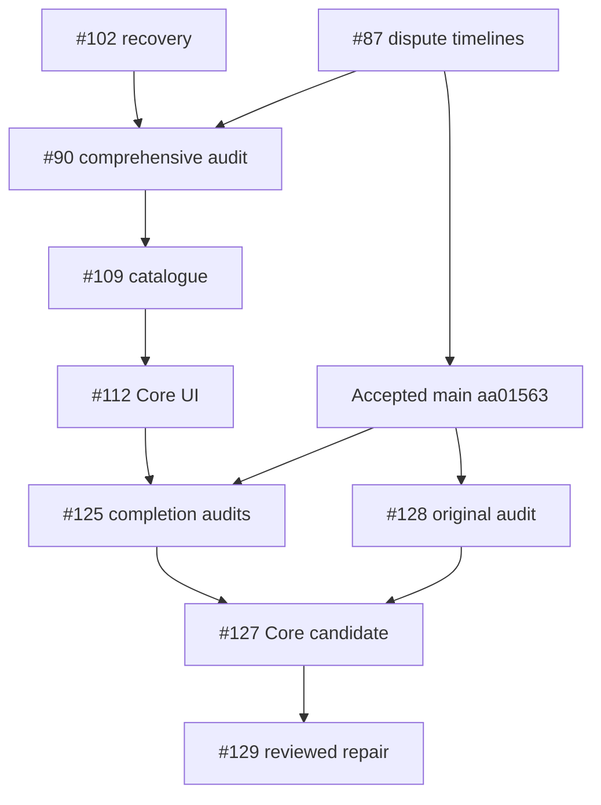

# Core containment and conditional PR reconciliation — 2026-11-20

This review compares the 16 open PRs observed at 23:19:43 UTC with prospective
source `eef0c6d8c832ce994db1019eb5e7d6a41800b8ef`, tree
`029e5fdda2d03347389397576ec08701ae04cec2`. Accepted `main` was
`aa01563fcc891da60fefebb8335eca27855678e8`. The candidate is repair PR #129,
based on Core PR #127 at `bea5de25cf76b66d87689034e2529f9b40c6dff6`.

**Containment does not establish candidate qualification.** The coordinator
owns provider qualification, integration, and all external writes. This
reviewer ran no product tests, archived programs, or vulnerability reproductions
and performed no remote mutations.

## Decisions

The coordinator subsequently closed #87 at 23:26:53 UTC as already incorporated
into qualified `main`, without a new merge or branch deletion. The original
open-state snapshot remains unchanged. The later action has
[its own receipt](pr87-reconciliation-20261120.json).

| PR | Recorded source | Proof | Decision |
|---|---|---|---|
| [129](https://github.com/djshellshoxxx/circula/pull/129) | `eef0c6d8` | Candidate itself | Active repair; qualify and integrate into #127. |
| [128](https://github.com/djshellshoxxx/circula/pull/128) | `896d69f4` | Ancestor; 23 audit entries unchanged | Reconcile only after qualified #127 reaches `main`. |
| [127](https://github.com/djshellshoxxx/circula/pull/127) | `bea5de25` | Ancestor | Active Core integration; complete exact-source and final-main gates. |
| [125](https://github.com/djshellshoxxx/circula/pull/125) | `22c767a9` | Ancestor; zero source-only commits | Conditional incorporation reconciliation after #127. |
| [112](https://github.com/djshellshoxxx/circula/pull/112) | `7462138f` | Ancestor; zero source-only commits | Conditional incorporation reconciliation after #127. |
| [111](https://github.com/djshellshoxxx/circula/pull/111) | `45356ca1` | Six identical documents; superseded fixture | Conditional closure after #127 with explicit supersession explanation. |
| [109](https://github.com/djshellshoxxx/circula/pull/109) | `5db3efc0` | Ancestor; zero source-only commits | Conditional incorporation reconciliation after #127. |
| [107](https://github.com/djshellshoxxx/circula/pull/107) | `b8cb63bf` | GOV-021 policy held | Keep open; preserve branch. |
| [104](https://github.com/djshellshoxxx/circula/pull/104) | `bcdc569c` | Runtime superseded; 102 documentary paths absent | Keep documentary reconciliation pending separate recovery. |
| [102](https://github.com/djshellshoxxx/circula/pull/102) | `f29ebb01` | Ancestor; zero source-only commits | Conditional incorporation reconciliation after #127. |
| [94](https://github.com/djshellshoxxx/circula/pull/94) | `45b596f1` | Signal policy held | Keep open; preserve branch. |
| [90](https://github.com/djshellshoxxx/circula/pull/90) | `839e8693` | Ancestor; zero source-only commits | Conditional incorporation reconciliation after #127. |
| [87](https://github.com/djshellshoxxx/circula/pull/87) | `b6275747` | Already in accepted main; 18 paths reconciled | Closed by coordinator as incorporated; source preserved. |
| [86](https://github.com/djshellshoxxx/circula/pull/86) | `4d349c4d` | Signal and GOV-021 policy held | Keep open; preserve branch. |
| [85](https://github.com/djshellshoxxx/circula/pull/85) | `0d480a5b` | GOV-021 policy held | Keep open; preserve branch. |
| [83](https://github.com/djshellshoxxx/circula/pull/83) | `af54887a` | Reviewer reset authority held | Keep open; preserve branch. |

[The complete inventory](open-prs-and-ancestry.json) records exact heads,
reported bases, original changed paths, merge bases, and source-only commits.
Reported PR base SHAs can be historical; current branch refs must be read again
before action.

## Source dependency graph

These are actual ancestry relationships among the selected refs, reduced from
pairwise checks. They do not imply qualification or approval. Exact hashes and
all relationships are in [the graph receipt](core-ancestry-graph.json).

## Complete alternative comparisons

**PR #87:** All 18 original paths remain in accepted main; seven complete files
are byte-identical, including the service and web timeline tests. All five
original named test functions and all seven added OpenAPI lines remain. Later
work explicitly supersedes timestamp reconstruction with atomic policy-version
binding, migration 0019, exact-version reads, and equal/backward-clock coverage.
Original partial-remediation history and ambiguous legacy-history limitations
remain documented. [The path proof](pr87-main-containment.json) maps every
source/main blob. [Provider observations](pr87-live-main-provider.json) at
23:23:44 UTC confirm exact-main CI runs
[44728309016](https://github.com/djshellshoxxx/circula/actions/runs/44728309016)
and [44613721224](https://github.com/djshellshoxxx/circula/actions/runs/44613721224)
completed successfully with nine successful jobs each; exact-main scorecard
also succeeded. The coordinator refreshed these checks before closure.

**PR #104:** Its complete PR diff contains 118 paths. Three Go verifier/test
files are byte-identical and share ancestry. The two source-only commits
`707a4363a86922d152ed2d203c9ea184fe4b323f` and
`bcdc569cbc483761bf2d0e2d7594636ac1713d7d` change 115 paths from common ancestor
`c3c991aa3c12a11edce2874e9444b9d2a99f746c`: eleven identical workflow/parity
documents, two differing Python files, and **102 absent documentary paths
totaling 5,206,983 original bytes**. All 38 original Python test methods remain;
eleven added methods cover nested-state/repeated-array compatibility and
complete compressed-stream handling. Retain these newer safeguards.
[The full path index](pr104-source-reconciliation.json) preserves every source
blob and missing-file size. Its 206-entry qualification ZIP contains ten
historical federation logs and a receipt; finding names alone does not establish
historical execution or current-source qualification. A separate recovery
worker owns verification and archival preservation. No complete documentary
containment or blanket closure is claimed here.

**PR #111:** Six changed documents are byte-identical. The sole remaining path
is `internal/service/sqlite_ioerr_linux_test.go`: only the SQL import and reader
snapshot setup differ. The candidate retains a separate, explicit read-only
transaction on a one-connection pool through failed writer closure. Every byte
after snapshot setup is identical, preserving subsequent assertions. There are
no production changes. [The fixture proof](pr111-alternate-fixture.json) records
all seven paths, three source-only commits, complete diff hash, and identical
suffix check. This supports explicit supersession after integration, not an
ancestry claim or new test-pass claim.

**PR #128:** Source `896d69f472652ed54c051ec82efcb7f162d1d2c4` is an ancestor.
All 23 original Git tree entries match, including modes/blobs. All 22 entries
in the original manifest passed actual byte-length and SHA-256 checks; the
manifest excludes itself. Directory tree:
`586694a64d6b8a830466b72b866ff370438e8518`.
[The identity receipt](pr128-audit-identity.json) preserves every result.
Original findings and failed/incomplete checks remain historical evidence.
Containment does not mean every security finding is resolved.

## Seven preserved holds

All seven tips match locally fetched refs and remain outside candidate ancestry.
The four policy/interface lineages and exact source heads are recorded in
[the hold receipt](seven-preserved-holds.json).

| Preserved branches | Remaining decision |
|---|---|
| `audit/gov021-final-core-refresh-20261119`, `audit/gov021-fixture-20261119`, `claude/gov-021-admin-recovery` | Permanent grants, independent approvers, waiting/objection period, expiry |
| `claude/aud4-f02-reviewer-reset-policy` | Reviewer reset authority |
| `audit/sec026-independent-20261119`, `claude/sec-026-abuse-signals` | Signal defaults, visibility, control authority, retention and erasure/export lifecycle; older lineage also contains GOV-021 |
| `planning/future-cli-specs-20261110` | Proposed CLI commands and interface contract |

No hold is lifted. This review changes none of the fifteen independent future
streams.

## Conditions for remaining reconciliation

1. Qualify and integrate #129 into #127, preserving unique work. Refresh main,
   resolve differences, and qualify the actual integration source.
2. Merge #127 under existing required-check and permission gates. Verify actual
   resulting main and provider checks. Confirm reviewed-source ancestry, or
   perform complete inclusion review if integration changed commit identity.
3. Refresh every source branch and PR; inspect any new work. Observe whether
   GitHub already updated an incorporated PR's state instead of assuming it.
4. Reconcile #90, #102, #109, #112, #125, and #128 only after actual-main source
   inclusion checks. Recheck #128's entire original audit tree. Reconcile #111
   with explicit document and fixture-supersession proof.
5. Keep #104 pending explicit documentary preservation/reconciliation. Preserve
   all seven holds and their five open PRs. Preserve original source branches;
   this review authorizes no branch deletion or shared-history rewrite.

## Evidence boundaries

Prior inventories, remaining-work, qualification, and security-handoff documents
provided provenance; Git source comparisons were independently checked. A
separate reviewer independently checked the seven holds and original audit.
[Verification metadata](verification.json) records actual documentation checks.
`SHA256SUMS` covers this directory except itself. No runtime, workflow, test,
dependency, or future-module source is changed by this package.
