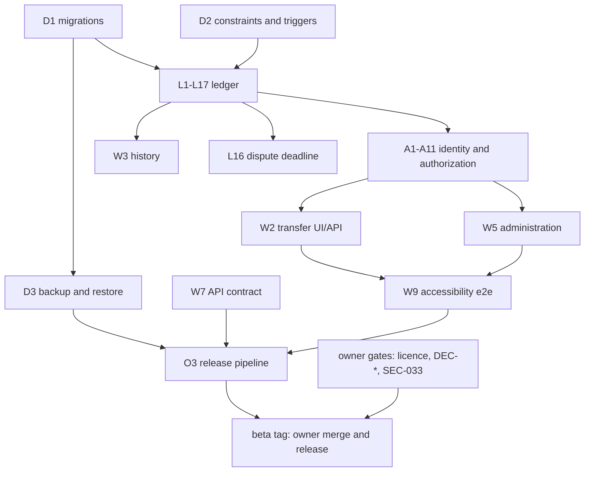

# Circula completion matrix (beta)

Date: 2026-11-11. Branch `claude/circula-beta-completion-1npjw6`. Every state below rests on the source, the tests
and the runs listed, not on the status columns in `docs/specs/`. Several of those columns are stale: FR-002 (setup
secret), DAT-047 (the 10,000-transaction migration fixture exists), DAT-049 (the scale is locked at creation) and
DAT-033/DAT-035/FR-082 (member and reviewer audit views) are built. They were marked partial or not built.

States: **COMPLETE** = implemented and verified by tests named here. **PARTIAL** = implemented, missing required
behaviour. **UNVERIFIED** = code exists, evidence insufficient. **MISSING**. **BLOCKED** = needs an owner decision or an
external dependency. Owner: **eng** = can be done now; **owner** = repository owner decision.

## Ledger (P0)

| # | Feature | State | Evidence | Remaining | Pri | Owner | Verification |
|---|---|---|---|---|---|---|---|
| L1 | Transfer: two-step propose/accept, two balanced entries, cached balances | COMPLETE | `service/posting.go` `postTx`; `trades_test.go:55` | | P0 | | unit, e2e, acceptance |
| L2 | Insufficient credit (at proposal and re-checked at accept) | COMPLETE | `checkCapacity`; `TestAcceptRechecksLimit`; `TestRefusedTransfersLeaveLedgerUnchanged` | | P0 | | unit |
| L3 | Invalid amount (0, negative, MinInt64, MaxInt64, decimals, overflow) | COMPLETE | `TestProposalValidation`, `api/strict_test.go`, `TestRefusedTransfersLeaveLedgerUnchanged` (ledger byte-identical) | | P0 | | unit, API |
| L4 | Self-transfer | COMPLETE | DB `CHECK (payer <> payee)`; refusal test asserts no ledger change | | P0 | | unit |
| L5 | Unknown counterparty, cross-network | COMPLETE | `authz_test.go:193,206`; refusal test | | P0 | | unit, API |
| L6 | Suspended, departed or pending party | COMPLETE | `TestSuspension`; refusal test (suspended accept, ledger unchanged) | | P0 | | unit |
| L7 | Idempotent submission (replay, key reuse with another body) | COMPLETE | `idempotency_test.go`; replay checks in `TestReversalAndAdjustmentFaultInjectionLeavesNoTrace` | | P0 | | unit, API |
| L8 | Concurrent transfers cannot breach the credit limit | COMPLETE | `BEGIN IMMEDIATE` plus process write gate (`store/sqlite.go:135`); `TestParallelAcceptsNeverBreachCreditLimit` (25 parallel, exactly 7 succeed) | | P0 | | unit under `-race` |
| L9 | Failure during posting leaves no trace | COMPLETE | `TestAcceptFaultInjectionLeavesNoTrace` (8 fault points); reversal and adjustment, 8 points each, in `ledger_beta_test.go` | Faults are injected at the store interface, not as real SQLite I/O errors | P0 | | unit |
| L10 | Reconciliation: cached = entry sum, network sum = 0 | COMPLETE | `VerifyLedger` → `store/sqlite_verify.go`; `TestVerifyDetectsBalanceCorruptionAndBalanceAt`; `TestVerifyDetectsTamperedEntry`; `circula verify-ledger` exit 3 | | P0 | | unit, CLI |
| L11 | Reversal: compensating entries, original kept | COMPLETE | `reversal.go`; `reversal_test.go:22-94` | | P0 | | unit, e2e |
| L12 | Immutable records, history integrity | COMPLETE | Append-only triggers (`0001_init.sql:278-351`); hash-chained audit; `TestAuditChainDetectsTampering` | Status-event ordering is checked only by count | P0 | | unit |
| L13 | Credit-limit boundary | COMPLETE | `TestQA004LimitBoundary` (limits 0, 1, 1e8) | | P0 | | unit |
| L14 | Unauthorized transfer (role, scope, other member) | COMPLETE | `TestAuthorizationMatrix` (10 actor classes); `api/authn_test.go` | | P0 | | unit, API |
| L15 | Restart persistence | COMPLETE | `TestReopenPreservesLedger`; acceptance scenario steps 16–17 | | P0 | | unit, CLI |
| L16 | Dispute deadline fixed at completion (DOM-017, DAT-051) | COMPLETE (new) | migration 0016; `TestDisputeDeadlineFixedAtCompletion` (fails against the old logic); `TestDisputeDeadlineBackfill*` | Re-review window still reads the current policy (outside DOM-017) | P0 | | unit, migration |
| L17 | Integer money, no floats | COMPLETE | `domain/money.go`, `AddChecked`/`AddBounded`, ±2^62 balance triggers (0015) | | P0 | | unit, fuzz |

## Identity, sessions, authorization (P0)

| # | Feature | State | Evidence | Remaining | Pri | Owner | Verification |
|---|---|---|---|---|---|---|---|
| A1 | Session fixation | COMPLETE | Session minted server-side at sign-in; `TestLoginDoesNotAdoptPlantedSessionCookie` | | P0 | | HTTP |
| A2 | Cookie flags (HttpOnly, SameSite=Lax, Secure, `__Host-`) | COMPLETE | `TestHeadersAndCookies`, `TestSecureCookiesAndHSTS`, `cookie_policy_adapter_test.go` | | P0 | | HTTP |
| A3 | CSRF | COMPLETE | `TestCSRFRejections` (token, Origin, Sec-Fetch-Site) | | P0 | | HTTP |
| A4 | IDOR | COMPLETE | non-party gets 404 in service, web and API (`authz_test.go:193`, `web/security_test.go:152`) | Same-network member-page reads are tested only lightly | P0 | | unit, HTTP |
| A5 | Login throttling, lockout, `circula unlock` | COMPLETE | `throttle_test.go`, `web/auth_limits_test.go` | Per-login throttle values: owner (SEC-006) | P0 | owner | unit |
| A6 | Account enumeration | COMPLETE (functional) | identical error and code: `auth_test.go:156`, `recovery_test.go:135` | Timing equivalence is not measured | P1 | eng | unit |
| A7 | Logout invalidates server-side | COMPLETE | `TestLogoutInvalidatesReplayedCookie`; `circula revoke-sessions` | | P0 | | HTTP, CLI |
| A8 | Password hashing (Argon2id), policy, blocklist | COMPLETE | `service/password*.go`, vectors | | P0 | | unit |
| A9 | MFA (TOTP), recovery codes, account recovery | COMPLETE | `mfa_test.go`, RFC vectors, e2e security spec | | P1 | | unit, e2e |
| A10 | Suspended member sign-in | COMPLETE (per DOM-039) | Suspension is per network; the member may sign in and view, but not propose or accept | | P0 | | unit |
| A11 | Registration / invitation / approval / open join | COMPLETE | `join.go`, `TestJoinByInvitationLink`, e2e no-script registration | | P0 | | e2e |

## Workflows, API, UI

| # | Feature | State | Evidence | Remaining | Pri | Owner | Verification |
|---|---|---|---|---|---|---|---|
| W1 | Dashboard: balance, available, limit, recent activity | COMPLETE | `web/templates/home.html`; e2e responsive and no-script specs | | P1 | | e2e |
| W2 | Transfer with review and confirm; double-submit safe | COMPLETE | `h_trades`; `TestValidationErrorSummary`; idempotency token in forms | | P0 | | HTTP, e2e |
| W3 | History with paging, direction, status, counterparty | COMPLETE | keyset paging (`api/cursor.go`), `FuzzOpenCursor` | | P1 | | API, e2e |
| W4 | Account management, credential change | COMPLETE | e2e `security.spec.js` password change | | P1 | | e2e |
| W5 | Administration: members, limits, suspension, adjustments (dual control), reversal, audit | COMPLETE | `admin_test.go`, `dualcontrol_test.go`, e2e `kbd-admin.spec.js` | Admin without the reviewer role may decide disputes (DEC-072) | P1 | owner | unit, e2e |
| W6 | Member and reviewer audit views (DAT-033/035, FR-082) | COMPLETE | API `GET /api/v1/audit-events` (`api/routes.go:78`), web `h_audit_scoped.go` with `my_audit.html`; `api/authn_test.go`, contract walk, e2e "own account activity log". The spec rows that say "no UI or API" are stale | | P1 | | API, e2e |
| W7 | JSON API contract | COMPLETE | `internal/contract` checks 85 operations and 164 (operation, status) pairs against `docs/api/openapi.yaml` | | P1 | | contract |
| W8 | Policy validators (ETag) | COMPLETE (fixed) | C-09 fix `addc229`; `TestPendingCurrencyNamePolicyPatchChangesETag` | | P1 | | API |
| W9 | Accessibility (WCAG 2.2 AA in light and dark, contrast, target size, reflow, keyboard, no-script) | COMPLETE (automated) | `make e2e` 578/578 | Manual screen-reader run (UX-056, QA-035) | P1 | owner | e2e |
| W10 | Data export (member, full) | COMPLETE (in memory) | `service/export.go`, `export_test.go` | Streaming/spool slice not integrated (review findings) | P2 | eng | unit |

## Platform and operations

| # | Feature | State | Evidence | Remaining | Pri | Owner | Verification |
|---|---|---|---|---|---|---|---|
| D1 | Forward-only, transactional, contiguous migrations | COMPLETE | `store/migrate.go`; `TestUpgradeFromEverySchemaVersion` (v1–v15 → v16); golden v1 → v16 with 10,000 transactions | | P0 | | unit |
| D2 | Foreign keys, CHECKs, triggers, busy timeout, WAL | COMPLETE | `store/sqlite.go:107`; `inspect.go` checks the pragmas | | P0 | | unit |
| D3 | Backup (signed, optionally encrypted) and restore drill | COMPLETE | `backup_test.go`, `restore_drill_test.go`; online backup of a live instance restored and verified 2026-11-11 (see the readiness report) | | P0 | | CLI, manual |
| O1 | Health, readiness, metrics, graceful shutdown, structured logs | COMPLETE | `ops_http.go`, `serve_test.go` | | P1 | | unit |
| O2 | systemd unit, Dockerfile, compose, reverse-proxy and TLS docs | UNVERIFIED | `deploy/`, `docs/ops/` | Container build not run here (no Docker); `scripts/smoke-deploy.sh` run (see the readiness report) | P1 | eng | smoke |
| O3 | Release pipeline: SBOM, scans, release-notes gate | COMPLETE (not exercised on a tag) | `scripts/*release*`, `release.yml` | First tagged release | P1 | owner | offline packaging run |
| O4 | CI | PARTIAL | `ci.yml` (Linux race gate, macOS 15, Windows, e2e) | Remove duplicate CI runs; move macOS/Windows tests to main or nightly (HANDOFF step 4) | P2 | eng | |

## Security hardening still open

See [../security/security-review.md](../security/security-review.md). Owner gates: licence, DEC-005/011/013/014/021/022/023/025,
A3-F02 break-glass scope, and an independent security review (SEC-033).

## Dependency graph

## Estimate

Engineering estimate. Rows count equally and PARTIAL/UNVERIFIED count as half: (43 COMPLETE + 0.5 × 2) / 45 ≈ 98 %
of the 45 rows above. This counts the beta feature list in this file, not every requirement in `docs/specs/`
(`docs/specs/12-quality-test-plan.md` alone still lists 28 P0 items as partial). Owner gates are not engineering work
and are not counted.
