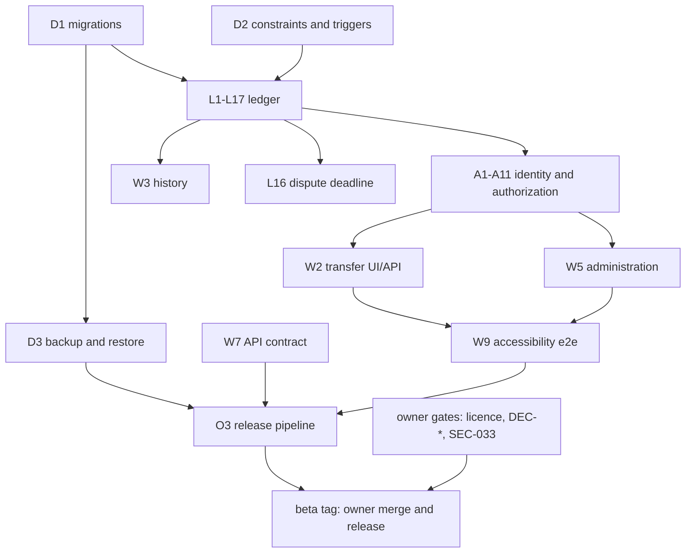

# Circula completion matrix (beta)

Updated 2026-11-16 after PRs #56 and #57 merged. This beta feature matrix is
an engineering inventory, not completion of every requirement in the larger specification.
Current changes and regression evidence are recorded in
[the core audit record](../audit/CORE-COMPLETION-2026-11-16.md); current combined CI results are
[PR #57 checks](https://github.com/djshellshoxxx/circula/pull/57/checks). The [100,000-sequence execution](../qa/QA001-2026-11-16.md) passed separately. Historical verification
records apply only to their recorded revisions. The 15 future modules remain isolated.

States: **COMPLETE** = implemented and verified by tests named here. **PARTIAL** = implemented, missing required
behaviour. **UNVERIFIED** = code exists, evidence insufficient. **MISSING**. **BLOCKED** = needs an owner decision or an
external dependency. Owner: **eng** = can be done now; **owner** = repository owner decision.

## Ledger (P0)

| # | Feature | State | Evidence | Remaining | Pri | Owner | Verification |
|---|---|---|---|---|---|---|---|
| L1 | Transfer: two-step propose/accept, two balanced entries, cached balances | COMPLETE | `service/posting.go` `postTx`; `trades_test.go:55` | | P0 | | unit, e2e, acceptance |
| L2 | Insufficient credit (at proposal and re-checked at accept) | COMPLETE | `checkCapacity`; `TestAcceptRechecksLimit`; `TestRefusedTransfersLeaveLedgerUnchanged` | | P0 | | unit |
| L3 | Invalid amount (0, negative, MinInt64, MaxInt64, decimals, overflow) | COMPLETE | `TestProposalValidation`, `api/strict_test.go`, `TestRefusedTransfersLeaveLedgerUnchanged` (ledger byte-identical) | | P0 | | unit, API |
| L4 | Self-transfer | COMPLETE | DB `CHECK (payer <> payee)`; refusal test asserts no ledger change | | P0 | | unit |
| L5 | Unknown counterparty, cross-network | COMPLETE | `authz_test.go:193,206`; refusal test | | P0 | | unit, API |
| L6 | Suspended, departed or pending party | COMPLETE | `TestSuspension`; refusal test (suspended accept, ledger unchanged) | | P0 | | unit |
| L7 | Idempotent submission (replay, key reuse with another body) | COMPLETE | `idempotency_test.go`; replay checks in `TestReversalAndAdjustmentFaultInjectionLeavesNoTrace` | | P0 | | unit, API |
| L8 | Concurrent transfers cannot breach the credit limit | COMPLETE | `BEGIN IMMEDIATE` plus process write gate (`store/sqlite.go:135`); `TestParallelAcceptsNeverBreachCreditLimit` (25 parallel, exactly 7 succeed) | | P0 | | unit under `-race` |
| L9 | Failure during posting leaves no trace | PARTIAL (qualification) | Interface faults, engine `SQLITE_FULL`, and actual Linux `SQLITE_IOERR_WRITE` during WAL COMMIT and checkpoint database writes; rollback or committed-state restart/retry/replay/reopen verified | Read/fsync, other write/device errors, checkpoint sync/truncate and uncertain-commit coverage remain; see [qualification limits](../qa/sqlite-storage-failure-qualification.md) | P0 | eng | unit, real SQLite failure |
| L10 | Reconciliation: cached = entry sum, network sum = 0 | COMPLETE | `VerifyLedger` → `store/sqlite_verify.go`; `TestVerifyDetectsBalanceCorruptionAndBalanceAt`; `TestVerifyDetectsTamperedEntry`; `circula verify-ledger` exit 3 | | P0 | | unit, CLI |
| L11 | Reversal: compensating entries, original kept | COMPLETE | `reversal.go`; `reversal_test.go:22-94` | | P0 | | unit, e2e |
| L12 | Immutable records, history integrity | COMPLETE | Append-only triggers (`0001_init.sql:278-351`); hash-chained audit; `TestAuditChainDetectsTampering` | Insertion order checked across ties, clock rollback, VACUUM and upgrade (`store/event_order_test.go`) | P0 | | unit |
| L13 | Credit-limit boundary | COMPLETE | `TestQA004LimitBoundary` (limits 0, 1, 1e8) | | P0 | | unit |
| L14 | Unauthorized transfer (role, scope, other member) | COMPLETE | `TestAuthorizationMatrix` (10 actor classes); `api/authn_test.go` | | P0 | | unit, API |
| L15 | Restart persistence | COMPLETE | `TestReopenPreservesLedger`; acceptance scenario steps 16–17 | | P0 | | unit, CLI |
| L16 | Dispute deadline fixed at completion (DOM-017, DAT-051) | COMPLETE (new) | migration 0016; `TestDisputeDeadlineFixedAtCompletion` (fails against the old logic); `TestDisputeDeadlineBackfill*` | Re-review window still reads the current policy (outside DOM-017) | P0 | | unit, migration |
| L17 | Integer money, no floats | COMPLETE | `domain/money.go`, `AddChecked`/`AddBounded`, ±2^62 balance triggers (0015) | | P0 | | unit, fuzz |

## Identity, sessions, authorization (P0)

| # | Feature | State | Evidence | Remaining | Pri | Owner | Verification |
|---|---|---|---|---|---|---|---|
| A1 | Session fixation | COMPLETE | Session minted server-side at sign-in; `TestLoginDoesNotAdoptPlantedSessionCookie` | | P0 | | HTTP |
| A2 | Cookie flags (HttpOnly, SameSite=Lax, Secure, `__Host-`) | COMPLETE | `TestHeadersAndCookies`, `TestSecureCookiesAndHSTS`, `cookie_policy_adapter_test.go` | | P0 | | HTTP |
| A3 | CSRF | COMPLETE | `TestCSRFRejections` (token, Origin, Sec-Fetch-Site) | | P0 | | HTTP |
| A4 | IDOR | COMPLETE | non-party gets 404 in service, web and API (`authz_test.go:193`, `web/security_test.go:152`); same-network reads expose directory fields only: `service/member_visibility_test.go`, `web/same_network_member_test.go`, `api/same_network_member_test.go` (2026-11-16); QA-012 matrix proves another network's ids look like ids that never existed | | P0 | | unit, HTTP |
| A5 | Login throttling, lockout, `circula unlock` | COMPLETE | `throttle_test.go`, `throttle_config_test.go`, `cmd/circula/config_throttle_test.go`, `web/auth_limits_test.go`; bounded operator settings preserve defaults | Operator chooses supported values (SEC-006) | P0 | owner | unit |
| A6 | Account enumeration | COMPLETE | identical error and code (`auth_test.go:156`, `recovery_test.go:135`); equal Argon2id work on every refused sign-in, including an unusable stored hash (BR-05 fix `8768e91`): `TestLoginRefusalsDoEqualWork`, `TestRecoveryRefusalsDoEqualWork`; opt-in `TestLoginTimingStatistical` (`CIRCULA_TIMING_TEST=1`) | A hash stored with older Argon2id parameters costs what those cost; timing threshold is DEC-023 | P1 | owner | unit |
| A7 | Logout invalidates server-side | COMPLETE | `TestLogoutInvalidatesReplayedCookie`; `circula revoke-sessions` | | P0 | | HTTP, CLI |
| A8 | Password hashing (Argon2id), policy, blocklist | COMPLETE | `service/password*.go`, vectors | | P0 | | unit |
| A9 | MFA (TOTP), recovery codes, account recovery | COMPLETE | `mfa_test.go`, RFC vectors, e2e security spec | | P1 | | unit, e2e |
| A10 | Suspended member sign-in | COMPLETE (per DOM-039) | Suspension is per network; the member may sign in and view, but not propose or accept | | P0 | | unit |
| A11 | Registration / invitation / approval / open join | COMPLETE | `join.go`, `TestJoinByInvitationLink`, e2e no-script registration | | P0 | | e2e |

## Workflows, API, UI

| # | Feature | State | Evidence | Remaining | Pri | Owner | Verification |
|---|---|---|---|---|---|---|---|
| W1 | Dashboard: balance, available, limit, recent activity | COMPLETE | `web/templates/home.html`; e2e responsive and no-script specs | | P1 | | e2e |
| W2 | Transfer with review and confirm; double-submit safe | COMPLETE | `h_trades`; `TestValidationErrorSummary`; idempotency token in forms | | P0 | | HTTP, e2e |
| W3 | History with paging, direction, status, counterparty | COMPLETE | keyset paging (`api/cursor.go`), `FuzzOpenCursor` | | P1 | | API, e2e |
| W4 | Account management, credential change | COMPLETE | e2e `security.spec.js` password change | | P1 | | e2e |
| W5 | Administration: members, limits, suspension, adjustments (dual control), reversal, audit | COMPLETE | `admin_test.go`, `dualcontrol_test.go`, e2e `kbd-admin.spec.js` | Admin without the reviewer role may decide disputes (DEC-072) | P1 | owner | unit, e2e |
| W6 | Member and reviewer audit views (DAT-033/035, FR-082) | COMPLETE | API `GET /api/v1/audit-events` (`api/routes.go:78`), web `h_audit_scoped.go` with `my_audit.html`; `api/authn_test.go`, contract walk, e2e "own account activity log". The spec rows that say "no UI or API" are stale | | P1 | | API, e2e |
| W7 | JSON API contract | COMPLETE | `internal/contract` validates live requests/responses against OpenAPI; MVP parity inventory tests 43 paired HTML/API operations and 6 API-only lifecycle/token operations | | P1 | | contract |
| W8 | Policy validators (ETag) | COMPLETE (fixed) | `service/policy_revision.go`, API/service revision tests; explicit policy ETags are rechecked inside the write transaction, including pending changes | | P1 | | API |
| W9 | Accessibility (WCAG 2.2 AA in light and dark, contrast, target size, reflow, keyboard, no-script) | COMPLETE (automated) | `make e2e` (axe, keyboard, responsive and no-script); 579 tests passed in PR #57 checks, separate from historical 578-test runs | Manual screen-reader run (UX-056, QA-035) | P1 | owner | e2e |
| W10 | Data export (member, full) | COMPLETE | disk spool with reserved bytes and running-export slots (BR-06), `export-spool-dir` setting, manifest `reconciliation` documented; erasure drops all affected network archives and aborts in-progress downloads (BR-04); `TestParallelLargeExportsStayBounded`, `TestErasureDropsNetworkExports` | ARC-020 (no CLI export), GOV-022 (import deferred), FR-095 thresholds (OQ-FR-3) | P2 | owner | unit |
| W11 | Optional adjustment link to an original entry | COMPLETE | Migration 0018; service/API/web/store adjustment relation tests; approval propagation, immutability and exact legacy export compatibility | Link is optional; it never changes the original transaction or financial semantics | P1 | | unit, API, HTML, export |

## Platform and operations

| # | Feature | State | Evidence | Remaining | Pri | Owner | Verification |
|---|---|---|---|---|---|---|---|
| D1 | Forward-only, transactional, contiguous migrations | COMPLETE | `store/migrate.go`; `TestUpgradeFromEverySchemaVersion` (historical versions → current v18); 10,000-transaction upgrade fixture; nonpositive versions rejected | | P0 | | unit |
| D2 | Foreign keys, CHECKs, triggers, busy timeout, WAL | COMPLETE | `store/sqlite.go:107`; `inspect.go` checks the pragmas | | P0 | | unit |
| D3 | Backup (signed, optionally encrypted) and restore drill | COMPLETE | `backup_test.go`, `restore_drill_test.go`; online backup of a live instance restored and verified 2026-11-11 (see the readiness report) | | P0 | | CLI, manual |
| O1 | Health, readiness, metrics, graceful shutdown, structured logs | COMPLETE | `ops_http.go`, `serve_test.go` | | P1 | | unit |
| O2 | systemd unit, Dockerfile, compose, reverse-proxy and TLS docs | COMPLETE (container run) | image built and run read-only, non-root, caps dropped; `/healthz`, `/readyz`, volume persistence, compose up: [../ops/container-verification-2026-11-12.md](../ops/container-verification-2026-11-12.md) | Built with the sandbox CA added; port publishing, multi-arch and TLS not exercised | P1 | eng | manual |
| O3 | Release pipeline: SBOM, scans, release-notes gate | COMPLETE (not exercised on a tag) | `scripts/*release*`, `release.yml` | First tagged release | P1 | owner | offline packaging run |
| O4 | CI | COMPLETE | `ci.yml`: one run per commit, Linux race/lint/govulncheck/e2e on every PR, macOS 15 and Windows on main, nightly, dispatch and opted-in PRs ([../ops/ci.md](../ops/ci.md)) | Remove macOS/Windows from required checks if set | P2 | owner | CI |

## Security hardening still open

See [../security/security-review.md](../security/security-review.md). Owner gates: licence, DEC-005/011/013/014/021/022/023/025,
A3-F02 break-glass scope, and an independent security review (SEC-033).

## Dependency graph

## Estimate

Engineering estimate (recounted 2026-11-16). Every one of the 45 rows above is COMPLETE; the rows that remain open name owner gates or the exercises listed in their Remaining column. This counts the beta feature list in this file, not every requirement in `docs/specs/` (`docs/specs/12-quality-test-plan.md` still lists 22 P0 items as partial and 6 as not built). Owner gates are not engineering work
and are not counted.
