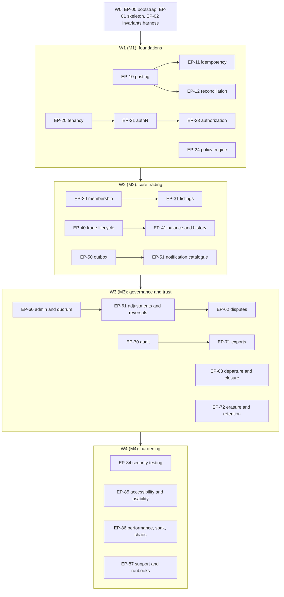

# MVP implementation plan

| Field | Value |
|---|---|
| Status | Draft (planning; not normative) |
| Owner role | Engineering lead (with Product architect) |
| Last updated | 2026-10-21 |
| Scope | Epic and story breakdown of the MVP by workstream with traced requirement IDs, acceptance via `QA-E2E` scenarios, dependencies, sizes and sequencing; the walking skeleton; the technology selection process (no decisions); repository bootstrap checklist; definition of ready and done; working agreements |
| Depends on | [04](../specs/04-functional-requirements.md) (FR), [03](../specs/03-domain-model-and-mutual-credit-rules.md) (INV), [05](../specs/05-architecture-and-trust-boundaries.md), [06](../specs/06-data-ledger-and-audit.md), [07](../specs/07-api-and-integration-contract.md), [08](../specs/08-ux-and-accessibility.md), [09](../specs/09-security-privacy-and-abuse.md), [11](../specs/11-deployment-operations-and-support.md), [12](../specs/12-quality-strategy-and-test-plan.md), [13](../specs/13-assumptions-risks-decisions-roadmap.md) |
| Companion plans | [Roadmap](roadmap.md) · [Master TODO](todo.md) · [Traceability (generated)](traceability.md) |

## 1. Purpose and ground rules

This plan turns the specifications into buildable work. It makes **no technology, vendor or hosting decision** (D-02, [00 section 4](../specs/00-conventions.md#4-writing-rules)); where a stack choice would change a story it says "per ADR". Requirements are never redefined here; epics list the IDs they implement and the owning document wins on any conflict.

- **Epic labels** `EP-nn` and **story labels** `EP-nn.k` are planning labels, not requirement IDs (they are not in the [prefix registry](../specs/00-conventions.md#21-prefix-registry-owner-document)) and MUST NOT be cited from specs.
- **Workstreams** `WS-1` to `WS-8` are those of [13 section 7.1](../specs/13-assumptions-risks-decisions-roadmap.md#71-mvp-foundations-in-scope); this plan adds `WS-0` (bootstrap and skeleton) and `WS-U` (UX and accessibility cross-cutting).
- **Sizes** (ESTIMATE, relative effort for a pair of engineers including tests; not calendar commitments): **S** up to about 1 week, **M** about 2 to 3 weeks, **L** about 4 to 6 weeks, **XL** more than 6 weeks (split before starting). Any XL epic below is split into the stories shown; stories are the unit that must fit in a size M or smaller.
- **Waves** are sequencing groups that align with milestones: W0 = M0/M1 entry, W1 = M1, W2 = M2, W3 = M3, W4 = M4.
- **Acceptance** cites `QA-E2E-nn` scenarios ([12 section 12](../specs/12-quality-strategy-and-test-plan.md#12-end-to-end-acceptance-scenarios)) and `QA-GATE-nn` gates. Where no scenario exists, the epic says "no QA-E2E" and names the test layer that must carry the evidence; those are also listed in [todo section C](todo.md#c-spec-reconciliation-and-verification-backlog).
- P2 requirements (post-MVP, [04 section 11](../specs/04-functional-requirements.md)) are not implemented; MVP code keeps their extension points open (`ARC-053`, `ARC-054`).

## 2. Sequencing at a glance

Text description: bootstrap and the skeleton come first; ledger, tenancy and policy follow in parallel; trading and membership need all three; governance needs trading and audit; hardening needs everything. Epics inside a wave may run in parallel unless a dependency is listed.

**Suggested order of first starts** (one list so nothing is missed): EP-00, EP-02 (harness), EP-01 (skeleton), EP-10, EP-20, EP-24, EP-21, EP-11, EP-12, EP-23, EP-89 (API contract, alongside), then W2 epics, then W3, then W4. Continuous epics (EP-81 observability, EP-82 backup/restore, EP-83 migrations, EP-88 i18n/copy) start in W1 and grow each wave.

## 3. Epic overview

| Epic | Title | WS | Size | Wave | Depends on | Key acceptance |
|---|---|---|---|---|---|---|
| EP-00 | Repository bootstrap and CI | WS-0 | M | W0 | none | Bootstrap checklist (section 7); QA-GATE-11 live |
| EP-01 | Walking skeleton | WS-0 | L | W0 | EP-00, EP-02 (parallel), stack ADR | QA-E2E-01 (thin), QA-E2E-04 |
| EP-02 | Invariants and property test harness | WS-0 | M | W0 | EP-00 | QA-GATE-01, QA-GATE-02 |
| EP-10 | Atomic posting and cached balances | WS-1 | L | W1 | EP-01 | QA-E2E-02, 03, 07, 21; QA-GATE-05 |
| EP-11 | Idempotency | WS-1 | M | W1 | EP-10 | QA-E2E-04, 05, 19 |
| EP-12 | Reconciliation and integrity | WS-1 | M | W1 | EP-10 | QA-GATE-09; QA-E2E-14 |
| EP-13 | Non-trade entry types (reversal, adjustment, opening, departure settlement) engine | WS-1 | M | W1 | EP-10 | QA-E2E-08, 09, 10 |
| EP-20 | Tenancy and Network model | WS-2 | M | W1 | EP-01 | QA-E2E-16; QA-GATE-06 |
| EP-21 | Authentication and sessions | WS-2 | L | W1 | EP-20 | QA-E2E-15 (part); QA-GATE-06 |
| EP-22 | Account recovery and anti-takeover | WS-2 | M | W1/W2 | EP-21, EP-50 | QA-E2E-15 |
| EP-23 | Roles and authorization matrix | WS-2 | M | W1 | EP-20, EP-21 | QA-GATE-06; QA-E2E-20, 22 |
| EP-24 | Policy engine, versions, notice | WS-2 | L | W1/W2 | EP-20 | QA-E2E-12, 24 |
| EP-30 | Membership lifecycle | WS-3 | L | W2 | EP-21, EP-24 | QA-E2E-01 |
| EP-31 | Listings and directory | WS-3 | M | W2 | EP-30 | QA-E2E-01 |
| EP-32 | Invitations, charter acceptance, onboarding | WS-3 | M | W2 | EP-30 | QA-E2E-01 |
| EP-40 | Trade lifecycle | WS-4 | L | W2 | EP-10, EP-11, EP-24 | QA-E2E-01 to 07, 20 |
| EP-41 | Balance, history and statements | WS-4 | M | W2 | EP-40 | QA-E2E-02, 17, 21 |
| EP-42 | Expiry timers and sweeps | WS-4 | S | W2 | EP-40 | QA-E2E-06 |
| EP-50 | Notification outbox and email transport | WS-5 | M | W2 | EP-10 | QA-E2E-18; QA-GATE-16 |
| EP-51 | Notification catalogue and preferences | WS-5 | M | W2/W3 | EP-50 | QA-E2E-18 |
| EP-60 | Admin controls and quorum | WS-6 | L | W3 | EP-23, EP-24, EP-70 | QA-E2E-11, 12 |
| EP-61 | Adjustments and Reversals | WS-6 | M | W3 | EP-13, EP-60 | QA-E2E-08, 09 |
| EP-62 | Disputes | WS-6 | L | W3 | EP-61, EP-51 | QA-E2E-08, 18 |
| EP-63 | Departure and Network closure | WS-6 | L | W3 | EP-13, EP-30, EP-60 | QA-E2E-10 |
| EP-64 | Appeals, moderation and conflict handling | WS-6 | M | W3 | EP-60, EP-31 | no QA-E2E (see todo) |
| EP-65 | Operator boundary, break-glass, admin recovery | WS-6 | M | W3 | EP-23, EP-70 | QA-E2E-22 |
| EP-70 | Audit events | WS-7 | M | W2/W3 | EP-23 | QA-E2E-09 |
| EP-71 | Exports and portability | WS-7 | L | W3 | EP-12, EP-70 | QA-E2E-13; QA-GATE-09 |
| EP-72 | Erasure, retention and privacy tooling | WS-7 | L | W3 | EP-30, EP-70 | QA-E2E-10 (anonymisation), QA-E2E-14 (replay); no dedicated erasure E2E |
| EP-80 | Packaging and install paths (T1/T2) | WS-8 | L | W3/W4 | EP-00 | OPS-001 clean-room install |
| EP-81 | Observability and alerting | WS-8 | M | W1 to W4 | EP-00 | QA-124 checklist |
| EP-82 | Backup, restore and recovery drills | WS-8 | M | W2 to W4 | EP-12 | QA-E2E-14; QA-GATE-09 |
| EP-83 | Migrations and release engineering | WS-8 | M | W2 to W4 | EP-10 | QA-E2E-23; QA-GATE-08 |
| EP-84 | Security hardening and testing | WS-8 | L | W3/W4 | EP-23 | QA-GATE-06; security gates G1 to G5 |
| EP-85 | Accessibility audit and usability study | WS-U | L | W2 to W4 | EP-90 | QA-E2E-17; QA-GATE-07 |
| EP-86 | Performance, soak and chaos | WS-8 | M | W4 | EP-40 | QA-GATE-13, 16, 17 |
| EP-87 | Support model, incident handling, hosted prerequisites | WS-8 | M | W4 | EP-81 | runbooks exercised once |
| EP-88 | Internationalisation readiness and copy lint | WS-U | S/M | W1 to W4 | EP-90 | QA-GATE-10 |
| EP-89 | API contract and OpenAPI | WS-1/2 | M | W1 to W3 | EP-20 | QA-GATE-04 |
| EP-90 | Design system and application shell | WS-U | M | W1/W2 | EP-00 | QA-GATE-07 (automated part) |

## 4. Epics and stories by workstream

Format per epic: **Implements** (requirement IDs; ranges are inclusive and cite the owning document), **Acceptance**, **Depends on**, **Size/Wave**, **Stories**. ID ranges are cited as "first to last".

### 4.1 WS-0 Bootstrap and walking skeleton

#### EP-00 Repository bootstrap and CI (M, W0)
- **Implements:** OPS-009 (artifact tested equals artifact deployed), OPS-010 to OPS-014 (environments), SEC-088 to SEC-098 (supply chain, secure development), QA-100 to QA-106 (covers tags and traceability), QA-120 to QA-126 (definition of done), DEC-077 build-integrity target.
- **Acceptance:** section 7 checklist all ticked; CI stages 1 and 2 of [12 section 9.3](../specs/12-quality-strategy-and-test-plan.md#93-ci-pipeline-stages) run on a trivial PR; QA-GATE-11 traceability check runs in CI.
- **Depends on:** licence ADR (DEC-015) for the first public push; otherwise none.
- **Stories:** EP-00.1 licence and community files; EP-00.2 repository layout and tooling per stack ADR; EP-00.3 CI pipeline stages 1 to 3 skeleton; EP-00.4 dev container and seed-data command; EP-00.5 covers-tag convention and traceability check wired to [scripts/gen-traceability.py](../../scripts/gen-traceability.py) and `scripts/check-specs.py`; EP-00.6 secret scan, dependency scan, SBOM job (DEC-077).

#### EP-02 Invariants and property test harness (M, W0)
- **Implements:** INV-001 to INV-016 as executable checks (12 section 5); ARC-036 (property-based testing), QA-001, QA-011, QA-040 (race tests R1 to R18 scaffold); DEC-148 volumes.
- **Acceptance:** QA-GATE-01 reduced suite green on the skeleton; QA-GATE-02 generator + oracle running at the PR volume.
- **Depends on:** EP-00; stack ADR (test tooling).
- **Stories:** EP-02.1 invariant assertion library (sum-zero, balance recompute, append-only probe); EP-02.2 operation generator and oracle (propose/accept/decline/cancel/expire); EP-02.3 concurrent runner on two app instances (scaffold); EP-02.4 reduced-versus-full suite switch for PR and release candidate.

#### EP-01 Walking skeleton (L, W0) — see [section 5](#5-walking-skeleton-thinnest-vertical-slice)
- **Implements (thin subset):** FR-NET-001, FR-NET-002 (Network + System Accounts), FR-MEM-006 (Member Account creation), FR-TRD-001, FR-TRD-002, FR-TRD-004, FR-TRD-006, FR-TRD-007, FR-TRD-015, FR-TRD-016, FR-BAL-001, FR-BAL-004; INV-001, INV-002, INV-005, INV-007, INV-008, INV-009; DAT-012 to DAT-017, DAT-024 to DAT-028; ARC-009; API-080.
- **Acceptance:** QA-E2E-01 (thin: no application flow, seeded members), QA-E2E-04 (retry with same key); QA-GATE-01 reduced.
- **Depends on:** EP-00, EP-02 (parallel), stack ADR spike outcome.
- **Stories:** see section 5.

### 4.2 WS-1 Ledger core

#### EP-10 Atomic posting and cached balances (L, W1)
- **Implements:** DAT-012 to DAT-023 (atomic posting, append-only, entry hash), DAT-029 to DAT-041 (concurrency control), DAT-042 to DAT-044 (reconstruction); ARC-009 to ARC-012 (critical path); INV-001 to INV-008, INV-011, INV-013, INV-015; FR-TRD-005, FR-TRD-007, FR-TRD-016, FR-TRD-024; DEC-004, DEC-087 to DEC-089, DEC-091, DEC-092.
- **Acceptance:** QA-E2E-02, QA-E2E-03, QA-E2E-07, QA-E2E-21, QA-E2E-24; QA-GATE-01 full; QA-GATE-05 R1 to R18 at release-candidate iteration counts.
- **Depends on:** EP-01; EP-20 for Network scoping.
- **Stories:** EP-10.1 ledger schema and identifier format (DAT-001 to DAT-011, per ADR); EP-10.2 posting function with ordered locking and limit checks; EP-10.3 cached balance maintenance and recompute path; EP-10.4 append-only enforcement and the three INV-003 exceptions as audited procedures; EP-10.5 `unit_scale` immutability after first entry (INV-013); EP-10.6 race and fault-injection tests for posting.

#### EP-11 Idempotency (M, W1)
- **Implements:** DAT-024 to DAT-028; API-080 to API-088; INV-009; FR-TRD-015; DEC-090 (after the doc 13 section 5.5 reconciliation).
- **Acceptance:** QA-E2E-04, QA-E2E-05, QA-E2E-19; retry matrix of [12 section 7.2](../specs/12-quality-strategy-and-test-plan.md#72-retry-and-idempotency-matrix).
- **Depends on:** EP-10.
- **Stories:** EP-11.1 key store and payload fingerprint; EP-11.2 unknown-outcome handling (replay returns original result); EP-11.3 key TTL and cleanup job; EP-11.4 contract tests for every posting operation.

#### EP-12 Reconciliation and integrity (M, W1)
- **Implements:** DAT-045 to DAT-053 (R1 to R14, halt on Critical, integrity checkpoints); OPS-061 to OPS-068; INV-007, INV-008; DEC-094 to DEC-096.
- **Acceptance:** QA-GATE-09 reconciliation part; QA-E2E-14 (restore then reconcile).
- **Depends on:** EP-10.
- **Stories:** EP-12.1 checks R1 to R14 as a library; EP-12.2 scheduled job and report; EP-12.3 automatic posting halt and operator-cleared procedure; EP-12.4 integrity checkpoints; EP-12.5 performance test at 1,000,000 Postings.

#### EP-13 Non-trade entry types engine (M, W1)
- **Implements:** INV-004, INV-010, INV-012, INV-016; DAT-018 to DAT-020; FR-NET-009 (opening balances), FR-ADM-007, FR-ADM-009 (posting side only); DEC-049 (limit flag, no block); canon 5.8 item 3 transaction types.
- **Acceptance:** engine-level tests; user-facing acceptance in EP-61 and EP-63.
- **Depends on:** EP-10.
- **Stories:** EP-13.1 `reversal` entry linked to original; EP-13.2 `adjustment` entry with mandatory reason and Audit Event hook; EP-13.3 `opening_balance` with posting cap (DEC-087); EP-13.4 `departure_settlement` entry and `closed` zero-balance guard (INV-016); EP-13.5 `limit_flag` on corrective entries.

### 4.3 WS-2 Identity, tenancy and policy

#### EP-20 Tenancy and Network model (M, W1)
- **Implements:** FR-NET-001 to FR-NET-005, FR-NET-012, FR-NET-013; ARC-020 to ARC-027; SEC-018 to SEC-025; INV-011; DEC-021, DEC-022, DEC-080.
- **Acceptance:** QA-E2E-16; QA-GATE-06 cross-Network negative tests per endpoint family (SEC-022).
- **Depends on:** EP-01.
- **Stories:** EP-20.1 Network entity with identity (unit name/symbol/scale) and operating status; EP-20.2 tenancy enforcement layer and test fixture; EP-20.3 System Accounts at creation (FR-NET-002); EP-20.4 setup wizard and "setup to open" guard (FR-NET-003 to FR-NET-005); EP-20.5 optional second isolation layer per ADR (DEC-080).

#### EP-21 Authentication and sessions (L, W1)
- **Implements:** FR-MEM-003, FR-MEM-004, FR-MEM-023; SEC-001 to SEC-017; API-011 to API-021; DEC-065 to DEC-068.
- **Acceptance:** QA-E2E-15 (sign-in parts); QA-GATE-06; authentication unit and integration tests.
- **Depends on:** EP-20; EP-50 for email verification mail.
- **Stories:** EP-21.1 account and credential model (one login, many Memberships; D-07); EP-21.2 passkey and TOTP enrolment/sign-in; EP-21.3 session lifecycle and timeouts; EP-21.4 step-up re-authentication (single platform constant, DEC-067); EP-21.5 rate limiting and neutral errors (SEC-055).

#### EP-22 Account recovery and anti-takeover (M, W1/W2)
- **Implements:** FR-MEM-019; SEC-026 to SEC-034; NTF-031 to NTF-034; DEC-069.
- **Acceptance:** QA-E2E-15.
- **Depends on:** EP-21, EP-50.
- **Stories:** EP-22.1 recovery initiation with identical responses; EP-22.2 delay and restricted period; EP-22.3 notifications to old channel; EP-22.4 abuse tests.

#### EP-23 Roles and authorization matrix (M, W1)
- **Implements:** SEC-018 to SEC-025 (matrix, object-level checks); API-015, API-016; FR-ADM-011, FR-ADM-012, FR-ADM-017, FR-ADM-031; INV-012; PER-001 and the permission matrix of doc 02.
- **Acceptance:** QA-GATE-06 100% of matrix cells (SEC-020); QA-E2E-20, QA-E2E-22.
- **Depends on:** EP-20, EP-21.
- **Stories:** EP-23.1 role model and checks as a single policy module; EP-23.2 matrix-driven generated tests; EP-23.3 object-level authorization on every resource; EP-23.4 Operator no-posting guarantee (absence tests).

#### EP-24 Policy engine, versions and notice (L, W1/W2)
- **Implements:** POL-001 to POL-041 (parameters, statuses, resolution, snapshots, presets); FR-ADM-001 to FR-ADM-006, FR-ADM-026; FR-TRD-025; GOV-008 to GOV-017; DEC-011, DEC-058 to DEC-060.
- **Acceptance:** QA-E2E-12 (policy change with notice); QA-E2E-24 (unit identity locked).
- **Depends on:** EP-20; EP-50 for notices.
- **Stories:** EP-24.1 parameter registry with bounds and cross-parameter rules; EP-24.2 policy versions and "in force" resolution; EP-24.3 scheduled change with notice and reminder; EP-24.4 snapshot on Trade (policy_version); EP-24.5 presets; EP-24.6 sensitive-parameter quorum hook (to EP-60).

### 4.4 WS-3 Membership and listings

#### EP-30 Membership lifecycle (L, W2)
- **Implements:** FR-MEM-001 to FR-MEM-006, FR-MEM-009 to FR-MEM-011, FR-MEM-018, FR-MEM-021; INV-015; LIF (doc 15 membership machine); canon 5.3 membership states; DEC-040.
- **Acceptance:** QA-E2E-01 (join), QA-E2E-20 (suspension race).
- **Depends on:** EP-21, EP-24.
- **Stories:** EP-30.1 application and approval queue (`approval` mode); EP-30.2 `invite` and `open` modes; EP-30.3 Member Account creation at the right state (DEC-040); EP-30.4 suspend and reinstate; EP-30.5 profile and visibility settings; EP-30.6 inactivity flag (FR-MEM-020, P1).

#### EP-31 Listings and directory (M, W2)
- **Implements:** FR-LST-001 to FR-LST-015; DEC-053 to DEC-056; UX-013 to UX-021.
- **Acceptance:** QA-E2E-01 (Offer found in directory); no scenario for moderation and search freshness (see todo).
- **Depends on:** EP-30.
- **Stories:** EP-31.1 listing CRUD and states; EP-31.2 directory browse and search with freshness bound (DEC-055); EP-31.3 profile page with chosen fields; EP-31.4 report abuse; EP-31.5 contact route or proposal start.

#### EP-32 Invitations, charter acceptance, onboarding (M, W2)
- **Implements:** FR-MEM-007, FR-MEM-008, FR-MEM-021, FR-MEM-022, FR-ADM-027; GOV-032 to GOV-036; DEC-030, DEC-031.
- **Acceptance:** QA-E2E-01 (with invitation variant to be added).
- **Depends on:** EP-30.
- **Stories:** EP-32.1 invitation tokens and quotas; EP-32.2 charter versioning and acceptance; EP-32.3 onboarding checklist for first admin (FR-NET-007 nudge).

### 4.5 WS-4 Trades and balances

#### EP-40 Trade lifecycle (L, W2)
- **Implements:** FR-TRD-001 to FR-TRD-025; INV-002, INV-005, INV-006, INV-009, INV-012, INV-015; LIF-051 to LIF-057 (races, timers); API-050 to API-067 (trade operations and errors); UX-037 to UX-045 (confirm before commit); DEC-042, DEC-043, DEC-110.
- **Acceptance:** QA-E2E-01 to QA-E2E-07, QA-E2E-20, QA-E2E-21; QA-GATE-05.
- **Depends on:** EP-10, EP-11, EP-24, EP-30.
- **Stories:** EP-40.1 propose (both origins) and review statement; EP-40.2 accept with atomic re-validation; EP-40.3 decline, cancel; EP-40.4 limits advisories for own account only (DEC-110); EP-40.5 open-proposal quotas and rate limits; EP-40.6 joint reversal request (FR-TRD-023, with EP-61); EP-40.7 listing reference (P1, FR-TRD-019).

#### EP-41 Balance, history and statements (M, W2)
- **Implements:** FR-BAL-001 to FR-BAL-011; UX-022 to UX-036 (balance panel, direction words, effect statements); DEC-057, DEC-114, DEC-117, DEC-118.
- **Acceptance:** QA-E2E-02, QA-E2E-17, QA-E2E-21; comprehension study UX-112 (M4).
- **Depends on:** EP-40.
- **Stories:** EP-41.1 balance panel with meaning sentence; EP-41.2 history list, filters, text search; EP-41.3 pending list; EP-41.4 over-limit explanation; EP-41.5 statement (P1) with arithmetic check (DAT-052); EP-41.6 balance visibility modes.

#### EP-42 Expiry timers and sweeps (S, W2)
- **Implements:** FR-TRD-012, FR-TRD-013; LIF-055 to LIF-057; DEC-043.
- **Acceptance:** QA-E2E-06 (expiry race at boundary).
- **Depends on:** EP-40.
- **Stories:** EP-42.1 expiry job with duplicate-timer safety; EP-42.2 reminder (DEC-125, optional).

### 4.6 WS-5 Notifications

#### EP-50 Outbox and email transport (M, W2)
- **Implements:** NTF-041 to NTF-049 (delivery semantics), NTF-055 to NTF-061 (bounces); ARC-006; FR-NTF-003, FR-NTF-008; DEC-123, DEC-130.
- **Acceptance:** QA-E2E-18; QA-GATE-16 (60 s for 95%).
- **Depends on:** EP-10 (post-commit events).
- **Stories:** EP-50.1 transactional outbox; EP-50.2 transport abstraction (RSK-032); EP-50.3 retry and bounce handling; EP-50.4 degraded mode.

#### EP-51 Notification catalogue and preferences (M, W2/W3)
- **Implements:** NTF-001 to NTF-040, NTF-062 to NTF-094; FR-NTF-001, FR-NTF-002, FR-NTF-004 to FR-NTF-007; DEC-124 to DEC-134.
- **Acceptance:** QA-E2E-18; copy-lint QA-GATE-10.
- **Depends on:** EP-50.
- **Stories:** EP-51.1 event catalogue and templates; EP-51.2 recipient resolution and deduplication (NTF-042, NTF-054); EP-51.3 preferences and mandatory classes; EP-51.4 in-app list; EP-51.5 admin digests (P1); EP-51.6 policy-change and broadcast notices.

### 4.7 WS-6 Governance and disputes

#### EP-60 Admin controls and quorum (L, W3)
- **Implements:** FR-ADM-001 to FR-ADM-006, FR-ADM-014, FR-ADM-015, FR-ADM-018, FR-ADM-019, FR-ADM-028 to FR-ADM-030; GOV-057 to GOV-072; DEC-033, DEC-036, DEC-071.
- **Acceptance:** QA-E2E-11, QA-E2E-12.
- **Depends on:** EP-23, EP-24, EP-70.
- **Stories:** EP-60.1 quorum workflow and pending-action visibility; EP-60.2 step-up gating of sensitive actions; EP-60.3 individual credit limits (FR-ADM-006); EP-60.4 role assignment (reviewer, admin) and resignation; EP-60.5 degraded quorum; EP-60.6 announcements.

#### EP-61 Adjustments and Reversals (M, W3)
- **Implements:** FR-ADM-007 to FR-ADM-010; FR-TRD-023; FR-BAL-006; INV-004, INV-010, INV-012; DEC-034, DEC-048, DEC-049.
- **Acceptance:** QA-E2E-08, QA-E2E-09.
- **Depends on:** EP-13, EP-60.
- **Stories:** EP-61.1 Adjustment request/approve/post; EP-61.2 Reversal by admin; EP-61.3 joint Reversal within `dispute_window_days`; EP-61.4 Member-visible labelling; EP-61.5 absence of admin Trade creation (FR-ADM-010 tests).

#### EP-62 Disputes (L, W3)
- **Implements:** FR-DSP-001 to FR-DSP-015; SEC-045 to SEC-054; INV-010; DEC-044 to DEC-047, DEC-076 (evidence encryption option).
- **Acceptance:** QA-E2E-08, QA-E2E-18 (notification dedupe across roles).
- **Depends on:** EP-61, EP-51.
- **Stories:** EP-62.1 raise, response, evidence; EP-62.2 reviewer queue and conflict exclusion (FR-DSP-007); EP-62.3 resolution and two-step execution; EP-62.4 withdrawal, escalation, SLA flags; EP-62.5 "did not agree" category (FR-DSP-014); EP-62.6 timeline view.

#### EP-63 Departure and Network closure (L, W3)
- **Implements:** FR-MEM-012 to FR-MEM-017; FR-NET-010, FR-NET-011, FR-NET-014; GOV-037 to GOV-041, GOV-079 to GOV-087; INV-016; DEC-032, DEC-037, DEC-039.
- **Acceptance:** QA-E2E-10 (variants A, B, C).
- **Depends on:** EP-13, EP-30, EP-60.
- **Stories:** EP-63.1 departing state and settlement summary; EP-63.2 `settle`, `write_off`, `community_fund` modes; EP-63.3 finalise to `closed` atomically; EP-63.4 admin-initiated removal; EP-63.5 Network pause and closure plan; EP-63.6 closing-state trade guard.

#### EP-64 Appeals, moderation, conflict handling (M, W3)
- **Implements:** FR-ADM-013, FR-ADM-021 to FR-ADM-025, FR-LST-010, FR-LST-011; GOV-023 to GOV-031.
- **Acceptance:** no QA-E2E (listed as a gap in [todo](todo.md#c-spec-reconciliation-and-verification-backlog)); integration tests at the cheapest layer (QA-006).
- **Depends on:** EP-60, EP-31.
- **Stories:** EP-64.1 moderation queue; EP-64.2 appeal record and unconflicted assignment; EP-64.3 conflict declarations; EP-64.4 appeal outcomes.

#### EP-65 Operator boundary, break-glass, admin recovery (M, W3)
- **Implements:** FR-ADM-017, FR-ADM-029, FR-ADM-032, FR-NET-015; SEC-035 to SEC-044; GOV-049 to GOV-056, GOV-075 to GOV-078; OPS-101 to OPS-104; DEC-073, DEC-079.
- **Acceptance:** QA-E2E-22.
- **Depends on:** EP-23, EP-70.
- **Stories:** EP-65.1 Operator hold (read-only/suspended); EP-65.2 break-glass with logging, notice, expiry; EP-65.3 loss-of-all-admins recovery procedure; EP-65.4 dual control for hosted.

### 4.8 WS-7 Audit and export

#### EP-70 Audit events (M, W2/W3)
- **Implements:** FR-AUD-001 to FR-AUD-009; INV-010; DAT-054 to DAT-064; SEC-061 to SEC-066; DEC-051, DEC-103.
- **Acceptance:** QA-E2E-09; audit-completeness test per INV-010 trigger list.
- **Depends on:** EP-23.
- **Stories:** EP-70.1 append-only audit store and writer API; EP-70.2 per-role views (FR-AUD-004 to FR-AUD-006); EP-70.3 minimised content (FR-AUD-007); EP-70.4 audit export (P1).

#### EP-71 Exports and portability (L, W3)
- **Implements:** FR-EXP-001 to FR-EXP-008; PRT-001 to PRT-046; DEC-135 to DEC-144, DEC-152.
- **Acceptance:** QA-E2E-13; QA-70-series verifier (QA-070); QA-GATE-09 verifier part.
- **Depends on:** EP-12, EP-70.
- **Stories:** EP-71.1 member self-export and statement; EP-71.2 Network export package and manifest; EP-71.3 asynchronous jobs and download links; EP-71.4 independent verifier module (DEC-152); EP-71.5 redaction rules (counterparty data, LEG-Q-28); EP-71.6 closure archive access (FR-EXP-006).

#### EP-72 Erasure, retention and privacy tooling (L, W3)
- **Implements:** FR-MEM-015, FR-EXP-005; DAT-065 to DAT-081 (personal data inventory, two-phase erasure, retention); SEC-099 to SEC-114; DEC-098 to DEC-106, DEC-009.
- **Acceptance:** QA-E2E-10 (anonymisation on closure), QA-E2E-14 (erasure replay after restore); **no dedicated erasure E2E** (recommend adding; todo).
- **Depends on:** EP-30, EP-70; counsel LEG-Q-27, LEG-Q-33.
- **Stories:** EP-72.1 profile/ledger separation verification; EP-72.2 erasure Phase 1 and Phase 2; EP-72.3 retention jobs per schedule; EP-72.4 erasure register and restore replay; EP-72.5 log scrubbing and canary tests (SEC-062).

### 4.9 WS-8 Operations and hardening

#### EP-80 Packaging and install paths T1/T2 (L, W3/W4)
- **Implements:** OPS-001 to OPS-008, OPS-088 to OPS-095; ARC-028 to ARC-032; DEC-022.
- **Acceptance:** clean-room install by someone outside the team (OPS-001); QA-GATE-08 compatibility.
- **Depends on:** EP-00.
- **Stories:** EP-80.1 deployment artifact (per ADR); EP-80.2 guided install and pre-flight checker; EP-80.3 operations record template (OPS-003); EP-80.4 upgrade and rollback guide.

#### EP-81 Observability and alerting (M, W1 to W4)
- **Implements:** OPS-035 to OPS-046; SEC-061 to SEC-066; QA-124.
- **Acceptance:** alerts have owners; log-canary scan (SEC-062) in CI.
- **Depends on:** EP-00.
- **Stories:** EP-81.1 structured logging without personal data; EP-81.2 SLIs and dashboards; EP-81.3 alert catalogue; EP-81.4 reconciliation and dispatch-latency alerts.

#### EP-82 Backup, restore and recovery drills (M, W2 to W4)
- **Implements:** OPS-023 to OPS-034; DAT-078, DAT-079; DEC-120 to DEC-122.
- **Acceptance:** QA-E2E-14; QA-GATE-09.
- **Depends on:** EP-12.
- **Stories:** EP-82.1 backup schedule and encryption; EP-82.2 automated restore drill on staging; EP-82.3 restore-then-reconcile gating of writes; EP-82.4 runbook (OPS-083).

#### EP-83 Migrations and release engineering (M, W2 to W4)
- **Implements:** OPS-047 to OPS-060; DAT-082 to DAT-089; DEC-105, DEC-108.
- **Acceptance:** QA-E2E-23; QA-GATE-08.
- **Depends on:** EP-10.
- **Stories:** EP-83.1 migration framework with expand/contract; EP-83.2 rehearsal on production-sized copy; EP-83.3 ledger digest equality check; EP-83.4 versioning and release notes.

#### EP-84 Security hardening and testing (L, W3/W4)
- **Implements:** SEC-088 to SEC-098, SEC-115, SEC-116; SEC-084 to SEC-087 (vulnerability disclosure); DEC-075, DEC-077; security gates G1 to G5 ([12 section 9.2](../specs/12-quality-strategy-and-test-plan.md#92-security-gates-g1-to-g5-from-doc-09-sec-094)).
- **Acceptance:** QA-GATE-06; G4 ASVS delta; independent assessment SEC-095.
- **Depends on:** EP-23.
- **Stories:** EP-84.1 threat-model deltas per feature (SEC-099 note); EP-84.2 DAST and abuse-case suite; EP-84.3 independent assessment; EP-84.4 vulnerability handling process.

#### EP-86 Performance, soak and chaos (M, W4)
- **Implements:** ARC-036 to ARC-052 (quality attributes, fitness checks); OPS-096 to OPS-100; DEC-149.
- **Acceptance:** QA-GATE-13, QA-GATE-16, QA-GATE-17; QA-GATE-14 and QA-GATE-15 reported.
- **Depends on:** EP-40.
- **Stories:** EP-86.1 load profile and data generator; EP-86.2 soak runs; EP-86.3 failure-injection suite; EP-86.4 capacity notes into OPS-096 to OPS-100.

#### EP-87 Support, incident handling, hosted prerequisites (M, W4)
- **Implements:** OPS-069 to OPS-087; SEC-078 to SEC-083.
- **Acceptance:** runbooks exercised once; tabletop (G5 security gate).
- **Depends on:** EP-81.
- **Stories:** EP-87.1 support tiers and ticket flow; EP-87.2 incident severity and comms templates; EP-87.3 runbooks; EP-87.4 service description for hosted (OPS-004).

#### EP-89 API contract and OpenAPI (M, W1 to W3)
- **Implements:** API-001 to API-010, API-022 to API-037, API-090 to API-133; DEC-057, DEC-107, DEC-108, DEC-109.
- **Acceptance:** QA-GATE-04 (every operation x error code; breaking-change detector).
- **Depends on:** EP-20.
- **Stories:** EP-89.1 OpenAPI skeleton and lint; EP-89.2 error model and problem details; EP-89.3 pagination, rate limits, versioning; EP-89.4 contract test generation.

### 4.10 WS-U UX and accessibility

#### EP-90 Design system and application shell (M, W1/W2)
- **Implements:** UX-001 to UX-012, UX-046 to UX-071 (responsive layout, keyboard, tables, colour, live regions); FR-NET-016; DEC-083, DEC-111, DEC-112.
- **Acceptance:** QA-GATE-07 automated part from the first screen.
- **Depends on:** EP-00.
- **Stories:** EP-90.1 tokens, components and focus rules; EP-90.2 role-based navigation; EP-90.3 error and message patterns (UX-072 to UX-080); EP-90.4 automated accessibility checks in CI.

#### EP-85 Accessibility audit and usability study (L, W2 to W4)
- **Implements:** UX-081 to UX-086, UX-097 to UX-114; QA-091; DEC-113, DEC-116.
- **Acceptance:** QA-E2E-17; QA-GATE-07 manual audits for JRN-001 to JRN-009; comprehension and usability thresholds UX-112 to UX-114.
- **Depends on:** EP-90, EP-41.
- **Stories:** EP-85.1 prototype review at M2 (ASM-029); EP-85.2 comprehension test of balance wording (RSK-015); EP-85.3 manual keyboard/screen-reader audit; EP-85.4 conformance report and accessibility statement.

#### EP-88 Internationalisation readiness and copy lint (S/M, W1 to W4)
- **Implements:** UX-087 to UX-096; NTF-035 to NTF-040; QA-025; QA-GATE-10; DEC-013, DEC-064.
- **Acceptance:** QA-GATE-10 (banned terms, 0 hits).
- **Depends on:** EP-90.
- **Stories:** EP-88.1 externalised strings and locale-aware formatting; EP-88.2 banned-term linter over UI, templates, exports, API docs; EP-88.3 unit grammar forms.

## 5. Walking skeleton (thinnest vertical slice)

**Goal.** Prove the riskiest path end to end — a Network, two Members, one Trade and a correct balance — through the real client, API and datastore, with the invariants harness in place from the first commit. Everything else is added around a working, tested spine. The skeleton is **not** a prototype to throw away; it is the first increment of EP-10, EP-20, EP-40 and EP-41.

**In the slice (and only this):**

1. **Network** created by seed command (FR-NET-001, FR-NET-002): unit name/symbol/scale, `network_clearing` and `community_fund` System Accounts, a fixed policy set (POL defaults; no editing UI).
2. **Two Members** created by seed (Alice, Bob) with Member Accounts (FR-MEM-006), credit limit set, no application flow, email/password stand-in only if the authentication ADR is not yet implemented (a throwaway sign-in is allowed behind a flag and MUST be removed before M1 exit).
3. **Trade**: Alice (Recipient) proposes 12.00 to Bob; Bob accepts; one Journal Entry with two Postings posts atomically (FR-TRD-001, FR-TRD-002, FR-TRD-004, FR-TRD-006, FR-TRD-007), including the review statement in words (FR-TRD-004) and limit checks (INV-005).
4. **Idempotent retry** of the accept (FR-TRD-015, INV-009).
5. **Balance and history** for both Members (FR-BAL-001, FR-BAL-004), with the meaning sentence (UX-024 style; wording per DEC-117 default) and no red/error styling for a negative balance.
6. **Invariants test harness** (EP-02): INV-001, INV-002, INV-005, INV-007, INV-008, INV-009 as executable checks, plus a property test that runs random propose/accept/decline sequences against the oracle, and a two-instance concurrent accept test (QA-E2E-03 shape).
7. **CI**: stages 1 to 3 of [12 section 9.3](../specs/12-quality-strategy-and-test-plan.md#93-ci-pipeline-stages), the traceability check, and a deployable artifact tested as deployed (OPS-009).

**Out of the slice:** applications/invitations, listings, notifications beyond a log line, disputes, adjustments, policy editing, exports, recovery, admin UI. Each has an epic.

**Skeleton stories (all within EP-01 unless noted):**

| Story | Description | Verifies |
|---|---|---|
| EP-01.1 | Repository, CI and artifact build (EP-00 done) | OPS-009 |
| EP-01.2 | Ledger schema: Network, accounts, Journal Entry, Postings, cached balance | DAT-012 to DAT-017 |
| EP-01.3 | Posting function: lock order, limit check, atomic two-posting entry | INV-001, INV-002, INV-005, ARC-009 |
| EP-01.4 | Trade propose/accept service and API (OpenAPI skeleton, EP-89.1) | FR-TRD-001, FR-TRD-006 |
| EP-01.5 | Idempotency key store for accept | INV-009, API-080 |
| EP-01.6 | Minimal web UI: propose, accept, balance, history | FR-BAL-001, UX-037 |
| EP-01.7 | Seed command and dev container | bootstrap checklist |
| EP-01.8 | Invariants and property harness wired into CI (EP-02) | QA-GATE-01 reduced |
| EP-01.9 | Two-instance concurrency test and first load probe | QA-E2E-03, ASM-022 |
| EP-01.10 | Skeleton demo script and write-up; first measured velocity and estimate re-baseline | roadmap section 3 |

**Exit (for the skeleton, inside M1):** the demo scenario runs on CI against the deployed artifact; QA-GATE-01 reduced is green; a measured note on effort replaces the roadmap's estimates.

## 6. Technology selection process

**No decision is made here** (D-02). This section defines how the stack-related decisions in the register (DEC-002, DEC-003, DEC-004, DEC-022, DEC-077, DEC-080, DEC-082, DEC-083, DEC-109) become ADRs, so that the choices are comparable, time-boxed and revisitable. The ADR process is in [ADR-0001](../decisions/0001-record-architecture-decisions.md) and [13 section 6.3](../specs/13-assumptions-risks-decisions-roadmap.md#63-adr-process).

### 6.1 Process

1. **Fix criteria first.** Product architect and Engineering lead agree the weighted criteria (6.3) and the must-have constraints (6.2) before looking at candidates; record them in the ADR draft. Owner signs off the weights.
2. **Long list, then short list.** Collect candidates per decision area; eliminate any that fail a must-have; keep at most three.
3. **Time-boxed spike** (suggest 2 to 3 weeks, ESTIMATE; the schedule trigger in RSK-021 is "no stack ADR 4 weeks after M0 exit"). The spike implements the walking-skeleton ledger path (section 5, items 1 to 4) and the two hardest tests: concurrent accepts on the same account (QA-E2E-03) and idempotent replay (QA-E2E-04) on each shortlisted option, using the same test script.
4. **Score and write the ADR** (MADR template, [0000-template](../decisions/0000-template.md)): context, options, criteria table with evidence links, decision, consequences, reversal cost, counsel input where applicable (licence).
5. **Review and accept**: Product architect proposes, Engineering lead and Security lead review, Product owner accepts; update the `DEC-` row and the ADR index in the same change.
6. **Revisit triggers** are written into each ADR (for example a failed QA-GATE-05 at scale, or a vendor licence change).

### 6.2 Must-have constraints (apply to every area)

- Supports the invariants INV-001 to INV-016 and the race gate (QA-GATE-05); can express "balance + delta >= -limit" atomically with ordered per-account serialisation (ARC-009, DAT-029 to DAT-041).
- Runs on a single commodity host for T1 and scales to T3 from the same artifact (OPS-001, ARC-028); no mandatory proprietary cloud service in the self-host path (D-01, RSK-027, RSK-030).
- Licence compatible with the chosen open-source licence (DEC-015) and with self-hosting by communities.
- No floating-point amounts anywhere (canon 5.2); integer minor units supported end to end, including in the API (DEC-107).
- Meets WCAG 2.2 AA tooling needs and server-rendered progressive enhancement default (DEC-083, D-14).

### 6.3 ADR candidates and evaluation criteria

| ADR candidate | Register entries | Options to compare (candidates, not choices) | Evaluation criteria (weights set in step 1) | Evidence required |
|---|---|---|---|---|
| **A1 Application stack** (language, framework, test tooling) | DEC-002, DEC-082, DEC-083 | Up to three mainstream web stacks that the team can staff | Team skill and hiring pool; correctness tooling (types, property-testing libraries, concurrency tests); maturity of security libraries (WebAuthn, TOTP, CSRF, sessions); server-rendered accessibility story; contributor friendliness for volunteers; operational footprint (memory, single-host install); long-term support and licence | Spike result; dependency health review; security-advisory history; time to green for the skeleton |
| **A2 Datastore and ledger approach** | DEC-004, DEC-003, DEC-080, DEC-087 to DEC-092, DEC-105 | Up to three datastore options, including whether to use general-purpose relational storage with in-database constraints versus a purpose-built ledger engine | Transactional guarantees needed for INV-002/INV-005 (isolation level, row locking or serialisable); ability to enforce append-only (INV-003) and tenant isolation (INV-011) below the application (DEC-080); point-in-time recovery for RPO/RTO targets (DEC-120); migration tooling for expand/contract (OPS-047 to OPS-060); export and reconciliation query performance at 1,000,000 Postings (DAT-049); operational complexity for T1; licence | Spike: QA-E2E-03/04 pass at 1,000 iterations; reconciliation timing; restore drill |
| **A3 Authentication approach** | DEC-007, DEC-065 to DEC-069, DEC-077 | Build on a vetted library versus an embeddable identity component, both self-hostable | WebAuthn/passkey and TOTP support; recovery flow control (72 h delay, restricted period); step-up recency as a single constant (DEC-067); rate limiting and neutral errors; no external SaaS dependency required for self-host; audit hooks; licence; ASVS L2 coverage (DEC-066) | Conformance test against SEC-001 to SEC-017; threat-model review |
| **A4 Hosting and deployment topology** | DEC-001, DEC-022, DEC-081, DEC-085, DEC-120 to DEC-122 | Container-based single-host package (T1/T2) plus one hosted reference (T3) | Reproducible install by non-experts; backup/restore tooling; secrets handling (OPS-015 to OPS-022); cost; data-location choices for LEG-Q-31; sub-processor count; portability between hosted and self-host via Network package (OPS-006) | Clean-room install; cost estimate; restore drill |
| **A5 Email and notification transport** | DEC-123, DEC-130, ASM-026, RSK-032 | At least two transports behind one abstraction | Deliverability for security mail; bounce/complaint webhooks; self-host viable (SMTP); sub-processor implications (LEG-Q-31); cost | Deliverability test; abstraction contract tests |
| **A6 Identifier format** | DEC-003 | UUIDv7, UUIDv4, ULID | Time-sortability for keyset pagination; non-guessability; library support in A1/A2; leakage of creation time (research-technical-standards note) | Spike benchmark; standards note review |
| **A7 Build integrity and supply chain** | DEC-077, DEC-075, RSK-038 | Attestation and SBOM tooling options per CI choice | SLSA L2 reachability; SBOM generation; dependency review automation; self-host reproducibility | CI proof of concept |
| **A8 Observability stack** | OPS-035 to OPS-046 | Open-standard (structured logs, metrics, traces) with self-hostable backends | Works on T1; no personal data in logs (SEC-062); cost; alert routing | Skeleton instrumented |
| **A9 Open-source licence** | DEC-015, ASM-030, RSK-045 | Candidates identified with counsel (copyleft variants, permissive) | Contributor and adopter fit; network-service gap; hosted-fork implications; counsel review (LEG-G-20) | Counsel written advice; contributor survey |
| **A10 Front-end approach** | DEC-083, DEC-111, DEC-112 | Server-rendered with progressive enhancement versus SPA | WCAG 2.2 AA effort; no-script core views; testing cost; bundle size (QA-GATE-15) | Skeleton UI accessibility run |

Sequencing: A9 in P0; A1, A2, A6 together at the spike (roadmap gate G0 to G1); A3, A5, A7 in M1; A4, A8, A10 by M1 exit. Keep ADRs small and independent so one can be superseded without reopening the rest.

## 7. Repository bootstrap checklist

Status: the repository currently has docs, prompts and scripts only (ASM-032). Tick items in [todo section E](todo.md#e-repository-bootstrap), which holds the owners.

**Governance and legal**
- [ ] Licence chosen (ADR A9, DEC-015; **pending counsel, LEG-Q-36 if counsel advises per 19 section 4.2**); `LICENSE` added; no external contribution accepted before this (RSK-045).
- [ ] `SECURITY.md`: private reporting route, supported versions, response targets consistent with SEC-084 to SEC-087 and DEC-075 (no bounty or safe-harbour claim until counsel reviews).
- [ ] `CONTRIBUTING.md`: how to propose a change, link to ADR process, spec-first rule (QA-123), covers tags (QA-100), DCO or CLA decision recorded with the licence ADR.
- [ ] `CODE_OF_CONDUCT.md` with a named reporting contact.
- [ ] `CODEOWNERS` for ledger, authorization, recovery, export and logging code (SEC-093 code-owner review).
- [ ] Governance note on maintainers and release rights (mitigates RSK-011; at least two release-capable maintainers).

**Repository and process**
- [ ] Issue templates: bug, feature (must cite requirement IDs), decision request (links a `DEC-`), security (points to `SECURITY.md`), accessibility defect.
- [ ] Pull-request template with the definition-of-done checklist (section 8.2), spec impact and "no test impact" notes (QA-106, QA-123).
- [ ] Branching and release convention; protected main branch; required checks.
- [ ] Labels: priority P0/P1/P2, workstream `WS-n`, epic `EP-nn`, `blocked-by-DEC`, `needs-counsel`.
- [ ] `docs/decisions/` ADR index updated with the first technology ADRs as they land.

**Tooling and CI**
- [ ] Dev container (or equivalent) that starts the app, the datastore and a mail catcher with one command.
- [ ] Seed data command (section 5 items 1 and 2; plus a "Standard envelope" generator for soak tests, QA 11.1).
- [ ] Formatter and linter configured; copy lint skeleton (QA-025); OpenAPI lint (API-130).
- [ ] CI stages 1 to 3 ([12 section 9.3](../specs/12-quality-strategy-and-test-plan.md#93-ci-pipeline-stages)); traceability check (`scripts/gen-traceability.py --check`, `scripts/check-specs.py`) as required checks.
- [ ] Secret scan, dependency scan, SAST on every PR (security gate G2); SBOM generation (DEC-077).
- [ ] Artifact build once, test the same artifact, deploy the same artifact (OPS-009).
- [ ] Pre-commit hooks mirror stage 1 checks.

**Environments**
- [ ] Staging environment definition built from the release artifact (OPS-009 to OPS-014); test data policy (no real personal data).
- [ ] Automated nightly run of stages 4 and 5 once EP-02 lands.

## 8. Definition of ready and done

### 8.1 Definition of ready (a story may be started)

- Cites the requirement IDs it implements; every cited ID exists (traceability check).
- Any `[DECISION NEEDED]` or `DEC-` that affects it is Accepted, or the story states which default it builds on and how to change it later; no hard-coded value that doc 13 section 5.5 lists as in conflict.
- Acceptance is stated: the given/when/then of the FR row, plus the `QA-E2E` scenario(s) or the named lower-layer tests.
- Dependencies (epics, ADRs, counsel items) are Done or scheduled earlier in the same wave.
- Sized S or M; XL and L epics are already split.
- Security and privacy impact noted (security gate G1 for anything touching roles, data flows, credentials or exports).
- UI stories link the design and list the screen states for accessibility testing (QA-122).

### 8.2 Definition of done (a change is merged)

Implements [12 section 11.3](../specs/12-quality-strategy-and-test-plan.md#113-definition-of-done) (QA-120 to QA-126); in short:

- [ ] Code reviewed; code-owner review where required (SEC-093); PR-stage gates green.
- [ ] Covers tags present for every requirement touched (QA-100); new behaviour tested at the cheapest sufficient layer; user-visible change has or updates a QA-E2E scenario.
- [ ] Ledger, limits, idempotency, lifecycle, authorization, recovery, export or migration changes also have property coverage (or a stated reason), a race test if shared state changed, and an invariants check (QA-121).
- [ ] UI: automated accessibility engine clean for all affected states, keyboard-tested by the author, copy lint clean, strings externalised (QA-122).
- [ ] Spec impact handled: owning document updated or "no spec impact" stated; new IDs registered; no dangling references (QA-123).
- [ ] Observability: structured logs without personal data, alert with an owner if operator action is needed (QA-124).
- [ ] Documentation, release notes, migration and rollback notes updated (QA-125).
- [ ] Release-level Done: all P0 gates green on the release candidate, release record complete (QA-126).

## 9. Working agreements

1. **Spec first, ID always.** Behaviour changes start with the owning spec and its ID; PRs cite IDs; nobody invents an ID in code or issues (00 section 2).
2. **One authoritative home.** If the plan and a spec disagree, the spec (or the decision register) wins; fix the plan.
3. **Decisions are recorded, not remembered.** Any choice that is a `DEC-` goes through the register and ADR process; small constants may be Accepted by editing the row with approver role and date (13 section 6.3).
4. **Invariants before features.** No feature that posts to the ledger merges without the invariant and race suites running on it (QA-GATE-01, QA-GATE-05). A failing invariant test stops the line.
5. **No re-run to green** for QA-GATE-01 and QA-GATE-05 suites (QA-042); flaky tests are quarantined with owner and date.
6. **Small, reviewable changes**; ledger, authorization, recovery, export and logging changes always get code-owner review.
7. **Money-like claims are out.** Anything resembling redemption, interest, fiat conversion, holds on funds by the Platform, or unilateral debit is escalated to the Product owner and counsel before design (INV-014, VIS-039, RSK-050). Banned terms apply to UI, docs, commit messages that become release notes, and marketing.
8. **Legal and tax matters are routed, not asserted.** Questions go to [19](../specs/19-legal-and-regulatory-open-questions.md) through the Product owner; contributors do not write legal conclusions into code comments or docs.
9. **Accessibility is a build-time property**, not a phase: automated checks from the first screen; manual audit at M4.
10. **Personal data stays out of the ledger and the logs** (D-09, SEC-062); test data is synthetic.
11. **Blameless incident and defect handling**; Sev-1/Sev-2 ledger, security or data-loss defects stop the release (QA-GATE-18).
12. **Estimate honestly.** Re-baseline the roadmap estimates after the skeleton and again at each milestone exit; share velocity, not promises.
13. **Review cadence.** Weekly: decision tracker and counsel tracker review ([todo sections A and B](todo.md)); at each milestone exit: risk register re-score (13 section 4) and traceability report.

## 10. Assumptions and open decisions

- Team skills and staffing are unknown (roadmap section 2); story sizing assumes pairs of engineers and is relative, not absolute.
- The epic-to-requirement mapping uses requirement ranges from the owning documents as of 2026-10-21; re-run [traceability](traceability.md) after spec changes and re-check ranges when a document adds or withdraws IDs.
- Open: which acceptance scenarios to add for moderation/appeals, erasure and invitation flows (todo section C).
- Open: whether the traceability generator should become the QA-101 tool or be replaced (DEC-151, todo section C).

## 11. References

Internal: [Roadmap](roadmap.md) · [Master TODO](todo.md) · [Traceability](traceability.md) · [Plans index](README.md) · [00](../specs/00-conventions.md) · [04](../specs/04-functional-requirements.md) · [12](../specs/12-quality-strategy-and-test-plan.md) · [13](../specs/13-assumptions-risks-decisions-roadmap.md) · [ADR-0001](../decisions/0001-record-architecture-decisions.md) · [research: technical standards](../notes/research-technical-standards.md)
