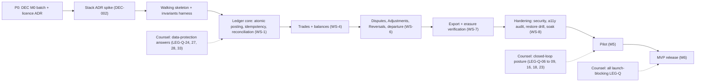

# Delivery roadmap

| Field | Value |
|---|---|
| Status | Draft (planning; not normative) |
| Owner role | Product owner (with Product architect and Engineering lead) |
| Last updated | 2026-10-21 |
| Scope | Time-boxed phases, effort ranges, critical path, parallel tracks, per-milestone release criteria, go/no-go gates and schedule risks for the MVP (M0 to M6) and a pointer to post-MVP waves (M7 to M9) |
| Depends on | [13 — Assumptions, risks, decisions, roadmap](../specs/13-assumptions-risks-decisions-roadmap.md) (authoritative milestones, FSP list, registers); [12 — Quality strategy](../specs/12-quality-strategy-and-test-plan.md) (QA gates); [19 — Legal questions](../specs/19-legal-and-regulatory-open-questions.md) (counsel gates) |
| Companion plans | [MVP implementation plan](mvp-implementation-plan.md) · [Master TODO](todo.md) · [Traceability (generated)](traceability.md) |

## 1. How to read this document

- **Milestones are defined in doc 13, not here.** Entry and exit criteria for M0 to M9 live in [13 section 7.3](../specs/13-assumptions-risks-decisions-roadmap.md#73-milestone-sequence); the dependency graph is in [13 section 7.4](../specs/13-assumptions-risks-decisions-roadmap.md#74-dependency-graph); the deferred specifications `FSP-01` to `FSP-20` are in [13 section 7.2](../specs/13-assumptions-risks-decisions-roadmap.md#72-deferred-sub-specifications-future-specs-to-author). This document links to them and adds only: durations, critical path, tracks, extra release criteria, gates and schedule risks.
- **Everything numeric here is an ESTIMATE.** Doc 13 section 8 deliberately omits effort and date estimates until owners and funding exist (ASM-004). The ranges below are planning aids for the owner's first conversation about staffing and funding; they MUST NOT be copied into the specs as commitments, and they carry no evidence base beyond the author's judgement of a ledger-centred web application of this scope. Replace them with measured velocity after the walking skeleton (section 3, phase P1).
- IDs (`DEC-`, `RSK-`, `LEG-Q-`, `QA-GATE-`, `INV-`) are cited, not redefined. The owning document wins on any conflict.

## 2. Team-size assumptions (ESTIMATE)

Durations are elapsed calendar weeks, given as low to high. They assume the stated team is stable, decisions arrive when needed (the biggest swing factor), and counsel answers arrive on the schedule of section 6.

| Profile | Assumed team (full-time equivalents) | Typical situation |
|---|---|---|
| **Lean** | ~2.5 FTE: Engineering lead + 1 engineer, ~0.5 shared across design, QA and operations | Volunteer or grant-funded core, part-time specialists |
| **Core** | ~5.5 FTE: Engineering lead + 3 engineers, 1 UX/front-end, ~0.5 QA, ~0.5 operations/security | Small funded team |
| **Full** | ~9 FTE: Engineering lead + 5 engineers, 1 UX, 1 QA, 1 operations/security | Funded team with dedicated QA and ops |

Counsel, Data protection lead and Product owner time are **not** counted in FTE; they are the gating resources for phase P0 and the gates in section 6.

## 3. Phases (ESTIMATE)

Each phase maps to one milestone of doc 13. Calendar-bound phases (P0, P5) do not shrink with team size.

| Phase | Milestone | Content (see doc 13 for exit criteria) | Lean (weeks) | Core (weeks) | Full (weeks) | Bound by |
|---|---|---|---|---|---|---|
| **P0** Decisions and counsel | [M0](../specs/13-assumptions-risks-decisions-roadmap.md#73-milestone-sequence) | Accept or confirm M0 decisions; resolve doc 13 section 5.5 conflicts; licence ADR (DEC-015); engage counsel; verify `[U]`/`[K]` claims; review docs | 4 to 8 | 4 to 8 | 4 to 8 | Owner and counsel availability |
| **P1** Walking skeleton, then foundations | [M1](../specs/13-assumptions-risks-decisions-roadmap.md#73-milestone-sequence) | Stack/datastore/topology ADRs after a spike; walking skeleton (plan section 5); WS-1 ledger core and WS-2 identity/tenancy; CI with build-integrity target | 14 to 20 | 8 to 12 | 6 to 9 | Ledger correctness work; stack spike |
| **P2** Core trading | [M2](../specs/13-assumptions-risks-decisions-roadmap.md#73-milestone-sequence) | WS-3 membership and listings, WS-4 trades and balances, WS-5 notifications; policy notice flow; accessibility prototype review | 16 to 24 | 10 to 14 | 7 to 10 | Breadth of UI and journeys |
| **P3** Governance and trust | [M3](../specs/13-assumptions-risks-decisions-roadmap.md#73-milestone-sequence) | WS-6 governance/disputes/departure/closure, WS-7 audit and export, erasure, retention | 16 to 24 | 10 to 14 | 7 to 10 | State-machine and race-test volume |
| **P4** Hardening and readiness | [M4](../specs/13-assumptions-risks-decisions-roadmap.md#73-milestone-sequence) | WS-8: security testing, accessibility audit, usability study, restore drill, load/soak, runbooks, counsel review of terms | 12 to 18 | 8 to 10 | 6 to 8 | External audits, scheduling of third parties |
| **P5** Pilot | [M5](../specs/13-assumptions-risks-decisions-roadmap.md#73-milestone-sequence) | At least 2 pilot Networks, agreed pilot period, measurement | 12 to 16 | 12 to 16 | 12 to 16 | Calendar time; recruitment (RSK-052) |
| **P6** MVP release | [M6](../specs/13-assumptions-risks-decisions-roadmap.md#73-milestone-sequence) | Pilot findings applied, P0 verification complete, hosted terms and notices, release notes | 3 to 5 | 2 to 4 | 2 to 4 | Counsel sign-off on launch-blocking LEG-Q |

**Rolled-up estimate to M6 (ESTIMATE):**

| Profile | Sum of P0 to P6 (weeks) | Rough calendar |
|---|---|---|
| Lean | 77 to 115 | about 18 to 27 months |
| Core | 54 to 78 | about 12 to 18 months |
| Full | 44 to 65 | about 10 to 15 months |

P0 can overlap the start of P1 (the stack spike needs only DEC-002 direction, not all M0 decisions); the sums above are therefore slightly pessimistic when counsel is quick. P5 is dominated by pilot recruitment and calendar time; do not plan to compress it by adding people.

**Effort sanity check (ESTIMATE):** Core profile over P1 to P4 is roughly 36 to 50 weeks x 5.5 FTE, about 200 to 275 person-weeks, before pilot support. Treat a figure outside 120 to 400 person-weeks as a signal to re-scope or re-estimate, not as a precise forecast.

## 4. Critical path

The critical path is the longest chain of hard dependencies; slipping any item slips M6.

In words: decisions and the stack spike unlock the walking skeleton; the ledger core must be proven (invariants, race tests, reconciliation) before trade, governance and export features are layered on it, because INV-001 to INV-016 are cross-cutting and release-blocking (QA-GATE-01, QA-GATE-05). Counsel answers feed three points: data-model freeze (section 6, gate G1), pilot entry (G4) and release (G5).

**Near-critical chains (float of a few weeks):**

1. Policy engine and versions (WS-2) before notice flow, disputes (`dispute_window_days` snapshot, DEC-058) and departure settlement.
2. Notification outbox (WS-5) before every flow that must notify (Adjustment, recovery, policy change; INV-012 relies on visibility to the affected Member).
3. Accessibility: prototype review at M2 (ASM-029) before audit at M4; late discovery is a rework risk (RSK-015).
4. Operator entity and on-call (ASM-004, ASM-028) before hosted pilot; independent of engineering effort but easy to forget.

## 5. Parallel tracks

Tracks can run concurrently once their entry condition is met. Workstream labels `WS-1` to `WS-8` are from [13 section 7.1](../specs/13-assumptions-risks-decisions-roadmap.md#71-mvp-foundations-in-scope).

| Track | Workstreams | Starts | Can run in parallel with | Must finish before | Lead role | Key IDs |
|---|---|---|---|---|---|---|
| **T-LEDGER** Ledger core | WS-1 | Skeleton (P1) | T-IDENT, T-OPS bootstrap | Any feature that posts (P2 trades) is merged to the release branch | Engineering lead | INV-001 to INV-016, DAT-012 to DAT-053, ARC-009 |
| **T-IDENT** Identity, tenancy, policy | WS-2 | P1 | T-LEDGER | Membership flows (P2); admin flows (P3) | Security lead | SEC-001 to SEC-025, POL-001 to POL-041, ARC-020 |
| **T-DIR** Directory and membership | WS-3 | P2 (needs tenancy and policy) | T-LEDGER trade work, T-UX | Pilot onboarding | Product owner | FR-MEM, FR-LST |
| **T-TRADE** Trades and balances | WS-4, WS-5 | P2 (needs ledger core) | T-DIR, T-UX | Governance (P3) | Engineering lead | FR-TRD, FR-BAL, NTF |
| **T-GOV** Admin and governance | WS-6, WS-7 | P3 (needs trades, audit base) | T-OPS, T-UX | Hardening (P4) | Governance lead | FR-ADM, FR-DSP, FR-AUD, FR-EXP, GOV |
| **T-UX** UX and accessibility | part of WS-3/4/6, WS-8 | P1 (design system, copy rules) | all | Accessibility audit (P4) | UX lead | UX-001 to UX-114, QA-GATE-07, QA-GATE-10 |
| **T-OPS** Operations and hosting | WS-8 | P1 (CI, environments, backups early) | all | Pilot (P5) | Operations lead | OPS-001 to OPS-104, QA-GATE-08, QA-GATE-09 |
| **T-LEGAL** Counsel and compliance | M0 and gates | P0 | all | Gates G1, G4, G5 | Product owner with Counsel | LEG-Q-01 to LEG-Q-35 |
| **T-QA** Quality infrastructure | cross-cutting | P1 (harness before features) | all | Every merge | QA lead | QA-GATE-01 to QA-GATE-18, QA-100 to QA-106 |

Rule of thumb: **never start a feature track before its entry condition**, but **start T-QA, T-OPS bootstrap and T-LEGAL on day one**; they have the longest lead times relative to their visible output.

## 6. Go/no-go gates

Gates are decision points for the Product owner (with the roles named). Each lists the evidence required. QA gates are `QA-GATE-nn` from [12 section 9.1](../specs/12-quality-strategy-and-test-plan.md#91-quality-gates-with-measurable-thresholds); counsel items are `LEG-Q-nn` from [19](../specs/19-legal-and-regulatory-open-questions.md), where "Gate H/S/P" are 19's own prioritisation tiers ([19 section 4](../specs/19-legal-and-regulatory-open-questions.md#4-prioritisation)): H = before first hosted launch, S = before first self-host distribution, P = before paid subscriptions.

A gate is **no-go** if any listed item is open without a recorded owner-signed exception (doc 13 section 6.3 "Milestone gate"). A counsel item can be answered "recorded risk acceptance" only where 19 says it may ship with recorded risk (19 section 4.1 item 6).

| Gate | Decision | When | Decision owner | Required evidence: decisions and process | Required evidence: QA gates | Required evidence: counsel |
|---|---|---|---|---|---|---|
| **G0** Start build | Begin walking skeleton | End of P0 (M0 exit) | Product owner | M0 exit criteria 1 to 7 of doc 13 met; DEC-001, DEC-005 to DEC-012, DEC-014, DEC-015, DEC-016, DEC-028, DEC-062, DEC-074, DEC-101, DEC-120 Accepted or defaults confirmed; stack ADR direction (DEC-002) | None (harness is first deliverable) | Counsel engaged (ASM-023); LEG-Q triaged with dates; interim posture on LEG-Q-24, LEG-Q-27 recorded |
| **G1** Data-model freeze | Freeze personal-data and ledger schema for M2 | Mid P1 | Data protection lead + Product architect | DEC-009, DEC-040, DEC-049, DEC-088, DEC-090 settled; reconciliation list (13 section 5.5) closed for DEC-090 | QA-GATE-01 reduced suite green; QA-GATE-04 contract skeleton | LEG-Q-24, LEG-Q-25, LEG-Q-27, LEG-Q-28, LEG-Q-30, LEG-Q-31, LEG-Q-32, LEG-Q-33 answered or interim default with named reversal cost (19 says these shape architecture and precede data-model freeze) |
| **G2** Core trading demo | Proceed to governance | M2 exit | Product architect | Needed-by M2 decisions Accepted (13 section 5.3); journeys Join, Offer/Request, Propose-and-accept, Review balances pass | QA-GATE-01, QA-GATE-02, QA-GATE-04, QA-GATE-05 (reduced), QA-GATE-10, QA-GATE-11, QA-GATE-16; QA-E2E-01 to QA-E2E-07 and QA-E2E-21 green; accessibility prototype review (ASM-029) | None new; copy review request for DEC-114, DEC-117 filed (LEG-Q-08, LEG-Q-09 context) |
| **G3** Governance complete | Proceed to hardening | M3 exit | Governance lead + Product owner | Needed-by M3 decisions Accepted; departure and closure tested | QA-GATE-01, 02, 05 (full iterations on release candidate), 06, 09 (export verifier part); QA-E2E-08 to QA-E2E-13 green; export round-trip (VIS-035) | LEG-Q-22 (reversal basis), LEG-Q-23 (wind-up) answered or constrained; LEG-Q-27 erasure design confirmed |
| **G4** Pilot entry | Recruit and onboard pilot Networks | M4 exit | Product owner | Operator entity confirmed if hosted (ASM-004); on-call roster (ASM-028); success thresholds agreed (DEC-017); at least 2 pilot Networks inside counsel-cleared jurisdictions (ASM-024); risk register re-scored | All P0 gates green on a release candidate: QA-GATE-01 to QA-GATE-13, QA-GATE-16, QA-GATE-17; QA-GATE-18 defect exit; QA-GATE-07 audit with 0 blocker/serious; restore drill (QA-E2E-14, QA-GATE-09) | Gate H items for pilot jurisdictions: LEG-Q-06 to LEG-Q-09, LEG-Q-16, LEG-Q-18, LEG-Q-23; the money regime LEG-Q for each pilot jurisdiction (LEG-Q-10, 12, 13, 14, 15); LEG-Q-20, LEG-Q-22, LEG-Q-24, LEG-Q-25, LEG-Q-27 to LEG-Q-33; LEG-Q-35 for hosted. Unanswered jurisdictions are geofenced, not launched |
| **G5** MVP release | Publish MVP release (hosted and/or self-host) | M6 entry to exit | Product owner | All Needed-by M0 to M6 decisions Accepted or deviations recorded; release notes; deferred-spec backlog confirmed | Every P0 requirement verified (doc 12); QA-GATE-01 to QA-GATE-18 per release record; G1 to G5 security gates (12 section 9.2) incl. independent assessment (SEC-095) | All launch-blocking LEG-Q answered and recorded (13 M6 entry). Gate S set (19 section 4.2) before any self-host distribution; Gate H set before hosted launch |
| **G6** Subscriptions (post-MVP) | Introduce paid hosting | Not in MVP (D-01) | Product owner | Operator entity; FSP-14 spec baselined | Release gates as G5 | Gate P: LEG-Q-17, LEG-Q-16, LEG-Q-20, LEG-Q-05, LEG-Q-29, LEG-Q-34 |

**No-go triggers that apply at every gate** (from doc 13 and doc 12): any open Sev-1/Sev-2 ledger, security or data-loss defect (QA-GATE-18); any proposal for redemption, interest, fiat conversion or unilateral debit without a decision and counsel advice (INV-014, VIS-039, RSK-050); any non-zero reconciliation finding (QA-GATE-09, DAT-047 halt behaviour).

## 7. Release criteria per milestone

These **supplement** the exit criteria in [13 section 7.3](../specs/13-assumptions-risks-decisions-roadmap.md#73-milestone-sequence); they are the quality and traceability evidence the plan asks to be attached to each milestone review.

| Milestone | Supplementary release criteria (evidence to attach) |
|---|---|
| **M0** | Decision tracker ([todo section A](todo.md#a-owner-decisions-needed-now)) shows every Needed-by M0 DEC as Accepted or default confirmed in writing; ADR-0001 index updated; [traceability report](traceability.md) regenerated with 0 undefined IDs; list of `[U]`/`[K]` claims with owner and due date ([todo section C](todo.md#c-spec-reconciliation-and-verification-backlog)); counsel engagement letter or equivalent on file |
| **M1** | Walking skeleton demo recorded against the thin slice (plan section 5); QA-GATE-01 (reduced and full) green; QA-GATE-12 (flake budget) reported; CI stages 1 to 3 of [12 section 9.3](../specs/12-quality-strategy-and-test-plan.md#93-ci-pipeline-stages) live; reconciliation R1 to R14 passing on seeded data; ADRs for stack, datastore, topology, identifiers, modular monolith merged; repository bootstrap checklist ([plan section 7](mvp-implementation-plan.md#7-repository-bootstrap-checklist)) complete |
| **M2** | QA-E2E-01 to QA-E2E-07, QA-E2E-12, QA-E2E-16, QA-E2E-18, QA-E2E-19, QA-E2E-20, QA-E2E-21 green on staging; QA-GATE-10 copy lint 0 hits; QA-GATE-16 notification SLO measured; traceability: every P0 `FR-NET`, `FR-MEM`, `FR-LST`, `FR-TRD`, `FR-BAL` requirement has a covers-tagged test (QA-100) |
| **M3** | QA-E2E-08 to QA-E2E-11, QA-E2E-13, QA-E2E-15, QA-E2E-22, QA-E2E-24 green; export verifier independent (DEC-152); erasure Phase 1 and 2 tests; QA-GATE-05 race gate at full iteration counts on two instances; traceability report: 0 P0/P1 `FR-*` without covering test (QA-GATE-11) |
| **M4** | All of [12 section 9.1](../specs/12-quality-strategy-and-test-plan.md#91-quality-gates-with-measurable-thresholds) P0 gates green on one release candidate artifact (OPS-009 byte-identical rule); QA-E2E-14 and QA-E2E-23 green; manual accessibility and usability reports filed; ASVS delta and independent assessment scheduled or done (SEC-095, SEC-115); runbooks (OPS-083 to OPS-085) exercised once; support model reviewed (OPS-069 to OPS-074) |
| **M5** | Pilot measurement plan frozen before launch; weekly reconciliation report (DAT-045) for pilot Networks; incident log; success measures VIS-026 to VIS-031 reported per Network (DEC-017 thresholds read as indicators); risk register re-scored |
| **M6** | Release record complete (12 section 9.3 stage 11); QA-GATE-18 clean; deferred-spec backlog reviewed against pilot evidence; Gate H/S artefacts (terms, privacy notice, DPA, accessibility statement) published |

## 8. Risks to the schedule

Risks are registered in [13 section 4](../specs/13-assumptions-risks-decisions-roadmap.md#4-risk-register); this table adds only the **schedule effect** and a planning response. Re-score at every milestone exit.

| RSK | Schedule effect | Planning response |
|---|---|---|
| RSK-054 Counsel availability | Slips G1, G4, G5; the single largest external schedule risk | Engage in P0; triage by gate (section 6); start with LEG-Q-24, 27, 28, 33 (they shape the data model); limit pilot to low-risk jurisdictions |
| RSK-021 Stack decision delayed or mismatched | Delays the skeleton and every track behind it | Time-box the spike (suggest 2 to 3 weeks); evaluation criteria fixed beforehand ([plan section 6](mvp-implementation-plan.md#6-technology-selection-process)); trigger is "no stack ADR 4 weeks after M0 exit" |
| RSK-022 Spec inconsistency | Rework and untestable requirements | Close doc 13 section 5.5 conflicts in P0 ([todo section C](todo.md#c-spec-reconciliation-and-verification-backlog)); run the traceability check from M1 |
| RSK-016, RSK-017, RSK-019 Concurrency, ledger drift, duplicate postings | Ledger bugs found late are the costliest; the race and invariant gates can fail repeatedly | Build the invariant and race harness in the skeleton, before features; do not defer QA-GATE-05 to M4 |
| RSK-018 Load exceeds envelope | Late performance work in P4 | Load test the skeleton at M1 against the Standard envelope shape (ASM-022), repeat each milestone |
| RSK-027 Hosted operator lacks funding/legal form | Blocks hosted pilot (G4) | Confirm operator entity by M3 (RSK-027 trigger); self-host pilot remains possible (D-01) |
| RSK-028 Support/on-call capacity | Blocks pilot go-live | Roster confirmed before M5 (ASM-028) |
| RSK-045 Licence choice | Blocks external contributors and the first public commit | Decide in P0 with counsel (DEC-015) |
| RSK-052 Pilot recruitment | P5 stalls or yields invalid evidence | Start recruitment conversations at M2; entry criteria agreed in P4 |
| RSK-015 Balance misread | Rework of balance UI after usability study | Prototype comprehension test at M2 (UX-112), not only at M4 |
| RSK-011 Single-maintainer dependency | Velocity cliff | Document as you go; ADRs; at least two people able to release |
| RSK-026 Unusable backups | Fails QA-GATE-09 late | Automate a restore drill from M1 on staging (OPS-026) |

## 9. After the MVP

Waves of deferred specifications (M7 to M9, `FSP-01` to `FSP-20`) are sequenced in [13 sections 7.2 and 7.3](../specs/13-assumptions-risks-decisions-roadmap.md#72-deferred-sub-specifications-future-specs-to-author). Spec-authoring tasks for them are tracked in [todo section D](todo.md#d-spec-gaps-and-deferred-spec-authoring). Only **FSP-11** (payments-adjacent exclusions) is recommended for early authoring because doc 13 asks for it to be reviewed before each wave and it guards INV-014.

## 10. Assumptions and open decisions of this plan

- Team profiles and durations are estimates (section 2). Open item: the Product owner confirms which profile applies, or supplies a different one, at G0.
- The plan assumes the milestone definitions of doc 13 stay stable; if doc 13 changes M0 to M6, update section 3 and section 7 here (they cite, not copy).
- No technology, vendor or hosting decision is made here (D-02); see the selection process in the [implementation plan](mvp-implementation-plan.md#6-technology-selection-process).
- The assignment of specific decisions to gates (section 6) is the planner's reading of the Needed-by column in doc 13 and doc 19 section 4; the register wins on conflict.

## 11. References

Internal: [13](../specs/13-assumptions-risks-decisions-roadmap.md) · [12](../specs/12-quality-strategy-and-test-plan.md) · [19](../specs/19-legal-and-regulatory-open-questions.md) · [05](../specs/05-architecture-and-trust-boundaries.md) · [11](../specs/11-deployment-operations-and-support.md) · [Plans index](README.md)
