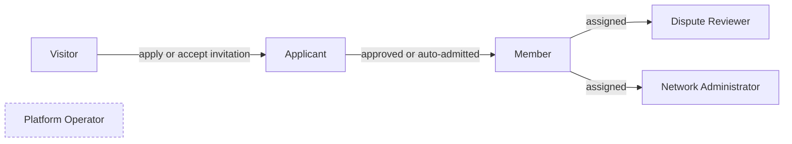
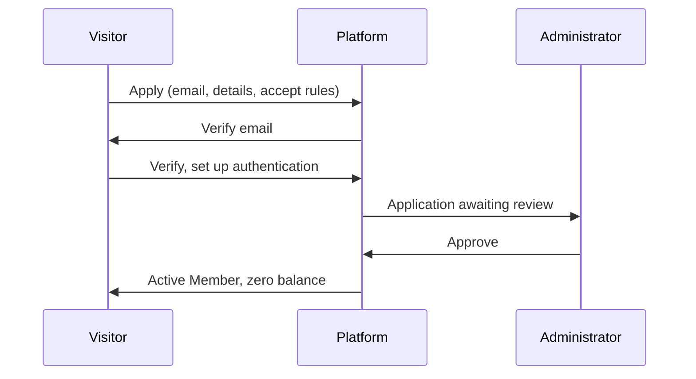

# 02 — Personas, Roles and Core User Journeys

| Field | Value |
|---|---|
| Status | Draft |
| Owner role | Product owner (with UX lead) |
| Last updated | 2026-10-21 |
| Scope | Personas; the roles Network Member, Network Administrator, Dispute Reviewer, Platform Operator and unauthenticated visitor/applicant; the role-by-capability permission matrix; core user journeys with preconditions, flows, error and accessible states, and postconditions |
| Depends on | [00 — Conventions](00-conventions.md), [01 — Product vision and scope](01-product-vision-and-scope.md) |
| Open questions | PER-OD-1 to PER-OD-8 in section 9; `[DECISION NEEDED]` markers |

## 1. Purpose and scope

This document defines **who** can do **what** in Circula and **how** the core journeys unfold at a requirements level. It is the source for authorization rules used by [04 — Functional requirements](04-functional-requirements.md), [07 — API](07-api-and-integration-contract.md), [09 — Security](09-security-privacy-and-abuse.md) and [12 — Test plan](12-quality-strategy-and-test-plan.md). It does not specify screens ([08 — UX](08-ux-and-accessibility.md)), domain rules ([03](03-domain-model-and-mutual-credit-rules.md)), state-machine detail ([15](15-lifecycle-state-machines.md)) or policy values ([16](16-network-policy-catalog.md)).

Requirement IDs: `PER-nnn` (roles and permissions) and `JRN-nnn` (journeys). Priorities and verification follow [00 section 2](00-conventions.md#2-requirement-identifiers). Verification codes: **T** automated or manual test, **I** inspection, **A** analysis, **D** demonstration.

## 2. Definitions used here

Terms are as in [00 section 5.1](00-conventions.md#51-vocabulary-exact-spellings) and the [glossary](14-glossary.md): Network, Member, Member Account, Network Administrator (`network_admin`), Dispute Reviewer (`dispute_reviewer`), Platform Operator (`platform_operator`), Offer, Request, Listing, Trade, Provider, Recipient, Proposer, Counterparty, Adjustment, Reversal, Dispute, Audit Event. States are those in [00 section 5.3](00-conventions.md#53-lifecycle-state-names-exact). Policy parameters are written in `code` as in [00 section 5.6](00-conventions.md#56-network-policy-parameter-names-exact-catalog-and-defaults-in-16-network-policy-catalogmd). Local terms:

| Term | Meaning |
|---|---|
| **Visitor** | Unauthenticated person using the public web entry points. |
| **Applicant** | A person with an authenticated login and a Membership in state `applicant` in a given Network. |
| **Acting capacity** | The single role under which an action is performed; recorded in the Audit Event (VIS-040). |
| **Party** | A Member who is the Provider or Recipient of a Trade, or the Proposer or Counterparty of a proposal. |

## 3. Personas

Personas are archetypes used to test requirements, not marketing segments. Each persona may hold more than one role in a Network. Examples use a Network whose unit is "hours" with `unit_scale` 2.

| Persona | Role(s) | Context | Goals | Pain points / needs | Accessibility notes |
|---|---|---|---|---|---|
| **Amara, the skilled helper** | Network Member | Retired electrician, offers repairs, 68, uses a tablet | Help neighbours; use credits for garden help and lifts | Fears "owing" and complex screens; must understand she is not being charged money | Larger text, zoom to 200 percent, plain language, no time-limited interactions |
| **Ben, the busy newcomer** | Network Member (applicant first) | Works shifts, 34, phone only, short attention windows | Quickly find a childminder, offer web help | Wants few steps, email reminders, mobile layout | Touch targets, one-handed use, readable on small screens |
| **Chidi, the careful skeptic** | Network Member | Accountant, wary of tampering | Verify that books are honest | Wants history, export, visible corrections | Screen reader user: needs table semantics and clear announcements of balance sign |
| **Dara, the volunteer coordinator** | Network Administrator | Runs a 120-member circle in spare time | Admit people, set sensible limits, resolve problems without drama | Time-poor; fears being blamed for mistakes; needs guardrails and a second pair of eyes | Keyboard-driven admin work; bulk-free but fast lists |
| **Emeka, the trusted elder** | Dispute Reviewer (and Member) | Respected in the community | Judge fairly and quickly | Needs facts, not access to everything; must not review his own friends' disputes without disclosure | Long-form reading; clear deadlines |
| **Farah, the host's sysadmin** | Platform Operator | Maintains a hosted instance for many circles | Keep it running, restore after failure, respond to abuse | Needs to help users without reading private content or changing balances | CLI and web; runbooks |
| **Gus, the visitor** | Visitor | Heard about the Network at a market | Understand what it is; see whether to apply | Needs honest explanation that credits are not money | Public pages meet same accessibility level |

**PER-001** — Each persona above **MUST** be traceable to at least one acceptance scenario in [12 — Quality strategy](12-quality-strategy-and-test-plan.md) and each journey in section 7 **MUST** list the persona(s) it serves. *Rationale: keeps design tied to real users. Verification: I (traceability check).* Priority P1.

## 4. Roles

### 4.1 Role definitions

| Role | Scope of role | Authentication | Obtained by | Notes |
|---|---|---|---|---|
| **Visitor** | Platform-wide, public pages only | None | Default | May read public Network information and, when `directory_visibility = public_listings`, public Listings. Rate-limited. |
| **Applicant** | One Network | Required | Applying or accepting an invitation; Membership state `applicant` | Cannot see member-only content or transact. May view and withdraw their own application. |
| **Network Member** (`member`) | One Network | Required | Membership state `active` | Base role. Permissions are per-Network; a person in two Networks has two independent sets. |
| **Dispute Reviewer** (`dispute_reviewer`) | One Network | Required | Assigned by a Network Administrator to an `active` Member | Additive to Member. Cannot review a Dispute in which they are a Party or that they have declared a conflict on. |
| **Network Administrator** (`network_admin`) | One Network | Required, with step-up authentication for sensitive actions | Assigned by an existing Network Administrator (subject to `admin_quorum`) or by Network creation | Additive to Member. An Administrator is also a Member with their own account, so their own Trades and balance are subject to the same rules. |
| **Platform Operator** (`platform_operator`) | Deployment (all Networks it hosts) | Required, with strong authentication (for example passkey) | Granted by the deployment owner out of band | Separate identity space from Member accounts. No ledger-posting powers. No default access to Network content. |

Text: a Visitor becomes an Applicant on applying or accepting an invitation; an Applicant becomes a Member on approval (or on invitation under `membership_mode = invite`); a Member may additionally hold Dispute Reviewer and/or Network Administrator roles. The Platform Operator is a separate role outside Network membership (dashed).

### 4.2 Role rules

| ID | Requirement | Priority |
|---|---|---|
| **PER-002** | Authorization **MUST** be evaluated server-side on every request, per Network, from the caller's current Membership state and roles; client-side hiding of controls **MUST NOT** be the only enforcement. *Rationale: prevents privilege escalation via direct API calls. Verification: T (negative authorization tests for every matrix row, one per role).* | P0 |
| **PER-003** | A person's roles in one Network **MUST NOT** confer any permission in another Network (INV-011). *Rationale: Networks are isolated tenants. Verification: T (cross-Network access attempts return not-found or forbidden and leak no data).* | P0 |
| **PER-004** | A person **MAY** hold Member plus Dispute Reviewer plus Network Administrator in the same Network; every action **MUST** be authorised under the single acting capacity stated in the request or session and recorded in the Audit Event for audited actions. *Rationale: separation of duties; accountability. Verification: T, I.* | P0 |
| **PER-005** | The Dispute Reviewer role **MUST NOT** grant visibility of any Trade, Member or balance beyond Disputes assigned to that Reviewer and the minimum related facts needed to decide them (the Trade, its parties' public names, relevant notes, evidence, and the Parties' balances only if the Network's `balance_visibility` already permits it). *Rationale: least privilege. Verification: T.* | P0 |
| **PER-006** | The Platform Operator **MUST NOT** have any capability to create, edit, reverse or delete Journal Entries or Postings, nor to act as a Member (INV-003, INV-004, INV-012). Operator access to Network content (Member profiles, Listing text, Trade notes, Dispute content) **MUST** be denied by default; any exception is a time-limited, logged, reasoned access recorded as an Audit Event visible to that Network's Administrators ([09](09-security-privacy-and-abuse.md) defines break-glass). *Rationale: Operators run infrastructure, not the community's books. Verification: T (no operator endpoint writes ledger), I (code and role review), D.* | P0 |
| **PER-007** | The last remaining Network Administrator of a Network **MUST NOT** be removable, suspended or able to resign until another `active` Member is assigned Network Administrator, except through the Network closure or recovery processes in [10](10-governance-and-network-operations.md). *Rationale: prevents orphaned Networks. Verification: T.* | P0 |
| **PER-008** | When the Network's `admin_quorum` is greater than 1, the sensitive actions in matrix rows marked "Q" **MUST** require approval by that number of distinct Network Administrators (none of whom is the affected Member), each recorded in the Audit Event. *Rationale: limits unilateral misuse. Verification: T.* | P0 |
| **PER-009** | Network Administrators **MUST NOT** be able to approve, accept or cancel a Trade on behalf of a Member, nor to see a Member's credentials, recovery factors or sessions. *Rationale: INV-012; credential isolation. Verification: T.* | P0 |

## 5. Permission matrix

Legend: **Y** permitted; **Y\*** permitted subject to the condition in the Notes column; **—** not permitted; **n/a** not applicable. Columns: **Vis** Visitor; **App** Applicant; **Mem** Member; **Rev** Dispute Reviewer (in addition to Member permissions; row shows only the Reviewer's extra or restricted permissions, otherwise "= Mem"); **Adm** Network Administrator (same convention); **Op** Platform Operator. "Q" in Notes means the action is subject to `admin_quorum` (PER-008) and step-up authentication. All actions are per-Network except Operator rows. Each row has a stable ID and **MUST** be enforced server-side (PER-002) and covered by at least one positive and one negative authorization test; priority is P0 unless stated. *Verification for all rows: T.*

### 5.1 Access, identity and profile

| ID | Capability | Vis | App | Mem | Rev | Adm | Op | Notes |
|---|---|---|---|---|---|---|---|---|
| **PER-010** | View public Network information (name, unit, description, membership mode, plain-language credit-unit disclaimer) | Y | Y | Y | = Mem | = Mem | Y | Disclaimer text per VIS-013 is always shown |
| **PER-011** | View public Listings | Y* | Y* | Y | = Mem | = Mem | — | Visitor and Applicant only if `directory_visibility = public_listings`; fields limited to those the Network marks public |
| **PER-012** | Submit an application or accept an invitation | Y* | n/a | n/a | n/a | n/a | — | Visitor only; subject to `membership_mode` (`open`: immediate application; `approval`: application queued; `invite`: valid invitation token required) |
| **PER-013** | View status of, and withdraw, own application | — | Y | n/a | n/a | n/a | — | Withdraw moves nothing in the ledger |
| **PER-014** | Sign in, sign out, manage own authentication methods (passkey, TOTP, password if offered) and sessions | Y* | Y | Y | = Mem | = Mem | Y* | Visitor: sign-in only. Operator uses the separate operator identity space |
| **PER-015** | Recover own account (JRN-008) | Y | Y | Y | = Mem | = Mem | Y* | Recovery never grants access to another person's account; Admins and Operators cannot perform recovery on behalf of a user |
| **PER-016** | View and edit own profile (display name, contact preferences, visibility choices within Network policy) | — | Y* | Y | = Mem | = Mem | — | Applicant: only application fields |
| **PER-017** | View other Members' profiles | — | — | Y* | = Mem | Y* | — | Visible fields per Network policy; Administrators see additional administrative fields (membership state, join date, roles), not credentials |

### 5.2 Listings and directory

| ID | Capability | Vis | App | Mem | Rev | Adm | Op | Notes |
|---|---|---|---|---|---|---|---|---|
| **PER-018** | Create, edit, pause, resume, archive own Listing (Offer or Request) | — | — | Y | = Mem | = Mem | — | Member in `suspended` state may not publish new Listings; existing Listings are hidden |
| **PER-019** | Browse and search the directory | Y* | — | Y | = Mem | = Mem | — | See PER-011 for Visitors |
| **PER-020** | Contact a Listing's owner (starts a Trade proposal or a message via the platform-mediated contact channel) | — | — | Y | = Mem | = Mem | — | Contact details only exposed per the owner's visibility choice |
| **PER-021** | Remove (moderate) any Listing with a stated reason; restore a removed Listing | — | — | — | — | Y | — | Audit Event; owner notified; owner may appeal (JRN-006) |
| **PER-022** | Report a Listing or Member for abuse | — | — | Y | = Mem | = Mem | Y* | Operator may receive Network-escalated abuse reports about platform misuse (not Network content) |

### 5.3 Trades

| ID | Capability | Vis | App | Mem | Rev | Adm | Op | Notes |
|---|---|---|---|---|---|---|---|---|
| **PER-023** | Propose a Trade (as Provider or as Recipient) | — | — | Y* | = Mem | = Mem | — | Member must be `active`; amount within `min_trade_amount` and `max_trade_amount`; amount strictly positive; two distinct Members |
| **PER-024** | Accept or decline a Trade proposed to them | — | — | Y* | = Mem | = Mem | — | Only the Counterparty; acceptance and posting are one atomic step; rejected if limits would be breached |
| **PER-025** | Cancel own `proposed` Trade | — | — | Y* | = Mem | = Mem | — | Only the Proposer, only while `proposed` |
| **PER-026** | View own Trades (any state) and their notes | — | — | Y | = Mem | = Mem | — | Parties only |
| **PER-027** | View another Member's Trades | — | — | — | Y* | — | — | Reviewer: only Trades that are the subject of an assigned Dispute (PER-005). Administrators have no general right; they see Trades through Dispute escalation, Audit Events and Adjustment targets only |
| **PER-028** | Create, accept, decline or cancel a Trade on behalf of another Member | — | — | — | — | — | — | Never permitted to any role (INV-012) |

### 5.4 Balances, history and export

| ID | Capability | Vis | App | Mem | Rev | Adm | Op | Notes |
|---|---|---|---|---|---|---|---|---|
| **PER-029** | View own balance, available credit, credit limit, pending proposals and full history | — | — | Y | = Mem | = Mem | — | Real-time consistent with ledger (INV-008) |
| **PER-030** | View another Member's balance | — | — | Y* | = Mem | Y* | — | By `balance_visibility`: `self` (no one), `admins` (Administrators only), `members` (all Members). Under `self`, Administrators still see network-level aggregates only |
| **PER-031** | View Network aggregate figures (member count, number and volume of Trades, sum of balances equals zero check) | — | — | Y* | = Mem | Y | Y* | Members: if Network policy allows aggregates. Operator: aggregate counts only, no per-Member figures |
| **PER-032** | Export own data (profile, listings, Trades, statement) | — | Y* | Y | = Mem | = Mem | — | Applicant: application data only; see [18](18-data-export-and-portability.md) |
| **PER-033** | Export Network data (members, Journal Entries, Audit Events, policy history) | — | — | — | — | Y | — | Q; produces an Audit Event; personal fields minimised per [18](18-data-export-and-portability.md) |

### 5.5 Disputes

| ID | Capability | Vis | App | Mem | Rev | Adm | Op | Notes |
|---|---|---|---|---|---|---|---|---|
| **PER-034** | Raise a Dispute about a Trade the Member is a Party to | — | — | Y* | = Mem | = Mem | — | Within `dispute_window_days` of completion (or at any time while `proposed`) |
| **PER-035** | Add statements and evidence to a Dispute they are a Party to; view its status and outcome | — | — | Y | = Mem | = Mem | — | Parties see all non-confidential material in their Dispute |
| **PER-036** | Withdraw own Dispute | — | — | Y* | = Mem | = Mem | — | Only the raiser; only while `open` or `under_review` |
| **PER-037** | View the Dispute queue and take assignment | — | — | — | Y | Y* | — | Reviewer: queue of unassigned or assigned Disputes without conflict. Administrator: queue metadata and escalated Disputes |
| **PER-038** | Decide a Dispute: `resolved_upheld`, `resolved_rejected` or `resolved_settled`, with written reasons | — | — | — | Y* | — | — | Not if Party or declared conflict; Administrators do not decide Disputes unless also holding the Reviewer role and not conflicted. Audit Event |
| **PER-039** | Escalate a Dispute (`escalated`) | — | — | — | Y | Y* | — | Reviewer may escalate when the case exceeds the role; Administrator may escalate if SLA is missed. Handling after escalation per [10](10-governance-and-network-operations.md) |
| **PER-040** | Apply the Reversal or Adjustment that implements an upheld or settled outcome | — | — | — | — | Y | — | Q; Administrator must not be a Party; linked to the Dispute and Audit Event; affected Members notified. Executing role is a recommended default, see PER-OD-3 |

### 5.6 Administration

| ID | Capability | Vis | App | Mem | Rev | Adm | Op | Notes |
|---|---|---|---|---|---|---|---|---|
| **PER-041** | Review applications: approve or reject with reason | — | — | — | — | Y | — | Audit Event; applicant notified; rejection reason visible to the applicant |
| **PER-042** | Create and revoke invitations | — | — | Y* | = Mem | Y | — | Members may invite only if the Network enables it (`membership_mode = invite` and member-invite option, see [16](16-network-policy-catalog.md)) |
| **PER-043** | Suspend or reinstate a Member, with reason | — | — | — | — | Y | — | Q; Audit Event; Member notified and may appeal; suspension never alters balances |
| **PER-044** | Start closure of a Membership (`departing` to `closed`), including removal and ban flag, with reason | — | — | — | — | Y | — | Q; Member may also start own departure (PER-051) |
| **PER-045** | Assign and revoke the Dispute Reviewer role | — | — | — | — | Y | — | Audit Event |
| **PER-046** | Assign and revoke the Network Administrator role | — | — | — | — | Y | — | Q; PER-007 applies |
| **PER-047** | Edit Network policy parameters | — | — | — | — | Y | — | Q for sensitive parameters (see [16](16-network-policy-catalog.md)); effective after `policy_notice_days` except safety fixes; `unit_name`, `unit_symbol`, `unit_scale` immutable once any Journal Entry exists (INV-013) |
| **PER-048** | Set a Member's individual `credit_limit` within `max_credit_limit` | — | — | — | — | Y | — | Audit Event; Member notified; lowering below current negative balance does not alter balance but blocks further spending |
| **PER-049** | Post an Adjustment to a Member Account or System Account with mandatory reason | — | — | — | — | Y | — | Q; INV-004, INV-010, INV-012; visible to the affected Member; not self-service for the Administrator's own account |
| **PER-050** | Initiate a standalone Reversal of a completed Trade, with reason | — | — | — | — | Y | — | Q; used for Administrator-initiated corrections outside a Dispute; counterparty-consent requirement per [03](03-domain-model-and-mutual-credit-rules.md) |
| **PER-051** | Start own departure from the Network | — | Y* | Y | = Mem | = Mem | — | Applicant: withdraw application instead (PER-013). Settlement mode per `departure_settlement_mode` |
| **PER-052** | View the Network's Audit Events | — | — | Y* | Y* | Y | Y* | Members: only events concerning themselves. Reviewer: events concerning assigned Disputes. Operator: platform-level events only, not Network content |
| **PER-053** | Post announcements and policy notices to all Members | — | — | — | — | Y | — | Policy notices are mandatory for policy changes (D-11) |
| **PER-054** | Initiate closure of the Network | — | — | — | — | Y | — | Q; follows [10](10-governance-and-network-operations.md); triggers export obligations |

### 5.7 Platform operation

| ID | Capability | Vis | App | Mem | Rev | Adm | Op | Notes |
|---|---|---|---|---|---|---|---|---|
| **PER-055** | Provision a new Network and assign its first Network Administrator(s) | — | — | — | — | — | Y | Operator creates the empty Network and the invitation; thereafter the Network governs itself |
| **PER-056** | Create a Network (self-service) | Y* | — | — | — | — | Y | Visitor: only if the deployment enables self-service Network creation [DECISION NEEDED: PER-OD-5] |
| **PER-057** | Suspend or restore a whole Network's service (for abuse, legal request or hosting reasons) | — | — | — | — | — | Y | Reason recorded; Network Administrators notified; read-only export remains available; no ledger change |
| **PER-058** | Operate infrastructure: deployment, configuration, secrets, upgrades, migrations, backups, restores | — | — | — | — | — | Y | Operations never mutate Journal Entries; restores and migrations followed by reconciliation ([11](11-deployment-operations-and-support.md)) |
| **PER-059** | View operational logs and metrics | — | — | — | — | — | Y | Logs contain no credentials and no Trade notes or free text ([09](09-security-privacy-and-abuse.md)) |
| **PER-060** | Access Network content in an emergency (break-glass) | — | — | — | — | — | Y* | Default deny (PER-006); time-limited, reasoned, dual-control, Audit Event visible to the Network |
| **PER-061** | Post, edit, reverse or delete any Journal Entry or Posting | — | — | — | — | — | — | Never permitted to any role through the Platform. (Restoration from backup is not an edit; see [11](11-deployment-operations-and-support.md)) |
| **PER-062** | Grant or revoke Platform Operator roles | — | — | — | — | — | Y* | Only by the deployment owner / existing Operator with dual control; logged |

**PER-063** — The matrix **MUST** be machine-readable in the implementation (a role-by-capability table in a configuration or test artefact) and every row above **MUST** have an automated authorization test case with at least one allowed and one denied actor. *Rationale: prevents drift between spec and enforcement. Verification: T, I (matrix-to-test coverage report).* Priority P0.

**PER-064** — Denied requests **MUST** return a response that does not reveal whether the target resource exists to an actor who lacks permission to know (for example: not-found rather than forbidden for objects in other Networks), and **MUST** be logged as security events without personal content. *Rationale: avoids enumeration. Verification: T.* Priority P1.

## 6. Cross-cutting rules for journeys

**JRN-010** — Accessible and error-state baseline for all journeys. Every step of every journey in section 7 **MUST**:

- (a) be completable with keyboard only and with a screen reader, to WCAG 2.2 Level AA (D-14), including forms, tables, dialogs, confirmations and error summaries;
- (b) present each validation or business-rule failure in plain language, adjacent to the field or action concerned and in a summary that receives focus, stating what happened, why, and what to do next, without relying on colour alone;
- (c) express any amount with the unit symbol/name, the correct number of decimals from `unit_scale`, and an explicit direction in words ("you will receive", "you will give") in addition to any sign or colour; negative balances **MUST** be described in words as well as shown with a minus sign;
- (d) preserve user input after a failed submission and never lose a draft because of a recoverable error;
- (e) provide an unambiguous state for loading, empty (no Listings, no history), success, partial failure, offline/connection lost, concurrency conflict ("this changed while you were deciding; here is the current state"), and permission denied;
- (f) avoid time limits that cannot be extended (session timeout warns and allows extension; proposals expire by `proposal_expiry_days`, which is a business rule shown prominently, not a UI timeout);
- (g) be idempotent on retry: pressing a confirm control twice, or retrying after a network failure, **MUST NOT** produce a second Trade, Adjustment or Reversal (INV-009).

*Rationale: consistent accessibility and error behaviour is the dominant usability risk. Verification: T (accessibility audit per [08](08-ux-and-accessibility.md); automated and manual tests in [12](12-quality-strategy-and-test-plan.md)).* Priority P0.

## 7. Core user journeys

Each journey lists persona(s), preconditions, main flow, alternative and error flows, requirement-level accessible/error states (beyond JRN-010), postconditions, and acceptance criteria. Detailed screens are in [08](08-ux-and-accessibility.md) and detailed functional requirements in [04](04-functional-requirements.md). Journeys do not duplicate domain rules; they cite them.

### JRN-001 — Join a Network

Priority P0. Personas: Gus (visitor), Ben (newcomer), Dara (approver). Roles: Visitor, Applicant, Network Administrator.

**Preconditions:** The Network exists and is not suspended or closed. The person has an email address and a current browser. For `invite` mode, the person holds a valid, unexpired, unused invitation.

**Main flow (`membership_mode = approval`):**

1. Visitor reads the public Network page, including the plain-language statement that the credit unit is an accounting unit for this community and is not money or guaranteed in value (VIS-013).
2. Visitor starts an application: supplies email, display name and the application fields the Network defined; reads and accepts the Network rules and privacy notice (acceptance recorded with version and time).
3. The Platform verifies control of the email (verification link or code) and creates or links the login (D-07). Membership is created in state `applicant`.
4. Applicant sets up authentication (passkey or TOTP offered; password if the deployment permits).
5. Network Administrator receives a notification, reviews the application, and approves it with an optional note.
6. Membership becomes `active`; a Member Account is created at zero balance with the Network's `default_credit_limit`; the Member is notified.
7. The new Member completes a short orientation that explains balances, credit limit and how to make a first Trade, then lands on the directory.

**Alternative flows:**

- `invite` mode: step 5 is skipped; accepting the invitation after email verification activates the Membership directly.
- `open` mode: steps 5 skipped; Membership becomes `active` after email verification and acceptance of rules; Network may add a probation policy [DECISION NEEDED: PER-OD-6 new-member limits].
- Existing login: a person who already holds an account in another Network signs in and adds a new Membership; no data from the other Network is copied (INV-011).
- Applicant withdraws before decision (PER-013); personal data is removed per retention rules.
- Administrator rejects: Membership becomes `rejected`; reason shown to the applicant; no Member Account is created.

**Error and accessible states (in addition to JRN-010):**

- Invalid, expired or already-used invitation: message states which, and how to request a new one; no information about who issued it.
- Email already registered in this Network: message directs to sign-in and recovery without confirming whether an application is pending to anyone but the owner of the email.
- Email verification not completed: application is retained for a limited period; reminder is sent; resend is rate-limited and states the wait.
- Application queue is long: applicant sees "waiting for review", the date submitted and the typical review time if the Network published one.
- Rules/privacy acceptance control is a labelled checkbox with links that open in a way that does not lose form data.

**Postconditions:** A new Membership exists in `applicant`, `active` or `rejected`; for `active` a Member Account with balance 0 exists; consent records, Audit Events (approval/rejection) and notifications exist; no Journal Entries are created at joining (INV-007 unaffected).

**Acceptance criteria:**

- (a) In each `membership_mode`, a Visitor reaches the correct state without any step that the mode forbids (T).
- (b) A newly `active` Member's balance is exactly 0 and `available_to_spend` equals `default_credit_limit` (T).
- (c) Approval and rejection each create an Audit Event with actor, time and reason (T).
- (d) The credit-unit disclaimer is shown before the application is submitted (I, T).
- (e) The whole journey is completable by keyboard and screen reader (T).

### JRN-002 — Offer and request goods or services

Priority P0. Personas: Amara (offers), Ben (requests). Roles: Member.

**Preconditions:** The actor is an `active` Member (not `suspended`).

**Main flow:**

1. Member chooses "Offer something" or "Ask for something".
2. Member enters title, description, category, optional availability and optional indicative price expressed in the Network's unit (informational only), and the visibility they permit within Network policy.
3. Member previews and publishes; Listing state moves `draft` to `published`.
4. Other Members find the Listing by browsing or searching; they may open it and start a Trade proposal or contact the owner.
5. Owner may edit, `paused`, resume, or `archived` the Listing at any time.

**Alternative and error flows:**

- Save as `draft` and return later.
- Listing violates Network rules: Administrator moderates it to `removed` with a reason; the owner is notified and can appeal (JRN-006).
- Suspended Member: cannot publish; existing Listings are hidden, not deleted.
- Unavailable owner: owner pauses all Listings in one action.

**Error and accessible states:** Required-field errors listed in a summary; character limits shown with remaining count announced politely; category list is a labelled control with keyboard access; empty directory state explains how to publish the first Listing; search with no results offers broadening suggestions and a "request this" action.

**Postconditions:** The Listing exists in the stated state; no Journal Entry is created (a Listing has no ledger effect); the owner and Administrators can view its history of changes.

**Acceptance criteria:** (a) a published Listing appears in the directory within 5 seconds [DECISION NEEDED: search freshness target] (T); (b) a paused or archived Listing does not appear in search (T); (c) creating or editing a Listing never changes any balance (T); (d) a Visitor sees the Listing only when `directory_visibility = public_listings` and only public fields (T).

### JRN-003 — Propose and accept a Trade

Priority P0. Personas: Amara, Ben, Chidi. Roles: Member (Proposer and Counterparty).

**Preconditions:** Both parties are `active` Members of the same Network. The Proposer has not exceeded rate limits. Neither party is the same account.

**Main flow (Provider-initiated, `initiated_by = provider`):**

1. Provider opens the Counterparty's profile or a Listing and chooses "Record a Trade".
2. Provider chooses the role "I provided", enters the Recipient, a description and an amount (decimal text parsed to integer minor units; strictly positive; within `min_trade_amount` and `max_trade_amount`).
3. The review step restates the proposal in words: "You provided [description] to [Name]. If [Name] accepts, [Name] will be charged [amount] [unit] and you will be credited [amount] [unit]." It shows the resulting balances for both parties only to the extent policy allows each to see them (own balances shown to self).
4. Provider confirms. Trade is created in `proposed`; the Counterparty is notified ([17](17-notifications-and-communications.md)). No ledger change occurs; the proposal does not reserve funds (D-05).
5. Counterparty opens the proposal, reads the restated terms, and accepts.
6. In one atomic step the Platform re-validates both parties' state and limits, posts −amount to the Recipient and +amount to the Provider (INV-001, INV-002), and the Trade becomes `completed`.
7. Both parties see the Trade in history with new balances; both are notified.

**Recipient-initiated variant (`initiated_by = recipient`):** the Recipient proposes "I received X and offer to pay N"; the Provider accepts.

**Alternative flows:**

- Counterparty declines (optionally with reason): `declined`; no ledger effect.
- Proposer cancels while `proposed`: `cancelled`.
- No response within `proposal_expiry_days`: `expired`; both notified.
- Counterparty proposes a change: MVP has no counter-proposal; they decline with a note and the Proposer creates a new proposal [DECISION NEEDED: PER-OD-7 counter-proposals].
- Wrong amount noticed after completion: raise a Dispute (JRN-005) or agree a Reversal; there is no edit.

**Error flows:**

- Acceptance would take the Recipient below `−credit_limit` (INV-005) or the Provider above `max_balance` (INV-006): acceptance fails atomically; the message names which limit, which party it affects (without disclosing the other party's balance beyond what policy allows), and the largest amount that would succeed if known to the viewer; the Trade stays `proposed` until expiry.
- Concurrent action (for example the proposal was cancelled while the Counterparty was reading it): the Counterparty sees the current state.
- Network failure on confirm: the client retries with the same idempotency key; the outcome is single (INV-009); the user sees a single result.
- Either party suspended or departing between proposal and acceptance: acceptance fails with a clear reason.
- Amount entry error (for example too many decimals, comma versus point, zero or negative): inline error; amount never silently rounded.

**Accessible states:** amounts are announced with unit and direction; confirmation dialogs are keyboard-trappable and return focus; the "what will happen to your balance" statement is text, not only colour or icon; status changes of the Trade announced with a polite live region.

**Postconditions:** For `completed`: one Journal Entry with two Postings summing to zero; both Member Accounts' cached balances equal the sum of their Postings (INV-008); an Audit-visible history exists; for other terminal states: no Journal Entry exists. A `completed` Trade can only change by Reversal (state `reversed`).

**Acceptance criteria:** (a) accepted Trade results in exactly one Journal Entry with −amount and +amount for Recipient and Provider (T); (b) a failed acceptance leaves both balances unchanged and the Trade `proposed` (T); (c) repeated acceptance requests produce one Journal Entry (T); (d) neither Administrators nor Operators can accept on a Member's behalf (T, PER-028); (e) restated wording matches the direction for both initiation modes (T, usability test).

### JRN-004 — Review balances and history

Priority P0. Personas: Chidi, Amara. Roles: Member (Administrators and Reviewers in their Member capacity).

**Preconditions:** Active or suspended Member signed in. (A `departing` Member may view; a `closed` Member can access only their export, per [18](18-data-export-and-portability.md).)

**Main flow:**

1. Member opens "My account".
2. The page shows, in one view: current balance with explicit meaning in words ("You have provided X more than you have received" or "You have received X more than you have provided"), credit limit, available to spend, optional `max_balance` headroom, and the count and total of pending proposals (informational; not reserving funds).
3. Member opens history: a list of Trades and any Reversals/Adjustments affecting them, newest first, each with date/time, counterparty, direction, amount, running balance, state and description; filter by date, counterparty, state and type; search by text.
4. Member opens an item to see its detail, linked Dispute(s), linked Reversal or Adjustment and the reason given.
5. Member exports a statement for a period (CSV and a human-readable format).

**Alternative and error flows:** Network `balance_visibility` restricts which other balances are shown (PER-030); empty history state explains how to start; export too large is processed asynchronously with progress and a notification; stale cache detected: the Platform shows a recomputed value or a clear "temporarily unavailable" notice, never a guessed figure (INV-008).

**Accessible states:** history is a semantic table with column headers and sortable controls exposed to assistive technology; running balance and direction are text; negative values have text equivalents; large datasets paginate with a visible count.

**Postconditions:** No state changes (read-only, apart from optional export audit entries).

**Acceptance criteria:** (a) the displayed balance equals the sum of the Member's Postings, verified in tests with seeded data (T); (b) adjustments and reversals appear in history with reasons and links (T); (c) a Member cannot see another Member's balance unless `balance_visibility` permits (T); (d) pending proposals never reduce `available_to_spend` (D-05) (T); (e) statement totals reconcile with the history (T).

### JRN-005 — Raise a Dispute

Priority P0. Personas: Chidi (raiser), Emeka (reviewer), Ben (respondent). Roles: Member, Dispute Reviewer, Network Administrator (escalation).

**Preconditions:** The raiser is a Party to the Trade. The Trade is `proposed`, or `completed` and within `dispute_window_days`. At least one Dispute Reviewer without a conflict exists (otherwise escalation per PER-OD-4).

**Main flow:**

1. Raiser opens the Trade and chooses "Dispute this Trade".
2. Raiser states the reason from a list (for example: not delivered, not as described, wrong amount, did not agree, other), describes the issue, attaches evidence if permitted, and states the remedy sought.
3. Dispute is created in `open`; the other Party and the assigned Reviewer are notified; the raiser sees the expected review date from `dispute_review_sla_days`. Balances are not frozen (D-12).
4. The respondent adds their statement within a response period [DECISION NEEDED: response period; recommended default half of `dispute_review_sla_days`].
5. A Reviewer without conflict takes assignment; state becomes `under_review`; Reviewer may ask questions of either Party in the Dispute thread.
6. Reviewer records a decision with reasons: `resolved_upheld` (remedy a Reversal or Adjustment), `resolved_rejected` or `resolved_settled` (parties agreed a remedy).
7. For upheld or settled outcomes with a ledger remedy, an Administrator who is not a Party applies the Reversal or Adjustment (PER-040), linked to the Dispute and Audit Event; both Parties are notified.
8. Both Parties see the outcome, reasons and any resulting entry; the Dispute is closed to further edits.

**Alternative flows:** Raiser withdraws (`withdrawn`); Reviewer or Administrator escalates (`escalated`) when conflicts, SLA breach, or a matter outside the Network's rules; parties settle between themselves and the Reviewer records `resolved_settled`; remedy cannot be applied because it would breach a limit: the outcome records the remedy owed and the Administrator decides the handling per [10](10-governance-and-network-operations.md) [DECISION NEEDED: PER-OD-3]; raiser asserts they did not authorise the Trade: treated as a disputed consent claim and flagged for abuse review.

**Error and accessible states:** window expired: message states the date and the alternative (raise a concern with an Administrator); a Reviewer discovering a conflict must declare it, which reassigns the case and records the declaration; evidence upload failures retain the text; deadline countdowns are text with dates, not only visual meters; the Dispute thread is announced via notifications and is readable as a linear conversation.

**Postconditions:** The Dispute is in a state defined in [00 section 5.3](00-conventions.md#53-lifecycle-state-names-exact); Audit Events exist for creation, assignment, decision and any remedy (INV-010); balances change only by a linked Reversal or Adjustment, never by the Dispute record itself.

**Acceptance criteria:** (a) a Reviewer who is a Party cannot be assigned or decide (T); (b) raising a Dispute does not change balances (T); (c) an upheld outcome produces a Reversal or Adjustment linked to the Dispute within the Administrator's action, or records why none was applied (T); (d) SLA breaches are visible to Administrators (T); (e) both Parties can see reasons and outcome (T).

### JRN-006 — Administer network rules

Priority P0. Persona: Dara. Roles: Network Administrator; affected Members.

**Preconditions:** The actor is a Network Administrator with step-up authentication completed for sensitive actions (PER-008 for quorum).

**Main flow (change a policy parameter, for example `default_credit_limit`):**

1. Administrator opens Network settings and selects a parameter; the UI shows the current value, effect description, allowed range from [16](16-network-policy-catalog.md), whether it applies to existing Members, and whether it is immutable.
2. Administrator enters the new value and a mandatory reason; the UI shows a plain-language impact preview ("N Members will be at or below the new limit").
3. If `admin_quorum` > 1, the change is submitted for approval by further Administrators (PER-008).
4. On approval the Platform records the change with effective date at least `policy_notice_days` ahead (default 14, D-11), unless marked as a safety fix with justification.
5. All Members are notified with the old value, new value, reason and effective date; the change is listed in a visible policy history.
6. At the effective date the Platform applies the change prospectively; no existing Journal Entry or balance is altered by a policy change; where a new limit is stricter than an existing balance, the balance is left as is and further spending is blocked until it returns within limits.

**Other administration flows under this journey:** approving/rejecting applications (JRN-001); suspending or reinstating a Member; moderating a Listing; assigning roles; posting an Adjustment (reason required, visible to the Member, never to the Administrator's own account); initiating a Reversal; viewing Audit Events; exporting Network data.

**Alternative and error flows:** Value outside allowed range or violating an invariant (for example `default_credit_limit` greater than `max_credit_limit`, changing `unit_scale` after the first posting): rejected with an explanation; quorum not reached before a timeout: change lapses and is recorded; Administrator tries to remove the last Administrator (PER-007): blocked; Administrator is a Party to the matter (for example Adjustment on own account, Dispute about their Trade): action blocked and another Administrator is required; a Member challenges a decision: appeal path in [10](10-governance-and-network-operations.md) and the decision is shown as "under appeal" without automatic reversal.

**Accessible states:** impact previews are text; sensitive actions require a confirmation dialog with a summary of consequences; the policy history is a list with change, reason, actor, dates, filterable; time zones are shown with offset.

**Postconditions:** A policy change record exists with actor, time, reason, old and new values, notice date and effective date; Audit Events exist (INV-010); Members have been notified; the ledger is unchanged by the change itself.

**Acceptance criteria:** (a) a policy change never takes effect before the notice period unless flagged as a safety fix with a recorded reason (T); (b) every policy, role, Adjustment and suspension action produces an Audit Event visible to Administrators and, where it concerns them, to the affected Member (T); (c) with `admin_quorum` = 2, a single Administrator cannot complete a Q-marked action (T); (d) an Adjustment is a new Journal Entry linked to an Audit Event and the Member is notified (T); (e) no Administrator action can post a Trade on behalf of a Member (T).

### JRN-007 — Member departure

Priority P1. Personas: Amara (leaving), Dara (administering). Roles: Member, Network Administrator.

**Preconditions:** Membership is `active` or `suspended`; the Network's `departure_settlement_mode` is configured.

**Main flow:**

1. Member chooses "Leave this Network" (or an Administrator starts removal with reason, PER-044). Membership becomes `departing`; new Listings and new Trade proposals are disabled; open proposals involving the Member are cancelled or expired with notices to counterparties.
2. The Platform shows the Member's settlement position per `departure_settlement_mode`:
   - `settle`: a non-zero balance should be brought towards zero by Trades or by an agreed Adjustment; a time limit applies [DECISION NEEDED: settlement period].
   - `write_off`: the Network agrees to clear the balance by an Adjustment against the `network_clearing` System Account, which is visible to all Members as a network-level aggregate.
   - `community_fund`: a positive balance is transferred to a Network-defined community account by Member-accepted Adjustment; a negative balance is covered as the Network decides.
3. The Member chooses personal-data handling and exports their data (PER-032).
4. When the settlement condition is met or the Administrator completes it with a recorded reason, Membership becomes `closed`; personal data is anonymised or pseudonymised (D-09); the ledger keeps opaque account IDs only.

**Alternative and error flows:** Member leaves with an unresolved Dispute: the Dispute continues with the account held by an anonymised party; negative balance not settled and Network chooses recovery: handled as governance under [10](10-governance-and-network-operations.md); no external debt collection is performed or implied by the Platform (VIS-014); a ban is recorded as a flag with a reason on `closed`/`suspended` and is appealable; reactivation after `closed` is a new Membership (never reopens the old account).

**Accessible states:** the settlement summary uses plain language ("You have provided X more than you received. This Network's rule is [mode]. What happens next: ..."); no dark patterns or emotionally manipulative retention prompts; export and closure confirmation are available even when the Member cannot transact.

**Postconditions:** Membership is `closed`; balance is zero or the recorded outcome of the write-off, fund transfer or recovery is documented in linked Journal Entries (Adjustments) and Audit Events; INV-007 holds; closed Member can no longer sign in to the Network; their data export is available for a limited period [DECISION NEEDED: post-closure export window].

**Acceptance criteria:** (a) a Member cannot reach `closed` with a non-zero balance unless the mode's recorded outcome exists (T); (b) all departure balance changes are Adjustments linked to Audit Events and visible to the Member (T); (c) after closure, no personal fields are readable in the Network's UI or exports while ledger totals are unchanged (T); (d) counterparties of cancelled proposals are notified (T).

### JRN-008 — Account recovery

Priority P0. Personas: Amara (lost device), Ben. Roles: Visitor (as the account holder), any signed-in role afterwards. Detailed security requirements are in [09](09-security-privacy-and-abuse.md).

**Preconditions:** The person has lost access to a sign-in method but controls the email address on the login, or holds a recovery code.

**Main flow:**

1. The person chooses "I can't sign in".
2. The Platform responds identically whether or not the email is registered (no account enumeration) and, if registered, sends a recovery message with a single-use, time-limited link.
3. The person follows the link and proves a recovery factor (a pre-issued recovery code, another enrolled method, or—when none exists—a waiting period with notifications to the account's email and active sessions) [DECISION NEEDED: PER-OD-2 recovery assurance and delay].
4. The person registers a new authentication method; prior sessions and removed methods are revoked.
5. The person is notified through all contact channels that recovery occurred, with how to report a malicious recovery.

**Alternative and error flows:** Expired or reused link: clear message and restart; too many attempts: temporary lock with stated wait and no lockout of the real owner via unauthenticated spam (rate limits are per account and per source, [09](09-security-privacy-and-abuse.md)); email no longer accessible: the person cannot recover through Administrators or the Operator. Handling is a documented manual process that preserves the account's integrity: the person applies as a new Member and the old Membership is closed by an Administrator after a reasoned review, with ledger continuity by an agreed Adjustment [DECISION NEEDED: PER-OD-2]; suspected takeover: the person or Administrators can lock the account; the Administrators see only that a lock occurred.

**Accessible states:** no CAPTCHA-only gate (an accessible alternative is always available); messages are plain and do not use time pressure; code entry fields are labelled, allow paste, and tolerate whitespace; instructions are text-based and available in the email as well.

**Postconditions:** The person has a working authentication method; old methods and sessions are revoked; an Audit Event (security) is recorded without secret material; the ledger and balance are unaffected.

**Acceptance criteria:** (a) the response to a recovery request is indistinguishable in content and timing class for registered and unregistered emails (T); (b) a recovered account's old sessions are all revoked (T); (c) no role other than the account holder can complete recovery or read recovery material (T, PER-009); (d) recovery produces a security Audit Event and a notification to the account's contact channel (T).

### JRN-009 — Network setup by the first Administrator

Priority P0. Personas: Dara, Farah. Roles: Platform Operator (provisioning) or self-service creator, then Network Administrator.

**Preconditions:** The deployment allows Network creation by the actor (PER-055/PER-056).

**Main flow:** (1) Network is provisioned with a name and a first Administrator invitation. (2) The first Administrator accepts, authenticates and becomes the Network's `network_admin` and a Member. (3) Administrator chooses the unit (`unit_name`, `unit_symbol`, `unit_scale`) with the warning that these become immutable once the first Journal Entry is created (INV-013). (4) Administrator sets membership mode, credit limits, visibility, dispute settings and other required parameters, with defaults from [16](16-network-policy-catalog.md) and a summary review. (5) Administrator publishes Network rules and the public description including the credit-unit statement. (6) Administrator invites further Administrators/Reviewers and the first Members.

**Alternative and error flows:** Invalid values are rejected with explanations; the Network remains in setup until required parameters are set; the second Administrator and Reviewer are strongly recommended and the Network displays a "single point of failure" notice until at least two Administrators exist [DECISION NEEDED: PER-OD-1].

**Postconditions:** Network is configured with a recorded policy version; unit and scale locked on first posting; initial `network_clearing` System Account exists; Audit Events recorded.

**Acceptance criteria:** (a) attempting to change `unit_scale` after the first posting is rejected (T); (b) the published Network page contains the credit-unit statement (I); (c) all required policy parameters have values before the Network can accept Members (T).

## 8. Journey coverage

| Foundational capability (prompt scope) | Journey |
|---|---|
| Join a network; membership; onboarding | JRN-001 |
| Offer/request goods or services; directory | JRN-002 |
| Propose and accept a trade | JRN-003 |
| Review balances and history | JRN-004 |
| Raise a dispute | JRN-005 |
| Administer network rules | JRN-006 |
| Member departure | JRN-007 |
| Account recovery | JRN-008 |
| Network setup | JRN-009 |
| Cross-cutting accessible/error states | JRN-010 |

**JRN-011** — Every capability row in the permission matrix **MUST** be reachable from at least one journey or be explicitly listed as an operations-only or reporting capability in [04](04-functional-requirements.md). *Rationale: no orphan permissions. Verification: I (traceability).* Priority P1.

## 9. Assumptions and open decisions

Registered in [13](13-assumptions-risks-decisions-roadmap.md). Canon defaults D-01 to D-14 apply (notably D-06, D-07, D-09, D-10, D-11, D-12, D-14).

| Ref | Decision needed | Options | Recommended default |
|---|---|---|---|
| PER-OD-1 | Minimum number of Network Administrators before the Network opens to Members | 1; 2 | Allow 1 with persistent warning; recommend 2 |
| PER-OD-2 | Account recovery assurance and delay when no second factor or recovery code remains | Email-only immediate; email plus 72-hour delay with notifications; Administrator-vouched | Email plus delay of 72 hours with notifications to all channels; no Administrator-vouched recovery in MVP. Detail in [09](09-security-privacy-and-abuse.md) |
| PER-OD-3 | Who executes the ledger remedy of an upheld Dispute, and handling when it would breach a limit | Reviewer-triggered automatic; Administrator-executed; Administrator-executed with limit override via Adjustment | Administrator-executed, non-Party, Q; if the remedy would breach a limit, the remedy is recorded and handled as an Adjustment with reason, never by bypassing INV-005 on a Trade posting. Exact mechanics belong in [03](03-domain-model-and-mutual-credit-rules.md) |
| PER-OD-4 | What happens when no unconflicted Dispute Reviewer exists | Escalate to another Administrator; escalate to an external process; auto-`escalated` | Auto-`escalated` to Administrators who are not Parties; otherwise to the Network's outside process per [10](10-governance-and-network-operations.md) |
| PER-OD-5 | Self-service Network creation | Operator-provisioned only; self-service with approval; open self-service | Operator-provisioned or deployment-flag self-service (for self-hosted single-Network installs, setup wizard) |
| PER-OD-6 | New-member limits (probation) | None; lower initial `credit_limit`; limited trade counts | Lower initial credit limit via `default_credit_limit`; no extra mechanism in MVP |
| PER-OD-7 | Counter-proposals on Trades | Not in MVP; single counter-offer; negotiation thread | Not in MVP (decline with note and re-propose) |
| PER-OD-8 | May Members view the identity of the Reviewer before assignment | Yes; no | Yes, with a right to object for conflict |

Assumptions: (A1) Every Member has an email address. (A2) The Network communicates its rules out of band as well as in the product. (A3) Administrators are Members and can be affected by their own actions; conflict-of-interest guards in this document are enforced by the Platform where detectable and by Network governance otherwise.

## 10. References

Internal: [00](00-conventions.md), [01](01-product-vision-and-scope.md), [03](03-domain-model-and-mutual-credit-rules.md), [04](04-functional-requirements.md), [07](07-api-and-integration-contract.md), [08](08-ux-and-accessibility.md), [09](09-security-privacy-and-abuse.md), [10](10-governance-and-network-operations.md), [11](11-deployment-operations-and-support.md), [12](12-quality-strategy-and-test-plan.md), [13](13-assumptions-risks-decisions-roadmap.md), [14](14-glossary.md), [15](15-lifecycle-state-machines.md), [16](16-network-policy-catalog.md), [17](17-notifications-and-communications.md), [18](18-data-export-and-portability.md), [19](19-legal-and-regulatory-open-questions.md).

Research notes: [prior art](../notes/research-prior-art-mutual-credit.md) (admin-burnout and succession, departure and dispute patterns, informing PER-007, PER-008, JRN-005, JRN-007); [technical standards](../notes/research-technical-standards.md); [regulatory and privacy questions](../notes/research-regulatory-privacy-questions.md).

External: WCAG 2.2, W3C Recommendation, <https://www.w3.org/TR/WCAG22/> (accessed 2026-10-21).
