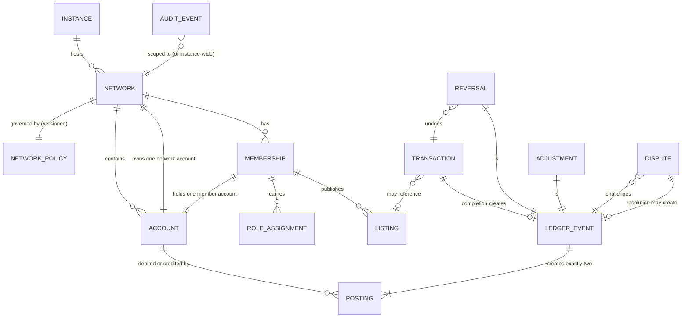
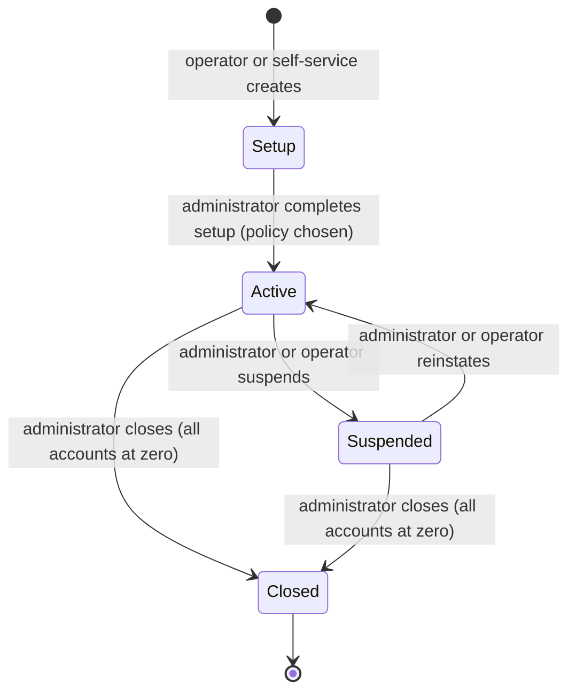
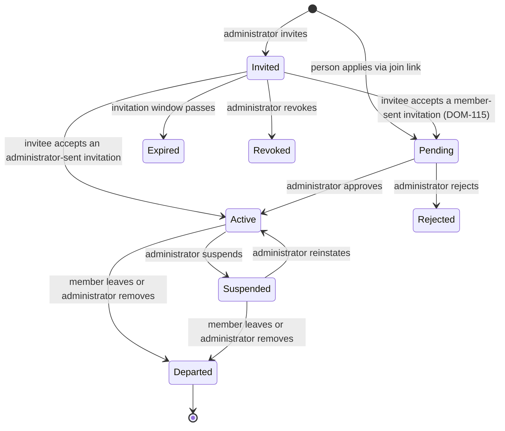
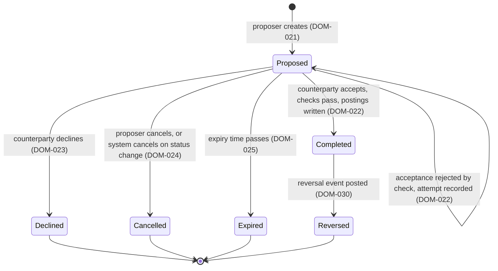
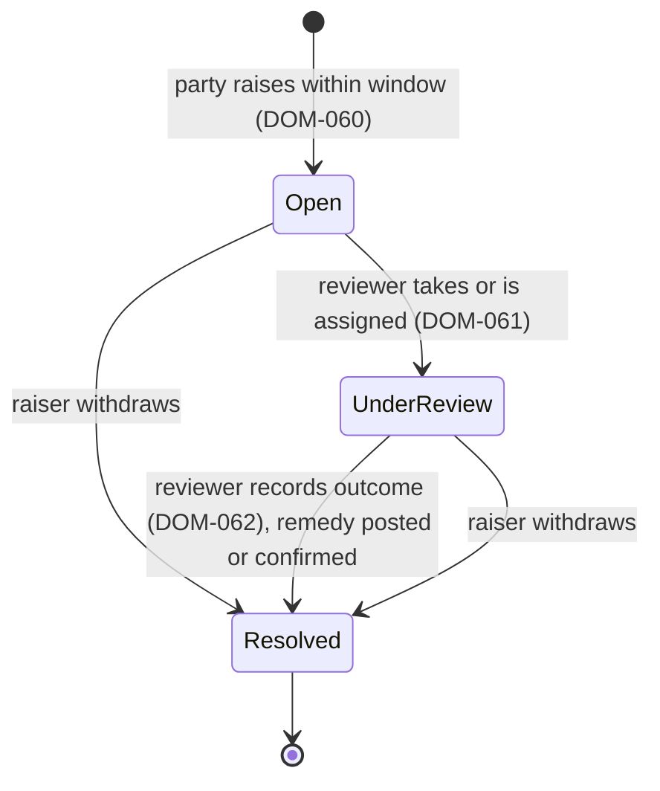

# Domain Model and Mutual-Credit Rules

| Field | Value |
|---|---|
| Status | Draft |
| Owner role | Domain modeler |
| Last updated | 2026-11-11 |
| Scope | The entities of a Circula network, their attributes and lifecycles, the platform-wide ledger invariants, the rules for transactions, reversals, adjustments, limits, disputes, member departure and default handling, and the boundary between configurable network policy and platform invariants. This is the authoritative home for every rule about how balances may change. |
| Dependencies | [00-conventions.md](00-conventions.md) (vocabulary, normative terms, baseline decisions) |
| Related documents | [02-personas-roles-and-journeys.md](02-personas-roles-and-journeys.md) (who holds which role), [04-functional-requirements.md](04-functional-requirements.md) (capabilities built on these rules), [06-data-model-ledger-and-audit.md](06-data-model-ledger-and-audit.md) (storage shape), [07-api-and-integration-contract.md](07-api-and-integration-contract.md) (operations and error codes), [10-governance-and-network-operations.md](10-governance-and-network-operations.md) (human processes around these rules), [12-quality-strategy-and-test-plan.md](12-quality-strategy-and-test-plan.md) (how the invariants are verified) |

## 1. Purpose

A mutual-credit network is an accounting agreement among its members: whoever provides goods or services is credited, whoever receives them is debited, and the sum of all balances is always zero. The software's one non-negotiable job is to keep that accounting correct, attributable, and reconstructable under every sequence of user actions, retries, concurrent requests, administrator interventions, and failures.

This document defines the model precisely enough that the data model, the API, the user interface, the security baseline, and the test plan can each enforce the same rules without inventing their own. Rules here are stated as platform invariants (`MUST`) or as network policies (`MAY`, with a recommended default). Section 11 lists every policy; anything not listed there is not configurable.

Identifier ranges in this document are reserved by topic so that later insertions do not renumber anything:

| Range | Topic |
|---|---|
| DOM-001 to DOM-019 | Ledger invariants |
| DOM-020 to DOM-029 | Transactions |
| DOM-030 to DOM-039 | Reversals |
| DOM-040 to DOM-049 | Adjustments |
| DOM-050 to DOM-059 | Limits and negative balances |
| DOM-060 to DOM-069 | Disputes |
| DOM-070 to DOM-079 | Membership, departure, default, closure |
| DOM-080 to DOM-089 | Nature of the credit unit |
| DOM-090 to DOM-119 | Network policy catalogue |

## 2. Domain overview

Plain-text summary: an instance hosts networks. A network has a versioned policy, memberships, and accounts. Each membership holds exactly one member account; the network itself owns one network account. Memberships publish listings and carry role assignments. Transactions, reversals, and adjustments are the three kinds of **ledger event**; each ledger event, once posted, creates exactly two postings (one debit, one credit) on two accounts of the same network. Disputes challenge a ledger event and their resolution may create another. Audit events record every state change.

## 3. Entities

Attribute lists are conceptual. Storage, identifier formats, and indexing are specified in [06-data-model-ledger-and-audit.md](06-data-model-ledger-and-audit.md).

### 3.1 Instance

One running deployment of the platform ([DEC-001](13-assumptions-risks-decisions-and-roadmap.md#dec-001)). The instance is the boundary of the platform operator's responsibility and of instance-wide audit events. The instance has no ledger of its own.

### 3.2 Network

| Attribute | Meaning |
|---|---|
| identifier | Opaque, unique within the instance. |
| name, description | Shown to members and, if the network chooses, to the public. |
| credit unit name, symbol | Free text chosen by the network, for example "hours" / "h". |
| decimal places | Integer 0, 1, or 2. Fixed once the first posting exists ([DOM-006](#dom-006)). |
| status | `Setup`, `Active`, `Suspended`, `Closed` (section 3.2.1). |
| policy | The current [network policy](#314-network-policy) version. |
| network account | The one [system account](#34-account) the network owns. |
| created at, closed at | Timestamps. |

#### 3.2.1 Network lifecycle

Plain-text summary: a network starts in `Setup`, where no postings are possible and the required policy values are chosen. It becomes `Active` when setup completes. `Suspended` stops all postings and new memberships but keeps everything readable. `Closed` is terminal: the ledger is read-only forever, and entry requires every account to be at zero ([DOM-075](#dom-075)).

### 3.3 Membership

The relationship between one person or organization and one network. The same person may hold memberships in several networks; nothing links those memberships at the ledger level.

| Attribute | Meaning |
|---|---|
| identifier | Opaque, unique. |
| network | The network joined. |
| identity | Reference to the platform-level login identity (email-based in the MVP, [DEC-007](13-assumptions-risks-decisions-and-roadmap.md#dec-007)). |
| display name | Name shown to other members of this network. |
| profile | Optional, network-visible contact and description fields; minimum set defined in [09-security-privacy-and-abuse-resistance.md](09-security-privacy-and-abuse-resistance.md). |
| status | `Invited`, `Pending`, `Active`, `Suspended`, `Departed`, plus terminal invitation states `Expired`, `Revoked`, `Rejected` (section 3.3.1). |
| roles | Zero or more of `administrator`, `reviewer`. Every active membership implicitly has the `member` role. |
| member account | The one account this membership holds ([DOM-015](#dom-015)). |
| joined at, departed at | Timestamps. |

#### 3.3.1 Membership lifecycle

Plain-text summary: a membership begins by invitation or application. An invitation sent by an administrator is already approved, so accepting it makes the membership `Active`; an invitation sent by a member ([DOM-115](#dom-115)) or an application needs administrator approval first. `Suspended` freezes the member account. `Departed` is terminal and requires the account to be closed at zero ([DOM-070](#dom-070), [DOM-071](#dom-071)).

### 3.4 Account

| Attribute | Meaning |
|---|---|
| identifier | Opaque, unique. |
| network | The owning network. Both accounts in any posting pair share this value ([DOM-005](#dom-005)). |
| type | `member` (held by exactly one membership) or `system` (held by the network). The MVP defines one system account per network, the **network account** ([DEC-003](13-assumptions-risks-decisions-and-roadmap.md#dec-003)). |
| status | `Active`, `Frozen`, `Closed` (section 3.4.1). |
| credit limit | Non-negative amount; the largest negative balance ordinary transactions may produce ([DOM-050](#dom-050)). |
| positive limit | Optional non-negative amount; the largest positive balance ordinary transactions may produce ([DOM-051](#dom-051)). |
| balance | Derived, see [3.5](#35-balance-available-credit-and-pending-totals). |

#### 3.4.1 Account lifecycle

| From | To | Trigger |
|---|---|---|
| (created) | `Active` | Membership becomes `Active` for the first time, or network is created (network account). |
| `Active` | `Frozen` | Membership suspended, or administrator freezes the account with a reason. |
| `Frozen` | `Active` | Membership reinstated, or administrator unfreezes. |
| `Active` or `Frozen` | `Closed` | Balance is zero, no `Proposed` transactions reference it, no open dispute names it, and the membership departs or the network closes ([DOM-070](#dom-070)). |

A `Frozen` account MUST NOT be the payer or payee of a new transaction and MUST NOT accept a `Proposed` transaction, but MAY be debited or credited by a reversal or adjustment ([DOM-016](#dom-016)). A `Closed` account accepts no postings of any kind.

### 3.5 Balance, available credit, and pending totals

- **Balance** = sum of credit postings − sum of debit postings on the account ([DOM-003](#dom-003)). A balance may be negative; a negative balance means the member has received more value from the network than they have provided so far. It is not a debt owed to the platform or to any single member.
- **Available credit** = balance + credit limit. It is the largest amount the account can be debited by ordinary transactions right now. If negative, the account is **over limit** ([DOM-052](#dom-052)).
- **Headroom** (only when a positive limit is set) = positive limit − balance.
- **Pending outgoing total** = sum of amounts of `Proposed` transactions where this account is payer. **Pending incoming total** likewise for payee. These are informational: they do not change the balance or available credit ([DEC-004](13-assumptions-risks-decisions-and-roadmap.md#dec-004)).

### 3.6 Credit limit and positive limit

Defined in section 8. A limit is a property of an account, defaulted from network policy at account creation and changeable by an administrator per account within policy bounds.

### 3.7 Listing (offer and request)

| Attribute | Meaning |
|---|---|
| identifier | Opaque, unique. |
| membership | The publishing member. |
| type | `offer` (goods or services the member will provide) or `request` (goods or services the member seeks). |
| title, description | Free text. |
| categories | Zero or more network-defined tags. |
| indicative amount | Optional amount or free-text pricing note. Not binding; a transaction records its own amount. |
| status | `Active`, `Paused`, `Closed`. |
| created at, updated at | Timestamps. |

Listings never move credits. A transaction MAY reference a listing for context ([DOM-021](#dom-021)); the reference does not constrain the amount.

### 3.8 Transaction

| Attribute | Meaning |
|---|---|
| identifier | Opaque, unique. |
| network | The network; both accounts belong to it. |
| payer account | The account to be debited. |
| payee account | The account to be credited. |
| amount | Positive integer in minor units ([DOM-006](#dom-006)). |
| description | Free text stating what was provided. Required ([DOM-021](#dom-021)). |
| listing | Optional reference to a listing. |
| proposer | The membership (or administrator acting for the network account) that created the proposal. Must hold the payer or the payee account ([DOM-021](#dom-021)). |
| status | `Proposed`, `Completed`, `Declined`, `Cancelled`, `Expired`, `Reversed` (section 5). |
| status reason | For `Cancelled`: `proposer`, `account_frozen`, `account_closed`, `membership_departed`, `network_suspended`. For `Reversed`: reference to the reversal. |
| idempotency key | Client-supplied, scoped to the proposer ([DOM-011](#dom-011)). |
| policy version | The network policy version in force when the transaction was proposed and, separately, when it was completed ([DOM-017](#dom-017)). |
| proposed at, expires at, completed at, closed at | Timestamps. |
| ledger event | Set when `Completed`: the event that created the postings. |
| failed acceptance attempts | Append-only list of (timestamp, actor, error code) for acceptances rejected by a limit or status check ([DOM-022](#dom-022)). |

### 3.9 Ledger event and posting

A **ledger event** is the single source of every balance change. It has exactly one of three kinds:

| Kind | Created by |
|---|---|
| `transaction_completed` | Acceptance of a `Proposed` transaction. |
| `reversal` | A reversal of a `Completed` transaction (section 6). |
| `adjustment` | An administrator action (section 7). |

| Ledger event attribute | Meaning |
|---|---|
| identifier | Opaque, unique. |
| network | The network. |
| sequence | Strictly increasing integer within the network ([DOM-010](#dom-010)). |
| kind | As above. |
| origin | The transaction, reversal request, dispute resolution, or adjustment that caused it ([DOM-007](#dom-007)). |
| authority | How the event was authorized: `mutual_consent`, `dispute_resolution`, `administrator`, `second_administrator_approved` ([DOM-013](#dom-013)). |
| actors | The memberships whose actions caused the event (proposer and acceptor; requesting parties; reviewer; administrator and approving administrator). |
| reason | Required for `reversal` and `adjustment`: a reason code from the policy catalogue plus free text. |
| limit override | Boolean, true only when a reversal or adjustment knowingly breached a limit ([DOM-032](#dom-032), [DOM-042](#dom-042)). |
| policy version | The policy version in force when posted. |
| posted at | Timestamp assigned by the ledger at posting. |

A **posting** is one half of a ledger event:

| Posting attribute | Meaning |
|---|---|
| ledger event | The owning event. |
| account | The account affected. |
| direction | `debit` or `credit`. |
| amount | The event's amount. Both postings of an event carry the same amount. |
| resulting balance | The account balance immediately after this posting, as recorded at posting time. A cache that MUST equal the derivation ([DOM-003](#dom-003)). |

Postings are immutable ([DOM-002](#dom-002)).

### 3.10 Reversal

A reversal is a ledger event of kind `reversal` that references exactly one `Completed` transaction and carries postings opposite to the original (original payer credited, original payee debited, same amount). Rules in section 6.

### 3.11 Adjustment

A ledger event of kind `adjustment` initiated by an administrator. It has a **from account** (debited) and a **to account** (credited), an adjustment type, a reason, and optional references to a transaction, dispute, or membership. Rules in section 7.

### 3.12 Dispute

| Attribute | Meaning |
|---|---|
| identifier | Opaque, unique. |
| subject | The ledger event challenged (a `transaction_completed` or `adjustment` event). |
| raised by | A membership that holds one of the subject's two accounts, or, for an adjustment against the network account, any administrator. |
| statement | Free text from the raiser. |
| status | `Open`, `Under review`, `Resolved` (section 9). |
| reviewer | The membership with the `reviewer` role handling it. |
| resolution | Outcome `dismissed`, `reversed`, `adjusted`, or `withdrawn`; reasoning text; the remedy ledger event if any; who confirmed it. |
| appeal | Optional single appeal record (section 9.4). |
| opened at, resolved at | Timestamps. |

### 3.13 Audit event

An append-only record created for every state change listed in [DOM-012](#dom-012). Conceptual fields: timestamp, actor (membership, operator identity, or `system`), action, object type and identifier, network (or instance-wide), before/after summary, request context (idempotency key, session reference). Contents, retention, and access are specified in [06-data-model-ledger-and-audit.md](06-data-model-ledger-and-audit.md); access rules in [09-security-privacy-and-abuse-resistance.md](09-security-privacy-and-abuse-resistance.md).

### 3.14 Network policy

The set of configurable values listed in section 11, stored as immutable versions. Each version records who set it, when it became effective, and a change note. Every ledger event and every transaction records the version it was evaluated under ([DOM-017](#dom-017)).

## 4. Ledger invariants

All invariants are P0 and platform-wide. No network policy can relax them, and no interface (web UI, API, administrative tool, migration script, or support procedure) may bypass them ([DEC-006](13-assumptions-risks-decisions-and-roadmap.md#dec-006)).

**DOM-001 — Balanced pairs.** Every ledger event MUST create exactly two postings: one `debit` and one `credit`, of the same amount, on two different accounts. The two postings and the event MUST be written in one atomic operation: either all three exist or none does.
*Rationale:* double-entry is what makes the zero-sum property hold without a separate reconciliation process.

**DOM-002 — Append-only accounting.** Ledger events and postings MUST NOT be updated or deleted after they are written, by any role or process, including the platform operator. Corrections MUST be made only by posting a reversal or an adjustment.
*Rationale:* an append-only history is the only way a balance can be audited back to its origins.

**DOM-003 — Balances are derived.** The balance of an account is defined as the sum of its credit postings minus the sum of its debit postings. Any stored balance (including the `resulting balance` on a posting) is a cache and MUST equal this derivation at all times. The platform MUST provide a verification operation that recomputes every balance from postings and reports any discrepancy ([QA](12-quality-strategy-and-test-plan.md) defines when it runs).
*Rationale:* a cached balance that drifts from its postings is the most common silent corruption in ledgers.

**DOM-004 — Zero-sum per network.** At every point in the ledger sequence, the sum of balances of all accounts in a network, member and system accounts together, MUST equal zero.
*Rationale:* follows from DOM-001 and DOM-005; stated separately because it is the property members rely on and the one the verification operation reports.

**DOM-005 — No cross-network postings.** Both accounts of a ledger event MUST belong to the same network. The platform MUST NOT convert, transfer, or net amounts between networks.
*Rationale:* each network's unit is its own accounting unit ([DEC-008](13-assumptions-risks-decisions-and-roadmap.md#dec-008)); a cross-network posting would imply an exchange rate.

**DOM-006 — Integer amounts in minor units.** Every amount MUST be a positive integer count of minor units of the network's credit unit. Zero and negative amounts are invalid. An amount, and any balance, MUST NOT exceed 2^53 − 1 minor units in magnitude, so that every value stays exact in JSON number representations and in exports; an event that would exceed this bound MUST be rejected with `invalid_amount`. The network's decimal places (0, 1, or 2) MUST NOT change once any posting exists in the network. Arithmetic on amounts MUST use integer operations; floating-point representations MUST NOT be used in the ledger or in any interface that feeds it ([DEC-005](13-assumptions-risks-decisions-and-roadmap.md#dec-005)).
*Rationale:* prevents rounding drift and ambiguous display.

**DOM-007 — Every posting has one origin.** Every ledger event MUST reference exactly one origin: the transaction it completed, the transaction it reversed (with the reversal request or dispute resolution that authorized it), or the adjustment record. Every posting MUST be reachable from its origin and vice versa.
*Rationale:* traceability: a member looking at a balance change must be able to reach the trade, dispute, or administrator decision behind it.

**DOM-008 — Consent for ordinary transactions.** A `transaction_completed` event MUST NOT be posted unless the holder of the payer account and the holder of the payee account have each given explicit consent to that transaction: proposing counts as the proposer's consent, acceptance as the counterparty's. For the network account, an administrator acting for the network gives its consent, subject to [DOM-043](#dom-043). No role, including administrators and the platform operator, can supply a member's consent on their behalf.
*Rationale:* members must be able to trust that their balance moves only when they agreed, or through the attributed and notified exception paths of reversal and adjustment.

**DOM-009 — Limit checks are atomic with posting.** The checks in [DOM-027](#dom-027) MUST be evaluated and the postings written in a single serializable operation per account pair, so that two concurrent events cannot both pass a check that only one of them could pass sequentially. An implementation MAY serialize by locking the accounts involved, by optimistic concurrency with retry, or by a single-writer ledger; it MUST NOT check first and post later without serialization.
*Rationale:* the classic double-spend race; see worked example 3 in section 13.

**DOM-010 — Total order per network.** Every ledger event MUST receive a sequence number that is assigned at posting, starts at 1 for the network, and is contiguous: each new event takes exactly the previous number plus one, with no gaps and no reuse. The balance of any account at any sequence position MUST be reconstructable by replaying postings up to that position. A gap in the sequence is a verification failure ([DOM-003](#dom-003)), because it can only mean a lost or removed event.
*Rationale:* reconstructable history is required for audits, disputes, and backups ([06-data-model-ledger-and-audit.md](06-data-model-ledger-and-audit.md)).

**DOM-011 — Idempotent state changes.** Every command that may create a ledger event, a transaction, a dispute, an adjustment, or a membership change MUST carry a client-supplied idempotency key scoped to the acting identity. A repeated command with the same key MUST return the original outcome and MUST NOT create a second object or posting. A repeated key with a different payload MUST be rejected. The platform MUST recognize a key for at least 24 hours after its first use; a key that created a lasting object (transaction, dispute, adjustment, membership change) SHOULD be kept with that object for as long as the object exists. Storage and expiry are specified in [06-data-model-ledger-and-audit.md](06-data-model-ledger-and-audit.md).
*Rationale:* retried requests after a network timeout are routine; without this rule they create duplicate trades.

**DOM-012 — Audited state changes.** The platform MUST record an audit event for every: ledger event; transaction status change; dispute status change; membership status or role change; account status or limit change; network status or policy change; listing creation and status change; export of network data and every download of an export file; authentication and credential event (login, failed login, recovery, password change, email change, second-factor enrolment and removal, session revocation); abuse report creation and handling; and every platform-operator access to network data, including the start, extension, and end of a break-glass grant.
*Rationale:* administrators and members need to answer "who did this and when" without engineering help.

**DOM-013 — Attribution of authority.** Every ledger event MUST record the actors whose actions caused it and the authority under which it was posted: mutual consent of the two parties; a dispute resolution (with the dispute reference); an administrator (with reason); or an administrator with a second administrator's approval.
*Rationale:* reversals and adjustments are the exception to consent; they must carry their justification with them.

**DOM-014 — No silent balance change.** Any change to an account's balance MUST appear in that account's history as a posting with its originating event, and the account holder MUST be notified of every ledger event on their account that they did not themselves accept or propose (reversals, adjustments, and dispute-driven events). Notification delivery is specified in [04-functional-requirements.md](04-functional-requirements.md); this invariant requires that the notification is attempted and the attempt audited.
*Rationale:* the stated product promise: no silent balance mutation.

**DOM-015 — One member account per membership; one network account per network.** Every membership MUST hold exactly one member account, created when the membership first becomes `Active`. Every network MUST have exactly one network account, created with the network, which MUST NOT be closed while the network is `Active` or `Suspended`. Only administrators may act for the network account.
*Rationale:* keeps the MVP model small while giving write-offs a balanced counterparty ([DEC-003](13-assumptions-risks-decisions-and-roadmap.md#dec-003)).

**DOM-016 — Account status gates.** An `Active` account may take part in any ledger event. A `Frozen` account MUST NOT be payer or payee of a new or accepted transaction, but MAY be a party to a reversal or adjustment. A `Closed` account MUST NOT be a party to any ledger event. A network in `Setup` or `Closed` status MUST NOT post any ledger event. A network in `Suspended` status MUST NOT post `transaction_completed` events, but MAY post reversals and adjustments initiated by its administrators under sections 6 and 7, so that errors can be corrected and the closing adjustments of [DOM-075](#dom-075) remain possible.
*Rationale:* suspension must stop trading without stopping corrections.

**DOM-017 — Policy is versioned and evaluated at posting time.** Network policy changes MUST create a new immutable policy version with an effective time, which MAY be in the future (a scheduled version). A scheduled version MAY be cancelled by an administrator before its effective time; the cancellation is audited and the version is never evaluated. A ledger event MUST be evaluated under the policy version in force at its posting time and MUST record that version. A policy change MUST NOT retroactively alter the status or validity of existing events, transactions, or disputes; it applies to evaluations after its effective time. Every active member MUST be notified of a new policy version no later than its effective time, and the notification attempt MUST be audited; this notification is mandatory and is not subject to [DOM-114](#dom-114).
*Rationale:* members and reviewers must be able to see which rules applied to a past event.

**DOM-018 — Policy cannot relax invariants.** No network policy value, administrator action, or operator action MAY cause the platform to violate DOM-001 through DOM-017. Where a policy table in section 11 offers a range, the platform MUST reject values outside the range.
*Rationale:* the policy catalogue is the complete list of what is configurable.

## 5. Transaction lifecycle and rules

Plain-text summary: a transaction starts as `Proposed`. The counterparty's acceptance, if the checks pass, posts it atomically and makes it `Completed`. It can end as `Declined` (counterparty), `Cancelled` (proposer or system), or `Expired` (time). A `Completed` transaction can only change once more, to `Reversed`, when a reversal event is posted against it.

**DOM-020 — Transaction states.** A transaction MUST be in exactly one of `Proposed`, `Completed`, `Declined`, `Cancelled`, `Expired`, `Reversed`. The only permitted transitions are those in the diagram above. Every transition MUST be audited ([DOM-012](#dom-012)) with the actor and, for `Cancelled`, the status reason.

**DOM-021 — Proposal validity.** The platform MUST accept a proposal only when all of the following hold at proposal time: the network is `Active`; payer and payee are different accounts in that network; both accounts are `Active`; the proposer holds the payer account or the payee account (or is an administrator acting for the network account as one side); the amount satisfies [DOM-006](#dom-006) and does not exceed the per-transaction maximum ([DOM-104](#dom-104)) if one is set; the description is present and non-empty; any referenced listing belongs to the same network. The proposal MUST record `expires at` = proposed at + proposal expiry window ([DOM-100](#dom-100)). A proposal MUST NOT be rejected for insufficient available credit: limits are checked at acceptance ([DEC-004](13-assumptions-risks-decisions-and-roadmap.md#dec-004)), though the interface SHOULD warn the proposer when the payer's available credit is below the amount ([08-ux-and-accessibility.md](08-ux-and-accessibility.md)).
*Rationale:* a proposal is a request for consent, not a reservation.

**DOM-022 — Acceptance and posting.** Only the holder of the counterparty account (the account the proposer does not hold) MAY accept a `Proposed` transaction; for the network account, an administrator other than the proposer ([DOM-043](#dom-043)). Acceptance MUST, in one atomic operation satisfying [DOM-009](#dom-009): re-check every condition of [DOM-021](#dom-021) as of now (except expiry, which is checked as `now < expires at`); evaluate the limit checks of [DOM-027](#dom-027); and, if all pass, create the `transaction_completed` ledger event, its two postings, and set the status to `Completed` with `completed at`. The checks are evaluated under the policy version in force at acceptance ([DOM-017](#dom-017)), so a policy change between proposal and acceptance (for example a lowered [DOM-104](#dom-104)) can make a previously valid proposal fail; this is not a retroactive change, because the proposal's status is unchanged. If any check fails, the transaction MUST remain `Proposed`, the attempt MUST be appended to `failed acceptance attempts`, the acceptor MUST receive the specific error code (section 5.1), and the proposer SHOULD be notified. Policy [DOM-105](#dom-105) MAY require an additional confirmation step above a threshold amount; when enabled, acceptance by the counterparty moves the transaction to a confirmation-pending substate of `Proposed` and the posting happens when the confirmation is given.
*Rationale:* acceptance is the moment of mutual consent and therefore the moment the ledger moves.

**DOM-023 — Decline.** Only the counterparty MAY decline a `Proposed` transaction. `Declined` is terminal. A declined transaction MUST remain visible to both parties with its decline time and optional reason text.

**DOM-024 — Cancellation.** The proposer MAY cancel a `Proposed` transaction at any time before it is accepted. The platform MUST cancel a `Proposed` transaction, with the corresponding status reason and `system` as actor, when the payer or payee account becomes `Frozen` or `Closed`, when either membership becomes `Departed`, or when the network leaves `Active`. Both parties MUST be notified of a system cancellation. `Cancelled` is terminal.

**DOM-025 — Expiry.** A `Proposed` transaction whose `expires at` has passed MUST NOT be accepted. The platform MUST transition it to `Expired` no later than the next attempt to read or act on it, and SHOULD do so by a scheduled sweep within one hour of expiry. `Expired` is terminal. The proposer MAY create a new proposal.

**DOM-026 — Completed is final except for reversal.** A `Completed` transaction's amount, accounts, and description MUST NOT change. The only subsequent transition is to `Reversed` through section 6. Free-text annotations (for example a note added by a party) MAY be attached as separate records but MUST NOT alter the transaction's own fields.

**DOM-027 — Limit checks at posting.** For a `transaction_completed` event, the platform MUST verify, as part of the atomic posting operation:

1. **Payer credit limit:** `payer balance − amount ≥ −(payer credit limit)`; otherwise error `limit_exceeded` (payer).
2. **Payee positive limit:** if the payee has a positive limit, `payee balance + amount ≤ payee positive limit`; otherwise error `positive_limit_exceeded` (payee).
3. **Over-limit payer:** if the payer's available credit is already negative (over limit, [DOM-052](#dom-052)) the event MUST be rejected with `limit_exceeded` even for small amounts.

For the network account the same formulas apply using its own limits ([DOM-053](#dom-053)). Reversals and adjustments are governed by [DOM-032](#dom-032) and [DOM-042](#dom-042) instead.

**DOM-028 — Pending does not reserve.** `Proposed` transactions MUST NOT change any balance, available credit, or limit check result. The platform MUST expose pending outgoing and pending incoming totals so that interfaces can show them next to the balance ([08-ux-and-accessibility.md](08-ux-and-accessibility.md)).
*Rationale:* [DEC-004](13-assumptions-risks-decisions-and-roadmap.md#dec-004); the reservation model is recorded as an alternative there.

**DOM-029 — Large-amount confirmation (policy-gated).** When [DOM-105](#dom-105) is enabled, a transaction whose amount is at or above the configured threshold MUST require the payer's holder to confirm a second time after the counterparty's acceptance, and MUST NOT post before that confirmation. The confirmation step MUST expire with the transaction ([DOM-025](#dom-025)).
*Rationale:* a cheap defense against mistaken or coerced large trades, left to the network to enable.

### 5.1 Error codes raised by transaction rules

These codes are the vocabulary the API ([07-api-and-integration-contract.md](07-api-and-integration-contract.md)) and UI ([08-ux-and-accessibility.md](08-ux-and-accessibility.md)) MUST use; they are listed here because they are part of the rules.

| Code | Raised when |
|---|---|
| `network_not_active` | Network status is not `Active` ([DOM-016](#dom-016)). |
| `account_not_active` | Payer or payee account is `Frozen` or `Closed` ([DOM-016](#dom-016)). |
| `same_account` | Payer equals payee ([DOM-021](#dom-021)). |
| `not_a_party` | Actor holds neither account, or is not the counterparty for accept/decline ([DOM-021](#dom-021), [DOM-022](#dom-022)). |
| `invalid_amount` | Amount violates [DOM-006](#dom-006) or exceeds [DOM-104](#dom-104). |
| `description_required` | Description missing ([DOM-021](#dom-021)). |
| `limit_exceeded` | Payer check in [DOM-027](#dom-027) fails. |
| `positive_limit_exceeded` | Payee check in [DOM-027](#dom-027) fails. |
| `transaction_expired` | Acceptance after `expires at` ([DOM-025](#dom-025)). |
| `invalid_transition` | Action not allowed from the current status ([DOM-020](#dom-020)). |
| `self_dealing_not_allowed` | Same person on both sides of a system-account event, or initiating and approving the same adjustment ([DOM-043](#dom-043)). |
| `idempotency_conflict` | Same idempotency key, different payload ([DOM-011](#dom-011)). |
| `confirmation_required` | Large-amount confirmation outstanding ([DOM-029](#dom-029)). |
| `window_closed` | An action is attempted after its policy window: mutual reversal ([DOM-031](#dom-031), [DOM-101](#dom-101)), dispute ([DOM-060](#dom-060), [DOM-102](#dom-102)), appeal ([DOM-063](#dom-063), [DOM-103](#dom-103)), administrator reversal ([DOM-108](#dom-108)). |
| `already_reversed` | Reversal of a transaction that is already `Reversed` ([DOM-033](#dom-033)). |
| `not_disputable` | Dispute raised on a `reversal` event ([DOM-060](#dom-060)). |
| `dispute_already_open` | A dispute on the same ledger event is `Open` or `Under review` ([DOM-060](#dom-060)). |
| `reviewer_ineligible` | Reviewer is a party to the subject event or initiated the subject adjustment ([DOM-061](#dom-061)). |
| `departure_blocked` | Departure attempted with a non-zero balance, a `Proposed` transaction, or an open dispute ([DOM-070](#dom-070)); the response names the blocking conditions. |
| `closure_blocked` | Network closure attempted while any account is not `Closed` at zero ([DOM-075](#dom-075)); the response names the blocking accounts. |
| `decimal_places_locked` | Attempt to change decimal places after the first posting ([DOM-006](#dom-006)). |
| `policy_value_out_of_range` | Policy value outside the range in section 11, or an account limit above the network maximum ([DOM-018](#dom-018), [DOM-091](#dom-091)). |
| `last_administrator` | Role change or departure that would leave the network without an active administrator (rule owned by [PER-006](02-personas-roles-and-journeys.md#per-006)). |
| `setup_incomplete` | Activation attempted before every "set at setup" policy in section 11 is chosen. |
| `invitation_expired` | Invitation accepted after its validity window ([DOM-099](#dom-099)). |
| `not_permitted_by_policy` | A policy in section 11 disables the action (for example `invite_only` applications, a zero-length window, [DOM-109](#dom-109) off, [DOM-113](#dom-113) separation, [DOM-115](#dom-115) off). |

## 6. Reversals

**DOM-030 — Reversal is a new event.** A reversal MUST be a ledger event of kind `reversal` referencing exactly one `Completed` transaction, with a `debit` posting on the original payee account and a `credit` posting on the original payer account for the original amount. On posting, the original transaction's status MUST become `Reversed` with a reference to the reversal. The original event and its postings MUST remain unchanged ([DOM-002](#dom-002)).

**DOM-031 — Reversal authority.** A reversal MUST be posted only under one of these authorities, each recorded per [DOM-013](#dom-013):

1. **Mutual consent:** the holders of both accounts each request reversal of the same transaction, and the second request arrives within the mutual-reversal window ([DOM-101](#dom-101)) measured from `completed at`. The reversal posts when the second request is recorded. Either party MAY withdraw their request before the second request arrives.
2. **Dispute resolution:** a dispute on the transaction is resolved with outcome `reversed` ([DOM-062](#dom-062)).
3. **Administrator:** an administrator posts the reversal with a reason code and text. Policy [DOM-108](#dom-108) MAY restrict this to a window after completion or require a second administrator's approval. Both parties MUST be notified ([DOM-014](#dom-014)).

**DOM-032 — Reversals may breach limits, visibly.** A reversal MUST be posted even if it leaves an account over its credit limit or positive limit, because it restores a prior state. The event MUST set `limit override` to true when this happens, and the affected account becomes over limit ([DOM-052](#dom-052)).
*Rationale:* refusing to undo an erroneous trade because of a limit would lock in the error.

**DOM-033 — At most one reversal; reversals are not reversed.** A transaction MUST NOT be reversed more than once. A reversal event MUST NOT itself be reversed; if a reversal was wrong, the parties create a new transaction, or an administrator posts an adjustment referencing the reversal.

**DOM-034 — Reversal of disputed transactions.** While a dispute on a transaction is `Open` or `Under review`, a mutual-consent reversal of that transaction MUST be recorded as the dispute's resolution with outcome `reversed` and reasoning "mutual consent", rather than as an independent reversal, so that one ledger event results and the dispute closes consistently.

## 7. Adjustments

**DOM-040 — Adjustment types.** An adjustment is a ledger event of kind `adjustment` with exactly one of these types:

| Type | From account (debited) | To account (credited) | Typical use |
|---|---|---|---|
| `correction` | Any account | Any other account in the network | Fix an error that a reversal cannot express (wrong amount already partly settled, mistaken adjustment). |
| `write_off` | Network account | Member account with a negative balance | Record a default or forgiveness per governance ([DOM-073](#dom-073)). The network account absorbs the loss visibly. |
| `forfeiture` | Member account with a positive balance | Network account | A departing member's positive balance is forfeited or donated to the network ([DOM-071](#dom-071)). |
| `policy_transfer` | Member account or network account | Network account or member account | A transfer the network's governance has decided on, such as a contribution levy or a grant, when policy [DOM-109](#dom-109) permits it. |

**DOM-041 — Adjustment requirements.** An adjustment MUST be initiated by an administrator of the network; MUST carry a type, a reason code from the policy-defined list plus free text, and references to the related transaction, dispute, or membership where one exists; MUST satisfy [DOM-001](#dom-001), [DOM-005](#dom-005), [DOM-006](#dom-006), and [DOM-016](#dom-016); MUST be notified to the holder of every member account involved ([DOM-014](#dom-014)); and MUST be disputable by those holders within the dispute window ([DOM-060](#dom-060)). When policy [DOM-107](#dom-107) is enabled, the adjustment MUST remain pending until a second, different administrator approves it, and MUST expire unposted if not approved within the proposal expiry window.

**DOM-042 — Adjustments and limits.** An adjustment MUST respect [DOM-027](#dom-027)-style limit checks for the account it debits unless the initiating administrator sets the `limit override` flag with a reason; the override MUST be recorded on the event and the affected account becomes over limit ([DOM-052](#dom-052)). `write_off` and `forfeiture` adjustments always bring a member account toward zero and MUST NOT be blocked by that member's limits.

**DOM-043 — No acting on both sides.** A person MUST NOT be the acting administrator for the network account and the holder of the counterparty member account in the same ledger event, and MUST NOT be both the initiator and the approving administrator of an adjustment. For a transaction or adjustment between the network account and an administrator's own member account, a different administrator MUST act for the network account or approve the event. If the network has only one administrator and policy [DOM-110](#dom-110) is enabled, the platform MAY post the event with a `self_dealing` flag that makes it visible to every active member of the network regardless of balance-visibility policy; if [DOM-110](#dom-110) is disabled, the event MUST be rejected with `self_dealing_not_allowed`.
*Rationale:* administrator misuse through the network account is the most direct abuse path in a mutual-credit ledger.

## 8. Limits and negative balances

**DOM-050 — Credit limit.** Every account MUST have a credit limit, a non-negative amount. A member account's limit is set from the network default ([DOM-090](#dom-090)) when the account is created and MAY be changed per account by an administrator within the network's maximum ([DOM-091](#dom-091)). A limit change MUST be audited with a reason and applies to ledger events posted after the change; it MUST NOT alter existing postings. Lowering a limit below the current negative balance is permitted and makes the account over limit ([DOM-052](#dom-052)).

**DOM-051 — Positive limit.** An account MAY have a positive limit, defaulted from policy ([DOM-092](#dom-092)) and changeable per account by an administrator. When unset, no positive bound is enforced.
*Rationale:* some networks cap hoarding to keep credits circulating; others do not.

**DOM-052 — Over-limit state.** An account is over limit when `balance < −credit limit` or, if a positive limit is set, `balance > positive limit`. Over-limit is a derived state, never stored as the only record. While a payer account is over its credit limit it MUST NOT be debited by an ordinary transaction ([DOM-027](#dom-027)); while a payee account is over its positive limit it MUST NOT be credited by one. Reversals and adjustments remain possible under their own rules. The account holder and the administrators MUST be able to see the over-limit state and the amount by which it is exceeded.

**DOM-053 — Network account limits.** The network account's credit limit and positive limit are set by policy ([DOM-093](#dom-093)); the credit limit MAY be unbounded. Its balance, which turns negative as write-offs accumulate, MUST be visible to every active member of the network, together with its ledger events (kind, type, amount, reason code, date). The counterparty of each such event MUST be shown by name only when [DOM-096](#dom-096) is `visible_to_members` or the event carries the `self_dealing` flag ([DOM-043](#dom-043)); otherwise the counterparty is shown as an unnamed member, because a named write-off would disclose that member's balance.
*Rationale:* the network account's negative balance is the network's shared loss; hiding it would be a silent mutation of the community's position.

**DOM-054 — Limits never move balances.** Changing a limit MUST NOT create a ledger event. Limits bound future ordinary transactions only.

## 9. Disputes

Plain-text summary: a party raises a dispute, a reviewer takes it, and the reviewer resolves it with one of four outcomes. Withdrawal by the raiser is also a resolution. An appeal does not reopen the dispute; it is a separate record on it (section 9.4).

**DOM-060 — Raising a dispute.** The holder of either account of a `transaction_completed` or `adjustment` event MAY raise a dispute on it within the dispute window ([DOM-102](#dom-102)) measured from `posted at`. Only one dispute MAY be `Open` or `Under review` per ledger event at a time. A `reversal` event cannot be disputed directly; its origin (the dispute or administrator action) is challenged through the appeal or governance process instead. Raising a dispute MUST NOT change any balance ([DOM-064](#dom-064)).

**DOM-061 — Review assignment.** A dispute moves to `Under review` when a membership holding the `reviewer` role takes it or an administrator assigns it. The reviewer MUST NOT be a holder of either account of the subject event and MUST NOT be the administrator who initiated a subject adjustment. If no eligible reviewer exists, the dispute remains `Open` and administrators MUST be alerted.

**DOM-062 — Resolution outcomes.** A resolution MUST record one outcome and reasoning text:

| Outcome | Ledger effect |
|---|---|
| `dismissed` | None. The subject stands. |
| `reversed` | A `reversal` of the subject transaction is posted under authority `dispute_resolution` ([DOM-031](#dom-031)). Only valid when the subject is a `Completed` transaction. |
| `adjusted` | An `adjustment` of type `correction` specified in the resolution (accounts, amount, reason) is posted under authority `dispute_resolution`. |
| `withdrawn` | None. Recorded when the raiser withdraws. |

When policy [DOM-111](#dom-111) requires administrator confirmation for the outcome's remedy, the resolution MUST be recorded as decided but the remedy MUST remain pending until an administrator who is not a party confirms it; the dispute status stays `Under review` until then. If the confirming administrator declines, the decline and its reason MUST be recorded, the dispute MUST stay `Under review`, and the reviewer MUST record a new resolution (the same remedy for a different administrator to confirm, or a different outcome). A remedy of outcome `reversed` follows [DOM-032](#dom-032); a remedy of outcome `adjusted` restores a prior state in the same way and MUST be posted even if it leaves an account over a limit, with `limit override` recorded. The remedy event, when posted, MUST reference the dispute ([DOM-007](#dom-007)), and the parties MUST be notified ([DOM-014](#dom-014)).

**DOM-063 — Resolution is final except by appeal.** A `Resolved` dispute MUST NOT be reopened. The raiser or the other party MAY file one appeal within the appeal window ([DOM-103](#dom-103)); the appeal process, who hears it, and what it may change are governance matters defined in [10-governance-and-network-operations.md](10-governance-and-network-operations.md). Any ledger consequence of an appeal MUST be posted as a new reversal or adjustment referencing the appeal; it MUST NOT edit the earlier resolution or events.

**DOM-064 — No freezing of amounts by disputes.** A dispute MUST NOT change balances, available credit, or account status. Interfaces MUST mark the subject event as disputed in both parties' histories while the dispute is not `Resolved`. An administrator MAY separately freeze an account under [DOM-016](#dom-016) with a reason.
*Rationale:* consistent with [DEC-004](13-assumptions-risks-decisions-and-roadmap.md#dec-004): the ledger has no reservations or holds.

### 9.4 Appeal record

An appeal is attached to a `Resolved` dispute: who appealed, when, the statement, who heard it (an administrator or a second reviewer per governance), the appeal outcome (`upheld`, `overturned`), and the reference to any remedy event. One appeal per dispute.

## 10. Membership, departure, default, and closure

**DOM-070 — Voluntary departure at zero.** An active or suspended member MAY leave a network at any time when their account balance is zero, no `Proposed` transaction names their account, and no dispute naming their account is `Open` or `Under review`. Departure MUST set the membership to `Departed` and the account to `Closed` atomically. When the conditions do not hold, the platform MUST return the specific blocking condition and MUST NOT depart the membership.

**DOM-071 — Departure with a non-zero balance.** A member whose balance is not zero MAY request departure; the request MUST be routed to the administrators. Departure then requires an administrator to post a closing adjustment that brings the balance to zero: a `write_off` for a negative balance, or, for a positive balance, a `forfeiture` to the network account or, where policy [DOM-112](#dom-112) permits, the member first transfers the balance to other members by ordinary transactions. The adjustment MUST reference the membership and MUST be posted in the same atomic operation as the status changes of [DOM-070](#dom-070), or immediately before them with the departure refusing to complete if the balance is still non-zero.

**DOM-072 — Administrator removal.** An administrator MAY suspend a membership at any time with a reason (freezing its account, [DOM-016](#dom-016)) and MAY remove it by the same departure rules as [DOM-070](#dom-070) and [DOM-071](#dom-071). The platform MUST cancel the member's `Proposed` transactions on suspension ([DOM-024](#dom-024)) and MUST notify the member of suspension, reinstatement, and removal.

**DOM-073 — Default handling.** The platform MUST treat a member with a negative balance who has departed, been removed, or been declared in default by governance only through these mechanisms: suspension ([DOM-072](#dom-072)); the over-limit state ([DOM-052](#dom-052)); the `write_off` adjustment ([DOM-040](#dom-040)); and the visible network account balance ([DOM-053](#dom-053)). The platform MUST NOT provide debt collection, interest, penalties computed on balances, or any claim in national currency. What counts as default, how long a network waits, and whether a departed member may rejoin are governance policies ([10-governance-and-network-operations.md](10-governance-and-network-operations.md)).
*Rationale:* a negative balance is an obligation to the community expressed in the community's unit, not a monetary debt; the software records outcomes and keeps them visible, it does not enforce them.

**DOM-074 — History survives departure.** Postings, ledger events, transactions, and disputes involving a departed member MUST be retained unchanged for as long as the network's ledger exists, because other members' balances depend on them. Personal data of departed members is minimized according to [06-data-model-ledger-and-audit.md](06-data-model-ledger-and-audit.md) and [09-security-privacy-and-abuse-resistance.md](09-security-privacy-and-abuse-resistance.md): the display name on historic records MAY be replaced by a pseudonym after the retention period, but the account identifier and amounts MUST NOT change.

**DOM-075 — Network closure.** A network MAY be closed only when every member account is `Closed` at zero and the network account is at zero, which generally requires closing adjustments for every remaining balance under [DOM-071](#dom-071). The platform MUST reject closure otherwise, naming the accounts that block it. On closure the ledger MUST become read-only and MUST remain exportable ([04-functional-requirements.md](04-functional-requirements.md)) for the retention period defined in [06-data-model-ledger-and-audit.md](06-data-model-ledger-and-audit.md).

**DOM-076 — Rejoining.** A departed person MAY be invited or apply again; a new membership and a new account are created. The platform MUST NOT carry a balance across memberships. Administrators SHOULD be shown that a prior membership existed and how it ended, subject to the privacy rules in [09-security-privacy-and-abuse-resistance.md](09-security-privacy-and-abuse-resistance.md).

## 11. Network policy catalogue versus platform invariants

Everything in this table is configurable by a network administrator within the stated bounds; everything in section 4 is not. Each policy value is part of the versioned network policy ([DOM-017](#dom-017)). Values marked "set at setup" MUST be chosen explicitly before the network becomes `Active`; the platform ships no default for them.

| ID | Policy | Allowed values | Recommended default |
|---|---|---|---|
| DOM-090 | Default credit limit for new member accounts | Non-negative amount | Set at setup; the platform MUST require an explicit choice because a network where no account can go negative cannot start trading. |
| DOM-091 | Maximum credit limit an administrator may grant to a member account | Non-negative amount ≥ DOM-090, or unbounded | Set at setup. |
| DOM-092 | Default positive limit for new member accounts | Non-negative amount or unset | Unset. |
| DOM-093 | Network account credit limit and positive limit | Non-negative amounts or unbounded | Unbounded credit limit; positive limit unset. |
| DOM-094 | Credit unit name, symbol, decimal places | Free text; 0 to 2 decimal places | Set at setup; decimal places immutable after first posting ([DOM-006](#dom-006)). |
| DOM-095 | Membership entry mode | `invite_only`, `invite_or_apply_with_approval`, `open_join_link_with_approval` | `invite_or_apply_with_approval`. Applications always require administrator approval before `Active`. An invitation sent by an administrator counts as approval; an invitation sent by a member ([DOM-115](#dom-115)) does not. |
| DOM-096 | Balance visibility to other members | `hidden`, `visible_to_members` | `hidden`. Own balance, administrators' view, and the network account balance ([DOM-053](#dom-053)) are not affected. |
| DOM-097 | Directory and listing visibility | `members_only`, `public_read` | `members_only`. |
| DOM-098 | Profile fields required beyond display name | Subset of the optional profile fields | None required. |
| DOM-099 | Invitation validity window | 1 to 90 days | 14 days. |
| DOM-100 | Proposal expiry window | 1 to 90 days | 14 days. |
| DOM-101 | Mutual-consent reversal window | 0 to 90 days (0 disables mutual reversal) | 7 days. |
| DOM-102 | Dispute window | 1 to 365 days | 30 days. |
| DOM-103 | Appeal window | 0 to 90 days (0 disables appeals) | 14 days. |
| DOM-104 | Maximum amount per transaction | Positive amount or unset | Unset. |
| DOM-105 | Large-amount confirmation threshold ([DOM-029](#dom-029)) | Positive amount or disabled | Disabled. |
| DOM-106 | Reason codes available for reversals and adjustments | Non-empty list of codes with labels | Platform-provided starter list: `error_amount`, `error_counterparty`, `not_delivered`, `duplicate`, `dispute`, `departure`, `default`, `governance`, `other`. |
| DOM-107 | Second-administrator approval required for adjustments ([DOM-041](#dom-041)) | `off`, `all_adjustments`, `above_threshold` with amount | `off`; [DOM-043](#dom-043) applies regardless. |
| DOM-108 | Administrator-initiated reversal constraints ([DOM-031](#dom-031)) | Window in days or unbounded; second-administrator approval on or off | 30 days; approval off. |
| DOM-109 | `policy_transfer` adjustments permitted ([DOM-040](#dom-040)) | `on`, `off` | `off`. |
| DOM-110 | Single-administrator self-dealing disclosure ([DOM-043](#dom-043)) | `on`, `off` | `off`. |
| DOM-111 | Administrator confirmation of dispute remedies ([DOM-062](#dom-062)) | `none`, `adjustments_only`, `all_remedies` | `adjustments_only`. |
| DOM-112 | Positive balance on departure ([DOM-071](#dom-071)) | `forfeit_to_network`, `transfer_then_forfeit_remainder` | `transfer_then_forfeit_remainder`. |
| DOM-113 | Administrator and reviewer roles may be held by the same person | `allowed`, `separate_people_required` | `allowed` (small networks); governance SHOULD recommend separation ([10-governance-and-network-operations.md](10-governance-and-network-operations.md)). |
| DOM-114 | Notification channel settings | Which events send email beyond the mandatory sets in [DOM-014](#dom-014) and [DOM-017](#dom-017) | All events on. |
| DOM-115 | Members may send invitations | `on`, `off` | `off`; administrators can always invite. A member-sent invitation, once accepted, enters `Pending` and requires administrator approval in every entry mode ([DOM-095](#dom-095)). |

Things a network cannot configure, by design: the double-entry rule, the zero-sum property, append-only history, consent for ordinary transactions, atomic limit checks, audit coverage, the existence of the network account, and the fact that credits are not converted to anything.

## 12. Nature of the credit unit

**DOM-080 — Accounting unit only.** The credit unit of a network is an accounting unit for recording mutual obligations among members. The platform MUST NOT: present an exchange rate between a credit unit and any national currency, cryptocurrency, or another network's unit; offer purchase, sale, redemption, or conversion of credits; compute interest or fees in credits; or describe balances as money, cash, deposits, or funds in any interface text ([00-conventions.md §9](00-conventions.md#9-writing-rules)). A network MAY describe its own valuation convention (for example "one credit is intended to represent one hour of work") in its free-text description; the platform attaches no behavior to it.
*Rationale:* [DEC-008](13-assumptions-risks-decisions-and-roadmap.md#dec-008). Whether a given network's use of credits raises tax, money-services, or consumer-protection questions is a counsel question recorded in [13-assumptions-risks-decisions-and-roadmap.md](13-assumptions-risks-decisions-and-roadmap.md); this document does not answer it.

**DOM-081 — No platform guarantee of acceptance or value.** The platform MUST NOT state or imply that any member will accept credits, that credits can be exchanged for anything, or that a balance has a value outside the network. Interface text that introduces balances SHOULD state the network's own description of what a credit represents and nothing more.

## 13. Worked examples

All examples use a network with 0 decimal places, unit "credits", default credit limit 100, no positive limit, and the network account `NET`.

**Example 1 — ordinary trade.** A (balance 0) proposes to be debited 40 in favor of B (balance 0) for "two hours of garden work". B accepts. One ledger event, sequence 1: debit A 40 (resulting −40), credit B 40 (resulting +40). Sum of balances: −40 + 40 + 0 (NET) = 0. A's available credit: −40 + 100 = 60.

**Example 2 — limit exceeded.** A is at −80. A proposes 30 to C. C accepts. Check: −80 − 30 = −110 < −100. The event is not posted; the transaction stays `Proposed`; the attempt is recorded with `limit_exceeded`; C sees the error; A is notified. A may cancel, or an administrator may raise A's limit within DOM-091, after which C can accept again before expiry.

**Example 3 — concurrent acceptances.** A is at −80 with two `Proposed` transactions of 15 each, to B and to C. B and C accept at the same instant. Under DOM-009 the ledger serializes the two postings: the first passes (−95), the second fails (−95 − 15 = −110 < −100) with `limit_exceeded`. It is unspecified which of B or C wins; what is specified is that exactly one does.

**Example 4 — dispute and reversal.** A, who was debited in example 1, disputes it ("work not done"). Reviewer R (not A or B) takes the dispute, resolves `reversed`. The platform posts sequence 2: debit B 40 (resulting 0), credit A 40 (resulting 0), authority `dispute_resolution`, origin: the dispute. Transaction 1 is now `Reversed`. Both postings of sequence 1 remain in the ledger.

**Example 5 — write-off on departure.** D is at −150 (an administrator had raised D's limit to 200) and has left the community without settling. Governance declares default. Administrator M posts `write_off`, reason `default`, referencing D's membership: debit NET 150 (NET resulting −150), credit D 150 (D resulting 0). D's account is then `Closed` and the membership `Departed`. The network account now shows −150 to every member: the loss is socialized and visible. Sum of all balances is still 0.

**Example 6 — idempotent retry.** A's client sends "propose 40 to B" with idempotency key `k1`; the response is lost. The client retries with `k1`. The platform returns the original transaction and creates no second one. A later request with `k1` but amount 45 is rejected with `idempotency_conflict`.

**Example 7 — administrator self-dealing guard.** The network's only administrator M proposes a transaction from NET to M's own account for "newsletter editing". With DOM-110 off, the platform rejects it with `self_dealing_not_allowed`. With DOM-110 on, M can post it, the event carries the `self_dealing` flag, and every member sees it in the network's public event list.

## 14. Open questions

| ID | Question | Decision needed | Decided by |
|---|---|---|---|
| OQ-DOM-1 | Should the MVP support a reservation model where `Proposed` transactions reduce available credit? | Confirm [DEC-004](13-assumptions-risks-decisions-and-roadmap.md#dec-004) or reopen. | Project owner |
| OQ-DOM-2 | Should partial reversals be supported directly, or is reversal-plus-new-transaction (or `correction` adjustment) sufficient for the MVP? | Scope of [DOM-033](#dom-033). | Project owner |
| OQ-DOM-3 | Should more than one system account per network (for example separate "losses" and "community fund" accounts) be allowed in the MVP? | Scope of [DOM-015](#dom-015). | Project owner |
| OQ-DOM-4 | Should organizations be modeled as a membership type with multiple authorized people, or as a single login shared by the organization? | Affects [DOM-008](#dom-008) consent attribution. | Project owner, with input from the first pilot network |
| OQ-DOM-5 | Which starter reason codes ([DOM-106](#dom-106)) should ship, and should they be translatable? | Product decision. | Product owner |
| OQ-DOM-6 | Whether a network's description of its valuation convention ([DOM-080](#dom-080)) needs a required disclaimer is a counsel question. | Record for counsel; no design change assumed. | Project owner with counsel |

## 15. Change history

| Date | Change |
|---|---|
| 2026-11-11 | Initial draft. |
