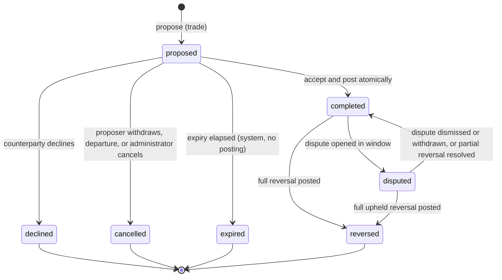

# 03 Domain Model and Mutual-Credit Rules

Status: Draft v0.1 · Owner: Product architect (with domain review by a second maintainer before v1.0) · Last updated: 2026-10-21 · Scope: entities, balance semantics, transaction kinds and state machine, consent, reservations, reversals, disputes, adjustments, default handling, member departure, configuration versus invariants · Depends on: [00-conventions.md](00-conventions.md) (glossary, LED-1..7, configurable defaults), [01-vision-scope.md](01-vision-scope.md), [04-functional-requirements.md](04-functional-requirements.md), [06-data-ledger-audit.md](06-data-ledger-audit.md) (storage of these rules), [07-api-contract.md](07-api-contract.md) (idempotency and error surface), [09-security-privacy.md](09-security-privacy.md) (authorization) · Open questions: section 14

This file is the authoritative home for **domain rules**. Terms are defined in the glossary of [00-conventions.md](00-conventions.md#3-glossary-authoritative) and are not redefined here. Platform invariants LED-1..LED-7 are defined in [00-conventions.md §4](00-conventions.md#4-platform-wide-invariants-not-configurable) and are referenced by ID only. Default values for configurable policies are defined in [00-conventions.md §5](00-conventions.md#5-configurable-network-policies-defaults) and are referenced by name only.

Normative terms follow [00-conventions.md §1](00-conventions.md#1-normative-terms).

---

## Build status (as built)

Snapshot: HEAD `925f637` (branch claude/circula-build). Statuses were first read at `31b1015` and re-checked at `925f637` (see TRACEABILITY.md). **built** = behaviour exists in code; **partial** = exists with the gaps stated, or the required verification was not run; **not built**; **deferred** = out of MVP by this spec or a recorded decision. Code paths and test names: [TRACEABILITY.md](../TRACEABILITY.md). Open owner decisions and resolved questions: [DECISIONS.md](../DECISIONS.md). Status is implementation status, not a compliance claim; no release gate has been run.

Summary: built 35, deferred 1, partial 3.

| ID | Priority | Status | Note |
|---|---|---|---|
| DOM-001 | P0 | built | Every entity carries network id; cross-network refs refused |
| DOM-002 | P0 | built | One member per person per network; second join returns existing |
| DOM-003 | P0 | built | Membership states and transitions table-tested |
| DOM-004 | P0 | built | Account state derived from membership |
| DOM-005 | P0 | built | Integer minor units; parser rejects fractions and zero |
| DOM-006 | P0 | built | Balance is sum of signed entries; sign convention in UI |
| DOM-007 | P0 | built | Effective limit: override else default |
| DOM-008 | P0 | built | Available = balance + limit - reserved outgoing |
| DOM-009 | P0 | built | Transaction kinds trade, reversal, adjustment, grant |
| DOM-010 | P0 | built | Transition table enforced; DB trigger tx_status_flow |
| DOM-011 | P0 | built | Payer and payee consent; requests do not post without accept |
| DOM-012 | P0 | built | Reservation on payer's own proposals; requests refined per SA-08 (DEC-035) |
| DOM-013 | P0 | built | Terms immutable; expiry is system transition with no posting |
| DOM-014 | P0 | built | Acceptance re-checks both parties and limit in one unit |
| DOM-015 | P0 | built | Completed trades have exactly two equal and opposite entries |
| DOM-016 | P0 | built | Idempotency key on retryable commands; key reuse refused |
| DOM-017 | P0 | built | Dispute window from completion; opening creates no entries |
| DOM-018 | P0 | built | Dispute states and outcomes with rationale and decider |
| DOM-019 | P0 | built | Reversal is new transaction; reversal cannot be reversed |
| DOM-020 | P0 | built | Cumulative reversed total capped at original amount |
| DOM-021 | P0 | built | Upheld reversal blocked by limit goes to posting_pending |
| DOM-022 | P0 | built | Adjustment: reason, system counter-entry, own-account refused |
| DOM-023 | P0 | built | No edit or delete of completed records; corrections are new transactions |
| DOM-024 | P0 | built | Departure preconditions, retain and settle-to-zero rules |
| DOM-025 | P1 | partial | Default flag built (no ledger effect); limit-warning job (DOM-025.1) not built |
| DOM-026 | P0 | built | One system account per network; exempt from limit |
| DOM-027 | P1 | built | Sign-up grant posted from system account on activation; off by default (DEC-051) |
| DOM-028 | P0 | built | No configuration key for invariants |
| DOM-029 | P0 | built | Policy bounds and unknown-field refusal; default MaxTxAmount differs (DEC-056) |
| DOM-030 | P0 | built | Policy versions appended; changes audited with old and new values |
| DOM-031 | P0 | built | Decimals locked after first posting |
| DOM-032 | P0 | built | Limit change posts nothing; reduction blocks only new debt |
| DOM-034 | P2 | deferred | Mutual reversal without dispute is post-MVP |
| DOM-035 | P0 | built | Audit event in the same unit for each state change |
| DOM-036 | P1 | partial | Admin reversal built; requires completed status, disputed only via dispute (DEC-052) |
| DOM-037 | P0 | built | Admin cannot act on own account or own trades |
| DOM-038 | P0 | partial | Party and conflict refusal built; admin without reviewer role may decide (DEC-072) |
| DOM-039 | P0 | built | Suspended members may decline, cancel and view; cannot propose or accept |
| DOM-040 | P0 | built | Listings write no entries |

## 1. Scope and principles of the model

- The model covers one network at a time. Nothing in it crosses a network boundary (DOM-001).
- The ledger is append-only. Balances, reservations and availability are derived views, not stored truth (LED-2, LED-3).
- The credit unit is an **accounting unit** of the network. It is not a cryptocurrency, a security, or a claim redeemable for national currency. Nothing in this model gives a credit a monetary value (see [01-vision-scope.md §1](01-vision-scope.md#1-purpose-and-statement-of-limits)).
- Trades are **consensual**: a member's balance decreases only through a transaction they accepted or proposed (DOM-011).

## 2. Entities and identifiers

Attributes below are conceptual. Physical schema, types and indexes are in [06-data-ledger-audit.md](06-data-ledger-audit.md).

| Entity | Purpose | Key attributes (conceptual) | Notes |
|---|---|---|---|
| Network | Tenant and rule set | id, name, slug, policy values, status (setup, active, closed) | One per tenant boundary (DOM-001) |
| Member | A person's membership in one network | id, network id, display name, membership state, roles, join method | One per person per network (DOM-002) |
| Account | Ledger account of a member | id, member id, account state, credit limit override | Exactly one per member; the system account is separate |
| System account | Network counterpart for adjustments and grants | id, network id | One per network (DOM-026) |
| Listing | Offer or request of goods or services | id, member id, type (offer or request), title, description, optional price, listing state | Has no balance effect (DOM-040) |
| Transaction | Proposal and, when completed, a set of postings | id, network id, kind, payer account, payee account, amount (minor units), status, proposer, listing ref (optional), note, expiry, original transaction ref (reversals), reason (adjustments, reversals, grants) | Kinds: `trade`, `reversal`, `adjustment`, `grant` (DOM-009) |
| Entry (posting) | Immutable ledger line | id, transaction id, account id, signed amount (minor units), sequence | Append-only (LED-2) |
| Dispute | Contest of one completed transaction | id, transaction id, opener account, reason category, statements, state, reviewer, decision, rationale | DOM-017, DOM-018 |
| Audit event | Record of a state change | see DOM-035 and [06-data-ledger-audit.md](06-data-ledger-audit.md) | Append-only (LED-6) |
| Policy | Configurable rule of one network | name, value, bounds | Section 13 |

Identifiers are opaque, unique within the deployment, and never reused (DOM-001 for scope; ID rules in [00-conventions.md §2](00-conventions.md#2-requirement-ids) apply to requirements only).

### DOM-001 · P0 · Network tenant boundary
- **Rationale.** The glossary defines the network as a tenant boundary; isolation is a privacy and correctness property (VIS-003).
- **Acceptance.**
  - Every entity above carries a network id, and every write rejects references to entities in another network (automated test).
  - A transaction whose payer and payee are in different networks is rejected with a validation error and creates no entries.

### DOM-002 · P0 · One member and one account per person per network
- **Rationale.** Glossary: a person in two networks has two members and two accounts.
- **Acceptance.**
  - A second join by the same identity in the same network returns the existing membership and creates no second member (FR-017).
  - Two networks create two independent members and accounts for the same identity, with no link between them visible to either network.

### DOM-003 · P0 · Membership states and join modes
- **Statement.** A membership MUST be in exactly one of: `pending` (awaiting approval), `active`, `suspended`, `departed`. The network's join mode (`invite`, `approval`, `open`; default in [00-conventions.md §5](00-conventions.md#5-configurable-network-policies-defaults)) determines how `pending` or `active` is reached on joining.
- **Permitted transitions.**
  - `pending` → `active` (approved), `pending` → `departed` (denied or withdrawn).
  - `active` → `suspended` (administrator), `suspended` → `active` (administrator).
  - `active` or `suspended` → `departed` (departure, section 12).
- **Acceptance.** Each permitted transition is tested; each other transition is refused with an error and no state change; each transition writes an audit event (LED-6).

### DOM-004 · P0 · Account states
- **Statement.** An account is `active` when its member is `active`; `frozen` when its member is `suspended`; `closed` when its member is `departed`. Account state governs new transactions only (DOM-039); it never changes balances or entries.
- **Acceptance.** A suspended member's existing entries and balance are unchanged after suspension (test compares balance before and after).

## 3. Units, balances and limits

### DOM-005 · P0 · Integer minor units, no floating point
- **Statement.** All amounts MUST be stored and computed as integers in minor units of the network's decimal setting. Amounts on trades MUST be integers greater than zero (LED-7). Floating-point arithmetic MUST NOT be used for any monetary value at any layer.
- **Rationale.** Rounding errors would break LED-1 and LED-3.
- **Acceptance.**
  - Property tests on the amount parser and arithmetic show no value changes under decimal round trips for the supported decimal range.
  - Static check finds no float type in money-handling packages (QA gate in [12-quality-test-plan.md](12-quality-test-plan.md)).
  - Input "0", negative amounts and amounts with more decimals than the network allows are rejected with field-level errors.

### DOM-006 · P0 · Balance semantics
- **Statement.** The balance of an account is the sum of its signed entries (LED-3). A **positive** balance means the member has provided more value than they have received and holds credits they can spend. A **negative** balance means the member has received more value than they have provided and has used credit. Zero means neither. The sign convention MUST be the same in storage, APIs and UI.
- **Worked illustration (not a default).** With 2 decimals, a payer's trade of 25.00 credits to a payee creates entries −2500 on the payer's account and +2500 on the payee's account. Afterwards the payer's balance is −2500 (has used 25.00 of credit) and the payee's is +2500 (is owed 25.00 of value by the network community). The two balances sum to zero.
- **Acceptance.** Scenario test reproduces the illustration; the UI copy for both sides is checked against [08-ux-accessibility.md](08-ux-accessibility.md).

### DOM-007 · P0 · Credit limit and effective limit
- **Statement.** The credit limit is the maximum negative balance an account may reach, stored as a non-negative magnitude (glossary). The **effective limit** of an account is its per-member override when one is set, otherwise the network default (see [00-conventions.md §5](00-conventions.md#5-configurable-network-policies-defaults)). The system account has no limit (DOM-026).
- **Acceptance.** Given a default and an override, the effective limit used by the posting check is the override; removing the override restores the default; each change is audited (FR-060).

### DOM-008 · P0 · Available credit
- **Statement.** For a member acting as payer, available credit = balance + effective limit − sum of amounts reserved by pending outgoing proposals (DOM-012). It is the largest amount the member can newly commit as payer. It is never presented as a balance.
- **Pending incoming** amounts (where the member is payee) MUST NOT increase available credit. They MAY be displayed separately as "awaiting from others".
- **Acceptance.** Table-driven tests cover: positive balance; negative balance within limit; negative balance at limit; reservation present; reservation released after decline, cancel, or expiry.

### DOM-032 · P0 · Limit changes do not post
- **Statement.** Changing a credit limit (default or override) MUST NOT create entries. If a reduction leaves an account below its new negative limit, the account keeps its balance, and every subsequent posting that would decrease it further is refused (LED-5).
- **Acceptance.** Test: reduce the limit below the current negative balance; the balance is unchanged; a new payer proposal is refused; an incoming credit posting is allowed and moves the balance toward zero.

## 4. Transactions

### DOM-009 · P0 · Transaction kinds
- **Statement.** Every transaction MUST have exactly one kind:
  - `trade`: a member pays another member an amount for goods or services. Created by proposal and acceptance (sections 5 and 6).
  - `reversal`: posts the opposite of an earlier transaction. Created only as described in section 8.
  - `adjustment`: an administrator-created correction against the system account. Section 10.
  - `grant`: a network-configured initial or periodic credit from the system account, if the network enables it. Section 10.
- **Required fields by kind.** `trade`: payer, payee, amount, proposer, expiry. `reversal` and `adjustment` and `grant`: a reason (mandatory), and for reversals the original transaction reference.
- **Acceptance.** Creation without the required fields for a kind is refused; the kind of an existing transaction cannot change.

### DOM-015 · P0 · Completed transactions have exactly two equal and opposite entries
- **Statement.** Every completed transaction MUST have a set of entries that sums to zero (LED-1). Trades and reversals MUST have exactly two entries, on the two accounts involved, with equal absolute amounts. Adjustments and grants MUST have exactly two entries, one on the member account and one on the system account, with equal absolute amounts.
- **Acceptance.** Database-level and domain-level checks reject any completed transaction with a different entry count or non-zero sum; a fault-injection test that fails between the two inserts leaves no entries (LED-4).

### DOM-016 · P0 · Idempotent proposal, acceptance and posting
- **Statement.** Each state-changing command that can be retried (propose, accept, decline, cancel, reverse, adjust, grant) MUST carry an idempotency key scoped to the network and the acting principal. Repeating a command with the same key and the same payload MUST return the original result and MUST NOT create a second transaction or entry (LED-4). Reusing a key with a different payload MUST be refused.
- **Acceptance.** Ten concurrent identical requests with one key produce one transaction and one entry pair; a key reused with a different amount is refused with no change. API mechanics are in [07-api-contract.md](07-api-contract.md).

### DOM-040 · P0 · Listings have no balance effect
- **Statement.** Creating, editing or archiving a listing MUST NOT create entries or change any balance or reservation. A trade MAY reference a listing; the reference is informational.
- **Acceptance.** Listing operations leave the entries count and all balances unchanged (test).

## 5. Transaction status state machine

Statuses are those in [00-conventions.md §3](00-conventions.md#3-glossary-authoritative): `proposed`, `accepted`, `completed`, `declined`, `cancelled`, `expired`, `disputed`, `reversed`.

### DOM-010 · P0 · Allowed transitions
- **Statement.** A transaction MUST move only along the transitions below. Any other transition MUST be refused and MUST NOT change state.

| From | To | Trigger | Who | Posting? |
|---|---|---|---|---|
| (none) | `proposed` | propose | either party (proposer); see DOM-011 | No; reserves payer capacity (DOM-012) |
| `proposed` | `accepted` → `completed` | accept | the party who did not propose | Yes, atomically (DOM-014) |
| `proposed` | `declined` | decline | the party who did not propose | No; releases reservation |
| `proposed` | `cancelled` | withdraw | the proposer | No; releases reservation |
| `proposed` | `cancelled` | departure of either party, or administrator cancellation with reason | system or administrator (not party) | No |
| `proposed` | `expired` | proposal expiry elapsed | system | No; releases reservation |
| `completed` | `disputed` | dispute opened within window | either party (DOM-017) | No |
| `completed` | `reversed` | full reversal posted | dispute outcome, administrator, or mutual agreement (DOM-019, DOM-034) | Yes, reversal transaction |
| `disputed` | `completed` | dispute dismissed or withdrawn; or partial upheld reversal posted and dispute closed | reviewer or opener | Partial reversal only, if any |
| `disputed` | `reversed` | full upheld reversal posted | reviewer | Yes, reversal transaction |

- **Notes.**
  - `accepted` is a transient state inside the atomic accept-and-post unit (DOM-014). It MUST NOT be left persisted after the unit commits or rolls back. Whether it is recorded in the audit trail is an open question (OQ-DOM-1).
  - `completed` is not terminal: it may later become `disputed` or `reversed`.
  - `declined`, `cancelled`, `expired` and fully `reversed` are terminal.
  - A **partial** reversal leaves the original in `completed` (or `disputed`) with a recorded reversed total (DOM-020).
- **Acceptance.** Generated test enumerates every (state, command) pair; permitted pairs produce the listed result; all other pairs are refused with no change and no audit event for the refused attempt (refusals MAY be logged in operational logs but MUST NOT create audit events).

## 6. Proposal, consent, acceptance and cancellation

### DOM-011 · P0 · Consent before debit
- **Statement.** A trade MUST NOT post unless the **party whose balance will decrease** (the payer) has consented to it, and the other party has also consented. Consent is given by proposing (for the proposer) and by accepting (for the other party). Therefore a trade is always proposed by one party and accepted by the other.
- **Rationale.** Principle 3. Without this rule a member could be charged by another member's action alone.
- **Acceptance.** Tests: a payee-initiated proposal requires payer acceptance; a payer-initiated proposal requires payee acceptance; no path posts without an accept by the non-proposer; an accept by the proposer of their own proposal is refused.

### DOM-012 · P0 · Proposal checks and capacity reservation
- **Statement.** A proposal MUST be refused unless:
  1. both parties are `active` members of the same network (DOM-039 for suspended members);
  2. amount is a positive integer within the network's maximum transaction amount;
  3. the payer's available credit (DOM-008) is at least the amount.
- **Reservation.** On successful proposal, the amount is reserved against the payer's available credit until the transaction leaves `proposed`. A proposal MUST NOT reserve against the payee.
- **Rationale.** Prevents over-commitment across several pending proposals. Reservation is a soft guard; acceptance re-checks the hard limit (DOM-014).
- **Acceptance.** Test: payer with available 30.00 proposes 20.00 (accepted), then 15.00 (refused: available 10.00); declining the first restores availability to 30.00.

### DOM-013 · P0 · Proposal immutability and exits
- **Statement.** The terms of a `proposed` transaction (payer, payee, amount, kind, listing reference) MUST NOT be edited. To change terms, the proposer withdraws (`cancelled`) and creates a new proposal. A note MAY be added only by the proposer before acceptance; notes are not terms.
- **Expiry.** Proposals expire after the network's proposal expiry (default in [00-conventions.md §5](00-conventions.md#5-configurable-network-policies-defaults)). Expiry is a system transition with no posting.
- **Acceptance.** An edit attempt on terms is refused; an expired proposal cannot be accepted (refused with "expired"); the reservation is released at expiry (test with a clock source).

### DOM-014 · P0 · Acceptance posts atomically and re-checks capacity
- **Statement.** Acceptance MUST, in one atomic unit: re-check that both parties are still active, re-check the payer's effective limit (LED-5) against the current balance, insert both entries, set the transaction to `completed`, and write the audit event (LED-4, LED-6). If any check fails, nothing is written, the transaction remains `proposed`, and the acceptance is refused with a reason. The hard check uses the balance and effective limit only (LED-5). Other pending reservations (DOM-012) are not subtracted here: they were guarded when each proposal was made, and any change that would invalidate this acceptance (such as a limit reduction) is caught by this check.
- **Per-account serialisation.** Postings against the same account MUST be serialised (LED-5).
- **Acceptance.**
  - Fault injection at each step leaves either no change or the full change.
  - Two accepts racing for the last available credit: exactly one succeeds; the other is refused and remains `proposed`.
  - A counterparty suspended between proposal and acceptance: acceptance refused.

### DOM-039 · P0 · Suspended members
- **Statement.** A suspended member MUST NOT propose, accept, reverse, or open a dispute. A suspended member MAY decline a proposal addressed to them and MAY withdraw their own proposal, because these are exits that do not add obligations. A suspended member MAY view their own balance and history and export their own data. Pending proposals involving a suspended member stay `proposed` until they are declined, cancelled or expired, and MUST NOT be accepted while the member is suspended.
- **Acceptance.** Automated authorization tests cover each action for suspended members; a suspended member's balance does not change except by a posting that was already completed.

## 7. Reversals and corrections

### DOM-019 · P0 · Reversal construction
- **Statement.** A reversal is a new transaction of kind `reversal` that references an original completed transaction. Its entries are equal and opposite to the original's entries for the reversed amount: the original payee is debited and the original payer is credited. A reversal MUST NOT reference a reversal, and a reversal MUST NOT be reversed. The original transaction is never edited (LED-2).
- **Acceptance.** Test: after a full reversal, each account's balance equals its balance before the original trade; the entry log contains the original and reversal entries; the original's entries are byte-identical before and after (DAT test).

### DOM-020 · P0 · Full and partial reversal and the cumulative cap
- **Statement.** The total reversed amount across all reversals of a transaction MUST NOT exceed the original amount. When the cumulative reversed amount equals the original amount, the original status becomes `reversed`. A partial reversal leaves the original in `completed`, or in `disputed` if a dispute is open, and records the reversed total.
- **Acceptance.** Reversing 20.00 of a 25.00 trade leaves status `completed` with reversed total 20.00; a further reversal of 10.00 is refused; a further reversal of 5.00 sets status `reversed`.

### DOM-034 · P2 · Mutual reversal
- **Statement.** Post-MVP. Both parties agree to reverse a completed transaction without a dispute, with the rules of DOM-019 and DOM-020 applying.
- **Acceptance.** Deferred; see [04-functional-requirements.md](04-functional-requirements.md#10-deferred-capabilities-explicit-list).

### DOM-036 · P1 · Administrative reversal
- **Statement.** An administrator MAY reverse a completed transaction without a dispute, for a recorded reason (for example, an error in the trade record or a suspected misuse). The reason is mandatory and audited. The administrator MUST NOT be a party to the transaction (DOM-037).
- **Acceptance.** Reversal without reason refused; reversal by a party refused; audit event contains reason and actor.

### DOM-023 · P0 · Corrections are new transactions
- **Statement.** No completed transaction, entry or audit event is ever edited or deleted. An error is corrected by a reversal (DOM-019), an adjustment (DOM-022) or a new trade. Records MAY be annotated only through append-only notes that do not change amounts, parties or status.
- **Acceptance.** Repository-level checks found no update or delete on entries or audit events (LED-2); the API has no route that edits a completed transaction (contract test).

## 8. Disputes

### DOM-017 · P0 · When a dispute may be opened
- **Statement.** A party to a `completed` transaction MAY open a dispute on it within the network's dispute window (default in [00-conventions.md §5](00-conventions.md#5-configurable-network-policies-defaults)), measured from the completion time. Opening a dispute sets the transaction to `disputed` and MUST NOT create or change entries.
- **Acceptance.** Dispute opened on day window−1 succeeds; on day window+1 is refused; postings and balances are identical before and after opening (test).

### DOM-018 · P0 · Dispute lifecycle and outcomes
- **Statement.** A dispute MUST be in one of these states: `open`, `under_review`, `posting_pending` (upheld, reversal blocked by DOM-021), `resolved`, `withdrawn`. Outcomes: `dismissed` (no posting; transaction returns to `completed`), `upheld` (full reversal posted), `partially_upheld` (partial reversal of a stated amount, not exceeding the remaining reversible amount, DOM-020). Withdrawal by the opener is allowed only before a decision. Each outcome MUST carry a rationale and the decider's identity.
- **Acceptance.** Each state transition is tested; a decision without rationale is refused; the opener cannot decide.

### DOM-038 · P0 · Reviewer independence
- **Statement.** A dispute reviewer MUST NOT decide a dispute on a transaction in which they are a party, or which they proposed, accepted, adjusted or reversed. Each decision MUST record the reviewer's identity.
- **Acceptance.** Automated test: a party to the transaction cannot record a decision; a reviewer who is a party is refused with a conflict reason; the audit event records the reviewer.

### DOM-021 · P0 · Reversal blocked by the limit
- **Statement.** If an upheld reversal would decrease the balance of the account being debited (the original payee) below its effective limit (LED-5), the reversal MUST NOT post. The dispute moves to `posting_pending`, and the transaction stays `disputed`. The network's resolution path (open question OQ-DOM-2) applies: candidate paths are a recorded, time-limited override of the affected member's limit by an administrator, or holding until the balance recovers. Under no path may a posting breach LED-5.
- **Rationale.** The payee may have spent the credits received; the reversal would then push them past their limit. A ledger rule must not be bent to close a dispute.
- **Acceptance.** Test: payee spent credits; upheld reversal refused as a posting; dispute shows `posting_pending`; after an administrator-approved limit override (audited) the reversal posts; without override the state persists and no entry is written.

## 9. Adjustments and grants

### DOM-022 · P0 · Adjustments
- **Statement.** An adjustment is an administrator-created transaction of kind `adjustment` that posts one entry on the member's account and one equal and opposite entry on the system account. A reason is mandatory. An administrator MUST NOT adjust their own account (DOM-037). Adjustments are completed on creation; they have no proposal stage. Adjustments on a member account are subject to LED-5 for the member side.
- **Acceptance.** Adjustment without reason refused; adjustment to own account refused; adjustment that would push a member below their effective limit refused with the reason; audit event has reason, actor, target and amount.

### DOM-037 · P0 · Administrators cannot act on their own transactions
- **Statement.** An administrator MUST NOT approve, adjust, reverse, or decide a dispute on a transaction in which their own account is a party, and MUST NOT change their own credit limit or suspension state.
- **Acceptance.** Automated authorization tests refuse each action; each refusal is recorded in operational logs.

### DOM-027 · P1 · Sign-up grants
- **Statement.** A network MAY enable a `grant` to new members (amount configured by the network; disabled by default, see OQ-DOM-3). Grants post from the system account, are completed on creation, and are subject to LED-5 on the member side (which will normally pass, since grants are positive). A grant is not a trade and does not require the member's consent; the member is informed through history.
- **Acceptance.** Grant created on join when enabled; not created when disabled; creates exactly two entries; balance equals grant amount after join.

## 10. Negative balances, limits and default handling

### DOM-025 · P1 · Default handling
- **Statement.** "Default" is a governance concept, not a ledger status. A network MAY configure:
  1. a **limit warning**: an administrator notice when a member has remained at or beyond their effective limit for a configured number of days (the threshold is a network policy with no platform default);
  2. a **default flag**: an administrator-applied, reasoned marker on a member. Setting the flag MUST NOT post entries and MUST NOT change balances. Its effect is limited to what the network configures (for example, blocking new payer proposals). Clearing the flag is audited.
- **What the software does not do.** It does not collect debts, send payment demands, reduce balances by itself, or report anyone externally. Any such action is outside the platform and is a governance matter.
- **Acceptance.** Setting and clearing the flag produces audit events and no entries; limit warning is produced once per period and is visible to administrators only.

### DOM-026 · P0 · System account
- **Statement.** Each network has exactly one system account. It is exempt from the credit limit check, may have any sign, and is the counterpart of adjustments and grants. The invariant that the sum of all account balances in a network is zero (LED-1) includes the system account.
- **Acceptance.** Sum check across member and system accounts equals zero after every fixture operation; limit check is skipped for system account.

## 11. Member departure and closure

### DOM-024 · P0 · Member departure
- **Preconditions.** A member may depart (voluntary or administrative) only when they have no `disputed` transaction, no `posting_pending` dispute, and no `proposed` transaction in which they are a party, unless those are first resolved, declined, cancelled or expired. Pending proposals involving a departing member MAY be auto-cancelled by the departure process; the automated cancellation is recorded in the audit trail.
- **Effects.** On departure, the membership becomes `departed` and the account becomes `closed` (DOM-003, DOM-004). Entries are retained. Per the network's departure rule (see section 13), either:
  - **retain (recommended default, OQ-DOM-4):** the balance remains on the closed account; the member keeps read-only access to their own history and export; the network's governance decides whether and how any balance is settled outside the platform; or
  - **settle-to-zero:** an administrator-created adjustment (DOM-022) moves the balance to the system account, with a mandatory reason. Positive balances are not redeemed by the platform; the settlement is recorded as an accounting correction only.
- **Completed trades remain.** Completed transactions and reversals involving a departed member remain valid, and disputes already opened remain resolvable.
- **Acceptance.** Departure refused with blocker list when blockers exist; after departure, no new proposal or acceptance involving the member succeeds; balance sums remain zero; the member can export their history (FR-090); settle-to-zero produces exactly two adjustment entries and a zero balance.

## 12. Concurrency and consistency expectations

- Concurrent commands that touch the same account MUST be serialised or validated against the same version so that LED-5 cannot be bypassed (LED-5, DOM-014).
- Read views MAY lag writes, but a view that shows a balance MUST be consistent with entries at one point in time, and a view that shows a status MUST NOT show a state that was never committed (see [06-data-ledger-audit.md](06-data-ledger-audit.md) for isolation level).
- Clock-dependent rules (proposal expiry, dispute window, limit-warning period) MUST use the server's time source and MUST be testable with an injected clock.

## 13. Configuration versus invariants

### DOM-028 · P0 · Invariants are not configurable
- **Statement.** The following MUST hold for every network and MUST NOT be settable by administrators or operators: LED-1 to LED-7 (see [00-conventions.md §4](00-conventions.md#4-platform-wide-invariants-not-configurable)); entries are append-only; the balance equals the sum of entries; an accepted trade posts both sides atomically; trades are consensual (DOM-011); a completed transaction is never edited; every state change is audited; the system account has no limit; the sum over a network is zero.
- **Acceptance.** No configuration endpoint or policy key exists for any invariant; a configuration change attempting one is refused.

### DOM-029 · P0 · Configurable policies and bounds
- **Statement.** Configurable policies are those listed in [00-conventions.md §5](00-conventions.md#5-configurable-network-policies-defaults), plus the items below, each with the bounds stated here. Where a default is listed in [00-conventions.md §5](00-conventions.md#5-configurable-network-policies-defaults), that value is authoritative. Where it is not listed, the default is the recommendation in section 14 and is not binding until decided.

| Policy | Bound (platform rule) | Notes |
|---|---|---|
| Default credit limit | Non-negative magnitude | DOM-007 |
| Per-member limit override | Non-negative magnitude, administrator only | DOM-007, audited |
| Maximum transaction amount | Positive integer in minor units; must be at least one minor unit | DOM-012 |
| Proposal expiry | Positive duration; platform maximum to be set (OQ-DOM-5) | DOM-013 |
| Decimals | 0 to a platform maximum (OQ-DOM-6); fixed once any posting exists | DOM-031 |
| Member directory visibility | Members-only is the only MVP value | FR-020 |
| Join mode | `invite`, `approval`, `open` | DOM-003 |
| Dispute window | Positive duration; platform maximum to be set | DOM-017 |
| Departure rule | `retain` or `settle-to-zero` | DOM-024 |
| Sign-up grant | Disabled, or a non-negative amount | DOM-027 |
| Limit warning threshold | Disabled, or a positive number of days | DOM-025 |

- **Validation.** Out-of-bounds or wrong-type values are refused with the field name and allowed range. Unknown policy keys are refused.
- **Acceptance.** Every bound has a test with a value at the edge (accepted) and just beyond (refused).

### DOM-030 · P0 · Policy changes take effect prospectively
- **Statement.** A policy change MUST apply only to transactions and decisions made after the change. It MUST NOT alter completed transactions, existing reservations' amounts, or the outcome of decided disputes. Each change is audited with old and new values, actor, and reason.
- **Acceptance.** Changing the dispute window does not reopen or close disputes already decided; changing the proposal expiry does not alter existing proposals' expiry times (or, if the network chose recalculation, the audit records it; open question OQ-DOM-7).

### DOM-031 · P0 · Decimals fixed after first posting
- **Statement.** The decimal setting MUST be fixed when the first entry is written to the network. Changing it afterwards is refused, because it would change the meaning of stored minor units.
- **Acceptance.** Change attempt after first posting refused; before first posting accepted and reflected in input and display.

### DOM-035 · P0 · Audit coupling
- **Statement.** Every state change defined in this model (membership, account, transaction status, dispute, reversal, adjustment, grant, policy change, role assignment, default flag) MUST write an audit event in the same atomic unit (LED-6). Audit content and access are defined in [06-data-ledger-audit.md](06-data-ledger-audit.md) and [09-security-privacy.md](09-security-privacy.md).
- **Acceptance.** Fault injection between the state change and the audit write leaves no state change; a sweep test lists each state-changing command and checks for an audit event.

### Governance-only rules (not enforced by software)

These are network governance matters documented in [10-governance-operations.md](10-governance-operations.md). The software records them but does not decide them:
- which goods and services are acceptable;
- whether a dispute's outcome is fair beyond the recorded rationale;
- who may be appointed administrator (the software enforces only that at least one administrator remains; FR-069);
- how members are told about rule changes;
- whether and how balances are settled outside the platform.

## 14. Open questions

- **OQ-DOM-1 (resolved as built).** Question moved to [DECISIONS.md](../DECISIONS.md): see DEC-036. Owner question on visibility stays open: DEC-074.
- **OQ-DOM-2 (resolved as built).** Question moved to [DECISIONS.md](../DECISIONS.md): see DEC-039.
- **OQ-DOM-3 (resolved as built).** Question moved to [DECISIONS.md](../DECISIONS.md): see DEC-051.
- **OQ-DOM-4 (resolved as built).** Question moved to [DECISIONS.md](../DECISIONS.md): see DEC-049.
- **OQ-DOM-5 (resolved as built).** Question moved to [DECISIONS.md](../DECISIONS.md): see DEC-050.
- **OQ-DOM-6 (resolved as built).** Question moved to [DECISIONS.md](../DECISIONS.md): see DEC-050.
- **OQ-DOM-7 (resolved as built).** Question moved to [DECISIONS.md](../DECISIONS.md): see DEC-037.
- **OQ-DOM-8 (counsel, before launch).** Whether any element of default handling, departure settlement, or the limit warning needs jurisdiction-specific review. This spec asserts no compliance and gives no legal advice.

Open questions are to be consolidated into [13-assumptions-risks-decisions.md](13-assumptions-risks-decisions.md).
