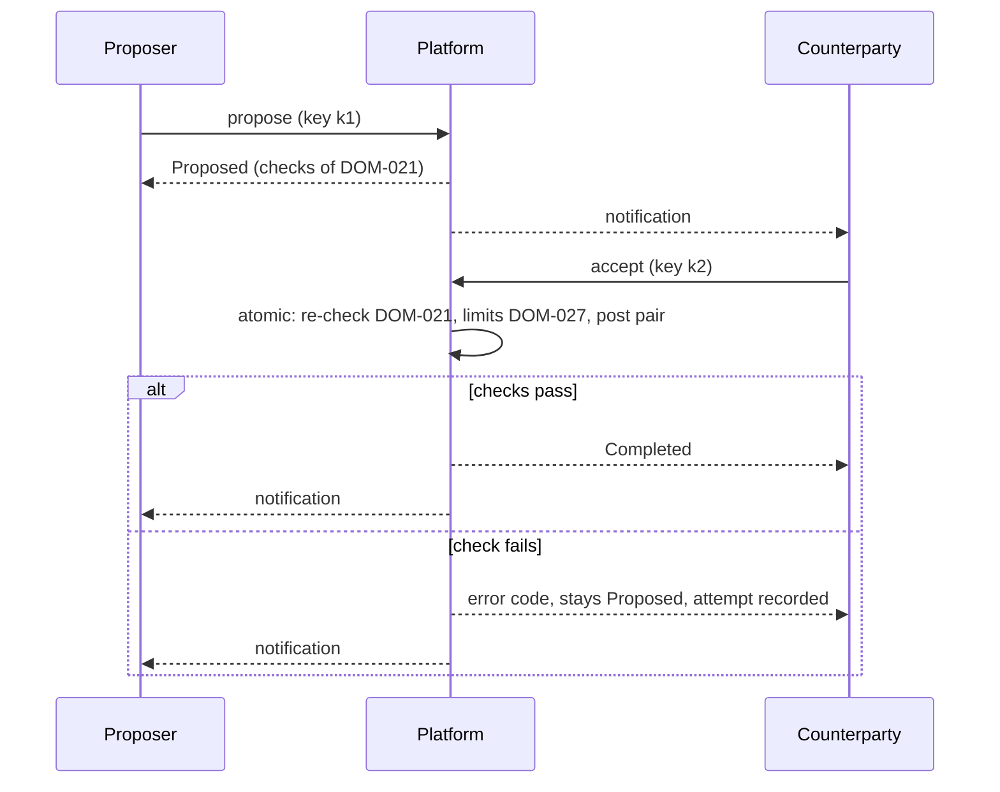

# Functional Requirements and Acceptance Criteria

| Field | Value |
|---|---|
| Status | Draft |
| Owner role | Product owner |
| Last updated | 2026-11-11 |
| Scope | The MVP capability list of Circula as testable functional requirements: network setup, identity and membership, member directory and listings, transactions, balance and history, administrator controls, disputes, audit history and notifications, and exports. Each requirement has a priority, rationale, dependencies, and Given/When/Then acceptance criteria. Ledger rules are cited from the domain model, never restated. Later capabilities are named as deferred. |
| Dependencies | [00-conventions.md](00-conventions.md) (terms, priorities, ID scheme, baseline decisions), [01-product-vision-and-scope.md](01-product-vision-and-scope.md) (MVP boundary), [02-personas-roles-and-journeys.md](02-personas-roles-and-journeys.md) (roles, permissions matrix, journeys), [03-domain-model-and-mutual-credit-rules.md](03-domain-model-and-mutual-credit-rules.md) (ledger rules, policy catalogue, error codes) |
| Related documents | [05-system-architecture.md](05-system-architecture.md), [06-data-model-ledger-and-audit.md](06-data-model-ledger-and-audit.md), [07-api-and-integration-contract.md](07-api-and-integration-contract.md), [08-ux-and-accessibility.md](08-ux-and-accessibility.md), [09-security-privacy-and-abuse-resistance.md](09-security-privacy-and-abuse-resistance.md), [10-governance-and-network-operations.md](10-governance-and-network-operations.md), [12-quality-strategy-and-test-plan.md](12-quality-strategy-and-test-plan.md), [13-assumptions-risks-decisions-and-roadmap.md](13-assumptions-risks-decisions-and-roadmap.md) |

## 1. Purpose and reading guide

This document is the authoritative home of the MVP capability list and its acceptance criteria ([00-conventions.md §7](00-conventions.md#7-authoritative-homes)). It turns the scope in [01-product-vision-and-scope.md §8.1](01-product-vision-and-scope.md#81-in-scope-for-the-mvp) into requirements a tester can execute. What the ledger may and may not do is defined in [03-domain-model-and-mutual-credit-rules.md](03-domain-model-and-mutual-credit-rules.md); a requirement here says which capability exercises a rule and how a tester observes it, and links the rule by identifier.

Identifier ranges are reserved by topic so that later insertions do not renumber anything:

| Range | Topic | Section |
|---|---|---|
| FR-001 to FR-009 | Network setup, rules statement, welcome screen | [3](#3-network-setup) |
| FR-010 to FR-019 | Identity and membership | [4](#4-identity-and-membership) |
| FR-020 to FR-029 | Member directory and listings, administrator and reviewer list | [5](#5-member-directory-and-listings) |
| FR-030 to FR-043 | Transactions | [6](#6-transactions) |
| FR-044 to FR-049 | Administrator controls, continued: break-glass administrator grant, session revocation, starting limit, oversight notices, message path to administrators (FR-060 to FR-069 is full) | [8](#8-administrator-controls) |
| FR-050 to FR-059 | Balance and history, ledger verification, network-account summary and adjustment log | [7](#7-balance-and-history) |
| FR-060 to FR-069 | Administrator controls, abuse reports, succession contact | [8](#8-administrator-controls) |
| FR-070 to FR-079 | Disputes, dispute age and reviewer reminder | [9](#9-disputes) |
| FR-080 to FR-089 | Audit history, notifications, notice board | [10](#10-audit-history-and-notifications) |
| FR-090 to FR-099 | Exports, export file expiry, final export at closure | [11](#11-exports) |

## 2. Conventions used in this document

### 2.1 Requirement template

Each requirement is written as: anchor and title with priority ([00-conventions.md §4](00-conventions.md#4-priority-levels)); a normative statement; *Rationale*; *Depends on* (DOM, PER, JRN, VIS, DEC identifiers); and numbered acceptance criteria in Given/When/Then form. Every requirement has at least one negative or edge criterion (wrong role, invalid state, retry with the same idempotency key, limit exceeded, expired, concurrent).

### 2.2 Common preconditions for acceptance criteria

Unless a criterion says otherwise:

- The fixture network `N` is `Active`, has 0 decimal places, unit "credits", default credit limit 100 ([DOM-090](03-domain-model-and-mutual-credit-rules.md#dom-090)), maximum credit limit 500 ([DOM-091](03-domain-model-and-mutual-credit-rules.md#dom-091)), no positive limit, and all other policies at their recommended defaults ([DOM-090](03-domain-model-and-mutual-credit-rules.md#dom-090) to [DOM-115](03-domain-model-and-mutual-credit-rules.md#dom-115)).
- Members `A`, `B`, `C` are `Active` with `Active` accounts at balance 0; `M` and `M2` are administrators; `R` is a reviewer who holds no account in the subject event; `NET` is the network account; `O` is the platform operator and `O2` a second, different platform operator account. Email addresses are of the form `member@example.org`.
- Every state-changing request carries a fresh idempotency key ([DOM-011](03-domain-model-and-mutual-credit-rules.md#dom-011)). "Retry with the same key" means the identical request with the identical key; the expected result is always the original outcome with no second object, posting, notification, or audit event for the state change.
- "Rejected with `code`" means the request changes no state, returns the named error code, and (where [DOM-022](03-domain-model-and-mutual-credit-rules.md#dom-022) requires it) records the failed attempt. The web client and the API return the same code for the same request ([DEC-006](13-assumptions-risks-decisions-and-roadmap.md#dec-006), [PER-008](02-personas-roles-and-journeys.md#per-008)).
- "Audited" means an audit event exists with actor, action, object, network, and timestamp ([DOM-012](03-domain-model-and-mutual-credit-rules.md#dom-012)); contents are defined in [06-data-model-ledger-and-audit.md](06-data-model-ledger-and-audit.md).
- "Notified" means a notification is created per [FR-084](#fr-084) and delivered per [FR-085](#fr-085).

### 2.3 Error codes

Domain-rule codes are those of [03-domain-model-and-mutual-credit-rules.md §5.1](03-domain-model-and-mutual-credit-rules.md#51-error-codes-raised-by-transaction-rules) and are used verbatim; that section is their authoritative home. The first six codes below are general request codes owned by [07-api-and-integration-contract.md](07-api-and-integration-contract.md); the rest are listed here only as a reading aid.

| Code | Raised when |
|---|---|
| `unauthenticated` | No valid session or token, or sign-in credentials are wrong. |
| `forbidden` | The actor's role does not permit the action ([PER-008](02-personas-roles-and-journeys.md#per-008)). |
| `not_found` | Object does not exist or belongs to a network the actor has no membership in ([DEC-001](13-assumptions-risks-decisions-and-roadmap.md#dec-001) isolation). |
| `validation_failed` | A field is missing or malformed (other than the §5.1 cases). An amount that breaks [DOM-006](03-domain-model-and-mutual-credit-rules.md#dom-006) or [DOM-104](03-domain-model-and-mutual-credit-rules.md#dom-104), including a non-integer, string, or exponent form, is always reported with top-level `invalid_amount` instead. |
| `rate_limited` | Request rate exceeded; response carries a retry-after interval ([09-security-privacy-and-abuse-resistance.md](09-security-privacy-and-abuse-resistance.md)). |
| `precondition_failed` | An administrator edit was based on a version that is no longer current (`If-Match` mismatch in [07-api-and-integration-contract.md](07-api-and-integration-contract.md)). |
| `not_permitted_by_policy` | Network policy disables the action (for example [DOM-095](03-domain-model-and-mutual-credit-rules.md#dom-095) `invite_only`, [DOM-101](03-domain-model-and-mutual-credit-rules.md#dom-101) = 0, [DOM-109](03-domain-model-and-mutual-credit-rules.md#dom-109) `off`). |
| `policy_value_out_of_range` | A policy or limit value lies outside its catalogue range ([DOM-018](03-domain-model-and-mutual-credit-rules.md#dom-018)). |
| `decimal_places_locked` | Decimal places changed after the first posting ([DOM-006](03-domain-model-and-mutual-credit-rules.md#dom-006)). |
| `setup_incomplete` | Activation attempted before every "set at setup" policy is chosen ([DOM-090](03-domain-model-and-mutual-credit-rules.md#dom-090), [DOM-091](03-domain-model-and-mutual-credit-rules.md#dom-091), [DOM-094](03-domain-model-and-mutual-credit-rules.md#dom-094)). |
| `invitation_expired` | Invitation accepted after its validity window ([DOM-099](03-domain-model-and-mutual-credit-rules.md#dom-099)). |
| `window_closed` | Dispute, appeal, mutual-reversal, or administrator-reversal window has passed ([DOM-101](03-domain-model-and-mutual-credit-rules.md#dom-101), [DOM-102](03-domain-model-and-mutual-credit-rules.md#dom-102), [DOM-103](03-domain-model-and-mutual-credit-rules.md#dom-103), [DOM-108](03-domain-model-and-mutual-credit-rules.md#dom-108)). |
| `dispute_already_open` | A dispute on the same ledger event is `Open` or `Under review` ([DOM-060](03-domain-model-and-mutual-credit-rules.md#dom-060)). |
| `reviewer_ineligible` | Reviewer or confirming administrator is a party to, or initiator of, the subject ([DOM-061](03-domain-model-and-mutual-credit-rules.md#dom-061), [DOM-062](03-domain-model-and-mutual-credit-rules.md#dom-062), [PER-006](02-personas-roles-and-journeys.md#per-006)). |
| `departure_blocked` | A [DOM-070](03-domain-model-and-mutual-credit-rules.md#dom-070) condition fails; the response names each blocking condition. |
| `closure_blocked` | A [DOM-075](03-domain-model-and-mutual-credit-rules.md#dom-075) condition fails; the response names each blocking account. |
| `last_administrator` | The action would leave the network with no `Active` administrator ([PER-006](02-personas-roles-and-journeys.md#per-006)). |

## 3. Network setup

**FR-001 — Create a network.** (P0)
The platform operator MUST be able to create a network by supplying a name and the email address of its first administrator. The network MUST be created in status `Setup` with its network account ([FR-004](#fr-004)), and the first administrator MUST receive an invitation that, when accepted, creates an `Active` membership with the `administrator` role without approval. Self-service network creation is not in the MVP ([OQ-FR-9](#14-open-questions)).
*Rationale:* the operator hands each network to its own administrators and holds no role inside it. *Depends on:* [PER-010](02-personas-roles-and-journeys.md#per-010), [PER-007](02-personas-roles-and-journeys.md#per-007), [PER-016](02-personas-roles-and-journeys.md#per-016), [DOM-015](03-domain-model-and-mutual-credit-rules.md#dom-015), [DEC-001](13-assumptions-risks-decisions-and-roadmap.md#dec-001).

1. Given `O` is signed in to the operations interface, when `O` creates network "Riverside" with first administrator `admin@example.org`, then a network exists in `Setup`, a network account exists, an invitation email is sent to `admin@example.org`, and the creation is audited as an instance-wide event.
2. Given that invitation, when the invitee accepts it, then the membership is `Active` with role `administrator` and a member account is created with no approval step.
3. Given `A` is a member of another network, when `A` attempts to create a network through the member interface or API, then the request is rejected with `forbidden`.
4. Given the creation response was lost, when `O` retries with the same idempotency key, then exactly one network exists and the original network identifier is returned.

**FR-002 — Setup wizard with required choices.** (P0)
While a network is in `Setup`, its administrator MUST be able to set the credit unit name, symbol, and decimal places ([DOM-094](03-domain-model-and-mutual-credit-rules.md#dom-094)), the default credit limit ([DOM-090](03-domain-model-and-mutual-credit-rules.md#dom-090)), and the maximum credit limit ([DOM-091](03-domain-model-and-mutual-credit-rules.md#dom-091)), and MAY set any other catalogue policy ([DOM-092](03-domain-model-and-mutual-credit-rules.md#dom-092) to [DOM-115](03-domain-model-and-mutual-credit-rules.md#dom-115)). The platform MUST NOT pre-fill a value for [DOM-090](03-domain-model-and-mutual-credit-rules.md#dom-090), [DOM-091](03-domain-model-and-mutual-credit-rules.md#dom-091), or [DOM-094](03-domain-model-and-mutual-credit-rules.md#dom-094); it MUST show the recommended default for every other policy. Each save creates a policy version ([FR-060](#fr-060)).
*Rationale:* a network cannot trade safely until its unit and limits are a conscious choice. *Depends on:* [DOM-017](03-domain-model-and-mutual-credit-rules.md#dom-017), [DOM-018](03-domain-model-and-mutual-credit-rules.md#dom-018), [DOM-090](03-domain-model-and-mutual-credit-rules.md#dom-090), [DOM-091](03-domain-model-and-mutual-credit-rules.md#dom-091), [DOM-094](03-domain-model-and-mutual-credit-rules.md#dom-094), [PER-011](02-personas-roles-and-journeys.md#per-011), [PER-034](02-personas-roles-and-journeys.md#per-034).

1. Given `N0` in `Setup`, when the administrator opens setup, then the fields for [DOM-090](03-domain-model-and-mutual-credit-rules.md#dom-090), [DOM-091](03-domain-model-and-mutual-credit-rules.md#dom-091), and [DOM-094](03-domain-model-and-mutual-credit-rules.md#dom-094) are empty and every other policy shows its recommended default.
2. Given `N0` in `Setup`, when the administrator saves decimal places 3, then the request is rejected with `policy_value_out_of_range`.
3. Given `N0` in `Setup`, when the administrator saves default credit limit 200 and maximum credit limit 100, then the request is rejected with `policy_value_out_of_range` ([DOM-091](03-domain-model-and-mutual-credit-rules.md#dom-091) must be ≥ [DOM-090](03-domain-model-and-mutual-credit-rules.md#dom-090)).
4. Given `N0` in `Setup`, when a member who is not an administrator submits a policy value, then the request is rejected with `forbidden`.

**FR-003 — Activate the network.** (P0)
The administrator MUST be able to move a network from `Setup` to `Active` once every "set at setup" policy has a value. Before activation, no ledger event may be posted and no member other than administrators may be admitted.
*Rationale:* activation is the point after which the ledger can move. *Depends on:* [DOM-016](03-domain-model-and-mutual-credit-rules.md#dom-016), [DOM-090](03-domain-model-and-mutual-credit-rules.md#dom-090), [DOM-091](03-domain-model-and-mutual-credit-rules.md#dom-091), [DOM-094](03-domain-model-and-mutual-credit-rules.md#dom-094), [JRN-006](02-personas-roles-and-journeys.md#jrn-006).

1. Given `N0` in `Setup` with all three required values set, when the administrator activates it, then its status is `Active`, the activation is audited, and the policy version in force is recorded.
2. Given `N0` in `Setup` with [DOM-090](03-domain-model-and-mutual-credit-rules.md#dom-090) unset, when the administrator activates it, then the request is rejected with `setup_incomplete` naming the missing policy.
3. Given `N0` in `Setup`, when an administrator proposes a transaction between `NET` and their own account, then it is rejected with `network_not_active`.
4. Given `N0` already `Active`, when the administrator activates it again with a new key, then it is rejected with `invalid_transition`.

**FR-004 — Network account creation.** (P0)
Creating a network MUST create its network account in the same operation, with limits from [DOM-093](03-domain-model-and-mutual-credit-rules.md#dom-093). The network account MUST NOT be closable while the network is `Setup`, `Active`, or `Suspended`, and only administrators may act for it.
*Rationale:* every write-off needs a balanced counterparty from the first day ([DEC-003](13-assumptions-risks-decisions-and-roadmap.md#dec-003)). *Depends on:* [DOM-015](03-domain-model-and-mutual-credit-rules.md#dom-015), [DOM-053](03-domain-model-and-mutual-credit-rules.md#dom-053), [DOM-093](03-domain-model-and-mutual-credit-rules.md#dom-093).

1. Given a newly created network, when its accounts are listed, then exactly one system account exists, at balance 0, with an unbounded credit limit and no positive limit.
2. Given `N` is `Active`, when `M` requests closure of `NET`, then the request is rejected with `invalid_transition`.
3. Given `N` is `Active`, when `A` (not an administrator) proposes a transaction with `NET` as the account `A` acts for, then it is rejected with `not_a_party`.

**FR-005 — Suspend and reinstate a network.** (P0)
An administrator or the platform operator MUST be able to suspend an `Active` network with a reason, and reinstate a `Suspended` network. Suspension MUST cancel every `Proposed` transaction with status reason `network_suspended` ([DOM-024](03-domain-model-and-mutual-credit-rules.md#dom-024)), stop ordinary transactions (`transaction_completed` events) and new memberships while administrator reversals and adjustments remain possible ([DOM-016](03-domain-model-and-mutual-credit-rules.md#dom-016)), keep all data readable and exportable, and notify every member with the reason ([GOV-082](10-governance-and-network-operations.md#gov-082), [GOV-083](10-governance-and-network-operations.md#gov-083), [SEC-156](09-security-privacy-and-abuse-resistance.md#sec-156)).
*Rationale:* a community may need to pause trading during a governance crisis or a suspected fault. *Depends on:* [DOM-016](03-domain-model-and-mutual-credit-rules.md#dom-016), [DOM-024](03-domain-model-and-mutual-credit-rules.md#dom-024), [DOM-012](03-domain-model-and-mutual-credit-rules.md#dom-012), [PER-038](02-personas-roles-and-journeys.md#per-038), [GOV-082](10-governance-and-network-operations.md#gov-082), [GOV-083](10-governance-and-network-operations.md#gov-083), [SEC-156](09-security-privacy-and-abuse-resistance.md#sec-156).

1. Given `N` has two `Proposed` transactions, when `M` suspends `N` with reason "governance review", then `N` is `Suspended`, both transactions are `Cancelled` with reason `network_suspended`, both parties of each are notified, every member is notified with the reason, and the suspension is audited.
2. Given `N` is `Suspended`, when `A` proposes a transaction, then it is rejected with `network_not_active`.
3. Given `N` is `Suspended`, when a person applies by join link, then the application is rejected with `network_not_active`.
4. Given `N` is `Suspended`, when `A` views balance and history or requests a self-export, then both succeed.
5. Given `N` is `Suspended`, when `M` reinstates it, then `N` is `Active` and previously cancelled transactions remain `Cancelled`.

**FR-006 — Close a network.** (P0)
An administrator MUST be able to close an `Active` or `Suspended` network when the [DOM-075](03-domain-model-and-mutual-credit-rules.md#dom-075) conditions hold. On closure the ledger MUST become read-only and remain exportable ([FR-092](#fr-092)).
*Rationale:* a community that ends must be able to leave a complete, balanced record. *Depends on:* [DOM-075](03-domain-model-and-mutual-credit-rules.md#dom-075), [DOM-071](03-domain-model-and-mutual-credit-rules.md#dom-071), [DOM-002](03-domain-model-and-mutual-credit-rules.md#dom-002), [DOM-004](03-domain-model-and-mutual-credit-rules.md#dom-004).

1. Given every member account is `Closed` at zero and `NET` is at zero, when `M` closes `N`, then `N` is `Closed`, `NET` is `Closed`, and the closure is audited.
2. Given member `A` is at −40, when `M` closes `N`, then it is rejected with `closure_blocked` naming `A`'s account, and nothing changes.
3. Given `N` is `Closed`, when any actor attempts a transaction, adjustment, reversal, policy change, or membership change, then each is rejected with `network_not_active`.

**FR-007 — Edit network identity details.** (P1)
An administrator MUST be able to change the network name, description, credit unit name, and symbol at any time while the network is not `Closed`. Each change is part of a new policy version ([DOM-094](03-domain-model-and-mutual-credit-rules.md#dom-094)). Decimal places follow [DOM-006](03-domain-model-and-mutual-credit-rules.md#dom-006).
*Rationale:* communities rename things; the ledger is unaffected. *Depends on:* [DOM-006](03-domain-model-and-mutual-credit-rules.md#dom-006), [DOM-017](03-domain-model-and-mutual-credit-rules.md#dom-017), [DOM-094](03-domain-model-and-mutual-credit-rules.md#dom-094).

1. Given `N` is `Active`, when `M` renames the unit from "credits" to "hours", then a new policy version exists and balances and postings are unchanged.
2. Given `N` has at least one posting, when `M` changes decimal places from 0 to 2, then the request is rejected with `decimal_places_locked`.

**FR-008 — Network rules statement.** (P1)
Administrators MUST be able to maintain a free-text network rules statement as defined by [GOV-003](10-governance-and-network-operations.md#gov-003). Each edit MUST create a new policy version with a change note ([DOM-017](03-domain-model-and-mutual-credit-rules.md#dom-017)), and every `Active` member and every applicant MUST be able to read the current statement; members MUST also be able to read earlier versions. The statement is shown during onboarding ([FR-009](#fr-009), [FR-014](#fr-014)).
*Rationale:* members can only follow rules they can read; versioning shows which rules applied when. *Depends on:* [GOV-003](10-governance-and-network-operations.md#gov-003), [DOM-017](03-domain-model-and-mutual-credit-rules.md#dom-017), [PER-011](02-personas-roles-and-journeys.md#per-011), [JRN-001](02-personas-roles-and-journeys.md#jrn-001).

1. Given `N` has rules statement version 1, when `M` edits it with note "added meeting schedule", then version 2 is current, version 1 remains readable, the change is audited, and a notice-board entry is created ([FR-089](#fr-089)).
2. Given mode `invite_or_apply_with_approval`, when a person opens the join link, then the current rules statement is shown before the application can be submitted.
3. Given `A` (not an administrator), when `A` edits the rules statement, then it is rejected with `forbidden`.
4. Given `M`'s edit response was lost, when `M` retries with the same key, then exactly one new version exists.

**FR-009 — Welcome screen.** (P0)
On a person's first sign-in to a network after their membership becomes `Active`, the platform MUST show a welcome screen with the content [GOV-035](10-governance-and-network-operations.md#gov-035) lists: the network's own description of what one credit represents, the starting credit limit, and the statements required by [DOM-080](03-domain-model-and-mutual-credit-rules.md#dom-080) and [DOM-081](03-domain-model-and-mutual-credit-rules.md#dom-081), worded according to [08-ux-and-accessibility.md](08-ux-and-accessibility.md), plus a link to the rules statement ([FR-008](#fr-008)). When the person dismisses it, the platform MUST record a "welcome seen" audit event with the policy version shown.
*Rationale:* a new member must learn what a credit is, and is not, before trading. *Depends on:* [GOV-035](10-governance-and-network-operations.md#gov-035), [DOM-080](03-domain-model-and-mutual-credit-rules.md#dom-080), [DOM-081](03-domain-model-and-mutual-credit-rules.md#dom-081), [DOM-012](03-domain-model-and-mutual-credit-rules.md#dom-012), [JRN-001](02-personas-roles-and-journeys.md#jrn-001).

1. Given `D` was just approved, when `D` signs in to `N` for the first time, then the welcome screen shows the network's description of a credit, credit limit 100, the accounting-unit statement, and a link to the rules statement.
2. Given `D` dismisses the welcome screen, then one "welcome seen" audit event exists naming `D` and the policy version; signing in again shows no welcome screen.
3. Given `D` dismisses it twice from two open browser tabs, then exactly one "welcome seen" event exists.
4. Given the network has no description of what a credit represents, then the welcome screen still shows the [DOM-080](03-domain-model-and-mutual-credit-rules.md#dom-080) and [DOM-081](03-domain-model-and-mutual-credit-rules.md#dom-081) statements and does not state any value of a credit.

## 4. Identity and membership

**FR-010 — Sign up for a platform identity.** (P0)
A person MUST be able to create a platform identity with an email address and a password, and MUST verify the email address by a single-use link before any membership of that identity can become `Active`. The identity is instance-level and separate from memberships. Password rules and hashing are defined in [09-security-privacy-and-abuse-resistance.md](09-security-privacy-and-abuse-resistance.md).
*Rationale:* one login across networks, with no ledger link between memberships ([PER-005](02-personas-roles-and-journeys.md#per-005)). *Depends on:* [DEC-007](13-assumptions-risks-decisions-and-roadmap.md#dec-007), [PER-005](02-personas-roles-and-journeys.md#per-005), [DOM-012](03-domain-model-and-mutual-credit-rules.md#dom-012).

1. Given no identity exists for `new@example.org`, when the person signs up and opens the verification link, then the identity is verified and the sign-up and verification are audited.
2. Given an unverified identity that has accepted an invitation, when an administrator approves the membership, then the membership stays `Pending` until the email is verified.
3. Given an identity for `a@example.org` exists, when someone signs up again with that address, then the response does not reveal that the address is registered and no second identity is created.
4. Given a used verification link, when it is opened again, then it is rejected with `invalid_transition`.

**FR-011 — Sign in, sessions, and second factor.** (P0)
A person MUST be able to sign in with email and password, see their active sessions, and revoke any of them. The platform SHOULD support an optional time-based one-time-password second factor. Personal access tokens for API use are P1 and are specified in [07-api-and-integration-contract.md](07-api-and-integration-contract.md) and [09-security-privacy-and-abuse-resistance.md](09-security-privacy-and-abuse-resistance.md).
*Rationale:* revocable sessions let a person recover from a lost device. *Depends on:* [DOM-012](03-domain-model-and-mutual-credit-rules.md#dom-012), [JRN-009](02-personas-roles-and-journeys.md#jrn-009).

1. Given a verified identity, when the person signs in with correct credentials, then a session is created and the login is audited.
2. Given a wrong password, when the person signs in, then the request is rejected with `unauthenticated` and a failed-login audit event exists.
3. Given repeated failed sign-ins beyond the threshold in [09-security-privacy-and-abuse-resistance.md](09-security-privacy-and-abuse-resistance.md), when another attempt arrives, then it is rejected with `rate_limited` and a retry-after interval.
4. Given two sessions, when the person revokes one, then the next request on the revoked session is rejected with `unauthenticated` and the revocation is audited.
5. Given a second factor is enrolled, when the person signs in with a correct password and no code, then no session is created.

**FR-012 — Account recovery.** (P0)
A person MUST be able to reset a forgotten password through a single-use, time-limited link sent to the verified email. A completed reset MUST revoke all existing sessions of that identity. Recovery never changes memberships, roles, or balances.
*Rationale:* email is the MVP recovery channel ([DEC-007](13-assumptions-risks-decisions-and-roadmap.md#dec-007)). *Depends on:* [DEC-007](13-assumptions-risks-decisions-and-roadmap.md#dec-007), [DOM-012](03-domain-model-and-mutual-credit-rules.md#dom-012).

1. Given a verified identity, when recovery is requested and the link is used to set a new password, then all prior sessions are revoked and the recovery is audited.
2. Given a recovery link older than its validity period, when it is used, then it is rejected with `invalid_transition` and the password is unchanged.
3. Given an address with no identity, when recovery is requested, then the response is identical to that for a registered address.

**FR-013 — Invite a member.** (P0)
An administrator MUST be able to invite a person to an `Active` network by email; a member MAY do so only when [DOM-115](03-domain-model-and-mutual-credit-rules.md#dom-115) is `on`. The invitation MUST expire after [DOM-099](03-domain-model-and-mutual-credit-rules.md#dom-099). An administrator MUST be able to revoke an `Invited` invitation. On acceptance the membership becomes `Active` or `Pending` as [DOM-095](03-domain-model-and-mutual-credit-rules.md#dom-095) and [DOM-115](03-domain-model-and-mutual-credit-rules.md#dom-115) determine ([OQ-FR-2](#14-open-questions)).
*Rationale:* invitation is the default entry path for small trusted communities. *Depends on:* [DOM-095](03-domain-model-and-mutual-credit-rules.md#dom-095), [DOM-099](03-domain-model-and-mutual-credit-rules.md#dom-099), [DOM-115](03-domain-model-and-mutual-credit-rules.md#dom-115), [DOM-015](03-domain-model-and-mutual-credit-rules.md#dom-015), [PER-012](02-personas-roles-and-journeys.md#per-012), [JRN-001](02-personas-roles-and-journeys.md#jrn-001).

1. Given entry mode `invite_only`, when `M` invites `d@example.org` and the invitee accepts within the [DOM-099](03-domain-model-and-mutual-credit-rules.md#dom-099) window, then the membership is `Active`, a member account exists with credit limit 100, and invitation and acceptance are audited.
2. Given entry mode `invite_or_apply_with_approval` and [DOM-115](03-domain-model-and-mutual-credit-rules.md#dom-115) `on`, when `A` invites `e@example.org` and the invitee accepts, then the membership is `Pending`.
3. Given [DOM-115](03-domain-model-and-mutual-credit-rules.md#dom-115) `off`, when `A` invites someone, then the request is rejected with `not_permitted_by_policy`.
4. Given an invitation sent 15 days ago with [DOM-099](03-domain-model-and-mutual-credit-rules.md#dom-099) = 14 days, when the invitee accepts, then it is rejected with `invitation_expired` and the membership is `Expired`.
5. Given an `Invited` invitation, when `M` revokes it and the invitee then accepts, then acceptance is rejected with `invalid_transition`.

**FR-014 — Apply to join.** (P0)
When [DOM-095](03-domain-model-and-mutual-credit-rules.md#dom-095) is not `invite_only`, a signed-in person MUST be able to apply through the network's join link, supplying the profile fields [DOM-098](03-domain-model-and-mutual-credit-rules.md#dom-098) requires. The application creates a `Pending` membership.
*Rationale:* lets a community grow beyond the administrators' contacts while keeping a human check. *Depends on:* [DOM-095](03-domain-model-and-mutual-credit-rules.md#dom-095), [DOM-098](03-domain-model-and-mutual-credit-rules.md#dom-098), [JRN-001](02-personas-roles-and-journeys.md#jrn-001).

1. Given mode `open_join_link_with_approval`, when a person applies with a display name, then a `Pending` membership exists, administrators are notified, and the application is audited.
2. Given mode `invite_only`, when a person opens the join link and applies, then it is rejected with `not_permitted_by_policy`.
3. Given [DOM-098](03-domain-model-and-mutual-credit-rules.md#dom-098) requires a phone field, when a person applies without it, then it is rejected with `validation_failed`.
4. Given a person already holds a `Pending` or `Active` membership in `N`, when they apply again, then it is rejected with `invalid_transition`.

**FR-015 — Approve or reject an application.** (P0)
An administrator MUST be able to approve a `Pending` membership, which makes it `Active` and creates its member account, or reject it with a reason, which makes it `Rejected`. The applicant MUST be notified of either outcome.
*Rationale:* human admission is the network's first line of defense against abuse. *Depends on:* [DOM-015](03-domain-model-and-mutual-credit-rules.md#dom-015), [DOM-050](03-domain-model-and-mutual-credit-rules.md#dom-050), [DOM-051](03-domain-model-and-mutual-credit-rules.md#dom-051), [PER-013](02-personas-roles-and-journeys.md#per-013), [JRN-001](02-personas-roles-and-journeys.md#jrn-001).

1. Given a `Pending` membership, when `M` approves it, then it is `Active`, one member account exists with credit limit = [DOM-090](03-domain-model-and-mutual-credit-rules.md#dom-090) and positive limit = [DOM-092](03-domain-model-and-mutual-credit-rules.md#dom-092), and the applicant is notified.
2. Given a `Pending` membership, when `M` rejects it with reason "not local", then it is `Rejected` and the applicant receives the reason.
3. Given `A` (not an administrator), when `A` approves an application, then it is rejected with `forbidden`.
4. Given `M` and `M2` act on the same application at once (approve and reject), then exactly one outcome is recorded and the other request is rejected with `invalid_transition`.
5. Given an approval response was lost, when `M` retries with the same key, then exactly one account exists.

**FR-016 — Suspend and reinstate a membership.** (P0)
An administrator MUST be able to suspend an `Active` membership with a mandatory reason and reinstate a `Suspended` one. Suspension freezes the account and cancels its `Proposed` transactions; reinstatement unfreezes it. The member MUST be notified of both. A suspended member MUST still be able to sign in, view their own balance and history, and export their own data.
*Rationale:* administrators need a reversible way to stop trading by one account without touching the ledger. *Depends on:* [DOM-072](03-domain-model-and-mutual-credit-rules.md#dom-072), [DOM-024](03-domain-model-and-mutual-credit-rules.md#dom-024), [DOM-016](03-domain-model-and-mutual-credit-rules.md#dom-016), [PER-014](02-personas-roles-and-journeys.md#per-014), [PER-006](02-personas-roles-and-journeys.md#per-006), [JRN-007](02-personas-roles-and-journeys.md#jrn-007).

1. Given `A` has a `Proposed` transaction to `B`, when `M` suspends `A` with reason "complaint under review", then `A` is `Suspended`, `A`'s account is `Frozen`, the transaction is `Cancelled` with reason `account_frozen`, `A` and `B` are notified, and the suspension is audited.
2. Given `A` is `Suspended`, when `A` signs in, then `A` sees own balance, history, and the suspension reason, and can request a self-export.
3. Given `M` is the only `Active` administrator (no `M2`), when `M` suspends `M`'s own membership, then it is rejected with `last_administrator`.
4. Given a suspension request without a reason, when submitted, then it is rejected with `validation_failed`.
5. Given `A` is `Suspended`, when `M` reinstates `A`, then `A` is `Active`, the account is `Active`, and `A` is notified.

**FR-017 — Leave a network at zero.** (P0)
A member MUST be able to depart when the [DOM-070](03-domain-model-and-mutual-credit-rules.md#dom-070) conditions hold. When they do not, the platform MUST name each blocking condition and offer the departure request path of [FR-018](#fr-018).
*Rationale:* leaving must be possible without administrator help when nothing is owed either way. *Depends on:* [DOM-070](03-domain-model-and-mutual-credit-rules.md#dom-070), [DOM-074](03-domain-model-and-mutual-credit-rules.md#dom-074), [PER-006](02-personas-roles-and-journeys.md#per-006), [JRN-008](02-personas-roles-and-journeys.md#jrn-008).

1. Given `A` at balance 0 with no `Proposed` transaction and no open dispute, when `A` departs, then the membership is `Departed` and the account `Closed` in one operation, and both are audited.
2. Given `A` at −30, when `A` departs, then it is rejected with `departure_blocked` naming "balance not zero" and nothing changes.
3. Given `A` at 0 with one `Proposed` transaction, when `A` departs, then it is rejected with `departure_blocked` naming that transaction.
4. Given `M` is the only `Active` administrator, when `M` departs, then it is rejected with `last_administrator`.
5. Given `A` has departed, when `B` views a past transaction with `A`, then it still shows `A`'s account identifier, amount, and display name.

**FR-018 — Departure with a non-zero balance, and administrator removal.** (P0)
A member with a non-zero balance MUST be able to submit a departure request that is routed to administrators. An administrator MUST be able to complete it, or remove a member, by posting the closing adjustment of [DOM-071](03-domain-model-and-mutual-credit-rules.md#dom-071) and departing the membership as [DOM-071](03-domain-model-and-mutual-credit-rules.md#dom-071) requires. Where [DOM-112](03-domain-model-and-mutual-credit-rules.md#dom-112) is `transfer_then_forfeit_remainder`, the member MUST be able to make ordinary transactions first while the request is open.
*Rationale:* departures with a balance are governance outcomes, recorded visibly against the network account. *Depends on:* [DOM-071](03-domain-model-and-mutual-credit-rules.md#dom-071), [DOM-072](03-domain-model-and-mutual-credit-rules.md#dom-072), [DOM-073](03-domain-model-and-mutual-credit-rules.md#dom-073), [DOM-040](03-domain-model-and-mutual-credit-rules.md#dom-040), [DOM-112](03-domain-model-and-mutual-credit-rules.md#dom-112), [PER-015](02-personas-roles-and-journeys.md#per-015), [JRN-008](02-personas-roles-and-journeys.md#jrn-008).

1. Given `A` at −60 submits a departure request, when `M` posts a `write_off` of 60 referencing `A`'s membership and completes the departure, then `NET` is −60, `A`'s account is `Closed` at 0, `A` is `Departed`, and `A` is notified.
2. Given `B` at +50 and [DOM-112](03-domain-model-and-mutual-credit-rules.md#dom-112) `forfeit_to_network`, when `M` completes `B`'s departure, then a `forfeiture` of 50 to `NET` is posted and `B` is `Departed`.
3. Given `M` posts a closing adjustment of 40 for `A` at −60, when `M` completes the departure, then it is rejected with `departure_blocked` (balance still −20).
4. Given `A` (not an administrator), when `A` removes `B`, then it is rejected with `forbidden`.

**FR-019 — Roles and network scoping of every action.** (P0)
The platform MUST evaluate every action against the actor's membership and roles in the network that owns the target object, and nothing else. A person with memberships in several networks MUST be able to switch between them, and authority held in one network MUST grant nothing in another.
*Rationale:* isolation of networks on one instance is enforced in software ([DEC-001](13-assumptions-risks-decisions-and-roadmap.md#dec-001)). *Depends on:* [PER-005](02-personas-roles-and-journeys.md#per-005), [PER-008](02-personas-roles-and-journeys.md#per-008), [DEC-001](13-assumptions-risks-decisions-and-roadmap.md#dec-001), [DEC-006](13-assumptions-risks-decisions-and-roadmap.md#dec-006).

1. Given `M` is an administrator of `N` and an ordinary member of `N2`, when `M` posts an adjustment in `N2`, then it is rejected with `forbidden`.
2. Given `A` has no membership in `N2`, when `A` requests a transaction identifier that belongs to `N2`, then it is rejected with `not_found`, and the response reveals nothing about the object.
3. Given `A`'s administrator role was removed a moment ago, when `A` submits an administrator action with a session opened earlier, then it is rejected with `forbidden`.

## 5. Member directory and listings

**FR-020 — Member profile.** (P0)
Each membership MUST have a display name and MAY have the optional profile fields defined in [09-security-privacy-and-abuse-resistance.md](09-security-privacy-and-abuse-resistance.md); fields that [DOM-098](03-domain-model-and-mutual-credit-rules.md#dom-098) requires MUST be present. A member MUST be able to edit their own profile; profiles are per membership, so one person may use different display names in different networks.
*Rationale:* members need to recognize trading partners; the network decides how much is required. *Depends on:* [DOM-098](03-domain-model-and-mutual-credit-rules.md#dom-098), [PER-005](02-personas-roles-and-journeys.md#per-005), [JRN-001](02-personas-roles-and-journeys.md#jrn-001).

1. Given `A` is `Active`, when `A` changes the display name, then other members see the new name and the change is audited.
2. Given [DOM-098](03-domain-model-and-mutual-credit-rules.md#dom-098) requires a neighborhood field, when `A` clears it, then the request is rejected with `validation_failed`.
3. Given `B`, when `B` edits `A`'s profile, then it is rejected with `forbidden`.

**FR-021 — Member directory.** (P0)
Active members MUST be able to list the `Active` members of their network with display name and public profile fields. Balances appear only as [DOM-096](03-domain-model-and-mutual-credit-rules.md#dom-096) permits ([FR-056](#fr-056)). Departed members MUST NOT appear in the directory.
*Rationale:* finding a trading partner is the first step of every trade. *Depends on:* [DOM-096](03-domain-model-and-mutual-credit-rules.md#dom-096), [DOM-097](03-domain-model-and-mutual-credit-rules.md#dom-097), [DOM-074](03-domain-model-and-mutual-credit-rules.md#dom-074), [PER-028](02-personas-roles-and-journeys.md#per-028).

1. Given `N` has 3 `Active` members and 1 `Departed` member, when `A` opens the directory, then 3 entries appear and none shows a balance under [DOM-096](03-domain-model-and-mutual-credit-rules.md#dom-096) `hidden`.
2. Given `A` has no membership in `N2` and [DOM-097](03-domain-model-and-mutual-credit-rules.md#dom-097) is `members_only` there, when `A` requests `N2`'s directory, then it is rejected with `not_found`.
3. Given a directory with more entries than one page, when `A` pages through it, then every entry appears exactly once.

**FR-022 — Publish a listing.** (P0)
An `Active` member of an `Active` network MUST be able to publish an offer or a request with title, description, optional categories from the network's list ([OQ-FR-3](#14-open-questions)), and an optional indicative amount or pricing note. The listing starts `Active`. An indicative amount is informational and never constrains a transaction ([DOM-021](03-domain-model-and-mutual-credit-rules.md#dom-021)).
*Rationale:* listings make the network's supply and demand visible. *Depends on:* [PER-017](02-personas-roles-and-journeys.md#per-017), [DOM-012](03-domain-model-and-mutual-credit-rules.md#dom-012), [JRN-002](02-personas-roles-and-journeys.md#jrn-002).

1. Given `A`, when `A` publishes an offer "bicycle repair" with indicative amount 20, then an `Active` offer exists and its creation is audited.
2. Given `A` is `Suspended`, when `A` publishes a listing, then it is rejected with `forbidden`.
3. Given a listing without a title, when submitted, then it is rejected with `validation_failed`.
4. Given the publish response was lost, when `A` retries with the same key, then exactly one listing exists; a retry with the same key and a different title is rejected with `idempotency_conflict`.

**FR-023 — Edit a listing.** (P0)
The publishing member MUST be able to edit the title, description, categories, and indicative amount of their own listing. Edits MUST NOT alter any transaction that references the listing.
*Rationale:* listings change; completed trades do not ([DOM-026](03-domain-model-and-mutual-credit-rules.md#dom-026)). *Depends on:* [DOM-026](03-domain-model-and-mutual-credit-rules.md#dom-026), [PER-017](02-personas-roles-and-journeys.md#per-017).

1. Given a `Completed` transaction references `A`'s offer, when `A` changes the offer's indicative amount, then the transaction's amount and description are unchanged.
2. Given `B`, when `B` edits `A`'s listing, then it is rejected with `forbidden`.

**FR-024 — Pause, reactivate, and close a listing.** (P0)
The publisher MUST be able to pause an `Active` listing, reactivate a `Paused` one, and close either. `Closed` is terminal. An administrator MAY pause or close another member's listing with a recorded reason, and the publisher MUST be notified.
*Rationale:* members need to withdraw offers without deleting history. *Depends on:* [PER-017](02-personas-roles-and-journeys.md#per-017), [DOM-012](03-domain-model-and-mutual-credit-rules.md#dom-012).

1. Given an `Active` listing, when `A` pauses it, then it no longer appears in default browse results and the change is audited.
2. Given a `Closed` listing, when `A` reactivates it, then it is rejected with `invalid_transition`.
3. Given `M` closes `A`'s listing with reason "duplicate", then `A` is notified with the reason.

**FR-025 — Browse and filter listings.** (P0)
Members MUST be able to browse listings of their network filtered by type (offer or request), category, and publisher, with `Active` listings of `Active` members shown by default.
*Rationale:* the smallest useful discovery tool. *Depends on:* [DOM-097](03-domain-model-and-mutual-credit-rules.md#dom-097), [JRN-002](02-personas-roles-and-journeys.md#jrn-002).

1. Given 5 offers and 3 requests, when `A` filters by type `request`, then exactly the 3 requests appear.
2. Given a `Paused` listing, when `A` browses with default filters, then it does not appear; the publisher still sees it in their own listings.
3. Given `A` has no membership in `N2`, when `A` requests `N2` listings filtered by any category, then it is rejected with `not_found` unless [DOM-097](03-domain-model-and-mutual-credit-rules.md#dom-097) in `N2` is `public_read` ([FR-027](#fr-027)).

**FR-026 — Text search over listings.** (P1)
Members SHOULD be able to search listings by words in title and description, combined with the filters of [FR-025](#fr-025).
*Rationale:* browse alone becomes impractical once a network has more than a few dozen listings. *Depends on:* [FR-025](#fr-025).

1. Given an offer titled "Bicycle repair", when `A` searches "bicycle", then it appears in results.
2. Given a matching listing that is `Closed`, when `A` searches with default filters, then it does not appear.

**FR-027 — Public read of directory and listings.** (P1)
When [DOM-097](03-domain-model-and-mutual-credit-rules.md#dom-097) is `public_read`, unauthenticated visitors MUST be able to read `Active` listings and the display names of their publishers, and nothing else: no balances, no contact fields, no transaction data.
*Rationale:* some networks recruit by showing what is on offer. *Depends on:* [DOM-097](03-domain-model-and-mutual-credit-rules.md#dom-097), [VIS-028](01-product-vision-and-scope.md#vis-028).

1. Given [DOM-097](03-domain-model-and-mutual-credit-rules.md#dom-097) `public_read`, when an unauthenticated visitor browses `N`'s listings, then `Active` listings appear with publisher display names and no contact fields.
2. Given [DOM-097](03-domain-model-and-mutual-credit-rules.md#dom-097) `members_only`, when an unauthenticated visitor requests them, then it is rejected with `unauthenticated`.

**FR-028 — Listings of suspended and departed members.** (P1)
Listings of a `Suspended` member MUST be hidden from browse and search while the suspension lasts and restored on reinstatement; listings of a `Departed` member MUST be `Closed` on departure. This is a recommended default pending [OQ-FR-8](#14-open-questions).
*Rationale:* members should not find offers they cannot trade on. *Depends on:* [DOM-072](03-domain-model-and-mutual-credit-rules.md#dom-072), [DOM-070](03-domain-model-and-mutual-credit-rules.md#dom-070), [PER-017](02-personas-roles-and-journeys.md#per-017).

1. Given `A` has 2 `Active` listings, when `M` suspends `A`, then neither appears in `B`'s browse results; after reinstatement both appear.
2. Given `A` departs, then `A`'s listings are `Closed` and the closures are audited with actor `system`.

**FR-029 — Administrators and reviewers listed.** (P0)
Every `Active` member MUST be able to see, on the network's home screen, the display names of the current administrators and reviewers, the date each role was granted, the number of `Active` administrators, and how to contact them through the platform ([FR-048](#fr-048)). The list MUST change when roles change ([GOV-100](10-governance-and-network-operations.md#gov-100), [SEC-052](09-security-privacy-and-abuse-resistance.md#sec-052), [GOV-051](10-governance-and-network-operations.md#gov-051)).
*Rationale:* members can only hold administrators to account if they know who they are. *Depends on:* [GOV-100](10-governance-and-network-operations.md#gov-100), [GOV-051](10-governance-and-network-operations.md#gov-051), [SEC-052](09-security-privacy-and-abuse-resistance.md#sec-052), [PER-005](02-personas-roles-and-journeys.md#per-005), [DOM-097](03-domain-model-and-mutual-credit-rules.md#dom-097).

1. Given `M` and `M2` are administrators and `R` is a reviewer, when `A` opens `N`'s home screen, then `M`, `M2`, and `R` appear with their roles and grant dates, and the count of `Active` administrators is 2.
2. Given `M` removes `R`'s reviewer role, when `A` reloads the home screen, then `R` is no longer listed.
3. Given [DOM-097](03-domain-model-and-mutual-credit-rules.md#dom-097) `public_read`, when an unauthenticated visitor requests the administrator and reviewer list, then it is rejected with `unauthenticated`.
4. Given `C` has no membership in `N`, when `C` requests the list, then it is rejected with `not_found`.

## 6. Transactions

Plain-text summary: the proposer creates a proposal, which the platform validates and announces to the counterparty. On acceptance the platform re-checks validity and limits and posts the two postings in one atomic step. If a check fails the transaction stays `Proposed`, the attempt is recorded, the acceptor gets the error code, and the proposer is told.

**FR-030 — Propose a transaction.** (P0)
An `Active` member MUST be able to propose a transaction with themselves as payer or payee, naming the counterparty account, the amount in minor units, a description, and optionally a listing. The platform MUST accept or reject the proposal per [DOM-021](03-domain-model-and-mutual-credit-rules.md#dom-021) and MUST NOT reject it for insufficient available credit; the interface SHOULD warn the proposer in that case.
*Rationale:* the proposal is the first half of mutual consent. *Depends on:* [DOM-021](03-domain-model-and-mutual-credit-rules.md#dom-021), [DOM-006](03-domain-model-and-mutual-credit-rules.md#dom-006), [DOM-008](03-domain-model-and-mutual-credit-rules.md#dom-008), [DOM-011](03-domain-model-and-mutual-credit-rules.md#dom-011), [DOM-028](03-domain-model-and-mutual-credit-rules.md#dom-028), [PER-018](02-personas-roles-and-journeys.md#per-018), [JRN-003](02-personas-roles-and-journeys.md#jrn-003).

1. Given `A` and `B`, when `A` proposes to be debited 40 in favor of `B` for "two hours of garden work", then a `Proposed` transaction exists with `expires at` = now + 14 days, balances are unchanged, `B` is notified, and the proposal is audited.
2. Given `A` at −90, when `A` proposes 40 to `B`, then the proposal is accepted and the response carries a warning that `A`'s available credit (10) is below the amount.
3. When `A` proposes with payer and payee both `A`'s account, then it is rejected with `same_account`.
4. When `A` proposes amount 0, amount −5, amount 2.5, amount 40.0, the exponent form 4e1, or the string "40" in a 0-decimal network, then each is rejected with top-level `invalid_amount` (not `validation_failed`); with [DOM-104](03-domain-model-and-mutual-credit-rules.md#dom-104) = 100, amount 101 is rejected with `invalid_amount`.
5. When `A` proposes with an empty description, then it is rejected with `description_required`.
6. When `A` proposes a transaction between `B` and `C`, then it is rejected with `not_a_party`.
7. Given `B`'s account is `Frozen`, when `A` proposes to `B`, then it is rejected with `account_not_active`.
8. Given the response to key `k1` was lost, when `A` retries with `k1`, then the original transaction is returned and no second exists; a request with `k1` and amount 45 is rejected with `idempotency_conflict`.
9. Given a listing from network `N2`, when `A` references it, then it is rejected with `not_found`.

**FR-031 — Accept a transaction.** (P0)
The holder of the counterparty account MUST be able to accept a `Proposed` transaction. Acceptance MUST behave as [DOM-022](03-domain-model-and-mutual-credit-rules.md#dom-022) and [DOM-027](03-domain-model-and-mutual-credit-rules.md#dom-027) define, atomically per [DOM-009](03-domain-model-and-mutual-credit-rules.md#dom-009), and the result MUST be shown to the acceptor immediately: either `Completed` with the new balance, or the specific error code with the transaction still `Proposed`.
*Rationale:* acceptance is the moment the ledger moves ([DEC-004](13-assumptions-risks-decisions-and-roadmap.md#dec-004)). *Depends on:* [DOM-022](03-domain-model-and-mutual-credit-rules.md#dom-022), [DOM-027](03-domain-model-and-mutual-credit-rules.md#dom-027), [DOM-009](03-domain-model-and-mutual-credit-rules.md#dom-009), [DOM-001](03-domain-model-and-mutual-credit-rules.md#dom-001), [DOM-010](03-domain-model-and-mutual-credit-rules.md#dom-010), [DOM-013](03-domain-model-and-mutual-credit-rules.md#dom-013), [DOM-017](03-domain-model-and-mutual-credit-rules.md#dom-017), [PER-019](02-personas-roles-and-journeys.md#per-019).

1. Given `A`'s proposal of 40 to `B`, when `B` accepts, then the transaction is `Completed`, one ledger event with authority `mutual_consent` and two postings exists (debit `A` 40, credit `B` 40), `A` is −40, `B` is +40, the policy version is recorded, and `A` is notified.
2. Given `A` at −80 proposes 30 to `C`, when `C` accepts, then it is rejected with `limit_exceeded`, the transaction stays `Proposed`, and `A` is notified.
3. Given `B` has positive limit 50 and balance 30, when `B` accepts `A`'s proposal of 30, then it is rejected with `positive_limit_exceeded`.
4. Given `A` is over limit at −120 after a limit reduction, when `B` accepts `A`'s proposal of 1, then it is rejected with `limit_exceeded`.
5. Given `A` proposed, when `A` accepts their own proposal, then it is rejected with `not_a_party`.
6. Given `A`'s account was frozen after proposing (system cancellation not yet observed by `B`'s client), when `B` accepts, then it is rejected with `invalid_transition` because the transaction is `Cancelled`.
7. Given `N` was suspended after the proposal, when `B` accepts, then it is rejected with `invalid_transition` (the transaction was cancelled by [DOM-024](03-domain-model-and-mutual-credit-rules.md#dom-024)); a fresh proposal is rejected with `network_not_active`.
8. Given `B` accepted and the response was lost, when `B` retries with the same key, then the same `Completed` result is returned and exactly two postings exist.
9. Given a `Completed` transaction, when `B` accepts again with a new key, then it is rejected with `invalid_transition`.

**FR-032 — Decline a transaction.** (P0)
The counterparty MUST be able to decline a `Proposed` transaction with optional reason text, per [DOM-023](03-domain-model-and-mutual-credit-rules.md#dom-023). The proposer MUST be notified.
*Rationale:* refusing consent must be as easy as giving it. *Depends on:* [DOM-023](03-domain-model-and-mutual-credit-rules.md#dom-023), [PER-020](02-personas-roles-and-journeys.md#per-020).

1. Given `A`'s proposal to `B`, when `B` declines with reason "wrong amount", then it is `Declined`, both see the decline time and reason, and `A` is notified.
2. Given `A`'s proposal to `B`, when `C` declines it, then it is rejected with `not_a_party`.
3. Given a `Declined` transaction, when `B` accepts it, then it is rejected with `invalid_transition`.

**FR-033 — Cancel a proposal.** (P0)
The proposer MUST be able to cancel their own `Proposed` transaction, per [DOM-024](03-domain-model-and-mutual-credit-rules.md#dom-024).
*Rationale:* a mistaken proposal must be withdrawable before it posts. *Depends on:* [DOM-024](03-domain-model-and-mutual-credit-rules.md#dom-024), [PER-021](02-personas-roles-and-journeys.md#per-021).

1. Given `A`'s proposal, when `A` cancels it, then it is `Cancelled` with reason `proposer` and `B` is notified.
2. Given `A`'s proposal, when `B` cancels it, then it is rejected with `not_a_party`.
3. Given `A` cancels and `B` accepts at the same instant, then exactly one succeeds; if acceptance wins, cancellation is rejected with `invalid_transition`, and if cancellation wins, acceptance is rejected with `invalid_transition` and no posting exists.

**FR-034 — System cancellation on status change.** (P0)
The platform MUST cancel affected `Proposed` transactions, with actor `system` and the status reasons of [DOM-024](03-domain-model-and-mutual-credit-rules.md#dom-024), when an account is frozen or closed, a membership departs, or the network leaves `Active`, and MUST notify both parties.
*Rationale:* a proposal that can no longer complete must not linger as if it could. *Depends on:* [DOM-024](03-domain-model-and-mutual-credit-rules.md#dom-024), [DOM-014](03-domain-model-and-mutual-credit-rules.md#dom-014), [DOM-016](03-domain-model-and-mutual-credit-rules.md#dom-016).

1. Given `A` has proposals to `B` and from `C`, when `M` freezes `A`'s account, then both are `Cancelled` with reason `account_frozen`, actor `system`, and all four parties are notified.
2. Given the same freeze request is retried with the same key, then no additional cancellations, notifications, or audit events are created.

**FR-035 — Expiry and expiry sweep.** (P0)
A `Proposed` transaction past `expires at` MUST be treated as [DOM-025](03-domain-model-and-mutual-credit-rules.md#dom-025) defines. A scheduled sweep SHOULD transition expired proposals within one hour of expiry, and any read or action on an expired proposal MUST transition it first.
*Rationale:* stale proposals mislead both parties about pending totals. *Depends on:* [DOM-025](03-domain-model-and-mutual-credit-rules.md#dom-025), [DOM-100](03-domain-model-and-mutual-credit-rules.md#dom-100), [DOM-028](03-domain-model-and-mutual-credit-rules.md#dom-028).

1. Given a proposal whose `expires at` passed 10 minutes ago and the sweep has not run, when `B` accepts, then it is rejected with `transaction_expired` and the transaction is `Expired`.
2. Given a proposal that expired 90 minutes ago, when `A` reads it without acting, then its status is `Expired` and `A`'s pending outgoing total excludes it.
3. Given an `Expired` transaction, when `A` cancels it, then it is rejected with `invalid_transition`.
4. Given the sweep runs twice over the same proposal, then exactly one status change and one audit event exist.

**FR-036 — Large-amount confirmation.** (P1)
When [DOM-105](03-domain-model-and-mutual-credit-rules.md#dom-105) is enabled, the platform MUST apply [DOM-029](03-domain-model-and-mutual-credit-rules.md#dom-029): after the counterparty accepts a transaction at or above the threshold, the payer's holder MUST confirm before posting, and the confirmation-pending state MUST be visible to both parties.
*Rationale:* a network-optional guard against mistaken or coerced large trades. *Depends on:* [DOM-029](03-domain-model-and-mutual-credit-rules.md#dom-029), [DOM-105](03-domain-model-and-mutual-credit-rules.md#dom-105), [DOM-022](03-domain-model-and-mutual-credit-rules.md#dom-022), [DOM-025](03-domain-model-and-mutual-credit-rules.md#dom-025).

1. Given threshold 200 and `B`'s proposal that `A` pays 250, when `A` accepts, then no posting exists, the response carries `confirmation_required`, and both see "awaiting payer confirmation".
2. Given that state, when `A` confirms, then the transaction posts under the checks of [FR-031](#fr-031).
3. Given that state, when `B` attempts to confirm, then it is rejected with `not_a_party`.
4. Given that state and `expires at` passes, when `A` confirms, then it is rejected with `transaction_expired`.
5. Given amount 199, when `A` accepts, then it posts at once without confirmation.

**FR-037 — Failed acceptance attempt record.** (P0)
Every acceptance or confirmation rejected by a limit or status check MUST be appended to the transaction's failed-attempt list with time, actor, and error code, visible to both parties and administrators ([DOM-022](03-domain-model-and-mutual-credit-rules.md#dom-022)).
*Rationale:* repeated failures explain why a trade did not happen and surface limit problems to administrators. *Depends on:* [DOM-022](03-domain-model-and-mutual-credit-rules.md#dom-022), [DOM-012](03-domain-model-and-mutual-credit-rules.md#dom-012).

1. Given `C`'s acceptance failed with `limit_exceeded`, when `A`, `C`, or `M` views the transaction, then the attempt is listed with time, actor `C`, and code `limit_exceeded`.
2. Given `C` retries the failed acceptance with the same key, then no second attempt entry is appended.
3. Given `C` retries with a new key after `M` raised `A`'s limit to 200, then the transaction posts and the earlier attempt remains listed.

**FR-038 — Request mutual reversal.** (P0)
Either party to a `Completed` transaction MUST be able to request its reversal within [DOM-101](03-domain-model-and-mutual-credit-rules.md#dom-101), and MUST be able to withdraw that request before the other party requests too. The other party MUST be notified of the request.
*Rationale:* honest mistakes are undone by both parties agreeing, without an administrator. *Depends on:* [DOM-031](03-domain-model-and-mutual-credit-rules.md#dom-031), [DOM-101](03-domain-model-and-mutual-credit-rules.md#dom-101), [PER-022](02-personas-roles-and-journeys.md#per-022).

1. Given a transaction completed 2 days ago, when `A` requests reversal with reason `error_amount`, then the request is recorded, `B` is notified, and balances are unchanged.
2. Given a transaction completed 8 days ago with [DOM-101](03-domain-model-and-mutual-credit-rules.md#dom-101) = 7 days, when `A` requests reversal, then it is rejected with `window_closed`.
3. Given [DOM-101](03-domain-model-and-mutual-credit-rules.md#dom-101) = 0, when `A` requests reversal, then it is rejected with `not_permitted_by_policy`.
4. Given `C` is not a party, when `C` requests reversal, then it is rejected with `not_a_party`.
5. Given `A`'s request is open, when `A` withdraws it and `B` then requests, then no reversal posts and `B`'s request is open.

**FR-039 — Mutual reversal posting.** (P0)
When the second party's request arrives within the window, the platform MUST post the reversal per [DOM-030](03-domain-model-and-mutual-credit-rules.md#dom-030), [DOM-032](03-domain-model-and-mutual-credit-rules.md#dom-032), and [DOM-033](03-domain-model-and-mutual-credit-rules.md#dom-033); if a dispute on the transaction is open, the reversal MUST be recorded as that dispute's resolution per [DOM-034](03-domain-model-and-mutual-credit-rules.md#dom-034). Both parties MUST be notified.
*Rationale:* one ledger event per undo, linked to its origin. *Depends on:* [DOM-030](03-domain-model-and-mutual-credit-rules.md#dom-030), [DOM-031](03-domain-model-and-mutual-credit-rules.md#dom-031), [DOM-032](03-domain-model-and-mutual-credit-rules.md#dom-032), [DOM-033](03-domain-model-and-mutual-credit-rules.md#dom-033), [DOM-034](03-domain-model-and-mutual-credit-rules.md#dom-034), [DOM-007](03-domain-model-and-mutual-credit-rules.md#dom-007), [DOM-014](03-domain-model-and-mutual-credit-rules.md#dom-014).

1. Given `A` requested reversal of the 40-credit trade, when `B` requests too, then one `reversal` event posts (debit `B` 40, credit `A` 40, authority `mutual_consent`), the transaction is `Reversed`, the original postings are unchanged, and both are notified.
2. Given `B` traded down to +5 after the trade and has credit limit 30, when the reversal posts, then `B` is −35, the event has `limit override` true, and `B` is shown over limit by 5 ([DOM-052](03-domain-model-and-mutual-credit-rules.md#dom-052)).
3. Given a `Reversed` transaction, when either party requests reversal, then it is rejected with `already_reversed` ([DOM-033](03-domain-model-and-mutual-credit-rules.md#dom-033)).
4. Given an open dispute on the transaction, when both parties request reversal, then the dispute is `Resolved` with outcome `reversed` and reasoning "mutual consent", and exactly one reversal event exists.
5. Given both parties submit the second request at the same instant, then exactly one reversal event exists.

**FR-040 — Administrator reversal.** (P0)
An administrator MUST be able to reverse a `Completed` transaction with a reason code ([DOM-106](03-domain-model-and-mutual-credit-rules.md#dom-106)) and text, within the window and approval rule of [DOM-108](03-domain-model-and-mutual-credit-rules.md#dom-108), under authority `administrator` or `second_administrator_approved`. Both parties MUST be notified.
*Rationale:* corrects clear errors when one party is unreachable. *Depends on:* [DOM-031](03-domain-model-and-mutual-credit-rules.md#dom-031), [DOM-108](03-domain-model-and-mutual-credit-rules.md#dom-108), [DOM-106](03-domain-model-and-mutual-credit-rules.md#dom-106), [DOM-013](03-domain-model-and-mutual-credit-rules.md#dom-013), [DOM-014](03-domain-model-and-mutual-credit-rules.md#dom-014), [DOM-043](03-domain-model-and-mutual-credit-rules.md#dom-043), [PER-023](02-personas-roles-and-journeys.md#per-023).

1. Given a transaction completed 3 days ago, when `M` reverses it with reason `duplicate`, then a reversal posts with authority `administrator`, actor `M`, and both parties are notified.
2. Given [DOM-108](03-domain-model-and-mutual-credit-rules.md#dom-108) window 30 days and a transaction completed 31 days ago, when `M` reverses it, then it is rejected with `window_closed`.
3. Given [DOM-108](03-domain-model-and-mutual-credit-rules.md#dom-108) approval on, when `M` initiates a reversal, then nothing posts until `M2` approves; `M` approving it is rejected with `self_dealing_not_allowed`.
4. Given `A` (not an administrator), when `A` invokes administrator reversal, then it is rejected with `forbidden`.
5. Given `N` is `Suspended`, when `M` reverses a transaction, then the reversal posts ([DOM-016](03-domain-model-and-mutual-credit-rules.md#dom-016)); when `A` proposes a new transaction, it is rejected with `network_not_active`.

**FR-041 — Transactions involving the network account.** (P0)
An administrator MUST be able to propose, accept, decline, and cancel transactions on behalf of the network account under [DOM-008](03-domain-model-and-mutual-credit-rules.md#dom-008), [DOM-022](03-domain-model-and-mutual-credit-rules.md#dom-022), and [DOM-043](03-domain-model-and-mutual-credit-rules.md#dom-043), including the single-administrator rule of [DOM-110](03-domain-model-and-mutual-credit-rules.md#dom-110).
*Rationale:* the network can trade (for example, recognizing volunteer work) only through accountable administrators. *Depends on:* [DOM-008](03-domain-model-and-mutual-credit-rules.md#dom-008), [DOM-015](03-domain-model-and-mutual-credit-rules.md#dom-015), [DOM-022](03-domain-model-and-mutual-credit-rules.md#dom-022), [DOM-043](03-domain-model-and-mutual-credit-rules.md#dom-043), [DOM-053](03-domain-model-and-mutual-credit-rules.md#dom-053), [DOM-110](03-domain-model-and-mutual-credit-rules.md#dom-110).

1. Given `M` proposes that `NET` pays `A` 20 for "newsletter delivery", when `A` accepts, then it posts with `M` recorded as acting for `NET`.
2. Given `M`, as holder of `M`'s own member account, proposes that `NET` pays `M` 20, when `M` accepts for `NET`, then it is rejected with `self_dealing_not_allowed`; when `M2` accepts for `NET`, then it posts.
3. Given `M` is the only administrator and [DOM-110](03-domain-model-and-mutual-credit-rules.md#dom-110) `off`, when `M` proposes `NET` pays `M` 20, then it is rejected with `self_dealing_not_allowed`.
4. Given `M` is the only administrator and [DOM-110](03-domain-model-and-mutual-credit-rules.md#dom-110) `on`, when `M` posts the same transaction, then it carries the `self_dealing` flag and appears in every member's network account view ([FR-055](#fr-055)).

**FR-042 — Concurrent acceptances.** (P0)
Concurrent acceptances, approvals, or remedies that debit the same account MUST be serialized per [DOM-009](03-domain-model-and-mutual-credit-rules.md#dom-009) so that the outcome equals some sequential order.
*Rationale:* the double-spend race is the most likely correctness defect. *Depends on:* [DOM-009](03-domain-model-and-mutual-credit-rules.md#dom-009), [DOM-027](03-domain-model-and-mutual-credit-rules.md#dom-027), [DOM-004](03-domain-model-and-mutual-credit-rules.md#dom-004).

1. Given `A` at −80 with two proposals of 15 to `B` and `C`, when `B` and `C` accept at the same instant, then exactly one posts, the other is rejected with `limit_exceeded`, and `A` is −95.
2. Given 50 concurrent acceptances against one payer whose available credit covers 10 of them, then exactly 10 post and the network's balances sum to zero.

**FR-043 — Transaction detail and annotations.** (P1)
Both parties and administrators MUST be able to view a transaction's full record: status history, actors, policy versions, failed attempts, reversal requests, disputes, and the ledger event. Parties MAY attach free-text notes as separate records per [DOM-026](03-domain-model-and-mutual-credit-rules.md#dom-026).
*Rationale:* one place to answer "what happened to this trade". *Depends on:* [DOM-026](03-domain-model-and-mutual-credit-rules.md#dom-026), [DOM-007](03-domain-model-and-mutual-credit-rules.md#dom-007), [DOM-017](03-domain-model-and-mutual-credit-rules.md#dom-017).

1. Given a `Completed` transaction, when `A` adds a note, then the note appears with author and time and the transaction's amount, accounts, and description are unchanged.
2. Given `C` is not a party and not an administrator, when `C` requests the transaction, then it is rejected with `not_found`.

## 7. Balance and history

**FR-050 — Own balance and available credit.** (P0)
A member MUST be able to see their account's balance with its sign, credit limit, available credit, and, where a positive limit is set, headroom, as defined in [03-domain-model-and-mutual-credit-rules.md §3.5](03-domain-model-and-mutual-credit-rules.md#35-balance-available-credit-and-pending-totals). Values come from the ledger at read time and reflect every posted event. The API returns amounts as integers in minor units; presentation is defined in [08-ux-and-accessibility.md](08-ux-and-accessibility.md).
*Rationale:* a member must always know where they stand ([VIS-001](01-product-vision-and-scope.md#vis-001)). *Depends on:* [DOM-003](03-domain-model-and-mutual-credit-rules.md#dom-003), [DOM-050](03-domain-model-and-mutual-credit-rules.md#dom-050), [DOM-051](03-domain-model-and-mutual-credit-rules.md#dom-051), [DEC-005](13-assumptions-risks-decisions-and-roadmap.md#dec-005), [PER-027](02-personas-roles-and-journeys.md#per-027), [JRN-004](02-personas-roles-and-journeys.md#jrn-004).

1. Given `A` at −40 with credit limit 100, when `A` opens the balance view, then it shows balance −40, credit limit 100, available credit 60.
2. Given a 2-decimal network and balance −1250 minor units, when the API returns the balance, then the value is the integer −1250 and the network's decimal places (2) are available in the same response or the network resource.
3. Given `B` accepts `A`'s proposal, when `A` reads the balance immediately after `B`'s acceptance response, then the new balance is shown.
4. Given `B`, when `B` requests `A`'s balance under [DOM-096](03-domain-model-and-mutual-credit-rules.md#dom-096) `hidden`, then it is rejected with `forbidden`.

**FR-051 — Pending totals.** (P0)
The balance view MUST show pending outgoing and pending incoming totals per [DOM-028](03-domain-model-and-mutual-credit-rules.md#dom-028), separately from balance and available credit, and the count of `Proposed` transactions behind each.
*Rationale:* members need to see what may still post without mistaking it for posted value ([DEC-004](13-assumptions-risks-decisions-and-roadmap.md#dec-004)). *Depends on:* [DOM-028](03-domain-model-and-mutual-credit-rules.md#dom-028), [DEC-004](13-assumptions-risks-decisions-and-roadmap.md#dec-004).

1. Given `A` at 0 has proposals of 30 and 20 as payer and one of 10 as payee, when `A` views the balance, then pending outgoing is 50 (2), pending incoming is 10 (1), and available credit is 100.
2. Given one of those proposals expires, when `A` views the balance, then pending outgoing is 30 (1).

**FR-052 — Over-limit state.** (P0)
When an account is over limit ([DOM-052](03-domain-model-and-mutual-credit-rules.md#dom-052)), its holder and administrators MUST see the over-limit state and the amount by which each limit is exceeded, and the holder MUST be told that ordinary transactions debiting (or crediting, for the positive limit) the account will be refused.
*Rationale:* the state is derived and must not surprise anyone at acceptance time. *Depends on:* [DOM-052](03-domain-model-and-mutual-credit-rules.md#dom-052), [DOM-050](03-domain-model-and-mutual-credit-rules.md#dom-050), [DOM-032](03-domain-model-and-mutual-credit-rules.md#dom-032), [DOM-042](03-domain-model-and-mutual-credit-rules.md#dom-042).

1. Given `M` lowers `A`'s limit from 100 to 30 while `A` is at −40, when `A` views the balance, then it shows over limit by 10 and available credit −10.
2. Given `A` is over limit, when `B` accepts `A`'s proposal of 1 debiting `A`, then it is rejected with `limit_exceeded`.
3. Given `A` is over limit, when `A` accepts `C`'s proposal that `C` pays `A` 15, then it posts and the over-limit state clears.

**FR-053 — Account history with origin links.** (P0)
A member MUST be able to list every posting on their account in ledger sequence order, each with direction, amount, resulting balance, ledger event kind, authority, counterparty display name, description or reason, and a link to its origin (transaction, reversal request, dispute, or adjustment). History MUST also list the member's `Proposed`, `Declined`, `Cancelled`, and `Expired` transactions, clearly separated from postings.
*Rationale:* every balance change is traceable to its origin ([VIS-022](01-product-vision-and-scope.md#vis-022)). *Depends on:* [DOM-003](03-domain-model-and-mutual-credit-rules.md#dom-003), [DOM-007](03-domain-model-and-mutual-credit-rules.md#dom-007), [DOM-010](03-domain-model-and-mutual-credit-rules.md#dom-010), [DOM-013](03-domain-model-and-mutual-credit-rules.md#dom-013), [DOM-014](03-domain-model-and-mutual-credit-rules.md#dom-014), [PER-027](02-personas-roles-and-journeys.md#per-027), [JRN-004](02-personas-roles-and-journeys.md#jrn-004).

1. Given `A` has a trade, a reversal, and a `write_off` posted, when `A` lists history, then three postings appear in sequence order, each resulting balance equals the running sum of the postings before it, and each links to its origin.
2. Given an adjustment by `M`, when `A` opens it from history, then `A` sees type, reason code and text, `M` as actor, and the authority.
3. Given a history longer than one page, when `A` pages through it while new postings arrive, then no posting is skipped or repeated.
4. Given `B`, when `B` requests `A`'s history, then it is rejected with `forbidden` (or `not_found` for a specific posting).

**FR-054 — Disputed markers.** (P0)
While a dispute on a ledger event is not `Resolved`, both parties' histories MUST mark that event as disputed with the dispute status and a link, and MUST NOT change any amount or balance ([DOM-064](03-domain-model-and-mutual-credit-rules.md#dom-064)).
*Rationale:* a challenge is visible without acting as a hold. *Depends on:* [DOM-064](03-domain-model-and-mutual-credit-rules.md#dom-064), [DOM-060](03-domain-model-and-mutual-credit-rules.md#dom-060).

1. Given `B` raises a dispute on a trade with `A`, when `A` and `B` view history, then both see the event marked "disputed — Open" and balances unchanged.
2. Given the dispute is resolved `dismissed`, then the marker shows "dispute resolved: dismissed" and is no longer shown as active.

**FR-055 — Network account visibility.** (P0)
Every `Active` member MUST be able to see the network account's balance and the list of ledger events on it (type, amount, reason code, date, authority), regardless of [DOM-096](03-domain-model-and-mutual-credit-rules.md#dom-096); events carrying the `self_dealing` flag MUST be marked as such. Counterparties are named or shown as an unnamed member as [DOM-053](03-domain-model-and-mutual-credit-rules.md#dom-053) defines.
*Rationale:* the network's shared position and any administrator self-dealing are community matters. *Depends on:* [DOM-053](03-domain-model-and-mutual-credit-rules.md#dom-053), [DOM-043](03-domain-model-and-mutual-credit-rules.md#dom-043), [DOM-110](03-domain-model-and-mutual-credit-rules.md#dom-110), [DOM-096](03-domain-model-and-mutual-credit-rules.md#dom-096).

1. Given two write-offs of 60 and 90, when `A` opens the network account view, then `NET` shows −150 and both adjustments appear with reason codes.
2. Given [DOM-096](03-domain-model-and-mutual-credit-rules.md#dom-096) `hidden`, when `A` opens the network account view, then `NET`'s balance is still shown.
3. Given a `self_dealing`-flagged event, then it is marked in every member's view and names the administrator's account.
4. Given [DOM-096](03-domain-model-and-mutual-credit-rules.md#dom-096) `hidden`, when `B` views a write-off to `A` on the network account list, then the counterparty is shown as an unnamed member.

**FR-056 — Other members' balances.** (P1)
Where [DOM-096](03-domain-model-and-mutual-credit-rules.md#dom-096) is `visible_to_members`, members MUST be able to see other `Active` members' balances in the directory; administrators always can; reviewers see the parties' postings for disputes assigned to them ([PER-028](02-personas-roles-and-journeys.md#per-028)).
*Rationale:* some networks use visible balances as a social signal. *Depends on:* [DOM-096](03-domain-model-and-mutual-credit-rules.md#dom-096), [PER-028](02-personas-roles-and-journeys.md#per-028), [PER-034](02-personas-roles-and-journeys.md#per-034).

1. Given `visible_to_members`, when `A` opens the directory, then each member's balance appears.
2. Given `hidden`, when `R` opens an assigned dispute, then `R` sees both parties' postings for the subject event and no other balances.

**FR-057 — Ledger verification result.** (P0)
Administrators MUST be able to run the [DOM-003](03-domain-model-and-mutual-credit-rules.md#dom-003) verification for their network and see the latest result: time, number of accounts and events checked, sum of balances, and any discrepancy. A discrepancy MUST alert the network's administrators and the platform operator, without exposing ledger contents to the operator.
*Rationale:* administrators can show their community that the books balance. *Depends on:* [DOM-003](03-domain-model-and-mutual-credit-rules.md#dom-003), [DOM-004](03-domain-model-and-mutual-credit-rules.md#dom-004), [DOM-010](03-domain-model-and-mutual-credit-rules.md#dom-010), [PER-033](02-personas-roles-and-journeys.md#per-033).

1. Given a consistent ledger, when `M` runs verification, then the result shows sum 0 and zero discrepancies, and the run is audited.
2. Given a test fixture with a deliberately corrupted cached balance, when verification runs, then the discrepancy names the account and both values and the alert reaches `M` and `O`.
3. Given `A`, when `A` runs verification, then it is rejected with `forbidden`.

**FR-058 — Verification trigger and result for administrators and operator.** (P1)
In addition to [FR-057](#fr-057), the platform operator MUST be able to trigger the [DOM-003](03-domain-model-and-mutual-credit-rules.md#dom-003) verification for every network on the instance and see, per network, the latest result (time, counts, sum of balances, number of discrepancies) without seeing account identities, balances, or postings. Any discrepancy found by a run that either role triggers MUST alert every `Active` administrator of the affected network.
*Rationale:* the operator can confirm instance-wide integrity after an upgrade or restore without reading trading data. *Depends on:* [DOM-003](03-domain-model-and-mutual-credit-rules.md#dom-003), [DOM-004](03-domain-model-and-mutual-credit-rules.md#dom-004), [PER-007](02-personas-roles-and-journeys.md#per-007), [PER-033](02-personas-roles-and-journeys.md#per-033), [DOM-012](03-domain-model-and-mutual-credit-rules.md#dom-012).

1. Given an instance with networks `N` and `N2`, when `O` triggers instance-wide verification, then a result exists for each network showing sum 0 and zero discrepancies, and the run is audited as an instance-wide event.
2. Given a corrupted cached balance in `N2`, when `O`'s run completes, then `O` sees "1 discrepancy" for `N2` with no account details, and every administrator of `N2` is alerted with the details.
3. Given `M` administers `N` only, when `M` requests `N2`'s verification result, then it is rejected with `not_found`.
4. Given a run is already in progress for `N`, when `M` triggers another, then no second run starts and the response refers to the running one.

**FR-059 — Network-account summary and adjustment log.** (P1)
Every `Active` member SHOULD be able to see, per calendar month, the count and total amount of adjustments by type that debited or credited the network account and the administrators who initiated them ([SEC-056](09-security-privacy-and-abuse-resistance.md#sec-056)), and a log of every adjustment event in the network with date, type, reason code, amount, network-account direction, initiating administrator, and dispute reference where any ([GOV-103](10-governance-and-network-operations.md#gov-103)). Member accounts are named only as [GOV-103](10-governance-and-network-operations.md#gov-103), [DOM-053](03-domain-model-and-mutual-credit-rules.md#dom-053), and [DOM-110](03-domain-model-and-mutual-credit-rules.md#dom-110) allow; whether the member-to-member default may be restricted further is open ([OQ-GOV-7](10-governance-and-network-operations.md#18-open-questions)).
*Rationale:* members can follow how the network account is used without seeing other members' balances. *Depends on:* [SEC-056](09-security-privacy-and-abuse-resistance.md#sec-056), [GOV-103](10-governance-and-network-operations.md#gov-103), [DOM-053](03-domain-model-and-mutual-credit-rules.md#dom-053), [DOM-096](03-domain-model-and-mutual-credit-rules.md#dom-096), [DOM-110](03-domain-model-and-mutual-credit-rules.md#dom-110), [PER-049](02-personas-roles-and-journeys.md#per-049).

1. Given in October `M` posted `write_off`s of 60 and 90 and a `correction` crediting `NET` 10, when `A` opens the October summary, then it shows `write_off` 2 events totalling 150 and `correction` 1 event totalling 10, each initiated by `M`.
2. Given a `correction` between `B` and `C` and [DOM-096](03-domain-model-and-mutual-credit-rules.md#dom-096) `hidden`, when `A` opens the adjustment log, then both accounts are shown as "a member"; when `B` opens it, `B`'s own account is named.
3. Given a `write_off` to `A` on `NET` and [DOM-096](03-domain-model-and-mutual-credit-rules.md#dom-096) `hidden`, when `B` opens the log, then the counterparty is shown as an unnamed member ([DOM-053](03-domain-model-and-mutual-credit-rules.md#dom-053)).
4. Given `C` has no membership in `N`, when `C` requests `N`'s summary or log, then it is rejected with `not_found`.

## 8. Administrator controls

**FR-060 — Edit policy with versioning.** (P0)
An administrator MUST be able to change any catalogue policy ([DOM-090](03-domain-model-and-mutual-credit-rules.md#dom-090) to [DOM-115](03-domain-model-and-mutual-credit-rules.md#dom-115)) with a mandatory change note. Each save MUST create a new immutable version, effective at save time or at a scheduled future time within the bound of [DOM-017](03-domain-model-and-mutual-credit-rules.md#dom-017) that an administrator MAY cancel before it takes effect ([PER-043](02-personas-roles-and-journeys.md#per-043)), and applying only to evaluations after its effective time ([DOM-017](03-domain-model-and-mutual-credit-rules.md#dom-017)). `Active` and `Suspended` members MUST be notified of each new version when it is created and, for a scheduled version, again when it takes effect ([DOM-017](03-domain-model-and-mutual-credit-rules.md#dom-017), [FR-084](#fr-084)), and it is posted to the notice board ([FR-089](#fr-089)).
*Rationale:* members and reviewers must be able to see which rules applied to a past event. *Depends on:* [DOM-017](03-domain-model-and-mutual-credit-rules.md#dom-017), [DOM-018](03-domain-model-and-mutual-credit-rules.md#dom-018), [PER-011](02-personas-roles-and-journeys.md#per-011), [PER-007](02-personas-roles-and-journeys.md#per-007), [JRN-006](02-personas-roles-and-journeys.md#jrn-006).

1. Given [DOM-100](03-domain-model-and-mutual-credit-rules.md#dom-100) = 14 days, when `M` sets it to 7 days with a note, then version n+1 exists, proposals created earlier keep their original `expires at`, and new proposals expire after 7 days.
2. Given `M`, when `M` sets [DOM-102](03-domain-model-and-mutual-credit-rules.md#dom-102) to 400 days, then it is rejected with `policy_value_out_of_range`.
3. Given a change without a note, when submitted, then it is rejected with `validation_failed`.
4. Given `O`, when `O` changes a policy through the normal interface or API, then it is rejected with `forbidden`.
5. Given `M` and `M2` save conflicting changes concurrently from the same base version, then the second is rejected with `precondition_failed` and must be resubmitted against the new version.
6. Given `M` schedules a version effective in 3 days and cancels it after 1 day, then it is never evaluated and the cancellation is audited.
7. Given `M` saves a version with an effective time in the past, or more than the [DOM-017](03-domain-model-and-mutual-credit-rules.md#dom-017) maximum ahead (181 days), then it is rejected with `validation_failed` and no version is created.
8. Given `A` is `Active` and `C` is `Suspended`, when `M` schedules a version effective in 3 days, then `A` and `C` are each notified when it is created and again when it takes effect, and each attempt is audited.

**FR-061 — Policy history.** (P0)
Every `Active` member MUST be able to see the current policy values that affect them, and administrators and reviewers MUST be able to see every past version with author, effective time, and change note, and which version a given transaction or ledger event was evaluated under.
*Rationale:* rules must be knowable, and past rules must be recoverable for disputes. *Depends on:* [DOM-017](03-domain-model-and-mutual-credit-rules.md#dom-017), [VIS-024](01-product-vision-and-scope.md#vis-024).

1. Given three versions, when `R` opens a disputed transaction, then `R` sees the version it was proposed under and the version it was completed under, and can open each.
2. Given `A`, when `A` views network rules, then `A` sees at least default credit limit, proposal expiry, dispute window, and mutual-reversal window in force.

**FR-062 — Per-account limits.** (P0)
An administrator MUST be able to set a member account's credit limit within [DOM-091](03-domain-model-and-mutual-credit-rules.md#dom-091) and its positive limit, with a reason, per [DOM-050](03-domain-model-and-mutual-credit-rules.md#dom-050), [DOM-051](03-domain-model-and-mutual-credit-rules.md#dom-051), and [DOM-054](03-domain-model-and-mutual-credit-rules.md#dom-054). The holder MUST be notified of a change to their limits. The effect of lowering [DOM-091](03-domain-model-and-mutual-credit-rules.md#dom-091) on existing limits is open ([OQ-FR-4](#14-open-questions)).
*Rationale:* trusted members may need more room; a limit change never moves a balance. *Depends on:* [DOM-050](03-domain-model-and-mutual-credit-rules.md#dom-050), [DOM-051](03-domain-model-and-mutual-credit-rules.md#dom-051), [DOM-054](03-domain-model-and-mutual-credit-rules.md#dom-054), [DOM-091](03-domain-model-and-mutual-credit-rules.md#dom-091), [DOM-012](03-domain-model-and-mutual-credit-rules.md#dom-012).

1. Given `A`'s limit 100, when `M` sets 300 with reason "long-standing provider", then the limit is 300, no ledger event is created, `A` is notified, and the change is audited with the reason.
2. Given [DOM-091](03-domain-model-and-mutual-credit-rules.md#dom-091) = 500, when `M` sets 600, then it is rejected with `policy_value_out_of_range`.
3. Given `A` (not an administrator), when `A` raises their own limit, then it is rejected with `forbidden`.
4. Given a limit change and an acceptance against `A` race, then the acceptance is evaluated against exactly one of the two limits, and the recorded event shows which.

**FR-063 — Post an adjustment.** (P0)
An administrator MUST be able to post an adjustment of any type permitted by [DOM-040](03-domain-model-and-mutual-credit-rules.md#dom-040) and [DOM-109](03-domain-model-and-mutual-credit-rules.md#dom-109), with the requirements of [DOM-041](03-domain-model-and-mutual-credit-rules.md#dom-041) and the limit rules of [DOM-042](03-domain-model-and-mutual-credit-rules.md#dom-042), including an explicit `limit override` with reason. Holders of affected member accounts MUST be notified and MUST be able to dispute it ([FR-070](#fr-070)).
*Rationale:* the only way to correct errors that a reversal cannot express and to record governance outcomes. *Depends on:* [DOM-040](03-domain-model-and-mutual-credit-rules.md#dom-040), [DOM-041](03-domain-model-and-mutual-credit-rules.md#dom-041), [DOM-042](03-domain-model-and-mutual-credit-rules.md#dom-042), [DOM-001](03-domain-model-and-mutual-credit-rules.md#dom-001), [DOM-002](03-domain-model-and-mutual-credit-rules.md#dom-002), [DOM-013](03-domain-model-and-mutual-credit-rules.md#dom-013), [DOM-014](03-domain-model-and-mutual-credit-rules.md#dom-014), [DOM-016](03-domain-model-and-mutual-credit-rules.md#dom-016), [DOM-106](03-domain-model-and-mutual-credit-rules.md#dom-106), [PER-024](02-personas-roles-and-journeys.md#per-024).

1. Given `A` at −60, when `M` posts `write_off` of 60 with reason `default` referencing `A`'s membership, then one event posts (debit `NET` 60, credit `A` 60), `A` is notified, and `A`'s history links to the adjustment.
2. Given `B` at 10 with limit 100, when `M` posts a `correction` debiting `B` 120 without override, then it is rejected with `limit_exceeded`; with override and reason it posts with `limit override` true and `B` is shown over limit.
3. Given [DOM-109](03-domain-model-and-mutual-credit-rules.md#dom-109) `off`, when `M` posts a `policy_transfer`, then it is rejected with `not_permitted_by_policy`.
4. Given an adjustment with no reason code, or a reason code absent from [DOM-106](03-domain-model-and-mutual-credit-rules.md#dom-106), when submitted, then it is rejected with `validation_failed`.
5. Given `A`'s account is `Closed`, when `M` posts an adjustment to it, then it is rejected with `account_not_active`.
6. Given amount 0, when submitted, then it is rejected with `invalid_amount`.
7. Given `M`'s response was lost, when `M` retries with the same key, then exactly one adjustment exists.

**FR-064 — Second-administrator approval and self-dealing guard.** (P0)
When [DOM-107](03-domain-model-and-mutual-credit-rules.md#dom-107) requires approval, an adjustment MUST be created in state `pending_approval` and stay unposted until a different administrator approves it (state `posted`) or rejects it with a reason (state `rejected`), and MUST move to `expired` unposted per [DOM-041](03-domain-model-and-mutual-credit-rules.md#dom-041); the holder of every member account involved is notified at each of these steps ([FR-084](#fr-084)). Independently of [DOM-107](03-domain-model-and-mutual-credit-rules.md#dom-107), adjustments between `NET` and an administrator's own account MUST follow [DOM-043](03-domain-model-and-mutual-credit-rules.md#dom-043) and [DOM-110](03-domain-model-and-mutual-credit-rules.md#dom-110). Pending adjustments MUST be visible to all administrators.
*Rationale:* administrator misuse via the network account is the most direct abuse path. *Depends on:* [DOM-041](03-domain-model-and-mutual-credit-rules.md#dom-041), [DOM-043](03-domain-model-and-mutual-credit-rules.md#dom-043), [DOM-107](03-domain-model-and-mutual-credit-rules.md#dom-107), [DOM-110](03-domain-model-and-mutual-credit-rules.md#dom-110), [DOM-009](03-domain-model-and-mutual-credit-rules.md#dom-009).

1. Given [DOM-107](03-domain-model-and-mutual-credit-rules.md#dom-107) `all_adjustments`, when `M` initiates a `correction` affecting `A`, then nothing posts, the adjustment is `pending_approval`, `M2` sees it pending, and `A` is notified; when `M2` approves, it is `posted` with authority `second_administrator_approved` naming both, and `A` is notified.
2. Given that pending adjustment, when `M` approves it, then it is rejected with `self_dealing_not_allowed`.
3. Given the pending adjustment is not approved within [DOM-100](03-domain-model-and-mutual-credit-rules.md#dom-100), when `M2` approves it, then it is rejected with `invalid_transition`, its state is `expired`, and `A` has been notified of the expiry.
4. Given [DOM-107](03-domain-model-and-mutual-credit-rules.md#dom-107) `above_threshold` 100, when `M` posts a 50-credit correction, then it posts at once.
5. Given [DOM-107](03-domain-model-and-mutual-credit-rules.md#dom-107) `off`, when `M` initiates a `write_off` to `M`'s own account, then it does not post until `M2` approves it; if `M` is the only administrator and [DOM-110](03-domain-model-and-mutual-credit-rules.md#dom-110) is `off`, it is rejected with `self_dealing_not_allowed`.
6. Given `M2` and a third administrator approve the same pending adjustment at once, then exactly one event posts.
7. Given limits were checked when `M` initiated it, when `M2` approves after the debited account's balance fell, then limits are re-checked at approval and may fail with `limit_exceeded`.
8. Given a `pending_approval` adjustment by `M` affecting `A`, when `M2` rejects it with reason "wrong account", then it is `rejected`, no event posts, `A` is notified with the reason, and the rejection is audited; a rejection without a reason is rejected with `validation_failed`, and `M` rejecting their own adjustment is rejected with `self_dealing_not_allowed`.

**FR-065 — Freeze and unfreeze an account.** (P0)
An administrator MUST be able to freeze an `Active` member account with a reason and unfreeze it, independently of membership suspension, with the effects of [DOM-016](03-domain-model-and-mutual-credit-rules.md#dom-016) and [DOM-024](03-domain-model-and-mutual-credit-rules.md#dom-024). The holder MUST be notified.
*Rationale:* stops trading on one account (for example during a dispute) while corrections remain possible ([DOM-064](03-domain-model-and-mutual-credit-rules.md#dom-064)). *Depends on:* [DOM-016](03-domain-model-and-mutual-credit-rules.md#dom-016), [DOM-024](03-domain-model-and-mutual-credit-rules.md#dom-024), [DOM-064](03-domain-model-and-mutual-credit-rules.md#dom-064).

1. Given `A`'s account, when `M` freezes it with reason "dispute pending", then it is `Frozen`, `A`'s proposals are cancelled, and `A` is notified.
2. Given a `Frozen` account, when `M` posts a `correction` crediting it, then it posts.
3. Given a `Frozen` account, when `M` freezes it again with a new key, then it is rejected with `invalid_transition`.
4. Given a freeze without reason, then it is rejected with `validation_failed`.

**FR-066 — Assign and remove roles.** (P0)
An administrator MUST be able to grant and remove the `administrator` and `reviewer` roles on `Active` memberships, subject to [DOM-113](03-domain-model-and-mutual-credit-rules.md#dom-113) and [PER-006](02-personas-roles-and-journeys.md#per-006). The affected member MUST be notified, and the change takes effect on the next request.
*Rationale:* governance continuity and separation of duties. *Depends on:* [PER-005](02-personas-roles-and-journeys.md#per-005), [PER-006](02-personas-roles-and-journeys.md#per-006), [PER-016](02-personas-roles-and-journeys.md#per-016), [DOM-113](03-domain-model-and-mutual-credit-rules.md#dom-113), [DOM-012](03-domain-model-and-mutual-credit-rules.md#dom-012).

1. Given `A`, when `M` grants `A` the reviewer role, then `A` can take disputes and the grant is audited.
2. Given [DOM-113](03-domain-model-and-mutual-credit-rules.md#dom-113) `separate_people_required`, when `M` grants `M2` the reviewer role, then it is rejected with `not_permitted_by_policy`.
3. Given `M` is the only administrator, when `M` removes `M`'s own administrator role, then it is rejected with `last_administrator`.
4. Given a `Pending` membership, when `M` grants it a role, then it is rejected with `invalid_transition`.

**FR-067 — Administrator work queue.** (P1)
Administrators SHOULD see one list of items awaiting them: pending applications, departure requests, adjustments and reversals awaiting approval, disputes with no eligible reviewer, remedies awaiting confirmation, and accounts over limit.
*Rationale:* small volunteer teams miss items that are spread across screens. *Depends on:* [DOM-061](03-domain-model-and-mutual-credit-rules.md#dom-061), [DOM-062](03-domain-model-and-mutual-credit-rules.md#dom-062), [DOM-071](03-domain-model-and-mutual-credit-rules.md#dom-071), [DOM-052](03-domain-model-and-mutual-credit-rules.md#dom-052).

1. Given one pending application and one dispute with no eligible reviewer, when `M` opens the queue, then both appear with links.
2. Given `M2` approves an application, when `M` refreshes the queue, then it no longer appears.

**FR-068 — Abuse report.** (P0)
Any `Active` member MUST be able to report a listing, a member of the same network, or a transaction they can see to the network's administrators, with a reason category and reason text, as defined in [09-security-privacy-and-abuse-resistance.md](09-security-privacy-and-abuse-resistance.md). Administrators MUST see reports in a queue with statuses `Open`, `Actioned`, and `Dismissed`, and close each with a reason text; the reporter MUST be notified at closure with the status only ([SEC-061](09-security-privacy-and-abuse-resistance.md#sec-061)). A report about an administrator, or that administrator's listing or transaction, MUST be visible to every administrator and MUST NOT be closable by the reported administrator; when the reported administrator is the only administrator, the reporter MUST be told so before submitting ([SEC-065](09-security-privacy-and-abuse-resistance.md#sec-065)). The reporter's identity MUST be visible to administrators only and MUST NOT appear in any export of the reported member ([SEC-062](09-security-privacy-and-abuse-resistance.md#sec-062)). Creating and handling a report MUST be audited ([DOM-012](03-domain-model-and-mutual-credit-rules.md#dom-012), [SEC-063](09-security-privacy-and-abuse-resistance.md#sec-063)). A report MUST NOT change any balance, status, listing, or role by itself; any action follows from a separate administrator action ([SEC-064](09-security-privacy-and-abuse-resistance.md#sec-064)).
*Rationale:* communities need a way to raise conduct problems that are not ledger disputes, without automatic penalties. *Depends on:* [DOM-012](03-domain-model-and-mutual-credit-rules.md#dom-012), [DOM-064](03-domain-model-and-mutual-credit-rules.md#dom-064), [PER-008](02-personas-roles-and-journeys.md#per-008), [PER-041](02-personas-roles-and-journeys.md#per-041), [SEC-060](09-security-privacy-and-abuse-resistance.md#sec-060), [SEC-061](09-security-privacy-and-abuse-resistance.md#sec-061), [SEC-062](09-security-privacy-and-abuse-resistance.md#sec-062), [SEC-063](09-security-privacy-and-abuse-resistance.md#sec-063), [SEC-064](09-security-privacy-and-abuse-resistance.md#sec-064), [SEC-065](09-security-privacy-and-abuse-resistance.md#sec-065).

1. Given `B` sees `A`'s listing, when `B` reports it with category `spam` and text, then an `Open` report appears in the administrators' queue, `B` receives confirmation, administrators are notified, the creation is audited, and the listing is still `Active`.
2. Given an `Open` report by `B`, when `M` closes it as `Actioned` with reason "warned member", then the report is `Actioned` with `M` as handler, the handling is audited, and `B` is notified of the status `Actioned` without the details of the action; a closure as `Dismissed` without reason text is rejected with `validation_failed`.
3. Given `A` is reported, when `A` views the report or the reporter's identity, then it is rejected with `not_found`.
4. Given `C` has no membership in `N`, when `C` reports a listing of `N`, then it is rejected with `not_found`.
5. Given `B`'s report response was lost, when `B` retries with the same key, then one report exists.
6. Given `B` reports `M`'s listing, when `M` closes the report, then it is rejected with `forbidden`, and `M2` can close it.
7. Given `M` is the only administrator, when `B` starts a report about `M`, then before submitting `B` is told that no other administrator will see it and is shown the network's governance contact.
8. Given `B` reported `A`, when `A` requests a self-export ([FR-090](#fr-090)), then the export contains no reporter identity.

**FR-069 — Succession contact.** (P1)
Administrators MUST be able to record a succession contact and succession rule text as defined in [GOV-053](10-governance-and-network-operations.md#gov-053). The record MUST be versioned, audited, announced as a policy change, and visible to the network's administrators and, in the operator console without break-glass, to the platform operator as the named exception of [PER-033](02-personas-roles-and-journeys.md#per-033), so that the operator can act on the break-glass administrator grant of [GOV-054](10-governance-and-network-operations.md#gov-054).
*Rationale:* a network whose only administrator becomes unreachable can continue under its own written rule. *Depends on:* [GOV-053](10-governance-and-network-operations.md#gov-053), [GOV-054](10-governance-and-network-operations.md#gov-054), [PER-033](02-personas-roles-and-journeys.md#per-033), [DOM-012](03-domain-model-and-mutual-credit-rules.md#dom-012), [DOM-017](03-domain-model-and-mutual-credit-rules.md#dom-017).

1. Given `N`, when `M` records `A` as succession contact with rule text, then a new version exists, the change is audited, and a notice-board entry is created.
2. Given that record, when `O` opens `N`'s succession information in the operations interface, then `O` sees the contact name and rule text and no ledger data.
3. Given `A` (not an administrator), when `A` changes the succession contact, then it is rejected with `forbidden`.
4. Given the recorded contact has `Departed`, then administrators see the record flagged as stale.

### 8.1 Further administrator controls (FR-044 to FR-049)

The range FR-060 to FR-069 is full; these requirements use the free identifiers FR-044 to FR-049 (section [1](#1-purpose-and-reading-guide)).

**FR-044 — Operator grants the administrator role under SEC-142.** (P0)
When a network has no administrator able to act, the platform operator MUST be able to grant the `administrator` role to one existing `Active` member of that network inside a break-glass session ([FR-088](#fr-088)), as [SEC-142](09-security-privacy-and-abuse-resistance.md#sec-142) and [GOV-054](10-governance-and-network-operations.md#gov-054) define. The grant MUST: name the member designated by the network's own written rules (the succession contact of [FR-069](#fr-069) or a written decision of the community), never one chosen by the operator; record the evidence relied on (the written rule, and for each `Active` administrator the statement that they could not be reached after a stated number of attempts); require approval by a second, different operator account regardless of the instance's dual-control setting, so that a single-operator instance cannot perform it; be audited in the network and instance audit logs with both operator identities, the reason, and the evidence ([DOM-012](03-domain-model-and-mutual-credit-rules.md#dom-012)); and be notified to every `Active` member of the network ([FR-084](#fr-084)). The grant MUST NOT post any ledger event or change any limit, policy value, or membership status. The granted role is an ordinary administrator role with no expiry; only the break-glass session is time-boxed ([SEC-140](09-security-privacy-and-abuse-resistance.md#sec-140)). The grant MUST be rejected when the network has an `Active` administrator that the evidence does not record as unreachable.
*Rationale:* a network whose only administrator is gone can continue under its own rules, without the operator gaining any ledger authority. *Depends on:* [SEC-140](09-security-privacy-and-abuse-resistance.md#sec-140), [SEC-142](09-security-privacy-and-abuse-resistance.md#sec-142), [GOV-053](10-governance-and-network-operations.md#gov-053), [GOV-054](10-governance-and-network-operations.md#gov-054), [PER-033](02-personas-roles-and-journeys.md#per-033), [PER-040](02-personas-roles-and-journeys.md#per-040), [PER-006](02-personas-roles-and-journeys.md#per-006), [DOM-012](03-domain-model-and-mutual-credit-rules.md#dom-012), [DOM-016](03-domain-model-and-mutual-credit-rules.md#dom-016).

1. Given `M` is `N`'s only administrator, `A` is the recorded succession contact, and `O` holds a break-glass session on `N`, when `O` submits a grant of `administrator` to `A` with the evidence (rule reference and 5 failed contact attempts with `M`) and `O2` approves it, then `A` holds the `administrator` role with no expiry, no ledger event, limit, policy version, or membership status has changed, the grant is audited in both audit logs naming `O`, `O2`, the reason, and the evidence, and every `Active` member of `N` is notified.
2. Given the same request, when no second operator approves it, or `O` approves their own request, or the instance has a single operator account, then the grant is rejected with `forbidden` and `A` has no new role.
3. Given `N` also has `M2` as an `Active` administrator and the evidence records only `M` as unreachable, when `O` submits the grant, then it is rejected with `invalid_transition`.
4. Given evidence without a reference to the written rule or without the contact attempts, when submitted, then it is rejected with `validation_failed`.
5. Given the designated member's membership is `Suspended`, when `O` submits the grant, then it is rejected with `invalid_transition`.
6. Given the break-glass session has ended, when `A` signs in, then `A` still holds the `administrator` role; when `O` uses the same session to post an adjustment or change a limit, it is rejected with `forbidden`.
7. Given the approval response was lost, when `O2` retries with the same key, then exactly one grant, one set of notifications, and one audit event for the grant exist.

**FR-045 — Administrator revokes a member's sessions.** (P0)
An administrator MUST be able to revoke all sessions of a member of their network, as [SEC-011](09-security-privacy-and-abuse-resistance.md#sec-011) and [SEC-046](09-security-privacy-and-abuse-resistance.md#sec-046) define. Because sessions belong to the identity, this signs the person out of every network ([OQ-SEC-6](09-security-privacy-and-abuse-resistance.md#8-open-questions)). The revocation MUST be audited in the network audit log and notified to the member. No administrator function MAY set, read, or reset a member's password, second factor, or recovery codes.
*Rationale:* an administrator can stop misuse of a member's sign-in without gaining control of the member's credentials. *Depends on:* [SEC-011](09-security-privacy-and-abuse-resistance.md#sec-011), [SEC-046](09-security-privacy-and-abuse-resistance.md#sec-046), [PER-047](02-personas-roles-and-journeys.md#per-047), [DOM-012](03-domain-model-and-mutual-credit-rules.md#dom-012).

1. Given `A` has two sessions, when `M` revokes `A`'s sessions with reason "lost phone reported", then the next request on either session is rejected with `unauthenticated`, the revocation is audited in `N`'s audit log, and `A` is notified.
2. Given `B` (not an administrator), when `B` revokes `A`'s sessions, then it is rejected with `forbidden`.
3. Given `M`, when `M` attempts to set `A`'s password or remove `A`'s second factor through any interface, then no such operation exists and the request is rejected with `forbidden` or `not_found`.
4. Given `D` is a member of `N2` only, when `M` (administrator of `N` only) revokes `D`'s sessions, then it is rejected with `not_found`.

**FR-046 — Starting limit set at approval.** (P0)
When approving a membership ([FR-015](#fr-015)), an administrator MUST be able to set a credit limit and positive limit different from [DOM-090](03-domain-model-and-mutual-credit-rules.md#dom-090) and [DOM-092](03-domain-model-and-mutual-credit-rules.md#dom-092), within [DOM-091](03-domain-model-and-mutual-credit-rules.md#dom-091) and with a reason, as a [DOM-050](03-domain-model-and-mutual-credit-rules.md#dom-050) limit change ([GOV-034](10-governance-and-network-operations.md#gov-034)). The new member MUST see the limit set on the welcome screen ([FR-009](#fr-009)).
*Rationale:* networks with a graded starting scheme can apply it at admission without a second step. *Depends on:* [GOV-034](10-governance-and-network-operations.md#gov-034), [DOM-050](03-domain-model-and-mutual-credit-rules.md#dom-050), [DOM-051](03-domain-model-and-mutual-credit-rules.md#dom-051), [DOM-054](03-domain-model-and-mutual-credit-rules.md#dom-054), [DOM-091](03-domain-model-and-mutual-credit-rules.md#dom-091), [PER-013](02-personas-roles-and-journeys.md#per-013).

1. Given `D`'s `Pending` membership, when `M` approves it with credit limit 50 and reason "first three months", then `D`'s account has credit limit 50, no ledger event exists, the limit and reason are audited, and `D`'s welcome screen shows 50.
2. Given [DOM-091](03-domain-model-and-mutual-credit-rules.md#dom-091) = 500, when `M` approves `D` with credit limit 600, then it is rejected with `policy_value_out_of_range` and the membership stays `Pending`.
3. Given `M` approves with a credit limit and no reason, then it is rejected with `validation_failed`.
4. Given `M` approves without a limit, then the account takes [DOM-090](03-domain-model-and-mutual-credit-rules.md#dom-090) and [DOM-092](03-domain-model-and-mutual-credit-rules.md#dom-092) as in [FR-015](#fr-015).

**FR-047 — Administrator oversight notices.** (P1)
The platform SHOULD show a persistent notice to the sole administrator of a network that has only one `Active` administrator ([GOV-051](10-governance-and-network-operations.md#gov-051)), and SHOULD show each administrator's last sign-in time to the other administrators of the same network, without removing any role automatically ([GOV-055](10-governance-and-network-operations.md#gov-055)). When one administrator exceeds the mass-action threshold of [SEC-055](09-security-privacy-and-abuse-resistance.md#sec-055), every other administrator MUST be alerted with the list of actions, and each further such action by that administrator in the period MUST require fresh authentication ([SEC-025](09-security-privacy-and-abuse-resistance.md#sec-025)).
*Rationale:* small administrator teams need to see when oversight has thinned or one person is acting at unusual volume. *Depends on:* [GOV-051](10-governance-and-network-operations.md#gov-051), [GOV-055](10-governance-and-network-operations.md#gov-055), [SEC-025](09-security-privacy-and-abuse-resistance.md#sec-025), [SEC-055](09-security-privacy-and-abuse-resistance.md#sec-055), [DOM-012](03-domain-model-and-mutual-credit-rules.md#dom-012).

1. Given `M` is the only `Active` administrator, when `M` opens any administrator screen, then a notice recommends adding a second administrator; after `M` grants `M2` the role, the notice no longer appears.
2. Given `M` last signed in 3 days ago, when `M2` opens the administrator list, then `M`'s last sign-in time is shown; when `A` (not an administrator) requests it, it is rejected with `forbidden`.
3. Given `M` has not signed in for 120 days, then `M` still holds the `administrator` role.
4. Given the [SEC-055](09-security-privacy-and-abuse-resistance.md#sec-055) threshold of 10 actions in 24 hours, when `M` posts an 11th adjustment in that period, then `M2` is alerted with the list of the 11 actions; `M`'s next adjustment in the period without fresh authentication is rejected with `reauthentication_required`.

**FR-048 — Message path to administrators.** (P1)
A member whose membership is `Active` or `Suspended`, or who was removed or departed within the personal-data period of [DATA-080](06-data-model-ledger-and-audit.md#data-080), MUST be able to send a text message to the network's administrators, for example to challenge a decision under [GOV-112](10-governance-and-network-operations.md#gov-112). Every `Active` administrator MUST be able to read it with sender and time and is notified of it. Sending a message MUST NOT change any status, limit, or ledger state; any outcome is a separate, audited administrator action. Sending MUST be audited without the message text.
*Rationale:* the challenge route of a network needs a channel that works even for a member who can no longer trade. *Depends on:* [GOV-110](10-governance-and-network-operations.md#gov-110), [GOV-111](10-governance-and-network-operations.md#gov-111), [GOV-112](10-governance-and-network-operations.md#gov-112), [GOV-042](10-governance-and-network-operations.md#gov-042), [DOM-012](03-domain-model-and-mutual-credit-rules.md#dom-012).

1. Given `A` is `Suspended`, when `A` sends "I would like to challenge my suspension", then `M` and `M2` are notified and see the message with sender `A` and the time, `A`'s membership is still `Suspended`, and the sending is audited.
2. Given an empty message, when `A` sends it, then it is rejected with `validation_failed`.
3. Given `C` has no membership in `N`, when `C` sends a message to `N`'s administrators, then it is rejected with `not_found`.
4. Given the send response was lost, when `A` retries with the same key, then exactly one message exists.

## 9. Disputes

**FR-070 — Raise a dispute.** (P0)
A holder of either account of a `transaction_completed` or `adjustment` event MUST be able to raise a dispute with a statement, within [DOM-102](03-domain-model-and-mutual-credit-rules.md#dom-102), per [DOM-060](03-domain-model-and-mutual-credit-rules.md#dom-060). For an adjustment against the network account, any administrator may raise it. Administrators and the other party MUST be notified.
*Rationale:* the formal route for "this should not have happened". *Depends on:* [DOM-060](03-domain-model-and-mutual-credit-rules.md#dom-060), [DOM-064](03-domain-model-and-mutual-credit-rules.md#dom-064), [DOM-102](03-domain-model-and-mutual-credit-rules.md#dom-102), [PER-025](02-personas-roles-and-journeys.md#per-025), [JRN-005](02-personas-roles-and-journeys.md#jrn-005).

1. Given a trade completed 10 days ago, when `B` raises a dispute "work not done", then a dispute is `Open`, `A` and administrators are notified, balances are unchanged, and the dispute is audited.
2. Given a trade completed 31 days ago with [DOM-102](03-domain-model-and-mutual-credit-rules.md#dom-102) = 30 days, when `B` raises a dispute, then it is rejected with `window_closed`.
3. Given an `Open` dispute on the event, when `A` raises another, then it is rejected with `dispute_already_open`.
4. Given a `reversal` event, when `A` disputes it, then it is rejected with `not_disputable`.
5. Given `C` holds neither account, when `C` raises a dispute, then it is rejected with `not_a_party`.
6. Given the response was lost, when `B` retries with the same key, then one dispute exists.
7. Given a `Reversed` transaction, when `B` disputes its `transaction_completed` event within the window, then it is rejected with `already_reversed` ([DOM-060](03-domain-model-and-mutual-credit-rules.md#dom-060)).

**FR-071 — Take or assign a dispute.** (P0)
An eligible reviewer MUST be able to take an `Open` dispute, and an administrator MUST be able to assign it to an eligible reviewer, moving it to `Under review` per [DOM-061](03-domain-model-and-mutual-credit-rules.md#dom-061). If no eligible reviewer exists, administrators MUST be alerted. If the assigned reviewer's membership leaves `Active` or loses the `reviewer` role, the dispute MUST return to `Open` and administrators MUST be alerted ([DOM-061](03-domain-model-and-mutual-credit-rules.md#dom-061)).
*Rationale:* impartial review requires the reviewer not to be a party. *Depends on:* [DOM-061](03-domain-model-and-mutual-credit-rules.md#dom-061), [PER-006](02-personas-roles-and-journeys.md#per-006), [PER-026](02-personas-roles-and-journeys.md#per-026), [DOM-113](03-domain-model-and-mutual-credit-rules.md#dom-113).

1. Given an `Open` dispute between `A` and `B`, when `R` takes it, then it is `Under review` with reviewer `R`, and the parties are notified.
2. Given `A` holds the reviewer role, when `A` takes a dispute where `A` is a party, then it is rejected with `reviewer_ineligible`.
3. Given the only reviewer is a party, when the dispute is raised, then it stays `Open` and administrators receive a "no eligible reviewer" alert.
4. Given `R` and `R2` take the same dispute at once, then exactly one becomes reviewer and the other is rejected with `invalid_transition`.
5. Given `A` without the reviewer role, when `A` takes a dispute, then it is rejected with `forbidden`.
6. Given `R` is reviewing a dispute, when `M` suspends `R`'s membership or removes `R`'s reviewer role, then the dispute is `Open` with no reviewer, administrators are alerted, and the change is audited; `R` recording a resolution afterwards is rejected with `forbidden`.

**FR-072 — Resolve: dismissed.** (P0)
The assigned reviewer MUST be able to resolve a dispute as `dismissed` with reasoning text ([DOM-062](03-domain-model-and-mutual-credit-rules.md#dom-062)). No ledger event results. Both parties MUST be notified with the reasoning.
*Rationale:* most disputes end without a ledger change; the reasoning must still be on record. *Depends on:* [DOM-062](03-domain-model-and-mutual-credit-rules.md#dom-062), [DOM-063](03-domain-model-and-mutual-credit-rules.md#dom-063).

1. Given `R` reviewing, when `R` dismisses with reasoning, then the dispute is `Resolved`, no ledger event exists, and both parties see the reasoning.
2. Given a reviewer other than the assigned one, when they resolve it, then it is rejected with `forbidden`.
3. Given a `Resolved` dispute, when `R` resolves it again, then it is rejected with `invalid_transition`.

**FR-073 — Resolve: reversed.** (P0)
The assigned reviewer MUST be able to resolve a dispute on a `Completed` transaction as `reversed`, which posts a reversal under authority `dispute_resolution` referencing the dispute, subject to [DOM-111](03-domain-model-and-mutual-credit-rules.md#dom-111) ([FR-075](#fr-075)) and [DOM-032](03-domain-model-and-mutual-credit-rules.md#dom-032).
*Rationale:* the dispute outcome and the ledger event are one linked record. *Depends on:* [DOM-062](03-domain-model-and-mutual-credit-rules.md#dom-062), [DOM-030](03-domain-model-and-mutual-credit-rules.md#dom-030), [DOM-031](03-domain-model-and-mutual-credit-rules.md#dom-031), [DOM-032](03-domain-model-and-mutual-credit-rules.md#dom-032), [DOM-007](03-domain-model-and-mutual-credit-rules.md#dom-007), [DOM-014](03-domain-model-and-mutual-credit-rules.md#dom-014).

1. Given [DOM-111](03-domain-model-and-mutual-credit-rules.md#dom-111) `adjustments_only` and a dispute on `A`'s 40-credit trade with `B`, when `R` resolves `reversed`, then a reversal posts referencing the dispute, the transaction is `Reversed`, the dispute is `Resolved`, and both are notified.
2. Given the reversal would leave `B` beyond its credit limit, then it posts with `limit override` true.
3. Given a dispute on an `adjustment`, when `R` resolves `reversed`, then it is rejected with `invalid_transition`.

**FR-074 — Resolve: adjusted.** (P0)
The assigned reviewer MUST be able to resolve a dispute as `adjusted`, specifying a `correction` (from account, to account, amount, reason), posted under authority `dispute_resolution` per [DOM-062](03-domain-model-and-mutual-credit-rules.md#dom-062) and [DOM-042](03-domain-model-and-mutual-credit-rules.md#dom-042), subject to [FR-075](#fr-075).
*Rationale:* some disputes call for a partial remedy that a full reversal cannot express. *Depends on:* [DOM-062](03-domain-model-and-mutual-credit-rules.md#dom-062), [DOM-040](03-domain-model-and-mutual-credit-rules.md#dom-040), [DOM-042](03-domain-model-and-mutual-credit-rules.md#dom-042), [DOM-111](03-domain-model-and-mutual-credit-rules.md#dom-111).

1. Given a 40-credit trade where 15 was agreed, when `R` resolves `adjusted` crediting `A` 25 from `B`, and an administrator confirms, then one `correction` of 25 posts referencing the dispute.
2. Given the specified amount is 0, then the resolution is rejected with `invalid_amount`.

**FR-075 — Administrator confirmation of the remedy.** (P0)
When [DOM-111](03-domain-model-and-mutual-credit-rules.md#dom-111) requires it, a decided resolution MUST hold its remedy pending until an administrator who is neither a party to the subject event nor the deciding reviewer confirms it, and the dispute MUST stay `Under review` until then ([DOM-062](03-domain-model-and-mutual-credit-rules.md#dom-062)). Limit checks run at confirmation. While the network is `Suspended`, an administrator-confirmed remedy MAY post and a remedy that needs no confirmation waits for reinstatement ([DOM-016](03-domain-model-and-mutual-credit-rules.md#dom-016)).
*Rationale:* a second pair of eyes on ledger-changing outcomes. *Depends on:* [DOM-062](03-domain-model-and-mutual-credit-rules.md#dom-062), [DOM-111](03-domain-model-and-mutual-credit-rules.md#dom-111), [DOM-009](03-domain-model-and-mutual-credit-rules.md#dom-009), [DOM-016](03-domain-model-and-mutual-credit-rules.md#dom-016), [DOM-042](03-domain-model-and-mutual-credit-rules.md#dom-042), [PER-045](02-personas-roles-and-journeys.md#per-045).

1. Given [DOM-111](03-domain-model-and-mutual-credit-rules.md#dom-111) `adjustments_only`, when `R` decides `adjusted`, then no event posts, the dispute is `Under review` with "remedy awaiting confirmation", and `M` confirming posts it and resolves the dispute.
2. Given `M` is a party to the dispute, when `M` confirms, then it is rejected with `reviewer_ineligible`.
3. Given [DOM-111](03-domain-model-and-mutual-credit-rules.md#dom-111) `none`, when `R` decides `adjusted`, then the event posts at once.
4. Given the remedy leaves `B` beyond its limit, when `M` confirms, then it posts with `limit override` recorded ([DOM-062](03-domain-model-and-mutual-credit-rules.md#dom-062)).
5. Given `M` declines to confirm with a reason, then the decline is recorded, the dispute stays `Under review`, `R` is notified, and `R` must record a new resolution.
6. Given `M` holds the reviewer role and is the deciding reviewer of the dispute, when `M` confirms the remedy, then it is rejected with `reviewer_ineligible`.
7. Given `N` is `Suspended` and [DOM-111](03-domain-model-and-mutual-credit-rules.md#dom-111) `adjustments_only`, when `M` confirms an `adjusted` remedy, then it posts; given [DOM-111](03-domain-model-and-mutual-credit-rules.md#dom-111) `none`, a decided remedy does not post until `N` is reinstated.

**FR-076 — Withdraw a dispute.** (P0)
The raiser MUST be able to withdraw a dispute that is `Open` or `Under review`, which resolves it with outcome `withdrawn`.
*Rationale:* parties often settle between themselves. *Depends on:* [DOM-062](03-domain-model-and-mutual-credit-rules.md#dom-062).

1. Given `B`'s `Open` dispute, when `B` withdraws, then it is `Resolved` with outcome `withdrawn` and `A` and any reviewer are notified.
2. Given `B`'s dispute, when `A` withdraws it, then it is rejected with `not_a_party`.
3. Given a pending remedy awaiting confirmation, when `B` withdraws, then the remedy is discarded unposted and the dispute is `withdrawn`.

**FR-077 — Appeal record.** (P1)
Either party MUST be able to file one appeal on a `Resolved` dispute within [DOM-103](03-domain-model-and-mutual-credit-rules.md#dom-103); the hearer records an outcome (`upheld`, `overturned`) and any remedy is posted as a new event referencing the appeal ([DOM-063](03-domain-model-and-mutual-credit-rules.md#dom-063)). Who hears it is defined in [10-governance-and-network-operations.md](10-governance-and-network-operations.md).
*Rationale:* a fair process allows one challenge without reopening the original record. *Depends on:* [DOM-063](03-domain-model-and-mutual-credit-rules.md#dom-063), [DOM-103](03-domain-model-and-mutual-credit-rules.md#dom-103), [DOM-002](03-domain-model-and-mutual-credit-rules.md#dom-002).

1. Given a dispute resolved 5 days ago, when `A` appeals, then an appeal record exists and the original resolution is unchanged.
2. Given [DOM-103](03-domain-model-and-mutual-credit-rules.md#dom-103) = 0, when `A` appeals, then it is rejected with `not_permitted_by_policy`; given it was resolved 15 days ago with window 14, it is rejected with `window_closed`.
3. Given an appeal already exists, when `B` appeals, then it is rejected with `invalid_transition`.

**FR-078 — Dispute view.** (P0)
The parties, the assigned reviewer, and administrators MUST be able to see the dispute record: subject event, statements, status history, reviewer, resolution, remedy event, and appeal. The reviewer additionally sees the parties' postings on the subject event ([PER-028](02-personas-roles-and-journeys.md#per-028)).
*Rationale:* a reviewer needs the facts in one place ([PER-003](02-personas-roles-and-journeys.md#per-003)). *Depends on:* [DOM-060](03-domain-model-and-mutual-credit-rules.md#dom-060), [DOM-062](03-domain-model-and-mutual-credit-rules.md#dom-062), [PER-028](02-personas-roles-and-journeys.md#per-028), [PER-029](02-personas-roles-and-journeys.md#per-029).

1. Given `R` is assigned, when `R` opens the dispute, then the subject event, both statements, and the parties' subject postings appear.
2. Given `C` is not involved and not an administrator, when `C` requests the dispute, then it is rejected with `not_found`.

**FR-079 — Dispute age and reviewer reminder.** (P1)
Administrators SHOULD see each dispute's age and time spent in each status, and the platform SHOULD send the assigned reviewer an email reminder when a dispute has been `Under review` for the reminder age of [GOV-061](10-governance-and-network-operations.md#gov-061). The platform MUST NOT resolve or reassign a dispute automatically when any period passes. An administrator MAY reassign a dispute to another eligible reviewer with a reason; the reassignment MUST be audited and the parties notified.
*Rationale:* volunteer reviewers forget; a visible age and a reminder keep cases moving without automatic outcomes. *Depends on:* [GOV-061](10-governance-and-network-operations.md#gov-061), [DOM-061](03-domain-model-and-mutual-credit-rules.md#dom-061), [DOM-062](03-domain-model-and-mutual-credit-rules.md#dom-062), [DOM-012](03-domain-model-and-mutual-credit-rules.md#dom-012), [PER-046](02-personas-roles-and-journeys.md#per-046).

1. Given a dispute raised 5 days ago that `R` took 2 days ago, when `M` opens the dispute list, then it shows age 5 days, 3 days `Open`, and 2 days `Under review`.
2. Given a dispute reaches the reminder age while `Under review`, then `R` receives one reminder email and the dispute's status is unchanged.
3. Given a dispute has been `Under review` for 60 days with no action, then it is still `Under review` with reviewer `R`.
4. Given `R` has not acted, when `M` reassigns the dispute to `R2` with reason "no response", then `R2` is the reviewer, the reassignment is audited, and both parties are notified; a reassignment without a reason is rejected with `validation_failed`, and one to a reviewer who is a party is rejected with `reviewer_ineligible`.
5. Given `A` (not an administrator), when `A` reassigns a dispute, then it is rejected with `forbidden`.

## 10. Audit history and notifications

**FR-080 — Audit event recording.** (P0)
The platform MUST record an audit event for every action in [DOM-012](03-domain-model-and-mutual-credit-rules.md#dom-012), including actions by `system` (sweeps, system cancellations) and rejected attempts that [DOM-022](03-domain-model-and-mutual-credit-rules.md#dom-022) requires. Audit events MUST be append-only: no role, including the operator, has an operation to edit or delete one. Event contents are defined in [06-data-model-ledger-and-audit.md](06-data-model-ledger-and-audit.md).
*Rationale:* administrators and members must answer "who did this and when" without engineering help. *Depends on:* [DOM-012](03-domain-model-and-mutual-credit-rules.md#dom-012), [DOM-002](03-domain-model-and-mutual-credit-rules.md#dom-002), [PER-009](02-personas-roles-and-journeys.md#per-009).

1. Given each action class of [DOM-012](03-domain-model-and-mutual-credit-rules.md#dom-012) is performed once in a test network, when the network's audit log is read, then each action has exactly one audit event with actor, action, object, and timestamp.
2. Given any role, when it attempts to modify or delete an audit event through any interface, then no such operation exists and the request is rejected with `forbidden` or `not_found`.
3. Given a state-changing request is retried with the same key, then no second audit event for the state change exists.

**FR-081 — Administrator audit log view.** (P0)
Administrators MUST be able to read their network's audit log, newest first, filtered by actor, action, object, and time range, and MUST NOT see audit events of other networks or instance-wide events other than break-glass access to their network ([FR-088](#fr-088)).
*Rationale:* oversight of the network's own administration. *Depends on:* [PER-029](02-personas-roles-and-journeys.md#per-029), [DOM-012](03-domain-model-and-mutual-credit-rules.md#dom-012), [DEC-001](13-assumptions-risks-decisions-and-roadmap.md#dec-001).

1. Given 3 adjustments by `M` and 2 by `M2`, when `M2` filters by actor `M` and action "adjustment", then exactly 3 events appear.
2. Given `M` administers `N` only, when `M` requests `N2`'s audit log, then it is rejected with `not_found`.
3. Given `A`, when `A` requests `N`'s audit log, then it is rejected with `forbidden`.

**FR-082 — Reviewer audit view.** (P0)
A reviewer MUST be able to read audit events relating to disputes assigned to them and their subject events, and nothing else of the audit log ([PER-029](02-personas-roles-and-journeys.md#per-029)).
*Rationale:* the reviewer needs the trail of the case, not the network. *Depends on:* [PER-029](02-personas-roles-and-journeys.md#per-029), [DOM-061](03-domain-model-and-mutual-credit-rules.md#dom-061).

1. Given `R` is assigned dispute `d1`, when `R` reads its trail, then the subject's proposal, acceptance, and dispute events appear.
2. Given `R` is not assigned `d2`, when `R` requests `d2`'s trail, then it is rejected with `forbidden`.

**FR-083 — Own sign-in activity.** (P1)
A person SHOULD be able to see their own recent authentication events (sign-ins, failed sign-ins, recoveries, session revocations) with time and coarse client description. Members see ledger activity through history ([FR-053](#fr-053)), not the audit log.
*Rationale:* lets a person notice unauthorized access. *Depends on:* [DOM-012](03-domain-model-and-mutual-credit-rules.md#dom-012), [PER-029](02-personas-roles-and-journeys.md#per-029).

1. Given two failed sign-ins and one success, when the person opens sign-in activity, then all three appear.
2. Given `A`, when `A` requests `B`'s sign-in activity, then it is rejected with `forbidden`.

**FR-084 — Notification events.** (P0)
The platform MUST create notifications for the events below. For every row of the mandatory notification set, an email MUST be attempted and the attempt audited ([FR-085](#fr-085)), and neither [DOM-114](03-domain-model-and-mutual-credit-rules.md#dom-114) nor member preferences can disable it. Optional events follow [DOM-114](03-domain-model-and-mutual-credit-rules.md#dom-114) and member preferences ([FR-087](#fr-087)).

Mandatory notification set:

| Event | Recipients | Source |
|---|---|---|
| Ledger event on the member's account that the member did not propose or accept: reversal, adjustment, dispute remedy | Account holder | [DOM-014](03-domain-model-and-mutual-credit-rules.md#dom-014) |
| New policy version, when created and, for a scheduled version, again when it takes effect | All `Active` and `Suspended` members | [DOM-017](03-domain-model-and-mutual-credit-rules.md#dom-017) |
| System cancellation of a proposal | Both parties | [DOM-024](03-domain-model-and-mutual-credit-rules.md#dom-024) |
| Adjustment affecting the member's account becomes `pending_approval`, and is approved, rejected, or expires | Account holder | [DOM-041](03-domain-model-and-mutual-credit-rules.md#dom-041) |
| Membership suspended, reinstated, removed | Member | [DOM-072](03-domain-model-and-mutual-credit-rules.md#dom-072) |
| Dispute raised, taken for review, decided, and resolved (including `withdrawn`) | Both parties | [DOM-062](03-domain-model-and-mutual-credit-rules.md#dom-062) |
| Remedy confirmation declined | Deciding reviewer and both parties | [FR-075](#fr-075) |
| No eligible reviewer; assigned reviewer left `Active` or lost the role | Administrators | [DOM-061](03-domain-model-and-mutual-credit-rules.md#dom-061) |
| Administrator action changing the member's limits, account status, membership status, roles, or listings, with the acting administrator, reason, and time | Affected member | [SEC-051](09-security-privacy-and-abuse-resistance.md#sec-051) |
| Role granted or removed; administrator suspended or removed; policy change; limit set above [DOM-090](03-domain-model-and-mutual-credit-rules.md#dom-090); `self_dealing` event posted; network export started; break-glass session started | Every administrator, including the actor | [SEC-054](09-security-privacy-and-abuse-resistance.md#sec-054) |
| Break-glass session started on the network (deferred only under [SEC-141](09-security-privacy-and-abuse-resistance.md#sec-141)) | Every administrator of the network | [SEC-141](09-security-privacy-and-abuse-resistance.md#sec-141), [FR-088](#fr-088) |
| Administrator role granted through break-glass | All `Active` members | [SEC-142](09-security-privacy-and-abuse-resistance.md#sec-142), [FR-044](#fr-044) |
| Network suspended or reinstated, with reason | Every member | [GOV-082](10-governance-and-network-operations.md#gov-082), [GOV-083](10-governance-and-network-operations.md#gov-083), [SEC-156](09-security-privacy-and-abuse-resistance.md#sec-156) |
| Network closed | Every member, including departed members whose email is still held | [GOV-094](10-governance-and-network-operations.md#gov-094) |
| Administrator decision listed in [GOV-110](10-governance-and-network-operations.md#gov-110), with reason and challenge route | Affected person | [GOV-111](10-governance-and-network-operations.md#gov-111) |
| Abuse report closed, with its status only | Reporter | [SEC-061](09-security-privacy-and-abuse-resistance.md#sec-061) |
| Invitation; application approved or rejected | Invitee or applicant | [DOM-095](03-domain-model-and-mutual-credit-rules.md#dom-095), [DEC-007](13-assumptions-risks-decisions-and-roadmap.md#dec-007) |
| Email verification and account recovery; completed password reset | Addressee | [DEC-007](13-assumptions-risks-decisions-and-roadmap.md#dec-007), [SEC-042](09-security-privacy-and-abuse-resistance.md#sec-042) |

Optional events:

| Event | Recipients |
|---|---|
| Proposal received; accepted; declined; cancelled by proposer; expired | Counterparty or proposer |
| Failed acceptance attempt ([DOM-022](03-domain-model-and-mutual-credit-rules.md#dom-022), SHOULD) | Proposer |
| Reversal requested by the other party ([DOM-031](03-domain-model-and-mutual-credit-rules.md#dom-031)) | Other party |
| Adjustment or reversal awaiting approval; remedy awaiting confirmation | Administrators |
| Application received; departure request; abuse report received; message from a member ([FR-048](#fr-048)) | Administrators |
| Reminder for a dispute `Under review` beyond the age of [GOV-061](10-governance-and-network-operations.md#gov-061) ([FR-079](#fr-079)) | Assigned reviewer |
| New notice-board announcement | All `Active` members |

*Rationale:* no silent balance change ([VIS-022](01-product-vision-and-scope.md#vis-022)); members choose the rest. *Depends on:* [DOM-014](03-domain-model-and-mutual-credit-rules.md#dom-014), [DOM-017](03-domain-model-and-mutual-credit-rules.md#dom-017), [DOM-022](03-domain-model-and-mutual-credit-rules.md#dom-022), [DOM-024](03-domain-model-and-mutual-credit-rules.md#dom-024), [DOM-041](03-domain-model-and-mutual-credit-rules.md#dom-041), [DOM-061](03-domain-model-and-mutual-credit-rules.md#dom-061), [DOM-062](03-domain-model-and-mutual-credit-rules.md#dom-062), [DOM-072](03-domain-model-and-mutual-credit-rules.md#dom-072), [DOM-114](03-domain-model-and-mutual-credit-rules.md#dom-114), [SEC-042](09-security-privacy-and-abuse-resistance.md#sec-042), [SEC-051](09-security-privacy-and-abuse-resistance.md#sec-051), [SEC-054](09-security-privacy-and-abuse-resistance.md#sec-054), [SEC-061](09-security-privacy-and-abuse-resistance.md#sec-061), [SEC-141](09-security-privacy-and-abuse-resistance.md#sec-141), [SEC-142](09-security-privacy-and-abuse-resistance.md#sec-142), [SEC-156](09-security-privacy-and-abuse-resistance.md#sec-156), [GOV-082](10-governance-and-network-operations.md#gov-082), [GOV-094](10-governance-and-network-operations.md#gov-094), [GOV-111](10-governance-and-network-operations.md#gov-111), [DEC-007](13-assumptions-risks-decisions-and-roadmap.md#dec-007).

1. Given `M` posts a `write_off` to `A`, then `A` receives an email and an in-app notification naming the event type and a link to it.
2. Given `A` turned off all optional emails and [DOM-114](03-domain-model-and-mutual-credit-rules.md#dom-114) has every optional event off, when `M` posts an adjustment to `A` or saves a new policy version, then `A` still receives an email for each and each attempt is audited.
3. Given `B` accepts `A`'s proposal, then `B` receives no notification for that acceptance (`B` acted) and `A` receives one if enabled.
4. Given `R` resolves a dispute between `A` and `B`, then both `A` and `B` receive an email.
5. Given `A` turned off all optional emails, when `M` lowers `A`'s credit limit with reason "review", then `A` still receives an email naming `M`, the reason, and the time, and the attempt is audited.
6. Given `C` is `Suspended`, when `M` schedules a policy version, then `C` receives an email when it is created and again when it takes effect.

**FR-085 — Email delivery and audit of attempts.** (P0)
Email notifications MUST be sent by the background job runner after the triggering state change commits, MUST be retried on temporary failure, and every attempt MUST be audited with outcome (accepted by the mail service, temporary failure, permanent failure). Delivery failure MUST NOT roll back the state change. Email content minimization is defined in [09-security-privacy-and-abuse-resistance.md](09-security-privacy-and-abuse-resistance.md).
*Rationale:* [DOM-014](03-domain-model-and-mutual-credit-rules.md#dom-014) requires the attempt and its audit, not a guarantee the mailbox received it. *Depends on:* [DOM-014](03-domain-model-and-mutual-credit-rules.md#dom-014), [DOM-012](03-domain-model-and-mutual-credit-rules.md#dom-012), [DEC-010](13-assumptions-risks-decisions-and-roadmap.md#dec-010).

1. Given the mail service is unavailable, when `M` posts an adjustment, then the adjustment is posted, attempts are retried, and each attempt is audited with outcome "temporary failure".
2. Given a permanent failure for `A`'s address, then administrators can see the failure and the in-app notification still exists.
3. Given the job runner restarts mid-delivery, then each notification is sent at most once after the mail service has accepted it, and each attempt is audited.

**FR-086 — In-app notification list.** (P1)
Each member SHOULD have an in-app list of their notifications for the current network, newest first, with read and unread state and a link to the object.
*Rationale:* a fallback when email is missed or delayed. *Depends on:* [FR-084](#fr-084).

1. Given 3 unread notifications, when `A` opens one, then it is marked read and the unread count is 2.
2. Given `A`, when `A` requests `B`'s notifications, then it is rejected with `forbidden`.

**FR-087 — Notification preferences.** (P1)
A member SHOULD be able to turn optional email notifications on or off per event type, within what [DOM-114](03-domain-model-and-mutual-credit-rules.md#dom-114) enables; mandatory events are shown as not switchable.
*Rationale:* reduces unwanted email without weakening [DOM-014](03-domain-model-and-mutual-credit-rules.md#dom-014). *Depends on:* [DOM-114](03-domain-model-and-mutual-credit-rules.md#dom-114), [DOM-014](03-domain-model-and-mutual-credit-rules.md#dom-014).

1. Given `A` turns off "proposal received", when `B` proposes, then `A` receives an in-app notification and no email.
2. Given `A` attempts to turn off a mandatory event, then it is rejected with `validation_failed`.

**FR-088 — Break-glass disclosure to administrators.** (P0)
Every platform-operator break-glass access to a network ([PER-033](02-personas-roles-and-journeys.md#per-033)) MUST appear in that network's audit log with operator identity, stated reason, start and end time, and objects accessed, and administrators MUST be notified when the access starts, or later only under the deferral rule of [SEC-141](09-security-privacy-and-abuse-resistance.md#sec-141). The session is read-only except the administrator grant of [FR-044](#fr-044) ([SEC-142](09-security-privacy-and-abuse-resistance.md#sec-142)).
*Rationale:* operator access is exceptional and visible. *Depends on:* [PER-032](02-personas-roles-and-journeys.md#per-032), [PER-033](02-personas-roles-and-journeys.md#per-033), [PER-007](02-personas-roles-and-journeys.md#per-007), [DOM-012](03-domain-model-and-mutual-credit-rules.md#dom-012), [SEC-140](09-security-privacy-and-abuse-resistance.md#sec-140), [SEC-141](09-security-privacy-and-abuse-resistance.md#sec-141), [SEC-142](09-security-privacy-and-abuse-resistance.md#sec-142).

1. Given `O` opens break-glass access to `N` with reason "restore fault", then `M` is notified at its start with the operator's name, reason category, reason text, and time box; when it ends, `M` sees the entry with reason and duration.
2. Given break-glass access, when `O` attempts to post a transaction or adjustment, then it is rejected with `forbidden`.
3. Given `O2` records that notice would hinder an active incident, when `O` opens break-glass access, then the notice to `M` is sent no later than 7 days after the start and shows the deferral and its reason; without a record by a second operator, no deferral is possible.

**FR-089 — Network notice board.** (P1)
Administrators MUST be able to post announcements (title, body) to the network notice board defined in [GOV-025](10-governance-and-network-operations.md#gov-025); `Active` members MUST be able to read them newest first. Every new policy version ([DOM-017](03-domain-model-and-mutual-credit-rules.md#dom-017)), including rules-statement and succession-contact changes, MUST create a notice-board entry automatically, linking to the version. Entries MUST NOT be editable after posting; a correction is a new entry.
*Rationale:* one place where members can see what changed and why. *Depends on:* [GOV-025](10-governance-and-network-operations.md#gov-025), [DOM-017](03-domain-model-and-mutual-credit-rules.md#dom-017), [DOM-012](03-domain-model-and-mutual-credit-rules.md#dom-012).

1. Given `M` posts "Market day on Saturday", when `A` opens the notice board, then the entry shows title, body, author `M`, and posted time.
2. Given `M` saves a new policy version, then a notice-board entry linking to it exists without any action by `M`.
3. Given a posted entry, when `M` attempts to edit it, then it is rejected with `invalid_transition`.
4. Given `A` (not an administrator), when `A` posts an announcement, then it is rejected with `forbidden`.

## 11. Exports

**FR-090 — Member self-export.** (P0)
A member MUST be able to export their own data for one network in CSV and JSON: profile, membership and role history, listings, account postings with ledger event references, transactions in every status, and disputes they raised or are party to. Amounts MUST be integers in minor units with the decimal places stated in the export. The export MUST be available to the requester only. A `Suspended` or `Departed` member keeps own-history read ([PER-027](02-personas-roles-and-journeys.md#per-027)) and self-export ([PER-030](02-personas-roles-and-journeys.md#per-030)) for the personal-data period of [DATA-080](06-data-model-ledger-and-audit.md#data-080) (2 years after `Departed`), as [GOV-042](10-governance-and-network-operations.md#gov-042) and [GOV-040](10-governance-and-network-operations.md#gov-040) require.
*Rationale:* members own a portable record of their participation ([VIS-009](01-product-vision-and-scope.md#vis-009)). *Depends on:* [PER-027](02-personas-roles-and-journeys.md#per-027), [PER-030](02-personas-roles-and-journeys.md#per-030), [GOV-040](10-governance-and-network-operations.md#gov-040), [GOV-042](10-governance-and-network-operations.md#gov-042), [DOM-006](03-domain-model-and-mutual-credit-rules.md#dom-006), [DOM-003](03-domain-model-and-mutual-credit-rules.md#dom-003), [DOM-012](03-domain-model-and-mutual-credit-rules.md#dom-012), [DEC-005](13-assumptions-risks-decisions-and-roadmap.md#dec-005).

1. Given `A` with 12 postings, when `A` requests a JSON and a CSV export, then both contain 12 postings, and the sum of credits minus debits equals `A`'s balance.
2. Given `A` is `Suspended`, when `A` requests a self-export, then it is produced.
3. Given `B`, when `B` requests `A`'s export, then it is rejected with `forbidden`.
4. Given `A` retries the export request with the same key, then one export job exists.
5. Given `A` departed 30 days ago, when `A` signs in and requests a self-export, then it is produced and `A` can read own history, and nothing else of `N`.

**FR-091 — Administrator network export.** (P0)
An administrator MUST be able to export the network in CSV and JSON: members and memberships, accounts with limits, the full ledger (events in sequence order with postings), transactions, disputes and appeals, policy versions, and the audit log. The export MUST state the ledger sequence position it reflects and MUST be consistent as of that position. File formats are documented in [06-data-model-ledger-and-audit.md](06-data-model-ledger-and-audit.md) and [07-api-and-integration-contract.md](07-api-and-integration-contract.md).
*Rationale:* a community can audit, archive, or move its network without the operator ([VIS-027](01-product-vision-and-scope.md#vis-027)). *Depends on:* [PER-031](02-personas-roles-and-journeys.md#per-031), [DOM-003](03-domain-model-and-mutual-credit-rules.md#dom-003), [DOM-004](03-domain-model-and-mutual-credit-rules.md#dom-004), [DOM-010](03-domain-model-and-mutual-credit-rules.md#dom-010), [DOM-012](03-domain-model-and-mutual-credit-rules.md#dom-012).

1. Given `N` with 200 events, when `M` exports, then replaying the exported postings in sequence reproduces every account's balance and their sum is 0.
2. Given trades post while the export runs, then the export contains exactly the events up to its stated sequence position.
3. Given `A`, when `A` requests a network export, then it is rejected with `forbidden`.
4. Given `O`, when `O` requests a network export, with or without a break-glass grant, then it is rejected with `forbidden` ([SEC-144](09-security-privacy-and-abuse-resistance.md#sec-144)).

**FR-092 — Export of a closed network.** (P0)
After closure, the administrators at closure MUST remain able to produce the network export of [FR-091](#fr-091) for the retention period ([OQ-FR-11](#14-open-questions)), and the export MUST show every account `Closed` at zero.
*Rationale:* a closed community still needs its records ([DOM-075](03-domain-model-and-mutual-credit-rules.md#dom-075)). *Depends on:* [DOM-075](03-domain-model-and-mutual-credit-rules.md#dom-075), [DOM-074](03-domain-model-and-mutual-credit-rules.md#dom-074), [DOM-002](03-domain-model-and-mutual-credit-rules.md#dom-002).

1. Given `N` is `Closed`, when a former administrator requests the export, then it is produced and shows all balances at 0.
2. Given `N` is `Closed`, when a former ordinary member requests a network export, then it is rejected with `forbidden`.

**FR-093 — Export audit.** (P0)
Every export request and every download MUST be audited with requester, scope, format, and time ([DOM-012](03-domain-model-and-mutual-credit-rules.md#dom-012)).
*Rationale:* exports move personal data out of the platform. *Depends on:* [DOM-012](03-domain-model-and-mutual-credit-rules.md#dom-012), [PER-030](02-personas-roles-and-journeys.md#per-030), [PER-031](02-personas-roles-and-journeys.md#per-031).

1. Given `M` exports and downloads twice, then three audit events exist (one request, two downloads).
2. Given an expired export link ([FR-095](#fr-095)), when `M` downloads, then it is rejected with `not_found` and the attempt is audited.

**FR-094 — Export integrity summary.** (P1)
Each network export SHOULD include a summary record: network identifier, decimal places, sequence position, account count, event count, sum of balances, and the result of the [DOM-003](03-domain-model-and-mutual-credit-rules.md#dom-003) verification at that position.
*Rationale:* the recipient can check completeness without the platform. *Depends on:* [DOM-003](03-domain-model-and-mutual-credit-rules.md#dom-003), [DOM-004](03-domain-model-and-mutual-credit-rules.md#dom-004), [DOM-010](03-domain-model-and-mutual-credit-rules.md#dom-010).

1. Given an export, when the counts are compared with the exported rows, then they match and the sum of balances is 0.
2. Given a ledger with a detected discrepancy, then the summary records the discrepancy instead of omitting it.

**FR-095 — Export file expiry.** (P1)
A generated export file MUST be downloadable only by its requester and only until it expires, with a recommended default of 7 days after the file is completed; the expiry time MUST be shown with the download link. After expiry the file MUST be deleted and a new export requested. Every download and every attempt on an expired file MUST be audited ([DOM-012](03-domain-model-and-mutual-credit-rules.md#dom-012), [FR-093](#fr-093)).
*Rationale:* limits how long copies of personal data and ledger history sit on the instance. *Depends on:* [DOM-012](03-domain-model-and-mutual-credit-rules.md#dom-012), [PER-030](02-personas-roles-and-journeys.md#per-030), [PER-031](02-personas-roles-and-journeys.md#per-031).

1. Given `M`'s export file was completed 2 days ago, when `M` downloads it, then the file is returned and the download is audited.
2. Given an export file completed 8 days ago, when `M` downloads it, then it is rejected with `not_found`, the attempt is audited, and `M` can request a new export.
3. Given `M2` did not request `M`'s export, when `M2` uses its link, then it is rejected with `forbidden`.
4. Given an export that is still `queued` or `running`, when `M` downloads it, then it is rejected with `invalid_transition`.

**FR-096 — Final export at closure.** (P0)
When an administrator closes a network ([FR-006](#fr-006)), the platform MUST first prompt that administrator to take a network export ([FR-091](#fr-091)) and MUST record on the closure whether one was taken ([GOV-092](10-governance-and-network-operations.md#gov-092)). Each member keeps self-export of their own data after closure for the retention period ([FR-090](#fr-090)).
*Rationale:* a community that ends should leave with its records, and the record shows whether it did. *Depends on:* [GOV-092](10-governance-and-network-operations.md#gov-092), [GOV-094](10-governance-and-network-operations.md#gov-094), [DOM-075](03-domain-model-and-mutual-credit-rules.md#dom-075), [DOM-012](03-domain-model-and-mutual-credit-rules.md#dom-012), [PER-031](02-personas-roles-and-journeys.md#per-031).

1. Given the [DOM-075](03-domain-model-and-mutual-credit-rules.md#dom-075) conditions hold, when `M` starts closing `N`, then `M` is offered a network export before confirming; when `M` confirms without one, `N` is `Closed` and the audited closure records "final export not taken".
2. Given `M` takes the export and then confirms, then the closure record references that export.
3. Given `M` starts closing `N` while `A` is at −40, then it is rejected with `closure_blocked` and no closure record exists.
4. Given `N` is `Closed`, when `A` requests a self-export, then it is produced.

## 12. Deferred capabilities

All P2, named to fix the boundary ([01-product-vision-and-scope.md §8.2](01-product-vision-and-scope.md#82-explicitly-deferred)); not designed here and carrying no identifier.

| Capability | Priority | Reason deferred |
|---|---|---|
| Mobile apps | P2 | The responsive web client covers the MVP ([DEC-006](13-assumptions-risks-decisions-and-roadmap.md#dec-006)); native clients would use the same public API. |
| Federation between networks | P2 | Ledgers are isolated and cross-network postings are forbidden ([DOM-005](03-domain-model-and-mutual-credit-rules.md#dom-005)). |
| Tokenization | P2 | No token issuance or distributed ledger ([VIS-016](01-product-vision-and-scope.md#vis-016)). |
| Payment conversion | P2 | Credits are an accounting unit only ([DEC-008](13-assumptions-risks-decisions-and-roadmap.md#dec-008), [DOM-080](03-domain-model-and-mutual-credit-rules.md#dom-080)). |
| Reputation scoring | P2 | No computed rating of members in the MVP. |
| Advanced analytics | P2 | Only counts needed for success measures. |
| Third-party integrations | P2 | The public API is the only extension point. |
| Paid hosting features | P2 | Hosted offerings run the same software ([DEC-001](13-assumptions-risks-decisions-and-roadmap.md#dec-001)). |
| Multi-person organization accounts | P2 | Consent attribution is undecided ([OQ-DOM-4](03-domain-model-and-mutual-credit-rules.md#14-open-questions)). |
| Partial reversals | P2 | A full reversal plus a new transaction or a `correction` covers the need ([OQ-DOM-2](03-domain-model-and-mutual-credit-rules.md#14-open-questions)). |
| Reservation model for pending transactions | P2 | Pending does not reserve ([DEC-004](13-assumptions-risks-decisions-and-roadmap.md#dec-004), [DOM-028](03-domain-model-and-mutual-credit-rules.md#dom-028)). |

## 13. Traceability: domain invariants to functional requirements

| Invariant | Exercised by |
|---|---|
| [DOM-001](03-domain-model-and-mutual-credit-rules.md#dom-001) Balanced pairs | [FR-031](#fr-031), [FR-039](#fr-039), [FR-063](#fr-063), [FR-073](#fr-073) |
| [DOM-002](03-domain-model-and-mutual-credit-rules.md#dom-002) Append-only accounting | [FR-006](#fr-006), [FR-039](#fr-039), [FR-063](#fr-063), [FR-077](#fr-077), [FR-080](#fr-080), [FR-092](#fr-092) |
| [DOM-003](03-domain-model-and-mutual-credit-rules.md#dom-003) Balances are derived | [FR-050](#fr-050), [FR-053](#fr-053), [FR-057](#fr-057), [FR-058](#fr-058), [FR-090](#fr-090), [FR-091](#fr-091), [FR-094](#fr-094) |
| [DOM-004](03-domain-model-and-mutual-credit-rules.md#dom-004) Zero-sum per network | [FR-006](#fr-006), [FR-042](#fr-042), [FR-057](#fr-057), [FR-091](#fr-091), [FR-094](#fr-094) |
| [DOM-005](03-domain-model-and-mutual-credit-rules.md#dom-005) No cross-network postings | [FR-019](#fr-019), [FR-030](#fr-030), [FR-063](#fr-063) |
| [DOM-006](03-domain-model-and-mutual-credit-rules.md#dom-006) Integer amounts | [FR-007](#fr-007), [FR-030](#fr-030), [FR-050](#fr-050), [FR-063](#fr-063), [FR-074](#fr-074), [FR-090](#fr-090) |
| [DOM-007](03-domain-model-and-mutual-credit-rules.md#dom-007) One origin per posting | [FR-039](#fr-039), [FR-043](#fr-043), [FR-053](#fr-053), [FR-073](#fr-073) |
| [DOM-008](03-domain-model-and-mutual-credit-rules.md#dom-008) Consent | [FR-030](#fr-030), [FR-031](#fr-031), [FR-041](#fr-041) |
| [DOM-009](03-domain-model-and-mutual-credit-rules.md#dom-009) Atomic limit checks | [FR-031](#fr-031), [FR-042](#fr-042), [FR-062](#fr-062), [FR-064](#fr-064), [FR-075](#fr-075) |
| [DOM-010](03-domain-model-and-mutual-credit-rules.md#dom-010) Total order per network | [FR-031](#fr-031), [FR-053](#fr-053), [FR-057](#fr-057), [FR-091](#fr-091) |
| [DOM-011](03-domain-model-and-mutual-credit-rules.md#dom-011) Idempotent state changes | [FR-001](#fr-001), [FR-015](#fr-015), [FR-022](#fr-022), [FR-030](#fr-030), [FR-031](#fr-031), [FR-063](#fr-063), [FR-070](#fr-070), [FR-080](#fr-080) |
| [DOM-012](03-domain-model-and-mutual-credit-rules.md#dom-012) Audited state changes | [FR-005](#fr-005), [FR-011](#fr-011), [FR-037](#fr-037), [FR-080](#fr-080), [FR-009](#fr-009), [FR-068](#fr-068), [FR-085](#fr-085), [FR-088](#fr-088), [FR-093](#fr-093), [FR-095](#fr-095), [FR-044](#fr-044), [FR-045](#fr-045), [FR-048](#fr-048), [FR-079](#fr-079), [FR-096](#fr-096) |
| [DOM-013](03-domain-model-and-mutual-credit-rules.md#dom-013) Attribution of authority | [FR-031](#fr-031), [FR-040](#fr-040), [FR-053](#fr-053), [FR-063](#fr-063), [FR-064](#fr-064) |
| [DOM-014](03-domain-model-and-mutual-credit-rules.md#dom-014) No silent balance change | [FR-034](#fr-034), [FR-039](#fr-039), [FR-053](#fr-053), [FR-063](#fr-063), [FR-064](#fr-064), [FR-084](#fr-084), [FR-085](#fr-085) |
| [DOM-015](03-domain-model-and-mutual-credit-rules.md#dom-015) One account per membership; one network account | [FR-001](#fr-001), [FR-004](#fr-004), [FR-013](#fr-013), [FR-015](#fr-015), [FR-041](#fr-041) |
| [DOM-016](03-domain-model-and-mutual-credit-rules.md#dom-016) Account status gates | [FR-003](#fr-003), [FR-005](#fr-005), [FR-030](#fr-030), [FR-040](#fr-040), [FR-044](#fr-044), [FR-063](#fr-063), [FR-065](#fr-065), [FR-075](#fr-075) |
| [DOM-017](03-domain-model-and-mutual-credit-rules.md#dom-017) Versioned policy | [FR-002](#fr-002), [FR-008](#fr-008), [FR-089](#fr-089), [FR-031](#fr-031), [FR-060](#fr-060), [FR-061](#fr-061), [FR-084](#fr-084) |
| [DOM-018](03-domain-model-and-mutual-credit-rules.md#dom-018) Policy cannot relax invariants | [FR-002](#fr-002), [FR-060](#fr-060), [FR-062](#fr-062) |

## 14. Open questions

| ID | Question | Decision needed | Decided by |
|---|---|---|---|
| OQ-FR-1 | Resolved: the domain-rule codes in section 2.3 are defined in [03 §5.1](03-domain-model-and-mutual-credit-rules.md#51-error-codes-raised-by-transaction-rules); the general request codes are defined in [07-api-and-integration-contract.md](07-api-and-integration-contract.md). | None; kept for traceability. | Resolved |
| OQ-FR-2 | Resolved: an administrator-sent invitation counts as approval; a member-sent invitation needs approval ([DOM-095](03-domain-model-and-mutual-credit-rules.md#dom-095), [DOM-115](03-domain-model-and-mutual-credit-rules.md#dom-115)). | None; kept for traceability. | Resolved |
| OQ-FR-3 | Who maintains the network's list of listing categories, and is it part of the versioned policy? | Recommended default: administrators maintain it outside the policy catalogue; changes audited. | Product owner |
| OQ-FR-4 | When [DOM-091](03-domain-model-and-mutual-credit-rules.md#dom-091) is lowered below a limit already granted to an account, is that account's limit lowered, kept, or flagged? | Rule for doc 03; recommended default: kept and flagged to administrators. | Domain modeler |
| OQ-FR-5 | Resolved: [DOM-017](03-domain-model-and-mutual-credit-rules.md#dom-017) allows scheduled policy versions that can be cancelled before their effective time. | None; kept for traceability. | Resolved |
| OQ-FR-6 | Resolved: a declined confirmation is recorded and the reviewer records a new resolution; remedies are posted with the limit override recorded ([DOM-062](03-domain-model-and-mutual-credit-rules.md#dom-062)). | None; kept for traceability. | Resolved |
| OQ-FR-7 | Resolved: answered by [GOV-042](10-governance-and-network-operations.md#gov-042) and [GOV-040](10-governance-and-network-operations.md#gov-040): `Suspended` and `Departed` members keep own-history read and self-export for the personal-data period of [DATA-080](06-data-model-ledger-and-audit.md#data-080) ([FR-090](#fr-090)). | None; kept for traceability. | Resolved |
| OQ-FR-8 | What happens to listings of suspended and departed members? | Confirm the recommended default in [FR-028](#fr-028). | Project owner with governance owner |
| OQ-FR-9 | Should self-service network creation be offered? | Mirrors [OQ-PER-1](02-personas-roles-and-journeys.md#5-open-questions); [FR-001](#fr-001) assumes operator creation. | Project owner |
| OQ-FR-10 | Resolved: export files expire after a recommended default of 7 days ([FR-095](#fr-095)). | None; kept for traceability. | Resolved |
| OQ-FR-11 | Counsel question: retention of personal data in closed-network exports and the 7-year recommended ledger retention. | Retention period and what personal data a closed-network export may include. | Project owner with counsel |
| OQ-FR-12 | Resolved: [DOM-016](03-domain-model-and-mutual-credit-rules.md#dom-016) now allows administrator reversals and adjustments in a `Suspended` network while forbidding ordinary transactions; [FR-040](#fr-040) follows it. | None; kept for traceability. | Resolved |
| OQ-FR-13 | Resolved: [DOM-053](03-domain-model-and-mutual-credit-rules.md#dom-053) names the counterparty only when [DOM-096](03-domain-model-and-mutual-credit-rules.md#dom-096) is `visible_to_members` or the event is `self_dealing`; [FR-055](#fr-055) follows it. | None; kept for traceability. | Resolved |

## 15. Change history

| Date | Change |
|---|---|
| 2026-11-11 | Initial draft. |
| 2026-11-11 | Added FR-008, FR-009, FR-058, FR-068, FR-069, FR-089, FR-095 and the mandatory notification set in FR-084; aligned FR-040, FR-055, FR-060, FR-075, FR-093 with revised doc 03; resolved OQ-FR-10 and OQ-FR-13. |
| 2026-11-11 | Consistency review fixes: FR-005 suspension wording; FR-030 top-level `invalid_amount`; FR-039, FR-060, FR-070 error codes (`already_reversed`, `precondition_failed`, `not_disputable`); FR-060 scheduled-version bound and notices (DOM-017); FR-064 adjustment states and rejection (DOM-041); FR-068 report statuses, reporter notice and confidentiality (SEC 5.5); FR-069 operator console exception (PER-033); FR-071 reviewer leaving `Active` (DOM-061); FR-075 confirming-administrator eligibility and suspended network (DOM-062, DOM-016); FR-084 mandatory set extended with SEC and GOV notices and sourced to DOM-041/DOM-062; FR-088 notice timing per SEC-141; FR-090 departed-member access; FR-091 export under break-glass refused (SEC-144); FR-095 expiry anchored on completion; added FR-029, FR-044 to FR-048, FR-059, FR-079, FR-096; reassigned FR-044 to FR-049 to administrator controls; resolved OQ-FR-7. |
