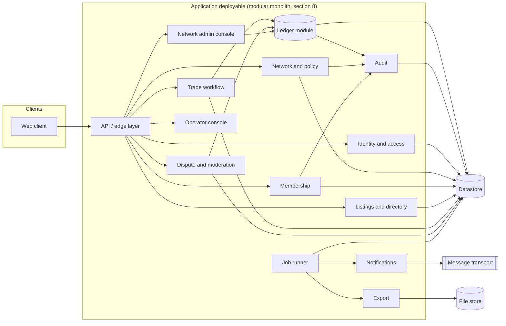
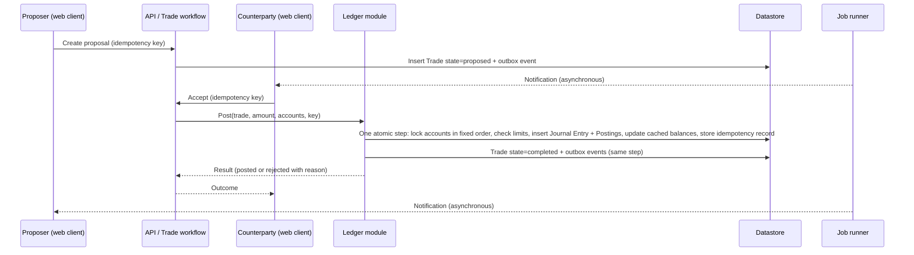
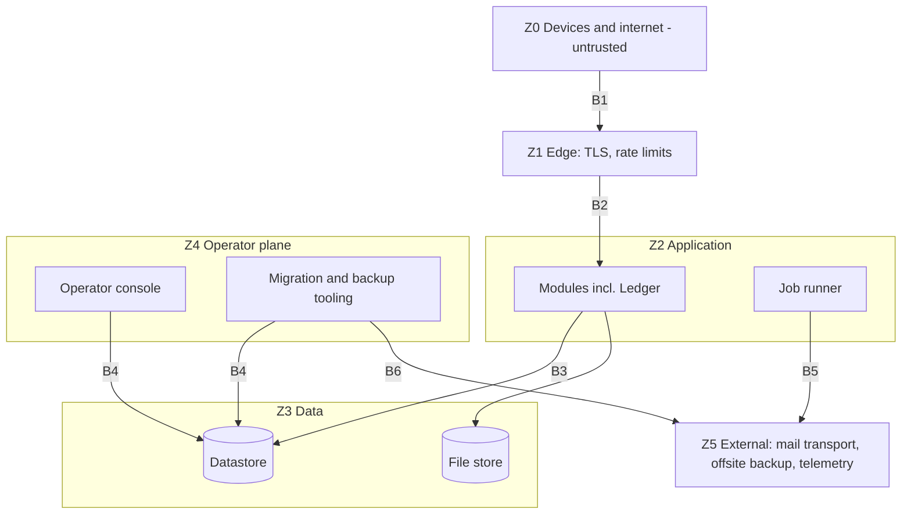

# 05 — Architecture and Trust Boundaries

| Field | Value |
|---|---|
| Status | Draft |
| Owner role | Product architect |
| Last updated | 2026-10-21 |
| Scope | Technology-neutral logical architecture of Circula: components and responsibilities, data flows, trust boundaries, tenancy and isolation, separation of Platform Operation from Network governance, deployment options (centralized versus self-hostable), module structure decision, quality attributes with measurable targets, and extension points for deferred capabilities |
| Depends on | [00 — Conventions and canon](00-conventions.md), [01 — Vision and scope](01-product-vision-and-scope.md), [02 — Personas and roles](02-personas-roles-and-journeys.md), [03 — Domain model](03-domain-model-and-mutual-credit-rules.md) |
| Open questions | ARC-OD-1 to ARC-OD-9 in section 12; consolidated in [13 — Assumptions, risks, decisions](13-assumptions-risks-decisions-roadmap.md) |

## 1. Purpose and scope

This document defines **what the system is made of, who and what is trusted, and how the parts are allowed to interact**, so that implementation teams can choose a concrete stack later (D-02) without re-deciding the structural rules that protect the ledger, member privacy and Network autonomy.

In scope: logical components; data flows for the critical paths; trust zones and boundaries; Network isolation; the separation between the Platform Operator (infrastructure) and Network governance (community rules); the centralized/self-hostable decision (D-01); the module structure decision; measurable quality attributes; extension points.

Out of scope and owned elsewhere:

| Topic | Owner |
|---|---|
| Ledger tables, identifiers, retention, migrations of data | [06 — Data, ledger and audit](06-data-ledger-and-audit.md) |
| API shapes, versioning, idempotency header contract | [07 — API and integration contract](07-api-and-integration-contract.md) |
| Threat model, authentication strength, abuse controls, break-glass detail | [09 — Security, privacy and abuse](09-security-privacy-and-abuse.md) |
| Environments, backup, monitoring, upgrades, incidents | [11 — Deployment, operations and support](11-deployment-operations-and-support.md) |
| Test strategy and gates | [12 — Quality strategy and test plan](12-quality-strategy-and-test-plan.md) |
| Legal characterisation of operator and Network roles | [19 — Legal and regulatory open questions](19-legal-and-regulatory-open-questions.md) (a question for counsel) |

The Platform handles an accounting unit that is **not money, not a security and not a cryptocurrency**, and no component in this architecture performs redemption, cash-out, interest, or fiat conversion (INV-014). No component named here is a payment rail.

## 2. Definitions used here

Terms (Network, Member, Member Account, Journal Entry, Posting, System Account, Adjustment, Reversal, Dispute, Audit Event, Platform Operator, Network Administrator, Dispute Reviewer) are exactly as in [00 section 5.1](00-conventions.md#51-vocabulary-exact-spellings) and the [glossary](14-glossary.md). Local terms:

| Term | Meaning in this document |
|---|---|
| **Component** | A logical unit with one responsibility and a defined interface. Components are not necessarily separate processes (see section 8). |
| **Module** | The code-level realisation of a Component inside the deployable (section 8). |
| **Zone** | A region of the system with a single trust level (Z0 to Z5, section 5). |
| **Trust boundary** | A line between Zones where data crosses and must be authenticated, authorised and validated. |
| **Tenant** | One Network. The unit of isolation. |
| **Deployment** | One running installation of the Platform, hosting one or more Networks, under one Platform Operator. |
| **Network context** | The Network identifier derived server-side from the authenticated session and membership, never taken solely from client input. |
| **Posting interface** | The single internal interface through which all Journal Entries are created. |
| **Outbox** | A durable list of events written in the same atomic step as the state change that caused them, consumed asynchronously. |

## 3. Architectural drivers and principles

Drivers come from [01](01-product-vision-and-scope.md): small volunteer-run communities, trust in the books, minimal data, no lock-in, accessible to everyone. Principles that all requirements below derive from:

| # | Principle | Consequence |
|---|---|---|
| A1 | **The ledger is the product's core and is isolated.** | One module writes ledger records; everything else depends on it, never the reverse. |
| A2 | **Correctness before availability before features.** A refused Trade is acceptable; a wrong balance is not. | Fail closed on ambiguity; reconciliation is a first-class running job. |
| A3 | **Server-side authority.** Clients (web UI, future apps) are untrusted renderers. | All authorisation, policy, limit and state-machine checks run server-side. |
| A4 | **Networks govern themselves; operators run machines.** | Operator capabilities and Network-admin capabilities are separated by identity space, interface and data access. |
| A5 | **One artifact, many deployments.** | Hosted and self-hosted use the same build and the same schema. |
| A6 | **Boring, replaceable dependencies.** | Every external dependency sits behind an interface with a self-contained default. |
| A7 | **Everything leaves.** | Every record class has an export path; a Network can be extracted whole. |
| A8 | **Minimal personal data at every boundary.** | Logs, emails, backups, exports and telemetry carry the least data that serves their purpose. |

## 4. Logical components

### 4.1 Component catalogue

| Component | Responsibility | Owns (data) | Must NOT |
|---|---|---|---|
| **Web client** | Renders UI for Visitors, Applicants, Members, Reviewers and Network Administrators; collects input; displays server-authoritative state. Meets WCAG 2.2 AA (D-14), i18n-ready (D-13). | No authoritative data; transient UI state | Enforce rules as the only control; compute balances; hold secrets beyond the session |
| **API gateway layer** (edge handling inside the deployable plus any reverse proxy) | TLS termination, request size and rate limits, request ID creation, routing, response security headers | None | Contain business logic |
| **Identity and access** | Accounts (email, passkey/TOTP, recovery), sessions, step-up authentication, role resolution per Network, operator identity space (separate store of credentials and sessions) | Login identities, credentials, sessions, role grants | Post to the ledger; reveal that an email exists in other Networks |
| **Network and policy** | Network lifecycle, policy parameters ([16](16-network-policy-catalog.md)), policy versions and notice periods (D-11), unit definition (immutable after first Journal Entry, INV-013) | Networks, units, policy versions | Change a posted amount; apply a policy retroactively |
| **Membership** | Membership state machine ([15](15-lifecycle-state-machines.md)), invitations, applications, departures | Memberships, invitations, profile fields | Create Member Accounts without the ledger component |
| **Listings and directory** | Offers/Requests, categories, search/browse, moderation state, `directory_visibility` enforcement | Listings, search projection | Affect balances; expose non-public data to Visitors |
| **Trade workflow** | Proposal, counterparty acceptance, decline, cancel, expiry (D-06); orchestrates the ledger call on acceptance | Trade proposals (Trade state), notes | Write Journal Entries directly |
| **Ledger** | The Posting interface; double-entry Journal Entries and Postings; limit enforcement (INV-005, INV-006); cached balances (D-04); idempotency records (INV-009); Reversals and Adjustments; `network_clearing` | Accounts, Journal Entries, Postings, cached balances, idempotency records | Depend on listings, notifications, UI; update or delete posted rows (INV-003) |
| **Dispute and moderation** | Dispute state machine, reviewer assignment with conflict exclusion, resolution recording; requests Reversals/Adjustments through the Posting interface | Disputes, evidence, resolutions | Freeze balances (D-12); review own-party disputes |
| **Audit** | Append-only Audit Events (INV-010) with actor, time, reason, target; integrity chaining; query by authorised roles | Audit Events | Be editable; contain secrets or unnecessary personal data |
| **Notifications** | Template rendering, delivery preferences, delivery attempts via a message-transport interface ([17](17-notifications-and-communications.md)) | Notification log, preferences | Block or roll back a posting when delivery fails |
| **Job runner** | Executes asynchronous work with retries: outbox consumption, expiry sweeps (`proposal_expiry_days`), reconciliation, export builds, retention/anonymisation, backups orchestration hooks | Job records | Run non-idempotent handlers |
| **Export** | Builds Network, Member and Audit exports ([18](18-data-export-and-portability.md)) from consistent snapshots | Export artifacts (time-limited) | Block posting; export beyond the requester's authority |
| **Network admin console** | The Network Administrator's section of the web client: rules, members, moderation, Adjustments, audit, exports | UI only | Be reachable by operator credentials |
| **Operator console** | Platform Operator tooling: provision/suspend Networks, deployment health, aggregate counts, job and backup status, break-glass request workflow | Operator-plane records (deployment configuration, provisioning log) | Show Network content by default; post to the ledger (PER role matrix in [02](02-personas-roles-and-journeys.md)) |
| **Datastore** | Durable, transactional storage for all of the above | All persistent state | Be reachable from outside the application and operator zones |
| **File store** | Binary artifacts (export files, later media) | Export files, attachments (deferred) | Hold ledger truth |
| **Observability** | Structured logs, metrics, traces, health endpoints ([11](11-deployment-operations-and-support.md)) | Operational telemetry | Contain secrets or Network content |

### 4.2 Component diagram

Text: all client traffic enters through the edge layer. Only the Trade workflow, Dispute and moderation, and the Network admin console (for Adjustments) call the Ledger, and only through the Posting interface. The Ledger and other governance modules write Audit Events. Notifications, exports and expiry run through the Job runner. The Operator console has no arrow to the Ledger by design.

### 4.3 Requirements: components and responsibilities

| ID | Pri | Requirement | Rationale | Verification |
|---|---|---|---|---|
| **ARC-001** | P0 | Each component in section 4.1 **MUST** have a single owning module with an explicit, documented interface; other modules **MUST** use only that interface and **MUST NOT** read or write its persistent records directly. | Prevents rule bypass and hidden coupling. | Static dependency rule check in CI fails on cross-module data access (T); architecture review (I). |
| **ARC-002** | P0 | All creation of Journal Entries and Postings (Trade completion, Reversal, Adjustment, opening/clearing entries) **MUST** go through the single Posting interface of the Ledger module. | One enforcement point for INV-001, INV-002, INV-005, INV-006, INV-011. | Code search shows one writer (I); the application's datastore role has write grants on ledger records only via that module's paths, verified by a test that a direct write from another module's connection scope is impossible or fails (T). |
| **ARC-003** | P0 | The Ledger module **MUST NOT** depend on Listings, Notifications, Export, Web client code or any network-reachable service during a posting. | Posting must succeed or fail on ledger state alone. | Dependency graph check (T). |
| **ARC-004** | P0 | Authorisation, policy evaluation, limit checks and lifecycle transitions **MUST** be enforced server-side on every request path; no rule **MAY** rely on client behaviour. | Clients are untrusted (A3). | Authorisation test matrix from the [02 permissions matrix](02-personas-roles-and-journeys.md) executed against the API without the web client (T). |
| **ARC-005** | P0 | Governance actions (role change, policy change, Adjustment, Reversal, dispute resolution, suspension, break-glass access) **MUST** write their Audit Event in the same atomic step as the state change, so neither exists without the other (INV-010). | Audit completeness. | Fault-injection test: fail the audit write, assert the change rolls back (T). |
| **ARC-006** | P0 | Side effects that are not part of ledger truth (notifications, search projection updates, webhooks later) **MUST** be produced via an Outbox written in the same atomic step as the originating change and consumed by the Job runner with at-least-once delivery; consumers **MUST** be idempotent. | A failed email must never undo or lose a Trade, and an event must never be lost after a commit. | Kill-the-consumer and kill-the-sender tests: exactly one effective delivery per event after recovery (T). The Outbox record and the IntegrityCheckpoint hash chain verified by reconciliation check R10 are specified in [06](06-data-ledger-and-audit.md) (DAT-097, R10). |
| **ARC-007** | P0 | The Operator console and operator identity space **MUST** be separated from Network-facing interfaces by distinct credentials store, session scope, route space and authorisation policy; an operator credential **MUST NOT** be accepted by Network-facing endpoints, and a Member or Network Administrator credential **MUST NOT** be accepted by operator endpoints. | Separation of platform operation from governance (A4). | Cross-credential negative tests on every endpoint family (T). |
| **ARC-008** | P1 | Each module **SHOULD** expose a health and readiness check, and the Job runner **MUST** expose its queue depth and oldest-job age. | Needed for the SLIs in [11](11-deployment-operations-and-support.md). | Health endpoint tests (T). |

## 5. Data flows

### 5.1 Trade proposal and acceptance (critical path)

Text: proposal creation has no ledger effect (D-05: no holds). Acceptance and posting are a single indivisible step (00 section 5.3: no persisted `accepted` state). The Ledger checks the floor `-credit_limit` and `max_balance` inside the same atomic step as the insert, so concurrent Trades cannot jointly breach limits (INV-005, INV-006). Notifications are produced after commit from the Outbox.

| ID | Pri | Requirement | Rationale | Verification |
|---|---|---|---|---|
| **ARC-009** | P0 | Trade acceptance **MUST** perform, in one atomic datastore transaction: acquisition of exclusive access to both Member Accounts in a deterministic order, limit evaluation against current cached balances, insertion of the Journal Entry and both Postings, cached-balance updates, idempotency-record write, Trade state transition to `completed`, and Outbox event writes. Partial results **MUST NOT** be observable or persistable (INV-002). | Atomicity and deadlock avoidance (see [technical standards note](../notes/research-technical-standards.md), section 1). | Concurrency test: at least 200 parallel acceptances racing against one account's floor leave balance at or above `-credit_limit` and every accepted Trade fully posted; crash-injection between each step leaves no partial state (T). |
| **ARC-010** | P0 | The idempotency record (key, request fingerprint, outcome) **MUST** be written in the same atomic step as the posting it protects; a replay with the same key and fingerprint **MUST** return the original outcome without a second posting; same key with a different fingerprint **MUST** be rejected (INV-009). | Safe client retries. | Replay and mutation tests, including replay during a concurrent first attempt (T). |
| **ARC-011** | P0 | After a successful posting, a read of either party's balance and history by that party **MUST** reflect the posting (read-your-writes). Derived projections (search index, aggregates, notifications) **MAY** lag. | Members must see their trades immediately (see [01](01-product-vision-and-scope.md) vision). | Test reads immediately after posting in a deployment with replicas, if replicas are used (T). |
| **ARC-012** | P0 | Every inbound request **MUST** receive a correlation identifier at the edge, propagated to logs, Audit Events, Outbox events and job executions it causes. | Traceability across components. | Trace a single request through all artefacts in an end-to-end test (T). |

### 5.2 Other flows

| Flow | Path | Key rules |
|---|---|---|
| **Sign-in** | Web client, Edge, Identity and access, session issued, role resolution per Network | Role resolved per Network on each request; operator sign-in uses the separate operator store (ARC-007) |
| **Adjustment / Reversal** | Network admin console or Dispute module, Posting interface, Ledger, Audit, Outbox to Notifications | Reason mandatory; affected Member notified (INV-004, INV-010, INV-012); `admin_quorum` and step-up authentication before the call |
| **Policy change** | Network admin console, Network and policy (new version with effective date), Audit, Outbox to Notifications | Effective after `policy_notice_days` unless a safety fix (D-11); Trade posting records which policy version applied |
| **Export** | Requester, Export request, Job runner builds from a consistent snapshot, File store (time-limited), Notification with link, Audit Event | Authorisation re-checked at download; does not block posting |
| **Reconciliation** | Job runner, Ledger read-only recomputation, result record, alert on drift | Detail in [11](11-deployment-operations-and-support.md); drift is a Severity-1 condition |
| **Operator access to Network content** | Break-glass request in Operator console, time-limited grant, Audit Event visible to that Network's Administrators | Default deny (see [02](02-personas-roles-and-journeys.md) and [09](09-security-privacy-and-abuse.md)) |
| **Notification delivery** | Outbox, Job runner, Notifications, Message transport | Minimal content; failures retried, never affect ledger |

### 5.3 Data classification

| Class | Examples | Member | Network Administrator | Dispute Reviewer | Platform Operator (default) | Infrastructure staff with datastore access |
|---|---|---|---|---|---|---|
| **Ledger** | Journal Entries, Postings, balances | Own account; others per `balance_visibility` | Per `balance_visibility` and role | Disputed Trades only | Aggregate counts only | Technically readable (see ARC-016) |
| **Identity** | Email, credentials, sessions | Own | No credentials; email only if the Network policy allows | No | No (operator identity separate) | Credentials stored hashed or as public keys only |
| **Network content** | Profiles, Listings, Trade notes, Dispute evidence | Per visibility | Yes within Network | Assigned Disputes | No (break-glass only) | Technically readable |
| **Audit** | Audit Events | Events about themselves | Network's events | Assigned Disputes | Platform-level events | Technically readable |
| **Operational telemetry** | Logs, metrics | No | No | No | Yes (redacted) | Yes |
| **Backups and exports** | Snapshots, export files | Own export | Network export | No | Existence and status only | Encrypted; keys held separately |

## 6. Trust boundaries

### 6.1 Zones

| Zone | Contents | Trust level |
|---|---|---|
| **Z0 Untrusted** | Member and visitor devices and browsers, the open internet, any automated client | None; all input hostile |
| **Z1 Edge** | TLS termination, reverse proxy, rate limiting, static assets | Semi-trusted; carries credentials in transit |
| **Z2 Application** | Deployable modules, job runner | Trusted to enforce rules; holds runtime secrets; least-privilege datastore role |
| **Z3 Data** | Datastore, file store | Highest sensitivity; reachable only from Z2 and Z4 |
| **Z4 Operator plane** | Operator console, deployment tooling, migration role, backup tooling, infrastructure shell access | Privileged; strongly authenticated; logged; distinct from Network governance |
| **Z5 External services** | Message transport, optional telemetry sink, offsite backup target | Untrusted for confidentiality beyond what is sent; availability dependency only |

### 6.2 Boundary table

| Boundary | Crossing | Controls required | Threat addressed (detail in [09](09-security-privacy-and-abuse.md)) |
|---|---|---|---|
| **B1** Z0 to Z1 | Browser to edge | TLS only (no plaintext listener except redirect), request size limits, rate limits per client and per Network, security headers, bot/abuse throttling on sign-in and recovery | Credential stuffing, enumeration, denial of service |
| **B2** Z1 to Z2 | Edge to application | Authenticated session or token; Network context derivation; input validation against schema; CSRF/Origin checks for browser sessions; authorisation per request | Broken access control, cross-Network access |
| **B3** Z2 to Z3 | Application to datastore | Least-privilege runtime role without UPDATE/DELETE on ledger and audit records; separate migration role not available at runtime; encrypted transport; credentials from secret store | SQL-level tampering, injection impact, insider misuse |
| **B4** Z4 to Z3 | Operator tooling to datastore | Dual-person approval for production data access [DECISION NEEDED: ARC-OD-5]; session recording or command logging; time-boxed credentials; Audit Event for any content access | Operator abuse, accidental data exposure |
| **B5** Z2 to Z5 | Application to message transport / telemetry | Minimal payload; no ledger amounts in message bodies unless the Network enables it; no secrets; TLS; egress allowlist | Data leakage to third parties |
| **B6** Z4 to Z5 | Backup to offsite | Encryption with keys not stored with the backup; immutability/retention lock where available; restore drills | Ransomware, loss of backups |

### 6.3 Requirements: trust boundaries

| ID | Pri | Requirement | Rationale | Verification |
|---|---|---|---|---|
| **ARC-013** | P0 | The datastore and file store **MUST NOT** be reachable from Z0 or Z1; only Z2 and Z4 identities **MAY** connect. | Reduces attack surface. | Network-path test from outside the application zone (T); configuration inspection (I). |
| **ARC-014** | P0 | The application runtime's datastore credentials **MUST** lack the ability to update or delete Journal Entries, Postings and Audit Events; schema-change credentials **MUST NOT** be present in the running application's environment. | Defence in depth for INV-003. | Attempted UPDATE/DELETE by the runtime role fails (T); environment inspection (I). |
| **ARC-015** | P0 | All traffic between zones **MUST** use authenticated, encrypted transport, including between Z2 and Z3 when they are on different hosts. | Confidentiality in transit. | Scan of listeners; certificate checks (T). |
| **ARC-016** | P0 | The documentation **MUST** state plainly that infrastructure staff with Z3 or host access can technically read stored Network content, and the architecture **MUST** limit that exposure by: break-glass logging (B4), encryption at rest of the datastore and backups, and a supported option for application-level encryption of selected high-sensitivity fields [DECISION NEEDED: ARC-OD-6]. | Honest threat model; avoids overstating privacy. | Documentation inspection (I); encryption-at-rest configuration check (T). |
| **ARC-017** | P0 | Data sent to Z5 **MUST** be limited to the minimum in [17](17-notifications-and-communications.md); no credential, session token or full export content **MAY** be sent through the message transport. | A8. | Content review of every template and payload (I); test that secrets are absent (T). |
| **ARC-018** | P0 | Secrets (datastore credentials, signing keys, transport credentials) **MUST** be injected at runtime from a secret store or protected file and **MUST NOT** be in source control, images, logs or the file store. | Prevents leakage. | Secret scanning in CI (T); log scan (T). |
| **ARC-019** | P1 | Any component that fetches URLs or accepts files from users (deferred media, link previews) **MUST** be placed behind a restricted egress policy before it is enabled. | Server-side request forgery risk when media arrives. | Review at enablement (I). |

## 7. Tenancy, isolation and separation of duties

### 7.1 Network isolation model

A Network is the tenant. Isolation is **logical** in the baseline: Networks share one deployment, one datastore and one schema, separated by Network context. Stronger physical isolation (separate datastore or separate deployment per Network) is a deployment choice, supported by ARC-024.

| Layer | Isolation mechanism |
|---|---|
| Identity | One login identity may hold memberships in several Networks (D-07). The identity record holds only login data. Display name, profile, roles and balances are per membership; no component returns data about a membership in Network A while serving Network B. |
| Authorisation | Network context derived server-side from the session and the membership; a client-supplied Network identifier is a selector that must match an existing membership, never a grant. |
| Data | Every Network-owned record carries `network_id`; ledger records reference accounts of exactly one Network (INV-011). |
| Resources | Per-Network rate limits and quotas to contain a noisy neighbour. |
| Operations | Per-Network export, restore-to-scratch and (P2) migration to another deployment without touching other Networks. |
| Observability | Logs and metrics are labelled with the Network identifier (opaque) so incidents can be scoped; no Network content in them. |

### 7.2 Platform operation versus Network governance

| Concern | Platform Operator (infrastructure) | Network governance (Network Administrators, Dispute Reviewers, Members) |
|---|---|---|
| Identity space | Separate operator credentials and sessions | Member identity space |
| Can provision or suspend a Network | Yes (service-level reasons, e.g. abuse of the Platform, non-payment where hosted subscriptions exist later) | No |
| Can set `credit_limit`, `unit_name`, `membership_mode`, other policy | No | Yes (within platform invariants; notice per D-11) |
| Can post, reverse, adjust | **Never** (INV-003, INV-004, INV-012) | Adjustments/Reversals with reason, audit, quorum (`admin_quorum`) |
| Can read Network content | Default no; time-limited, logged, reasoned break-glass | Yes within role |
| Can read aggregate counts | Yes (aggregate only) | Yes |
| Can alter software invariants | Only by deploying a new version via the release process (section 8 of [11](11-deployment-operations-and-support.md)) | No |
| Accountable for | Availability, backups, security patching, abuse of the Platform | Rules, membership, fairness, dispute outcomes |

Platform Operator suspension of a Network is a service action and **MUST NOT** alter ledger records; it blocks new Trades and sign-in while preserving data and export rights (see [10](10-governance-and-network-operations.md) for governance consequences and [19](19-legal-and-regulatory-open-questions.md) for questions for counsel on operator duties).

### 7.3 Requirements: tenancy

| ID | Pri | Requirement | Rationale | Verification |
|---|---|---|---|---|
| **ARC-020** | P0 | Every record that belongs to a Network **MUST** carry the owning `network_id`, and every query on such records **MUST** be constrained by the Network context through a central data-access layer, not by ad hoc filters in feature code. | Prevents cross-Network leakage. | Code review rule plus automated scan for unscoped queries (T, I). |
| **ARC-021** | P0 | The Ledger **MUST** structurally reject any Journal Entry whose Postings reference accounts of more than one Network, or accounts of a Network different from the Journal Entry's own (INV-011). | Platform invariant. | Test with crafted cross-Network posting; constraint verification (T). |
| **ARC-022** | P0 | For every Network-scoped endpoint family, an automated test **MUST** present valid credentials of Network A against a resource of Network B and assert a not-found response indistinguishable from a nonexistent resource. | Prevents existence leaks and cross-tenant access. | Test suite execution in the release gate (T). |
| **ARC-023** | P1 | A second, independent enforcement of tenant scoping **SHOULD** exist below the application data-access layer where the datastore supports it [DECISION NEEDED: ARC-OD-7: yes/no and mechanism]. | Defence in depth against a single coding error. | Test that bypassing the data-access layer still returns no cross-Network rows (T). |
| **ARC-024** | P1 | The Platform **MUST** be able to produce a self-contained Network package (data plus configuration) and restore it into a scratch deployment without affecting other Networks. | Portability, restore drills, per-Network exit. | Round-trip test with reconciliation of balances (T). |
| **ARC-025** | P0 | The login identity **MUST NOT** disclose to any Network whether the same email holds memberships elsewhere; invitations and member lists show only Network-local information. | Privacy across Networks. | Test: invite email known in another Network and compare responses (T). |
| **ARC-026** | P0 | Platform Operators **MUST** have no code path that calls the Posting interface, and operator roles **MUST NOT** be able to obtain Member or Network Administrator roles in a Network without going through that Network's normal invitation and acceptance. | Separation of duties (INV-012). | Role-capability tests; code search for Posting interface callers (T, I). |
| **ARC-027** | P0 | Per-Network rate limits and quotas (requests, export jobs, storage once media exists) **MUST** exist so that one Network's load cannot exhaust shared capacity. | Fairness in hosted multi-tenant use. | Load test with one abusive Network; others stay within latency targets (T). |

## 8. Deployment topology and structure

### 8.1 Centralized versus self-hostable (D-01)

The repository commits to neither. Options:

| Option | Strengths | Weaknesses | Fit |
|---|---|---|---|
| **A. Hosted only** (one Operator runs everything) | Simplest operations; consistent upgrades; fastest iteration | Lock-in risk; trust concentrated in one party; conflicts with "everything leaves" unless export is excellent; Operator becomes a single point of legal exposure | Weak for community trust |
| **B. Self-host only** | Maximal autonomy and privacy; no hosting liability for the project | Communities lack sysadmins ([02](02-personas-roles-and-journeys.md) personas); upgrade and backup failures endanger ledgers; support burden is uneven | Weak for small volunteer communities |
| **C. One codebase, both** (baseline, D-01) | Communities choose; a third party or the project may host for those who cannot self-host; export and restore keep both honest | Must support two operational profiles; testing matrix larger | **Recommended** |

**Recommended baseline (D-01):** Option C. One build artifact and one schema for all deployments. Three supported topologies:

| Topology | Description | Networks | Typical Operator |
|---|---|---|---|
| **T1 Single-Network self-host** | One host or small cluster, one Network | 1 | A Network's own volunteer or contractor |
| **T2 Multi-Network self-host** | One deployment hosting several Networks for a federation of groups or a local host | 2 to tens | A host organisation such as the sysadmin persona "Farah" in [02](02-personas-roles-and-journeys.md) |
| **T3 Operator-hosted multi-tenant** | A Platform Operator runs a deployment for many unrelated Networks | Tens to hundreds | Hosting party; hosted subscriptions and billing are out of MVP scope (D-01) |

| ID | Pri | Requirement | Rationale | Verification |
|---|---|---|---|---|
| **ARC-028** | P0 | The same build artifact, schema and migration set **MUST** serve T1, T2 and T3; behavioural differences **MUST** come only from configuration. | A5; avoids a forked product. | Run the full acceptance suite in T1 and T3 configurations (T). |
| **ARC-029** | P0 | The deployable **MUST** run with only these external dependencies: one transactional datastore, one file store, one message transport (optional; Network operation without notifications degraded but valid), and a secret-injection mechanism. Each **MUST** sit behind an interface with a documented self-contained default. | A6; self-host feasible on commodity infrastructure. | Start the system with only the defaults on a single host and run smoke tests (T). |
| **ARC-030** | P0 | The Platform **MUST NOT** contact the project maintainers or any third party for licensing, analytics or update checks by default; any telemetry **MUST** be opt-in, aggregate-only and documented. | Privacy and sovereignty; self-host trust. | Egress observation test of a default installation (T). |
| **ARC-031** | P0 | Application processes **MUST** be stateless between requests: session, job and idempotency state live in the datastore (or a documented shared store), so processes can be replaced or scaled horizontally. | Availability and simple operation. | Kill-and-restart and multi-instance tests (T). |
| **ARC-032** | P1 | No feature **MAY** be available only in hosted or only in self-hosted mode in the MVP. | Prevents lock-in dynamics. | Feature inventory (I). |

### 8.2 Modular monolith versus services (decision)

| Criterion | Modular monolith | Separate services |
|---|---|---|
| Atomic posting of Trade state, Journal Entry and Outbox (INV-002, ARC-009) | Natural: one transaction | Needs distributed transactions or sagas: higher risk to correctness |
| Self-host simplicity | One deployable plus the datastore | Many processes, networks, versions |
| Team size assumption (small project) | Fits | Overhead |
| Independent scaling | Coarse (scale the whole deployable or run extra job-runner processes) | Fine | 
| Fault isolation | Weak between modules | Strong |
| Future extraction | Possible if boundaries are enforced | Already done |

**Recommendation:** a **modular monolith**: one deployable artifact, strict module boundaries, one datastore transaction scope, with the job runner started as a separate process type from the same artifact. The Ledger module is designed so it could be extracted (it has no inbound dependencies from lower layers, ARC-003). This is a decision for the product architect and implementers; record in an ADR [DECISION NEEDED: ARC-OD-3].

Re-evaluation triggers for splitting: sustained ledger write load above 50 percent of the capacity target (section 9, ARC-040) after tuning; need for independent release cadence of a component by different teams; a regulatory or customer demand for physically separate ledger hosting.

| ID | Pri | Requirement | Rationale | Verification |
|---|---|---|---|---|
| **ARC-033** | P0 | Inter-module dependencies **MUST** form a directed acyclic graph with Ledger and Audit at the bottom and presentation at the top; the allowed dependency graph **MUST** be written down and checked automatically in CI. | Keeps the monolith modular. | Dependency-rule check fails the build on violation (T). |
| **ARC-034** | P0 | A single datastore transaction **MUST** be able to span Trade state, Ledger writes, Audit Events and Outbox writes; designs that require distributed transactions across them are non-conformant in the MVP. | Correctness (A2). | Architecture review and test of the atomic path (I, T). |
| **ARC-035** | P1 | Architectural decisions that alter sections 4 to 8 **MUST** be recorded as ADRs in `docs/decisions/` and referenced from [13](13-assumptions-risks-decisions-roadmap.md). | Maintainability of intent. | Review of change history (I). |

## 9. Quality attributes and measurable targets

Targets are **proposals** for the baseline; thresholds are marked for product decision. "Standard envelope" is defined below and is a planning assumption, not a product promise.

### 9.1 Performance envelope (sizing assumptions)

| Dimension | Pilot | Standard (design limit) | Stretch (must not be precluded) |
|---|---|---|---|
| Members per Network | up to 300 | up to 2,000 | up to 10,000 |
| Networks per deployment | up to 10 | up to 500 | up to 2,000 |
| Completed Trades per Network per month | up to 1,200 | up to 8,000 | up to 40,000 |
| Journal Entries per deployment per day | up to 400 | up to 20,000 | up to 100,000 |
| Concurrent signed-in sessions per deployment | up to 100 | up to 3,000 | up to 15,000 |
| Retained ledger history per Network | 5 years minimum (see [06](06-data-ledger-and-audit.md)) | same | same |

The Standard column aligns with the design-limit option in the Vision document's envelope decision ([01](01-product-vision-and-scope.md), section 12); the Stretch column covers the 100 to 10,000 member range this architecture is asked to reason about. [DECISION NEEDED: ARC-OD-1: which column is the committed design limit]. Peak load is assumed to be 10 times the daily average per hour (communities trade in bursts around markets and weekends).

### 9.2 Quality attribute table

| ID | Pri | Attribute | Requirement (measurable) | Verification |
|---|---|---|---|---|
| **ARC-036** | P0 | Correctness | The system **MUST** show 0 violations of INV-001 to INV-011 in the full automated suite, including property-based tests (random Trade, Reversal and Adjustment sequences with concurrent execution) that assert: zero-sum per Journal Entry, per-Network sum zero, cached equals recomputed, limits held. Any violation in production is a Severity-1 incident. | Property-test run of at least 100,000 generated operations per release; reconciliation job in production (T, M). |
| **ARC-037** | P0 | Correctness | Amounts **MUST** be integers in minor units end to end (storage, computation, API, exports); no floating-point type **MAY** touch an amount (00 section 5.2). | Static scan and API contract tests (T, I). |
| **ARC-038** | P0 | Availability | A hosted deployment **SHOULD** meet a monthly availability objective for the Trade acceptance and sign-in paths of 99.5 percent (about 3.6 hours per month) [DECISION NEEDED: ARC-OD-2: 99.5 or 99.9]; self-hosted deployments have no Platform-set objective but **MUST** document their expected figure. Planned maintenance windows **MUST** be announced at least 72 hours ahead where they affect writes. | SLO measurement in [11](11-deployment-operations-and-support.md) (M). |
| **ARC-039** | P0 | Availability / degradation | When a non-ledger dependency fails the system **MUST** degrade as in section 9.3 rather than fail whole; when the Datastore is unavailable the system **MUST** fail closed (no Trade acceptance, no stale-data balance claims). | Fault-injection tests per dependency (T). |
| **ARC-040** | P0 | Performance | At the Standard envelope, server-side processing time for Trade acceptance **MUST** be at most 300 ms at p95 and 1 s at p99, balance and recent-history read at most 150 ms at p95, directory search at most 500 ms at p95, with the deployment sized per [11](11-deployment-operations-and-support.md). The ledger path **MUST** sustain at least 50 Trade acceptances per second per deployment without limit violations. [DECISION NEEDED: ARC-OD-1] | Load test with the Standard dataset, recording p95/p99 (T). |
| **ARC-041** | P1 | Performance | At the Stretch envelope the same targets **SHOULD** hold on a scaled-up single datastore without architectural change; if not, the measured gap is recorded in the roadmap. | Load test with synthetic Stretch dataset (T). |
| **ARC-042** | P0 | Performance (client) | On a mid-range phone on a throttled mobile connection (reference profile defined in [08](08-ux-and-accessibility.md)), the main member screens **SHOULD** reach largest contentful paint within 2.5 seconds at p75 and respond to input within 200 ms at p75. | Lab and field measurement (T, M). |
| **ARC-043** | P0 | Accessibility | Every MVP journey **MUST** meet WCAG 2.2 Level AA (D-14); the architecture **MUST** allow server-rendered content for core flows so assistive technologies do not depend on client-side-only rendering [DECISION NEEDED: ARC-OD-8: server-rendered baseline with progressive enhancement versus client-rendered application]. | Automated plus manual audit per [08](08-ux-and-accessibility.md) (T, D). |
| **ARC-044** | P0 | Maintainability | Module dependency rules checked in CI (ARC-033); Ledger module branch coverage at least 95 percent and overall at least 80 percent [DECISION NEEDED: ARC-OD-9: coverage thresholds]; every public module interface documented; a new contributor **SHOULD** run the complete system and test suite from a clean checkout in 30 minutes or less using documented steps. | CI metrics; onboarding trial (M, D). |
| **ARC-045** | P0 | Portability | The system **MUST NOT** rely on vendor-specific services; the datastore interface **MUST** be exercised by a conformance test suite so that a second datastore implementation can be validated; the system **MUST** run on a single commodity host with 2 vCPU and 4 GiB memory for a Pilot-envelope Network. | Conformance suite; single-host smoke and load test (T). |
| **ARC-046** | P0 | Exportability | A complete Network export (members, Listings, Trades, Journal Entries, Postings, Audit Events, policies; see [18](18-data-export-and-portability.md)) at the Standard envelope **MUST** complete within 15 minutes without blocking postings, and a Member's own export within 2 minutes; re-import or independent recomputation **MUST** reproduce all balances. | Export timing and round-trip test (T). |
| **ARC-047** | P0 | Recoverability | Architecture **MUST** permit restore from backup to a defined point in time and reconciliation after restore, with targets in [11](11-deployment-operations-and-support.md). | Restore drill (T). |
| **ARC-048** | P0 | Observability | Every component **MUST** emit structured logs with correlation identifiers (ARC-012), metrics, and health signals, free of secrets and Network content. | Log content tests (T). |
| **ARC-049** | P1 | Evolvability | A schema or API change **MUST** keep compatibility with the previous release for one version (N-1) so rolling upgrade and rollback are possible. | CI migration compatibility test (T). |
| **ARC-050** | P0 | Privacy by design | Data minimisation **MUST** be demonstrable: a data inventory per component lists every personal-data field, its purpose and retention (see [09](09-security-privacy-and-abuse.md) and [06](06-data-ledger-and-audit.md)). | Inventory review (I). |
| **ARC-051** | P1 | Clock and time | All stored timestamps **MUST** be UTC; ordering-sensitive logic (expiry, notice periods) **MUST** use datastore or single-authority time, not client time. | Tests with skewed client clocks (T). |

### 9.3 Degraded-mode behaviour

| Failure | Required behaviour | Still works |
|---|---|---|
| Message transport down | Queue and retry; surface "notification delayed" to admins | All Trades, balances, Listings |
| Search projection stale or down | Fall back to unfiltered browse by category or recency | Trades, balances |
| Job runner down | Trades and reads continue; expiry, exports, reconciliation delayed; alert on job age | Core flows; expired proposals display as expired by timestamp check |
| File store down | Exports unavailable | Core flows |
| Operator console down | None for members | Everything member-facing |
| Datastore unavailable | Fail closed, maintenance page that states data is safe and Trades are not being recorded | Nothing that depends on writes; static informational page |
| Datastore read-only (maintenance or failover) | Read-only mode: balances and history readable, all writes rejected with explicit message | Reads |

### 9.4 Fitness checks

A "fitness check" is an automated test that fails when an architectural rule is broken.

| ID | Pri | Requirement | Verification |
|---|---|---|---|
| **ARC-052** | P0 | CI **MUST** run at least these fitness checks on every change: module dependency rules (ARC-033); single Posting-interface writer (ARC-002); no unscoped Network queries (ARC-020); cross-Network negative tests (ARC-022); amount-type scan (ARC-037); secret scan (ARC-018). | CI configuration inspection (I) |

## 10. Extension points for deferred capabilities

The MVP does not implement these; the architecture **MUST NOT** preclude them (IDs and structures below are what must stay true now).

| Deferred capability | Extension point | What must hold now |
|---|---|---|
| **Organisation/business memberships** | Member Account owner type | Account owner is referenced by an owner type and identifier, not assumed to be a person row |
| **Standing orders, recurring Trades, holds/reservations (D-05, D-06)** | Pre-posting hook in the Trade workflow; separate reservation records outside Postings | Postings represent only completed value; no pending amounts in Postings |
| **Group or split Trades** | Journal Entry with more than two Postings | Journal Entry and INV-001 already allow N Postings; Trade workflow restricts to two in MVP |
| **Mobile apps and third-party clients** | Public API ([07](07-api-and-integration-contract.md)) with scoped tokens | API versioned from the start; web client uses the same API as any other client |
| **Webhooks and integrations** | Outbox event catalogue | Events carry stable type names and identifiers; no PII beyond identifiers |
| **Single sign-on, social login** | Identity provider interface in Identity and access | Role resolution independent of the credential type |
| **Media for Listings** | File store interface, egress policy (ARC-019) | Listings have attachment references, no binary in the datastore row |
| **Multiple languages (D-13)** | Externalised strings, locale per membership | No concatenated sentences; amounts formatted by unit scale and locale |
| **Federation / inter-Network settlement** | Network-level System Account for settlement, inter-Network protocol | Identifiers globally unique and non-guessable (D-03); INV-011 holds until a deliberate, counsel-reviewed change |
| **Analytics and reputation** | Read replica or export stream | No analytics writes into operational tables; opt-in aggregates only |
| **Alternative ledger engine** | Posting interface | Posting interface semantics are engine-independent (see the technical standards note on purpose-built ledger stores) |
| **Per-Network encryption keys, dedicated datastore per Network** | Datastore interface; Network package (ARC-024) | `network_id` scoping already present |

**Not designed-for:** redemption, cash-out, interest, fiat conversion, tokenisation, blockchain representations, card or bank payments (INV-014).

| ID | Pri | Requirement | Rationale | Verification |
|---|---|---|---|---|
| **ARC-053** | P1 | Identifiers for Networks, accounts, Journal Entries and Postings **MUST** be globally unique, opaque and non-guessable (D-03), not per-Network sequences. | Preserves future federation, safe export and merge. | Schema review; uniqueness test across Networks (I, T). |
| **ARC-054** | P1 | The web client **MUST** use only the public API contract of [07](07-api-and-integration-contract.md); no private back-channel endpoints **MAY** exist for it. | Enables other clients; tests the API. | Endpoint inventory (I). |

## 11. Failure and abuse scenarios the architecture must survive

| Scenario | Architectural answer |
|---|---|
| A coding bug reads another Network's rows | Central scoped data access (ARC-020), optional second enforcement (ARC-023), negative tests (ARC-022) |
| Two simultaneous Trades overdraw a Member | Atomic, ordered-lock posting (ARC-009), concurrency tests |
| Client retries after a network drop | Idempotency (ARC-010) |
| An operator tries to "fix" a balance | No Posting caller (ARC-026), runtime role cannot update ledger rows (ARC-014), break-glass logging |
| Notification provider outage | Outbox and degraded mode (ARC-006, section 9.3) |
| Cache drift or silent corruption | Reconciliation job (see [11](11-deployment-operations-and-support.md)), Severity-1 handling |
| Lost datastore | Restore with reconciliation ([11](11-deployment-operations-and-support.md)) |
| A Network wants to leave | Complete export and Network package (ARC-024, ARC-046) |
| Hosted operator disappears | Self-host path from the same artifact and import from the Network package (D-01, ARC-028) |

## 12. Assumptions and open decisions

Registered for [13](13-assumptions-risks-decisions-roadmap.md); each decision records options and a recommended default.

| ID | Decision / assumption | Options | Recommended default |
|---|---|---|---|
| ARC-OD-1 | Committed design envelope (members per Network, Networks per deployment, trades per day) and performance targets in ARC-040 | (a) Pilot; (b) Standard; (c) Stretch | (b) Standard as the committed design limit, (a) for pilot sizing, (c) not precluded |
| ARC-OD-2 | Hosted availability objective for write and sign-in paths | 99.5 percent; 99.9 percent | 99.5 percent, revisit after a measured quarter |
| ARC-OD-3 | Modular monolith versus services | Modular monolith; services | Modular monolith with enforced boundaries (ADR to record) |
| ARC-OD-4 | Supported topologies in MVP | T1 only; T1+T2; T1+T2+T3 | T1+T2 fully supported; T3 supported as a configuration, with hosted subscriptions out of scope (D-01) |
| ARC-OD-5 | Production data access by operators: single approver versus dual control | Single with logging; dual control | Dual control for hosted (T3); single with logging acceptable in T1 where Operator and Network are the same group |
| ARC-OD-6 | Application-level encryption of selected high-sensitivity fields | None; optional per field class; mandatory | Optional supported mechanism for dispute evidence and free-text notes; decide field list in [09](09-security-privacy-and-abuse.md) |
| ARC-OD-7 | Second tenant-isolation enforcement below the application | None; datastore-level row policies or equivalent | Include where the chosen datastore supports it |
| ARC-OD-8 | Rendering approach for accessibility and resilience | Server-rendered with progressive enhancement; client-rendered single-page | Server-rendered with progressive enhancement for core journeys |
| ARC-OD-9 | Coverage and mutation-testing thresholds | As in ARC-044; stricter | As in ARC-044 |
| Assumption | The Platform Operator is not assumed to be a party to Trades and holds no Member Account | | |
| Assumption | The chosen datastore provides ACID transactions with row-level locking or an equivalent serializable guarantee | | Required by ARC-009 and ARC-034 |
| Assumption | Legal roles of Operator and Network (controller/processor, potential regulatory characterisation of any Network activity) are not asserted here | | A question for counsel; see [19](19-legal-and-regulatory-open-questions.md) |
| Canon note | No conflict with the shared canon found | | |

## 13. References

Internal:
- [00 — Conventions and canon](00-conventions.md)
- [01 — Product vision and scope](01-product-vision-and-scope.md)
- [02 — Personas, roles and journeys](02-personas-roles-and-journeys.md)
- [03 — Domain model and mutual-credit rules](03-domain-model-and-mutual-credit-rules.md)
- [06 — Data, ledger and audit](06-data-ledger-and-audit.md)
- [07 — API and integration contract](07-api-and-integration-contract.md)
- [08 — UX and accessibility](08-ux-and-accessibility.md)
- [09 — Security, privacy and abuse](09-security-privacy-and-abuse.md)
- [10 — Governance and network operations](10-governance-and-network-operations.md)
- [11 — Deployment, operations and support](11-deployment-operations-and-support.md)
- [12 — Quality strategy and test plan](12-quality-strategy-and-test-plan.md)
- [13 — Assumptions, risks, decisions, roadmap](13-assumptions-risks-decisions-roadmap.md)
- [15 — Lifecycle state machines](15-lifecycle-state-machines.md)
- [16 — Network policy catalog](16-network-policy-catalog.md)
- [17 — Notifications and communications](17-notifications-and-communications.md)
- [18 — Data export and portability](18-data-export-and-portability.md)
- [19 — Legal and regulatory open questions](19-legal-and-regulatory-open-questions.md)
- Research: [technical standards](../notes/research-technical-standards.md) (ledger concurrency, idempotency, operations), [prior art in mutual credit](../notes/research-prior-art-mutual-credit.md)

External (accessed 2026-10-21):
- RFC 2119 and RFC 8174 for requirement language (see 00).
- WCAG 2.2: <https://www.w3.org/TR/WCAG22/> (accessed 2026-10-21).
- Core Web Vitals thresholds, largest contentful paint "good" at 2.5 seconds: <https://web.dev/articles/lcp> (background knowledge, not re-fetched; re-check before external citation).
