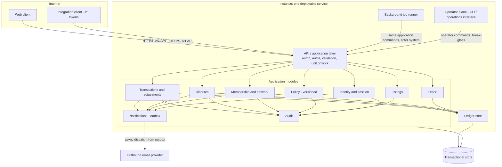
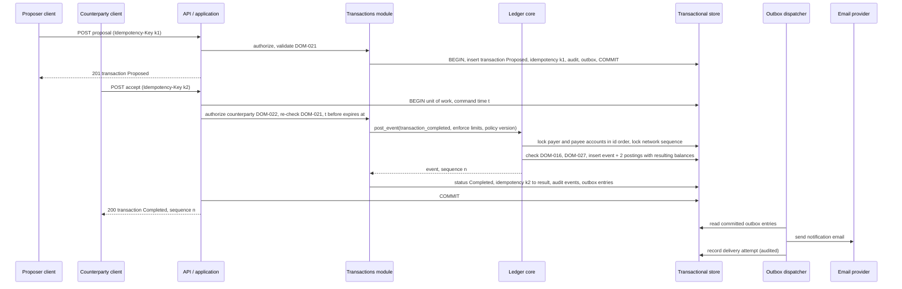
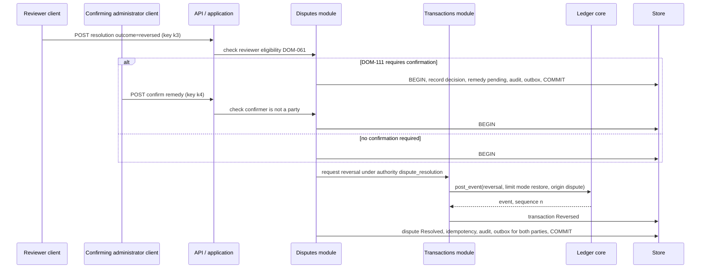
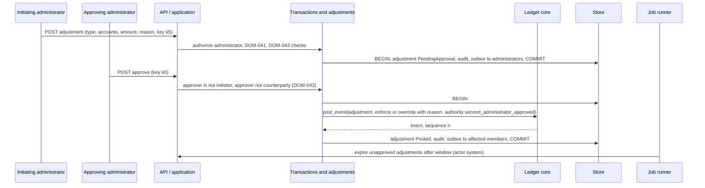
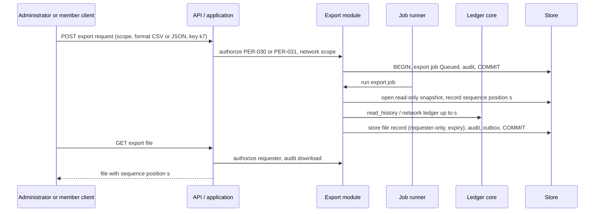
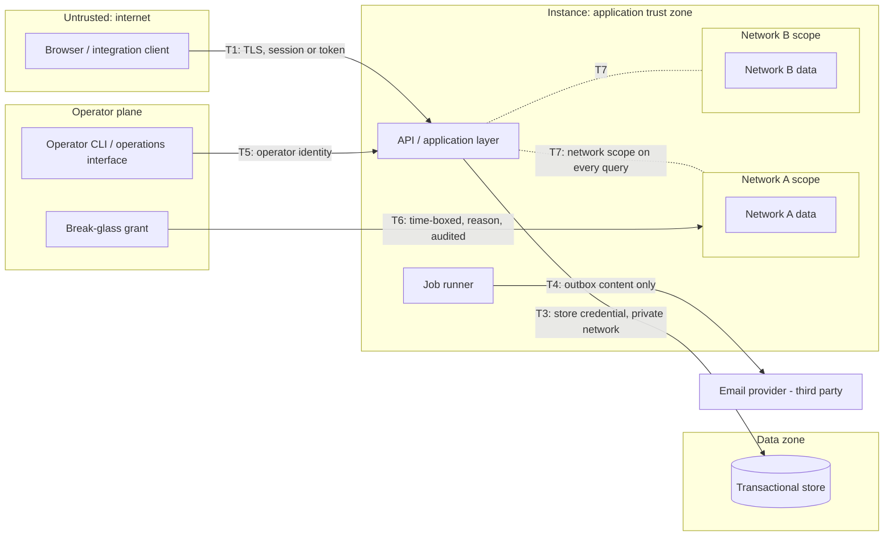
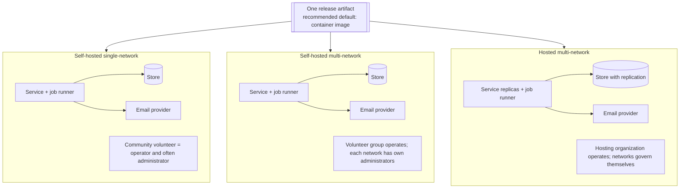

# System Architecture and Trust Boundaries

| Field | Value |
|---|---|
| Status | Draft |
| Owner role | Product architect |
| Last updated | 2026-11-11 |
| Scope | Technology-neutral logical architecture of Circula: components and their responsibilities, the ledger core interface, data flow for the key ledger paths, trust boundaries, the separation of platform operation from network governance, deployment options, measurable architectural qualities, the concurrency and consistency model, failure modes, and the constraints any implementation stack must satisfy. Authoritative home for components, trust boundaries, deployment topology, and architectural qualities. |
| Dependencies | [00-conventions.md](00-conventions.md) (vocabulary, baseline decisions), [01-product-vision-and-scope.md](01-product-vision-and-scope.md) (goals and principles), [02-personas-roles-and-journeys.md](02-personas-roles-and-journeys.md) (roles, operator limits), [03-domain-model-and-mutual-credit-rules.md](03-domain-model-and-mutual-credit-rules.md) (ledger invariants and lifecycles) |
| Related documents | [04-functional-requirements.md](04-functional-requirements.md), [06-data-model-ledger-and-audit.md](06-data-model-ledger-and-audit.md), [07-api-and-integration-contract.md](07-api-and-integration-contract.md), [08-ux-and-accessibility.md](08-ux-and-accessibility.md), [09-security-privacy-and-abuse-resistance.md](09-security-privacy-and-abuse-resistance.md), [10-governance-and-network-operations.md](10-governance-and-network-operations.md), [11-deployment-operations-and-support.md](11-deployment-operations-and-support.md), [12-quality-strategy-and-test-plan.md](12-quality-strategy-and-test-plan.md), [13-assumptions-risks-decisions-and-roadmap.md](13-assumptions-risks-decisions-and-roadmap.md) |

## 1. Purpose

This document fixes the shape of the system that enforces the rules in [03-domain-model-and-mutual-credit-rules.md](03-domain-model-and-mutual-credit-rules.md). It names the components, which entities each one owns, how a request travels from a browser to an immutable posting, where trust changes hands, and what any implementation stack must provide. It chooses no programming language, framework, database product, or hosting vendor. Ledger rules are not restated here; this document says where and how they are enforced, and links to them.

Identifier ranges are reserved by topic:

| Range | Topic |
|---|---|
| ARCH-001 to ARCH-019 | Components, module boundaries, ledger core interface |
| ARCH-020 to ARCH-029 | Data flow of key paths |
| ARCH-030 to ARCH-044 | Trust boundaries and network isolation |
| ARCH-045 to ARCH-049 | Platform operation versus network governance |
| ARCH-050 to ARCH-059 | Deployment |
| ARCH-060 to ARCH-074 | Architectural qualities |
| ARCH-075 to ARCH-084 | Concurrency, consistency, idempotency, time |
| ARCH-085 to ARCH-094 | Failure modes and degradation |
| ARCH-095 to ARCH-109 | Technology-neutral implementation constraints |

## 2. Architectural drivers

| Driver | Source | Architectural consequence |
|---|---|---|
| Balances reconstructable exactly from immutable postings | [VIS-001](01-product-vision-and-scope.md#vis-001), [DOM-002](03-domain-model-and-mutual-credit-rules.md#dom-002), [DOM-003](03-domain-model-and-mutual-credit-rules.md#dom-003), [DOM-010](03-domain-model-and-mutual-credit-rules.md#dom-010) | Isolated ledger core with append-only storage, reconstruct and verify operations ([ARCH-003](#arch-003), [ARCH-061](#arch-061)). |
| Atomic posting of balanced pairs | [DOM-001](03-domain-model-and-mutual-credit-rules.md#dom-001) | One transactional store, one unit of work per command ([ARCH-075](#arch-075)). |
| Limit checks race-free under concurrency | [VIS-003](01-product-vision-and-scope.md#vis-003), [DOM-009](03-domain-model-and-mutual-credit-rules.md#dom-009), [DOM-027](03-domain-model-and-mutual-credit-rules.md#dom-027) | Serialized posting per account pair ([ARCH-076](#arch-076)). |
| Retries never duplicate | [DOM-011](03-domain-model-and-mutual-credit-rules.md#dom-011), [JRN-009](02-personas-roles-and-journeys.md#jrn-009) | Idempotency record committed with the effect ([ARCH-078](#arch-078)). |
| Nothing happens silently | [VIS-022](01-product-vision-and-scope.md#vis-022), [DOM-012](03-domain-model-and-mutual-credit-rules.md#dom-012), [DOM-014](03-domain-model-and-mutual-credit-rules.md#dom-014) | Audit event and notification outbox row written in the same unit of work as the change ([ARCH-020](#arch-020)). |
| One path to the ledger | [VIS-026](01-product-vision-and-scope.md#vis-026), [DEC-006](13-assumptions-risks-decisions-and-roadmap.md#dec-006), [PER-008](02-personas-roles-and-journeys.md#per-008) | The web client is an ordinary API client; no internal shortcut ([ARCH-002](#arch-002)). |
| Policy versioned and evaluated at posting | [DOM-017](03-domain-model-and-mutual-credit-rules.md#dom-017), [VIS-004](01-product-vision-and-scope.md#vis-004) | Policy module returns an immutable version identifier used for every evaluation ([ARCH-005](#arch-005)). |
| Many isolated networks per instance | [DEC-001](13-assumptions-risks-decisions-and-roadmap.md#dec-001), [VIS-010](01-product-vision-and-scope.md#vis-010), [DOM-005](03-domain-model-and-mutual-credit-rules.md#dom-005) | Mandatory network scoping of every query and command ([ARCH-037](#arch-037)). |
| Operator holds no ledger authority | [PER-007](02-personas-roles-and-journeys.md#per-007), [PER-033](02-personas-roles-and-journeys.md#per-033), [VIS-019](01-product-vision-and-scope.md#vis-019) | Separate operator plane and break-glass path ([ARCH-045](#arch-045)). |
| Small volunteer groups self-host | [VIS-010](01-product-vision-and-scope.md#vis-010), [VIS-027](01-product-vision-and-scope.md#vis-027), [DEC-010](13-assumptions-risks-decisions-and-roadmap.md#dec-010) | Modular monolith: one service, one store, one job runner, one email provider ([ARCH-001](#arch-001)). |
| Data leaves with the network | [VIS-009](01-product-vision-and-scope.md#vis-009), [DOM-075](03-domain-model-and-mutual-credit-rules.md#dom-075) | Export module reading through ledger core interfaces ([ARCH-013](#arch-013), [ARCH-072](#arch-072)). |
| Accessible on small screens and assistive technology | [VIS-011](01-product-vision-and-scope.md#vis-011) | Web client conformance target owned by UX ([ARCH-066](#arch-066)). |

## 3. Logical components and responsibilities

Plain-text summary: browsers and, from P1, token-holding integration clients reach the instance only through the versioned HTTPS API. The API/application layer authenticates, authorizes, validates, and opens one unit of work per command, then calls the application modules. Modules that change balances (transactions and adjustments, disputes, membership departure) call the ledger core, which is the only component that writes ledger events and postings. Audit and notification outbox rows are written by the calling modules inside the same unit of work. The background job runner and the operator plane issue commands through the same application layer as any other actor. Everything persists in one transactional store. Email leaves asynchronously from the outbox to the outbound email provider.

| Component | Responsibilities | Owns entities ([03](03-domain-model-and-mutual-credit-rules.md) section 3) |
|---|---|---|
| Web client | Renders screens, collects input, generates idempotency keys per user intent, formats integer amounts for display ([DEC-005](13-assumptions-risks-decisions-and-roadmap.md#dec-005)). Holds no authority. | None (holds only the session credential). |
| API / application layer | Request authentication, permission checks per [02](02-personas-roles-and-journeys.md) matrix, input validation, network scope resolution, unit-of-work control, idempotency handling, error mapping to [DOM section 5.1](03-domain-model-and-mutual-credit-rules.md#51-error-codes-raised-by-transaction-rules) codes, rate-limit responses. | Idempotency records. |
| Ledger core | Posts ledger events with invariant and limit checks; reads balances and history; verifies all balances; reconstructs balances at a sequence; manages account status and limits. | Ledger event, posting, account (status, limits), per-network sequence counter. |
| Policy module | Stores immutable policy versions, validates values against [DOM section 11](03-domain-model-and-mutual-credit-rules.md#11-network-policy-catalogue-versus-platform-invariants) ranges, answers "version in force at time T". | Network policy versions. |
| Identity and session | Platform-level login identity, password verification, optional TOTP second factor, session issue and revocation, recovery, personal access tokens (P1). | Identity, credential, session, access token. |
| Membership and network | Network lifecycle, invitations and applications, membership lifecycle and roles, departure orchestration ([DOM-070](03-domain-model-and-mutual-credit-rules.md#dom-070), [DOM-071](03-domain-model-and-mutual-credit-rules.md#dom-071)). | Network, membership, role assignment, invitation. |
| Listings | Offer and request lifecycle and directory queries. Never calls the ledger core. | Listing, category. |
| Transactions and adjustments | Transaction lifecycle ([DOM-020](03-domain-model-and-mutual-credit-rules.md#dom-020) to [DOM-029](03-domain-model-and-mutual-credit-rules.md#dom-029)), mutual reversal requests, adjustments awaiting second-administrator approval ([DOM-041](03-domain-model-and-mutual-credit-rules.md#dom-041)). | Transaction, failed acceptance attempt, reversal request, adjustment record. |
| Disputes | Dispute lifecycle, reviewer eligibility, resolutions, remedy confirmation, appeals. | Dispute, resolution, appeal. |
| Notifications | Writes outbox entries in the caller's unit of work; dispatches email; keeps the in-app notification list; records delivery attempts. | Outbox entry, notification, delivery attempt. |
| Background job runner | Runs scheduled and queued jobs: proposal expiry sweep ([DOM-025](03-domain-model-and-mutual-credit-rules.md#dom-025)), invitation expiry ([DOM-099](03-domain-model-and-mutual-credit-rules.md#dom-099)), pending-adjustment expiry, notification dispatch and retries, balance verification, export generation, retention tasks. | Job schedule and run records. |
| Audit module | Appends audit events; serves scoped audit queries. No update or delete operation exists. | Audit event. |
| Export module | Produces member self-exports and administrator network exports in CSV and JSON; audits each export. | Export job and file record. |
| Operator plane | Instance configuration, network creation with first administrator, network suspension, health and job status, break-glass grants ([PER-033](02-personas-roles-and-journeys.md#per-033)). | Operator identity, break-glass grant. |
| Transactional store | Durable, atomic, isolated storage for all entities ([DEC-009](13-assumptions-risks-decisions-and-roadmap.md#dec-009)). | Physical storage only; schema owned by [06](06-data-model-ledger-and-audit.md). |
| Outbound email provider | Delivers email handed over by the dispatcher. External; untrusted for integrity of anything but delivery. | None. |

**ARCH-001 — Modular monolith.** (P0) The MVP MUST be delivered as one deployable service containing the API/application layer, all application modules, the ledger core, and the background job runner, plus one transactional store and one outbound email integration ([DEC-010](13-assumptions-risks-decisions-and-roadmap.md#dec-010)). The job runner MAY run as a separate process of the same artifact.
*Rationale:* one service and one store is the smallest set a volunteer group can run, and it makes the single atomic unit of work in [ARCH-075](#arch-075) possible without distributed transactions.

**ARCH-002 — Web client is a public API client.** (P0) The web client MUST perform every read and state change through the same versioned public API that integration clients use ([07-api-and-integration-contract.md](07-api-and-integration-contract.md)). No endpoint, flag, or header MAY grant the web client a check-skipping or privileged path. An automated test MUST show that every web-client request targets a documented public API operation.
*Rationale:* [DEC-006](13-assumptions-risks-decisions-and-roadmap.md#dec-006), [VIS-026](01-product-vision-and-scope.md#vis-026).

**ARCH-003 — Ledger core interface.** (P0) The ledger core MUST expose exactly the following operation groups, and nothing outside the ledger core MAY write ledger events, postings, account limits, account status, or the sequence counter:

| Operation | Inputs (conceptual) | Behavior | Outputs |
|---|---|---|---|
| `post_event` | network, kind, debit account, credit account, amount, origin reference, authority, actors, reason, limit mode (`enforce`, `restore` for reversals, `override` with reason), policy version, command time | Inside the caller's unit of work: lock accounts ([ARCH-076](#arch-076)); check [DOM-001](03-domain-model-and-mutual-credit-rules.md#dom-001), [DOM-005](03-domain-model-and-mutual-credit-rules.md#dom-005), [DOM-006](03-domain-model-and-mutual-credit-rules.md#dom-006), [DOM-016](03-domain-model-and-mutual-credit-rules.md#dom-016); apply [DOM-027](03-domain-model-and-mutual-credit-rules.md#dom-027), [DOM-032](03-domain-model-and-mutual-credit-rules.md#dom-032) or [DOM-042](03-domain-model-and-mutual-credit-rules.md#dom-042) per limit mode; allocate sequence ([DOM-010](03-domain-model-and-mutual-credit-rules.md#dom-010)); write event and two postings with resulting balances. | Posted event (identifier, sequence, resulting balances) or one [DOM 5.1](03-domain-model-and-mutual-credit-rules.md#51-error-codes-raised-by-transaction-rules) error code; no partial write. |
| `read_balance`, `read_history` | account, optional cursor | Balance, available credit, over-limit amount, postings with origin references, in sequence order. | Values derived per [DOM-003](03-domain-model-and-mutual-credit-rules.md#dom-003). |
| `verify_all_balances` | network or all networks | Recomputes every balance from postings, compares with every stored cache, checks [DOM-004](03-domain-model-and-mutual-credit-rules.md#dom-004) per network and sequence gaps. | Report: networks checked, accounts checked, discrepancies (account, expected, stored). |
| `reconstruct_at_sequence` | network, sequence position | Replays postings up to and including the position. | Balance of every account at that position. |
| `manage_account` | account, new status or limits, reason, actor | Opens accounts, changes status and limits ([DOM-050](03-domain-model-and-mutual-credit-rules.md#dom-050), [DOM-054](03-domain-model-and-mutual-credit-rules.md#dom-054)); never creates a ledger event. | Updated account. |

*Rationale:* a narrow interface lets the ledger be tested alone against every DOM invariant and is the single place where an invariant violation could originate.

**ARCH-004 — Dependency direction.** (P0) Module dependencies MUST point downward only: web client → API → application modules → {ledger core, policy, audit, notifications outbox writer} → store abstraction. The ledger core MUST depend on nothing above it: it MUST NOT call the policy, audit, notification, identity, or any other application module, and receives everything it needs (policy version, actors, command time) as inputs. A module MUST NOT read or write another module's stored entities except through that module's interface. A build-time dependency check MUST fail the build on any violation ([12-quality-strategy-and-test-plan.md](12-quality-strategy-and-test-plan.md)).
*Rationale:* keeps the ledger core extractable and testable without the rest of the system ([DEC-010](13-assumptions-risks-decisions-and-roadmap.md#dec-010)).

**ARCH-005 — Policy module returns versions, not values alone.** (P0) Every policy lookup MUST return the policy version identifier together with the values, and every command that evaluates policy MUST pass that identifier to whatever it records ([DOM-017](03-domain-model-and-mutual-credit-rules.md#dom-017)). Within one unit of work all evaluations MUST use one version: the version in force at the command time ([ARCH-080](#arch-080)).
*Rationale:* prevents a command from mixing rules from two versions when a policy change lands concurrently.

**ARCH-006 — Application layer owns orchestration.** (P0) Authorization, consent tracking, reviewer eligibility, and lifecycle transitions MUST live in the application modules; the ledger core MUST NOT decide whether an actor may act. The application layer MUST call `post_event` only after its own checks pass, and MUST treat a ledger core error as the outcome of the whole command (rolling back the unit of work except for records the DOM rules require on failure, such as the failed acceptance attempt in [DOM-022](03-domain-model-and-mutual-credit-rules.md#dom-022), which MUST be committed in a separate unit of work that writes no ledger state).
*Rationale:* separates "who may" from "what is arithmetically allowed", so each is testable alone.

**ARCH-007 — Audit and outbox are written by the caller.** (P0) For every state change listed in [DOM-012](03-domain-model-and-mutual-credit-rules.md#dom-012), the owning application module MUST append the audit event, and for every [DOM-014](03-domain-model-and-mutual-credit-rules.md#dom-014) case the outbox entry, in the same unit of work as the change. A change MUST NOT commit without its audit event.
*Rationale:* audit coverage and notification attempts follow from atomicity rather than from best-effort hooks.

**ARCH-008 — Background jobs use application commands.** (P0) Every job that changes state (expiry, cancellation, retention) MUST invoke the same application-layer command an interactive actor would, with actor `system`, an idempotency key derived from the job and target object, and full audit. Jobs MUST be safe to run more than once for the same target.
*Rationale:* no second code path to the ledger; at-least-once scheduling is enough when jobs are idempotent.

**ARCH-009 — Listings stay off the ledger.** (P0) The listings module MUST NOT call the ledger core. A transaction's listing reference MUST be validated by the transactions module through the listings interface (same network, [DOM-021](03-domain-model-and-mutual-credit-rules.md#dom-021)).
*Rationale:* listings never move credits ([03](03-domain-model-and-mutual-credit-rules.md) section 3.7).

**ARCH-010 — In-app notification list.** (P1) The notifications module SHOULD keep a per-membership notification list readable through the API, populated from the same outbox entries as email, so that a member sees every [DOM-014](03-domain-model-and-mutual-credit-rules.md#dom-014) notification even when email delivery fails. SMS and push channels are deferred.
*Rationale:* email delivery is outside the instance's control ([ARCH-086](#arch-086)).

**ARCH-011 — Personal access tokens.** (P1) The identity module SHOULD issue revocable personal access tokens bound to one identity, scoped to the networks and permissions the identity holds at use time, for integration clients. Tokens MUST NOT grant any permission the identity lacks ([09-security-privacy-and-abuse-resistance.md](09-security-privacy-and-abuse-resistance.md)).
*Rationale:* integrations use the same public API and the same permission checks as the web client.

**ARCH-012 — Identity is separate from membership.** (P0) The identity and session module MUST know nothing about balances, accounts, or network policy. A membership references an identity; an identity carries no network role. Revoking a session MUST take effect for the next request on every API operation.
*Rationale:* authority is per membership ([PER-005](02-personas-roles-and-journeys.md#per-005)); a compromised identity is contained by session revocation.

**ARCH-013 — Exports read through module interfaces.** (P1) The export module MUST obtain ledger data through `read_history` and network-wide ledger reads of the ledger core and other data through the owning modules' interfaces, under the same authorization and network scoping as interactive reads. An export MUST include the sequence position it was taken at, so that `reconstruct_at_sequence` at that position reproduces the balances it contains.
*Rationale:* [VIS-009](01-product-vision-and-scope.md#vis-009) success measure: independent recomputation matches.

## 4. Data flow of key paths

**ARCH-020 — Propose, accept, post.** (P0) Acceptance of a transaction MUST follow the sequence below: all of re-validation, limit checks, posting, status change, idempotency record, audit event, and outbox entry commit in one unit of work; email is sent only after commit.

Plain-text summary: proposal is its own committed unit of work and reserves nothing. On acceptance, one unit of work opens with a single command time, the transactions module re-checks validity and authority, and the ledger core locks both accounts in a fixed order, checks status and limits, and writes the event and its two postings. In the same unit of work the transaction becomes `Completed` and the idempotency record, audit events, and outbox entries are written. Only after commit does the dispatcher send email and record the attempt. If any check fails, nothing ledger-related commits; the failed attempt is recorded per [ARCH-006](#arch-006).
*Rationale:* [DOM-009](03-domain-model-and-mutual-credit-rules.md#dom-009), [DOM-011](03-domain-model-and-mutual-credit-rules.md#dom-011), [DOM-012](03-domain-model-and-mutual-credit-rules.md#dom-012), [DOM-014](03-domain-model-and-mutual-credit-rules.md#dom-014), [DOM-022](03-domain-model-and-mutual-credit-rules.md#dom-022).

**ARCH-021 — Dispute resolution with remedy.** (P0) A resolution with outcome `reversed` or `adjusted` MUST post its remedy event, set the transaction or dispute status, and write audit and outbox entries in one unit of work. When [DOM-111](03-domain-model-and-mutual-credit-rules.md#dom-111) requires confirmation, the decision and the remedy are two units of work: the decision commits with the remedy pending, and the confirmation unit of work posts the remedy.

Plain-text summary: the reviewer records the outcome. Without a confirmation policy the remedy posts immediately; with one, the decision commits first and an eligible administrator's confirmation later posts the remedy. In both cases the reversal (or `correction` adjustment for `adjusted`) is posted by the ledger core in restore mode, the original transaction becomes `Reversed`, the dispute becomes `Resolved`, and both parties' notifications are queued, all in one unit of work.
*Rationale:* [DOM-062](03-domain-model-and-mutual-credit-rules.md#dom-062), [DOM-032](03-domain-model-and-mutual-credit-rules.md#dom-032), [DOM-007](03-domain-model-and-mutual-credit-rules.md#dom-007).

**ARCH-022 — Adjustment with second-administrator approval.** (P0) When [DOM-107](03-domain-model-and-mutual-credit-rules.md#dom-107) applies, initiation MUST commit an adjustment record in a pending state without touching the ledger, and approval by a different administrator MUST post the event in its own unit of work; an unapproved record MUST be expired by the job runner after the proposal expiry window.

Plain-text summary: the first administrator's request creates a pending adjustment record with no ledger effect. A second, different administrator who is not on the counterparty side approves it, and only then does the ledger core post it, recording both actors and the approval authority. Affected members are notified. Pending records that are not approved in time are expired by the job runner through the normal command.
*Rationale:* [DOM-041](03-domain-model-and-mutual-credit-rules.md#dom-041), [DOM-043](03-domain-model-and-mutual-credit-rules.md#dom-043), [DOM-013](03-domain-model-and-mutual-credit-rules.md#dom-013).

**ARCH-023 — Export.** (P1) An export request MUST be authorized and audited when requested, generated asynchronously by the job runner from a consistent snapshot at one sequence position, stored for retrieval only by the requester for a limited time (recommended default 7 days), and audited again when downloaded.

Plain-text summary: an export request is authorized against the member or administrator export permission and audited. The job runner builds the file from one read-consistent snapshot, recording the sequence position, so that balances in the file are reproducible. The file is retrievable only by its requester until it expires, and the download is audited.
*Rationale:* [DOM-012](03-domain-model-and-mutual-credit-rules.md#dom-012) audits exports; a snapshot prevents an export that mixes two ledger states.

## 5. Trust boundaries

Plain-text summary: everything on the internet side is untrusted. Clients cross into the instance only over TLS with a session or token (T1, T2). Only the instance holds the store credential, over a network path not reachable from the internet (T3). Email leaves to a third-party provider carrying only outbox content (T4). The operator works through a separate plane with a separate identity (T5) and reaches a network's data only through a break-glass grant (T6). Inside the instance, each network's data is a logical scope that every query and command must name (T7).

| ID | Boundary | What crosses | Controls (details in [09-security-privacy-and-abuse-resistance.md](09-security-privacy-and-abuse-resistance.md)) |
|---|---|---|---|
| T1 | Internet ↔ API | HTTP requests and responses, credentials at login | TLS on every connection; rate limits with HTTP 429 and `Retry-After`; input validation; request size limits; no unauthenticated state change except login, recovery, invitation acceptance, application. |
| T2 | Client ↔ session | Session credential or access token | Server-side session record, revocable ([ARCH-012](#arch-012)); every request re-authorized against current membership and roles ([PER-008](02-personas-roles-and-journeys.md#per-008)); client-supplied network or actor fields never trusted for authority. |
| T3 | API ↔ store | Queries and commands, store credential | Store unreachable from the internet; least-privilege credential; no ledger update/delete rights where the store supports it ([ARCH-034](#arch-034)); encrypted backups ([11](11-deployment-operations-and-support.md)). |
| T4 | Application ↔ email provider | Recipient address, subject, body with link | Minimal content ([ARCH-035](#arch-035)); provider credential held as secret; delivery status treated as advisory. |
| T5 | Operator plane ↔ instance | Instance configuration, network creation, network suspension, job and health status | Operator identities separate from member identities; every operator action audited ([DOM-012](03-domain-model-and-mutual-credit-rules.md#dom-012)); no ledger commands available ([ARCH-045](#arch-045)). |
| T6 | Break-glass | Read access to one network's data, for a stated reason and time | [PER-033](02-personas-roles-and-journeys.md#per-033); [ARCH-047](#arch-047). |
| T7 | Network ↔ network inside one instance | Nothing. No data or amount crosses. | Mandatory network scoping ([ARCH-037](#arch-037)), isolation tests ([ARCH-038](#arch-038)), [DOM-005](03-domain-model-and-mutual-credit-rules.md#dom-005). |

**ARCH-030 — Client is untrusted.** (P0) The API MUST derive the acting identity, membership, roles, and network from the authenticated session or token and the addressed resource, never from client-supplied claims, and MUST re-evaluate them on every request.
*Rationale:* the web client is replaceable and inspectable by anyone ([ARCH-002](#arch-002)).

**ARCH-031 — Transport protection.** (P0) Every connection crossing T1 MUST use TLS; the instance MUST refuse to serve the API or web client over unencrypted HTTP except to redirect. Version floor and cipher policy are set in [09-security-privacy-and-abuse-resistance.md](09-security-privacy-and-abuse-resistance.md).
*Rationale:* session credentials and member data cross the internet.

**ARCH-032 — Unauthenticated surface.** (P0) The set of API operations callable without a session MUST be enumerated in [07-api-and-integration-contract.md](07-api-and-integration-contract.md) and limited to login, recovery, invitation and join-link handling, health check, and public-read listing directory when [DOM-097](03-domain-model-and-mutual-credit-rules.md#dom-097) is `public_read`. An automated test MUST fail if any other operation responds without authentication.
*Rationale:* a small, listed surface is checkable.

**ARCH-033 — Store is internal.** (P0) The transactional store MUST NOT accept connections from outside the instance's private network, and only the service and the operator's backup and migration tooling MAY hold store credentials.
*Rationale:* direct store access bypasses every application-level rule.

**ARCH-034 — Store-level append-only where available.** (P1) Where the chosen store supports per-table permissions, the service's runtime credential SHOULD lack update and delete rights on ledger events, postings, and audit events; schema migrations SHOULD run under a separate credential.
*Rationale:* defense in depth for [DOM-002](03-domain-model-and-mutual-credit-rules.md#dom-002) against application defects.

**ARCH-035 — Minimal email content.** (P0) Notification emails MUST contain only the event type, the network name, the minimum identifying description needed to act, and a link into the web client; they MUST NOT contain session credentials or another member's balance. Whether amounts appear in email is an open question (OQ-ARCH-6); recommended default: amounts omitted.
*Rationale:* the email provider and mailboxes are outside the instance's control ([VIS-028](01-product-vision-and-scope.md#vis-028)).

**ARCH-036 — Secrets outside the artifact.** (P0) Store credentials, email provider credentials, and session-signing keys MUST be supplied at runtime through configuration and MUST NOT be part of the deployable artifact or written to logs. Handling is owned by [11-deployment-operations-and-support.md](11-deployment-operations-and-support.md).
*Rationale:* one artifact is shared by all deployments ([ARCH-050](#arch-050)).

**ARCH-037 — Mandatory network scoping.** (P0) Every query and command touching network-owned data MUST carry an explicit network identifier resolved from the addressed resource and verified against the actor's membership. The data-access layer MUST make an unscoped query against network-owned entities impossible to express or MUST reject it at runtime; the only unscoped readers are instance-wide jobs (verification, retention), which iterate network by network. Identifiers of network-owned objects MUST be resolved together with their network, so that a valid identifier from network B addressed under network A returns "not found".
*Rationale:* [DEC-001](13-assumptions-risks-decisions-and-roadmap.md#dec-001) places isolation in software; a single missing filter leaks one community's data to another.

**ARCH-038 — Isolation tests.** (P0) The test suite MUST include, for every API operation, a case where an actor with a membership in network A addresses an object of network B, and MUST assert the "not found" outcome with no data from B in the response, logs visible to A, or audit events of A. Coverage of every operation MUST be checked automatically ([12-quality-strategy-and-test-plan.md](12-quality-strategy-and-test-plan.md)).
*Rationale:* isolation is only as good as its weakest endpoint.

**ARCH-039 — Per-network caches and files.** (P0) Any cache, search index, export file, or job queue entry holding network data MUST be keyed by network and subject to the same scoping as the store.
*Rationale:* isolation leaks often occur outside the primary store.

**ARCH-040 — Instance-wide audit.** (P0) Operator actions and authentication events that belong to no network MUST be recorded as instance-wide audit events; operator actions affecting a network (creation, suspension, break-glass) MUST additionally be recorded in that network's audit scope.
*Rationale:* [DOM-012](03-domain-model-and-mutual-credit-rules.md#dom-012); network administrators see what was done to their network.

## 6. Separation of platform operation from network governance

| Concern | Platform operator ([PER-004](02-personas-roles-and-journeys.md#per-004)) | Network administrators ([PER-002](02-personas-roles-and-journeys.md#per-002)) |
|---|---|---|
| Install, upgrade, back up, restore, monitor the instance | Yes, through the operator plane and infrastructure | No |
| Create a network and assign its first administrator | Yes ([PER-010](02-personas-roles-and-journeys.md#per-010)) | No (self-service creation is an open decision in [02](02-personas-roles-and-journeys.md)) |
| Suspend or reinstate a network | Yes, audited in the network's scope ([03](03-domain-model-and-mutual-credit-rules.md) section 3.2.1) | Yes |
| Configure network policy, memberships, roles | No ([PER-007](02-personas-roles-and-journeys.md#per-007)) | Yes |
| Post transactions, reversals, adjustments | No, by any path | Within DOM rules |
| Read network data | Only through break-glass ([PER-033](02-personas-roles-and-journeys.md#per-033)) | Yes, within the permissions matrix |
| Read aggregated operational metrics | Yes, without member identifiers ([ARCH-073](#arch-073)) | Not applicable |

**ARCH-045 — Operator plane has no ledger commands.** (P0) The operator plane MUST NOT offer any command that posts a ledger event, changes an account's limits or status, changes network policy, or changes a membership or role, other than assigning the first administrator at network creation. Operator identities MUST NOT be able to hold memberships through the operator plane; an operator who is also a community member uses a separate member identity.
*Rationale:* [PER-007](02-personas-roles-and-journeys.md#per-007), [VIS-019](01-product-vision-and-scope.md#vis-019).

**ARCH-046 — Honest statement of infrastructure power.** (P0) The documentation for operators and administrators MUST state that whoever controls the infrastructure (the store, backups, or the host) can technically read or alter stored data outside the software, that the software cannot prevent this, and which mechanisms make it detectable: [ARCH-034](#arch-034) permissions, the balance verification job ([ARCH-061](#arch-061)), and exports held by the network ([ARCH-072](#arch-072)). Tamper evidence beyond this (for example hash-chained ledger events) is an open question (OQ-ARCH-3); the documentation MUST NOT claim cryptographic guarantees.
*Rationale:* [VIS-029](01-product-vision-and-scope.md#vis-029) and [09](09-security-privacy-and-abuse-resistance.md) forbid unsupported claims; networks choosing a host need to know what they are trusting.

**ARCH-047 — Break-glass mechanics.** (P0) Break-glass access MUST be implemented as a grant record created through the operator plane naming the operator identity, one network, a reason, and an end time (recommended default maximum 4 hours, not renewable without a new grant). While a grant is active the operator MAY read that network's data through read-only operations; the grant MUST NOT enable any state-changing command. Grant creation, every read under it, and expiry MUST be audited in the network's scope and the network's administrators MUST be notified when the grant is created. Further requirements are owned by [09-security-privacy-and-abuse-resistance.md](09-security-privacy-and-abuse-resistance.md).
*Rationale:* [PER-033](02-personas-roles-and-journeys.md#per-033), [DEC-001](13-assumptions-risks-decisions-and-roadmap.md#dec-001).

**ARCH-048 — Repairs go through domain rules.** (P0) Fault repair that requires a ledger change MUST be carried out by a network administrator through reversal or adjustment. Operator tooling MUST NOT include scripts that write ledger events or postings directly; data migrations that touch ledger tables MUST be append-only transformations verified by `verify_all_balances` before and after ([11-deployment-operations-and-support.md](11-deployment-operations-and-support.md)).
*Rationale:* [DOM-002](03-domain-model-and-mutual-credit-rules.md#dom-002) binds operators too.

## 7. Deployment options

**Decision status: DECIDED** per [DEC-001](13-assumptions-risks-decisions-and-roadmap.md#dec-001): Circula is self-hostable first; a hosted offering, if any, runs the same software; one instance can host many networks. Alternatives considered and summarized there:

| Alternative | Why not the baseline |
|---|---|
| Centralized hosted service only | Makes every network depend on one operator; contradicts [VIS-010](01-product-vision-and-scope.md#vis-010) and [VIS-027](01-product-vision-and-scope.md#vis-027). |
| Self-hosted only, one network per instance | Simpler isolation, but forces every small network to run infrastructure; a multi-network instance lets one volunteer group host neighbors. |
| Federated instances exchanging credits | Requires cross-network postings, which [DOM-005](03-domain-model-and-mutual-credit-rules.md#dom-005) forbids; deferred. |

Plain-text summary: one release artifact serves three deployment shapes. A single-network self-hosted instance and a multi-network self-hosted instance run the same service, job runner, store, and email integration; they differ only in configuration and in who operates them. A hosted multi-network instance is the same artifact, typically with more than one service replica and a replicated store, run by a hosting organization that holds no governance role in any network.

| Aspect | Self-hosted single-network | Self-hosted multi-network | Hosted multi-network |
|---|---|---|---|
| Artifact | Same | Same | Same |
| Network creation | Operator creates one network at install | Operator creates each network | Operator creates, or self-service if decided ([PER-010](02-personas-roles-and-journeys.md#per-010)) |
| Configuration differences | Instance limit of networks = 1 (recommended default) | Limit unset | Limit unset; replica count; stricter monitoring |
| Who operates | Often the same people as administrators, in a separate role | Volunteer group | Hosting organization |
| Data-processing roles of operator | Counsel question (OQ-ARCH-9) | Counsel question | Counsel question |

**ARCH-050 — One artifact for all deployments.** (P0) Every supported deployment MUST run the same released artifact. Behavior differences between deployments MUST come only from documented configuration values; no build variant, feature branch, or hosted-only module MAY exist. Recommended default packaging: an OCI container image; alternatives (OS packages, a single executable) are recorded in OQ-ARCH-8.
*Rationale:* [DEC-001](13-assumptions-risks-decisions-and-roadmap.md#dec-001); a hosted fork would make self-hosters second-class.

**ARCH-051 — Minimum topology.** (P0) A conforming instance MUST run with one service process, one job runner (same or separate process), one transactional store, and an outbound email integration (SMTP relay or provider API). No other infrastructure component (message broker, cache, search engine) MAY be required in the MVP.
*Rationale:* [VIS-010](01-product-vision-and-scope.md#vis-010) volunteer operability.

**ARCH-052 — Horizontal service replicas.** (P1) The service SHOULD be stateless between requests (sessions and idempotency in the store) so that more than one replica can run against one store without changing correctness. Correctness MUST NOT depend on a single replica, since DOM-009 is enforced in the store ([ARCH-076](#arch-076)).
*Rationale:* hosted deployments need replicas for upgrades without downtime; self-hosters need none.

**ARCH-053 — Network portability between instances.** (P2) Moving one network from one instance to another with ledger, policy history, and audit intact is deferred. The MVP provides the network export ([ARCH-072](#arch-072)) as the portable record.
*Rationale:* names the scope boundary; import requires identity re-binding, not designed in this pass.

## 8. Architectural qualities

| Quality | Measurable statement | Requirement | Verified by |
|---|---|---|---|
| Correctness | 0 invariant violations in verification runs; verification at least daily per network | [ARCH-060](#arch-060), [ARCH-061](#arch-061) | [12](12-quality-strategy-and-test-plan.md) |
| Availability | Recommended defaults below; threshold needs product decision | [ARCH-063](#arch-063) | [11](11-deployment-operations-and-support.md) |
| Accessibility | WCAG 2.2 AA for MVP screens | [ARCH-066](#arch-066) | [08](08-ux-and-accessibility.md) |
| Maintainability | 0 dependency-rule violations at build; ledger core test suite runs without other modules | [ARCH-004](#arch-004), [ARCH-067](#arch-067) | Build check |
| Portability | Test suite passes on at least two stores meeting DEC-009 | [ARCH-069](#arch-069) | CI matrix |
| Data exportability | Balances recomputed from export equal displayed balances in 100% of tests | [ARCH-072](#arch-072) | Round-trip test |
| Observability | Metrics, logs, and traces defined below, no member identifiers in metrics | [ARCH-073](#arch-073) | [11](11-deployment-operations-and-support.md) |

**ARCH-060 — Invariants enforced in one place.** (P0) Each DOM invariant MUST have exactly one enforcing component named in [12-quality-strategy-and-test-plan.md](12-quality-strategy-and-test-plan.md)'s traceability table, and ledger invariants [DOM-001](03-domain-model-and-mutual-credit-rules.md#dom-001) to [DOM-010](03-domain-model-and-mutual-credit-rules.md#dom-010) MUST be enforced in the ledger core. The store MUST additionally enforce what it can declaratively: uniqueness of (network, sequence), uniqueness of (identity, idempotency key), non-null required references, positive amounts.
*Rationale:* duplicated enforcement drifts; declarative constraints catch application defects.

**ARCH-061 — Balance verification job.** (P0) The job runner MUST run `verify_all_balances` for every network at least once every 24 hours (recommended default: daily, off-peak), after every restore, and before and after every upgrade that migrates ledger data. A discrepancy MUST raise an operator alert and a notice to that network's administrators, and MUST NOT be corrected automatically. The run and its result MUST be recorded (without personal data beyond account identifiers). What happens to posting while a discrepancy is open is OQ-ARCH-4.
*Rationale:* [DOM-003](03-domain-model-and-mutual-credit-rules.md#dom-003), [VIS-001](01-product-vision-and-scope.md#vis-001) scheduled check.

**ARCH-062 — Reconstruction is exercised.** (P0) `reconstruct_at_sequence` MUST be exercised by automated tests at randomly chosen positions of generated ledgers, and its result at the latest position MUST equal `read_balance` for every account.
*Rationale:* [DOM-010](03-domain-model-and-mutual-credit-rules.md#dom-010) reconstructability is only real if tested.

**ARCH-063 — Availability targets.** (P1) Recommended default targets for a hosted instance, each a threshold that needs product decision (OQ-ARCH-2): monthly availability of the API ≥ 99.5% excluding announced maintenance; recovery point objective ≤ 24 hours; recovery time objective ≤ 4 hours; p95 latency of an acceptance command ≤ 1 second at the reference load in OQ-ARCH-5. Self-hosted instances carry no availability commitment; the software MUST make the same targets achievable on the minimum topology.
*Rationale:* operators need numbers to size and monitor; the product owner must accept them.

**ARCH-064 — Maintenance without ledger risk.** (P0) Upgrades MUST either complete schema migration fully or leave the previous schema intact; the service MUST refuse to start against a schema version it does not support, reporting both versions.
*Rationale:* a half-migrated ledger is a correctness failure, not an availability one.

**ARCH-065 — Health endpoints.** (P0) The service MUST expose a liveness check and a readiness check that reports not-ready when the store is unreachable or the schema version is unsupported; neither check MAY reveal network data.
*Rationale:* operators and orchestrators need a signal that does not require break-glass.

**ARCH-066 — Accessibility.** (P0) The web client MUST meet WCAG 2.2 Level AA for all MVP screens, operate by keyboard only, and announce balance changes to screen readers, as specified in [08-ux-and-accessibility.md](08-ux-and-accessibility.md). The API MUST return everything the client needs for accessible presentation (balance sign, available credit, pending totals per [DOM-028](03-domain-model-and-mutual-credit-rules.md#dom-028), status labels as codes) so that no meaning exists only in client-side computation.
*Rationale:* [VIS-011](01-product-vision-and-scope.md#vis-011).

**ARCH-067 — Ledger core testable alone.** (P0) The ledger core's test suite MUST run against a store with only the ledger core's entities, with no other module loaded.
*Rationale:* [DEC-010](13-assumptions-risks-decisions-and-roadmap.md#dec-010).

**ARCH-068 — Documented module interfaces.** (P1) Each module's interface SHOULD be documented in the code repository next to the module, listing operations, owned entities, and audit events emitted.
*Rationale:* volunteer maintainers change hands; interfaces are where changes break.

**ARCH-069 — No vendor lock.** (P0) The implementation MUST NOT depend on a feature available from only one store product or one hosting vendor unless it sits behind an interface with a second implementation tested in CI. The full test suite MUST pass against at least two transactional store products meeting [DEC-009](13-assumptions-risks-decisions-and-roadmap.md#dec-009), or the project MUST record a decision accepting one ([13](13-assumptions-risks-decisions-and-roadmap.md)).
*Rationale:* [VIS-027](01-product-vision-and-scope.md#vis-027); communities must be able to move hosts.

**ARCH-070 — Email provider is replaceable.** (P0) Outbound email MUST be reachable through a standard protocol (SMTP submission) as the baseline; provider-specific APIs MAY be added as optional adapters.
*Rationale:* any self-hoster can obtain an SMTP relay.

**ARCH-071 — Open-format data.** (P0) Every persisted entity MUST be representable in the export formats without loss of ledger meaning: identifiers, sequence, integer amounts with the network's decimal places, timestamps in UTC ISO 8601.
*Rationale:* [VIS-009](01-product-vision-and-scope.md#vis-009), [DEC-005](13-assumptions-risks-decisions-and-roadmap.md#dec-005).

**ARCH-072 — Exportability.** (P1) Member self-export and administrator network export MUST be available in CSV and JSON as described in [04-functional-requirements.md](04-functional-requirements.md) and [06-data-model-ledger-and-audit.md](06-data-model-ledger-and-audit.md), MUST remain available for a `Closed` network during retention ([DOM-075](03-domain-model-and-mutual-credit-rules.md#dom-075)), and an automated test MUST recompute balances from an exported ledger without Circula code and compare them with `reconstruct_at_sequence` at the export's position.
*Rationale:* [VIS-009](01-product-vision-and-scope.md#vis-009) success measure.

**ARCH-073 — Observability.** (P0) The service MUST emit, in vendor-neutral formats:

| Signal | Minimum content |
|---|---|
| Metrics | Requests by operation and outcome code; ledger events posted per kind; acceptances rejected per [DOM 5.1](03-domain-model-and-mutual-credit-rules.md#51-error-codes-raised-by-transaction-rules) code; command latency; unit-of-work retries ([ARCH-077](#arch-077)); outbox depth and oldest-entry age; job lag per job type; last verification time and result; clock offset. Labels MAY include network identifier; MUST NOT include member identifiers or names. |
| Logs | Structured, one correlation identifier per request carried into jobs it creates; MUST NOT contain passwords, session credentials, TOTP secrets, email bodies, or free-text fields from members ([09](09-security-privacy-and-abuse-resistance.md)). |
| Traces | Per-request spans across API, module, ledger core, and store calls, linkable by correlation identifier; OPTIONAL in self-hosted deployments. |

Logs and traces are diagnostic, not an audit record; the audit module is the only audit record.
*Rationale:* operators must diagnose faults without break-glass ([PER-004](02-personas-roles-and-journeys.md#per-004) pain points).

## 9. Concurrency and consistency model

**ARCH-075 — One unit of work per command.** (P0) Each state-changing command MUST execute as one atomic transaction in the store containing every write it causes: domain objects, ledger event and postings, idempotency record, audit events, and outbox entries. External effects (email, file delivery) MUST happen only after commit, driven from committed rows.
*Rationale:* [DOM-001](03-domain-model-and-mutual-credit-rules.md#dom-001); the outbox pattern removes the "posted but not notified" and "notified but not posted" states.

**ARCH-076 — Realizing DOM-009 (recommended default).** (P0) [DOM-009](03-domain-model-and-mutual-credit-rules.md#dom-009) MUST be realized by one of the strategies below; the recommended default is strategy 1.

| # | Strategy | How | Trade-off |
|---|---|---|---|
| 1 (default) | Row locks in deterministic order + per-network sequence | In the unit of work: lock both account rows in ascending identifier order, then lock the network's sequence counter, read balances, check, write, increment sequence, commit. All code paths take locks in this order. | Serializes all postings within one network (sequence lock); no cross-network contention. Expected volumes per network are small (OQ-ARCH-5). |
| 2 | Serializable isolation | Run the unit of work at serializable isolation; sequence allocated in the same transaction; retry on serialization failure. | No explicit locks; requires bounded retry ([ARCH-077](#arch-077)). |
| 3 | Single writer per network | All posting commands for a network go through one serialized worker. | Simplest reasoning; adds a queue and makes posting latency depend on queue depth. |
| 4 | Optimistic concurrency | Version counters on account rows; compare-and-set at write; retry on conflict. | Works on stores without row locks; retries under contention. |

Whichever strategy is used, the concurrency tests of [12-quality-strategy-and-test-plan.md](12-quality-strategy-and-test-plan.md) (worked example 3 in [03](03-domain-model-and-mutual-credit-rules.md) section 13) MUST pass, and sequence numbers MUST be gap-free per network (a rolled-back unit of work releases its sequence number).
*Rationale:* the strategy is an implementation choice; the guarantee is not. Gap-free sequences make tampering by deletion detectable by verification.

**ARCH-077 — Bounded retry.** (P0) A unit of work aborted by a deadlock, lock timeout, or serialization failure MUST be retried inside the service with the same command time and idempotency key, up to a bound (recommended default 3 attempts), then fail with a retryable `service_unavailable` problem response. Retries MUST NOT be visible as duplicate effects.
*Rationale:* contention is normal; the client should rarely see it.

**ARCH-078 — Idempotency storage.** (P0) [DOM-011](03-domain-model-and-mutual-credit-rules.md#dom-011) MUST be realized by an idempotency record (acting identity, key, operation, payload fingerprint, outcome reference, status) inserted in the same unit of work as the command's effect, under a uniqueness constraint on (acting identity, key). A concurrent duplicate MUST wait for or fail against the first; a completed duplicate MUST return the original outcome; a different fingerprint MUST return `idempotency_conflict`. Objects created by a command (transaction, dispute, adjustment) MUST keep the key permanently ([03](03-domain-model-and-mutual-credit-rules.md) section 3.8), so replay returns the original object for as long as it exists; a cached response body MAY expire after a recommended default of 7 days (OQ-ARCH-12).
*Rationale:* committing the record with the effect is the only way a crash between "effect" and "remember" cannot cause a duplicate.

**ARCH-079 — Read consistency.** (P0) A read issued by a client after it received a successful response to a command MUST reflect that command (read-your-writes). Balance and history reads MUST come from committed data and MUST NOT show a ledger event without both of its postings. If read replicas are used, reads that follow a command from the same session MUST be routed to the primary or to a replica known to include the command.
*Rationale:* a member who just accepted a trade must see it immediately ([JRN-003](02-personas-roles-and-journeys.md#jrn-003)).

**ARCH-080 — Command time.** (P0) Each command MUST read the clock once at the start of its unit of work and use that one value ("command time") for every check and timestamp it writes: expiry (`command time < expires at`, [DOM-025](03-domain-model-and-mutual-credit-rules.md#dom-025)), window checks ([DOM-060](03-domain-model-and-mutual-credit-rules.md#dom-060), [DOM-101](03-domain-model-and-mutual-credit-rules.md#dom-101)), policy version selection ([ARCH-005](#arch-005)), `posted at`. Server time is authoritative; client-supplied times MUST NOT affect any rule.
*Rationale:* one value per command makes checks repeatable and testable with a controlled clock.

**ARCH-081 — UTC and clock discipline.** (P0) All stored and transmitted timestamps MUST be UTC with at least millisecond precision; conversion to local time is the client's job. Hosts MUST synchronize their clocks with a time source; the service MUST report clock offset as a metric and the operator SHOULD be alerted when offset exceeds 1 second. The ledger sequence, not `posted at`, is the authoritative order of ledger events.
*Rationale:* with replicas, timestamps may tie or invert slightly; ordering must not depend on them.

**ARCH-082 — Testable time.** (P0) The clock MUST be an injectable dependency of the application layer and job runner so that tests can control it.
*Rationale:* expiry and windows are measured in days ([JRN-009](02-personas-roles-and-journeys.md#jrn-009)) and must be testable in seconds.

**ARCH-083 — Status changes cancel within the same unit of work.** (P0) System cancellations required by [DOM-024](03-domain-model-and-mutual-credit-rules.md#dom-024) when an account is frozen or closed, a membership departs, or a network leaves `Active` MUST be performed in the same unit of work as the triggering status change, not by a later job.
*Rationale:* otherwise a proposal could be accepted in the gap between the status change and the sweep.

## 10. Failure modes and degradation

| Failure | Effect on ledger | Behavior | Requirement |
|---|---|---|---|
| Email provider unavailable or rejecting | None | Outbox entries stay pending; retries with backoff; in-app list unaffected | [ARCH-086](#arch-086) |
| Job runner stopped | None on correctness; sweeps and emails lag | Expiry enforced at read/act time; lag alerted | [ARCH-087](#arch-087) |
| Store unavailable | No partial posting possible | API unavailable for state changes; readiness not-ready | [ARCH-085](#arch-085) |
| Service crash mid-command | Unit of work rolled back | Client retries with same key; no duplicate | [ARCH-075](#arch-075), [ARCH-078](#arch-078) |
| Lost response to client | Committed once | Retry returns original outcome | [ARCH-078](#arch-078) |
| Verification discrepancy | Detected, not corrected | Alert; administrators notified | [ARCH-061](#arch-061) |
| Restore from backup | Ledger rolled back to backup point | Verification before reopening; outbox replay deduplicated | [ARCH-089](#arch-089) |
| Clock offset beyond bound | Window checks shift by offset | Alert; sequence order unaffected | [ARCH-081](#arch-081) |

**ARCH-085 — Store unavailable: never partial.** (P0) When the store is unreachable or a unit of work cannot commit, the command MUST fail as a whole with a retryable problem response (HTTP 503 recommended, `Retry-After` set) and the readiness check MUST report not-ready. The MVP MUST NOT offer a degraded mode that accepts commands for later posting. A read-only mode from a replica is OPTIONAL (OQ-ARCH-7); when offered, every response MUST mark the data as possibly stale and state-changing operations MUST be refused.
*Rationale:* a queued acceptance would evaluate limits at a different time than consent ([DEC-004](13-assumptions-risks-decisions-and-roadmap.md#dec-004)).

**ARCH-086 — Email outbox retries.** (P0) The dispatcher MUST retry an undelivered outbox entry with increasing delay (recommended default: first retry after 1 minute, doubling, capped at 1 hour, for up to 72 hours), record each attempt and its result, and mark the entry failed after the last attempt. Every attempt MUST be auditable ([DOM-014](03-domain-model-and-mutual-credit-rules.md#dom-014)). Each email MUST carry a stable message identifier derived from the outbox entry so that a replay after restore or crash can be recognized as a duplicate by the recipient's client. Email failure MUST NOT block or roll back any ledger command.
*Rationale:* the ledger must not depend on a third party's uptime.

**ARCH-087 — Bounded job lag.** (P0) The expiry sweep MUST be scheduled at least every 15 minutes (recommended default) so that [DOM-025](03-domain-model-and-mutual-credit-rules.md#dom-025)'s one-hour target holds with margin; invitation and pending-adjustment expiry at least hourly. Expiry MUST also be applied lazily whenever an expired object is read or acted on, so that a stopped job runner delays notifications but never permits a late acceptance. The operator MUST be alerted when any scheduled job has not completed for two consecutive intervals.
*Rationale:* correctness must not depend on the runner; timeliness of notifications does.

**ARCH-088 — Job runner single execution per target.** (P0) Two runner instances MUST NOT process the same job target concurrently in a way that produces two effects; idempotency keys per job and target ([ARCH-008](#arch-008)) MUST make concurrent or repeated runs produce one effect.
*Rationale:* hosted deployments may run more than one runner during upgrades.

**ARCH-089 — Restore procedure hooks.** (P0) After a restore, the instance MUST start in a maintenance state that refuses state-changing commands until `verify_all_balances` has passed for every network and the operator has confirmed reopening; administrators of every network MUST be notified of the restore point. Procedure details are owned by [11-deployment-operations-and-support.md](11-deployment-operations-and-support.md).
*Rationale:* members must learn that trades after the backup point were lost, rather than discover it.

**ARCH-090 — Rate limiting does not alter outcomes.** (P0) A request refused by rate limiting MUST have no effect and MUST NOT consume its idempotency key, so that the client can retry it after `Retry-After`. Limits and thresholds are owned by [09-security-privacy-and-abuse-resistance.md](09-security-privacy-and-abuse-resistance.md).
*Rationale:* a throttled acceptance must remain acceptable later.

## 11. Technology-neutral implementation constraints

Any language, framework, or store may be chosen if it provides the capabilities below.

**ARCH-095 — Transactional store capabilities.** (P0) The store MUST provide: atomic multi-row, multi-table transactions; serializable isolation or row-level locking with deterministic lock acquisition ([ARCH-076](#arch-076)); uniqueness constraints; durable commit (a committed transaction survives process and host restart); consistent read snapshots for exports and verification; point-in-time or periodic backup with verified restore ([DEC-009](13-assumptions-risks-decisions-and-roadmap.md#dec-009)).
*Rationale:* without these, DOM-001, DOM-009, and DOM-011 cannot be met.

**ARCH-096 — Integer arithmetic.** (P0) Amounts and balances MUST be stored and computed as signed integers of at least 64 bits; overflow MUST be detected and rejected as `invalid_amount` rather than wrapped. No layer, including JSON serialization in the web client, MAY pass amounts through binary floating point; where a platform's number type cannot represent 64-bit integers exactly, amounts MUST be transmitted as decimal strings of digits ([07-api-and-integration-contract.md](07-api-and-integration-contract.md)).
*Rationale:* [DOM-006](03-domain-model-and-mutual-credit-rules.md#dom-006); common JSON clients lose precision above 2^53.

**ARCH-097 — Identifiers.** (P0) The stack MUST generate opaque, globally unique, non-sequential external identifiers (recommended default UUID version 7, [RFC 9562](https://www.rfc-editor.org/rfc/rfc9562), accessed 2026-11-11) and maintain the per-network ledger sequence separately; the sequence MUST NOT be used as an external identifier ([06-data-model-ledger-and-audit.md](06-data-model-ledger-and-audit.md)).
*Rationale:* enumerable identifiers aid cross-network probing ([ARCH-037](#arch-037)).

**ARCH-098 — Schema migrations.** (P0) The stack MUST support versioned, ordered, forward schema migrations run by an explicit operator step, recorded in the store with their version, and either applied completely or not at all ([ARCH-064](#arch-064)).
*Rationale:* upgrades are routine for volunteer operators and must not corrupt the ledger.

**ARCH-099 — Scheduling.** (P0) The stack MUST support scheduled jobs at the intervals in [ARCH-061](#arch-061) and [ARCH-087](#arch-087) without an external scheduler beyond the instance's own processes.
*Rationale:* [ARCH-051](#arch-051) minimum topology.

**ARCH-100 — Credential handling primitives.** (P0) The stack MUST provide a memory-hard or iterated password hashing function and a TOTP implementation conforming to [RFC 6238](https://www.rfc-editor.org/rfc/rfc6238) (accessed 2026-11-11); choice of algorithm and parameters is owned by [09-security-privacy-and-abuse-resistance.md](09-security-privacy-and-abuse-resistance.md).
*Rationale:* identity is platform-level and stored by the instance.

**ARCH-101 — Web client constraints.** (P0) The web client MUST work in the current and previous major versions of the major browser engines, at 320 px viewport width, without third-party scripts loaded at runtime from outside the instance.
*Rationale:* [VIS-011](01-product-vision-and-scope.md#vis-011); third-party scripts would cross T1 with member data.

**ARCH-102 — Packaging and configuration.** (P0) The artifact MUST be configurable entirely through documented environment variables or a configuration file, MUST run as a non-administrative operating-system user, and MUST start on a fresh store by creating the schema through the migration step ([ARCH-098](#arch-098)).
*Rationale:* [ARCH-050](#arch-050); repeatable installation for [VIS-010](01-product-vision-and-scope.md#vis-010).

**ARCH-103 — Licensing of dependencies.** (P1) Runtime dependencies SHOULD be available under licenses that permit self-hosting without per-instance fees, so that no deployment option in section 7 requires a commercial license.
*Rationale:* [VIS-027](01-product-vision-and-scope.md#vis-027). Licensing questions beyond this are a counsel question.

## 12. Open questions

| ID | Question | Decision needed | Decided by |
|---|---|---|---|
| OQ-ARCH-1 | Confirm concurrency strategy 1 (row locks + per-network sequence lock) as the default, or prefer serializable isolation or single writer. | Choice among [ARCH-076](#arch-076) strategies. | Product architect with implementing team |
| OQ-ARCH-2 | Availability, recovery point, recovery time, and latency targets for hosted instances. | Accept or change [ARCH-063](#arch-063) defaults. | Project owner |
| OQ-ARCH-3 | Should ledger events be hash-chained per network (or periodically anchored in exports) for tamper evidence against infrastructure-level alteration? | Scope (P1/P2) and whether any claim may be made about it. | Project owner with security reviewer |
| OQ-ARCH-4 | When verification finds a discrepancy, should the network's posting stop automatically until resolved? | Alert-only (current default) versus automatic posting halt. | Project owner |
| OQ-ARCH-5 | Reference load per instance and per network (networks, members, ledger events per day) for sizing and latency targets. | Numbers for [ARCH-063](#arch-063) and [ARCH-076](#arch-076). | Product owner with pilot networks |
| OQ-ARCH-6 | May notification emails include amounts and counterparty names? | Content rule for [ARCH-035](#arch-035). | Product owner with security reviewer |
| OQ-ARCH-7 | Should the MVP offer a read-only mode from a replica when the primary store is unavailable? | Include or defer [ARCH-085](#arch-085) option. | Product architect |
| OQ-ARCH-8 | Release packaging: container image only, or also OS packages or a single executable. | Supported artifact formats for [ARCH-050](#arch-050). | Project owner with operations owner |
| OQ-ARCH-9 | Data-processing roles and obligations of a hosting operator versus each network for member personal data, and data-location requirements for hosted instances. Counsel question. | Record for counsel; no design change assumed. | Project owner with counsel |
| OQ-ARCH-10 | Should isolation be reinforced by a separate store schema or database per network, in addition to software scoping? | Defense-in-depth choice versus operational cost. | Product architect with security reviewer |
| OQ-ARCH-11 | Should export files be generated synchronously for small networks instead of always through the job runner? | Simplification of [ARCH-023](#arch-023). | Product architect |
| OQ-ARCH-12 | Retention period for cached idempotent responses (recommended default 7 days) for commands that create no lasting object. | Value for [ARCH-078](#arch-078). | Product architect with API owner |

## 13. Change history

| Date | Change |
|---|---|
| 2026-11-11 | Initial draft. |
