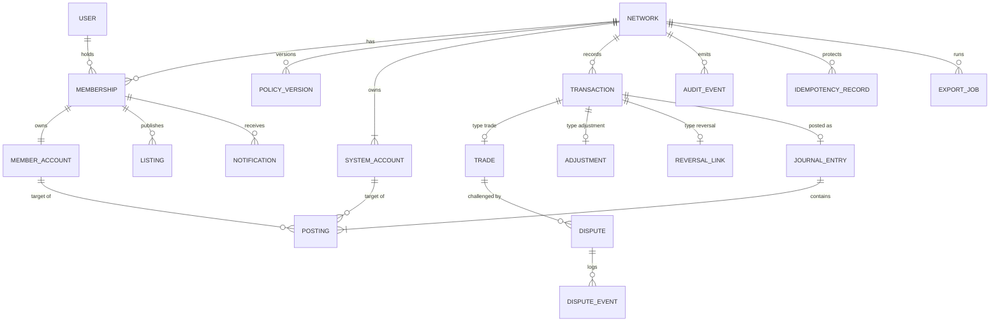

# 06 — Data Model, Ledger and Audit

| Field | Value |
|---|---|
| Status | Draft |
| Owner role | Data and ledger architect |
| Last updated | 2026-10-21 |
| Scope | Conceptual entities, attributes and mutability classes; identifiers; relationships; atomic posting; idempotency records; append-only ledger; balance reconstruction and reconciliation; concurrency requirements; audit-event contents and access; retention; migration principles; personal-data inventory and erasure/anonymisation approach |
| Depends on | [00 — Conventions and canon](00-conventions.md), [03 — Domain model](03-domain-model-and-mutual-credit-rules.md), [15 — Lifecycle state machines](15-lifecycle-state-machines.md) |
| Open questions | See section 15; consolidated in [13 — Assumptions, risks, decisions](13-assumptions-risks-decisions-roadmap.md) |

## 1. Purpose and scope

This document is the single authoritative home for **what Circula stores, how it is identified, how ledger writes behave under retries and concurrency, how balances are proven, what the audit trail contains, how long things are kept, and how personal data is separated from accounting data**. It is technology-neutral (D-02): it names no database, cloud or framework. Terms such as "unit of work" mean "a single atomic, isolated, durable commit"; each implementation chooses how to achieve it, but the observable requirements below are binding.

Meaning of balances, signs, limits and invariants is owned by [03](03-domain-model-and-mutual-credit-rules.md) (`DOM-`, `INV-`); state machines by [15](15-lifecycle-state-machines.md) (`LIF-`); policy parameter ranges by [16](16-network-policy-catalog.md); API shapes and error codes by [07](07-api-and-integration-contract.md); export formats and the reconciliation proof carried in packages by [18](18-data-export-and-portability.md) (`PRT-`); backup, restore cadence and monitoring by [11](11-deployment-operations-and-support.md). This document cites those and does not redefine them. The credit unit is an accounting unit and nothing here implies redemption, interest or conversion (`INV-014`, [DOM-001](03-domain-model-and-mutual-credit-rules.md)).

Out of scope: physical schema, indexes, storage engine, replication topology.

## 2. Definitions used here

Canon terms (Network, Member Account, System Account, Journal Entry, Posting, Adjustment, Reversal, Dispute, Audit Event) are as in [00 section 5.1](00-conventions.md) and [14](14-glossary.md). Local terms:

| Term | Meaning |
|---|---|
| **Unit of work** | One atomic, isolated, durable commit. Equivalent to the "atomic unit" of [LIF-002](15-lifecycle-state-machines.md). |
| **Mutability class** | **I** immutable: never changes after insert. **A** append-only: rows are never updated or deleted; new rows are added. **M** mutable: fields may change in place; changes to governance-relevant fields are also recorded as History Records and/or Audit Events. Suffix `*`: mutable only through a named procedure (stated in the Notes column). Suffix `R`: the field is **redactable** (section 12.4): its value may be replaced by a tombstone by the erasure procedure and by no other path. |
| **Account** | The union of Member Accounts and System Accounts; both draw identifiers from one space and are the targets of Postings. |
| **Account serialisation** | Whatever mechanism guarantees that postings and limit-relevant changes on one Account behave as if executed one at a time (section 8). |
| **Cached balance** | The balance stored on an Account row (D-04). Never an authority (`INV-008`). |
| **Tombstone** | A fixed placeholder value (for example `[removed]`) that replaces a redacted field; the redaction itself is audited. |
| **Entry hash** | Digest of the canonical content of a Journal Entry and its Postings (section 6.4). |
| **Integrity checkpoint** | A sealed digest and count over all Journal Entries (or Audit Events) of a Network at a consistent snapshot (section 9.4). |

Type notation used in attribute tables: `id` (opaque identifier, section 3), `ts` (UTC instant, microsecond precision, RFC 3339 on the wire), `int` (signed integer of at least 64 bits), `text(n)` (Unicode, at most n characters), `enum`, `bool`, `hash` (digest with algorithm tag), `json` (structured, schema-versioned, no personal data unless stated). Null column: **N** not null, **Y** nullable. PD column marks personal data class: **D** direct identifier or contact data, **C** member-authored free content that may contain personal data, **P** pseudonymous reference or behavioural data, blank = none.

## 3. Identifiers

Baseline D-03: opaque, time-sortable, non-guessable identifiers; UUIDv7 ([RFC 9562](https://www.rfc-editor.org/rfc/rfc9562)) recommended, UUIDv4 and ULID being the alternatives recorded in [13](13-assumptions-risks-decisions-roadmap.md).

| ID | Pri | Requirement | Rationale | Verification |
|---|---|---|---|---|
| DAT-001 | P0 | Every entity instance in section 4 MUST have a primary identifier generated by the Platform (server side) that is unique across the whole deployment (all Networks), opaque (encodes no business meaning, no Network or person data) and never reused, including after erasure or Network disposal. | Cross-Network leak tests can detect foreign identifiers; identifiers survive anonymisation as stable keys. | Test: generate 10 million identifiers across Networks, no collision; inspection: no identifier derived from email, name or amount |
| DAT-002 | P0 | Identifiers MUST be non-guessable: at least 70 bits of unpredictable content, and an authorisation check MUST NOT be replaced by identifier secrecy. | Enumeration resistance as defence in depth. | Inspection of generator; authorisation tests with valid-but-foreign identifiers return not-found (`DOM-002`) |
| DAT-003 | P0 | Identifiers MUST be exposed in one canonical text form (lowercase, hyphenated when UUID) in APIs and exports, and MUST be compared as opaque values. | Interoperability and reproducible exports ([18](18-data-export-and-portability.md)). | Schema test on API and export outputs |
| DAT-004 | P0 | Business ordering MUST NOT rely on identifier order. Ledger ordering uses `account_seq` per Account (section 6.2) and `(posted_at, journal_entry_id)` for Network-wide listing. | Time-sortable identifiers are not a commit order. | Inspection; test with identifiers generated out of order across workers |
| DAT-005 | P0 | Every Network-scoped row MUST carry `network_id`, and a reference from one row to another MUST be rejected unless both rows have the same `network_id`. Cross-Network references are permitted only from `User` (which has no `network_id`) to `Membership`. | Enforces `INV-011` in the data layer, not only in services. | Test: crafted cross-Network reference for every reference attribute is rejected |
| DAT-006 | P2 | Entities shown to humans for reference (Trade, Journal Entry) SHOULD additionally carry a short, non-sequential, checksummed `public_ref` unique per Network, for statements and support conversations. | Humans cannot read UUIDs aloud. Deferred, designed-for. | Test: uniqueness, checksum detects single-character errors |

Note: UUIDv7 reveals creation time to the millisecond. This is accepted for ledger rows (which carry `posted_at` anyway) and recorded as an assumption for Membership and Listing identifiers (section 15, A-DAT-1).

## 4. Entity catalogue

### 4.1 Entity overview

| Entity | Class | Network-scoped | Purpose | Personal data |
|---|---|---|---|---|
| Network | M (unit identity I after first Journal Entry) | — | Tenant: unit, lifecycle | no |
| User | M | no | Login identity, spans Networks (D-07) | D |
| Credential | M | no | Authentication material of a User | D (secret) |
| Membership | M | yes | A User in one Network; lifecycle ([15](15-lifecycle-state-machines.md)) | P |
| MemberProfile | M | yes | Personal data of a Membership, kept apart from all accounting rows | D, C |
| MemberAccount | M* | yes | Ledger account owned by a Membership; cached balance | P |
| SystemAccount | M* | yes | `network_clearing`, `community_fund` | no |
| Listing, ListingVersion | M, A | yes | Offer or Request; no ledger effect | C |
| Transaction | M (status only) | yes | Business record of every ledger-affecting intent | P |
| Trade | M (proposal fields) | yes | Detail of a Transaction of type `trade` | C |
| Adjustment, Approval | M, A | yes | Detail of type `adjustment` and admin approvals | C |
| ReversalLink | I | yes | Links a Reversal Transaction to the Trade it reverses | no |
| JournalEntry | **I** | yes | Ledger record | no |
| Posting | **I** | yes | Signed line against one Account | no |
| Dispute, DisputeEvent | M, A | yes | Challenge to a Trade and its evidence trail | C |
| PolicyVersion | I | yes | Versioned Network policy | no |
| AuditEvent | **I** (R fields) | yes / platform | Governance and security record | P |
| HistoryRecord | A | yes | Per-object transition log ([LIF-008](15-lifecycle-state-machines.md)) | P |
| IdempotencyRecord | M* | yes / actor | Retry protection | P |
| Notification | M* | yes | Notification intent and delivery state ([17](17-notifications-and-communications.md)) | P |
| ExportJob | M | yes | Export request and artifact reference ([18](18-data-export-and-portability.md)) | P |
| IntegrityCheckpoint | I | yes | Sealed digest over ledger or audit data | no |
| ReconciliationRun | A | yes | Result of a reconciliation | no |
| Invitation, ConsentRecord, Attachment | M, A, M | yes | Supporting records | D / P / C |
| ImportBatch | M | yes | P2 hook for importing from other systems | P |

### 4.2 ER diagram

Text description: a Network owns two System Accounts, versioned Policies, Memberships and Transactions. A User (login) holds Memberships in one or more Networks; each Membership owns exactly one Member Account. Every Transaction that reaches `posted`/`completed` has exactly one Journal Entry holding two or more Postings, each against one Account. Trades can be challenged by Disputes, each with an append-only event log. Reversal, Adjustment and Trade are type-specific detail of Transaction. Audit Events, Idempotency Records, Notifications and Export Jobs hang off the Network.

### 4.3 Network, identity and membership

**Network** (class M; `unit_*` become I once a Journal Entry exists, `INV-013`)

| Attribute | Type | Null | Mut | PD | Notes |
|---|---|---|---|---|---|
| network_id | id | N | I | | |
| slug | text(63) | N | M | | Unique, human-readable label |
| display_name | text(120) | N | M | | |
| unit_name, unit_symbol | text(40), text(8) | N | I* | | Mutable only while the Network has no Journal Entry (`DOM-007`) |
| unit_scale | int 0–4 | N | I* | | Same rule; default 2 |
| service_state | enum | N | M | | Values owned by [10](10-governance-and-network-operations.md) (for example active, paused, closing, closed) |
| posting_halted | bool | N | M | | Set by integrity-breach rule (DAT-047); not a lifecycle state |
| created_at | ts | N | I | | |
| closed_at | ts | Y | M* | | Set by closure procedure |

**User** (login identity, not network-scoped; D-07)

| Attribute | Type | Null | Mut | PD | Notes |
|---|---|---|---|---|---|
| user_id | id | N | I | | |
| login_email | text(254) | N | M | D | Normalised; unique among non-erased Users |
| email_verified_at | ts | Y | M | | |
| status | enum | N | M | | Values owned by [09](09-security-privacy-and-abuse.md); MUST distinguish usable from erased |
| preferred_locale | text(35) | Y | M | | D-13 |
| created_at, last_authenticated_at | ts | N, Y | I, M | P | |
| erased_at | ts | Y | M* | | Set by user-level erasure |

**Credential** (child of User): `credential_id` id I; `user_id`; `type` enum (`password_hash`, `passkey`, `totp`, `recovery_code_hash`); `secret_material` (hash, public key or encrypted secret; never plaintext secret) M*; `created_at`; `last_used_at`; `revoked_at`. Class M. Detailed rules in [09](09-security-privacy-and-abuse.md).

**Membership** (class M)

| Attribute | Type | Null | Mut | PD | Notes |
|---|---|---|---|---|---|
| membership_id | id | N | I | P | |
| network_id | id | N | I | | |
| user_id | id | Y | M* | P | Set at creation; set to null by erasure Phase 2 (section 12.3) |
| state | enum | N | M* | | Canon 5.3 names; changed only by transitions MB1–MB7 |
| state_version | int | N | M* | | Compare-and-set counter ([LIF-003](15-lifecycle-state-machines.md)) |
| roles | set of enum | N | M* | | `member`, `network_admin`, `dispute_reviewer`; each change audited |
| ban_flag, ban_reason_code | bool, enum | N, Y | M* | | Flag, not a state (`DOM-041`); free-text reason lives in the Audit Event |
| credit_limit_override | int ≥ 0 | Y | M* | | Admin action, audited (`DOM-011`); account-serialised (DAT-034) |
| departure_mode_snapshot | enum | Y | I* | | Written once at MB6 (`DOM-039`) |
| departure_started_at | ts | Y | I* | | |
| invitation_id | id | Y | I | | |
| external_ref, import_batch_id | text(128), id | Y | I | P | P2 import hook (section 4.8) |
| created_at, activated_at, closed_at | ts | N, Y, Y | I* | | |
| last_activity_at | ts | Y | M | P | Input to the inactivity flag (`DOM-043`); no other use |
| anonymisation_phase | enum | N | M* | | `none`, `restricted`, `erased` (section 12.3) |
| former_member_ordinal | int | Y | I* | | Network-scoped pseudonym number assigned at Phase 1 |

**MemberProfile** (class M, personal data store separate from every accounting row; DAT-070)

| Attribute | Type | Null | Mut | PD | Notes |
|---|---|---|---|---|---|
| membership_id | id | N | I | P | One-to-one |
| display_name | text(80) | N | M | D | The only mandatory personal field (data minimisation) |
| contact_phone, locality | text(40), text(120) | Y | M | D | Coarse locality; no street address by default |
| bio, avatar_ref | text(1000), id | Y | M | C | |
| contact_visibility | json | N | M | | Which fields other Members and the public may see; defaults to least visible |
| custom_fields | json | Y | M | C | Network-defined optional fields |

### 4.4 Accounts

**MemberAccount** (class M*) and **SystemAccount** (class M*) share the Account shape:

| Attribute | Type | Null | Mut | Notes |
|---|---|---|---|---|
| account_id | id | N | I | |
| network_id | id | N | I | |
| account_kind | enum | N | I | `member` or `system` |
| membership_id | id | Y | I | Not null and unique for `member`; null for `system` (`DOM-003`) |
| system_role | enum | Y | I | `network_clearing` or `community_fund` for `system`; unique per Network (`DOM-004`) |
| balance | int | N | M* | Cached balance; written only inside a posting unit of work or the repair procedure (DAT-044) |
| last_account_seq | int | N | M* | Count of Postings on the Account |
| created_at | ts | N | I | |

### 4.5 Transactions, ledger and corrections

**Transaction** (class M for `status`, `state_version`, `status_changed_at`; all else I)

| Attribute | Type | Null | Notes |
|---|---|---|---|
| transaction_id, network_id | id | N | |
| type | enum | N | `trade`, `reversal`, `adjustment`, `opening_balance`, `departure_settlement` (`DOM` assumption A-4) |
| status | enum | N | Type-specific vocabulary from [15](15-lifecycle-state-machines.md): Trade (`proposed`, `completed`, `declined`, `cancelled`, `expired`, `reversed`); other types (`pending`, `posted`, `refused`, `withdrawn`, `expired`) |
| state_version | int | N | |
| initiator_kind | enum | N | `member`, `network_admin`, `system` |
| initiated_by_membership_id | id | Y | Null when `system` |
| reason_code | enum | Y | |
| reason_text | text(500) | Y | R; Network-visible, so DAT-058 and DAT-070 warn authors |
| journal_entry_id | id | Y | Null until posted; unique; status `posted` or `completed` if and only if not null ([LIF-038](15-lifecycle-state-machines.md)) |
| evaluated_policy_version_id | id | Y | Set in the posting unit of work (`DOM-014`) |
| origin_key_hash, origin_payload_hash | hash | Y | Idempotency fingerprint kept for the life of the Transaction (DAT-021) |
| external_ref, import_batch_id | text(128), id | Y | P2 import hook |
| created_at, status_changed_at | ts | N | |

**Trade** (1:0..1 with Transaction type `trade`)

| Attribute | Type | Null | Mut | PD | Notes |
|---|---|---|---|---|---|
| transaction_id | id | N | I | | |
| provider_account_id, recipient_account_id | id | N | I | P | Distinct Member Accounts of the Network (`INV-015`) |
| amount | int ≥ 1 | N | I | | Minor units (`DOM-008`, `DOM-018`) |
| initiated_by | enum | N | I | | `provider` or `recipient` |
| proposal_version | int | N | M* | | Incremented by description edits (`DOM-018`) |
| description | text | Y | M, R | C | Length limit per `DOM-024`; never read by logic |
| listing_id | id | Y | I | | Informational (`DOM-006`) |
| expires_at | ts | N | I | | `created_at + proposal_expiry_days`, fixed (`DOM-021`) |
| completed_at | ts | Y | I* | | |
| dispute_window_ends_at | ts | Y | I* | | Computed at completion from policy then in force (A-DAT-3) |

**Adjustment** (type `adjustment`): `transaction_id`; `member_account_id`; `system_account_id`; `direction` (`credit_member` or `debit_member`); `amount` int ≥ 1; `reason_code` (required); `reason_text` R; `override_reason` text(500) Y R (`DOM-033`); `dispute_id` Y; `corrects_journal_entry_id` Y; `approvals_required` int (snapshot of `admin_quorum`). All I except text redaction.

**Approval** (class A): `approval_id`; `transaction_id` (Adjustment or Reversal); `approver_membership_id`; `decision` (`approve`, `reject`); `reason_code`; `decided_at`. Unique on (`transaction_id`, `approver_membership_id`).

**ReversalLink** (class I, the **Reversal link** of the assignment): `reversal_link_id`; `reversal_transaction_id` (unique); `original_transaction_id`; `original_journal_entry_id`; `path` (`joint` or `admin`); `dispute_id` Y; `created_at`. At most one ReversalLink whose Reversal Transaction is `pending` or `posted` exists per `original_transaction_id` ([RV1](15-lifecycle-state-machines.md)). Once posted, the Journal Entry carries `reverses_journal_entry_id`, unique, so an entry can be reversed at most once (`DOM-025`).

**JournalEntry** (class **I**, contains no free text and no personal data)

| Attribute | Type | Null | Notes |
|---|---|---|---|
| journal_entry_id, network_id | id | N | |
| transaction_id | id | N | Unique: one entry per Transaction |
| type | enum | N | Copy of Transaction type (so hashes and exports are self-contained) |
| posted_at | ts | N | Platform clock, read after account serialisation is held (DAT-041) |
| effective_at | ts | Y | Reserved for P2 import; not user-settable in MVP |
| reverses_journal_entry_id | id | Y | Unique where not null |
| corrects_journal_entry_id, dispute_id | id | Y | Links required by `INV-004` |
| limit_flag | enum | N | `none`, `limit_exceeded_by_reversal` (`DOM-027`), `limit_exceeded_by_adjustment` (`DOM-033`); the second value extends [03](03-domain-model-and-mutual-credit-rules.md) (A-DAT-4) |
| reason_code | enum | Y | Code only |
| policy_version_id | id | N | Policy evaluated at posting |
| posting_count | int | N | |
| entry_hash, hash_version | hash, int | N | Section 6.4 |

**Posting** (class **I**)

| Attribute | Type | Null | Notes |
|---|---|---|---|
| posting_id, journal_entry_id, network_id | id | N | |
| account_id | id | N | At most one Posting per Account per entry |
| amount | int, ≠ 0 | N | Signed minor units; Recipient `−`, Provider `+` for a Trade (canon 5.2) |
| account_seq | int ≥ 1 | N | Gapless per Account: 1, 2, 3… (DAT-035) |
| balance_after | int | N | Balance of the Account immediately after this Posting |

### 4.6 Disputes, policy, audit and operations

**Dispute** (class M): `dispute_id`; `network_id`; `trade_transaction_id`; `raised_by_membership_id`; `respondent_membership_id`; `reviewer_membership_id` Y; `state` (canon 5.3), `state_version`; `reason_code`; `reason_text` R; `policy_version_id` (snapshot at DS1, [LIF-024](15-lifecycle-state-machines.md)); `opened_at`; `sla_flagged_at` Y; `resolved_at` Y; `resolution_code` Y; `resolution_text` Y R; `remedy_type` Y (`reversal`, `adjustment`, `cancel_trade`, `none`); `remedy_transaction_id` Y.

**DisputeEvent** (class A): `dispute_event_id`; `dispute_id`; `seq`; `kind` (`state_change`, `submission`, `evidence`, `reviewer_note`, `settlement_terms`, `consent`, `remedy_link`, `annotation`); `actor_membership_id`; `body` text(4000) Y R; `attachment_ids` Y; `visibility` (`parties_and_reviewers`, `reviewers_and_admins`); `terms_hash` Y (for `consent`, binds consent to the exact terms, [LIF-023](15-lifecycle-state-machines.md)); `created_at`.

**PolicyVersion** (class I)

| Attribute | Type | Null | Notes |
|---|---|---|---|
| policy_version_id, network_id | id | N | |
| version_no | int | N | 1, 2, 3… unique per Network |
| parameters | json | N | All policy names of [canon 5.6](00-conventions.md) except `unit_name`, `unit_symbol`, `unit_scale`, which live on Network (A-DAT-2) |
| announced_at, effective_at | ts | N | `effective_at ≥ announced_at + policy_notice_days` unless `is_safety_fix` (D-11) |
| is_safety_fix | bool | N | |
| change_reason_code | enum | N | |
| created_by_membership_id | id | Y | Null for version 1 created with the Network |

**AuditEvent** (class I; R fields)

| Attribute | Type | Null | PD | Notes |
|---|---|---|---|---|
| audit_event_id | id | N | | |
| network_id | id | Y | | Null for platform-level events (deployment, operator access) |
| occurred_at | ts | N | | |
| category | enum | N | | `ledger`, `membership`, `governance`, `dispute`, `export`, `security`, `platform` |
| actor_kind | enum | N | | `member`, `network_admin`, `dispute_reviewer`, `platform_operator`, `system`, `anonymous` |
| actor_ref | id | Y | P | `membership_id` in Network events (never `user_id`, DAT-056); operator staff identifier in platform events; null for `system` |
| acting_capacity | enum | N | | The role exercised, since one person holds several |
| action | text(64) | N | | Code `<domain>.<verb>` from the catalogue (section 10.2) |
| target_type, target_id | enum, id | N | | |
| affected_membership_id | id | Y | P | Enables "events about me" (FR-AUD-004) |
| reason_code | enum | N | | Required for governance actions |
| reason_text | text(280) | Y | C | R; optional elaboration |
| outcome | enum | N | | `success`, `denied`, `failed` |
| correlation_id | id | N | | Request or job identifier, for joining to operational logs |
| details | json | N | | Action-specific, schema-versioned: state names, amounts, policy parameter before/after; no personal data, no secrets |
| event_hash, hash_version | hash, int | N | | Section 10.4 |

**IdempotencyRecord** (class M*): section 7.

**Notification** (class M* for delivery fields; payload I): `notification_id`; `network_id` Y; `recipient_membership_id` Y or `recipient_user_id` Y (exactly one); `template_key` (owned by [17](17-notifications-and-communications.md)); `subject_type`, `subject_id`; `channel` enum; `params` json (identifiers and codes only; display text is rendered at send time); `status` (`queued`, `sent`, `delivered`, `failed`, `read`, `suppressed`); `attempts`; `created_at`, `sent_at`, `read_at`.

**ExportJob** (class M): `export_job_id`; `network_id` Y; `requested_by_user_id`; `requested_by_membership_id` Y; `scope` (`member_self`, `network_admin`, `network_closure`, `network_archive`, `audit_events`; [18](18-data-export-and-portability.md)); `format`; `schema_version`; `as_of` ts; `filters` json; `state` (`queued`, `running`, `ready`, `failed`, `expired`, `cancelled`); `progress`; `row_counts` json; `manifest_hash` hash Y; `artifact_ref` Y; `artifact_expires_at` Y; `download_count`; `created_at`, `completed_at`.

### 4.7 Supporting entities

| Entity | Class | Key attributes |
|---|---|---|
| HistoryRecord | A | `history_record_id`, `object_type`, `object_id`, `seq`, `from_state`, `to_state`, `event`, `actor_kind`, `actor_ref`, `reason_code`, `reason_text` (R), `state_version`, `occurred_at`, `detail` json (for TR2: `proposal_version` accepted and before/after balances of both parties, [LIF-018](15-lifecycle-state-machines.md)); visible to parties of the object |
| IntegrityCheckpoint | I | `checkpoint_id`, `network_id`, `scope` (`ledger`, `audit`), `entry_count`, `digest`, `hash_version`, `sum_of_balances` (ledger scope; MUST be 0), `previous_checkpoint_id`, `created_at` |
| ReconciliationRun | A | `run_id`, `network_id`, `scope`, `trigger` (`scheduled`, `on_demand`, `post_restore`, `post_migration`), `started_at`, `finished_at`, `result` (`pass`, `fail`), `checks` json (per check: id, count examined, count failed), `discrepancies` json (identifiers only) |
| Invitation | M | `invitation_id`, `network_id`, `invitee_email_hash` and `invitee_email` (D, deleted at use or expiry plus 7 days), `token_hash`, `created_by_membership_id`, `expires_at`, `used_at` |
| ConsentRecord | A | `consent_id`, `user_id` or `membership_id`, `purpose_code` (for example terms, privacy notice version, directory visibility), `document_version`, `granted` bool, `recorded_at` |
| Attachment | M | `attachment_id`, `network_id`, `uploaded_by_membership_id`, `content_hash`, `byte_size`, `media_type`, `storage_ref`, `scan_status`, `created_at`, `redacted_at` Y |

### 4.8 Import hook (P2)

`ImportBatch` (class M): `import_batch_id`, `network_id`, `source_label`, `source_format`, `source_file_hash`, `mode` (`dry_run`, `commit`), `state`, `counts` json, `created_by_membership_id`, `created_at`, `report_ref`. The nullable `external_ref` and `import_batch_id` attributes on Membership and Transaction exist so that import can be added without a migration of ledger tables. Behaviour is specified in [18](18-data-export-and-portability.md).

## 5. Relationships and cardinalities

| From | To | Cardinality | Rule |
|---|---|---|---|
| Network | PolicyVersion | 1 : 1..n | Version 1 is created with the Network; versions are never edited |
| Network | SystemAccount | 1 : 2 | Created atomically with the Network (`DOM-004`) |
| Network | Membership | 1 : 0..n | |
| User | Membership | 1 : 0..n | At most one non-terminal Membership per (User, Network) ([MB1](15-lifecycle-state-machines.md)) |
| Membership | MemberAccount | 1 : 1 | Created in the same unit of work (`DOM-003`) |
| Membership | MemberProfile | 1 : 1 | Profile can be absent only after Phase 2 erasure |
| Transaction | Trade / Adjustment / ReversalLink | 1 : 0..1 | Exactly the one matching `type`; none for `opening_balance`, `departure_settlement` |
| Transaction | JournalEntry | 1 : 0..1 | Posted if and only if present |
| JournalEntry | Posting | 1 : 2..n | Trade, Reversal, Adjustment, departure: exactly 2; `opening_balance`: at most [DECISION NEEDED: DEC-DAT-1, max postings per opening entry; recommended 500] |
| Account | Posting | 1 : 0..n | `account_seq` gapless |
| Trade | Dispute | 1 : 0..n | At most one non-terminal Dispute per raiser per Trade ([DS1](15-lifecycle-state-machines.md)) |
| Dispute | DisputeEvent | 1 : 1..n | First event is the `raise` |
| JournalEntry | JournalEntry | 0..1 : 0..1 | `reverses_journal_entry_id`; acyclic (reversals of reversals unsupported, `DOM-029`) |
| Any lifecycle object | HistoryRecord | 1 : 1..n | |

| ID | Pri | Requirement | Rationale | Verification |
|---|---|---|---|---|
| DAT-007 | P0 | The data model MUST implement every entity, attribute nullability and mutability class in section 4. Any attribute marked I or A MUST be unwritable after insert through every interface used by application code. | The classes are what make `INV-003` testable. | Inspection of privileges; negative tests per I/A attribute through each interface |
| DAT-008 | P0 | Referential rules in section 5 (cardinality, uniqueness, acyclicity of `reverses_journal_entry_id`) MUST be enforced at storage level where the chosen technology supports it, and in the write path always. | Uniqueness under concurrency cannot rely on application checks alone ([LIF-038](15-lifecycle-state-machines.md) race (i)). | Test: parallel duplicate reversal, duplicate Journal Entry per Transaction, duplicate approver; exactly one succeeds |
| DAT-009 | P0 | Amounts and balances MUST use an integer type of at least 64 bits; arithmetic MUST be checked, and an operation that would overflow MUST be rejected, never wrapped or rounded. A configured platform maximum per Posting [DECISION NEEDED: DEC-DAT-2, maximum Posting amount; recommended 10^12 minor units] applies. | Exactness (`DOM-008`). | Boundary tests at maximum and maximum plus one |
| DAT-010 | P0 | All timestamps MUST be stored in UTC with at least microsecond precision and produced by the Platform clock, never the client clock. | [LIF-007](15-lifecycle-state-machines.md); consistent ordering and exports. | Test with skewed client clock |
| DAT-011 | P1 | Every enumeration listed in section 4 MUST be stored as its canon spelling (for example `proposed`, `network_clearing`), never as a display label. | Stable exports and migrations. | Schema inspection |

## 6. The ledger

### 6.1 Atomic posting

Every ledger-affecting transition executes as one unit of work in the following order. Any failure before commit discards everything (`INV-002`, [LIF-002](15-lifecycle-state-machines.md)).

| Step | Action |
|---|---|
| 1 | Authenticate and authorise the actor ([LIF-004](15-lifecycle-state-machines.md) order) |
| 2 | Idempotency check: look up (scope, key); replay stored outcome, or reject on payload mismatch (section 7) |
| 3 | Acquire account serialisation for every Account to be posted, in ascending `account_id` order |
| 4 | Re-read the Transaction; compare `state_version`; check the transition is legal |
| 5 | Read the Network's effective PolicyVersion and the Membership states and limits (consistent with step 3) |
| 6 | Evaluate guards (`INV-015`, `INV-005`, `INV-006`, `DOM-012`, `DOM-013`; or the Reversal/Adjustment guards) against the balances read after step 3 |
| 7 | Insert Journal Entry and Postings with `account_seq`, `balance_after`, `entry_hash`; verify Postings sum to zero (`INV-001`) |
| 8 | Update cached balances and `last_account_seq` |
| 9 | Update Transaction (status, `journal_entry_id`, `evaluated_policy_version_id`), related objects (Trade, Dispute) and write the History Records |
| 10 | Write the Audit Event where required (`INV-010`) |
| 11 | Write Notification intents (outbox, DAT-016) |
| 12 | Write the IdempotencyRecord outcome |
| 13 | Commit |

| ID | Pri | Requirement | Rationale | Verification |
|---|---|---|---|---|
| DAT-012 | P0 | Steps 7 to 12 MUST commit or roll back together. No reader, including a reader running a reconciliation, MAY observe a Journal Entry without all its Postings, a Posting without updated cached balance, a `completed` Trade without its Journal Entry, or a Journal Entry whose Transaction is not `completed`/`posted`. | `INV-002`, `INV-008`, [LIF-038](15-lifecycle-state-machines.md). | Failure injection after each of steps 7 to 12; concurrent reader at read-committed-or-stronger never sees a partial state; reconciliation clean afterwards |
| DAT-013 | P0 | The Journal Entry MUST be rejected before commit if its Postings do not sum to exactly zero, if any Posting amount is zero, if two Postings name the same Account, if the Postings span more than one Network, or if a Posting names an Account whose Membership is `closed`. | `INV-001`, `INV-011`, `INV-016`. | Property test with random entries; crafted violations |
| DAT-014 | P0 | A Trade Journal Entry MUST contain exactly two Postings, `−amount` on the Recipient Account and `+amount` on the Provider Account. A Reversal entry MUST contain the exact negation of every Posting of the reversed entry. | `DOM-023`, `DOM-025`. | Table-driven tests; reconciliation check R7 (section 9.2) |
| DAT-015 | P0 | If the Audit Event (step 10) or the idempotency outcome (step 12) cannot be written, the unit of work MUST abort with no ledger effect. | `INV-010`, `INV-009`. | Forced write failure at each step |
| DAT-016 | P0 | Notification intents MUST be written in the same unit of work as the transition that causes them (transactional outbox) and delivered afterwards. A rolled-back transition MUST produce no notification; a committed one MUST eventually produce its notification even after a crash. Delivery MUST never block or roll back a posting. | No false or lost notices ([17](17-notifications-and-communications.md)). | Crash test between commit and send; rollback test |
| DAT-017 | P0 | A posting unit of work MUST complete within `max_posting_unit_duration` [DECISION NEEDED: DEC-DAT-3, recommended 30 seconds] measured from lock acquisition, otherwise it MUST abort with no effect and a retryable error. | Bounds lock hold times and gives exports a safe snapshot cut ([18](18-data-export-and-portability.md)). | Test with an injected stall |

### 6.2 Append-only ledger

| ID | Pri | Requirement | Rationale | Verification |
|---|---|---|---|---|
| DAT-018 | P0 | JournalEntry and Posting rows MUST be insert-only. The application's storage credentials MUST NOT hold update or delete rights on them, and a storage-level guard (trigger, constraint or equivalent) SHOULD additionally reject updates and deletes. | `INV-003`; defence in depth against application bugs. | Privilege inspection; negative test via every interface, including the administrative tooling |
| DAT-019 | P0 | Corrections MUST be new Journal Entries linked to the original (`reverses_journal_entry_id` or `corrects_journal_entry_id`) and to an Audit Event. The only procedures allowed to touch existing ledger rows are those in section 13.4 (migration of representation, disaster recovery, Network disposal), each audited and each content-preserving or all-or-nothing per Network. | `INV-004`; keeps "normal operation" in `INV-003` meaningful. | Inspection of procedures; migration test proves entry hashes unchanged |
| DAT-020 | P0 | `limit_flag` MUST be set at posting when a Reversal or Adjustment leaves an Account outside its floor or cap (`DOM-027`, `DOM-033`), MUST never change afterwards, and the *current* over-limit or over-cap status of an Account MUST be derived from current balance and limits, not from the flag. | Flag records history; status reflects now. | Test: later credit clears over-limit status; flag remains |

### 6.3 Ordering

Each Posting carries `account_seq`, assigned while holding the Account's serialisation, equal to the previous `last_account_seq + 1`. Within one Account, `account_seq` order is the true commit order. Network-wide listing orders by `(posted_at, journal_entry_id)`; this order is deterministic but is not a commit order across Accounts, and nothing may depend on it for correctness.

### 6.4 Entry hash

`entry_hash` is the SHA-256 digest of the canonical form of the Journal Entry fields (excluding `entry_hash` itself) together with its Postings (`account_id`, `amount`, `account_seq`, `balance_after`) sorted by `account_id`, canonicalised with the JSON Canonicalization Scheme ([RFC 8785](https://www.rfc-editor.org/rfc/rfc8785); background knowledge, not re-fetched on 2026-10-21 because the sandbox had no route to rfc-editor.org). `hash_version` names the exact field list, so adding fields later never invalidates old hashes. Because the entry contains no free text or personal data, the hash never needs redaction.

| ID | Pri | Requirement | Rationale | Verification |
|---|---|---|---|---|
| DAT-021 | P1 | Each Transaction that creates a resource (Trade proposal, Adjustment, Reversal request) MUST store `origin_key_hash` and `origin_payload_hash` permanently, and a creation request replayed after the IdempotencyRecord TTL with the same scope, key and payload MUST return the existing resource rather than create another. | Duplicate protection outlives the TTL. | Replay-after-TTL test |
| DAT-022 | P0 | `entry_hash` MUST be computed in the posting unit of work and stored; recomputation from stored Postings MUST reproduce it for every entry. | Tamper evidence and export verification ([18](18-data-export-and-portability.md)). | Reconciliation check R12; mutate one stored amount in a test copy and see the check fail |
| DAT-023 | P1 | The Platform SHOULD seal an IntegrityCheckpoint over each Network's ledger and audit data at least daily (section 9.4). Sealing MUST run outside the posting path and MUST NOT take locks that delay postings. | Community-verifiable history without write contention. | Latency test: p99 posting latency unchanged with sealing running |

## 7. Idempotency

`INV-009` requires that a retried request with the same key and payload yields the same outcome and never a second posting, and that the same key with a different payload is rejected. Key format, header name and error codes are owned by [07](07-api-and-integration-contract.md); this section owns the record semantics.

| Aspect | Rule |
|---|---|
| Scope | (`network_id`, `actor_ref`, `key`). For operations with no Network (for example Network creation) `network_id` is absent: (`actor_ref`, `key`). Different actors or Networks using the same key string never collide. |
| Key | Client-generated, opaque, 16 to 128 characters from a URL-safe set; a UUID is recommended. Required on every operation that changes ledger state, Trade or Dispute state, Adjustment/Reversal state, Membership state or policy; optional elsewhere. |
| Payload hash | SHA-256 over a canonical form of (operation name, target identifiers, normalised request body). Excludes transport headers, timestamps and authentication material. Equality of two requests means equality of this hash. |
| Consumption | A key is **consumed** only when the unit of work commits. Rejections that depend on state at the time (for example `credit_limit_exceeded`, illegal transition), validation failures and server errors do not consume the key, so the caller may retry the same key after fixing the cause (Example B in [03](03-domain-model-and-mutual-credit-rules.md)). |
| Stored outcome | HTTP-independent: outcome code, resource identifiers (`transaction_id`, `journal_entry_id`), and a snapshot of non-personal result fields (amount, `balance_after`, `posted_at`). Not the full response body. |
| Replay | Same scope, key, payload hash: return the stored outcome with an indication that it is a replay; no new row, no new posting, no new notification, no new Audit Event. The resource representation returned MAY reflect later state. |
| Mismatch | Same scope and key, different payload hash: reject, change nothing. |
| In progress | Same scope and key while the first request is still executing: MUST either wait and return the first outcome, or return a retryable error naming a retry delay; MUST NOT execute twice. |
| TTL | Record retained at least `idempotency_ttl` [DECISION NEEDED: DEC-DAT-4; options 24 hours, 72 hours, 7 days; recommended 72 hours]; deleted after. State machines independently prevent double posting ([LIF-006](15-lifecycle-state-machines.md)); DAT-021 covers creation requests. |

| ID | Pri | Requirement | Rationale | Verification |
|---|---|---|---|---|
| DAT-024 | P0 | The IdempotencyRecord MUST be created in the same unit of work as the effect it protects, with a uniqueness guarantee on (scope, key) enforced by storage. | A separate step would leave a window for double posting. | 100 parallel identical requests: exactly one posting, all callers receive the same outcome or a retryable in-progress error |
| DAT-025 | P0 | Replays MUST return the stored outcome identifiers and result snapshot, and MUST NOT re-evaluate guards. | A balance change between attempts must not turn a success into a failure for a retrying client. | Test: accept, change limits, replay accept; original success returned |
| DAT-026 | P0 | A mismatched payload under an existing key MUST be rejected without side effects. | `INV-009`. | Test mutating amount, counterparty and description in turn |
| DAT-027 | P0 | IdempotencyRecords MUST NOT store credentials, tokens or full request bodies, and MUST be deleted at TTL expiry by a job that is safe to run concurrently and late. | Minimisation; [LIF-055](15-lifecycle-state-machines.md) timer rules. | Content scan; delayed-run test |
| DAT-028 | P1 | The effective TTL MUST be published in the API documentation and returned with the stored outcome. | Clients can plan retries. | Documentation inspection ([07](07-api-and-integration-contract.md)) |

## 8. Concurrency control

These requirements state outcomes, not mechanisms. Acceptable mechanisms include row or key locks taken in a fixed order, conditional atomic updates, serialisable isolation with automatic retry, or a single-writer ledger engine ([research note](../notes/research-technical-standards.md), section 1). The ADR chosen later records the mechanism (D-02).

| ID | Pri | Requirement | Rationale | Verification |
|---|---|---|---|---|
| DAT-029 | P0 | **Serial equivalence per Account.** The set of committed postings on any Account MUST be equivalent to executing them one at a time in `account_seq` order. For every Posting of a Trade, `balance_after ≥ −credit_limit` and `balance_after ≤ max_balance` (when set) MUST hold using the limits in force at its commit, and `balance_after` MUST equal the preceding Posting's `balance_after` plus `amount`. | `INV-005`, `INV-006`, [DOM-020](03-domain-model-and-mutual-credit-rules.md); the property is checkable offline from the data. | Offline checker over test databases; 100-way concurrent accept test: a Recipient who can afford exactly 3 yields exactly 3 successes and the floor balance |
| DAT-030 | P0 | **No lost updates.** The final cached balance MUST equal the sum of committed Postings after any interleaving of concurrent operations, including operations on different Trades touching the same Account and operations from different application instances. | `INV-008`. | Randomised concurrency test (at least 100,000 operations over 20 Accounts); reconciliation check R3 passes |
| DAT-031 | P0 | **Deterministic lock ordering.** Whenever a unit of work serialises more than one Account, it MUST acquire them in ascending canonical `account_id` order, for every code path including Reversal, Adjustment and departure settlement. | Prevents deadlock ([DOM-020](03-domain-model-and-mutual-credit-rules.md)). | Test: opposing transfers A→B and B→A in a tight loop for 60 seconds, zero deadlock aborts surfaced to clients |
| DAT-032 | P0 | **No client-visible deadlocks or serialisation failures.** If the mechanism aborts a unit of work for deadlock or serialisation reasons, the Platform MUST retry it transparently up to [DECISION NEEDED: DEC-DAT-5, retry count; recommended 5] times and then return a retryable error with no effect. | Callers see outcomes, not internals. | Fault injection |
| DAT-033 | P0 | **Bounded waiting.** Waiting for account serialisation MUST time out after [DECISION NEEDED: DEC-DAT-6, lock wait timeout; recommended 5 seconds] and return a retryable error with no effect. | Prevents pile-ups behind a stalled holder. | Test with a held lock |
| DAT-034 | P0 | **Limit-relevant changes share the Account's serialisation.** Any change to a value that a limit check reads for Account A (`credit_limit_override`, the Membership `state`, roles that affect trading) MUST be executed under A's account serialisation or evaluated inside the same unit of work as the checks, so that for any concurrent pair the order is decided by commit and the outcome equals one of the two serial orders. Network-wide policy changes need no per-Account lock because they take effect at `effective_at` and are read at commit ([DOM-014](03-domain-model-and-mutual-credit-rules.md)). | Races R6, R7, R9 in [15 section 9.2](15-lifecycle-state-machines.md). | Concurrency tests R6, R7, R9, R16 |
| DAT-035 | P0 | `account_seq` MUST be gapless and unique per Account, assigned while the Account serialisation is held. A gap, duplicate or decreasing `balance_after` chain is an integrity failure (section 9.2, check R4). | Makes deletion or insertion of a Posting detectable without a global lock. | Test: delete one Posting in a test copy; check R4 fails |
| DAT-036 | P0 | **State compare-and-set.** Every lifecycle object MUST change state through a compare-and-set on `state_version`, with exactly one winner among competing events ([LIF-003](15-lifecycle-state-machines.md)). | Races R1 to R18. | Concurrency tests of [LIF-051](15-lifecycle-state-machines.md) |
| DAT-037 | P0 | **First-entry guard.** Changing `unit_name`, `unit_symbol` or `unit_scale` MUST be serialised against the first Journal Entry of the Network, so that exactly one of the two wins and `INV-013` holds in both outcomes. | `INV-013`. | Concurrency test of first posting versus scale change |
| DAT-038 | P0 | **Consistent reads.** A balance or statement read MUST return its cached balance together with the `last_account_seq` it reflects, and a history page set MUST be read from one consistent snapshot, so that the displayed balance equals the sum of displayed Postings plus any earlier ones. A reader MUST NOT see a balance without the Posting that produced it. | `INV-008`; screen-reader and accountant personas depend on arithmetic that adds up ([02](02-personas-roles-and-journeys.md)). | Test: reader loop during 1,000 concurrent postings never observes a mismatch |
| DAT-039 | P0 | **Uniqueness races.** Creation of a Journal Entry per Transaction, a Reversal per Trade, an Approval per approver, and a Membership per (User, Network) non-terminal MUST be race-safe: concurrent attempts produce exactly one row. | `DOM-025`, [LIF-038](15-lifecycle-state-machines.md). | Parallel attempts, 1,000 iterations each |
| DAT-040 | P0 | Concurrency testing MUST run against the real storage technology in the reference deployment (not only a mock), because isolation behaviour is technology-specific. | Mocks hide anomalies such as write skew. | CI gate in [12](12-quality-strategy-and-test-plan.md) |
| DAT-041 | P0 | `posted_at` MUST be read after all required Account serialisation is held, and for any one Account `posted_at` MUST be non-decreasing in `account_seq` order. | A statement in `account_seq` order never goes back in time. | Clock-skew test across instances |

## 9. Balance reconstruction and reconciliation

### 9.1 Reconstruction

The ledger alone (JournalEntry and Posting) suffices to recompute every Account's balance (`INV-008`): `balance(account) = Σ Posting.amount`, and equivalently the `balance_after` of the Account's highest `account_seq`. No other data is needed, which also makes the Network exportable and verifiable by third parties ([18](18-data-export-and-portability.md)).

| ID | Pri | Requirement | Rationale | Verification |
|---|---|---|---|---|
| DAT-042 | P0 | The Platform MUST provide a recompute procedure that, from Posting rows only, produces `(account_id, balance, posting_count, last_account_seq)` for every Account of a Network, and a repair procedure that can overwrite cached balances from that result. | `INV-008`; restore-from-ledger path. | Test: corrupt cached balances in a test copy, run repair, reconciliation passes |
| DAT-043 | P0 | The recompute procedure MUST run without taking Account serialisation for long periods: it reads a consistent snapshot and MUST NOT delay postings by more than [DECISION NEEDED: DEC-DAT-7, recommended 50 ms at p99] on a Network of 1 million Postings. | Reconciliation must be runnable on a live Network. | Performance test |
| DAT-044 | P0 | Repair of cached balances MUST run as a serialised administrative procedure per Account, MUST write an Audit Event with before and after values (category `ledger`, action `ledger.cache_repaired`), and MUST NOT alter any Journal Entry or Posting. | Repair is a cache fix, not a ledger change (`INV-003`, `INV-010`). | Test; audit coverage query |

### 9.2 Reconciliation procedure

A reconciliation run examines one Network at a consistent snapshot and executes these checks, each recorded in `ReconciliationRun.checks`:

| Check | Assertion | Failure severity |
|---|---|---|
| R1 | Every Journal Entry's Postings sum to zero (`INV-001`) | Critical |
| R2 | Every Posting's Account belongs to the Journal Entry's Network (`INV-011`) | Critical |
| R3 | For every Account: cached `balance` = Σ Postings = `balance_after` of its last Posting; `last_account_seq` = Posting count (`INV-008`) | Critical for Σ mismatch of ledger; Repairable if only the cache differs |
| R4 | `account_seq` is gapless from 1 and each `balance_after` = previous plus `amount` (DAT-035) | Critical |
| R5 | Sum of all balances in the Network (Member plus System) = 0 (`INV-007`) | Critical |
| R6 | A Transaction is `posted`/`completed`/`reversed` if and only if it has exactly one Journal Entry; no Journal Entry lacks a Transaction ([LIF-038](15-lifecycle-state-machines.md)) | Critical |
| R7 | Each entry with `reverses_journal_entry_id` negates the original exactly; each original is reversed at most once | Critical |
| R8 | A `closed` Membership's Account has balance 0 and no Posting with `posted_at` after `closed_at` (`INV-016`) | Critical |
| R9 | Each Adjustment, Reversal, policy change, role change, dispute resolution, membership decision and export has its Audit Event (`INV-010`) | High |
| R10 | `limit_flag` is consistent with `balance_after` relative to limits at that time; Trade entries have `limit_flag = none` | High |
| R11 | Trade entries have exactly two Postings with opposite signs and the Trade's `amount` (DAT-014); `INV-015` participants are distinct | Critical |
| R12 | Recomputed `entry_hash` equals stored `entry_hash` for every entry (DAT-022); latest IntegrityCheckpoint digest reproduces over the entries it covers | Critical |
| R13 | No two Transactions share (`network_id`, creator, `origin_key_hash`) | Medium |
| R14 | `evaluated_policy_version_id` and `policy_version_id` exist and were effective at `posted_at` | High |

| ID | Pri | Requirement | Rationale | Verification |
|---|---|---|---|---|
| DAT-045 | P0 | The Platform MUST implement checks R1 to R14 as an automated reconciliation that can be triggered on demand, by schedule, after every restore and after every migration touching ledger tables, and that records a ReconciliationRun. Scheduled frequency is set in [11](11-deployment-operations-and-support.md); the minimum is [DECISION NEEDED: DEC-DAT-8; recommended daily and on every restore or migration]. | Detects corruption early. | Seeded-fault tests: one fault per check is detected |
| DAT-046 | P0 | R1, R2, R4 (for affected Accounts), R11 MUST additionally be enforced inline in every posting unit of work (cheap local checks), not only by the periodic run. | Prevents bad rows existing even briefly. | Failure injection |
| DAT-047 | P0 | A run result `fail` of severity Critical, other than a cache-only R3 mismatch, MUST (a) raise an operator alert, (b) set `Network.posting_halted` so no further Journal Entries are accepted for that Network, (c) write an Audit Event `ledger.integrity_breach` visible to the Network's administrators, and (d) leave reads and exports available. Clearing the halt requires a documented operator procedure and an Audit Event. [DECISION NEEDED: DEC-DAT-9, automatic halt versus alert only; recommended automatic halt.] | Fail closed. The Operator still holds no posting power (`INV-012`); halting is an operational safeguard. | Seeded Critical fault halts postings and exposes the audit event |
| DAT-048 | P0 | A cache-only R3 mismatch MUST be repaired per DAT-044 and reported to administrators in aggregate; it MUST NOT halt postings. | Cache drift is expected to be rare and harmless once repaired. | Test |
| DAT-049 | P0 | A reconciliation run MUST complete for a Network of 1 million Postings within [DECISION NEEDED: DEC-DAT-10; recommended 10 minutes] without exceeding the posting-delay bound of DAT-043. | Operability at the target scale of large community Networks. | Performance test |
| DAT-050 | P1 | The latest ReconciliationRun result, time and IntegrityCheckpoint digest SHOULD be viewable by Network administrators and included in every Network export manifest ([18](18-data-export-and-portability.md)). | Transparency; basis for the export proof. | Inspection |
| DAT-051 | P0 | After any restore, the Platform MUST run reconciliation before accepting postings; if the restored data fails a Critical check, the Network MUST stay `posting_halted`. | A restore must not silently reintroduce inconsistency. | Backup-restore test in [12](12-quality-strategy-and-test-plan.md) |

### 9.3 Statement arithmetic

A member statement for a period MUST show opening balance, each Posting in `account_seq` order, closing balance and the sum identity `opening + Σ amounts = closing`. The opening balance is the `balance_after` of the last Posting before the period (or 0).

| ID | Pri | Requirement | Rationale | Verification |
|---|---|---|---|---|
| DAT-052 | P0 | Statements and exports MUST derive running balances from `balance_after` values and MUST verify the identity above before delivery; a mismatch MUST fail the request rather than present a guessed figure. | [02 JRN review balances](02-personas-roles-and-journeys.md): never a guessed figure. | Test with a corrupted copy |

### 9.4 Integrity checkpoints

An IntegrityCheckpoint over the ledger has `digest = SHA-256` of the concatenation of all `entry_hash` values of the Network's Journal Entries visible at the snapshot, ordered by `journal_entry_id`; the audit-scope digest is the same over `event_hash`. Each checkpoint records `entry_count`, `sum_of_balances` and the previous checkpoint's identifier. A checkpoint can be re-derived by anyone holding the entries (for example from an export package), so a Platform Operator cannot silently alter history that a Network administrator has already exported. A checkpoint does not prove that entries are *absent* after the snapshot; the entry count and `account_seq` continuity cover that.

| ID | Pri | Requirement | Rationale | Verification |
|---|---|---|---|---|
| DAT-053 | P1 | IntegrityCheckpoints MUST be immutable, MUST be included in Network exports, and SHOULD be shown to administrators with a way to copy the latest digest for outside safekeeping. Publishing a digest outside the Platform is optional. [DECISION NEEDED: DEC-DAT-11, external anchoring; recommended not in MVP.] | Tamper evidence without external services. | Inspection; recompute test |

## 10. Audit events

### 10.1 Rules and contents

Audit Events are distinct from Journal Entries: the ledger records value movements; audit records who did what and why. Required fields are in section 4.6. Rules from [00 section 5.4](00-conventions.md) and [04 FR-AUD](04-functional-requirements.md) are made concrete here.

| ID | Pri | Requirement | Rationale | Verification |
|---|---|---|---|---|
| DAT-054 | P0 | Every action in the catalogue (10.2) MUST produce exactly one Audit Event with all required fields, written in the same unit of work as the action; a failed audit write aborts the action. | `INV-010`, FR-AUD-001. | Coverage query per action type; forced audit-write failure |
| DAT-055 | P0 | AuditEvent rows MUST be insert-only except for redaction of `reason_text` and `details` text fields by the erasure procedure (section 12); no interface may edit or delete an event. Redaction MUST itself produce an Audit Event. | FR-AUD-002. | Negative tests; redaction test |
| DAT-056 | P0 | An AuditEvent MUST reference people only by opaque identifier (`actor_ref`, `affected_membership_id`); Network events MUST use `membership_id` and MUST NOT contain `user_id`, email, display name, IP address, device identifier, free-text names, tokens or credentials. Operator events use a staff identifier. | FR-AUD-007; prevents cross-Network linking of a person. | Automated scan of all events in the test suite for email-like, token-like and name-like strings |
| DAT-057 | P0 | `details` MUST validate against a per-action JSON schema; it carries state names, codes, amounts, before/after parameter values and identifiers only. Free text beyond `reason_text` MUST NOT be accepted. | Prevents the audit trail becoming a personal-data store. | Schema validation in CI; unknown action fails |
| DAT-058 | P0 | `reason_code` MUST be mandatory for governance and ledger-correction actions, and `reason_text` MUST be bounded to 280 characters. Reason entry UIs MUST warn authors not to include personal data about third parties. | `INV-010`; minimisation. | UI inspection ([08](08-ux-and-accessibility.md)); length test |
| DAT-059 | P0 | Each Audit Event MUST carry `event_hash` over its fields with redactable text replaced by a salted per-row digest, so redaction does not invalidate hashes (section 10.4). | Integrity survives erasure. | Redact then recompute |
| DAT-060 | P1 | Audit Events of `outcome = denied` for attempted admin actions without authority SHOULD be recorded, rate-limited per actor to avoid flooding ([LIF-005](15-lifecycle-state-machines.md)). | Detects privilege probing. | Test |
| DAT-061 | P0 | Operational and security logs (IP addresses, user agents, authentication attempts, session identifiers) MUST be stored separately from AuditEvents with their own retention, owned by [09](09-security-privacy-and-abuse.md). | Keeps short-lived, higher-risk data out of the long-lived audit trail. | Inspection of both stores |

### 10.2 Minimum action catalogue

Naming `<domain>.<verb>`. [09](09-security-privacy-and-abuse.md) and [10](10-governance-and-network-operations.md) MAY add actions; none may be removed.

| Category | Actions |
|---|---|
| `ledger` | `adjustment.requested`, `adjustment.posted`, `adjustment.refused`, `adjustment.withdrawn`, `adjustment.expired`, `reversal.requested`, `reversal.posted`, `reversal.refused`, `reversal.withdrawn`, `reversal.expired`, `departure_settlement.posted`, `opening_balance.posted`, `ledger.cache_repaired`, `ledger.integrity_breach`, `ledger.halt_cleared` |
| `membership` | `membership.approved`, `membership.rejected`, `membership.suspended`, `membership.reinstated`, `membership.departing`, `membership.closed`, `membership.ban_set`, `membership.ban_cleared`, `membership.credit_limit_set`, `membership.roles_changed`, `member.restricted` (Phase 1), `member.erased` (Phase 2) |
| `governance` | `policy.scheduled`, `policy.activated`, `network.created`, `network.paused`, `network.closing`, `network.closed`, `network.disposed`, `listing.removed` |
| `dispute` | `dispute.resolved_upheld`, `dispute.resolved_rejected`, `dispute.resolved_settled`, `dispute.escalated` |
| `export` | `export.requested`, `export.approved`, `export.delivered`, `export.downloaded`, `export.expired`, `export.failed`, `import.committed` |
| `security` / `platform` | `breakglass.opened`, `breakglass.closed`, `audit.exported`, `audit.sensitive_viewed`, `migration.applied`, `restore.completed` |

### 10.3 Access expectations

| Reader | Sees | Does not see | Source |
|---|---|---|---|
| Member | Events with `affected_membership_id` = self, including acting capacity of the actor and the reason (the actor's identity is shown when the actor is a Network administrator or Dispute Reviewer, as parties know their reviewer and admins) | Events about others; `details` fields that identify others | FR-AUD-004; [DOM-031](03-domain-model-and-mutual-credit-rules.md) |
| Dispute Reviewer | Events concerning Disputes assigned to them | Any other event | FR-AUD-005 |
| Network Administrator | All events of their Network, filterable by date, action, actor, target | Platform-level events; security-log data | FR-AUD-003 |
| Platform Operator | Platform-level events (`network_id` null) and break-glass notices | Network events | FR-AUD-006, `INV-012` |
| Anyone | Cannot create, edit or delete events | | DAT-055 |

| ID | Pri | Requirement | Rationale | Verification |
|---|---|---|---|---|
| DAT-062 | P0 | Audit queries MUST enforce the table in 10.3 in the data-access layer (filter by `network_id` and role) and MUST return not-found, not forbidden, for events outside a caller's scope. | Least privilege without existence leaks. | Authorisation tests per role |
| DAT-063 | P1 | Exports and bulk views of Audit Events by administrators SHOULD themselves be audited (`audit.exported`), and viewing sensitive categories SHOULD be audited (`audit.sensitive_viewed`). | FR-AUD-009. | Test |
| DAT-064 | P0 | Break-glass access by the Platform Operator to Network content MUST create an Audit Event with `network_id` set, visible to that Network's administrators, before access is granted. | Separation of platform and Network ([05](05-architecture-and-trust-boundaries.md)). | Test: access impossible if event write fails |

### 10.4 Hash definition

`event_hash` = SHA-256 over the RFC 8785 canonical form of the event with each redactable text field replaced by `H(row_salt || value)`. The salt is stored with the redactable value and destroyed at redaction; the hash stays. Low-entropy text therefore cannot be recovered from the hash alone after redaction.

## 11. Personal data inventory

| Data | Where | Class | Purpose | Visible to | Treatment at closure and erasure |
|---|---|---|---|---|---|
| Login email | User | D | Authentication, notices | Owner; platform support under break-glass | Deleted/anonymised when the User's last Membership reaches Phase 2 and no other Membership exists (12.3) |
| Credentials (hashes, passkey public keys, TOTP secrets) | Credential | D | Authentication | Nobody in clear | Revoked at user erasure; destroyed |
| Display name, phone, locality, bio, avatar, custom fields | MemberProfile | D, C | Directory, coordination | Per `contact_visibility` and `directory_visibility` | Phase 1 hidden everywhere except the former member's export; Phase 2 destroyed |
| Listing text, versions | Listing, ListingVersion | C | Directory | Per `directory_visibility` | Archived at `departing`; deleted at Phase 2 (author is the closed member) |
| Trade description | Trade | C | Context for counterparties | Both parties, admins | Member-authored descriptions replaced by tombstone at Phase 2 (A-DAT-5) |
| Reason texts | Transaction, Adjustment, Dispute, HistoryRecord, AuditEvent | C | Accountability | By object | Tombstoned on erasure where authored by or exclusively about the erased member (administrator-authored text about them is redacted unless needed for a pending Dispute) |
| Dispute submissions and attachments | DisputeEvent, Attachment | C | Fair hearing | Parties, reviewer, admins | Member-authored content tombstoned/deleted at Phase 2; resolution outcome and codes retained |
| Membership state, roles, dates, `former_member_ordinal` | Membership | P | Governance | Admins, member | Retained; opaque |
| `last_activity_at` | Membership | P | Inactivity flag | Admins (as flag only) | Cleared at Phase 1 |
| Balances, Postings, Journal Entries | Ledger | P | Accounting | Per `balance_visibility` | Retained; reference opaque IDs only (D-09); whether pseudonymous rows remain personal data is a question for counsel ([LEG-Q-27](19-legal-and-regulatory-open-questions.md)) |
| Audit Events | AuditEvent | P | Accountability | Section 10.3 | Retained; `reason_text` redactable |
| Consents | ConsentRecord | P | Evidence of notices accepted | Owner, admins | Retained while needed to evidence consent, then deleted per retention table |
| Invitee email | Invitation | D | Invitation | Inviting admin | Deleted at use or 7 days after expiry |
| Notification recipient, params | Notification | P | Delivery | Owner | Deleted per retention table |
| Export requester, scope | ExportJob | P | Accountability | Owner, admins | Reduced to Audit Event after retention |
| IP address, device, session | Security logs | D, P | Security | Operator security staff | Owned by [09](09-security-privacy-and-abuse.md); short retention |

| ID | Pri | Requirement | Rationale | Verification |
|---|---|---|---|---|
| DAT-065 | P0 | The ledger entities (JournalEntry, Posting, IntegrityCheckpoint, PolicyVersion, and the non-text attributes of Transaction) MUST contain no direct identifiers and no member-authored free text, except the redactable fields explicitly marked R in section 4. | D-09 depends on separability. | Schema scan; automated test inserting a name in every ledger field is rejected or absent |
| DAT-066 | P0 | MemberProfile and all other D-class data MUST be stored in a store logically separate from the accounting entities (DAT-066), joinable only through `membership_id`, so that erasure never touches a ledger row. | `INV-003` compatible erasure. | Schema inspection; erasure test shows zero modified ledger rows |
| DAT-067 | P0 | Collected profile fields MUST be limited to those in 4.3 by default; any additional Network-defined field is optional for the member, defaults to not visible, and is declared in the export schema. | Data minimisation. | Inspection |
| DAT-068 | P1 | D-class fields of MemberProfile and User SHOULD be encrypted at field level with keys separate from the data store, enabling destruction of keys as an erasure aid for backups. | Backups age out erased data (section 12.5). | Inspection of key management ([09](09-security-privacy-and-abuse.md)) |
| DAT-069 | P0 | Every attribute carrying personal data MUST be listed in the personal data inventory (section 11) and in the export schema ([18](18-data-export-and-portability.md)); adding one is a change requiring an update to both. | Subject access and portability completeness. | CI check comparing schema annotations to inventory |
| DAT-070 | P1 | Free-text input surfaces MUST show who will see the text and warn against entering third-party personal data or payment details. | Reduces accidental collection. | UX inspection |
| DAT-071 | P1 | Free-text fields stored on ledger-adjacent entities (Transaction `reason_text`, Trade `description`) MUST NOT be indexed by cross-Network or Platform-level search. | Keeps Network isolation and limits profiling. | Inspection |

## 12. Erasure and anonymisation (D-09)

Principle: ledger rows keep opaque account identifiers only; personal data is removed from every other store; counterparties keep a coherent record of amounts, dates and types. Whether pseudonymised rows remain personal data, and the retention periods that apply, are questions for counsel ([LEG-Q-27](19-legal-and-regulatory-open-questions.md), [LEG-Q-33](19-legal-and-regulatory-open-questions.md)); this section describes behaviour, not legal sufficiency.

### 12.1 Triggers

| Trigger | Effect |
|---|---|
| Membership `closed` (MB7) | Start Phase 1 in the same unit of work |
| Member requests erasure while `active`/`suspended` | Not available directly: the Member must depart first (zero balance, `INV-016`); the request is recorded and routed into the departure journey |
| Member requests erasure after `closed` and before Phase 2 | Phase 2 executes immediately (forgoing the remaining export window after confirmation) |
| User has no Membership left that is not at Phase 2 | User-level erasure |
| Rejected applicant | Application data deleted after [DECISION NEEDED: DEC-DAT-12, recommended 30 days] |
| Network disposal (13.4) | All Network data removed |

### 12.2 Phase 1: restricted (at closure)

Atomic with MB7: assign `former_member_ordinal`; set `anonymisation_phase = restricted`; copy MemberProfile into a **sealed** store readable only by the former member for the export window; remove the profile from every UI, API and export except the former member's own export (FR-EXP-005, FR-EXP-006); archive Listings (already done at MB6); clear `last_activity_at`; revoke sessions for this Network; display name everywhere becomes "Former member #n" (n = ordinal); Audit Event `member.restricted`.

### 12.3 Phase 2: erased (closure plus export window, default 30 days)

Executed by a job, idempotent, safe to run late: destroy the sealed profile and its encryption key; set `Membership.user_id` to null (severing the link between login and this Membership); tombstone member-authored free text (Trade descriptions, Dispute submissions, reasons, Listing versions, Attachments deleted); purge the member's outstanding ExportJob artifacts; if the User has no other un-erased Membership, delete Credentials and anonymise or delete the User row; set `anonymisation_phase = erased`; Audit Event `member.erased` with counts only. Ledger rows, Transaction metadata, amounts, timestamps, reason codes and opaque identifiers stay.

### 12.4 Redaction

| ID | Pri | Requirement | Rationale | Verification |
|---|---|---|---|---|
| DAT-072 | P0 | Phase 1 MUST complete atomically with the closing transition, and from that instant no API, UI view, notification or export (other than the former member's own export) MAY reveal any D-class or C-class field of the former member, and counterparties MUST see only "Former member #n". | D-09; FR-EXP-005. | Test across API, UI, search, notifications, exports |
| DAT-073 | P0 | Phase 2 MUST run no later than the export window plus [DECISION NEEDED: DEC-DAT-13, execution slack; recommended 24 hours], MUST be idempotent and resumable, and MUST report failures to Platform operations. | Erasure must not depend on a fragile single run. | Interrupt-and-resume test; delayed-run test |
| DAT-074 | P0 | Redaction MUST replace the value with a tombstone, destroy any per-row salt used for hashing (section 10.4), keep object identifiers and states, and produce an Audit Event. Redaction MUST NOT be exposed as a general edit capability. | Prevents abuse of erasure to rewrite history. | Negative test for edit via redaction path |
| DAT-075 | P0 | Erasure MUST modify zero Journal Entry or Posting rows, and reconciliation MUST pass before and after with identical digests. | `INV-003`, `INV-007`. | Test: digest before equals digest after |
| DAT-076 | P0 | Pending Disputes in which the erased member is a party MUST remain decidable: the record continues with the pseudonymised party, member-authored text already considered by the reviewer MAY be retained until resolution plus [DECISION NEEDED: DEC-DAT-14, recommended 90 days] and is then tombstoned. | Fairness to the counterparty ([15 section 9.1](15-lifecycle-state-machines.md)). | Scenario test |
| DAT-077 | P0 | Erasure MUST be applied to ExportJob artifacts, Notifications and IdempotencyRecords that contain or reference the erased member's personal data, or those objects MUST be shown to contain none. | No residual copies. | Residual-data scan after Phase 2 in the test suite |

### 12.5 Backups and restores

| ID | Pri | Requirement | Rationale | Verification |
|---|---|---|---|---|
| DAT-078 | P0 | Erased personal data MUST age out of backups within the backup retention window (set in [11](11-deployment-operations-and-support.md); recommended not more than 35 days), and the privacy notice MUST state the window. | Honest storage limitation. | Inspection; backup inventory |
| DAT-079 | P0 | The Platform MUST keep an erasure log of opaque `membership_id` plus phase and time (it holds no personal data), and after any restore MUST re-apply every erasure recorded after the backup's time before the Network serves traffic. | A restore must not resurrect erased data. | Restore test in [12](12-quality-strategy-and-test-plan.md) |

## 13. Retention, migration

### 13.1 Retention table

Periods below are **recommended defaults**, not legal conclusions. Counsel confirms or replaces them ([LEG-Q-33](19-legal-and-regulatory-open-questions.md)); the Network, as controller (D-08), may lengthen within platform limits. [DECISION NEEDED: DEC-DAT-15, retention schedule per entity as listed.]

| Entity | Retention | Clock starts | At end |
|---|---|---|---|
| Network | Life of the Network plus closed-archive period | Closure | Disposal procedure (13.4) |
| Journal Entry, Posting, IntegrityCheckpoint, PolicyVersion, Transaction metadata | Life of the Network plus `closed_archive_period` [DECISION NEEDED: DEC-DAT-16; recommended 12 months for hosted Networks after the closure export is acknowledged; self-hosted: operator's choice] | Closure | Disposal procedure |
| Audit Events: ledger, membership, governance, dispute categories | As the ledger they explain | Closure | Disposal |
| Audit Events: export, security, platform | 24 months [DECISION NEEDED: DEC-DAT-17] | Event time | Delete |
| HistoryRecord | As parent object | | As parent |
| User, Credential | While any Membership is not erased | Last Membership at Phase 2 | Delete or anonymise |
| Membership (non-personal core) | As the ledger | | Disposal |
| MemberProfile | Active lifetime of Membership | Closure | Phase 1 seal; Phase 2 destroy (12.2–12.3) |
| Listing, ListingVersion | Active; archived 12 months | Archive or removal | Delete |
| Trade description, reason texts | As parent unless member-authored and member erased | Phase 2 | Tombstone |
| Dispute, DisputeEvent | As the Transaction they concern | | Text tombstoned per 12.3 |
| Attachment | As the Dispute plus 90 days after resolution | Resolution | Delete |
| IdempotencyRecord | TTL (DEC-DAT-4) | Creation | Delete |
| Notification | 90 days after sent or read [DECISION NEEDED: DEC-DAT-18] | Sent | Delete |
| ExportJob metadata | 12 months | Completion | Delete (Audit Event stays per its row) |
| Export artifacts | Until link expiry, at most 7 days | Ready | Delete and verify |
| Invitation | Use or expiry plus 7 days | | Delete |
| ConsentRecord | While the Membership exists plus 24 months | Closure | Delete |
| ReconciliationRun | 13 months | Run | Delete |
| ImportBatch | 12 months; source file at most 7 days | Commit | Delete |

| ID | Pri | Requirement | Rationale | Verification |
|---|---|---|---|---|
| DAT-080 | P0 | Retention MUST be enforced by automated, idempotent jobs, and each deletion class MUST be observable (count and time of last run) to operators. | Retention that nobody checks is not retention. | Test with advanced clock; monitoring check |
| DAT-081 | P0 | The retention schedule effective for a Network MUST be shown to its Members in the privacy notice and MUST not be shortened below the ledger retention of its entries while the Network is active. | Transparency; ledger integrity. | Inspection |

### 13.2 Migration principles

| ID | Pri | Requirement | Rationale | Verification |
|---|---|---|---|---|
| DAT-082 | P0 | Schema and data migrations MUST be versioned, ordered, identified by a unique version number, checksummed and recorded (`migration.applied` Audit Event, platform category) with start, end and verification result. | Reproducible upgrades across hosted and self-hosted installs. | Inspection; apply-twice test is a no-op |
| DAT-083 | P0 | Migrations MUST be forward-only. Each migration MUST declare its **rollback strategy** as one of: *reversible* (a tested inverse that loses no data), *compatible* (the previous application version runs correctly on the migrated schema, enabling application rollback without data rollback), or *restore-required* (a verified pre-migration backup and the documented restore procedure). Destructive (contract) steps MUST be restore-required and MUST NOT ship in the same release as the step that introduced the replacement (expand, migrate, contract). | Safe upgrades without down-scripts that destroy data. | CI check on declared strategy; rehearsal of each strategy in staging |
| DAT-084 | P0 | A migration MUST NOT update or delete any Journal Entry or Posting value, change any `entry_hash` input, or change an identifier. Adding nullable attributes and indexes is permitted. A change in hash inputs requires a new `hash_version` with old entries retaining theirs. | `INV-003`, DAT-022. | Test: ledger digest (IntegrityCheckpoint) equals before and after on a production-sized copy |
| DAT-085 | P0 | Every migration touching ledger-related tables MUST be followed by reconciliation (DAT-045) and MUST NOT be marked complete on failure; the Network stays `posting_halted` until resolved. | Detects migration damage. | Test with a deliberately corrupting migration |
| DAT-086 | P0 | Migrations MUST be rehearsed on a copy of production-sized data before release, MUST be resumable and idempotent if batched, and MUST state expected duration and whether posting is paused. A migration that pauses posting MUST pause it for at most [DECISION NEEDED: DEC-DAT-19; recommended 60 seconds] or be run in an announced maintenance window. | Availability ([05](05-architecture-and-trust-boundaries.md), [11](11-deployment-operations-and-support.md)). | Rehearsal report |
| DAT-087 | P1 | The data model MUST expose a `data_model_version` (semantic version) that appears in export manifests and API metadata, with MAJOR increments for removed or re-typed attributes. | Export consumers and importers can detect incompatibility ([18](18-data-export-and-portability.md)). | Inspection |
| DAT-088 | P1 | Enumerations MAY gain values in MINOR versions; values MUST NOT be repurposed or renamed in place. | Stable meaning of historic rows. | Review checklist |

### 13.3 Disaster recovery

Restore from backup is a documented procedure owned by [11](11-deployment-operations-and-support.md). DAT-051 and DAT-079 apply to it. A restore replaces ledger content wholesale from a verified backup; it MUST NOT be used to edit history selectively.

### 13.4 Procedures that touch existing ledger rows

| Procedure | Allowed effect | Conditions |
|---|---|---|
| Migration | Representation changes that preserve content and hashes | DAT-084, DAT-085 |
| Disaster recovery | Wholesale replacement from backup | DAT-051, DAT-079; Audit Event `restore.completed` |
| Network disposal | Deletion of all rows of one closed Network | Closure export acknowledged by an administrator, retention period elapsed, `admin_quorum` approval, Audit Event `network.disposed`, all-or-nothing per Network |

| ID | Pri | Requirement | Rationale | Verification |
|---|---|---|---|---|
| DAT-089 | P0 | These three procedures MUST be the only ones that modify or delete ledger rows; none MUST be reachable from the normal application interface, and Network disposal MUST be impossible for a Network not in `closed` service state. | `INV-003` and A-DAT-6. | Privilege and interface inspection |

## 14. Derived data

| ID | Pri | Requirement | Rationale | Verification |
|---|---|---|---|---|
| DAT-090 | P0 | Every derived store (cached balances, directory/search indexes, statements, dashboards, caches) MUST be rebuildable from source entities and MUST NOT be the only copy of any fact. A derived store MUST be rebuilt or invalidated for a Member upon erasure Phase 1. | `INV-008`; erasure completeness. | Rebuild test; erasure test covering search |
| DAT-091 | P1 | Aggregates shown to members (Network totals, counts) MUST be computed from the ledger and MUST NOT disclose individual balances beyond `balance_visibility`. | Policy enforcement ([04 FR-BAL-008](04-functional-requirements.md)). | Test |

## 15. Assumptions and open decisions

| Ref | Item | Options | Recommended default |
|---|---|---|---|
| A-DAT-1 | Time-sortable identifiers expose creation time of Membership and Listing to those who see the identifier. | Accept (D-03) / UUIDv4 for member-facing entities | Accept |
| A-DAT-2 | `unit_name`, `unit_symbol`, `unit_scale` are stored on Network, not in PolicyVersion, although [canon 5.6](00-conventions.md) lists them as policy parameter names; [16](16-network-policy-catalog.md) must reflect this. | Network / PolicyVersion copy | Network |
| A-DAT-3 | `dispute_window_ends_at` is fixed at completion from the policy then in force; later policy changes do not move it. [03](03-domain-model-and-mutual-credit-rules.md) does not state which policy applies. | Snapshot at completion / current policy at dispute time | Snapshot |
| A-DAT-4 | `limit_flag` value `limit_exceeded_by_adjustment` extends the canon; [03](03-domain-model-and-mutual-credit-rules.md) names only the reversal value. | Add / reuse one value | Add |
| A-DAT-5 | Member-authored Trade descriptions are tombstoned at Phase 2; counterparty-authored text remains. Alternative: retain all descriptions, or tombstone only on request. [DECISION NEEDED: DEC-DAT-20, description handling at erasure.] | Tombstone member-authored / retain / on request | Tombstone member-authored |
| A-DAT-6 | Canon `INV-003` allows "documented disaster-recovery and migration procedures" only; Network disposal (13.4) is a third. Canon owner should add it to the carve-out. | Add / forbid deletion entirely | Add |
| A-DAT-7 | The canon has no Network-wide commit order; ordering uses `account_seq` per Account and `(posted_at, journal_entry_id)` listing. | As specified / global gapless sequence (single writer per Network) | As specified |
| A-DAT-8 | Pseudonymous references to a closed person (the ordinal, context in descriptions) may allow counterparties to infer identity; the design reduces but does not eliminate this. | Accept / larger anonymity sets | Accept; counsel review |
| A-DAT-9 | Network administrators can read all Journal Entries of their Network for governance and reconciliation regardless of `balance_visibility` (needed by FR-EXP-003/004); [04](04-functional-requirements.md) FR-EXP-008 wording should reflect it. | Admin sees ledger / admin sees only aggregates | Admin sees ledger |

Decisions introduced here (for [13](13-assumptions-risks-decisions-roadmap.md) to register): DEC-DAT-1 to DEC-DAT-20 as marked inline. Recommended defaults are proposals; none is a legal conclusion. Retention and erasure sufficiency in each jurisdiction: a question for counsel ([19](19-legal-and-regulatory-open-questions.md): LEG-Q-27, LEG-Q-28, LEG-Q-33).

Cross-document needs: [07](07-api-and-integration-contract.md) to define key format, replay indication and error classes for payload mismatch and in-progress; [09](09-security-privacy-and-abuse.md) to own the security log (DAT-061) and User status values; [10](10-governance-and-network-operations.md) to own `service_state` values; [11](11-deployment-operations-and-support.md) to set reconciliation frequency, backup window and Network disposal procedure; [12](12-quality-strategy-and-test-plan.md) to adopt DAT-029, DAT-030, DAT-040, DAT-051, DAT-075, DAT-079 as gates; [16](16-network-policy-catalog.md) per A-DAT-2; [17](17-notifications-and-communications.md) for DAT-016.

## 16. References

- [00 — Conventions and canon](00-conventions.md); [03 — Domain model](03-domain-model-and-mutual-credit-rules.md); [15 — Lifecycle state machines](15-lifecycle-state-machines.md); [04 — Functional requirements](04-functional-requirements.md)
- [18 — Data export and portability](18-data-export-and-portability.md); [19 — Legal and regulatory open questions](19-legal-and-regulatory-open-questions.md)
- Research notes: [technical standards](../notes/research-technical-standards.md) (sections 1 ledger, 2 identifiers, 6 privacy engineering, 8 amounts; sources there carry [K]/[V]/[U] flags and were accessed 2026-10-21); [regulatory and privacy questions](../notes/research-regulatory-privacy-questions.md) (section 2.5)
- RFC 9562 (UUIDs): <https://www.rfc-editor.org/rfc/rfc9562> and RFC 8785 (JSON Canonicalization Scheme): <https://www.rfc-editor.org/rfc/rfc8785>; both background knowledge, not re-fetched on 2026-10-21 because the sandbox could not resolve rfc-editor.org; re-check before external citation.
