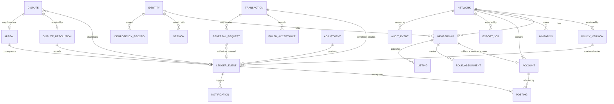

# Data Model, Ledger, and Audit Requirements

| Field | Value |
|---|---|
| Status | Draft |
| Owner role | Domain modeler |
| Last updated | 2026-11-11 |
| Scope | Storage shape of every Circula record at a conceptual level: entities, identifiers, relationships and cardinalities; the storage obligations that make the ledger atomic, append-only, verifiable, and reconstructable; audit event contents, coverage, and access; personal-data placement and minimization; retention and deletion; migration principles; and the field-level export formats. No database product, schema language, or framework is chosen. |
| Dependencies | [00-conventions.md](00-conventions.md) (vocabulary, ID scheme, baseline decisions), [03-domain-model-and-mutual-credit-rules.md](03-domain-model-and-mutual-credit-rules.md) (entity semantics, ledger invariants, error codes), [02-personas-roles-and-journeys.md](02-personas-roles-and-journeys.md) (who may read what) |
| Related documents | [05-system-architecture.md](05-system-architecture.md) (ledger module, job runner), [07-api-and-integration-contract.md](07-api-and-integration-contract.md) (identifier and idempotency exposure, error format), [09-security-privacy-and-abuse-resistance.md](09-security-privacy-and-abuse-resistance.md) (credential storage, audit access enforcement, break-glass), [10-governance-and-network-operations.md](10-governance-and-network-operations.md) (departure and closure processes), [11-deployment-operations-and-support.md](11-deployment-operations-and-support.md) (backups, restore, upgrade procedure), [12-quality-strategy-and-test-plan.md](12-quality-strategy-and-test-plan.md) (verification and migration tests), [13-assumptions-risks-decisions-and-roadmap.md](13-assumptions-risks-decisions-and-roadmap.md) (decision log) |

## 1. Purpose

[03-domain-model-and-mutual-credit-rules.md](03-domain-model-and-mutual-credit-rules.md) says what the ledger means. This document says what any conforming store MUST hold and guarantee so that those meanings survive retries, concurrency, failures, upgrades, restores, and departures of members. It is the authoritative home for storage shape, identifiers, audit event contents, retention, and migration ([00-conventions.md §7](00-conventions.md#7-authoritative-homes)).

This document never redefines an entity's semantics, lifecycle, or validity rule. Where a rule exists in document 03 it is cited by identifier. Requirements here are about storage: what is recorded, in which scope, with which type, under which write and read constraints.

The design assumes the baseline decisions: one transactional database per instance inside a modular monolith ([DEC-010](13-assumptions-risks-decisions-and-roadmap.md#dec-010)), with serializable-or-equivalent guarantees for postings ([DEC-009](13-assumptions-risks-decisions-and-roadmap.md#dec-009)); many networks per instance isolated in software ([DEC-001](13-assumptions-risks-decisions-and-roadmap.md#dec-001)); integer minor-unit amounts ([DEC-005](13-assumptions-risks-decisions-and-roadmap.md#dec-005)).

Identifier ranges in this document are reserved by topic:

| Range | Topic |
|---|---|
| DATA-001 to DATA-019 | Entities, scoping, types, relationships |
| DATA-020 to DATA-029 | Identifiers, ledger sequence, idempotency |
| DATA-030 to DATA-049 | Ledger storage |
| DATA-050 to DATA-069 | Audit events |
| DATA-070 to DATA-079 | Personal-data minimization |
| DATA-080 to DATA-089 | Retention and deletion |
| DATA-090 to DATA-099 | Migration |
| DATA-100 to DATA-119 | Export formats |

## 2. Conceptual entities and relationships

### 2.1 Conventions for all entities

Conceptual types used below:

| Type | Meaning |
|---|---|
| `id` | Opaque external identifier ([DATA-020](#data-020)). |
| `ref(X)` | Reference to the `id` of an entity X. |
| `amount` | Positive integer count of minor units, 1 to 2^53 − 1 ([DATA-004](#data-004)). |
| `signed amount` | Integer count of minor units, −(2^53 − 1) to 2^53 − 1. Used for balances. |
| `limit` | Non-negative integer count of minor units, or the explicit marker `unbounded` / `unset` as the attribute states. Never a sentinel number. |
| `timestamp` | Instant in UTC with at least millisecond precision ([DATA-005](#data-005)). |
| `enum(...)` | Closed set of stable lowercase string codes; display labels live outside the stored value ([DATA-006](#data-006)). |
| `text` | UTF-8 string with a maximum length set in [07-api-and-integration-contract.md](07-api-and-integration-contract.md). |
| `hash` | Fixed-length digest; algorithm named where it matters. |
| `json` | Structured document with a versioned schema. |

Every entity lists its **owning scope**: `network` (the record belongs to exactly one network and carries its network reference) or `instance` (the record belongs to the instance as a whole).

**DATA-001 — Entity set.** A conforming store MUST hold the entities in sections 2.2 to 2.22 with at least the attributes listed. Additional attributes MAY be added if they do not change the meaning of a listed one. Entity semantics are those of [03-domain-model-and-mutual-credit-rules.md §3](03-domain-model-and-mutual-credit-rules.md#3-entities); entities absent from document 03 (identity, invitation, session, idempotency record, notification, export job, reversal request, dispute resolution) are storage records that implement rules stated there. (P0)
*Rationale:* one shared record set keeps API, UI, exports, and tests consistent.

**DATA-002 — Network scoping on every network-scoped record.** Every record whose owning scope is `network` MUST store its network reference, and the reference MUST NOT change after creation. Every reference from one network-scoped record to another MUST point to a record with the same network reference; the store MUST reject a write that would create a cross-network reference (for example by composite references that include the network reference, or an equivalent constraint checked inside the write). (P0)
*Rationale:* storage-level enforcement of [DOM-005](03-domain-model-and-mutual-credit-rules.md#dom-005) and of network isolation ([DEC-001](13-assumptions-risks-decisions-and-roadmap.md#dec-001)); a query bug in the application then cannot create a cross-network posting.

**DATA-003 — Referential integrity.** Every `ref(X)` attribute marked required MUST resolve to an existing X. Records referenced by a ledger event, posting, or audit event MUST NOT be deleted while the referencing record exists; personal data is removed by attribute erasure instead ([DATA-073](#data-073)). (P0)

**DATA-004 — Amount representation.** Amounts, balances, and limits MUST be stored as integers in minor units ([DOM-006](03-domain-model-and-mutual-credit-rules.md#dom-006)). Every stored amount and every balance, including intermediate sums in verification, MUST lie within ±(2^53 − 1); a ledger event whose resulting balance would leave that range MUST be rejected with `invalid_amount`. (P0)
*Rationale:* the bound keeps every value exactly representable in JSON consumers ([RFC 8259 §6](https://www.rfc-editor.org/rfc/rfc8259#section-6), [RFC 7493 §2.2](https://www.rfc-editor.org/rfc/rfc7493#section-2.2), accessed 2026-11-11) and is far beyond any community's volume.

**DATA-005 — Timestamps.** Every timestamp MUST be stored as a UTC instant with at least millisecond precision. Ledger `posted at` values MUST be assigned by the store's transaction at commit time or by the ledger module inside the posting transaction, never supplied by a client. Within one network, `posted at` MUST be non-decreasing in sequence order. (P0)

**DATA-006 — Enumerations.** Status, kind, type, authority, direction, outcome, and action values MUST be stored as the exact lowercase codes defined in document 03 or in this document. Adding a code is a migration ([section 8](#8-migration-principles)); renaming or removing a code used by any existing ledger or audit record is forbidden. (P0)

### 2.2 Relationship overview

Plain-text summary: an identity (login) holds memberships, sessions, and idempotency records. A network has policy versions, memberships, invitations, accounts, export jobs, and audit events. A membership holds at most one member account (exactly one once first active), carries role assignments, and publishes listings. A ledger event has exactly two postings, each on one account, and records the policy version it was evaluated under. A transaction may produce one ledger event on completion, records failed acceptance attempts, and may receive reversal requests that authorize a reversal event. An adjustment posts as one ledger event once approved. A dispute challenges one ledger event, may have one resolution whose remedy is a ledger event, and may have one appeal whose consequence is another ledger event. Ledger events trigger notifications. Instance-level audit events (no network) exist alongside network-scoped ones.

### 2.3 Identity (login)

Scope: instance. Not in document 03 §3; implements the platform-level login referenced by membership ([DEC-007](13-assumptions-risks-decisions-and-roadmap.md#dec-007)).

| Attribute | Type | Notes |
|---|---|---|
| id | `id` | |
| email | `text` | Normalized for uniqueness comparison; unique among non-erased identities. |
| email verified at | `timestamp` or empty | |
| password hash | `text` | Strong adaptive hash; parameters and algorithm in [09-security-privacy-and-abuse-resistance.md](09-security-privacy-and-abuse-resistance.md). Never the password. |
| second factor | `json` or empty | TOTP secret stored encrypted; recovery codes stored hashed ([09-security-privacy-and-abuse-resistance.md](09-security-privacy-and-abuse-resistance.md)). |
| status | `enum(active, locked, disabled, erased)` | `erased` per [DATA-073](#data-073). |
| is operator | boolean | Instance operator capability; never a network role ([PER-007](02-personas-roles-and-journeys.md#per-007)). |
| created at, updated at | `timestamp` | |

Relationships: 1 identity to 0..n memberships (at most one non-terminal membership per network), 0..n sessions, 0..n idempotency records.

### 2.4 Network

Scope: instance (the network is the scope root). Mirrors [03 §3.2](03-domain-model-and-mutual-credit-rules.md#32-network).

| Attribute | Type | Notes |
|---|---|---|
| id | `id` | |
| name, description | `text` | |
| credit unit name, symbol | `text` | |
| decimal places | integer 0..2 | Immutable after first posting ([DOM-006](03-domain-model-and-mutual-credit-rules.md#dom-006)). |
| status | `enum(setup, active, suspended, closed)` | |
| current policy version | `ref(NetworkPolicyVersion)` | Pointer only; history in policy versions. |
| network account | `ref(Account)` | Exactly one ([DOM-015](03-domain-model-and-mutual-credit-rules.md#dom-015)). |
| last sequence | integer ≥ 0 | Sequence counter ([DATA-022](#data-022)). |
| audit chain head | `hash` or empty | When [DATA-057](#data-057) is adopted. |
| created at, closed at | `timestamp` | |

Relationships: 1 network to 1..n policy versions, 0..n memberships, 1..n accounts (one system), 0..n ledger events.

### 2.5 NetworkPolicyVersion

Scope: network. Mirrors [03 §3.14](03-domain-model-and-mutual-credit-rules.md#314-network-policy).

| Attribute | Type | Notes |
|---|---|---|
| id | `id` | |
| network | `ref(Network)` | |
| version number | integer ≥ 1 | Strictly increasing per network, contiguous. |
| values | `json` | One key per policy [DOM-090](03-domain-model-and-mutual-credit-rules.md#dom-090) to [DOM-115](03-domain-model-and-mutual-credit-rules.md#dom-115) (the full section 11 catalogue), every key present, amounts as integers. |
| effective at | `timestamp` | |
| set by | `ref(Membership)` | Administrator, or operator identity at network creation. |
| change note | `text` | Required. |
| created at | `timestamp` | |

Immutable after insert ([DATA-031](#data-031)).

### 2.6 Membership

Scope: network. Mirrors [03 §3.3](03-domain-model-and-mutual-credit-rules.md#33-membership).

| Attribute | Type | Notes |
|---|---|---|
| id | `id` | |
| network | `ref(Network)` | |
| identity | `ref(Identity)` | |
| display name | `text` | Personal data; the only place a member's name is stored ([DATA-071](#data-071)). |
| profile | `json` | Optional fields per [09-security-privacy-and-abuse-resistance.md](09-security-privacy-and-abuse-resistance.md) and [DOM-098](03-domain-model-and-mutual-credit-rules.md#dom-098). |
| status | `enum(invited, pending, active, suspended, departed, expired, revoked, rejected)` | |
| status reason | `text` or empty | Required for suspension and removal. |
| pseudonymized at | `timestamp` or empty | [DATA-074](#data-074). |
| joined at, departed at | `timestamp` | |

Relationships: 0..1 member account (exactly 1 once first `active`), 0..n role assignments, 0..n listings.

### 2.7 RoleAssignment

Scope: network.

| Attribute | Type | Notes |
|---|---|---|
| id | `id` | |
| network, membership | `ref` | |
| role | `enum(administrator, reviewer)` | `member` is implicit. |
| granted by, granted at | `ref(Membership)`, `timestamp` | |
| revoked by, revoked at | `ref(Membership)`, `timestamp`, or empty | Set once; a revoked row is never deleted, a regrant is a new row. |

### 2.8 Account

Scope: network. Mirrors [03 §3.4](03-domain-model-and-mutual-credit-rules.md#34-account).

| Attribute | Type | Notes |
|---|---|---|
| id | `id` | |
| network | `ref(Network)` | |
| type | `enum(member, system)` | |
| system purpose | `enum(network)` or empty | Set for system accounts only. |
| membership | `ref(Membership)` or empty | Required when type is `member`; unique. |
| status | `enum(active, frozen, closed)` | |
| credit limit | `limit` (`unbounded` allowed only for the network account, [DOM-093](03-domain-model-and-mutual-credit-rules.md#dom-093)) | |
| positive limit | `limit` (`unset` allowed) | |
| balance cache | `signed amount` | Cache of [DOM-003](03-domain-model-and-mutual-credit-rules.md#dom-003); see [DATA-034](#data-034). |
| balance cache sequence | integer | Sequence of the last posting reflected in the cache. |
| created at, closed at | `timestamp` | |

Limit changes are recorded as audit events with before/after values and reason ([DOM-050](03-domain-model-and-mutual-credit-rules.md#dom-050)).

### 2.9 LedgerEvent

Scope: network. Mirrors [03 §3.9](03-domain-model-and-mutual-credit-rules.md#39-ledger-event-and-posting).

| Attribute | Type | Notes |
|---|---|---|
| id | `id` | |
| network | `ref(Network)` | |
| sequence | integer ≥ 1 | [DATA-022](#data-022). Unique per network. |
| kind | `enum(transaction_completed, reversal, adjustment)` | |
| origin type, origin | `enum(transaction, reversal_request, dispute_resolution, adjustment, appeal)`, `ref` | Exactly one origin ([DOM-007](03-domain-model-and-mutual-credit-rules.md#dom-007)). |
| reversed transaction | `ref(Transaction)` | Required when kind is `reversal`; unique (at most one reversal, [DOM-033](03-domain-model-and-mutual-credit-rules.md#dom-033)). |
| authority | `enum(mutual_consent, dispute_resolution, administrator, second_administrator_approved)` | |
| actors | list of (`ref(Membership)`, `enum(proposer, acceptor, requester, reviewer, initiator, approver, confirmer)`) | |
| reason code, reason text | `enum` from [DOM-106](03-domain-model-and-mutual-credit-rules.md#dom-106), `text` | Required for `reversal` and `adjustment`. |
| limit override | boolean | [DOM-032](03-domain-model-and-mutual-credit-rules.md#dom-032), [DOM-042](03-domain-model-and-mutual-credit-rules.md#dom-042). |
| self dealing | boolean | [DOM-043](03-domain-model-and-mutual-credit-rules.md#dom-043). |
| policy version | `ref(NetworkPolicyVersion)` | [DOM-017](03-domain-model-and-mutual-credit-rules.md#dom-017). |
| posted at | `timestamp` | [DATA-005](#data-005). |
| chain hash | `hash` or empty | When [DATA-057](#data-057) is adopted. |

Insert-only ([DATA-031](#data-031)).

### 2.10 Posting

Scope: network. Mirrors [03 §3.9](03-domain-model-and-mutual-credit-rules.md#39-ledger-event-and-posting).

| Attribute | Type | Notes |
|---|---|---|
| id | `id` | Internal and exported; never the only key used for ordering. |
| network | `ref(Network)` | Equal to the event's network. |
| ledger event | `ref(LedgerEvent)` | |
| sequence | integer | Copy of the event's sequence, for per-account ordered reads. |
| account | `ref(Account)` | |
| direction | `enum(debit, credit)` | Unique per (ledger event, direction). |
| amount | `amount` | Equal on both postings of an event. |
| resulting balance | `signed amount` | Written once at insert ([DOM-003](03-domain-model-and-mutual-credit-rules.md#dom-003)). |

Cardinality: exactly 2 per ledger event, on 2 different accounts ([DOM-001](03-domain-model-and-mutual-credit-rules.md#dom-001)). Insert-only.

### 2.11 Transaction

Scope: network. Mirrors [03 §3.8](03-domain-model-and-mutual-credit-rules.md#38-transaction).

| Attribute | Type | Notes |
|---|---|---|
| id | `id` | |
| network, payer account, payee account | `ref` | |
| amount | `amount` | |
| description | `text` | Required, immutable after completion ([DOM-026](03-domain-model-and-mutual-credit-rules.md#dom-026)). |
| listing | `ref(Listing)` or empty | |
| proposer | `ref(Membership)` | |
| status | `enum(proposed, completed, declined, cancelled, expired, reversed)` | |
| confirmation pending | boolean | Substate of `proposed` ([DOM-022](03-domain-model-and-mutual-credit-rules.md#dom-022), [DOM-029](03-domain-model-and-mutual-credit-rules.md#dom-029)). |
| status reason | `enum(proposer, account_frozen, account_closed, membership_departed, network_suspended)` or empty | |
| decline reason | `text` or empty | |
| idempotency key | `text` | Unique per (proposer identity, key), retained permanently ([DATA-025](#data-025)). |
| policy version at proposal, at completion | `ref(NetworkPolicyVersion)` | |
| proposed at, expires at, completed at, closed at | `timestamp` | |
| ledger event, reversal event | `ref(LedgerEvent)` or empty | |

Child record **FailedAcceptanceAttempt** (scope: network, insert-only): id, transaction, attempted at, actor `ref(Membership)`, error code from [03 §5.1](03-domain-model-and-mutual-credit-rules.md#51-error-codes-raised-by-transaction-rules), policy version evaluated. Cardinality 0..n per transaction ([DOM-022](03-domain-model-and-mutual-credit-rules.md#dom-022)).

Mutable fields of a transaction are limited to status, confirmation pending, status reason, decline reason, closed/completed timestamps, policy version at completion, and the two event references; each change follows a [DOM-020](03-domain-model-and-mutual-credit-rules.md#dom-020) transition and is audited.

### 2.12 ReversalRequest

Scope: network. Implements [DOM-031](03-domain-model-and-mutual-credit-rules.md#dom-031) items 1 and 3.

| Attribute | Type | Notes |
|---|---|---|
| id | `id` | |
| network, transaction | `ref` | Transaction must be `completed`. |
| kind | `enum(mutual, administrator)` | |
| requested by | `ref(Membership)` | |
| counter request by, at | `ref(Membership)`, `timestamp`, or empty | Second party (mutual) or approving administrator ([DOM-108](03-domain-model-and-mutual-credit-rules.md#dom-108)). |
| reason code, reason text | `enum`, `text` | |
| status | `enum(pending, posted, withdrawn, expired, superseded_by_dispute)` | `superseded_by_dispute` per [DOM-034](03-domain-model-and-mutual-credit-rules.md#dom-034). |
| window ends at | `timestamp` | From [DOM-101](03-domain-model-and-mutual-credit-rules.md#dom-101) or [DOM-108](03-domain-model-and-mutual-credit-rules.md#dom-108). |
| ledger event | `ref(LedgerEvent)` or empty | Set when posted. |
| created at, closed at | `timestamp` | |

### 2.13 Adjustment

Scope: network. Mirrors [03 §3.11](03-domain-model-and-mutual-credit-rules.md#311-adjustment); this record is the adjustment's origin and exists before posting when approval is required ([DOM-041](03-domain-model-and-mutual-credit-rules.md#dom-041), [DOM-107](03-domain-model-and-mutual-credit-rules.md#dom-107)).

| Attribute | Type | Notes |
|---|---|---|
| id | `id` | |
| network, from account, to account | `ref` | |
| type | `enum(correction, write_off, forfeiture, policy_transfer)` | |
| amount | `amount` | |
| reason code, reason text | `enum`, `text` | |
| related transaction, dispute, membership, reversal event | `ref` or empty | |
| limit override requested | boolean | With reason in reason text. |
| initiated by | `ref(Membership)` | |
| approval required | boolean | Evaluated from policy at initiation. |
| approved by, approved at | `ref(Membership)`, `timestamp`, or empty | Different from initiator ([DOM-043](03-domain-model-and-mutual-credit-rules.md#dom-043)). |
| status | `enum(pending_approval, posted, rejected, expired)` | |
| expires at | `timestamp` or empty | Set when approval is required. |
| ledger event | `ref(LedgerEvent)` or empty | |
| created at, closed at | `timestamp` | |

### 2.14 Dispute

Scope: network. Mirrors [03 §3.12](03-domain-model-and-mutual-credit-rules.md#312-dispute).

| Attribute | Type | Notes |
|---|---|---|
| id | `id` | |
| network, subject | `ref(Network)`, `ref(LedgerEvent)` | Kind `transaction_completed` or `adjustment`. |
| raised by | `ref(Membership)` | |
| statement | `text` | Personal data may appear; see [DATA-075](#data-075). |
| status | `enum(open, under_review, resolved)` | At most one non-`resolved` per subject. |
| reviewer | `ref(Membership)` or empty | |
| opened at, assigned at, resolved at | `timestamp` | |

### 2.15 DisputeResolution

Scope: network. One per dispute (0..1).

| Attribute | Type | Notes |
|---|---|---|
| id | `id` | |
| network, dispute | `ref` | |
| outcome | `enum(dismissed, reversed, adjusted, withdrawn)` | [DOM-062](03-domain-model-and-mutual-credit-rules.md#dom-062). |
| reasoning | `text` | |
| remedy specification | `json` or empty | For `adjusted`: from account, to account, amount, reason code. |
| decided by, decided at | `ref(Membership)`, `timestamp` | |
| confirmation required | boolean | [DOM-111](03-domain-model-and-mutual-credit-rules.md#dom-111). |
| confirmed by, confirmed at | `ref(Membership)`, `timestamp`, or empty | |
| remedy event | `ref(LedgerEvent)` or empty | |

### 2.16 Appeal

Scope: network. Mirrors [03 §9.4](03-domain-model-and-mutual-credit-rules.md#94-appeal-record). 0..1 per dispute.

| Attribute | Type | Notes |
|---|---|---|
| id | `id` | |
| network, dispute | `ref` | Dispute must be `resolved`. |
| appealed by, appealed at | `ref(Membership)`, `timestamp` | |
| statement | `text` | |
| heard by | `ref(Membership)` or empty | |
| outcome, decided at | `enum(upheld, overturned)` or empty, `timestamp` | |
| consequence event | `ref(LedgerEvent)` or empty | [DOM-063](03-domain-model-and-mutual-credit-rules.md#dom-063). |

### 2.17 Listing

Scope: network. Mirrors [03 §3.7](03-domain-model-and-mutual-credit-rules.md#37-listing-offer-and-request).

| Attribute | Type | Notes |
|---|---|---|
| id | `id` | |
| network, membership | `ref` | |
| type | `enum(offer, request)` | |
| title, description | `text` | |
| categories | list of `text` | Network-defined tags. |
| indicative amount, pricing note | `amount` or empty, `text` or empty | |
| status | `enum(active, paused, closed)` | |
| created at, updated at | `timestamp` | |

### 2.18 Notification (outbox)

Scope: network, or instance for identity-level messages (recovery, sign-in alerts).

| Attribute | Type | Notes |
|---|---|---|
| id | `id` | |
| network | `ref(Network)` or empty | |
| recipient | `ref(Identity)` and `ref(Membership)` or empty | Address resolved at send time, not copied ([DATA-072](#data-072)). |
| notification type | `enum` | Includes the [DOM-014](03-domain-model-and-mutual-credit-rules.md#dom-014) mandatory set. |
| subject object type, subject id | `enum`, `ref` | For example the ledger event. |
| mandatory | boolean | True for [DOM-014](03-domain-model-and-mutual-credit-rules.md#dom-014) notifications. |
| channel | `enum(email, in_app)` | |
| status | `enum(pending, sent, failed, suppressed)` | |
| attempts, last attempt at, last error | integer, `timestamp`, `text` | |
| read at | `timestamp` or empty | In-app list. |
| created at | `timestamp` | |

### 2.19 AuditEvent

Scope: network, or instance. Contents in [section 5](#5-audit-event-contents).

### 2.20 IdempotencyRecord

Scope: instance (keyed by identity); carries the network reference when the command is network-scoped. Rules in [DATA-024](#data-024).

| Attribute | Type | Notes |
|---|---|---|
| identity | `ref(Identity)` | |
| key | `text` | Unique per identity. |
| network | `ref(Network)` or empty | |
| operation | `text` | Stable operation name from [07-api-and-integration-contract.md](07-api-and-integration-contract.md). |
| request hash | `hash` | SHA-256 over operation and canonical request body. |
| state | `enum(in_progress, completed)` | |
| response status, response body | integer, `json` | Stored on completion. |
| result object type, result id | `enum`, `ref` or empty | |
| created at, expires at | `timestamp` | |

### 2.21 Invitation

Scope: network.

| Attribute | Type | Notes |
|---|---|---|
| id | `id` | |
| network | `ref(Network)` | |
| invitee email | `text` | Personal data of a non-member; erased per [DATA-082](#data-082). |
| invited by | `ref(Membership)` | |
| token hash | `hash` | The token itself is never stored. |
| status | `enum(pending, accepted, expired, revoked)` | |
| expires at | `timestamp` | [DOM-099](03-domain-model-and-mutual-credit-rules.md#dom-099). |
| membership | `ref(Membership)` | The `invited` membership it backs. |
| created at, closed at | `timestamp` | |

### 2.22 Session and ExportJob

**Session** (scope: instance): id; identity; token hash (never the token); created at; last seen at; expires at; revoked at and revoked by (or empty); second factor satisfied (boolean); client summary (coarse user-agent family, truncated IP per [DATA-056](#data-056)). Revocation sets `revoked at`; a revoked session MUST NOT authenticate any request.

**ExportJob** (scope: network): id; network; requested by `ref(Membership)` (or operator identity under break-glass); kind `enum(member_self, network_full)`; subject membership (for `member_self`); format `enum(csv, json)`; as of sequence (integer); status `enum(queued, running, completed, failed, expired)`; file reference; file checksum (`hash`, SHA-256); format version; requested at, completed at, expires at. The file is deleted at `expires at`; the job record is retained with the audit log.

## 3. Identifiers

**DATA-020 — Opaque external identifiers.** Every entity exposed outside the store MUST have an identifier that is globally unique within the instance, carries no meaning about network, owner, or ordinal position, and does not change. Recommended default: UUID version 7 ([RFC 9562 §5.7](https://www.rfc-editor.org/rfc/rfc9562#section-5.7), accessed 2026-11-11), generated by the application. Alternatives: UUID version 4 (no embedded time), or another 128-bit random identifier with a fixed text form ([OQ-DATA-1](#10-open-questions)). (P0)
*Rationale:* opaque identifiers prevent enumeration across networks; version 7 keeps index locality. Version 7 embeds creation time to the millisecond, which is acceptable because creation times are visible to the same readers anyway.

**DATA-021 — Identifier text form.** Identifiers MUST appear in the API and exports in one canonical lowercase text form (for UUIDs, the hyphenated form of [RFC 9562 §4](https://www.rfc-editor.org/rfc/rfc9562#section-4)). Internal surrogate keys, if a store uses them, MUST NOT appear in the API, exports, or audit events. (P0)

**DATA-022 — Per-network ledger sequence.** The sequence of [DOM-010](03-domain-model-and-mutual-credit-rules.md#dom-010) MUST be allocated inside the same database transaction that writes the ledger event, by incrementing the network's `last sequence` counter, so that a rolled-back posting consumes no number. Sequences in a network MUST be contiguous from 1: the store MUST hold events 1..N with no gaps, where N is the network's `last sequence`. The verification job MUST report any gap or duplicate. (P0)
*Rationale:* contiguity lets any reader detect a missing event without trusting the store. It serializes postings within one network; [OQ-DATA-9](#10-open-questions) records the throughput trade-off.

**DATA-023 — Sequence is never the only identifier.** Every ledger event MUST be addressable by its opaque identifier. The API and exports MUST include the sequence as an attribute alongside the identifier and MUST NOT accept a sequence number as the sole reference to an event. (P0)
*Rationale:* sequences are per network and guessable; they order, they do not identify.

**DATA-024 — Idempotency record storage.** For every command covered by [DOM-011](03-domain-model-and-mutual-credit-rules.md#dom-011), the store MUST hold an idempotency record unique on (identity, key). The record MUST be inserted in state `in_progress` inside the command's transaction before any effect, and updated to `completed` with the response status, response body, and result reference in the same transaction as the effect. A repeated request with the same (identity, key): with an equal request hash and state `completed`, MUST return the stored response without re-executing; with a different request hash, MUST be rejected with `idempotency_conflict`; with state `in_progress` held by a concurrent transaction, MUST wait for or be rejected with a retryable error defined in [07-api-and-integration-contract.md](07-api-and-integration-contract.md), and MUST NOT execute twice. A command that fails with a validation or rule error MUST store that error response too, so that a retry returns the same error. (P0)

**DATA-025 — Idempotency retention window.** Idempotency records MUST be retained for at least the response-cache window, recommended default 7 days from creation ([OQ-DATA-2](#10-open-questions)), and MAY be deleted after it. Independently of the window, the key used to create a transaction, dispute, adjustment, reversal request, or membership change MUST be stored permanently on the created record with a uniqueness constraint per acting identity, so that a retry after the window still cannot create a duplicate object; such a retry MUST return the existing object or `idempotency_conflict`. (P0)
*Rationale:* the response cache can expire; the duplicate-prevention guarantee for ledger-relevant objects cannot.

## 4. Ledger storage requirements

**DATA-030 — One transaction per posting.** Posting a ledger event MUST write, in one database transaction that commits or rolls back as a unit: the ledger event with its sequence; both postings with resulting balances; the update of both accounts' balance caches; the origin record's status change (transaction, reversal request, adjustment, dispute resolution, or appeal); the audit events for the posting and the status change ([DOM-012](03-domain-model-and-mutual-credit-rules.md#dom-012)); the notification outbox rows for [DOM-014](03-domain-model-and-mutual-credit-rules.md#dom-014); and the idempotency record completion ([DATA-024](#data-024)). No external side effect (email send, export file write) may occur inside that transaction; the job runner delivers outbox rows after commit ([05-system-architecture.md](05-system-architecture.md)). (P0)
*Rationale:* [DOM-001](03-domain-model-and-mutual-credit-rules.md#dom-001), [DOM-009](03-domain-model-and-mutual-credit-rules.md#dom-009), [DOM-011](03-domain-model-and-mutual-credit-rules.md#dom-011), [DOM-012](03-domain-model-and-mutual-credit-rules.md#dom-012), and [DOM-014](03-domain-model-and-mutual-credit-rules.md#dom-014) fail independently if these writes are split; the outbox makes "notification attempted" a consequence of commit rather than a hope.
*Acceptance criteria:* fault injection that aborts the transaction after any single write leaves none of the listed records present; a crash after commit leaves all present and the outbox row is delivered on restart.

**DATA-031 — Append-only enforcement at storage level.** Ledger events, postings, failed acceptance attempts, policy versions, and audit events are **append-only tables**. The database role used by the running application MUST hold insert and select privileges only on them and MUST NOT hold update, delete, or truncate privileges. A second, independent safeguard MUST reject update and delete on these tables even for a role that holds the privilege, except during a migration run under [DATA-092](#data-092). Recommended default: separate application and migration roles plus row-level triggers (or the store's equivalent) that reject modification. Alternatives: a store whose append-only tables expose no update primitive; or an append-only log file per network protected by the hash chain of [DATA-057](#data-057) and verified on every read. (P0)
*Rationale:* [DOM-002](03-domain-model-and-mutual-credit-rules.md#dom-002) applies to every role, including the operator; privilege separation turns an application bug or injection into a refused write instead of a rewritten history.
*Acceptance criteria:* an update or delete issued with the application role's credentials on each listed table fails; the same statement issued with the migration role outside a migration run fails.

**DATA-032 — Mutable ledger-adjacent records.** Accounts (status, limits, balance cache), transactions, reversal requests, adjustments, disputes, resolutions, and appeals MAY be updated only through the state transitions defined in document 03, and every update MUST be accompanied in the same transaction by an audit event carrying the before/after summary. Their deletion by the application role MUST be impossible. (P0)

**DATA-033 — Concurrency invariant.** The store and the ledger module together MUST guarantee: for every network, the committed ledger events, their postings and resulting balances, and the outcome (posted or rejected with its error code) of every posting attempt that committed a record are identical to those produced by executing the attempts one at a time in ascending sequence order, each attempt reading the balances, account statuses, limits, and policy version left by the previous one. Recommended default: within the posting transaction, first lock the network's sequence counter, then lock the involved accounts in ascending identifier order, then read balances and run the [DOM-027](03-domain-model-and-mutual-credit-rules.md#dom-027) checks, then write. Alternatives: serializable isolation with automatic retry on serialization failure (bounded retries, then a retryable error); or a single writer per network. An implementation MUST NOT evaluate limits outside the posting transaction ([DOM-009](03-domain-model-and-mutual-credit-rules.md#dom-009), [DEC-009](13-assumptions-risks-decisions-and-roadmap.md#dec-009)). (P0)
*Rationale:* states the property a test can check (equivalence to a serial order) rather than a mechanism; the fixed lock order prevents deadlocks.
*Acceptance criteria:* worked example 3 of document 03, run with 50 concurrent acceptances against one payer, posts exactly the number of events a serial execution posts and leaves verification passing.

**DATA-034 — Balance caches.** The `resulting balance` on each posting MUST equal the previous resulting balance of the same account (0 for its first posting) plus the amount for `credit` or minus it for `debit`. The account `balance cache` MUST equal the resulting balance of the account's highest-sequence posting and MUST be updated in the posting transaction. Reads that show a balance MAY use the cache. (P0)

**DATA-035 — Verification job.** The platform MUST provide the verification operation of [DOM-003](03-domain-model-and-mutual-credit-rules.md#dom-003) as a job that, per network, recomputes from postings alone and checks: (a) every ledger event has exactly two postings, one debit and one credit, equal amounts, two different accounts, same network ([DOM-001](03-domain-model-and-mutual-credit-rules.md#dom-001), [DOM-005](03-domain-model-and-mutual-credit-rules.md#dom-005)); (b) sequences contiguous from 1 ([DATA-022](#data-022)); (c) every posting's resulting balance and every account's balance cache equal the recomputed running sum ([DATA-034](#data-034)); (d) the sum of all account balances is zero ([DOM-004](03-domain-model-and-mutual-credit-rules.md#dom-004)); (e) every event's origin exists and points back ([DOM-007](03-domain-model-and-mutual-credit-rules.md#dom-007)); (f) every event's policy version belongs to the network and was effective at `posted at` ([DOM-017](03-domain-model-and-mutual-credit-rules.md#dom-017)); (g) every `transaction_completed` event whose payer or payee ended over limit, and every reversal or adjustment that breached a limit, carries `limit override` true where [DOM-032](03-domain-model-and-mutual-credit-rules.md#dom-032) or [DOM-042](03-domain-model-and-mutual-credit-rules.md#dom-042) requires it, and no `transaction_completed` event breached a limit; (h) the hash chains verify when [DATA-057](#data-057) is adopted. The job MUST run on a schedule (recommended default: daily per network, [OQ-DATA-13](#10-open-questions)), on demand by the operator for any network and by an administrator for their own network, after every restore, and as the migration gate of [DATA-093](#data-093). (P0)
*Acceptance criteria:* each of checks (a) to (h) has a test that corrupts a copy of the store in exactly that way and observes the job report it.

**DATA-036 — Verification reports, never repairs.** Each run MUST store a verification result record (network, started at, finished at, highest sequence checked, pass or fail, list of discrepancies with check letter and record identifiers) and an audit event. A failed run MUST alert the operator ([11-deployment-operations-and-support.md](11-deployment-operations-and-support.md)) and MUST be visible to that network's administrators. The job MUST NOT modify any ledger record or cache. Rebuilding a balance cache from postings is a separate operator command that MUST be audited, MUST run only after a failed verification has been investigated, and MUST NOT touch events or postings; any other remedy is a reversal or adjustment by the network's administrators. (P0)
*Rationale:* an automatic fix hides the defect that caused the discrepancy.

**DATA-037 — Reconstruction at a sequence position.** For any network, account, and sequence position s ≤ N, the store MUST be able to return the balance as of s, equal to the resulting balance of the account's last posting with sequence ≤ s (0 if none) and equal to the recomputed sum of those postings. The store MUST support ordered reads of postings by (account, sequence) and of events by (network, sequence) without scanning other networks. (P0)
*Rationale:* [DOM-010](03-domain-model-and-mutual-credit-rules.md#dom-010); disputes and audits ask "what was the balance when this happened".

**DATA-038 — Policy reference on ledger records.** Every ledger event, transaction (at proposal and at completion), failed acceptance attempt, adjustment, and dispute resolution MUST store the policy version identifier it was evaluated under, and the store MUST retain every referenced policy version for as long as the referencing record ([DOM-017](03-domain-model-and-mutual-credit-rules.md#dom-017)). (P0)

**DATA-039 — Flags are stored, not inferred.** `limit override` and `self dealing` MUST be stored on the ledger event at posting as booleans, together with the reason text for an override. They MUST NOT be recomputed later from balances or roles, because limits and roles change. (P0)

**DATA-040 — Closed networks are read-only.** When a network becomes `closed`, the store MUST reject any insert of a ledger event, posting, transaction, adjustment, reversal request, dispute, or listing for that network, independently of application checks ([DOM-075](03-domain-model-and-mutual-credit-rules.md#dom-075)). Audit events and export jobs remain insertable. (P0)

## 5. Audit event contents

**DATA-050 — Audit event fields.** Every audit event MUST carry the fields below. (P0)

| Field | Type | Content |
|---|---|---|
| id | `id` | |
| occurred at | `timestamp` | Commit time of the action. |
| scope | `enum(network, instance)` | |
| network | `ref(Network)` or empty | Required when scope is `network`. |
| actor type | `enum(membership, operator, identity, system)` | `identity` for pre-membership actions such as sign-in. |
| actor id | `ref` or empty | Empty only for `system`. |
| break-glass | boolean | True when the actor is acting under operator break-glass ([PER-033](02-personas-roles-and-journeys.md#per-033)). |
| break-glass grant | `ref` or empty | The break-glass record ([09-security-privacy-and-abuse-resistance.md](09-security-privacy-and-abuse-resistance.md)). |
| action | `enum` | From the fixed vocabulary in [DATA-051](#data-051). |
| object type, object id | `enum`, `ref` | The entity acted on. |
| related ids | list of (`enum`, `ref`) | For example the ledger event of a transaction completion. |
| summary | `json` | Before/after values of non-sensitive fields only ([DATA-053](#data-053)). |
| reason | `text` or empty | Reason given by the actor where the rule requires one. |
| outcome | `enum(success, failure)` | |
| error code | `enum` or empty | From [03 §5.1](03-domain-model-and-mutual-credit-rules.md#51-error-codes-raised-by-transaction-rules) or the auth/validation codes in [07-api-and-integration-contract.md](07-api-and-integration-contract.md). |
| request id | `text` or empty | |
| idempotency key | `text` or empty | |
| session ref hash | `hash` or empty | Keyed hash of the session id; lets readers group events by session without obtaining a usable reference. |
| client address | `text` or empty | Per [DATA-056](#data-056). |
| chain hash | `hash` or empty | When [DATA-057](#data-057) is adopted. |

**DATA-051 — Action vocabulary.** The `action` field MUST take one of the following codes. New codes are added only by amending this table. (P0)

| Object | Actions |
|---|---|
| identity | `identity.created`, `identity.login_succeeded`, `identity.login_failed`, `identity.logout`, `identity.password_changed`, `identity.recovery_requested`, `identity.recovery_completed`, `identity.second_factor_enabled`, `identity.second_factor_disabled`, `identity.email_changed`, `identity.locked`, `identity.unlocked`, `identity.erased` |
| session | `session.created`, `session.revoked`, `session.expired` |
| network | `network.created`, `network.setup_completed`, `network.suspended`, `network.reinstated`, `network.closed` |
| policy version | `policy.version_created` |
| invitation | `invitation.created`, `invitation.accepted`, `invitation.revoked`, `invitation.expired` |
| membership | `membership.applied`, `membership.approved`, `membership.rejected`, `membership.activated`, `membership.suspended`, `membership.reinstated`, `membership.departure_requested`, `membership.departed`, `membership.profile_updated`, `membership.pseudonymized` |
| role assignment | `role.granted`, `role.revoked` |
| account | `account.created`, `account.frozen`, `account.unfrozen`, `account.closed`, `account.limit_changed`, `account.cache_rebuilt` |
| transaction | `transaction.proposed`, `transaction.acceptance_failed`, `transaction.confirmation_requested`, `transaction.completed`, `transaction.declined`, `transaction.cancelled`, `transaction.expired`, `transaction.reversed` |
| ledger event | `ledger_event.posted` |
| reversal request | `reversal_request.created`, `reversal_request.withdrawn`, `reversal_request.expired`, `reversal_request.superseded` |
| adjustment | `adjustment.initiated`, `adjustment.approved`, `adjustment.rejected`, `adjustment.expired` |
| dispute | `dispute.raised`, `dispute.assigned`, `dispute.withdrawn`, `dispute.resolution_recorded`, `dispute.remedy_confirmed`, `dispute.resolved` |
| appeal | `appeal.filed`, `appeal.decided` |
| listing | `listing.created`, `listing.updated`, `listing.paused`, `listing.reactivated`, `listing.closed` |
| notification | `notification.attempted`, `notification.failed` (mandatory set only, [DOM-014](03-domain-model-and-mutual-credit-rules.md#dom-014)) |
| export | `export.requested`, `export.completed`, `export.failed`, `export.downloaded` |
| break-glass | `break_glass.opened`, `break_glass.data_accessed`, `break_glass.closed` |
| verification | `verification.passed`, `verification.failed` |
| personal data | `personal_data.read` (if [OQ-DATA-6](#10-open-questions) adopts it), `personal_data.erasure_requested`, `personal_data.erased` |
| instance | `migration.applied`, `backup.restored` |

**DATA-052 — Coverage.** The platform MUST write an audit event, in the same transaction as the change, for each item of [DOM-012](03-domain-model-and-mutual-credit-rules.md#dom-012): every ledger event (`ledger_event.posted`); every transaction status change; every dispute status change and every appeal; every membership status change and role grant or revocation; every account status or limit change; every network status change and policy version; every listing creation and status change; every export request, completion, and download; every authentication event (sign-in success and failure, recovery, second-factor change, session revocation); and every operator break-glass opening, data access, and closing. It MUST also audit rejected acceptance attempts, authorization denials on state-changing commands, verification runs, migrations, and restores. Pure validation failures that change nothing MAY be omitted. (P0)

**DATA-053 — Summary content limits.** The `summary` field MUST contain only: identifiers; status, kind, type, and role codes; amounts, limits, and balances; policy keys and values; timestamps; and booleans. It MUST NOT contain passwords or hashes of them, tokens, second-factor secrets, email addresses, display names, profile values, listing text, transaction descriptions, dispute statements, or reasoning text; those are read from the referenced object under its own access rules. (P0)
*Rationale:* keeps the immutable audit log free of personal data that may later need erasure ([DATA-073](#data-073)).

**DATA-054 — Audit immutability.** Audit events are append-only under [DATA-031](#data-031). No role, including the operator, may edit or delete an individual audit event while its retention period runs ([DATA-081](#data-081)). (P0)

**DATA-055 — Audit read access.** Read access MUST be enforced on every audit query, as follows; enforcement details and the reviewer default live in [PER-029](02-personas-roles-and-journeys.md#per-029) and [09-security-privacy-and-abuse-resistance.md](09-security-privacy-and-abuse-resistance.md). (P0)

| Reader | May read |
|---|---|
| Member | Events whose object is their own identity, sessions, membership, or account, or a transaction, reversal request, adjustment, dispute, or appeal in which their account is a party; presented through their history and security views, not as the network audit log ([PER-029](02-personas-roles-and-journeys.md#per-029)). Actor identities of other members are shown as membership references resolved to display names under the network's visibility rules. |
| Dispute reviewer | Events relating to disputes assigned to them. |
| Network administrator | All `network`-scoped events of their network, including break-glass events for that network. Not instance-scoped events, not other networks. |
| Platform operator | All `instance`-scoped events and all break-glass records; `network`-scoped events only through break-glass, which itself is audited. |

**DATA-056 — Client address policy.** The audit `client address` MUST NOT be a full IP address. Recommended default: store the address truncated to its /24 (IPv4) or /48 (IPv6) prefix. Alternatives: a keyed hash of the full address with a rotating key; or no address at all ([OQ-DATA-3](#10-open-questions)). Full addresses needed for rate limiting live only in short-lived operational data owned by [09-security-privacy-and-abuse-resistance.md](09-security-privacy-and-abuse-resistance.md). (P1)

**DATA-057 — Tamper evidence.** The store SHOULD make ledger events and audit events tamper-evident. Recommended default: a hash chain per network for ledger events (ordered by sequence) and one per network plus one for the instance for audit events, where each record's `chain hash` = SHA-256 ([FIPS 180-4](https://csrc.nist.gov/pubs/fips/180-4/upd1/final), accessed 2026-11-11) of the previous record's chain hash concatenated with a canonical serialization of the record's fields, and the network's current heads are included in every network export manifest and shown to administrators. Alternatives: periodic signed checkpoints of heads; or no chaining, relying on [DATA-031](#data-031) ([OQ-DATA-4](#10-open-questions)). (P1)
*Rationale:* privilege separation stops the application from rewriting history; a chain also lets an outside reader detect rewriting by anyone with database owner access.

**DATA-063 — Audit export format.** Audit events in exports MUST include every field of [DATA-050](#data-050) the reader may see, with the same codes. Recommended default: JSON Lines (one [RFC 8259](https://www.rfc-editor.org/rfc/rfc8259) object per line, ordered by occurred at then id) plus a CSV with the same columns where `summary` and `related ids` are JSON-encoded strings. When [DATA-057](#data-057) is adopted, the export MUST contain enough fields and the documented canonical serialization to recompute the chain. (P0)

## 6. Personal-data minimization in the data model

**DATA-070 — Personal-data inventory.** The following fields are personal data and MUST be tagged as such in the data dictionary so that export, erasure, and access logging find them: identity email, password hash, second-factor material; session client summary; membership display name and profile; invitation invitee email; listing title, description, and pricing note; transaction description and decline reason; dispute statement, resolution reasoning, appeal statement; adjustment and reversal reason text; notification recipient references; audit client address. (P0)

**DATA-071 — Where personal data lives.** Login data (email, credentials) MUST live only on the identity. Names and profile data MUST live only on the membership, separately per network, so that one network's administrators cannot see a person's other memberships or profiles. Ledger events, postings, audit events, and policy versions MUST reference memberships and accounts by identifier and MUST NOT copy names, emails, or profile values. (P0)
*Rationale:* a name stored once can be pseudonymized once without touching immutable records.

**DATA-072 — Never stored.** The store MUST NOT hold: any value, price, or rate in a national currency or another unit ([DEC-008](13-assumptions-risks-decisions-and-roadmap.md#dec-008)); government identification numbers; dates of birth; bank, card, or other financial account details; precise geolocation; full client IP addresses in audit events ([DATA-056](#data-056)); plaintext passwords, session tokens, invitation tokens, or recovery codes; rendered notification bodies after delivery. Notification rows store the template type and object references; the recipient address is resolved at send time. (P0)

**DATA-073 — Erasure by attribute, not by record.** When personal data must be removed, the platform MUST overwrite or null the personal-data attributes of [DATA-070](#data-070) on mutable records (identity, membership, invitation, listing, session, notification) and keep the record and its identifier. For an identity with no non-departed membership: email replaced by an unusable tombstone, credentials and second-factor material deleted, sessions deleted, status `erased`. (P0)

**DATA-074 — Pseudonymization of departed members.** Pseudonymization under [DOM-074](03-domain-model-and-mutual-credit-rules.md#dom-074) MUST be a single update to the membership record: the display name is replaced by a stable pseudonym derived from the membership identifier (for example "Former member 7F3K"), profile values are erased, the member's listings' text fields are erased, and `pseudonymized at` is set; one `membership.pseudonymized` audit event is written. Account identifiers, ledger events, postings, transactions, amounts, and audit events MUST NOT change. Because [DATA-071](#data-071) forbids copies, every view and export shows the pseudonym from then on. Trigger: departure plus the personal-data retention period of [DATA-082](#data-082), or an accepted erasure request. (P0)

**DATA-075 — Personal data inside immutable free text.** Transaction descriptions ([DOM-026](03-domain-model-and-mutual-credit-rules.md#dom-026)), dispute statements, and reason texts may contain names. The platform MUST NOT edit them as part of pseudonymization. Interfaces SHOULD warn authors at entry that these texts are permanent and visible to the other party and administrators ([08-ux-and-accessibility.md](08-ux-and-accessibility.md)). Whether an erasure request can require redaction of such text is a counsel question ([OQ-DATA-7](#10-open-questions)); if redaction is ever required, it MUST be a migration-style procedure that replaces the text with a fixed marker, records a `personal_data.erased` audit event, and leaves amounts, accounts, and identifiers untouched. (P1)

**DATA-076 — Logging of personal-data reads.** Whether administrator and reviewer reads of member profiles, emails, or other members' balances produce `personal_data.read` audit events is an open decision ([OQ-DATA-6](#10-open-questions), linked to [OQ-PER-5](02-personas-roles-and-journeys.md#5-open-questions)). Recommended default: log reads of contact fields and every export, not directory or history browsing. (P1)

## 7. Retention and deletion

**DATA-080 — Retention table.** Records MUST be retained at least, and personal data at most, as follows (P0 for ledger rows; P1 for the rest):

| Data | Retention | After the period |
|---|---|---|
| Ledger events, postings, transactions, failed attempts, reversal requests, adjustments, disputes, resolutions, appeals, policy versions, accounts | While the network exists, then the post-closure period: recommended default 7 years after `closed at` ([OQ-DATA-5](#10-open-questions), counsel question). | Whole-network purge by the operator, recorded as an instance audit event; no partial deletion. |
| Network-scoped audit events | Same as ledger rows. | Purged with the network. |
| Instance-scoped authentication audit events | Recommended default 400 days ([OQ-DATA-10](#10-open-questions)). | Deleted by a scheduled job under the migration-role exception, recorded as an instance audit event. Break-glass records follow the ledger rule of the network accessed. |
| Membership name and profile of departed, rejected, expired, or revoked memberships | Recommended default 2 years after the terminal status ([OQ-DATA-8](#10-open-questions); answers [OQ-PER-6](02-personas-roles-and-journeys.md#5-open-questions)). | Pseudonymized ([DATA-074](#data-074)); the record remains so administrators can see that a prior membership existed ([DOM-076](03-domain-model-and-mutual-credit-rules.md#dom-076)). |
| Identity email and credentials | While any non-erased membership exists or the person keeps the login. | Erased per [DATA-073](#data-073) on request or 2 years after the last membership became terminal with no sign-in. |
| Invitation invitee email | Until 30 days after a terminal invitation status, unless accepted. | Erased; token hash deleted at terminal status. |
| Sessions | 30 days after expiry or revocation. | Deleted. |
| Idempotency records | [DATA-025](#data-025) window. | Deleted; keys on created objects remain. |
| Notification outbox rows | 90 days after final status. | Deleted (mandatory-notification audit events remain). |
| Export files | 7 days after completion. | File deleted; job record kept with the audit log. |
| Verification results | Same as the network's audit events. | Purged with the network. |

**DATA-081 — Ledger entries cannot be deleted.** No deletion request, administrator action, or operator action MAY delete or alter a ledger event, posting, or network-scoped audit event during its retention period ([DOM-002](03-domain-model-and-mutual-credit-rules.md#dom-002), [DOM-074](03-domain-model-and-mutual-credit-rules.md#dom-074)). (P0)

**DATA-082 — Deletion requests.** A person's request to delete their data MUST result, after the checks of [10-governance-and-network-operations.md](10-governance-and-network-operations.md): erasure of identity data under [DATA-073](#data-073) once no membership is non-departed; pseudonymization under [DATA-074](#data-074) of each departed membership; erasure of listing text, invitation emails, sessions, and notification rows. It MUST NOT remove ledger rows, account identifiers, amounts, or audit events. The platform MUST tell the requester in plain text which records remain and why. Whether a request can be honored before the departure precondition is met, and response deadlines, are counsel questions ([OQ-DATA-8](#10-open-questions)). (P1)

**DATA-083 — Erasure register and backups.** Every erasure or pseudonymization MUST be recorded in an erasure register that holds only the affected record identifiers, action, and time. After any restore from backup, the platform MUST re-apply every register entry newer than the backup before the instance accepts requests. Backup retention and its relation to these periods are owned by [11-deployment-operations-and-support.md](11-deployment-operations-and-support.md); backups older than the longest personal-data period SHOULD NOT be kept. (P1)
*Rationale:* without the register, a restore silently undoes erasures.

## 8. Migration principles

**DATA-090 — Forward-only versioned migrations.** Schema and data changes MUST be applied only by numbered migrations recorded in a schema-version record (version, name, checksum, applied at, applied by). The application MUST refuse to start against a schema version it was not built for. Editing an applied migration is forbidden; corrections are new migrations. (P0)

**DATA-091 — Transactional or idempotent.** Each migration MUST either run in a single database transaction or be idempotent and resumable, so that an interrupted run can be re-executed to completion without duplicating or losing data. (P0)

**DATA-092 — Ledger tables are never rewritten in place.** A migration MUST NOT update or delete existing rows of the append-only tables of [DATA-031](#data-031). Permitted changes: adding columns whose existing rows read as empty or a constant default; adding tables; backfilling derived data into new tables or new columns of mutable tables; adding indexes and constraints that existing data already satisfies. The canonical serialization used by [DATA-057](#data-057) MUST be versioned so that added columns do not change existing chain hashes. Migrations MUST run under the migration role, and each run MUST write a `migration.applied` instance audit event. (P0)

**DATA-093 — Verification gate.** An upgrade that includes a migration touching ledger, account, or audit tables MUST run the verification job ([DATA-035](#data-035)) for every network before the migration and after it, and MUST stop the upgrade, leaving the instance closed to requests, if the post-migration run reports a discrepancy that the pre-migration run did not. (P0)
*Acceptance criteria:* a test migration that alters one resulting balance is detected and the upgrade halts ([12-quality-strategy-and-test-plan.md](12-quality-strategy-and-test-plan.md)).

**DATA-094 — Downgrade by restore.** Down-migrations are not required. The supported downgrade is restoring the backup taken immediately before the upgrade, then re-applying the erasure register ([DATA-083](#data-083)); the procedure and the loss of writes made after the upgrade MUST be documented in [11-deployment-operations-and-support.md](11-deployment-operations-and-support.md). The upgrade procedure MUST take that backup and verify it is restorable before applying a migration. (P0)

**DATA-095 — Export format stability.** Exports carry a `format_version` of the form `MAJOR.MINOR`. Within a major version, changes MUST be additive (new files or columns at the end, new enumeration codes); removing, renaming, or changing the meaning of a column requires a new major version, and the previous major version MUST remain selectable for at least one subsequent minor release of the platform. (P1)

## 9. Export data formats

**DATA-100 — Common export rules.** Every export MUST: be produced from a consistent snapshot at one ledger sequence per network (`as_of_sequence`); be packaged as one archive containing a `manifest.json` and one file per table (recommended default ZIP archive, alternative uncompressed directory download, [OQ-DATA-11](#10-open-questions)); encode CSV per [RFC 4180](https://www.rfc-editor.org/rfc/rfc4180) in UTF-8 with a header row, comma separator, CRLF line endings, empty field for null, `true`/`false` for booleans; encode JSON per [RFC 8259](https://www.rfc-editor.org/rfc/rfc8259) with each table as an array of objects using the same field names as the CSV columns; write amounts, balances, and limits as integers in minor units ([DATA-004](#data-004)) with `decimal_places` in the manifest, and `unbounded`/`unset` limits as an empty value plus a boolean column; write timestamps as [RFC 3339](https://www.rfc-editor.org/rfc/rfc3339) UTC with `Z` and millisecond precision; write identifiers per [DATA-021](#data-021) and enumerations as stored codes; include only records the requester may read ([DATA-055](#data-055)); and be audited ([DATA-052](#data-052)). All URLs accessed 2026-11-11. (P0)

**DATA-101 — Manifest.** `manifest.json` MUST contain: `format_version`, `export_id`, `kind` (`member_self` or `network_full`), `generated_at`, `requested_by` (membership id), `network` (`id`, `name`, `credit_unit_name`, `credit_unit_symbol`, `decimal_places`, `status`), `as_of_sequence`, `policy_version_id` current at that sequence, `files` (name, row count, SHA-256 checksum), and, when [DATA-057](#data-057) is adopted, `ledger_chain_head` and `audit_chain_head`. (P0)

**DATA-102 — Member self-export files.** A member self-export covers one membership ([PER-030](02-personas-roles-and-journeys.md#per-030)) and MUST contain the files below. (P0)

| File | Columns |
|---|---|
| `profile` | identity_email, membership_id, network_id, display_name, profile (JSON string), status, roles (semicolon-separated codes), joined_at, departed_at |
| `account` | account_id, status, credit_limit, credit_limit_unbounded, positive_limit, positive_limit_unset, balance, as_of_sequence |
| `history` | sequence, ledger_event_id, posted_at, kind, authority, origin_type, origin_id, transaction_id, direction, amount, resulting_balance, counterparty_account_id, counterparty_display_name, description, reason_code, limit_override, self_dealing, disputed |
| `transactions` | transaction_id, my_role (`payer`/`payee`), proposer_membership_id, counterparty_account_id, amount, description, status, status_reason, listing_id, proposed_at, expires_at, completed_at, closed_at, ledger_event_id, reversal_event_id, policy_version_at_proposal, policy_version_at_completion |
| `failed_acceptance_attempts` | transaction_id, attempted_at, actor_membership_id, error_code |
| `disputes` | dispute_id, subject_event_id, raised_by_me, statement (only if raised by me), status, reviewer_membership_id, outcome, reasoning, remedy_event_id, opened_at, resolved_at, appeal_outcome, appeal_decided_at |
| `listings` | listing_id, type, title, description, categories, indicative_amount, pricing_note, status, created_at, updated_at |

`counterparty_display_name` follows the network's visibility policy and pseudonymization at export time.

**DATA-103 — Administrator network export files.** A network export ([PER-031](02-personas-roles-and-journeys.md#per-031)) MUST contain the files below; together with the manifest they are sufficient to recompute every balance and run checks (a) to (g) of [DATA-035](#data-035) outside the platform. (P0)

| File | Columns |
|---|---|
| `policy_versions` | policy_version_id, version_number, effective_at, set_by_membership_id, change_note, values (JSON string) |
| `memberships` | membership_id, display_name, status, status_reason, roles, joined_at, departed_at, pseudonymized_at, contact_email (only if [OQ-DATA-12](#10-open-questions) permits administrators to see it) |
| `role_assignments` | role_assignment_id, membership_id, role, granted_by, granted_at, revoked_by, revoked_at |
| `accounts` | account_id, type, system_purpose, membership_id, status, credit_limit, credit_limit_unbounded, positive_limit, positive_limit_unset, balance, created_at, closed_at |
| `ledger_events` | sequence, ledger_event_id, kind, origin_type, origin_id, reversed_transaction_id, authority, actors (JSON string), reason_code, reason_text, limit_override, self_dealing, policy_version_id, posted_at, chain_hash |
| `postings` | posting_id, ledger_event_id, sequence, account_id, direction, amount, resulting_balance |
| `transactions` | as in [DATA-102](#data-102) with payer_account_id and payee_account_id instead of my_role and counterparty, plus decline_reason |
| `failed_acceptance_attempts` | transaction_id, attempted_at, actor_membership_id, error_code, policy_version_id |
| `reversal_requests` | reversal_request_id, transaction_id, kind, requested_by, counter_request_by, counter_request_at, reason_code, reason_text, status, window_ends_at, ledger_event_id, created_at, closed_at |
| `adjustments` | adjustment_id, type, from_account_id, to_account_id, amount, reason_code, reason_text, related_transaction_id, related_dispute_id, related_membership_id, initiated_by, approved_by, approved_at, status, ledger_event_id, created_at, closed_at |
| `disputes` | dispute_id, subject_event_id, raised_by, statement, status, reviewer, opened_at, assigned_at, resolved_at |
| `dispute_resolutions` | dispute_id, outcome, reasoning, remedy_specification (JSON string), decided_by, decided_at, confirmed_by, confirmed_at, remedy_event_id |
| `appeals` | appeal_id, dispute_id, appealed_by, appealed_at, statement, heard_by, outcome, decided_at, consequence_event_id |
| `listings` | listing_id, membership_id, type, title, description, categories, status, created_at, updated_at |
| `audit_events` | per [DATA-063](#data-063), network-scoped events only |
| `verification` | last verification run: started_at, finished_at, highest_sequence, result, discrepancy_count |

**DATA-104 — Export correctness.** For every network export, the sum of `amount` over `postings` signed by direction per account MUST equal that account's `balance`, every `resulting_balance` MUST match the running sum, and the sum of all balances MUST be zero; the platform MUST run these checks on the produced files before marking the job `completed` and mark it `failed` otherwise. (P0)
*Acceptance criteria:* covered by export correctness tests in [12-quality-strategy-and-test-plan.md](12-quality-strategy-and-test-plan.md).

## 10. Open questions

| ID | Question | Decision needed | Decided by |
|---|---|---|---|
| OQ-DATA-1 | Which external identifier format: UUIDv7 (recommended), UUIDv4, or another 128-bit random id? | Confirm [DATA-020](#data-020); UUIDv7 exposes creation time to the millisecond. | Project owner with security reviewer |
| OQ-DATA-2 | How long is the idempotency response cache kept? | Confirm 7 days in [DATA-025](#data-025) or choose another window; must match [07-api-and-integration-contract.md](07-api-and-integration-contract.md). | Project owner with API owner |
| OQ-DATA-3 | How is the client address stored in audit events: truncated prefix (recommended), keyed hash, or not at all? | Choice for [DATA-056](#data-056); privacy aspects are a counsel question. | Security reviewer, counsel |
| OQ-DATA-4 | Adopt hash-chain tamper evidence for ledger and audit events, and how are heads anchored? | Confirm [DATA-057](#data-057) and the anchoring method. | Project owner with security reviewer |
| OQ-DATA-5 | Post-closure retention of ledger and audit data: 7 years recommended. Counsel question: which jurisdictions' record-keeping rules, if any, apply to networks' records. | Period for [DATA-080](#data-080). | Project owner with counsel |
| OQ-DATA-6 | Are administrator and reviewer reads of personal data audited (`personal_data.read`)? | Choice for [DATA-076](#data-076); linked to [OQ-PER-5](02-personas-roles-and-journeys.md#5-open-questions). | Security reviewer |
| OQ-DATA-7 | Counsel question: can an erasure request require redaction of personal data in immutable free text (descriptions, statements, reasons)? | Whether [DATA-075](#data-075) redaction procedure is needed for launch. | Project owner with counsel |
| OQ-DATA-8 | Personal-data retention after a terminal membership (2 years recommended) and whether pseudonymization may occur earlier on request; response deadlines are a counsel question. | Periods in [DATA-080](#data-080), behavior of [DATA-082](#data-082). | Project owner with counsel |
| OQ-DATA-9 | Contiguous per-network sequence serializes all postings within one network. Acceptable at expected community volumes, or allow gaps with per-account locking? | Confirm [DATA-022](#data-022). | Project owner with architecture owner |
| OQ-DATA-10 | Retention of instance-level authentication audit events (400 days recommended). | Period for [DATA-080](#data-080). | Security reviewer |
| OQ-DATA-11 | Export packaging: ZIP archive (recommended) or alternatives; JSON arrays (recommended) or JSON Lines for large tables. | Confirm [DATA-100](#data-100). | Project owner |
| OQ-DATA-12 | May administrators see and export members' login email addresses, or only an opt-in contact field? | Column rule in [DATA-103](#data-103); depends on [09-security-privacy-and-abuse-resistance.md](09-security-privacy-and-abuse-resistance.md). | Security reviewer with project owner |
| OQ-DATA-13 | Verification schedule: daily per network recommended; should it also run after every N postings? | Confirm [DATA-035](#data-035) and match [12-quality-strategy-and-test-plan.md](12-quality-strategy-and-test-plan.md). | Architecture owner with QA owner |

## 11. Change history

| Date | Change |
|---|---|
| 2026-11-11 | Initial draft. |
