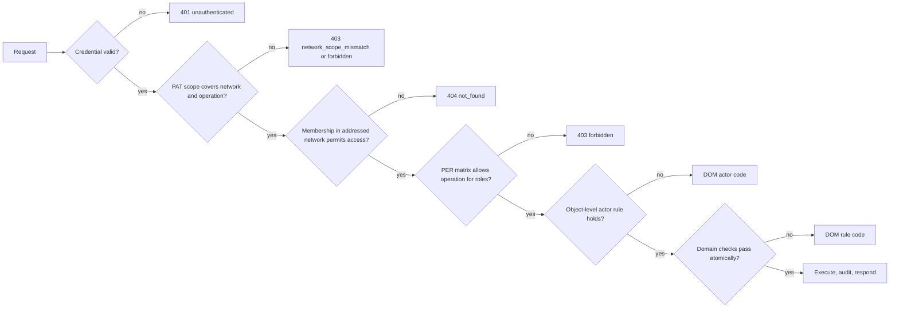

# API and Integration Contract

| Field | Value |
|---|---|
| Status | Draft |
| Owner role | Product architect |
| Last updated | 2026-11-11 |
| Scope | The public API through which the web client and every integration reach Circula: design principles, protocol baseline, authentication and authorization, error format, pagination, idempotency, versioning, rate-limit responses, the conceptual catalogue of MVP operations, representation sketches, the integration surface (exports now, webhooks deferred), and the contract-testing requirement. Authoritative home for API shape, errors, pagination, idempotency, and versioning ([00-conventions.md §7](00-conventions.md#7-authoritative-homes)). |
| Dependencies | [00-conventions.md](00-conventions.md) (terms, IDs, baseline decisions), [02-personas-roles-and-journeys.md](02-personas-roles-and-journeys.md) (roles and permissions matrix), [03-domain-model-and-mutual-credit-rules.md](03-domain-model-and-mutual-credit-rules.md) (ledger rules and error-code vocabulary) |
| Related documents | [01-product-vision-and-scope.md](01-product-vision-and-scope.md), [04-functional-requirements.md](04-functional-requirements.md), [05-system-architecture.md](05-system-architecture.md), [06-data-model-ledger-and-audit.md](06-data-model-ledger-and-audit.md), [08-ux-and-accessibility.md](08-ux-and-accessibility.md), [09-security-privacy-and-abuse-resistance.md](09-security-privacy-and-abuse-resistance.md), [10-governance-and-network-operations.md](10-governance-and-network-operations.md), [11-deployment-operations-and-support.md](11-deployment-operations-and-support.md), [12-quality-strategy-and-test-plan.md](12-quality-strategy-and-test-plan.md), [13-assumptions-risks-decisions-and-roadmap.md](13-assumptions-risks-decisions-and-roadmap.md) |

## 1. Purpose

Circula has one way into the ledger: the public API. The MVP web client is a consumer of that API and has no privileged path ([DEC-006](13-assumptions-risks-decisions-and-roadmap.md#dec-006), [VIS-026](01-product-vision-and-scope.md#vis-026)). Every rule that protects balances, consent, limits, and attribution in [03-domain-model-and-mutual-credit-rules.md](03-domain-model-and-mutual-credit-rules.md) is therefore enforced behind this contract, once, for the browser and for scripts alike.

This document fixes the shape of that contract so that the implementation, the web client, integrators, and the test suite agree on it. It defines the conventions every operation follows and lists the conceptual operations the MVP needs. It does not define the internal module interface of the ledger core (owned by [05-system-architecture.md](05-system-architecture.md)), storage (owned by [06-data-model-ledger-and-audit.md](06-data-model-ledger-and-audit.md)), or rate-limit thresholds and authentication strength (owned by [09-security-privacy-and-abuse-resistance.md](09-security-privacy-and-abuse-resistance.md)).

The protocol choices in section 3 are **recommended defaults**, not settled decisions; alternatives are recorded in [section 14](#14-open-questions). Paths in the catalogue are recommended, and the conventions they illustrate (network scoping, one operation per state transition, idempotency, error codes) are normative regardless of the final path spelling.

Identifier ranges in this document are reserved by topic:

| Range | Topic |
|---|---|
| API-001 to API-009 | Design principles |
| API-010 to API-019 | Protocol baseline |
| API-020 to API-029 | Authentication and authorization |
| API-030 to API-039 | Error format |
| API-040 to API-049 | Pagination, filtering, sorting |
| API-050 to API-059 | Idempotency |
| API-060 to API-069 | Versioning and compatibility |
| API-070 to API-079 | Rate limiting and quotas |
| API-080 to API-099 | Operations catalogue |
| API-100 to API-109 | Representations |
| API-110 to API-114 | Webhooks and integrations |
| API-115 to API-119 | Contract testing |

### 1.1 Standards cited

Cited standards. URLs were not accessed on 2026-11-11 ([OQ-API-14](#14-open-questions)); verify before review.

| Standard | URL | Used in |
|---|---|---|
| RFC 9110 HTTP Semantics | https://www.rfc-editor.org/rfc/rfc9110 | [API-010](#api-010) |
| RFC 8259 JSON | https://www.rfc-editor.org/rfc/rfc8259 | [API-010](#api-010) |
| RFC 9457 Problem Details for HTTP APIs | https://www.rfc-editor.org/rfc/rfc9457 | [API-030](#api-030) |
| RFC 9562 UUIDs | https://www.rfc-editor.org/rfc/rfc9562 | [API-008](#api-008) |
| RFC 3339 Date and Time on the Internet | https://www.rfc-editor.org/rfc/rfc3339 | [API-007](#api-007) |
| RFC 6901 JSON Pointer | https://www.rfc-editor.org/rfc/rfc6901 | [API-033](#api-033) |
| RFC 7396 JSON Merge Patch | https://www.rfc-editor.org/rfc/rfc7396 | [API-012](#api-012) |
| RFC 6750 Bearer Token Usage | https://www.rfc-editor.org/rfc/rfc6750 | [API-022](#api-022) |
| RFC 8594 Sunset header | https://www.rfc-editor.org/rfc/rfc8594 | [API-063](#api-063) |
| RFC 9745 Deprecation header | https://www.rfc-editor.org/rfc/rfc9745 | [API-063](#api-063) |
| draft-ietf-httpapi-ratelimit-headers | https://datatracker.ietf.org/doc/draft-ietf-httpapi-ratelimit-headers/ | [API-071](#api-071) (candidate only) |

## 2. Design principles

<a id="api-001"></a>**API-001 — One path for the client and integrations.** (P0)
The web client MUST perform every read and every state change through operations listed in this contract. The server MUST NOT expose an endpoint, flag, header, or parameter that only the web client may use to bypass a check applied to other callers. A behavior available in the UI is available through the API to a caller holding the same roles, and refused in both when refused in either.
*Rationale:* [DEC-006](13-assumptions-risks-decisions-and-roadmap.md#dec-006); one enforcement point means one set of rules to test.

<a id="api-002"></a>**API-002 — Ledger invariants enforced server-side on every operation.** (P0)
Every operation that can create a ledger event, change a transaction, dispute, adjustment, membership, role, account limit, or policy MUST evaluate the applicable DOM rules on the server at the moment of execution, including [DOM-009](03-domain-model-and-mutual-credit-rules.md#dom-009) atomic limit checks. The server MUST NOT accept, trust, or persist client-computed balances, available credit, resulting balances, sequence numbers, timestamps of record, or authority values. Any such field present in a request body MUST be ignored or rejected with `validation_failed`; this contract chooses rejection.
*Rationale:* a client is untrusted input; the ledger state at posting time is the only valid basis for a limit check ([DOM-027](03-domain-model-and-mutual-credit-rules.md#dom-027)).

<a id="api-003"></a>**API-003 — Explicit network scoping in every path.** (P0)
Every operation on network data MUST carry the network identifier in its path (`/v1/networks/{network_id}/...`). The server MUST resolve every other identifier in the request (path or body) within that network and MUST treat an identifier that belongs to a different network exactly as a nonexistent identifier (section 5). No operation MAY read or write data of two networks in one call, except the operator endpoints in [API-093](#api-093), which return no ledger data.
*Rationale:* [DEC-001](13-assumptions-risks-decisions-and-roadmap.md#dec-001) isolation is enforced in software; putting the scope in the path makes it checkable on every request and in logs. Enforces [DOM-005](03-domain-model-and-mutual-credit-rules.md#dom-005) at the boundary.

<a id="api-004"></a>**API-004 — Least privilege.** (P0)
Every operation MUST declare the roles that may invoke it (section 10), and the server MUST deny every caller not covered, per [PER-008](02-personas-roles-and-journeys.md#per-008). Responses MUST include only fields the caller is permitted to see under [PER-028](02-personas-roles-and-journeys.md#per-028) and network policy ([DOM-096](03-domain-model-and-mutual-credit-rules.md#dom-096), [DOM-097](03-domain-model-and-mutual-credit-rules.md#dom-097)); a field the caller may not see MUST be omitted, not returned as `null`.
*Rationale:* omission avoids revealing that a value exists; [VIS-028](01-product-vision-and-scope.md#vis-028).

<a id="api-005"></a>**API-005 — Stable contract.** (P0)
Within one major version, the meaning of every documented field, error code, status value, and operation MUST NOT change. Changes follow section 8.
*Rationale:* self-hosted instances upgrade on their own schedule; integrations must keep working across minor upgrades.

<a id="api-006"></a>**API-006 — Integer amounts.** (P0)
Every amount, balance, limit, total, and threshold MUST be represented as a JSON integer count of minor units ([DOM-006](03-domain-model-and-mutual-credit-rules.md#dom-006), [DEC-005](13-assumptions-risks-decisions-and-roadmap.md#dec-005)). Amounts and positive limits are non-negative; balances and available credit may be negative. Representations of a network MUST carry `credit_unit.decimal_places` so a client can format values; the API MUST NOT return formatted or fractional amounts. Every integer amount and balance MUST lie within ±9007199254740991 (2^53 − 1) so that every JSON parser reads it exactly. Every amount-rule failure of an amount field (transaction, adjustment, remedy, or listing indicative amount) MUST be reported with the top-level code `invalid_amount` (422, section 5.1), not as a field error inside `validation_failed`: a value that is not a JSON integer (including `40.0`, `"40"`, and exponent notation), zero or negative, beyond the bound, or above [DOM-104](03-domain-model-and-mutual-credit-rules.md#dom-104). A limit, total, or threshold value that is not an integer, is beyond the bound, or is outside its allowed range is rejected with `policy_value_out_of_range` ([DOM-018](03-domain-model-and-mutual-credit-rules.md#dom-018), [DOM-091](03-domain-model-and-mutual-credit-rules.md#dom-091)).
*Rationale:* rounding drift and parser precision loss are the two ways amounts get corrupted in transit. The bound is recorded for [06-data-model-ledger-and-audit.md](06-data-model-ledger-and-audit.md) as [OQ-API-10](#14-open-questions).

<a id="api-007"></a>**API-007 — UTC timestamps.** (P0)
Every timestamp in requests and responses MUST be an RFC 3339 profile of ISO 8601 date-time in UTC with the `Z` suffix and millisecond precision, for example `2026-11-11T09:30:00.000Z`. The server MUST reject timestamps with other offsets in requests with `validation_failed`. Timestamps of record (`proposed_at`, `posted_at`, and so on) are assigned by the server only ([API-002](#api-002)).
*Rationale:* one format removes time-zone ambiguity in disputes and windows ([DOM-100](03-domain-model-and-mutual-credit-rules.md#dom-100) to [DOM-103](03-domain-model-and-mutual-credit-rules.md#dom-103)).

<a id="api-008"></a>**API-008 — Opaque identifiers.** (P0)
Every resource identifier exposed by the API MUST be an opaque string, globally unique, and not derivable from creation order or count (recommended default: UUID version 7 per RFC 9562, in lowercase canonical text form; storage rules in [06-data-model-ledger-and-audit.md](06-data-model-ledger-and-audit.md)). Clients MUST NOT parse identifiers. The ledger `sequence` ([DOM-010](03-domain-model-and-mutual-credit-rules.md#dom-010)) is exposed as an integer attribute of ledger events and as a pagination position, never as an identifier of any resource.
*Rationale:* sequential external identifiers leak activity volume and invite enumeration.

<a id="api-009"></a>**API-009 — Every state change is attributable.** (P0)
Every successful state-changing response MUST include the `Request-Id` response header, and the audit event created under [DOM-012](03-domain-model-and-mutual-credit-rules.md#dom-012) MUST record that request identifier and the idempotency key. Every error response MUST carry the same value in `request_id` (section 5).
*Rationale:* support and dispute review need to tie a client-side report to one server-side record.

## 3. Protocol baseline (recommended default)

<a id="api-010"></a>**API-010 — HTTP and JSON.** (P0)
The API SHOULD be served over HTTPS only (HTTP semantics per RFC 9110) with JSON (RFC 8259) bodies encoded in UTF-8. Plain HTTP requests MUST NOT be served except a redirect without body content, and the server MUST NOT accept credentials over plain HTTP. Transport configuration is owned by [09-security-privacy-and-abuse-resistance.md](09-security-privacy-and-abuse-resistance.md) and [11-deployment-operations-and-support.md](11-deployment-operations-and-support.md).
*Rationale:* the most widely supported option for small self-hosting teams and for browser clients; GraphQL and gRPC are rejected for the MVP in [OQ-API-1](#14-open-questions).

<a id="api-011"></a>**API-011 — Version prefix.** (P0)
Every path MUST begin with `/v{major}`; the MVP major version is `/v1` (section 8).

<a id="api-012"></a>**API-012 — Resource-oriented paths.** (P0)
Paths name resources with plural nouns and opaque identifiers: `/v1/networks/{network_id}/transactions/{transaction_id}`. Reads use `GET`. Creation uses `POST` on the collection. Partial updates of editable attributes use `PATCH` with a JSON merge patch (RFC 7396). Deletion of a client-owned item (for example a personal access token) uses `DELETE`.

<a id="api-013"></a>**API-013 — State transitions are named operations.** (P0)
A lifecycle transition defined in [03-domain-model-and-mutual-credit-rules.md](03-domain-model-and-mutual-credit-rules.md) (accept, decline, cancel, approve, suspend, resolve, and so on) MUST be exposed as `POST` to a named sub-path of the resource, for example `POST .../transactions/{id}/accept`, and MUST NOT be reachable by `PATCH` of a `status` field. `status` fields are read-only in every representation.
*Rationale:* each transition has its own actor rule, checks, and audit event; a writable status field would merge them into one unguarded operation.

<a id="api-014"></a>**API-014 — Content negotiation.** (P0)
Requests with a body MUST use `Content-Type: application/json`; the server MUST reject other types with 415 `unsupported_media_type`. Successful responses use `application/json`; error responses use `application/problem+json` (RFC 9457). Export downloads use `text/csv` or `application/json` as requested ([API-092](#api-092)). A request whose `Accept` header excludes every type the operation can produce MUST receive 406 `not_acceptable`. The server MUST NOT vary field names, field types, or semantics by client type or user agent.

<a id="api-015"></a>**API-015 — Envelope conventions.** (P0)
A single resource is returned as a bare JSON object without a wrapper. A collection is returned as `{"data": [...], "next_cursor": string|null, "has_more": boolean}` (section 6). Field names use `snake_case`. Absent optional values are omitted; `null` is used only where the schema documents it as a meaningful value (for example `positive_limit: null` meaning "no positive limit", [DOM-051](03-domain-model-and-mutual-credit-rules.md#dom-051)). Every resource carries `id` and, where it has a lifecycle, `status`. Responses to a state transition return the full updated resource with HTTP 200, or 201 with a `Location` header when a new resource is created.

<a id="api-016"></a>**API-016 — Optimistic concurrency for editable configuration.** (P0)
Resources edited by administrators without a ledger effect (network description, network policy, listing content, account limits) MUST return an `ETag`. `PATCH` and policy-update operations on them MUST require `If-Match`; a missing header MUST receive 428 `precondition_required` and a stale value 412 `precondition_failed`. Ledger-affecting operations do not use `If-Match`; their serialization is [DOM-009](03-domain-model-and-mutual-credit-rules.md#dom-009).
*Rationale:* two administrators editing policy at once must not silently overwrite each other ([DOM-017](03-domain-model-and-mutual-credit-rules.md#dom-017)).

## 4. Authentication and authorization

<a id="api-020"></a>**API-020 — Credentials.** (P0)
The API accepts exactly two credential types: (a) a **session** established by interactive login, used by the web client; (b) a **personal access token** (PAT, P1, [API-022](#api-022)). Requests with no credential MAY reach only the operations marked "Anonymous" in section 10. A request presenting an invalid, expired, or revoked credential MUST receive 401 `unauthenticated` with a `WWW-Authenticate` header, and MUST NOT fall back to anonymous access. Password hashing, second-factor rules, lockout, and recovery are owned by [09-security-privacy-and-abuse-resistance.md](09-security-privacy-and-abuse-resistance.md).

<a id="api-021"></a>**API-021 — Web session cookie and CSRF defence.** (P0)
The session identifier for the web client MUST be carried in a cookie with the attributes `Secure`, `HttpOnly`, `SameSite=Lax` or stricter, a `Path` of `/`, and no `Domain` attribute broader than the serving host. The session identifier MUST NOT appear in a URL, response body, or log. Every state-changing request authenticated by the session cookie MUST pass a cross-site request forgery check: the server MUST verify that the `Origin` header (or, when absent, `Referer`) matches the instance's configured origin, and MUST additionally require a per-session anti-forgery token in a request header (recommended name `X-CSRF-Token`) that is not a cookie. Failure MUST receive 403 `forbidden` with `detail` naming the CSRF check, and MUST NOT change state. Sessions MUST be listable and revocable by their owner ([API-081](#api-081)); revocation MUST take effect on the next request using that session.
*Rationale:* cookies are sent automatically by browsers; without the double check a third-party page could propose a transaction in the member's name.

<a id="api-022"></a>**API-022 — Personal access tokens.** (P1)
An identity MAY create PATs for integrations. A PAT MUST be sent as `Authorization: Bearer <token>` (RFC 6750) and MUST NOT be accepted in cookies or query strings. Each PAT MUST record: a name, an expiry (recommended default maximum 365 days, value owned by [09-security-privacy-and-abuse-resistance.md](09-security-privacy-and-abuse-resistance.md)), the list of networks it may address, and per network a set of scopes from this table:

| Scope | Grants (never more than the holder's roles allow) |
|---|---|
| `read` | `GET` operations on the network that the holder's roles allow. |
| `trade` | Propose, accept, decline, cancel, confirm transactions; request or withdraw reversal; manage own listings. |
| `disputes` | Raise, withdraw, appeal disputes; for reviewers, take and resolve. |
| `admin` | Administrator operations (membership, roles, limits, policy, adjustments, administrator reversals). `admin` is a PAT scope name only; the role it relies on is `administrator` ([PER-005](02-personas-roles-and-journeys.md#per-005)). |
| `export` | Request and download exports permitted to the holder ([PER-030](02-personas-roles-and-journeys.md#per-030), [PER-031](02-personas-roles-and-journeys.md#per-031)). |

The effective permission of a PAT request MUST be the intersection of the token's scopes for the addressed network and the holder's current roles in that network, re-evaluated on every request, so that a role revoked after token creation is revoked for the token too. A PAT MUST NOT be able to create or revoke PATs, change the password or second factor, list or revoke sessions, or call any operator endpoint. The token value MUST be shown once at creation and stored only in a non-reversible form. A request addressing a network not in the token's list MUST receive 403 `network_scope_mismatch`; a request needing a scope the token lacks MUST receive 403 `forbidden` with `detail` naming the missing scope. Token format is [OQ-API-2](#14-open-questions).
*Rationale:* integrations need narrower and shorter-lived authority than an interactive login.

<a id="api-023"></a>**API-023 — Authorization pipeline.** (P0)
Every request MUST be authorized in this order, and the first failing step MUST determine the response:

1. **Identity:** resolve the credential to a platform identity, or to anonymous. Failure: 401 `unauthenticated`.
2. **Credential scope:** for a PAT, check the network list and scope (API-022). Failure: 403 `network_scope_mismatch` or `forbidden`.
3. **Membership:** for a network-scoped path, resolve the identity's membership in `{network_id}` and its status. No membership, or a membership in a status that grants no access to the operation: 404 `not_found` for the network and everything under it, unless the network's policy makes the requested resource publicly readable ([DOM-097](03-domain-model-and-mutual-credit-rules.md#dom-097)). Exception: a `Suspended` or `Departed` membership keeps own-history reads ([PER-027](02-personas-roles-and-journeys.md#per-027)) and own-data export (request, status, and download; [PER-030](02-personas-roles-and-journeys.md#per-030), [PER-042](02-personas-roles-and-journeys.md#per-042)) for the personal-data retention period of [DATA-080](06-data-model-ledger-and-audit.md#data-080) (2 years after `Departed`), as [SEC-023](09-security-privacy-and-abuse-resistance.md#sec-023) allows.
4. **Roles:** derive roles (`member` for every Active membership; `administrator`, `reviewer` as assigned, [PER-005](02-personas-roles-and-journeys.md#per-005)).
5. **Operation permission:** evaluate the operation's row of the permissions matrix ([PER-010](02-personas-roles-and-journeys.md#per-010) to [PER-032](02-personas-roles-and-journeys.md#per-032), [PER-035](02-personas-roles-and-journeys.md#per-035) to [PER-049](02-personas-roles-and-journeys.md#per-049)) including Policy-dependent cells under the current policy version ([PER-034](02-personas-roles-and-journeys.md#per-034)). Failure: 403 `forbidden`. A write by a caller whose own membership is `Suspended` fails here with `forbidden`, except the reads and exports kept in step 3 ([SEC-023](09-security-privacy-and-abuse-resistance.md#sec-023)); `account_not_active` is raised only in step 7, for a `Frozen` or `Closed` counterparty account ([DOM-016](03-domain-model-and-mutual-credit-rules.md#dom-016)).
6. **Object-level rule:** evaluate the domain actor rule (for example counterparty-only acceptance, [DOM-022](03-domain-model-and-mutual-credit-rules.md#dom-022); reviewer recusal, [DOM-061](03-domain-model-and-mutual-credit-rules.md#dom-061)). Failure: the DOM code (`not_a_party`, `reviewer_ineligible`, `self_dealing_not_allowed`).
7. **Domain checks:** the remaining DOM rules of the operation, evaluated atomically with the write where [DOM-009](03-domain-model-and-mutual-credit-rules.md#dom-009) requires it.

A resource that exists in the network but that the caller may not see at all (for example another member's transaction when the caller is a plain member) MUST receive 404 `not_found`, not 403, so that the response names no data the caller could not otherwise see ([PER-008](02-personas-roles-and-journeys.md#per-008)).
*Rationale:* fixed ordering makes the response deterministic and testable; 404 for unseen objects prevents probing.



Plain-text summary: a request is checked for a valid credential, then for token scope, then for membership in the network named in its path, then against the permissions matrix for the caller's roles, then against the object-level actor rule, and finally against the domain rules applied atomically with the write. The first failure decides the error; only a request passing all six steps executes and is audited.

<a id="api-024"></a>**API-024 — Operator endpoints are separate.** (P0)
Operator operations MUST live under `/v1/operator/...`, MUST require an identity flagged as platform operator for the instance, and MUST NOT be reachable with a PAT. Holding the operator flag MUST NOT grant any permission on `/v1/networks/{network_id}/...` paths ([PER-007](02-personas-roles-and-journeys.md#per-007)). An operator who is also a member of a network acts there only through that membership.

<a id="api-025"></a>**API-025 — Break-glass is flagged on every request.** (P0)
Operator access to network data MUST go through a break-glass grant created by `POST /v1/operator/break-glass` with a reason, a target network, and a duration within the maximum set by [09-security-privacy-and-abuse-resistance.md](09-security-privacy-and-abuse-resistance.md) ([PER-032](02-personas-roles-and-journeys.md#per-032), [PER-033](02-personas-roles-and-journeys.md#per-033)). While the grant is active, requests made under it MUST carry the grant identifier in the `Break-Glass-Grant` request header, MUST be limited to `GET` operations on the target network, except the administrator grant of [API-093](#api-093), and MUST NOT include export requests or downloads ([SEC-144](09-security-privacy-and-abuse-resistance.md#sec-144)), MUST each create an audit event that references the grant ([DOM-012](03-domain-model-and-mutual-credit-rules.md#dom-012)), and every response MUST carry the header `Break-Glass: active`. Any other state-changing request under a grant MUST receive 403 `forbidden`. The grant's duration follows [SEC-140](09-security-privacy-and-abuse-resistance.md#sec-140) (default 4 hours, maximum 24 hours). The grant MUST end at its expiry or at `POST /v1/operator/break-glass/{grant_id}/end`, whichever is first, and the network's administrators MUST be able to list grants on their network ([API-090](#api-090)).

## 5. Error format

<a id="api-030"></a>**API-030 — Problem details.** (P0)
Every error response (HTTP 4xx and 5xx) MUST be an RFC 9457 problem details object with `Content-Type: application/problem+json` and these members:

| Member | Required | Content |
|---|---|---|
| `type` | Yes | Absolute URI identifying the problem type, one per `code` (recommended default form `https://docs.circula.example/problems/{code}`; base URI is [OQ-API-12](#14-open-questions)). |
| `title` | Yes | Short, fixed, human-readable summary of the type, in English; not localized per request. |
| `status` | Yes | The HTTP status code, equal to the response status. |
| `detail` | Yes | Human-readable explanation of this occurrence. MUST NOT contain data the caller may not see, stack traces, query text, or secrets. |
| `instance` | Yes | Relative URI of the request path that failed, without query string. |
| `code` | Yes (extension) | Machine-readable code from section 5.1 or 5.2. Clients MUST branch on `code`, never on `title` or `detail`. |
| `request_id` | Yes (extension) | The request identifier, equal to the `Request-Id` response header ([API-009](#api-009)). |
| `errors` | For `validation_failed` and `policy_value_out_of_range` | Array of field errors ([API-033](#api-033)). |
| further extension members | Per code | Listed in sections 5.1 and 5.2, for example `account` for `limit_exceeded`. |

<a id="api-031"></a>**API-031 — Domain codes are used verbatim.** (P0)
When an operation fails because a rule in [03-domain-model-and-mutual-credit-rules.md](03-domain-model-and-mutual-credit-rules.md) fails, the response MUST carry the code from its section 5.1 unchanged and the HTTP status in the table below. When several checks fail, the server MUST report the first in the evaluation order of [API-023](#api-023), and within domain checks the order of the rule's numbered list (for [DOM-027](03-domain-model-and-mutual-credit-rules.md#dom-027): payer credit limit, payee positive limit, over-limit payer).

### 5.1 Domain codes and HTTP status

| DOM code ([03 §5.1](03-domain-model-and-mutual-credit-rules.md#51-error-codes-raised-by-transaction-rules)) | HTTP status | Extension members | Why this status |
|---|---|---|---|
| `network_not_active` | 409 | `network_status` | Valid request, refused by current network state. |
| `account_not_active` | 409 | `account` (id), `account_status` | Refused by the state of a `Frozen` or `Closed` counterparty account ([DOM-016](03-domain-model-and-mutual-credit-rules.md#dom-016)); a caller whose own membership is `Suspended` receives `forbidden` ([API-023](#api-023)). |
| `same_account` | 422 | | Request content is invalid regardless of state. |
| `not_a_party` | 403 | | Caller is a member but lacks the actor right ([DOM-022](03-domain-model-and-mutual-credit-rules.md#dom-022)). |
| `invalid_amount` | 422 | `pointer` (the amount field); `max_amount` when [DOM-104](03-domain-model-and-mutual-credit-rules.md#dom-104) applies | Content invalid; every amount-rule failure ([API-006](#api-006)). |
| `description_required` | 422 | | Content invalid. |
| `limit_exceeded` | 409 | `account` (payer id), `available_credit` only if the caller may see it | Depends on current balance; may succeed later ([DOM-027](03-domain-model-and-mutual-credit-rules.md#dom-027)). |
| `positive_limit_exceeded` | 409 | `account` (payee id) | As above; payee headroom is not disclosed to the payer. |
| `transaction_expired` | 409 | `expires_at` | Refused by state ([DOM-025](03-domain-model-and-mutual-credit-rules.md#dom-025)). |
| `invalid_transition` | 409 | `current_status` | Refused by state ([DOM-020](03-domain-model-and-mutual-credit-rules.md#dom-020)). |
| `self_dealing_not_allowed` | 403 | | Caller may not act on both sides ([DOM-043](03-domain-model-and-mutual-credit-rules.md#dom-043)). |
| `idempotency_conflict` | 422 | `original_request_id` | Key reused with a different payload ([DOM-011](03-domain-model-and-mutual-credit-rules.md#dom-011), section 7). |
| `confirmation_required` | 409 | `confirmation_expires_at` | An action needs the outstanding large-amount confirmation first ([DOM-029](03-domain-model-and-mutual-credit-rules.md#dom-029)). |

A failed acceptance that returns `limit_exceeded`, `positive_limit_exceeded`, `account_not_active`, or `network_not_active` MUST leave the transaction `Proposed` and append the attempt as required by [DOM-022](03-domain-model-and-mutual-credit-rules.md#dom-022); the error response is the acceptor's notification of the specific code.

### 5.2 Additional codes

General codes defined by this contract:

| Code | HTTP status | Raised when |
|---|---|---|
| `unauthenticated` | 401 | No valid credential where one is required ([API-020](#api-020)). |
| `forbidden` | 403 | Permissions matrix, PAT scope, CSRF check, or break-glass restriction denies the operation. |
| `reauthentication_required` | 401 | A high-impact administrator action requires fresh authentication and the session's last authentication is too old ([09-security-privacy-and-abuse-resistance.md](09-security-privacy-and-abuse-resistance.md)); carries `reauthenticate_within_seconds`. |
| `network_scope_mismatch` | 403 | A PAT addresses a network outside its network list ([API-022](#api-022)). |
| `not_found` | 404 | Resource does not exist in the addressed network, belongs to another network ([API-003](#api-003)), or is invisible to the caller ([API-023](#api-023)). The three cases MUST be indistinguishable in status, body, and timing class. |
| `method_not_allowed` | 405 | Method not defined for the path. |
| `not_acceptable` | 406 | See [API-014](#api-014). |
| `malformed_request` | 400 | Body is not parseable JSON, or a query parameter cannot be parsed. |
| `idempotency_key_required` | 400 | State-changing request without `Idempotency-Key` ([API-050](#api-050)). |
| `validation_failed` | 422 | One or more fields invalid; carries `errors[]` ([API-033](#api-033)). |
| `conflict` | 409 | A request with the same idempotency key is still in progress ([API-054](#api-054)), or another generic state conflict not covered by a more specific code. |
| `precondition_failed` | 412 | `If-Match` does not match the current `ETag` ([API-016](#api-016)). |
| `precondition_required` | 428 | `If-Match` missing where required. |
| `unsupported_media_type` | 415 | See [API-014](#api-014). |
| `rate_limited` | 429 | Rate or quota exceeded ([API-070](#api-070)). |
| `internal` | 500 | Unexpected server failure. MUST NOT have changed state partially ([DOM-001](03-domain-model-and-mutual-credit-rules.md#dom-001)); the client MAY retry with the same idempotency key. |
| `service_unavailable` | 503 | Instance in maintenance or upgrade ([11-deployment-operations-and-support.md](11-deployment-operations-and-support.md)); carries `Retry-After`. |

Domain-rule codes needed by operations in section 10. Each enforces an existing DOM or PER rule and is defined in [03 §5.1](03-domain-model-and-mutual-credit-rules.md#51-error-codes-raised-by-transaction-rules), which is their authoritative home; this table adds only the HTTP status and extension members:

| Code | HTTP status | Rule enforced | Extension members |
|---|---|---|---|
| `departure_blocked` | 409 | [DOM-070](03-domain-model-and-mutual-credit-rules.md#dom-070) | `blocking_conditions[]`: subset of `balance_not_zero`, `proposed_transactions`, `open_disputes` |
| `closure_blocked` | 409 | [DOM-075](03-domain-model-and-mutual-credit-rules.md#dom-075) | `blocking_accounts[]` (account ids) |
| `last_administrator` | 409 | [PER-006](02-personas-roles-and-journeys.md#per-006) | |
| `window_closed` | 409 | [DOM-060](03-domain-model-and-mutual-credit-rules.md#dom-060), [DOM-031](03-domain-model-and-mutual-credit-rules.md#dom-031), [DOM-063](03-domain-model-and-mutual-credit-rules.md#dom-063), [DOM-108](03-domain-model-and-mutual-credit-rules.md#dom-108) | `window`: `dispute`, `mutual_reversal`, `appeal`, `administrator_reversal`; `closed_at` |
| `dispute_already_open` | 409 | [DOM-060](03-domain-model-and-mutual-credit-rules.md#dom-060) | `dispute` (id, only if visible to caller) |
| `not_disputable` | 409 | [DOM-060](03-domain-model-and-mutual-credit-rules.md#dom-060) (reversal events) | |
| `already_reversed` | 409 | [DOM-033](03-domain-model-and-mutual-credit-rules.md#dom-033), [DOM-060](03-domain-model-and-mutual-credit-rules.md#dom-060) | `reversal` (ledger event id) |
| `reviewer_ineligible` | 403 | [DOM-061](03-domain-model-and-mutual-credit-rules.md#dom-061), [DOM-062](03-domain-model-and-mutual-credit-rules.md#dom-062) (confirming administrator), [PER-006](02-personas-roles-and-journeys.md#per-006) | |
| `decimal_places_locked` | 409 | [DOM-006](03-domain-model-and-mutual-credit-rules.md#dom-006) | |
| `policy_value_out_of_range` | 422 | [DOM-018](03-domain-model-and-mutual-credit-rules.md#dom-018), [DOM-091](03-domain-model-and-mutual-credit-rules.md#dom-091) | Top-level code; `errors[]` names each out-of-range field in the shape of [API-033](#api-033) |
| `setup_incomplete` | 409 | [DOM-094](03-domain-model-and-mutual-credit-rules.md#dom-094) (values set at setup) | `missing_policies[]` (policy keys) |
| `invitation_expired` | 409 | [DOM-099](03-domain-model-and-mutual-credit-rules.md#dom-099) | `expires_at` |
| `not_permitted_by_policy` | 403 | [DOM-095](03-domain-model-and-mutual-credit-rules.md#dom-095), [DOM-109](03-domain-model-and-mutual-credit-rules.md#dom-109), [DOM-113](03-domain-model-and-mutual-credit-rules.md#dom-113), [DOM-115](03-domain-model-and-mutual-credit-rules.md#dom-115) and other section 11 policies | `policy` (the policy key) |

<a id="api-032"></a>**API-032 — Errors never change state.** (P0)
A response with status 4xx or 5xx MUST mean that no ledger event, posting, or domain state change was committed by that request, with one exception: the failed-acceptance record of [DOM-022](03-domain-model-and-mutual-credit-rules.md#dom-022) and the audit events of failed authentication ([DOM-012](03-domain-model-and-mutual-credit-rules.md#dom-012)), which are recorded although the operation failed.

<a id="api-033"></a>**API-033 — Validation error shape.** (P0)
A `validation_failed` problem MUST carry `errors`, an array with one entry per invalid field, each with `pointer` (an RFC 6901 JSON Pointer into the request body, or `#/query/{name}` for a query parameter), `code` (a DOM code such as `description_required` where one applies, otherwise one of `required`, `invalid_format`, `too_long`, `out_of_range`, `unknown_field`, `not_found_in_network`, `read_only`), and `detail`. The server MUST report every invalid field it can detect without executing the operation, not only the first. A body field naming an identifier not found in the addressed network MUST produce field code `not_found_in_network` without saying whether it exists elsewhere ([API-003](#api-003)). Amount-rule failures are not field errors: they are reported as top-level `invalid_amount` ([API-006](#api-006)), which takes precedence over field errors in the same request; out-of-range policy and limit values are reported as top-level `policy_value_out_of_range` with `errors[]` in this shape.

## 6. Pagination, filtering, and sorting

<a id="api-040"></a>**API-040 — Cursor pagination only.** (P0)
Every collection operation MUST be paginated with an opaque `cursor` query parameter and a `limit` parameter. `limit` defaults to 50; the server MUST accept values 1 to 200 and MUST reject others with `validation_failed`. The response carries `next_cursor` (null on the last page) and `has_more`. Cursors are opaque, bound to the collection and its filters, and MUST be rejected with `validation_failed` (pointer `#/query/cursor`) if reused with different filters. Offset or page-number pagination MUST NOT be offered on ledger events, postings, transactions, or audit events.
*Rationale:* offsets skip or repeat rows when new events are appended between page requests; on a ledger that corrupts any total a client computes.

<a id="api-041"></a>**API-041 — Stable ordering.** (P0)
Every collection MUST have a documented, total, stable order. Ledger events and postings MUST be ordered by `sequence` ascending by default (descending allowed via `order=desc`); a cursor positions by sequence, so a client paging forward from a cursor receives every event posted later exactly once. Other collections are ordered by creation time then `id`. A page MUST NOT contain the same item twice, and walking all pages MUST return every item that existed when the first page was requested.

<a id="api-042"></a>**API-042 — Sequence position parameters for ledger reads.** (P0)
Ledger history operations MUST additionally accept `after_sequence` and `up_to_sequence` (integers) so that an integration can resume from the last sequence it processed and so that a client can read history as of a known position ([DOM-010](03-domain-model-and-mutual-credit-rules.md#dom-010)). Responses to ledger reads MUST include `as_of_sequence`, the highest sequence in the network visible to the read.

<a id="api-043"></a>**API-043 — Minimal filters.** (P0)
The MVP filter set is closed; the server MUST reject unknown query parameters with `validation_failed`:

| Collection | Filters | Sort options |
|---|---|---|
| Transactions | `status` (repeatable), `role` (`payer`, `payee`, `proposer`, `counterparty`), `account`, `created_from`, `created_to` | `created_at` asc/desc |
| Ledger events and postings | `kind`, `account` (network ledger only), `after_sequence`, `up_to_sequence`, `posted_from`, `posted_to` | `sequence` asc/desc |
| Members and directory | `status` (administrators only), `role`, `q` (display-name prefix) | `display_name`, `joined_at` |
| Listings | `type`, `status`, `category`, `q` (full-text on title and description) | `updated_at` desc, `relevance` with `q` |
| Disputes | `status`, `assigned_to_me`, `raised_by_me` | `opened_at` |
| Audit events | `action`, `object_type`, `object_id`, `actor`, `from`, `to` | `occurred_at` asc/desc |
| Notifications | `unread` | `created_at` desc |
| Abuse reports | `status` | `created_at` asc/desc |
| Notice board | — | `posted_at` desc |

## 7. Idempotency

<a id="api-050"></a>**API-050 — Key required on every state-changing request.** (P0)
Every `POST`, `PUT`, `PATCH`, and `DELETE` request MUST carry an `Idempotency-Key` header, enforcing [DOM-011](03-domain-model-and-mutual-credit-rules.md#dom-011) for all state changes, not only ledger ones. A request without it MUST receive 400 `idempotency_key_required` and MUST NOT change state. Exception: the credential-establishing operations `POST /v1/sessions` (login), `POST /v1/recovery`, and `POST /v1/recovery/complete` MUST NOT store or replay responses, because a replay would re-issue a credential; they accept but ignore the header ([OQ-API-6](#14-open-questions)).

<a id="api-051"></a>**API-051 — Key format and scope.** (P0)
A key MUST be 16 to 128 characters from the set `A-Z a-z 0-9 - _ .`; the server MUST reject others with `validation_failed` (pointer `#/header/Idempotency-Key`). Clients SHOULD use a random UUID per logical operation. Keys are scoped per acting identity: the same key sent by two identities denotes two unrelated requests; the same identity using a session and a PAT shares one scope. The server MUST bind each key to a fingerprint of the method, the path template with its identifiers, and the canonicalized request body.

<a id="api-052"></a>**API-052 — Replay semantics.** (P0)
When a request arrives with a key already completed for that identity and the fingerprint matches, the server MUST NOT execute the operation again and MUST return the stored status code and body of the original response, adding the response header `Idempotent-Replayed: true`. This applies to stored error responses with status 4xx except 401, 403 from CSRF failure, 409 `conflict`, 429, and 5xx, which are not stored: a retry after those executes normally. A key used with a different fingerprint MUST receive 422 `idempotency_conflict` carrying `original_request_id`, and MUST NOT change state.

<a id="api-053"></a>**API-053 — Retention and lifetime uniqueness.** (P0)
Stored responses MUST be kept for at least 24 hours from first completion ([DOM-011](03-domain-model-and-mutual-credit-rules.md#dom-011)); the recommended default is 7 days, the value of [DATA-025](06-data-model-ledger-and-audit.md#data-025). The idempotency key of a request that created a lasting object stays attached to that object for its lifetime, so a replay after the stored response has expired still returns a reference to the existing object rather than creating a second one ([05-system-architecture.md](05-system-architecture.md)).
*Rationale:* the duplicate-trade risk does not expire after 24 hours; the stored body may.

<a id="api-054"></a>**API-054 — Concurrent duplicates.** (P0)
When a request arrives while an earlier request with the same identity and key is still executing, the server MUST NOT execute it concurrently and MUST respond 409 `conflict` with `Retry-After` (recommended 1 second) and `detail` stating that the original request is in progress. The client SHOULD retry with the same key after the indicated delay.

## 8. Versioning and compatibility

<a id="api-060"></a>**API-060 — Major version in the URL.** (P0)
Breaking changes MUST be released only under a new path prefix (`/v2`). An instance MUST serve the previous major version alongside the new one for the whole deprecation period ([API-063](#api-063)), with both versions enforcing identical ledger rules through the same core ([API-002](#api-002)).

<a id="api-061"></a>**API-061 — Additive changes are non-breaking.** (P0)
Within a major version the following MAY be added without a version change: new operations; new optional request fields; new response fields; new enum values in response fields; new error codes; new optional query parameters; new response headers. The following are breaking and require a new major version: removing or renaming a field, operation, or code; changing a field's type or meaning; making an optional request field required; changing an error code's HTTP status; changing default ordering or pagination behavior; tightening validation of previously accepted input other than for a security fix recorded in the changelog.

<a id="api-062"></a>**API-062 — Client tolerance rule.** (P0)
Every client, including the web client, MUST ignore response fields it does not recognize, MUST treat an unrecognized enum value as an "unknown" state (displayed as such, never mapped to a known state), and MUST handle an unrecognized error `code` by its HTTP status class. The contract tests ([API-115](#api-115)) MUST include a check that the web client tolerates an added field and an added enum value.
*Rationale:* additive evolution is only non-breaking if clients are built to tolerate it.

<a id="api-063"></a>**API-063 — Deprecation and sunset signalling.** (P0)
A deprecated operation or version MUST, for the whole deprecation period, carry the `Deprecation` response header (RFC 9745) and a `Sunset` header (RFC 8594) with the date after which it may stop being served, and a `Link` header with `rel="deprecation"` pointing to the migration notes. The deprecation period MUST be at least the recommended default of 12 months from the first release carrying the header ([OQ-API-3](#14-open-questions)). Instance administrators and network administrators SHOULD be told of deprecations through the release notes and the operator status page ([11-deployment-operations-and-support.md](11-deployment-operations-and-support.md)).

<a id="api-064"></a>**API-064 — Changelog.** (P0)
Every release that changes the contract MUST publish a changelog entry listing each added, deprecated, and removed operation, field, enum value, and error code, with the release version, and MUST update the machine-readable contract description ([API-115](#api-115)). The instance MUST expose its software version and supported API major versions at `GET /v1/meta` (anonymous).

## 9. Rate limiting and quotas

<a id="api-070"></a>**API-070 — Rate-limit response.** (P0)
When a request exceeds a rate limit or quota, the server MUST respond 429 `rate_limited` with a `Retry-After` header in seconds and MUST NOT execute the operation. A 429 is never stored for idempotent replay ([API-052](#api-052)). Limits, keys (per identity, per network, per source address), lockout after failed logins, and thresholds are owned by [09-security-privacy-and-abuse-resistance.md](09-security-privacy-and-abuse-resistance.md).

<a id="api-071"></a>**API-071 — Rate-limit headers.** (P1)
The server SHOULD inform clients of their remaining allowance through standard response headers if a standard is adopted. The candidate is the IETF HTTPAPI working group's "RateLimit header fields for HTTP" (draft-ietf-httpapi-ratelimit-headers); its current status was not verified in this pass. Whether to adopt it, and which revision, is [OQ-API-4](#14-open-questions). Until decided, no rate-limit headers other than `Retry-After` are part of the contract.

<a id="api-072"></a>**API-072 — Ledger operations are not rate-limited differently by role.** (P0)
Rate limits MUST NOT be configured such that the web client and a PAT holding the same roles receive different outcomes for the same request rate, except where [09-security-privacy-and-abuse-resistance.md](09-security-privacy-and-abuse-resistance.md) sets a separate budget for PATs; any such budget MUST be documented in the contract description.
*Rationale:* [API-001](#api-001): differential throttling must be explicit, not a hidden privileged path.

## 10. Conceptual operations catalogue

<a id="api-080"></a>**API-080 — Catalogue conventions.** (P0)
The tables in this section list the operations the MVP API MUST provide (P0 unless marked). In paths, `{n}` abbreviates `/v1/networks/{network_id}`. "Actor roles" cites the permissions matrix row; "own" means the caller acts on their own identity, membership, or account; "Anonymous" means no credential is needed. "DOM rules" lists the rules the operation enforces server-side; it does not restate them. "Error codes" lists domain and operation-specific codes; every operation can additionally return `unauthenticated`, `forbidden`, `not_found`, `validation_failed`, `malformed_request`, `rate_limited`, `internal`, and every state-changing one `idempotency_key_required`, `idempotency_conflict`, and `conflict`. "Idem." is "Key" when `Idempotency-Key` is required ([API-050](#api-050)) and "Safe" for reads. Every state-changing operation creates the audit event required by [DOM-012](03-domain-model-and-mutual-credit-rules.md#dom-012) and [PER-009](02-personas-roles-and-journeys.md#per-009). Functional acceptance criteria for these operations are owned by [04-functional-requirements.md](04-functional-requirements.md).

<a id="api-081"></a>**API-081 — Identity and sessions.** (P0)

| Operation | Method + path | Actor roles (PER) | DOM rules | Error codes | Idem. |
|---|---|---|---|---|---|
| Sign up (create identity) | `POST /v1/identities` | Anonymous | — | `validation_failed` (email in use is reported without confirming existence; see [09](09-security-privacy-and-abuse-resistance.md)) | Key |
| Verify email | `POST /v1/identities/verify-email` | Anonymous with token | — | `validation_failed` | Key |
| Log in | `POST /v1/sessions` | Anonymous | [DOM-012](03-domain-model-and-mutual-credit-rules.md#dom-012) (audit) | `unauthenticated`, `rate_limited` | Exempt ([API-050](#api-050)) |
| Log out (current session) | `DELETE /v1/sessions/current` | own | [DOM-012](03-domain-model-and-mutual-credit-rules.md#dom-012) | — | Key |
| List own sessions | `GET /v1/sessions` | own (session only) | — | — | Safe |
| Revoke a session | `DELETE /v1/sessions/{session_id}` | own (session only) | [DOM-012](03-domain-model-and-mutual-credit-rules.md#dom-012) | — | Key |
| Start account recovery | `POST /v1/recovery` | Anonymous | [DOM-012](03-domain-model-and-mutual-credit-rules.md#dom-012) | `rate_limited` (response identical whether or not the email exists) | Exempt |
| Complete recovery | `POST /v1/recovery/complete` | Anonymous with token | [DOM-012](03-domain-model-and-mutual-credit-rules.md#dom-012) | `validation_failed` | Exempt |
| Get own identity and memberships | `GET /v1/me` | own | — | — | Safe |
| Update own identity (email, password) | `PATCH /v1/me` | own (session only) | [DOM-012](03-domain-model-and-mutual-credit-rules.md#dom-012) | `validation_failed` | Key |
| Enrol TOTP second factor (P1) | `POST /v1/me/mfa/totp`, then `POST /v1/me/mfa/totp/verify` | own (session only) | [DOM-012](03-domain-model-and-mutual-credit-rules.md#dom-012) | `validation_failed` | Key |
| Remove second factor (P1) | `DELETE /v1/me/mfa/totp` | own (session only, re-authenticated) | [DOM-012](03-domain-model-and-mutual-credit-rules.md#dom-012) | `forbidden` | Key |
| Create, list, revoke PATs (P1) | `POST`, `GET /v1/me/tokens`; `DELETE /v1/me/tokens/{token_id}` | own (session only) | [DOM-012](03-domain-model-and-mutual-credit-rules.md#dom-012) | `validation_failed` | Key / Safe |

<a id="api-082"></a>**API-082 — Networks and policy.** (P0)

| Operation | Method + path | Actor roles (PER) | DOM rules | Error codes | Idem. |
|---|---|---|---|---|---|
| Create network | `POST /v1/operator/networks` ([API-093](#api-093)) | Operator ([PER-010](02-personas-roles-and-journeys.md#per-010)) | [DOM-015](03-domain-model-and-mutual-credit-rules.md#dom-015) (network account created) | `validation_failed` | Key |
| Get network | `GET {n}` | Any member; Anonymous if [DOM-097](03-domain-model-and-mutual-credit-rules.md#dom-097) is `public_read` (public fields only) | — | — | Safe |
| Update name, description, credit unit name/symbol | `PATCH {n}` with `If-Match` | Administrator ([PER-011](02-personas-roles-and-journeys.md#per-011)) | [DOM-094](03-domain-model-and-mutual-credit-rules.md#dom-094), [DOM-006](03-domain-model-and-mutual-credit-rules.md#dom-006) | `decimal_places_locked`, `precondition_failed` | Key |
| Complete setup (activate) | `POST {n}/activate` | Administrator ([PER-039](02-personas-roles-and-journeys.md#per-039)) | [DOM-090](03-domain-model-and-mutual-credit-rules.md#dom-090), [DOM-091](03-domain-model-and-mutual-credit-rules.md#dom-091), [DOM-094](03-domain-model-and-mutual-credit-rules.md#dom-094) (set-at-setup values present), [DOM-018](03-domain-model-and-mutual-credit-rules.md#dom-018) | `invalid_transition`, `setup_incomplete` (missing set-at-setup values) | Key |
| Suspend network | `POST {n}/suspend` (reason required) | Administrator ([PER-038](02-personas-roles-and-journeys.md#per-038)); operator path in [API-093](#api-093) | [DOM-016](03-domain-model-and-mutual-credit-rules.md#dom-016), [DOM-024](03-domain-model-and-mutual-credit-rules.md#dom-024) (system cancellations) | `invalid_transition` | Key |
| Reinstate network | `POST {n}/reinstate` | Administrator ([PER-038](02-personas-roles-and-journeys.md#per-038)); operator path in [API-093](#api-093) | [DOM-016](03-domain-model-and-mutual-credit-rules.md#dom-016) | `invalid_transition` | Key |
| Close network | `POST {n}/close` | Administrator ([PER-039](02-personas-roles-and-journeys.md#per-039)) | [DOM-075](03-domain-model-and-mutual-credit-rules.md#dom-075) | `closure_blocked`, `invalid_transition` | Key |
| Get current policy | `GET {n}/policy` | Any member | [DOM-017](03-domain-model-and-mutual-credit-rules.md#dom-017) | — | Safe |
| Update policy (creates new version) | `PUT {n}/policy` with `If-Match`, full policy plus `change_note` and optional `effective_at` | Administrator ([PER-011](02-personas-roles-and-journeys.md#per-011)) | [DOM-017](03-domain-model-and-mutual-credit-rules.md#dom-017), [DOM-018](03-domain-model-and-mutual-credit-rules.md#dom-018), [DOM-090](03-domain-model-and-mutual-credit-rules.md#dom-090) to [DOM-114](03-domain-model-and-mutual-credit-rules.md#dom-114) | `policy_value_out_of_range` (with `errors[]`), `validation_failed` (missing `change_note`; `effective_at` in the past or more than 180 days ahead, [DOM-017](03-domain-model-and-mutual-credit-rules.md#dom-017)), `decimal_places_locked`, `precondition_failed` | Key |
| List policy versions | `GET {n}/policy/versions` | Any member | [DOM-017](03-domain-model-and-mutual-credit-rules.md#dom-017) | — | Safe |
| Get one policy version | `GET {n}/policy/versions/{version}` | Any member | [DOM-017](03-domain-model-and-mutual-credit-rules.md#dom-017) | — | Safe |
| Cancel a scheduled policy version | `POST {n}/policy/versions/{version}/cancel` (`reason`) | Administrator ([PER-043](02-personas-roles-and-journeys.md#per-043)) | [DOM-017](03-domain-model-and-mutual-credit-rules.md#dom-017) | `invalid_transition` (already in effect or cancelled) | Key |
| Get rules statement (current, or one version) | `GET {n}/rules-statement` (optional `version`) | Any member; identity applying to join ([FR-008](04-functional-requirements.md#fr-008)) | [DOM-017](03-domain-model-and-mutual-credit-rules.md#dom-017) | — | Safe |
| Update rules statement (creates new policy version) | `PUT {n}/rules-statement` with `If-Match` (`text`, `change_note`) | Administrator ([PER-048](02-personas-roles-and-journeys.md#per-048)) | [DOM-017](03-domain-model-and-mutual-credit-rules.md#dom-017) | `validation_failed`, `precondition_failed` | Key |
| Get succession contact | `GET {n}/succession-contact` | Administrator ([PER-048](02-personas-roles-and-journeys.md#per-048)); operator path in [API-093](#api-093) | — | — | Safe |
| Update succession contact (creates new policy version) | `PUT {n}/succession-contact` with `If-Match` (`membership`, `rule_text`, `change_note`) | Administrator ([PER-048](02-personas-roles-and-journeys.md#per-048)) | [DOM-017](03-domain-model-and-mutual-credit-rules.md#dom-017) | `validation_failed` (membership not Active in the network), `precondition_failed` | Key |

<a id="api-083"></a>**API-083 — Memberships and invitations.** (P0)

| Operation | Method + path | Actor roles (PER) | DOM rules | Error codes | Idem. |
|---|---|---|---|---|---|
| Invite | `POST {n}/invitations` | Administrator; member if policy allows ([PER-012](02-personas-roles-and-journeys.md#per-012)) | [DOM-095](03-domain-model-and-mutual-credit-rules.md#dom-095), [DOM-099](03-domain-model-and-mutual-credit-rules.md#dom-099) | `network_not_active` | Key |
| List invitations | `GET {n}/invitations` | Administrator ([PER-012](02-personas-roles-and-journeys.md#per-012)) | — | — | Safe |
| Revoke invitation | `POST {n}/invitations/{invitation_id}/revoke` | Administrator ([PER-012](02-personas-roles-and-journeys.md#per-012)) | membership lifecycle (03 §3.3.1) | `invalid_transition` | Key |
| Accept invitation | `POST /v1/invitations/{token}/accept` (network resolved from the token) | Invitee identity | [DOM-095](03-domain-model-and-mutual-credit-rules.md#dom-095), [DOM-015](03-domain-model-and-mutual-credit-rules.md#dom-015), [DOM-098](03-domain-model-and-mutual-credit-rules.md#dom-098) | `invitation_expired` (expired), `invalid_transition` (revoked), `validation_failed` | Key |
| Apply to join | `POST {n}/applications` | Identity without membership, if [DOM-095](03-domain-model-and-mutual-credit-rules.md#dom-095) permits | [DOM-095](03-domain-model-and-mutual-credit-rules.md#dom-095), [DOM-098](03-domain-model-and-mutual-credit-rules.md#dom-098) | `network_not_active`, `not_permitted_by_policy` (`invite_only`) | Key |
| Approve application | `POST {n}/memberships/{membership_id}/approve` | Administrator ([PER-013](02-personas-roles-and-journeys.md#per-013)) | [DOM-015](03-domain-model-and-mutual-credit-rules.md#dom-015) (account created), [DOM-050](03-domain-model-and-mutual-credit-rules.md#dom-050) | `invalid_transition` | Key |
| Reject application | `POST {n}/memberships/{membership_id}/reject` | Administrator ([PER-013](02-personas-roles-and-journeys.md#per-013)) | membership lifecycle | `invalid_transition` | Key |
| Suspend member | `POST {n}/memberships/{membership_id}/suspend` (reason required) | Administrator ([PER-014](02-personas-roles-and-journeys.md#per-014)) | [DOM-072](03-domain-model-and-mutual-credit-rules.md#dom-072), [DOM-016](03-domain-model-and-mutual-credit-rules.md#dom-016), [DOM-024](03-domain-model-and-mutual-credit-rules.md#dom-024) | `last_administrator`, `invalid_transition` | Key |
| Reinstate member | `POST {n}/memberships/{membership_id}/reinstate` | Administrator ([PER-014](02-personas-roles-and-journeys.md#per-014)) | [DOM-072](03-domain-model-and-mutual-credit-rules.md#dom-072) | `invalid_transition` | Key |
| Depart (own, at zero) | `POST {n}/memberships/me/depart` | own ([JRN-008](02-personas-roles-and-journeys.md#jrn-008)) | [DOM-070](03-domain-model-and-mutual-credit-rules.md#dom-070), [PER-006](02-personas-roles-and-journeys.md#per-006) | `departure_blocked`, `last_administrator` | Key |
| Request departure (non-zero balance) | `POST {n}/memberships/me/departure-requests` | own | [DOM-071](03-domain-model-and-mutual-credit-rules.md#dom-071) | `invalid_transition` | Key |
| Remove member | `POST {n}/memberships/{membership_id}/remove` (reason; optional closing adjustment spec) | Administrator ([PER-015](02-personas-roles-and-journeys.md#per-015)) | [DOM-070](03-domain-model-and-mutual-credit-rules.md#dom-070), [DOM-071](03-domain-model-and-mutual-credit-rules.md#dom-071), [DOM-072](03-domain-model-and-mutual-credit-rules.md#dom-072), [DOM-043](03-domain-model-and-mutual-credit-rules.md#dom-043) | `departure_blocked`, `last_administrator`, `self_dealing_not_allowed` | Key |
| Assign role | `POST {n}/memberships/{membership_id}/roles` (`role`) | Administrator ([PER-016](02-personas-roles-and-journeys.md#per-016)) | [DOM-113](03-domain-model-and-mutual-credit-rules.md#dom-113) | `invalid_transition`, `not_permitted_by_policy` ([DOM-113](03-domain-model-and-mutual-credit-rules.md#dom-113) separation) | Key |
| Revoke role | `DELETE {n}/memberships/{membership_id}/roles/{role}` | Administrator ([PER-016](02-personas-roles-and-journeys.md#per-016)) | [PER-006](02-personas-roles-and-journeys.md#per-006) | `last_administrator` | Key |
| List members (administrative view, all statuses) | `GET {n}/memberships` | Administrator | — | — | Safe |
| Member directory (Active members, public profile fields) | `GET {n}/directory` | Any member ([PER-035](02-personas-roles-and-journeys.md#per-035)); Anonymous if `public_read` ([DOM-097](03-domain-model-and-mutual-credit-rules.md#dom-097)) | [DOM-097](03-domain-model-and-mutual-credit-rules.md#dom-097), [DOM-096](03-domain-model-and-mutual-credit-rules.md#dom-096) (balances only if visible) | — | Safe |
| Get membership | `GET {n}/memberships/{membership_id}` | own; Administrator; others see directory fields only | [DOM-076](03-domain-model-and-mutual-credit-rules.md#dom-076) (prior membership shown to administrators) | — | Safe |
| Update own profile | `PATCH {n}/memberships/me` with `If-Match` | own | [DOM-098](03-domain-model-and-mutual-credit-rules.md#dom-098) | `precondition_failed` | Key |
| Record welcome screen seen | `POST {n}/memberships/me/welcome-seen` | own (Active membership; [FR-009](04-functional-requirements.md#fr-009)) | [DOM-012](03-domain-model-and-mutual-credit-rules.md#dom-012) (one "welcome seen" audit event per membership; a repeat returns the existing record) | — | Key |

<a id="api-084"></a>**API-084 — Accounts.** (P0)

| Operation | Method + path | Actor roles (PER) | DOM rules | Error codes | Idem. |
|---|---|---|---|---|---|
| Get own account | `GET {n}/accounts/me` | own ([PER-027](02-personas-roles-and-journeys.md#per-027)) | — | — | Safe |
| Get balance view | `GET {n}/accounts/{account_id}/balance` | own ([PER-027](02-personas-roles-and-journeys.md#per-027)); Administrator; others per policy ([PER-028](02-personas-roles-and-journeys.md#per-028), [DOM-096](03-domain-model-and-mutual-credit-rules.md#dom-096)); network account visible to every member ([DOM-053](03-domain-model-and-mutual-credit-rules.md#dom-053)) | [DOM-003](03-domain-model-and-mutual-credit-rules.md#dom-003), [DOM-028](03-domain-model-and-mutual-credit-rules.md#dom-028), [DOM-052](03-domain-model-and-mutual-credit-rules.md#dom-052) | — | Safe |
| Reconstruct balance at sequence (P1) | `GET {n}/accounts/{account_id}/balance?at_sequence={s}` | Same as balance view | [DOM-010](03-domain-model-and-mutual-credit-rules.md#dom-010) | `validation_failed` (sequence beyond `as_of_sequence`) | Safe |
| List accounts with balances | `GET {n}/accounts` | Administrator ([PER-028](02-personas-roles-and-journeys.md#per-028)); members if [DOM-096](03-domain-model-and-mutual-credit-rules.md#dom-096) is `visible_to_members` | [DOM-052](03-domain-model-and-mutual-credit-rules.md#dom-052) (filter `over_limit=true`) | — | Safe |
| Update limits | `PATCH {n}/accounts/{account_id}/limits` with `If-Match`, `credit_limit`, `positive_limit`, `reason` | Administrator ([PER-044](02-personas-roles-and-journeys.md#per-044)) | [DOM-050](03-domain-model-and-mutual-credit-rules.md#dom-050), [DOM-051](03-domain-model-and-mutual-credit-rules.md#dom-051), [DOM-054](03-domain-model-and-mutual-credit-rules.md#dom-054), [DOM-091](03-domain-model-and-mutual-credit-rules.md#dom-091), [DOM-093](03-domain-model-and-mutual-credit-rules.md#dom-093) | `policy_value_out_of_range` (above the network maximum, with `errors[]`), `account_not_active` (Closed), `precondition_failed` | Key |
| Freeze / unfreeze account | `POST {n}/accounts/{account_id}/freeze`, `.../unfreeze` (reason) | Administrator ([PER-044](02-personas-roles-and-journeys.md#per-044)) | [DOM-016](03-domain-model-and-mutual-credit-rules.md#dom-016), [DOM-024](03-domain-model-and-mutual-credit-rules.md#dom-024), [DOM-064](03-domain-model-and-mutual-credit-rules.md#dom-064) | `invalid_transition` | Key |

<a id="api-085"></a>**API-085 — Listings.** (P0)

| Operation | Method + path | Actor roles (PER) | DOM rules | Error codes | Idem. |
|---|---|---|---|---|---|
| Create listing | `POST {n}/listings` | Active member ([PER-017](02-personas-roles-and-journeys.md#per-017)) | [DOM-012](03-domain-model-and-mutual-credit-rules.md#dom-012); indicative amount per [API-006](#api-006) | `network_not_active`, `validation_failed` | Key |
| Get listing | `GET {n}/listings/{listing_id}` | Any member; Anonymous if `public_read` | [DOM-097](03-domain-model-and-mutual-credit-rules.md#dom-097) | — | Safe |
| Update listing | `PATCH {n}/listings/{listing_id}` with `If-Match` | Owner ([PER-017](02-personas-roles-and-journeys.md#per-017)) | — | `precondition_failed` | Key |
| Pause / resume / close own listing | `POST {n}/listings/{listing_id}/pause`, `/resume`, `/close` | Owner ([PER-017](02-personas-roles-and-journeys.md#per-017)) | [DOM-012](03-domain-model-and-mutual-credit-rules.md#dom-012) | `invalid_transition` | Key |
| Pause or close another member's listing | same paths with `reason` | Administrator ([PER-017](02-personas-roles-and-journeys.md#per-017) note) | [DOM-012](03-domain-model-and-mutual-credit-rules.md#dom-012) | `invalid_transition` | Key |
| Search and browse listings | `GET {n}/listings?type=&category=&q=` | Any member ([PER-035](02-personas-roles-and-journeys.md#per-035)); Anonymous if `public_read` | [DOM-097](03-domain-model-and-mutual-credit-rules.md#dom-097) | — | Safe |

Listings have no delete operation: closing is the terminal action, so that transactions referencing a listing keep a valid reference ([DOM-021](03-domain-model-and-mutual-credit-rules.md#dom-021)).

<a id="api-086"></a>**API-086 — Transactions.** (P0)

| Operation | Method + path | Actor roles (PER) | DOM rules | Error codes | Idem. |
|---|---|---|---|---|---|
| Propose | `POST {n}/transactions` (`payer_account`, `payee_account`, `amount`, `description`, optional `listing`) | Party to one side ([PER-018](02-personas-roles-and-journeys.md#per-018)); Administrator for the network account side | [DOM-008](03-domain-model-and-mutual-credit-rules.md#dom-008), [DOM-011](03-domain-model-and-mutual-credit-rules.md#dom-011), [DOM-021](03-domain-model-and-mutual-credit-rules.md#dom-021), [DOM-006](03-domain-model-and-mutual-credit-rules.md#dom-006), [DOM-104](03-domain-model-and-mutual-credit-rules.md#dom-104), [DOM-043](03-domain-model-and-mutual-credit-rules.md#dom-043) | `network_not_active`, `account_not_active`, `same_account`, `not_a_party`, `invalid_amount`, `description_required`, `self_dealing_not_allowed` | Key |
| Get transaction | `GET {n}/transactions/{transaction_id}` | Either party; Administrator; assigned reviewer | — | — | Safe |
| List transactions | `GET {n}/transactions` (filters [API-043](#api-043)) | own (as party); Administrator (all) | — | — | Safe |
| Accept | `POST {n}/transactions/{transaction_id}/accept` | Counterparty ([PER-019](02-personas-roles-and-journeys.md#per-019)) | [DOM-022](03-domain-model-and-mutual-credit-rules.md#dom-022), [DOM-009](03-domain-model-and-mutual-credit-rules.md#dom-009), [DOM-027](03-domain-model-and-mutual-credit-rules.md#dom-027), [DOM-025](03-domain-model-and-mutual-credit-rules.md#dom-025), [DOM-029](03-domain-model-and-mutual-credit-rules.md#dom-029), [DOM-043](03-domain-model-and-mutual-credit-rules.md#dom-043) | `not_a_party`, `limit_exceeded`, `positive_limit_exceeded`, `account_not_active`, `network_not_active`, `transaction_expired`, `invalid_transition`, `self_dealing_not_allowed` | Key |
| Decline | `POST {n}/transactions/{transaction_id}/decline` (optional `reason`) | Counterparty ([PER-020](02-personas-roles-and-journeys.md#per-020)) | [DOM-023](03-domain-model-and-mutual-credit-rules.md#dom-023) | `not_a_party`, `invalid_transition` | Key |
| Cancel | `POST {n}/transactions/{transaction_id}/cancel` | Proposer ([PER-021](02-personas-roles-and-journeys.md#per-021)) | [DOM-024](03-domain-model-and-mutual-credit-rules.md#dom-024) | `not_a_party`, `invalid_transition` | Key |
| Confirm large amount | `POST {n}/transactions/{transaction_id}/confirm` | Payer holder | [DOM-029](03-domain-model-and-mutual-credit-rules.md#dom-029), [DOM-105](03-domain-model-and-mutual-credit-rules.md#dom-105), then all acceptance checks of [DOM-022](03-domain-model-and-mutual-credit-rules.md#dom-022) | as Accept | Key |
| Request reversal | `POST {n}/transactions/{transaction_id}/reversal-requests` (`reason`) | Either party ([PER-022](02-personas-roles-and-journeys.md#per-022)) | [DOM-031](03-domain-model-and-mutual-credit-rules.md#dom-031) item 1, [DOM-101](03-domain-model-and-mutual-credit-rules.md#dom-101), [DOM-033](03-domain-model-and-mutual-credit-rules.md#dom-033), [DOM-034](03-domain-model-and-mutual-credit-rules.md#dom-034), [DOM-032](03-domain-model-and-mutual-credit-rules.md#dom-032) | `not_a_party`, `window_closed`, `already_reversed`, `invalid_transition` | Key |
| Withdraw reversal request | `POST {n}/transactions/{transaction_id}/reversal-requests/{request_id}/withdraw` | Requesting party | [DOM-031](03-domain-model-and-mutual-credit-rules.md#dom-031) | `invalid_transition` (second request already arrived) | Key |
| Administrator reversal | `POST {n}/transactions/{transaction_id}/reversals` (`reason_code`, `reason_text`) | Administrator ([PER-023](02-personas-roles-and-journeys.md#per-023)) | [DOM-031](03-domain-model-and-mutual-credit-rules.md#dom-031) item 3, [DOM-108](03-domain-model-and-mutual-credit-rules.md#dom-108), [DOM-106](03-domain-model-and-mutual-credit-rules.md#dom-106), [DOM-032](03-domain-model-and-mutual-credit-rules.md#dom-032), [DOM-033](03-domain-model-and-mutual-credit-rules.md#dom-033), [DOM-014](03-domain-model-and-mutual-credit-rules.md#dom-014), [DOM-043](03-domain-model-and-mutual-credit-rules.md#dom-043) | `window_closed`, `already_reversed`, `network_not_active`, `self_dealing_not_allowed` | Key |
| Approve administrator reversal (when [DOM-108](03-domain-model-and-mutual-credit-rules.md#dom-108) requires) | `POST {n}/transactions/{transaction_id}/reversals/{reversal_id}/approve` | A second Administrator ([PER-023](02-personas-roles-and-journeys.md#per-023), [PER-045](02-personas-roles-and-journeys.md#per-045)) | [DOM-043](03-domain-model-and-mutual-credit-rules.md#dom-043), [DOM-013](03-domain-model-and-mutual-credit-rules.md#dom-013) | `self_dealing_not_allowed`, `invalid_transition` | Key |

Accept returns 200 with the transaction in status `Completed` and its `ledger_event`, or, when [DOM-029](03-domain-model-and-mutual-credit-rules.md#dom-029) applies, status `Proposed` with `confirmation_pending: true`; it never returns 202 for a posting, because posting is synchronous with acceptance ([DEC-004](13-assumptions-risks-decisions-and-roadmap.md#dec-004)). An administrator reversal awaiting approval returns 201 with `status: "pending_approval"`.

<a id="api-087"></a>**API-087 — Ledger history.** (P0)

| Operation | Method + path | Actor roles (PER) | DOM rules | Error codes | Idem. |
|---|---|---|---|---|---|
| List postings for an account (cursor by sequence) | `GET {n}/accounts/{account_id}/postings` | own ([PER-027](02-personas-roles-and-journeys.md#per-027)); Administrator; reviewer for the parties of an assigned dispute ([PER-028](02-personas-roles-and-journeys.md#per-028) note); network account: any member ([DOM-053](03-domain-model-and-mutual-credit-rules.md#dom-053)) | [DOM-010](03-domain-model-and-mutual-credit-rules.md#dom-010), [DOM-014](03-domain-model-and-mutual-credit-rules.md#dom-014), [DOM-064](03-domain-model-and-mutual-credit-rules.md#dom-064) (disputed marker) | — | Safe |
| Get ledger event | `GET {n}/ledger-events/{event_id}` | Holder of either account; Administrator; assigned reviewer | [DOM-007](03-domain-model-and-mutual-credit-rules.md#dom-007), [DOM-013](03-domain-model-and-mutual-credit-rules.md#dom-013) | — | Safe |
| Network ledger (all events) | `GET {n}/ledger-events` | Administrator; every member for events flagged `self_dealing` ([DOM-043](03-domain-model-and-mutual-credit-rules.md#dom-043)) and events on the network account | [DOM-010](03-domain-model-and-mutual-credit-rules.md#dom-010) | — | Safe |

Every posting row MUST carry its ledger event's `sequence`, `kind`, `posted_at`, `direction`, `amount`, `resulting_balance`, a reference to the origin ([DOM-007](03-domain-model-and-mutual-credit-rules.md#dom-007)), and `disputed: true` while a dispute on the event is not `Resolved`.

<a id="api-088"></a>**API-088 — Adjustments.** (P0)

| Operation | Method + path | Actor roles (PER) | DOM rules | Error codes | Idem. |
|---|---|---|---|---|---|
| Create adjustment | `POST {n}/adjustments` (`type`, `from_account`, `to_account`, `amount`, `reason_code`, `reason_text`, references, optional `limit_override`) | Administrator ([PER-024](02-personas-roles-and-journeys.md#per-024)) | [DOM-040](03-domain-model-and-mutual-credit-rules.md#dom-040), [DOM-041](03-domain-model-and-mutual-credit-rules.md#dom-041), [DOM-042](03-domain-model-and-mutual-credit-rules.md#dom-042), [DOM-043](03-domain-model-and-mutual-credit-rules.md#dom-043), [DOM-016](03-domain-model-and-mutual-credit-rules.md#dom-016), [DOM-106](03-domain-model-and-mutual-credit-rules.md#dom-106), [DOM-107](03-domain-model-and-mutual-credit-rules.md#dom-107), [DOM-109](03-domain-model-and-mutual-credit-rules.md#dom-109), [DOM-014](03-domain-model-and-mutual-credit-rules.md#dom-014) | `network_not_active`, `account_not_active`, `same_account`, `invalid_amount`, `limit_exceeded`, `positive_limit_exceeded`, `self_dealing_not_allowed`, `not_permitted_by_policy` (`policy_transfer` off, [DOM-109](03-domain-model-and-mutual-credit-rules.md#dom-109)) | Key |
| Approve pending adjustment | `POST {n}/adjustments/{adjustment_id}/approve` | A different Administrator ([PER-024](02-personas-roles-and-journeys.md#per-024), [PER-045](02-personas-roles-and-journeys.md#per-045)) | [DOM-041](03-domain-model-and-mutual-credit-rules.md#dom-041), [DOM-043](03-domain-model-and-mutual-credit-rules.md#dom-043), [DOM-009](03-domain-model-and-mutual-credit-rules.md#dom-009) | `self_dealing_not_allowed`, `invalid_transition` (not `pending_approval`: rejected or expired), `limit_exceeded` | Key |
| Reject pending adjustment | `POST {n}/adjustments/{adjustment_id}/reject` (`reason`) | A different Administrator ([PER-024](02-personas-roles-and-journeys.md#per-024), [PER-045](02-personas-roles-and-journeys.md#per-045)) | [DOM-041](03-domain-model-and-mutual-credit-rules.md#dom-041), [DOM-043](03-domain-model-and-mutual-credit-rules.md#dom-043) | `self_dealing_not_allowed`, `invalid_transition` (not `pending_approval`), `validation_failed` (missing `reason`) | Key |
| Get / list adjustments | `GET {n}/adjustments/{adjustment_id}`, `GET {n}/adjustments` | Administrator; holder of an involved member account (own only) | — | — | Safe |

Create returns 201 with `status: "posted"` and the ledger event, or `status: "pending_approval"` when [DOM-107](03-domain-model-and-mutual-credit-rules.md#dom-107) applies. A pending adjustment ends `posted` (approved), `rejected` (with the rejecting administrator and reason), or `expired` ([DOM-041](03-domain-model-and-mutual-credit-rules.md#dom-041)).

<a id="api-089"></a>**API-089 — Disputes.** (P0)

| Operation | Method + path | Actor roles (PER) | DOM rules | Error codes | Idem. |
|---|---|---|---|---|---|
| Raise | `POST {n}/disputes` (`ledger_event`, `statement`) | Holder of either account ([PER-025](02-personas-roles-and-journeys.md#per-025)); any Administrator for network-account adjustments | [DOM-060](03-domain-model-and-mutual-credit-rules.md#dom-060), [DOM-064](03-domain-model-and-mutual-credit-rules.md#dom-064), [DOM-102](03-domain-model-and-mutual-credit-rules.md#dom-102) | `not_a_party`, `window_closed`, `dispute_already_open`, `not_disputable`, `already_reversed` (transaction already `Reversed`) | Key |
| Take (self) or assign reviewer | `POST {n}/disputes/{dispute_id}/assign` (`reviewer` = self or a membership) | Reviewer (self); Administrator (assign) ([PER-026](02-personas-roles-and-journeys.md#per-026), [PER-046](02-personas-roles-and-journeys.md#per-046)) | [DOM-061](03-domain-model-and-mutual-credit-rules.md#dom-061), [DOM-113](03-domain-model-and-mutual-credit-rules.md#dom-113) | `reviewer_ineligible`, `invalid_transition` | Key |
| Resolve | `POST {n}/disputes/{dispute_id}/resolve` (`outcome`, `reasoning`, adjustment spec when `adjusted`) | Assigned reviewer ([PER-026](02-personas-roles-and-journeys.md#per-026)) | [DOM-062](03-domain-model-and-mutual-credit-rules.md#dom-062), [DOM-031](03-domain-model-and-mutual-credit-rules.md#dom-031), [DOM-032](03-domain-model-and-mutual-credit-rules.md#dom-032), [DOM-111](03-domain-model-and-mutual-credit-rules.md#dom-111), [DOM-014](03-domain-model-and-mutual-credit-rules.md#dom-014) | `reviewer_ineligible`, `invalid_transition`, `already_reversed`, `validation_failed` | Key |
| Confirm remedy | `POST {n}/disputes/{dispute_id}/remedy/confirm` | Administrator who is neither a party nor the deciding reviewer ([PER-045](02-personas-roles-and-journeys.md#per-045), [DOM-111](03-domain-model-and-mutual-credit-rules.md#dom-111)) | [DOM-062](03-domain-model-and-mutual-credit-rules.md#dom-062), [DOM-016](03-domain-model-and-mutual-credit-rules.md#dom-016) (a confirmed remedy MAY post while the network is `Suspended`), [DOM-009](03-domain-model-and-mutual-credit-rules.md#dom-009) | `reviewer_ineligible`, `invalid_transition`, `network_not_active` (`Setup` or `Closed` only), `account_not_active` | Key |
| Decline remedy | `POST {n}/disputes/{dispute_id}/remedy/decline` (`reason`) | Administrator who is neither a party nor the deciding reviewer ([PER-045](02-personas-roles-and-journeys.md#per-045)) | [DOM-062](03-domain-model-and-mutual-credit-rules.md#dom-062) (decline recorded; dispute stays `Under review`; reviewer records a new resolution) | `reviewer_ineligible`, `invalid_transition` (no remedy pending), `validation_failed` (missing `reason`) | Key |
| Withdraw | `POST {n}/disputes/{dispute_id}/withdraw` | Raiser | [DOM-062](03-domain-model-and-mutual-credit-rules.md#dom-062) (`withdrawn`) | `invalid_transition` | Key |
| Appeal | `POST {n}/disputes/{dispute_id}/appeal` (`statement`) | Raiser or other party | [DOM-063](03-domain-model-and-mutual-credit-rules.md#dom-063), [DOM-103](03-domain-model-and-mutual-credit-rules.md#dom-103) | `window_closed`, `invalid_transition` (already appealed) | Key |
| Record appeal outcome | `POST {n}/disputes/{dispute_id}/appeal/decide` | Hearer per [10-governance-and-network-operations.md](10-governance-and-network-operations.md) | [DOM-063](03-domain-model-and-mutual-credit-rules.md#dom-063) (remedy as new event) | `forbidden`, `invalid_transition` | Key |
| Get / list disputes | `GET {n}/disputes/{dispute_id}`, `GET {n}/disputes` | Parties; assigned reviewer; reviewers (unassigned queue); Administrator | — | — | Safe |

<a id="api-090"></a>**API-090 — Audit log.** (P0)

| Operation | Method + path | Actor roles (PER) | DOM rules | Error codes | Idem. |
|---|---|---|---|---|---|
| List network audit events | `GET {n}/audit-events` (filters [API-043](#api-043)) | Administrator; reviewer for assigned disputes, or per policy ([PER-029](02-personas-roles-and-journeys.md#per-029)) | [DOM-012](03-domain-model-and-mutual-credit-rules.md#dom-012) | — | Safe |
| List break-glass grants on the network | `GET {n}/break-glass-grants` | Administrator ([PER-033](02-personas-roles-and-journeys.md#per-033)) | [DOM-012](03-domain-model-and-mutual-credit-rules.md#dom-012) | — | Safe |
| List own security events (logins, sessions) | `GET /v1/me/security-events` | own | [DOM-012](03-domain-model-and-mutual-credit-rules.md#dom-012) | — | Safe |

Audit events are read-only through the API; no operation updates or deletes them. Field contents are owned by [06-data-model-ledger-and-audit.md](06-data-model-ledger-and-audit.md).

<a id="api-091"></a>**API-091 — Notifications.** (P1)

| Operation | Method + path | Actor roles (PER) | DOM rules | Error codes | Idem. |
|---|---|---|---|---|---|
| List own notifications | `GET /v1/me/notifications` (all networks, each item network-scoped) | own ([PER-036](02-personas-roles-and-journeys.md#per-036)) | [DOM-014](03-domain-model-and-mutual-credit-rules.md#dom-014) | — | Safe |
| Mark read | `POST /v1/me/notifications/{notification_id}/read`; `POST /v1/me/notifications/read-all` | own | — | — | Key |
| Get / update own notification preferences | `GET`, `PATCH {n}/memberships/me/notification-preferences` | own | [DOM-114](03-domain-model-and-mutual-credit-rules.md#dom-114) (mandatory set cannot be turned off) | `validation_failed` | Safe / Key |

<a id="api-092"></a>**API-092 — Exports.** (P0)

| Operation | Method + path | Actor roles (PER) | DOM rules | Error codes | Idem. |
|---|---|---|---|---|---|
| Request own-data export | `POST {n}/exports` (`scope: "self"`, `format: "csv"\|"json"`) | own ([PER-030](02-personas-roles-and-journeys.md#per-030)) | [DOM-012](03-domain-model-and-mutual-credit-rules.md#dom-012) | `validation_failed` | Key |
| Request network export | `POST {n}/exports` (`scope: "network"`, `format`) | Administrator ([PER-031](02-personas-roles-and-journeys.md#per-031)) | [DOM-012](03-domain-model-and-mutual-credit-rules.md#dom-012), [DOM-075](03-domain-model-and-mutual-credit-rules.md#dom-075) (available after closure) | `validation_failed` | Key |
| Get export status | `GET {n}/exports/{export_id}` | Requester | — | — | Safe |
| Download | `GET {n}/exports/{export_id}/download` | Requester ([PER-042](02-personas-roles-and-journeys.md#per-042)); same credential type and roles still held | [DOM-012](03-domain-model-and-mutual-credit-rules.md#dom-012) (download audited) | `invalid_transition` (not yet `completed`), `not_found` (file expired) | Safe |

Exports run as background jobs: request returns 202 with the export resource (`status` `queued`, `running`, `completed`, `failed`, `expired`). Exported amounts are integers in minor units with `decimal_places` stated in the file metadata ([DEC-005](13-assumptions-risks-decisions-and-roadmap.md#dec-005)); network ledger exports include every posting with its `sequence` so that balances can be recomputed independently ([VIS-009](01-product-vision-and-scope.md#vis-009)). File contents and retention of export files are owned by [06-data-model-ledger-and-audit.md](06-data-model-ledger-and-audit.md).

<a id="api-093"></a>**API-093 — Operator.** (P0)

| Operation | Method + path | Actor roles (PER) | DOM rules | Error codes | Idem. |
|---|---|---|---|---|---|
| Instance health (liveness, readiness, version) | `GET /v1/operator/health` (detailed); `GET /v1/meta` (anonymous, version only) | Operator | — | — | Safe |
| List networks (id, name, status, member count; no ledger data) | `GET /v1/operator/networks` | Operator | [PER-007](02-personas-roles-and-journeys.md#per-007) | — | Safe |
| Create network and first administrator invitation | `POST /v1/operator/networks` | Operator ([PER-010](02-personas-roles-and-journeys.md#per-010)) | [DOM-015](03-domain-model-and-mutual-credit-rules.md#dom-015) | `validation_failed` | Key |
| Suspend / reinstate network (operational reason) | `POST /v1/operator/networks/{network_id}/suspend`, `/reinstate` | Operator ([PER-038](02-personas-roles-and-journeys.md#per-038)); lifecycle allows it (03 §3.2.1) | [DOM-016](03-domain-model-and-mutual-credit-rules.md#dom-016), [DOM-024](03-domain-model-and-mutual-credit-rules.md#dom-024) | `invalid_transition` | Key |
| **Break-glass: start** | `POST /v1/operator/break-glass` (`network`, `reason`, `duration`) | Operator ([PER-032](02-personas-roles-and-journeys.md#per-032), [PER-033](02-personas-roles-and-journeys.md#per-033)) | [DOM-012](03-domain-model-and-mutual-credit-rules.md#dom-012) | `validation_failed` (duration above maximum) | Key |
| **Break-glass: end** | `POST /v1/operator/break-glass/{grant_id}/end` | Operator holding the grant | [DOM-012](03-domain-model-and-mutual-credit-rules.md#dom-012) | `invalid_transition` | Key |
| **Break-glass: read** | `GET {n}/...` with `Break-Glass-Grant` header ([API-025](#api-025)) | Operator with active grant | [DOM-012](03-domain-model-and-mutual-credit-rules.md#dom-012), [DOM-002](03-domain-model-and-mutual-credit-rules.md#dom-002) | `forbidden` (any write other than the administrator grant; any export) | Safe |
| **Break-glass: administrator grant** | `POST /v1/operator/networks/{network_id}/administrator-grant` with `Break-Glass-Grant` header (`membership`, `evidence`, `second_operator_approval`) | Operator with active grant on that network, approved by a second, different operator ([PER-040](02-personas-roles-and-journeys.md#per-040); [SEC-142](09-security-privacy-and-abuse-resistance.md#sec-142), [GOV-054](10-governance-and-network-operations.md#gov-054)) | [DOM-012](03-domain-model-and-mutual-credit-rules.md#dom-012) (no ledger event) | `forbidden` (no active grant, no second operator, or approver is the requester), `invalid_transition` (an administrator able to act exists: `Active` and not recorded as unreachable in the evidence, [FR-044](04-functional-requirements.md#fr-044)), `validation_failed` (membership not Active, missing evidence) | Key |
| Get succession contact (no break-glass) | `GET /v1/operator/networks/{network_id}/succession-contact` | Operator ([PER-033](02-personas-roles-and-journeys.md#per-033) exception, [PER-048](02-personas-roles-and-journeys.md#per-048)) | [DOM-012](03-domain-model-and-mutual-credit-rules.md#dom-012) (read audited) | — | Safe |

The administrator grant assigns an ordinary `administrator` role with no expiry; only the break-glass session is time-boxed ([SEC-140](09-security-privacy-and-abuse-resistance.md#sec-140)). Every member of the network is notified of the grant ([SEC-142](09-security-privacy-and-abuse-resistance.md#sec-142)). A single-operator instance cannot perform it.

<a id="api-094"></a>**API-094 — Balance verification.** (P0)

| Operation | Method + path | Actor roles (PER) | DOM rules | Error codes | Idem. |
|---|---|---|---|---|---|
| Start verification of one network | `POST {n}/verifications` | Administrator ([PER-037](02-personas-roles-and-journeys.md#per-037)) | [DOM-003](03-domain-model-and-mutual-credit-rules.md#dom-003), [DOM-004](03-domain-model-and-mutual-credit-rules.md#dom-004) | `conflict` (one already running) | Key |
| Start instance-wide verification | `POST /v1/operator/verifications` | Operator ([PER-037](02-personas-roles-and-journeys.md#per-037)) | [DOM-003](03-domain-model-and-mutual-credit-rules.md#dom-003), [DOM-004](03-domain-model-and-mutual-credit-rules.md#dom-004) | `conflict` | Key |
| Get verification result | `GET {n}/verifications/{verification_id}`; `GET /v1/operator/verifications/{verification_id}` | Administrator (full detail for own network); Operator (per network: pass or fail, `as_of_sequence`, discrepancy count, no account ids or amounts) | [DOM-003](03-domain-model-and-mutual-credit-rules.md#dom-003), [PER-007](02-personas-roles-and-journeys.md#per-007) | — | Safe |

Verification is a background job (202 on start). A network-level result MUST report `as_of_sequence`, `sum_of_balances` (which MUST be 0, [DOM-004](03-domain-model-and-mutual-credit-rules.md#dom-004)), accounts checked, and for administrators each discrepancy as (account, cached balance, derived balance). Scheduling of automatic runs is owned by [12-quality-strategy-and-test-plan.md](12-quality-strategy-and-test-plan.md) and [11-deployment-operations-and-support.md](11-deployment-operations-and-support.md).

<a id="api-095"></a>**API-095 — Abuse reports.** (P0)

| Operation | Method + path | Actor roles (PER) | DOM rules | Error codes | Idem. |
|---|---|---|---|---|---|
| Report a listing, member, or transaction | `POST {n}/abuse-reports` (`subject`: `type` `listing`\|`membership`\|`transaction` and `id`; `category`; `text`) | Active member, on a subject the caller can see ([PER-041](02-personas-roles-and-journeys.md#per-041); [FR-068](04-functional-requirements.md#fr-068)) | [DOM-012](03-domain-model-and-mutual-credit-rules.md#dom-012), [DOM-064](03-domain-model-and-mutual-credit-rules.md#dom-064) (no state change by itself) | `validation_failed` (unknown `category`, text too long) | Key |
| List report queue | `GET {n}/abuse-reports` (filter `status`) | Administrator ([PER-041](02-personas-roles-and-journeys.md#per-041)) | [DOM-012](03-domain-model-and-mutual-credit-rules.md#dom-012) | — | Safe |
| Get report | `GET {n}/abuse-reports/{report_id}` | Administrator; reporter (own report, status only) ([PER-041](02-personas-roles-and-journeys.md#per-041)) | — | — | Safe |
| Close report (handle) | `POST {n}/abuse-reports/{report_id}/close` (`status`: `actioned`\|`dismissed`, `reason`) | Administrator who is not the reported administrator ([PER-041](02-personas-roles-and-journeys.md#per-041); [SEC-065](09-security-privacy-and-abuse-resistance.md#sec-065)) | [DOM-012](03-domain-model-and-mutual-credit-rules.md#dom-012) | `forbidden` (reported administrator), `invalid_transition` (already closed), `validation_failed` (missing `reason`) | Key |

Report statuses are `Open`, `Actioned`, and `Dismissed` ([SEC-061](09-security-privacy-and-abuse-resistance.md#sec-061)); the reporter is notified at closure. The reporter's identity is a field only administrators see; it MUST be omitted for every other caller and from every export of the reported member ([SEC-062](09-security-privacy-and-abuse-resistance.md#sec-062), [API-004](#api-004)). A reported member requesting the report receives `not_found` ([API-023](#api-023)).

<a id="api-096"></a>**API-096 — Notice board.** (P1)

| Operation | Method + path | Actor roles (PER) | DOM rules | Error codes | Idem. |
|---|---|---|---|---|---|
| Post announcement | `POST {n}/notices` (`title`, `body`) | Administrator ([PER-048](02-personas-roles-and-journeys.md#per-048); [FR-089](04-functional-requirements.md#fr-089)) | [DOM-012](03-domain-model-and-mutual-credit-rules.md#dom-012) | `validation_failed` | Key |
| List notice board | `GET {n}/notices` | Any member | [DOM-017](03-domain-model-and-mutual-credit-rules.md#dom-017) (entries created for each new policy version) | — | Safe |

Entries are immutable after posting; a correction is a new entry. An edit attempt (`PATCH {n}/notices/{notice_id}`) MUST receive 409 `invalid_transition` with `current_status: "posted"` ([FR-089](04-functional-requirements.md#fr-089)). Entries for policy versions, rules-statement changes, and succession-contact changes are created by the server, not through this operation.

## 11. Representations

<a id="api-100"></a>**API-100 — Representation rules.** (P0)
Representations MUST follow [API-006](#api-006) to [API-008](#api-008) and [API-015](#api-015). Every network-scoped resource MUST carry `network` (the network id) so that a stored object can be checked against the path it was fetched from. The sketches below are illustrative of shape and naming, not complete schemas; the complete schema is the machine-readable contract description ([API-115](#api-115)). Identifiers are abbreviated placeholders.

<a id="api-101"></a>**API-101 — Network credit-unit metadata.** (P0)
The network representation MUST include `credit_unit` with `name`, `symbol`, and `decimal_places`; every client MUST format amounts by dividing by 10^`decimal_places` only for display.

```json
{
  "id": "0193a5f2-0000-7000-8000-00000000n001",
  "name": "Riverside Exchange",
  "status": "Active",
  "credit_unit": { "name": "hours", "symbol": "h", "decimal_places": 2 },
  "network_account": "0193a5f2-0000-7000-8000-00000000a000",
  "policy_version": 3,
  "created_at": "2026-11-01T10:00:00.000Z"
}
```

<a id="api-102"></a>**API-102 — Transaction.** (P0)

```json
{
  "id": "0193a5f2-0000-7000-8000-00000000t042",
  "network": "0193a5f2-0000-7000-8000-00000000n001",
  "status": "Completed",
  "payer_account": "0193a5f2-0000-7000-8000-00000000a011",
  "payee_account": "0193a5f2-0000-7000-8000-00000000a012",
  "amount": 4000,
  "description": "Two hours of garden work",
  "listing": "0193a5f2-0000-7000-8000-00000000l007",
  "proposer": "0193a5f2-0000-7000-8000-00000000m011",
  "proposed_at": "2026-11-10T08:00:00.000Z",
  "expires_at": "2026-11-24T08:00:00.000Z",
  "completed_at": "2026-11-10T09:12:31.204Z",
  "confirmation_pending": false,
  "policy_version_proposed": 3,
  "policy_version_completed": 3,
  "ledger_event": "0193a5f2-0000-7000-8000-00000000e105",
  "reversal": null,
  "failed_acceptance_attempts": []
}
```

`failed_acceptance_attempts` entries carry `at`, `actor`, and `code`, and are visible to both parties and administrators ([DOM-022](03-domain-model-and-mutual-credit-rules.md#dom-022)).

<a id="api-103"></a>**API-103 — Ledger event with postings.** (P0)

```json
{
  "id": "0193a5f2-0000-7000-8000-00000000e105",
  "network": "0193a5f2-0000-7000-8000-00000000n001",
  "sequence": 105,
  "kind": "transaction_completed",
  "origin": { "type": "transaction", "id": "0193a5f2-0000-7000-8000-00000000t042" },
  "authority": "mutual_consent",
  "actors": ["0193a5f2-0000-7000-8000-00000000m011", "0193a5f2-0000-7000-8000-00000000m012"],
  "limit_override": false,
  "self_dealing": false,
  "policy_version": 3,
  "posted_at": "2026-11-10T09:12:31.204Z",
  "disputed": false,
  "postings": [
    { "account": "0193a5f2-0000-7000-8000-00000000a011", "direction": "debit",  "amount": 4000, "resulting_balance": -4000 },
    { "account": "0193a5f2-0000-7000-8000-00000000a012", "direction": "credit", "amount": 4000, "resulting_balance": 4000 }
  ]
}
```

`resulting_balance` of a posting on an account the caller may not see under [PER-028](02-personas-roles-and-journeys.md#per-028) MUST be omitted ([API-004](#api-004)). `reason` (`code`, `text`) is present for `reversal` and `adjustment` kinds.

<a id="api-104"></a>**API-104 — Account balance view.** (P0)
The balance view MUST expose every derived value of [03 §3.5](03-domain-model-and-mutual-credit-rules.md#35-balance-available-credit-and-pending-totals) computed server-side at one ledger position, so that a client never computes them:

```json
{
  "account": "0193a5f2-0000-7000-8000-00000000a011",
  "network": "0193a5f2-0000-7000-8000-00000000n001",
  "account_status": "Active",
  "as_of_sequence": 118,
  "balance": -4000,
  "credit_limit": 10000,
  "positive_limit": null,
  "available_credit": 6000,
  "headroom": null,
  "over_limit": { "state": "none", "exceeded_by": 0 },
  "pending_outgoing_total": 1500,
  "pending_incoming_total": 0,
  "pending_outgoing_count": 1,
  "pending_incoming_count": 0
}
```

`over_limit.state` is one of `none`, `below_credit_limit`, `above_positive_limit` ([DOM-052](03-domain-model-and-mutual-credit-rules.md#dom-052)). Pending totals never alter `available_credit` ([DOM-028](03-domain-model-and-mutual-credit-rules.md#dom-028)).

<a id="api-105"></a>**API-105 — Dispute.** (P0)

```json
{
  "id": "0193a5f2-0000-7000-8000-00000000d003",
  "network": "0193a5f2-0000-7000-8000-00000000n001",
  "subject": { "type": "ledger_event", "id": "0193a5f2-0000-7000-8000-00000000e105" },
  "raised_by": "0193a5f2-0000-7000-8000-00000000m012",
  "statement": "Work was not done.",
  "status": "Resolved",
  "reviewer": "0193a5f2-0000-7000-8000-00000000m020",
  "resolution": {
    "outcome": "reversed",
    "reasoning": "Both parties confirmed the work did not take place.",
    "remedy_event": "0193a5f2-0000-7000-8000-00000000e121",
    "remedy_status": "posted",
    "confirmed_by": null,
    "decided_at": "2026-11-11T14:02:00.000Z"
  },
  "appeal": null,
  "opened_at": "2026-11-10T18:00:00.000Z",
  "resolved_at": "2026-11-11T14:02:00.000Z"
}
```

`remedy_status` is `none`, `pending_confirmation`, `declined`, or `posted` ([DOM-111](03-domain-model-and-mutual-credit-rules.md#dom-111)). After a decline, the declining administrator, time, and reason are recorded and the reviewer records a new resolution ([DOM-062](03-domain-model-and-mutual-credit-rules.md#dom-062)).

<a id="api-106"></a>**API-106 — Problem examples.** (P0)

Domain rule failure on acceptance:

```json
{
  "type": "https://docs.circula.example/problems/limit_exceeded",
  "title": "Credit limit would be exceeded",
  "status": 409,
  "detail": "Accepting this transaction would take the payer account below its credit limit. The transaction remains proposed.",
  "instance": "/v1/networks/0193a5f2-0000-7000-8000-00000000n001/transactions/0193a5f2-0000-7000-8000-00000000t051/accept",
  "code": "limit_exceeded",
  "account": "0193a5f2-0000-7000-8000-00000000a011",
  "request_id": "req_01JCX9Q4T7"
}
```

Validation failure on proposal:

```json
{
  "type": "https://docs.circula.example/problems/validation_failed",
  "title": "Request validation failed",
  "status": 422,
  "detail": "2 fields are invalid.",
  "instance": "/v1/networks/0193a5f2-0000-7000-8000-00000000n001/transactions",
  "code": "validation_failed",
  "request_id": "req_01JCX9R2B1",
  "errors": [
    { "pointer": "/payee_account", "code": "not_found_in_network", "detail": "No such account in this network." },
    { "pointer": "/description", "code": "description_required", "detail": "Describe what was provided." }
  ]
}
```

## 12. Webhooks and integrations

<a id="api-110"></a>**API-110 — Webhooks deferred.** (P2)
Outbound webhooks and event subscriptions are deferred: they need signed delivery, retry, and per-network endpoint governance that would widen the security surface before the MVP ledger is proven. Integrations that need change feeds in the MVP poll ledger history with `after_sequence` ([API-042](#api-042)).

<a id="api-111"></a>**API-111 — Exports are the MVP integration surface.** (P0)
The MVP integration surface is: the exports of [API-092](#api-092) (CSV and JSON), and, from P1, PAT-authenticated read and trade operations of this contract. No integration-specific endpoint (accounting-package connector, chat bot, bridge to an external ledger) is part of the MVP; any such connector MUST use only operations in this contract ([API-001](#api-001)). Conversion of credits to or from any external unit is out of scope by [VIS-013](01-product-vision-and-scope.md#vis-013) and [DOM-080](03-domain-model-and-mutual-credit-rules.md#dom-080).

<a id="api-112"></a>**API-112 — No cross-network operations.** (P0)
No operation, including future integration operations within `/v1`, MAY transfer or net amounts between networks ([DOM-005](03-domain-model-and-mutual-credit-rules.md#dom-005)). Federation is deferred and requires a new decision ([13-assumptions-risks-decisions-and-roadmap.md](13-assumptions-risks-decisions-and-roadmap.md)).

## 13. Contract testing

<a id="api-115"></a>**API-115 — Machine-readable contract description.** (P0)
The contract MUST be published as a machine-readable description versioned with the software (recommended default: OpenAPI 3.1; [OQ-API-11](#14-open-questions)), covering every operation, schema, error code, header, and the roles column of section 10. The instance MUST serve it at `GET /v1/meta/contract` (anonymous).

<a id="api-116"></a>**API-116 — Contract test suite.** (P0)
The test strategy in [12-quality-strategy-and-test-plan.md](12-quality-strategy-and-test-plan.md) MUST include automated contract tests that, for every release: (a) exercise every operation of section 10 against the contract description and fail on any undocumented field, status, or code; (b) for every row of the permissions matrix ([PER-010](02-personas-roles-and-journeys.md#per-010) to [PER-032](02-personas-roles-and-journeys.md#per-032), [PER-035](02-personas-roles-and-journeys.md#per-035) to [PER-049](02-personas-roles-and-journeys.md#per-049)) assert both the allowed and a denied caller, including the 404-versus-403 rule of [API-023](#api-023); (c) assert each mapping of section 5.1 and 5.2; (d) assert idempotent replay, `idempotency_conflict`, and concurrent-duplicate `conflict` ([API-052](#api-052) to [API-054](#api-054)); (e) assert pagination completeness and no duplicates while events are appended between pages ([API-041](#api-041)); (f) assert that requests addressing an identifier from another network receive `not_found` ([API-003](#api-003)); (g) assert that client-supplied balance or sequence fields are rejected ([API-002](#api-002)).

<a id="api-117"></a>**API-117 — Same-path verification for the web client.** (P0)
The test suite MUST verify that the web client issues only requests documented in the contract description, by recording the client's traffic in end-to-end tests and failing on any undocumented method and path ([DEC-006](13-assumptions-risks-decisions-and-roadmap.md#dec-006)).

<a id="api-118"></a>**API-118 — Backward-compatibility check.** (P0)
Each release MUST be checked against the previous release's contract description, and the build MUST fail on any change classified as breaking by [API-061](#api-061) within the same major version.

## 14. Open questions

| ID | Question | Decision needed | Decided by |
|---|---|---|---|
| OQ-API-1 | Protocol: HTTP+JSON resource API (recommended), GraphQL, or gRPC? GraphQL is rejected for the MVP because per-field authorization and query-cost limits add a second enforcement surface over the ledger and complicate idempotency; gRPC is rejected because browsers need a proxy layer, contrary to [DEC-006](13-assumptions-risks-decisions-and-roadmap.md#dec-006) simplicity, and self-hosters' tooling is HTTP-centric. | Confirm HTTP+JSON for `/v1`. | Project owner with product architect |
| OQ-API-2 | PAT format and lifetime: opaque random token with a recognizable prefix (recommended, enables secret scanning) versus signed self-contained tokens; maximum lifetime. | Token format and maximum lifetime; revocation must remain immediate ([API-022](#api-022)). | Security reviewer |
| OQ-API-3 | Deprecation period for a major version: 12 months (recommended), 6 months, or tied to self-hosted release cadence. | Minimum period in [API-063](#api-063). | Project owner |
| OQ-API-4 | Adopt the IETF RateLimit header fields (draft-ietf-httpapi-ratelimit-headers) and which revision, or only `Retry-After`? Status of the draft was not verified in this pass. | Adoption and revision in [API-071](#api-071). | Product architect with security reviewer |
| OQ-API-5 | Resolved: answered by [DATA-025](06-data-model-ledger-and-audit.md#data-025): minimum 24 hours ([DOM-011](03-domain-model-and-mutual-credit-rules.md#dom-011)), recommended default 7 days; keys of created objects persist with the object ([API-053](#api-053)). | None; kept for traceability. | Resolved |
| OQ-API-6 | Credential-establishing operations (login, recovery) are exempted from stored-response replay ([API-050](#api-050)). Accept the exemption, or require keys and replay without credentials? | Confirm exemption. | Security reviewer |
| OQ-API-7 | Resolved: the domain-rule codes in section 5.2 are now defined in [03 §5.1](03-domain-model-and-mutual-credit-rules.md#51-error-codes-raised-by-transaction-rules). | None; kept for traceability. | Resolved |
| OQ-API-8 | Resolved: answered by [PER-035](02-personas-roles-and-journeys.md#per-035) to [PER-049](02-personas-roles-and-journeys.md#per-049), which add the rows for directory and listing search, own notifications, balance verification, network suspension and reinstatement, and the other actions this contract relies on; section 10 cites them. | None; kept for traceability. | Resolved |
| OQ-API-9 | HTTP status for state-dependent rule failures (`limit_exceeded` and similar): 409 (recommended) or 422. | Confirm mapping in section 5.1. | Product architect |
| OQ-API-10 | Resolved: [DOM-006](03-domain-model-and-mutual-credit-rules.md#dom-006) now bounds amounts and balances to 2^53 − 1 minor units; [API-006](#api-006) and [06-data-model-ledger-and-audit.md](06-data-model-ledger-and-audit.md) follow it. | None; kept for traceability. | Resolved |
| OQ-API-11 | Contract description format: OpenAPI 3.1 (recommended) or an alternative schema language. | Format in [API-115](#api-115). | Product architect |
| OQ-API-12 | Base URI for problem `type` values: a project documentation domain (none exists yet), or an instance-relative URI. | Base URI in [API-030](#api-030). | Project owner |
| OQ-API-13 | Should anonymous `public_read` access ([DOM-097](03-domain-model-and-mutual-credit-rules.md#dom-097)) cover the directory, listings, and network description only (assumed), or listings only? | Scope of anonymous operations. | Product owner with security reviewer |
| OQ-API-14 | External standards cited (RFC 9110, 8259, 9457, 9562, 3339, 6901, 7396, 6750, 8594, 9745) were not re-accessed in this pass because outbound access to the RFC Editor was unavailable. | Verify citations and add access dates before status `Review`. | Product architect |

## 15. Change history

| Date | Change |
|---|---|
| 2026-11-11 | Initial draft. |
| 2026-11-11 | Consistency review fixes: `admin` named as a PAT scope; export status `completed`; adjustment reject, remedy decline, rules statement, welcome-seen, abuse reports ([API-095](#api-095)), notice board ([API-096](#api-096)), succession contact, scheduled-version cancel, and break-glass administrator grant operations; top-level `invalid_amount` and `policy_value_out_of_range`; `setup_incomplete`, `invitation_expired`, `not_permitted_by_policy` mapped; suspended-actor and own-data rules in [API-023](#api-023); PER-035 to PER-049 cited; OQ-API-8 resolved. |
