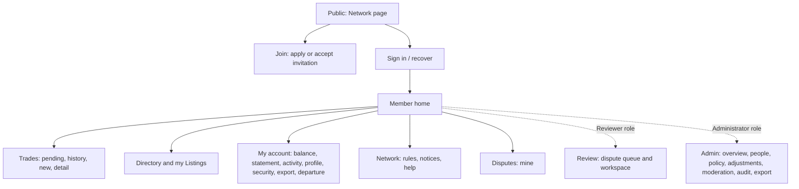

# 08 — UX and Accessibility

| Field | Value |
|---|---|
| Status | Draft |
| Owner role | Product design lead (with accessibility lead as co-owner) |
| Last updated | 2026-10-21 |
| Scope | Information architecture and navigation per role; MVP core screens (purpose, content, actions, states, per-screen requirements); the rendering rules that make balance, direction and meaning unmistakable; confirm-before-commit for Trades; responsive, keyboard, focus and screen-reader behaviour; validation and error messaging tied to API error codes; WCAG 2.2 AA mapping (D-14); i18n/l10n readiness (D-13); content design for sensitive states; plain-language target; session and timeout UX; usability success measures. **Not** in scope: visual design (colour palette, typography, iconography), pixel layouts, or feature-level interaction specs. |
| Depends on | [00 — Conventions](00-conventions.md), [02 — Personas, roles and journeys](02-personas-roles-and-journeys.md), [03 — Domain model](03-domain-model-and-mutual-credit-rules.md), [04 — Functional requirements](04-functional-requirements.md), [07 — API contract](07-api-and-integration-contract.md), [15 — Lifecycle state machines](15-lifecycle-state-machines.md) |
| Open questions | Section 16 (UX-OD-1 to UX-OD-12); registration of the corresponding decisions in [13 — Assumptions, risks, decisions](13-assumptions-risks-decisions-roadmap.md) |

## 1. Purpose and scope

Circula holds a community's books. The interface is where members form beliefs about what they owe and are owed, so its first duty is **never to let a member misread the direction, size or meaning of a balance or a Trade**. This document turns that duty, plus the accessibility target of WCAG 2.2 Level AA (D-14), into testable requirements for the first-party web client.

The client is an ordinary consumer of the API ([07](07-api-and-integration-contract.md), API-001 onward): it adds no ledger rule of its own, and any validation it performs is advisory (the server is authoritative; INV-005, INV-006, INV-009, INV-012). This document therefore specifies *presentation and interaction obligations*, and cites the owning functional requirement ([04](04-functional-requirements.md)) rather than redefining behaviour.

What this document deliberately does not do: it gives no wireframes, visual styling or step-by-step interaction design for individual features. Screens are described by purpose, content, actions and states so that design and engineering can proceed in parallel; the requirements below are the acceptance bar for whatever design emerges.

Priorities follow [00 §2](00-conventions.md): **P0** MVP launch-blocking, **P1** MVP but may slip one release with a recorded decision, **P2** designed-for, post-MVP.

## 2. Definitions used here

Terms are as in the canon ([00 §5.1](00-conventions.md), [14 — Glossary](14-glossary.md)): Network, Member, Credit unit, Trade, Provider, Recipient, Proposer, Counterparty, Adjustment, Reversal, Dispute, Audit Event, Network Administrator, Dispute Reviewer, Platform Operator. Additional terms used only in this document:

| Term | Meaning |
|---|---|
| **Direction word** | The visible text that states which way value moved for the viewer: *Earned*, *Spent*, *Added*, *Deducted* (section 6.4). |
| **Balance panel** | The standard component showing balance, state label, available-to-spend, credit limit and (if set) cap headroom (section 6.2). |
| **Review step** | The mandatory screen between entering a Trade and submitting it, or between viewing and accepting a proposal (section 6.6). |
| **Acting capacity** | The single role (Member, Dispute Reviewer, Network Administrator) under which the user is currently acting (PER-004 in [02](02-personas-roles-and-journeys.md)). |
| **Status message** | A message that reports the result of an action or a change without taking focus (WCAG 2.2 SC 4.1.3). |
| **CSS px** | The reference pixel used by WCAG for size and reflow measures. |
| **Copy catalogue** | The single externalised set of user-visible strings (section 11). |

## 3. Design principles (binding as requirements)

| ID | Pri | Requirement | Rationale | Verification |
|---|---|---|---|---|
| UX-001 | P0 | Every screen that shows an amount **MUST** show the Network's credit unit with it (symbol or name per `unit_symbol`/`unit_name`) and **MUST NOT** use a currency symbol, currency code, or money imagery for credit amounts. | INV-014: credits are not money; prevents misreading. | Copy and visual audit across all screens; automated scan of the copy catalogue for currency symbols and ISO-4217 codes adjacent to amounts |
| UX-002 | P0 | Every screen **MUST** show, in a persistent header region, the name of the Network the user is acting in and, where the user holds Memberships in more than one Network, a control to switch Network. | Two Memberships are two accounts (INV-011, FR-MEM-004); confusing them is a ledger-affecting error. | Test: user with two Memberships; every route displays the Network name; switching changes all balances and lists and leaves no data from the other Network visible |
| UX-003 | P0 | The client **MUST NOT** display a Trade, balance or history entry as completed, or update a displayed balance, until the server has confirmed the operation; the client **MUST NOT** use optimistic updates for ledger-affecting operations. | The ledger is the only authority (INV-008). | Test with delayed and failing server responses: UI shows "in progress" then server truth |
| UX-004 | P0 | A negative balance **MUST NOT** be styled or worded as an error, warning or failure state while it is within `credit_limit`; warning treatment is reserved for blocked actions (over-limit, over-cap) and for items needing the user's action. | In mutual credit a negative balance is a normal obligation to provide, not a fault; alarm discourages participation. | Design review plus copy review against section 6.3 |
| UX-005 | P0 | Client-side validation **MUST** be advisory only: every rule the client checks is re-enforced by the API, and the client **MUST** display the server's outcome when the two disagree. | API-enforced invariants; policy can change between page load and submit (FR-TRD-003). | Test: bypass client checks via direct call; server error is rendered through the section 9 patterns |
| UX-006 | P1 | The client **SHOULD** offer a help entry point on every screen, in the same relative location, that explains the credit unit, balance terms and how to reach the Network's administrators. | Consistent help (SC 3.2.6); reduces support load. | Inspection of all screens |

## 4. Information architecture

### 4.1 Site map

The structure is per Network; the top level is the Network context (UX-002). Role-specific areas appear only for users holding the role in that Network (enforcement is server-side: PER-002); the client **MUST NOT** rely on hiding to enforce access.

Textual form: Visitors reach the public Network page, join and sign-in screens. Authenticated members land on Home and reach Trades, Directory/Listings, My account, Network information, and their own Disputes. Reviewers additionally reach the Review area; Administrators additionally reach the Admin area. Operators use a separate platform console, outside this document ([11](11-deployment-operations-and-support.md) and [09](09-security-privacy-and-abuse.md)).

### 4.2 Navigation per role

| Role | Primary navigation items (in order) | Notes |
|---|---|---|
| Visitor | Network information; Join; Sign in; Public Listings (if `directory_visibility = public_listings`); Help | No balance or member data is shown. |
| Applicant | Application status; Network information; Help; Sign out | Cannot reach Trades or Directory (PER-011, PER-019). |
| Member | Home; Trades; Directory; My Listings; My account; Network (rules, notices); Help | "New trade" is a persistent primary action on Home and Trades. |
| Dispute Reviewer (in addition) | Review (queue, my cases) | Review is a separate area with its own acting-capacity banner (UX-009). |
| Network Administrator (in addition) | Admin (Overview; People; Policy; Adjustments and Reversals; Moderation; Audit; Network export; Announcements) | Admin is a separate area with its own banner (UX-009). |

| ID | Pri | Requirement | Rationale | Verification |
|---|---|---|---|---|
| UX-007 | P0 | Primary navigation **MUST** contain at most seven top-level items per role, use identical labels and order on every screen, and be reachable as a landmark (`nav`) with an accessible name. | Learnability; SC 3.2.3, 2.4.1. | Inspection; automated landmark check |
| UX-008 | P0 | Every screen **MUST** have a unique, descriptive page title of the form "Screen name – Network name", a single level-one heading matching the screen name, and a logical heading hierarchy without skipped levels. | SC 2.4.2, 2.4.6, 1.3.1; orientation across Networks. | Automated title/heading check on every route |
| UX-009 | P0 | When a user holds more than one role in a Network, the Review and Admin areas **MUST** show a persistent text banner "Acting as: Dispute Reviewer" or "Acting as: Network Administrator", and Member screens **MUST NOT** expose admin-only controls inline. | Single acting capacity (PER-004); separation of duties. | Test with a user holding all three roles: banner present in Review/Admin only; no admin control inside Member screens |
| UX-010 | P0 | Every Trade, Listing, Dispute and notification **MUST** have a stable deep-link URL that survives sign-in (after sign-in the user returns to it), except that a return to a state-changing action **MUST** land on the review step, not execute it. | Email links (FR-NTF-001) must work; prevents accidental commits. | Test: open a link from a notification while signed out |
| UX-011 | P0 | An object the user may not see **MUST** render as the same "We can't find this page" screen as a non-existent object, with no hint of existence. | API-006 no existence leakage. | Test: unauthorised vs missing id produce identical visible content |
| UX-012 | P1 | Screens deeper than two levels (for example Dispute detail, Listing edit) **SHOULD** show a breadcrumb or an explicit "Back to …" link. | Orientation; keyboard efficiency. | Inspection |

## 5. MVP core screens

Screen IDs (SCR-nn) are local to this document. "State" columns are summarised in 5.3. Priorities are those of the underlying functional requirements ([04](04-functional-requirements.md)).

### 5.1 Screen catalogue

| Screen | Purpose | Key content | Primary actions | Pri |
|---|---|---|---|---|
| SCR-01 Network page (public) | Let a visitor judge whether to join (FR-NET-006) | Name, unit name/symbol, membership mode, description, credit-unit disclaimer (VIS-013), public Listings if enabled | Join, Sign in | P0 |
| SCR-02 Join | Apply, or accept an invitation, and verify email (FR-MEM-001 to 003) | Application fields set by the Network, rules text, acceptance of rules, disclaimer | Submit application; verify email | P0 |
| SCR-03 Sign in and recovery | Authenticate; recover access (FR-MEM-019) | Email, passkey/TOTP options, "I can't sign in", Network chooser if several | Sign in; start recovery | P0 |
| SCR-04 Home | At-a-glance position and what needs attention | Balance panel; "Waiting for you" proposals; "Waiting for others"; last five history rows; notices | New trade; open a proposal | P0 |
| SCR-05 Account and history | Full statement (FR-BAL-001, 004 to 006) | Balance panel; filterable history table with direction words and running balance; export | Filter, search, open entry, download statement (P1) | P0 |
| SCR-06 Trades | List own Trades by state (FR-TRD-017) | Two lists: pending and past; filters | Open Trade; New trade | P0 |
| SCR-07 Trade detail | Everything about one Trade | Parties and roles, amount, description, state history, expiry, linked Disputes/Reversals/Adjustments | Accept, Decline, Cancel, Raise Dispute, Agree Reversal | P0 |
| SCR-08 New trade (with review step) | Propose a Trade (FR-TRD-001 to 004) | Direction choice, counterparty, amount, description, optional Listing; review statement | Review; Send proposal | P0 |
| SCR-09 Respond to proposal | Accept or decline (FR-TRD-006 to 010) | As SCR-07 plus review statement with exact resulting balance | Accept and record; Decline with reason | P0 |
| SCR-10 Directory | Find Offers and Requests (FR-LST-005) | Search, category filter, result list, owner display name | Open Listing; Start trade | P0 |
| SCR-11 Listing and member profile | Read a Listing or profile (FR-LST-015) | Listing text, owner's chosen profile fields | Contact; Start trade; Report | P0 |
| SCR-12 My Listings | Manage own Listings (FR-LST-001 to 003) | Listings by state with counts; editor with field counters | Create, publish, pause, archive | P0 |
| SCR-13 Profile and security | Profile, contact preferences, sign-in methods, sessions (FR-MEM-018) | Editable profile, visibility choices, authentication methods, active sessions | Edit; add passkey; end session | P0 |
| SCR-14 Notifications | In-product list (FR-NTF-006) | Read/unread items with deep links | Open; mark read | P1 |
| SCR-15 Dispute (raise and detail) | Raise and follow a Dispute (FR-DSP-001 to 005, 015) | Trade summary, reason category, statements, evidence, timeline, status, outcome | Raise; add statement; withdraw | P0 |
| SCR-16 Network rules and notices | Know the rules and upcoming changes (FR-ADM-004, 005, 014) | Rules text, policy values in plain words, pending changes with effective dates, announcements | Read; acknowledge (if required) | P0 |
| SCR-17 Activity about my account | See Audit Events that concern the Member (FR-AUD-004) | Adjustments, limit changes, suspension, role changes with reasons and times | Open linked entry | P0 |
| SCR-18 Departure | Leave in an orderly way (FR-MEM-012, 013) | Settlement summary in plain words per `departure_settlement_mode`, remaining steps | Start departure; confirm | P0 |
| SCR-19 My data export | Request and download own export (FR-EXP-001, 002) | Scope, format, status, expiry | Request; download | P0 |
| SCR-20 Application status | Applicant sees status (FR-MEM-009) | State, decision reason if rejected | Withdraw | P0 |
| SCR-21 Review queue | Reviewer picks up cases (FR-DSP-006) | Unassigned/assigned Disputes without conflict, age, SLA marker | Take assignment; declare conflict | P0 |
| SCR-22 Review workspace | Decide a Dispute (FR-DSP-008, 012) | Trade facts, parties' statements and evidence, timeline | Resolve with reasons; escalate | P0 |
| SCR-23 Admin overview | Network health (FR-BAL-008, FR-NET-007) | Aggregates, zero-sum check and last-reconciled time, over-limit/over-cap accounts, pending approvals, SLA flags | Open item | P0 |
| SCR-24 Applications and invitations | Admission (FR-MEM-005, 007) | Applications with answers; invitations with status | Approve, reject with reason; invite, revoke | P0 |
| SCR-25 People | Administer Members (FR-MEM-010, FR-ADM-006, 011, 016) | Member list with state, join date, roles; per-member limit | Suspend, reinstate, set `credit_limit`, assign roles | P0 |
| SCR-26 Policy | Edit rules (FR-ADM-001 to 005) | Parameters with bounds, current and proposed values, notice period, pending approvals | Propose change; approve | P0 |
| SCR-27 Adjustments and Reversals | Correct the ledger (FR-ADM-007 to 009) | Target, direction in words, amount, reason, resulting balance, approvals | Post; approve; reject | P0 |
| SCR-28 Moderation | Reports and appeals (FR-ADM-013) | Report queue, Listing under review, appeal | Remove, restore, dismiss | P0 |
| SCR-29 Audit | Browse Audit Events (FR-AUD-003) | Filterable event list | Filter; open event | P0 |
| SCR-30 Network export | Export Network data (FR-EXP-003) | Scope, personal-field minimisation notice, status | Request (Q); download | P0 |
| SCR-31 Network setup | First-administrator wizard (FR-NET-003 to 005, JRN-009) | Required parameters, unit warning, readiness checklist | Save; open Network | P0 |
| SCR-32 Announcements | Post notices (FR-ADM-014) | Draft, audience, preview | Publish | P1 |

The Platform Operator console is out of scope here.

### 5.2 Role-by-screen matrix

● = primary use; ○ = limited or read-only (see note); — = no access. Roles per [02 §4](02-personas-roles-and-journeys.md). Rev and Adm columns show access *in addition to* Member access; a Reviewer or Administrator holds Member screens as the Member column shows.

| Screen | Vis | App | Mem | Rev (extra) | Adm (extra) | Note |
|---|---|---|---|---|---|---|
| SCR-01 Network page | ● | ● | ● | | | Disclaimer always shown |
| SCR-02 Join | ● | — | — | | | |
| SCR-03 Sign in/recovery | ● | ● | ● | | | |
| SCR-04 Home | — | — | ● | | | |
| SCR-05 Account and history | — | — | ● | | | Own account only |
| SCR-06 Trades | — | — | ● | | | Own Trades only (PER-026, PER-028) |
| SCR-07 Trade detail | — | — | ● | ○ | | Reviewer: only for Trades under an assigned Dispute (PER-005) |
| SCR-08 New trade | — | — | ● | | | Disabled with explanation when `suspended` or `departing`-restricted |
| SCR-09 Respond | — | — | ● | | | Counterparty only; no admin variant exists |
| SCR-10 Directory | ○ | — | ● | | | Visitor only if `public_listings` |
| SCR-11 Listing/profile | ○ | — | ● | | ○ | Admin sees extra administrative fields (PER-017) |
| SCR-12 My Listings | — | — | ● | | | |
| SCR-13 Profile/security | — | ○ | ● | | | Applicant: application fields only |
| SCR-14 Notifications | — | ○ | ● | | | |
| SCR-15 Dispute | — | — | ● | | | Party view |
| SCR-16 Rules and notices | ○ | ○ | ● | | | Visitor: public parts |
| SCR-17 Activity about me | — | — | ● | | | |
| SCR-18 Departure | — | ○ | ● | | | Applicant uses withdrawal (SCR-20) |
| SCR-19 My export | — | ○ | ● | | | Applicant: application data only (PER-032) |
| SCR-20 Application status | — | ● | — | | | |
| SCR-21 Review queue | — | — | — | ● | ○ | Admin: queue metadata and escalated cases (PER-037) |
| SCR-22 Review workspace | — | — | — | ● | — | Not for Parties or conflicted reviewers |
| SCR-23 Admin overview | — | — | — | | ● | Per-member figures only within `balance_visibility` |
| SCR-24 to SCR-30, SCR-32 | — | — | — | | ● | Q actions need step-up and quorum |
| SCR-31 Network setup | — | — | — | | ● | First administrator only |

### 5.3 States every screen must handle

| State | Requirement summary |
|---|---|
| Loading | Visible text "Loading …" (not only a spinner) after 400 ms; skeletons are `aria-hidden` and the region carries `aria-busy`; after 10 s show "This is taking longer than usual" with a retry. |
| Empty | Say what is empty, why, and the one next action; never a blank region. |
| Error (load) | Section 9 patterns; keep navigation usable; offer retry. |
| Partial / stale | If a refresh fails, keep the last data, label it "as of {time}", and say the data may be out of date. |
| Forbidden / not found | UX-011. |
| Suspended / read-only Network | Banner explaining what is disabled and why (section 12); disabled controls remain focusable or are replaced by text, never silently absent. |

### 5.4 Per-screen requirements

| ID | Pri | Requirement | Rationale | Verification |
|---|---|---|---|---|
| UX-013 | P0 | Every screen in 5.1 **MUST** implement the loading, empty, error and forbidden states of 5.3 using shared components. | Consistency; covers the happy-path-only failure mode. | Per-screen state test suite (force each state via mock) |
| UX-014 | P0 | The empty states **MUST** use at least these texts (wording per copy catalogue): SCR-04 pending: "Nothing is waiting for you."; SCR-05/06: "No trades yet. When you give or receive something, record it as a trade." with a New trade action; SCR-10: "No listings match. Try fewer words, or post a request of your own."; SCR-21: "No cases are waiting." | Teach the next step. | Inspection against catalogue |
| UX-015 | P0 | Home (SCR-04) **MUST** show the Balance panel (6.2) above the fold at 320 CSS px width without scrolling, and **MUST** list proposals awaiting the user before proposals awaiting others. | Core awareness (FR-BAL-001); action first. | Viewport test at 320 x 568 CSS px |
| UX-016 | P0 | Each pending proposal row **MUST** state who must act ("Waiting for you" or "Waiting for {Name}"), the amount with unit, the effect in words (6.5), and the exact expiry date-time with time zone. | Prevents silent expiry (FR-TRD-012). | Inspection; screen-reader walkthrough |
| UX-017 | P0 | Trade detail (SCR-07) **MUST** show the full state history with timestamps and, for each linked Dispute, Reversal or Adjustment, a link and its state. | FR-TRD-017; no hidden mutation (FR-BAL-006). | Seeded-data test |
| UX-018 | P0 | A control that is unavailable because of the user's state (suspended, over-limit, Network paused) **MUST** be shown with a text reason adjacent to it; it **MUST NOT** merely disappear. | FR-BAL-009, FR-MEM-011; users must understand why. | Test per state |
| UX-019 | P0 | SCR-26 and SCR-27 **MUST** display, before submit, the pending-approval status under `admin_quorum` ("Waiting for 1 more administrator") and state in words when a result is queued (`approval_pending`) rather than posted. | PER-008; avoids assuming a change took effect. | Test with `admin_quorum = 2` |
| UX-020 | P0 | The client **MUST NOT** provide any screen, button or shortcut that creates, accepts, declines or cancels a Trade for another Member. | INV-012, FR-ADM-010. | Inspection of all admin screens and routes |
| UX-021 | P1 | SCR-14 **SHOULD** show an unread count in navigation as text (not colour only) and announce changes politely. | FR-NTF-006; SC 4.1.3. | Screen-reader test |

## 6. Balance, direction and meaning

### 6.1 Principles

The same facts are always stated three ways: **words** (state label and sentence), **sign and number**, and **placement** (which column or section). No single channel, in particular colour, carries the meaning alone.

### 6.2 The Balance panel

One shared component renders the following on Home, Account and Trade review. Examples assume `unit_name = hours`, `unit_scale = 2`, `credit_limit = 50.00`.

| Element | Content rule | Example (balance −30.00) | Example (balance +12.00) |
|---|---|---|---|
| Balance | Signed number with unit; "+" for positive, U+2212 "−" for negative, no sign at zero; full `unit_scale` decimals always | −30.00 hours | +12.00 hours |
| State label | One short label immediately above or beside the balance | You owe the network | You are owed by the network |
| Meaning sentence (FR-BAL-002) | Plain statement of the net position; never describes money or debt in national currency | You have received 30.00 hours more than you have provided. | You have provided 12.00 hours more than you have received. |
| Available to spend | Label "You can spend up to"; value from `available_to_spend`, never below 0 | You can spend up to 20.00 hours | You can spend up to 62.00 hours |
| Credit limit | Unsigned magnitude with explanation | Credit limit: 50.00 hours. Your balance can go as low as −50.00 hours. | same |
| Cap headroom (if `max_balance` set) | Unsigned headroom with explanation; value from the API field `max_balance_headroom` (null when no cap; the `headroom` problem detail on `max_balance_exceeded` carries the same quantity), never computed client-side; see [07](07-api-and-integration-contract.md) | You can receive up to 90.00 hours more before reaching this network's cap. | same, own value |
| Pending (FR-BAL-001) | Count and total, labelled informational | 2 proposals pending (35.00 hours). They don't reserve credit or change your balance. | same |
| Unit note | One-line link "What are {unit_name}?" opening the plain-language unit explanation (6.7) | | |
| Freshness | "As of {local time}" | | |

At balance zero the state label is "Even" and the sentence "You have provided and received the same amount."

| ID | Pri | Requirement | Rationale | Verification |
|---|---|---|---|---|
| UX-022 | P0 | The Balance panel **MUST** render every element in the table above that applies, using only values returned by the API (`balance`, `credit_limit`, `available_to_spend`, `max_balance`, `max_balance_headroom`; `available_to_spend` is exactly the field defined in [07](07-api-and-integration-contract.md) and reduces only on posting, never on a pending proposal, D-05) and **MUST NOT** recompute them in the client. | Single source of truth (INV-008). | Contract test: rendered text equals golden strings for seeded values, including zero, negative within limit, exactly at limit, over limit, and with cap |
| UX-023 | P0 | The state label and the meaning sentence **MUST** both be present as text adjacent to the balance figure, and the figure **MUST** carry an explicit sign character as defined above. | Direction unmistakable without colour (SC 1.4.1). | Greyscale and screen-reader walkthrough; automated text-presence test |
| UX-024 | P0 | Balances **MUST NOT** be rendered with parentheses for negatives, with abbreviations such as "CR" or "DR", or with a currency symbol; positive and negative amounts **MUST NOT** differ only by colour, weight or icon. | Ambiguity across accounting conventions. | Copy lint; visual audit |
| UX-025 | P0 | "Available to spend" **MUST** be rendered as zero with an explanation, not as a negative figure, when the balance is at or beyond the floor, and the explanation **MUST** state that receiving credit is still possible (FR-BAL-009). | Understand why a Trade is blocked. | Test: balance equal to, and below, the floor |
| UX-026 | P0 | Pending amounts **MUST NOT** be added to, subtracted from, or visually grouped with the balance or "available to spend", and the text "doesn't change your balance" (or equivalent catalogue string) **MUST** appear wherever pending totals appear. | D-05 / FR-TRD-005: no holds. | Inspection; golden-string test |
| UX-027 | P0 | When the displayed balance cannot be confirmed (FR-BAL-003) the panel **MUST** show "Your balance is temporarily unavailable" and **MUST NOT** show a number. | Never show a guessed figure. | Fault-injection test |
| UX-028 | P0 | If `balance_visibility` allows the viewer to see another Member's balance, it **MUST** use the same Balance panel semantics with the label "{Name}'s balance"; if not allowed, no placeholder suggesting a hidden figure (for example "••••") **MUST** be shown. | Privacy (FR-BAL-007); avoids probing. | Test per setting |
| UX-029 | P0 | Copy for balance and Trade surfaces **MUST** pass the copy lint list (the authoritative banned and discouraged terms are in [14 section 4](14-glossary.md); this list is a subset and must not contradict it): no occurrence of "pay", "payment", "cash", "currency", "money", "deposit", "withdraw", "wallet", "funds", "interest", "loan", "debt", "owe you money", "price" (except in the explicit statement that credits are not money), in any catalogue string for the member and admin UI. | VIS-012, VIS-013, INV-014. | Automated catalogue lint in CI plus legal-copy review ([19](19-legal-and-regulatory-open-questions.md)) |

### 6.3 Negative balances and limits

A negative balance within the limit is shown with a neutral treatment and the state label "You owe the network" (a recorded exception candidate: the glossary bans "owe"; fallback "Your balance is below zero"; held until counsel review under UX-OD-12 and [LEG-Q-38](19-legal-and-regulatory-open-questions.md)) followed by the meaning sentence. "Owe" means an obligation to provide goods or services to the community, and the label is always accompanied by the sentence. When the account is at or beyond the floor (including after a lowered limit, FR-BAL-009), a persistent notice states: what is blocked ("You can't spend right now"), why ("Your balance is at your credit limit"), what still works ("You can still receive credit and earn by providing something"), and how to change it ("Provide something to another member, or ask the network's administrators about your limit"). Over-cap mirrors it.

### 6.4 Direction words in history

Every history row (SCR-05, Home recent, statement view) **MUST** carry exactly one direction word, as text in its own cell or labelled field, from this closed set:

| Entry type | Viewer is credited (+) | Viewer is debited (−) |
|---|---|---|
| Trade (Provider/Recipient) | **Earned** | **Spent** |
| Reversal of a Trade | Added back (reversal) | Taken back (reversal) |
| Adjustment | Added (network adjustment) | Deducted (network adjustment) |
| Opening balance | Added (opening balance) | Deducted (opening balance) |
| Departure settlement | Added (settlement) | Deducted (settlement) |

History row fields: date and time (localised), description, counterparty name or "Network adjustment", type tag, direction word, signed amount with unit, running balance, state (for Trade entries, the Trade state in words), reason (for Reversals and Adjustments, FR-BAL-006). Reasons of Adjustments are shown to the affected Member as recorded.

| ID | Pri | Requirement | Rationale | Verification |
|---|---|---|---|---|
| UX-030 | P0 | Every history row **MUST** include its direction word from the table above as text, the signed amount with unit, and the running balance after the entry; the running balance of the newest row **MUST** equal the displayed current balance. | FR-BAL-004; honest statement. | Seeded-data test with each entry type; reconciliation assertion |
| UX-031 | P0 | Reversal and Adjustment rows **MUST** be labelled as such with their reason and a link to the original Trade or Dispute, and **MUST NOT** be visually merged with or hidden inside the original Trade row. | FR-BAL-006; INV-004. | Seeded-data test |
| UX-032 | P0 | The history table **MUST** present pending (`proposed`) items only in the separate pending list, never inline among completed rows; `declined`, `cancelled` and `expired` Trades appear in the Trades list with state text and the words "No effect on your balance". | FR-BAL-010; avoids implying money moved. | Test; screen-reader output states status per row |
| UX-033 | P0 | When a filter or search is active, the running-balance column **MUST** still show the account's true running balance for each shown row (not a sum of the filtered subset), and the page **MUST** state "Showing {n} of {total} entries". | FR-BAL-005; avoids a false total. | Test with filter on counterparty |
| UX-034 | P0 | Trade state names shown to users **MUST** map one-to-one to the canon states with these plain labels: `proposed` "Waiting for {Name}" or "Waiting for you", `completed` "Completed", `declined` "Declined", `cancelled` "Cancelled", `expired` "Expired", `reversed` "Reversed". The client **MUST NOT** show a "disputed" or "accepted" state; linked Disputes are shown as a separate marker ("Dispute open"). | Canon 5.3. | Mapping unit test; copy audit |

### 6.5 Plain-language effect statements

For each Trade the client generates, from structured data, a sentence naming the viewer's own effect. Patterns (angle brackets are variables):

| Viewer, state | Pattern |
|---|---|
| Provider, proposed | "If <Name> accepts, you will earn +<amount> <unit>. Nothing changes until then." |
| Recipient, proposed | "If <Name> accepts, you will spend −<amount> <unit>. Nothing changes until then." |
| Provider, completed | "You earned +<amount> <unit> from <Name> on <date>." |
| Recipient, completed | "You spent −<amount> <unit> with <Name> on <date>." |
| Declined, cancelled, expired | "This trade didn't go ahead. Your balance wasn't affected." |
| Reversed | "This trade was reversed on <date>. The original amount was returned." |

| ID | Pri | Requirement | Rationale | Verification |
|---|---|---|---|---|
| UX-035 | P0 | Effect statements **MUST** be generated from the Trade's structured fields (roles, amount, state) by a single shared function, not hand-written per screen, and an automated wording test **MUST** cover both `initiated_by` modes and every Trade state. | FR-TRD-004; one mistake here is a ledger misunderstanding. | Wording test matrix: 2 modes x 6 states x 2 viewers |
| UX-036 | P0 | The statement "Credits are not money" (6.7 text) **MUST** be reachable in one action from every screen showing an amount, and **MUST** appear in full on SCR-01, SCR-02 (with required acknowledgement), first sign-in, and help. | VIS-013; honesty. | Inspection; first-sign-in test |

### 6.6 Confirm-before-commit

The Trade flow has three steps, each a distinct state with its own heading: **Enter** → **Review** → **Result**.

**Review step (proposer, SCR-08).** Shows in this order: a heading "Review your trade"; the sentence naming the direction ("You provided <description> to <Name>" or "You received <description> from <Name>"); the two parties by display name with roles (Provider will be credited, Recipient will be charged); the amount with unit; the viewer's resulting balance *if accepted* and the viewer's available-to-spend after; the proposal expiry date-time; the line "Nothing changes in your balance until <Name> accepts"; buttons "Send proposal" and "Edit". The other party's resulting balance is **not** shown unless `balance_visibility` permits.

**Review step (counterparty, SCR-09).** Same structure with the exact result: "If you accept, your balance changes from −30.00 hours to −42.50 hours. <Name>'s balance changes to <X>" (only if visible). Buttons "Accept and record trade" and "Decline". This is the commit point: acceptance posts immediately and atomically (FR-TRD-007).

**Result.** For propose: "Proposal sent to <Name>. Nothing has changed in your balance yet." For accept: "Trade completed. Your balance is now <balance>." Both are status messages (6.8) with a link to the Trade.

| ID | Pri | Requirement | Rationale | Verification |
|---|---|---|---|---|
| UX-037 | P0 | The client **MUST NOT** allow a Trade to be proposed or accepted without a Review step displaying: both parties by name with their roles, direction in words, the amount with unit, description, and the viewer's resulting balance and available-to-spend; and **MUST** require an explicit activation of a button whose label names the action. | SC 3.3.4; FR-TRD-004; error prevention for ledger-affecting actions. | Test: no path (including keyboard Enter in a field) submits without the review; label audit |
| UX-038 | P0 | The Review step **MUST** show the resulting balance computed from the server's values at review time and **MUST** be refreshed if the user waits long enough for data to be stale (recommended: 60 s) or the server reports `stale_version`; the refreshed view **MUST** require a new confirmation. | Avoids confirming against stale data (FR-TRD-014). | Test with delayed confirm and concurrent change |
| UX-039 | P0 | Returning to Edit from Review **MUST** preserve all entered values (no re-entry) and focus **MUST** return to the first field. | SC 3.3.7; efficiency. | Test |
| UX-040 | P0 | After activation of the commit button the client **MUST** disable repeat activation, mark the region `aria-busy`, send one idempotency key per attempt that is reused on retry, and **MUST NOT** generate a new key for the same Review. | INV-009; FR-TRD-015. | Test: double-click; network drop after submit; retry yields one Trade |
| UX-041 | P0 | If the outcome is unknown (timeout or 5xx on a posting operation, API-067), the client **MUST** say "We couldn't confirm whether this went through. Check your history before trying again", offer a "Retry safely" action that reuses the key, and link to the history. | Prevents duplicate or lost postings (INV-009). | Fault-injection test (crash after commit, before response) |
| UX-042 | P0 | The counterparty chooser **MUST** be keyboard- and screen-reader-operable, **MUST NOT** require typing the exact name, and **MUST** show enough visible disambiguation (display name plus whatever distinguishing field the member has chosen to share) that two members with similar names can be told apart; the chosen counterparty **MUST** be repeated in the Review step. | Wrong-counterparty errors are the most likely Trade mistake. | Test with duplicate display names |
| UX-043 | P0 | The direction selection **MUST** be offered as a labelled radio group in plain words ("I provided something to {Name}" / "I received something from {Name}") and **MUST** drive the effect sentence live; internal terms (`initiated_by`, Provider, Recipient) **MUST NOT** be the only labels. | Plain language; FR-TRD-001. | Inspection; usability test (section 15) |
| UX-044 | P0 | The amount field **MUST** be a text input with a decimal input hint (not a numeric spinner), a persistent visible unit label beside it (not a placeholder), and a parse echo ("This is 1.50 hours") once valid; it **MUST** reject, not round, input with more decimals than `unit_scale` (FR-TRD-002). | Exactness; prevents mouse-wheel and locale errors. | Test with scale 0, 2, 4 and locale separators |
| UX-045 | P1 | Administrator Adjustments and Reversals (SCR-27) **MUST** use the same three-step pattern, showing the target Member, direction in words ("deduct" / "add"), amount, resulting balance of the Member, reason, whether it exceeds limits, and "The Member will be notified". | FR-ADM-007, 008; INV-010, INV-012. | Test |

### 6.7 Credit-unit explanation (reference copy)

The following is the baseline text (proposed; final wording is a question for counsel, see [19](19-legal-and-regulatory-open-questions.md)). `{unit}` is the Network's unit name.

> **What are {unit}?** {unit} are this community's way of keeping track of what members give and receive. They are not money. They can't be exchanged for money, and nobody guarantees that another member will accept them. A negative balance means you have received more than you have provided. A positive balance means you have provided more than you have received.

### 6.8 Live announcements of change

Balance and status changes that happen without navigation (a proposal accepted while the page is open, a refresh) **MUST** be announced politely and **MUST NOT** take focus (section 8.4).

## 7. Responsive layout

| ID | Pri | Requirement | Rationale | Verification |
|---|---|---|---|---|
| UX-046 | P0 | All screens **MUST** reflow without horizontal scrolling and without loss of information or function at a viewport width of 320 CSS px (and equivalently 400% zoom at 1280 CSS px), except content that needs two-dimensional layout (none expected in MVP). | SC 1.4.10 Reflow. | Automated viewport test at 320 and 1280 px with 400% zoom emulation; manual check |
| UX-047 | P0 | The layout **MUST** adapt at content-driven breakpoints; the baseline classes are **compact** (< 600 CSS px, single column, navigation behind a labelled menu button), **medium** (600 to 1023 CSS px, single or two column) and **expanded** (≥ 1024 CSS px, persistent navigation). The class boundaries are defaults [DECISION NEEDED: UX-OD-1]. | Phone-first communities (VIS-017: web only). | Visual regression at each class |
| UX-048 | P0 | Tables (history, Trades, people, audit) **MUST** remain complete in compact width by reflowing each row into a labelled group (term/value pairs) that preserves the same reading order and every column's information; sorting and filtering controls **MUST** remain available. | Reflow without dropping the direction word, amount or running balance. | Test at 320 px: every column's content present per row; screen-reader reads labels |
| UX-049 | P0 | Pointer targets **MUST** be at least 24 x 24 CSS px (or have equivalent spacing) and primary action targets **SHOULD** be at least 44 x 44 CSS px. | SC 2.5.8; touch use. | Automated target-size check; manual audit |
| UX-050 | P0 | The layout **MUST** support text resizing to 200% and user text-spacing overrides (line height 1.5, paragraph spacing 2x, letter spacing 0.12 em, word spacing 0.16 em) without loss of content or function; the client **MUST NOT** lock orientation. | SC 1.4.4, 1.4.12, 1.3.4. | Manual and bookmarklet-based test |
| UX-051 | P0 | The primary action of a screen (for example "Send proposal") **MUST NOT** be obscured by sticky headers, cookie banners or on-screen keyboards when focused. | SC 2.4.11 Focus Not Obscured (Minimum). | Test: tab through each form with sticky elements active; with virtual keyboard emulation |
| UX-052 | P1 | The client **SHOULD** respect `prefers-reduced-motion` and `prefers-color-scheme` and **MUST NOT** convey state by animation alone; no content may flash more than three times per second. | Vestibular safety; SC 2.3.1. | Inspection |
| UX-053 | P1 | Supported browsers **SHOULD** be the current and previous major versions of evergreen desktop and mobile browsers [DECISION NEEDED: UX-OD-2]; unsupported browsers **MUST** receive a readable message rather than a broken page. | Realistic test matrix. | Browser matrix run |

## 8. Keyboard, focus and assistive-technology semantics

### 8.1 Keyboard and focus

| ID | Pri | Requirement | Rationale | Verification |
|---|---|---|---|---|
| UX-054 | P0 | Every function **MUST** be operable with a keyboard alone, with no keyboard trap, in a logical focus order that matches the visual and reading order; custom widgets **MUST** follow the corresponding WAI-ARIA Authoring Practices keyboard pattern. | SC 2.1.1, 2.1.2, 2.4.3. | Manual keyboard walkthrough of every journey; automated focus-order check |
| UX-055 | P0 | A visible focus indicator **MUST** be present on every focusable element with sufficient contrast (3:1 against adjacent colours) and **MUST NOT** be removed without replacement. | SC 2.4.7, 1.4.11. | Automated and manual |
| UX-056 | P0 | A "Skip to main content" link **MUST** be the first focusable element, and pages **MUST** expose `header`, `nav`, `main` and `footer` landmarks (with accessible names where more than one of a type exists). | SC 2.4.1, 1.3.1. | Automated landmark check |
| UX-057 | P0 | On client-side route change the client **MUST** move focus to the new level-one heading (or the main landmark), set the page title, and announce the change to assistive technology; on full page loads the browser's default is acceptable. | Avoids silent navigation in single-page behaviour. | Screen-reader test |
| UX-058 | P0 | Dialogs **MUST** be used sparingly (only for session warning, step-up and destructive confirmations that do not need a full page); they **MUST** move focus in on open, contain focus while modal, be dismissible with Escape except where an explicit choice is required, and return focus to the invoking control on close. | SC 2.4.3, 2.1.2. | Test |
| UX-059 | P0 | No character-key-only shortcuts **MUST** exist unless they can be turned off or remapped. | SC 2.1.4. | Inspection |
| UX-060 | P0 | No function **MUST** require dragging or path-based gestures; any list reordering **MUST** offer buttons. | SC 2.5.7, 2.5.1. | Inspection |

### 8.2 Tables and lists

| ID | Pri | Requirement | Rationale | Verification |
|---|---|---|---|---|
| UX-061 | P0 | Data tables **MUST** be native table structure with a caption (or `aria-labelledby` heading), column headers with `scope="col"`, and a row header cell identifying each row (date and description) where rows are individually meaningful; **MUST NOT** use tables for layout. | SC 1.3.1. | Automated structure check; screen-reader test |
| UX-062 | P0 | Sortable columns **MUST** present the header as a button, expose the current sort with `aria-sort`, and announce the result of sorting as a status message ("Sorted by date, newest first"). | SC 4.1.2, 4.1.3. | Test |
| UX-063 | P0 | The amount cell **MUST** contain the complete accessible text, for example "Spent −12.00 hours", such that a screen reader reading the cell alone conveys direction, sign, number and unit; abbreviated visual forms (symbols) **MUST** have the full text available programmatically. | Direction unmistakable for non-visual users. | Screen-reader test of each entry type |
| UX-064 | P0 | Pagination **MUST** be a `nav` with an accessible name, mark the current page (`aria-current="page"`), expose total count, and **MUST NOT** change content on focus; filter changes **MUST** announce the new result count as a status message. | FR-BAL-005; SC 3.2.2, 4.1.3. | Test |
| UX-065 | P0 | Icons **MUST** be decorative (`aria-hidden`) when adjacent to text that carries the same meaning, or carry a text alternative when they stand alone; amounts, directions and states **MUST NOT** be rendered as images. | SC 1.1.1, 1.4.5. | Automated and manual |

### 8.3 Colour and contrast

| ID | Pri | Requirement | Rationale | Verification |
|---|---|---|---|---|
| UX-066 | P0 | Text **MUST** have contrast of at least 4.5:1 (3:1 for large text), and UI component boundaries, state indicators and focus indicators at least 3:1, in every supported colour scheme. | SC 1.4.3, 1.4.11. | Automated contrast check in CI plus manual spot check |
| UX-067 | P0 | Colour **MUST NOT** be the only means of conveying direction, state, error, required status or link identity; links inside text **MUST** be distinguishable by more than colour. | SC 1.4.1. | Greyscale walkthrough |

### 8.4 Status messages and live regions

| ID | Pri | Requirement | Rationale | Verification |
|---|---|---|---|---|
| UX-068 | P0 | The page **MUST** contain a persistent polite live region (`role="status"`) present in the DOM before messages are inserted, used for: Trade proposed/completed/declined/cancelled, balance changed by a refresh, filter result counts, save confirmations, copy-to-clipboard confirmations. | SC 4.1.3. | Screen-reader test; automated presence check |
| UX-069 | P0 | Blocking errors that need immediate attention (failed submission, session expired, unknown outcome) **MUST** use an assertive alert (`role="alert"`) and, for form submissions, move focus to the error summary (section 9). Non-blocking messages **MUST NOT** move focus. | SC 4.1.3, 3.3.1. | Test |
| UX-070 | P0 | Status messages **MUST** stay in the DOM (or be otherwise perceivable) long enough to be read: toasts **MUST NOT** disappear in fewer than 8 seconds unless dismissed, and any information needed later (for example "Your balance is now …") **MUST** also appear persistently on the resulting page. | SC 2.2.1 spirit; cognitive load. | Inspection |
| UX-071 | P0 | Live-region content **MUST** be a complete sentence including direction, amount and unit (for example "Trade completed. Your balance is now −42.50 hours."), and the balance figure on the page **MUST** be updated in the same render. | Meaning without sight. | Screen-reader test |

## 9. Validation and error messages

### 9.1 Rules

1. Every error message states **what** is wrong, **why** (the rule in plain words) and **how to fix** it (a concrete action or value). Example: "The amount is too large. This network allows trades of up to 100.00 hours. Enter 100.00 or less."
2. Messages are built from the API's stable `code` and typed parameters (API-035, API-036), never parsed from `detail` text, and never expose internals (identifiers other than the user's reference, stack traces, SQL, internal state names, other members' balances beyond `balance_visibility`; API-037).
3. Unknown codes fall back to a message by HTTP status class with a "Reference: {request_id}" line for support.
4. Tone: no blame, no exclamation marks, no jargon.
5. Errors for fields are shown next to the field and in a summary; errors for the operation are shown in the summary and an alert.

| ID | Pri | Requirement | Rationale | Verification |
|---|---|---|---|---|
| UX-072 | P0 | On submit with invalid fields the client **MUST** show an error summary at the top of the form, move focus to it, list every error as a link to its field, and set `aria-invalid="true"` and `aria-describedby` on each invalid field pointing at its message. | SC 3.3.1, 3.3.3, 2.4.3. | Screen-reader and keyboard test |
| UX-073 | P0 | Errors **MUST** be identified in text (not only by colour or icon) and each message **MUST** include what, why and how to fix. | SC 3.3.1, 3.3.3, 1.4.1. | Catalogue review: every error string has the three parts; automated check for a "fix" clause |
| UX-074 | P0 | The client **MUST** map the `errors[].pointer` of a `validation_failed` response to form fields, showing every failing field at once, and **MUST** show unmapped pointers in the summary. | API-064. | Test with multi-field failure |
| UX-075 | P0 | Required fields **MUST** be marked in text ("required") not only by an asterisk; every input **MUST** have a visible, programmatically associated label; format hints **MUST** be visible before entry; inputs for known data **MUST** carry the correct `autocomplete` token. | SC 3.3.2, 1.3.1, 1.3.5. | Automated and manual |
| UX-076 | P0 | Inline validation **MUST** run on blur or submit, not on each keystroke, and **MUST NOT** show an error for a field the user is still completing; character counters (FR-LST-002) **MUST** be announced only when crossing defined thresholds (for example 80% and 100%). | Avoid noisy announcements. | Screen-reader test |
| UX-077 | P0 | Entered values **MUST** be preserved after any error, including a server error and a session expiry (except credentials and one-time codes). | SC 3.3.7. | Test |
| UX-078 | P0 | For `credit_limit_exceeded` when the viewer is the failing party, the message **MUST** state the viewer's available-to-spend and the shortfall (from the typed members) and offer "Use {available} instead" where the viewer is the Proposer or Counterparty able to act; when the failing party is the other Member, the message **MUST NOT** reveal their balance or limit (FR-TRD-008, FR-TRD-009). | Actionable without leaking. | Test under each `balance_visibility` |

### 9.2 Message patterns for key codes

Texts are baseline copy for the catalogue (English; variables in braces). Codes are from [07 §8.3](07-api-and-integration-contract.md).

| Code | Message pattern (what, why, fix) |
|---|---|
| `validation_failed` | "Some details need fixing. {n} fields have problems; each is listed below." |
| `amount_out_of_bounds` | "That amount isn't allowed. Trades here must be between {min} and {max} {unit}. Enter an amount in that range." |
| `unit_scale_mismatch` | "That amount has too many decimal places. This network uses {places}. Remove the extra digits." (or "Please reload; the network's settings changed.") |
| `credit_limit_exceeded` (self) | "You can't spend this much. You can spend up to {available} {unit} and this trade needs {amount}. Lower the amount by {shortfall}, or provide something first." |
| `credit_limit_exceeded` (other) | "This trade can't go through because of a limit on {Name}'s account. Ask them to check with the network's administrators, or propose a smaller amount." |
| `max_balance_exceeded` (self) | "You can't receive this much. This network caps balances at {max_balance} {unit}; you can receive {headroom} more. Propose a smaller amount." |
| `proposal_expired` | "This proposal expired on {expires_at}. Ask {Name} to send a new one." |
| `trade_not_proposed` | "This trade is already {current_state_label}, so it can't be changed. Open it to see what happened." |
| `stale_version` | "This was updated while you were looking at it. We've reloaded the latest version. Please review it again." |
| `counterparty_not_active` | "{Name} can't take part in trades right now. Choose someone else, or contact the network's administrators." |
| `membership_not_active` | "Your membership is {state_label}, so you can't do this. See what is affected and how to ask for a review." (links to section 12 screen) |
| `self_trade_not_allowed` | "You can't trade with yourself. Choose another member." |
| `open_proposal_quota_exceeded` | "You have {limit} proposals open, which is the most allowed. Wait for a reply or cancel one." |
| `dispute_window_closed` | "The time to raise a dispute ended on {window_ended_at}. You can still contact the network's administrators." |
| `trade_not_disputable` | "A dispute can't be raised on a trade that is {state_label}." |
| `duplicate_open_dispute` | "You already have an open dispute about this trade. Open it to add information." |
| `reason_required` | "A reason is required. Write why you're doing this; the affected member will see it." |
| `reauthentication_required` | "Please confirm it's you before continuing." (opens step-up, UX-103) |
| `approval_pending` (2xx) | "Submitted. {n} more administrator(s) must approve before this takes effect." |
| `session_expired` | See section 13. |
| `rate_limited` | "You're doing that too quickly. Wait {retry_after_seconds} seconds and try again." |
| `idempotency_in_progress` | "We're still processing your request. Please wait a moment; don't send it again." |
| `idempotency_conflict` | "This request was already used for different details. Review the details and submit again." |
| `service_unavailable` | "The service is briefly unavailable. Wait {retry_after_seconds} seconds and try again. Your details are kept." |
| `internal_error` | "Something went wrong on our side. Nothing was changed unless you were told otherwise. Try again, or contact support with reference {request_id}." (for posting operations see UX-041) |
| `not_found` / `forbidden` (hidden) | "We can't find this page." (UX-011) |
| `last_admin_required` | "You can't do this because the network needs at least one administrator. Assign another administrator first." |
| `consent_missing` | "Both people must agree to these terms. {Name} hasn't agreed yet." |
| `policy_notice_too_short` | "The change can't start that soon. Members need {policy_notice_days} days' notice. The earliest date is {earliest_effective_at}." |

| ID | Pri | Requirement | Rationale | Verification |
|---|---|---|---|---|
| UX-079 | P0 | Every code in the API error catalogue ([07 §8.3](07-api-and-integration-contract.md), API-070) that a first-party screen can trigger **MUST** have a catalogue entry with the three-part message; a CI check **MUST** fail when the API catalogue contains a code with no UX entry and no explicit "generic fallback" marker. | No raw or missing messages in production. | Automated diff of API catalogue against UX catalogue |
| UX-080 | P0 | Message text **MUST NOT** contain `request_id`, identifiers, internal field names or state names; the one exception is a labelled "Reference" line on unexpected errors (`internal_error`, unknown codes). | Avoid exposing internals; supportability. | Scan of rendered messages in negative tests |

## 10. WCAG 2.2 Level AA mapping

The target is WCAG 2.2 Level AA (D-14), for all member, applicant, reviewer and administrator screens. WCAG 2.2 adds nine criteria to 2.1 and removes SC 4.1.1 Parsing; the six new criteria at A/AA that matter here are 2.4.11, 2.5.7, 2.5.8, 3.2.6, 3.3.7 and 3.3.8 (see section 17 for sourcing). The table maps the criteria that carry the most weight for this product to where the spec applies them. Criteria not listed (for example 1.2.x time-based media) are not triggered because the MVP has no audio/video; if media is added, they apply.

| SC | Name (level) | How it applies to Circula | Spec reference |
|---|---|---|---|
| 1.1.1 | Non-text Content (A) | Icons, empty-state illustrations, any chart | UX-065 |
| 1.3.1 | Info and Relationships (A) | Tables, form labels, headings, landmarks | UX-056, UX-061, UX-075 |
| 1.3.2 | Meaningful Sequence (A) | Reflowed table rows keep reading order | UX-048 |
| 1.3.4 | Orientation (AA) | No orientation lock | UX-050 |
| 1.3.5 | Identify Input Purpose (AA) | `autocomplete` on name, email, one-time code | UX-075 |
| 1.4.1 | Use of Color (A) | Direction, states, errors never colour-only | UX-023, UX-067 |
| 1.4.3 | Contrast (Minimum) (AA) | All text | UX-066 |
| 1.4.4 | Resize Text (AA) | 200% | UX-050 |
| 1.4.5 | Images of Text (AA) | Amounts and states are real text | UX-065 |
| 1.4.10 | Reflow (AA) | 320 CSS px | UX-046, UX-048 |
| 1.4.11 | Non-text Contrast (AA) | Controls, focus ring, state badges | UX-055, UX-066 |
| 1.4.12 | Text Spacing (AA) | Override tolerance | UX-050 |
| 1.4.13 | Content on Hover or Focus (AA) | Tooltips for "What are credits?" are dismissible, hoverable, persistent | UX-036 (implementation: use a disclosure, not hover-only) |
| 2.1.1, 2.1.2 | Keyboard, No Keyboard Trap (A) | All flows | UX-054, UX-058 |
| 2.1.4 | Character Key Shortcuts (A) | None by default | UX-059 |
| 2.2.1 | Timing Adjustable (A) | Session timeout, proposal expiry display | Section 13 |
| 2.2.2 | Pause, Stop, Hide (A) | Auto-updating lists must be pausable or not auto-update focus | UX-070, UX-086 |
| 2.3.1 | Three Flashes (A) | No flashing | UX-052 |
| 2.4.1 | Bypass Blocks (A) | Skip link | UX-056 |
| 2.4.2 | Page Titled (A) | Unique titles | UX-008 |
| 2.4.3 | Focus Order (A) | Review/Result transitions | UX-054, UX-057 |
| 2.4.4 | Link Purpose (In Context) (A) | "Open trade with Sam", not "click here" | UX-016 |
| 2.4.6 | Headings and Labels (AA) | Descriptive | UX-008, UX-075 |
| 2.4.7 | Focus Visible (AA) | | UX-055 |
| **2.4.11** | Focus Not Obscured (Minimum) (AA, new in 2.2) | Sticky headers, on-screen keyboards, banners | UX-051 |
| 2.5.1 | Pointer Gestures (A) | No path gestures | UX-060 |
| 2.5.3 | Label in Name (A) | Visible button text is in the accessible name ("Send proposal") | UX-037 |
| **2.5.7** | Dragging Movements (AA, new) | No drag-only | UX-060 |
| **2.5.8** | Target Size (Minimum) (AA, new) | 24 x 24 CSS px | UX-049 |
| 3.1.1, 3.1.2 | Language of Page / of Parts (A, AA) | `lang` on page; on user content in other languages | UX-091 |
| 3.2.1, 3.2.2 | On Focus / On Input (A) | No context change on focus or filter input | UX-064 |
| 3.2.3, 3.2.4 | Consistent Navigation / Identification (AA) | Same order and labels | UX-007 |
| **3.2.6** | Consistent Help (A, new) | Help in the same relative place | UX-006 |
| 3.3.1 | Error Identification (A) | Text errors | UX-072, UX-073 |
| 3.3.2 | Labels or Instructions (A) | | UX-075 |
| 3.3.3 | Error Suggestion (AA) | "How to fix" | UX-073, UX-078 |
| 3.3.4 | Error Prevention (Legal, Financial, Data) (AA) | Trade posting is a financial-style commitment: review and confirm; reversible by Reversal flow | UX-037, UX-045 |
| **3.3.7** | Redundant Entry (A, new) | No re-typing between Review and Edit; recovery after expiry | UX-039, UX-077 |
| **3.3.8** | Accessible Authentication (Minimum) (AA, new) | Passkey/TOTP support, password manager and paste allowed, no puzzles or memory tests; email-code entry allows paste | UX-081 |
| 4.1.2 | Name, Role, Value (A) | Custom widgets | UX-054, UX-062 |
| 4.1.3 | Status Messages (AA) | Live regions | UX-068 to UX-071 |

SC 3.1.5 Reading Level is Level AAA and is not a conformance target; it is used as guidance for section 14. SC 2.4.12 Focus Not Obscured (Enhanced), 2.4.13 Focus Appearance and 3.3.9 Accessible Authentication (Enhanced) are AAA and not required; the design SHOULD NOT preclude them.

| ID | Pri | Requirement | Rationale | Verification |
|---|---|---|---|---|
| UX-081 | P0 | Sign-in, recovery and step-up screens **MUST NOT** require a cognitive function test: they **MUST** allow paste into every field, permit password-manager autofill, offer a passkey or authenticator option as a non-memory method, and **MUST NOT** use puzzles, transcription of obscured characters, or time-limited memory tests. One-time-code fields **MUST** accept a pasted code. | SC 3.3.8; D-07. | Manual test with password manager; automated attribute check |
| UX-082 | P0 | The product **MUST** conform to WCAG 2.2 Level AA for all screens in 5.1 before release; conformance claims **MUST** be backed by (a) automated checks in CI on every screen state, (b) a manual keyboard and screen-reader audit of the journeys JRN-001 to JRN-009 ([02](02-personas-roles-and-journeys.md)) on at least two screen-reader/browser pairs [DECISION NEEDED: UX-OD-3], and (c) an audit record stored with the release. | D-14; automated tools cover only part of the criteria. | Release checklist; audit report |
| UX-083 | P0 | A page that contains a known, accepted AA failure **MUST NOT** ship without an entry in the accessibility conformance record naming the criterion, the screen, the impact, a workaround and a fix date. | Honest reporting. | Review of conformance record |
| UX-084 | P1 | The deployment **SHOULD** publish an accessibility statement (conformance level, known limitations, contact route and response target) reachable from every screen footer. Whether a statement or conformance level is legally required in a given deployment is a question for counsel ([19](19-legal-and-regulatory-open-questions.md)); this document makes no claim of legal compliance. | Feedback route; regulatory mapping is not asserted here. | Inspection |
| UX-085 | P1 | Accessibility regression tests (an automated rule engine run on each screen state in CI) **SHOULD** fail the build on any new violation of rules tagged to WCAG 2.2 AA. | Prevents erosion; links to [12](12-quality-strategy-and-test-plan.md). | CI configuration inspection |
| UX-086 | P1 | Any region that updates automatically (pending list, balance refresh) **MUST** either update only on user action or announce changes politely without moving focus, and **MUST** provide a manual "Refresh" control. | SC 2.2.2, 4.1.3; avoids losing place. | Test |

## 11. Internationalisation and localisation readiness

The MVP ships English only (D-13). The obligation is that adding a language requires no code change. The API already selects messages by (code, locale) and exposes typed parameters (API-035, API-036).

| ID | Pri | Requirement | Rationale | Verification |
|---|---|---|---|---|
| UX-087 | P0 | All user-visible strings **MUST** be externalised in a copy catalogue keyed by stable message IDs; code **MUST NOT** build sentences by concatenating fragments; plural, gender and select variation **MUST** use a message format with CLDR plural categories, and every message with a count **MUST** be defined for plural forms. | D-13; languages with several plural forms. | Static check for string literals in UI code; lint for concatenation |
| UX-088 | P0 | Numbers, amounts, dates, times and lists **MUST** be formatted by a locale-aware formatter; amounts **MUST** always show exactly `unit_scale` decimals in the locale's decimal separator, with locale grouping; the API's canonical form (decimal text or integer minor units) **MUST** remain the only wire format. | D-13; INV-013 context (precision is Network-wide). | Test with `en`, `de`, `fr`, `ar`, `hi` locales on seeded values |
| UX-089 | P0 | Amount input **MUST** be parsed according to the active locale's decimal separator and **MUST** reject ambiguous input (for example "1,500" where the locale uses "," as decimal and the Network's scale would make it 1.50) with an explanatory error rather than guessing. | Prevents mis-keyed value; FR-TRD-002. | Test matrix: locale x scale x input |
| UX-090 | P0 | Dates and times **MUST** be stored and transferred in UTC ISO 8601 and displayed in the user's time zone (default browser, overridable in the profile) with the zone shown on detail views and on expiry times; relative times ("in 2 days") **MUST** be accompanied by the absolute value. | 00 §4; unambiguous expiry and dispute windows. | Test across zones and DST boundaries |
| UX-091 | P0 | The document `lang` and `dir` attributes **MUST** reflect the active locale; user-generated text in other languages or scripts **MUST** be isolated (bidirectional isolation or `dir="auto"`) and, where known, marked with its own `lang`. | SC 3.1.1, 3.1.2; correct mixed-direction rendering of names and descriptions. | Test with Arabic/Hebrew names inside English text and vice versa |
| UX-092 | P0 | Layout **MUST** use logical (start/end) properties so a right-to-left locale mirrors layout; only directional icons mirror; numerals, the credit unit symbol and signs **MUST** render in a stable order (sign adjacent to the number) in RTL contexts. | RTL readiness; sign misplacement can flip the meaning of an amount. | RTL pseudo-locale visual test; amount rendering test |
| UX-093 | P1 | The build **SHOULD** include a pseudo-locale (accented, +40% length, bidi-marked) used in CI screenshots to catch truncation, hard-coded strings and layout breakage. | Catches defects before translation. | Pseudo-locale run |
| UX-094 | P0 | The Network's unit name **MUST** be treated as a variable string in the catalogue; the unit configuration (see [16](16-network-policy-catalog.md)) **SHOULD** supply singular and plural forms where the language needs them, otherwise the client uses the unit symbol with the number and avoids sentences that require inflection. | Grammatical correctness; unit is Network-set. | Inspection; see UX-OD-5 |
| UX-095 | P1 | Email and in-product notifications **SHOULD** use the same catalogue and formatters as the web client so wording and number formats cannot diverge ([17](17-notifications-and-communications.md)). | Single source for wording. | Inspection |
| UX-096 | P0 | Locale selection **MUST** be user-controllable and persisted per login; sort order for text **MUST** use locale collation; copy **MUST** avoid idioms and culture-specific references so translation is feasible. | D-13; usability for multilingual communities. | Test |

## 12. Content design for sensitive states

General rules for the whole section: state the fact; state the effect on the user's balance and abilities; state what is still possible; state what to do and who to contact; give any deadline as an absolute date; never speculate on motive; never reveal another person's private details; use "you" and "{Name}", avoid "user"/"offender"/"delinquent"/"debtor"/"default"/"bad standing".

| State | What the screen shows (required content) | Example copy (baseline) |
|---|---|---|
| **Over the limit** (balance at or below floor, including after a limit change or Adjustment; the "default"-like situation) | Notice on Home/Account; effect (spending blocked); what still works (receiving, listing, messaging); path to recover; who to contact; if the Network has recovery rules ([10](10-governance-and-network-operations.md)), link to them | "You've reached your credit limit. You can't spend right now, but you can still receive credit by providing something to other members. Your limit is 50.00 hours. If you think this is wrong, contact the network's administrators." |
| **Limit lowered** | Old and new value, effective date, reason; "Your balance hasn't changed" | "Your credit limit changed from 50.00 to 30.00 hours on 2026-11-04. Your balance isn't affected, but you can't spend until it's above −30.00." |
| **Suspended** (FR-MEM-010, 011) | Banner on every screen; the reason as recorded; what is blocked (new Trades, publishing Listings); what remains (view history, export, raise or answer Disputes, contact admins); balance unchanged; how to ask for a review (appeal route); admin contact | "Your membership is suspended. You can't make or accept trades or post listings. Your balance and history are unchanged and you can still download your data. Reason given: {reason}. To ask for a review, {route}." |
| **Trade proposed to a suspended member** | Shown to the other party | "{Name} can't take part in trades right now. You can cancel this proposal." (no reason disclosed) |
| **Departing / closed** (FR-MEM-012 to 014) | Settlement summary in words by `departure_settlement_mode`; steps to zero; export timing | "To leave, your balance needs to reach 0.00. Your balance is −12.00 hours. In this network, the remaining amount will be {settle / written off / given to the community fund}." |
| **Banned flag** | Same as suspended or closed, plus the recorded reason and appeal route; no public shaming; no sign to others | "Your membership has ended. Reason: {reason}. …" |
| **Dispute raised by you** (FR-DSP) | Status in plain words; what happens next; deadlines; "Your balance hasn't changed" (D-12); timeline; you may withdraw | "Your dispute is open. A reviewer will look at it by {date}. Nothing has changed in either balance. You can add information or withdraw it." |
| **Dispute raised against you** | Neutral summary of what is claimed (not a conclusion), your response deadline in absolute time, how to respond, what could happen | "{Name} has questioned a trade from {date}. You can add your side by {date}. Nothing has changed in either balance." |
| **Dispute outcome** | Outcome in words; reasons as written by the reviewer; resulting ledger effects as a link to the Reversal/Adjustment; appeal/escalation route | "The reviewer decided to reverse this trade. Reasons: …. The trade was reversed on {date}; your balance is now {balance}." |
| **Adjustment posted** | Shown before or with the change; direction in words; reason; who (role); link | "A network administrator deducted 5.00 hours on {date}. Reason: {reason}. If you disagree, {route}." |
| **Policy change notice** | Old and new value, reason, effective date, what it means for the viewer | "From {date}, the largest trade allowed will change from 100.00 to 60.00 hours." |
| **Network paused or closing** | Banner, what is disabled, export availability | "This network is paused. You can view your history but not start trades." |
| **Application rejected** | Decision, recorded reason, how to ask again | "Your application wasn't accepted. Reason: {reason}." |

| ID | Pri | Requirement | Rationale | Verification |
|---|---|---|---|---|
| UX-097 | P0 | Every state in the table above **MUST** have a catalogue entry that provides each required content item, and the entry **MUST** be reviewed by a Network-governance owner and by counsel for any statement on rights or remedies ([19](19-legal-and-regulatory-open-questions.md)). | Sensitive states are where trust is won or lost. | Copy review gate with sign-off record |
| UX-098 | P0 | State notices **MUST** appear on the first screen the user sees after the state begins (login or next load) and **MUST** also be sent per [17](17-notifications-and-communications.md); a ledger-affecting change **MUST NOT** be first discovered by the user as an unexplained number. | FR-BAL-006, FR-AUD-004, INV-012. | Test: Adjustment, limit change and suspension visible with reason on next load |
| UX-099 | P0 | The words listed as prohibited in the general rules above, plus the terms of UX-029, **MUST** not appear in these entries; reasons recorded by admins are shown verbatim to the affected Member but the administrator form **MUST** warn that the Member will read the reason. | Dignity, accuracy; avoids surprise. | Copy lint; admin form check |
| UX-100 | P0 | A suspended or banned user **MUST** still be able to reach the screens that explain their state, their history, their own export, and the contact route for appeal. | Fair process; data access. | Test with each state |

## 13. Session, timeout and expiry UX

Session lifetimes, idle thresholds and step-up windows are defined in [09](09-security-privacy-and-abuse.md); this section fixes what the user experiences.

| ID | Pri | Requirement | Rationale | Verification |
|---|---|---|---|---|
| UX-101 | P0 | Before an idle session ends, the client **MUST** warn the user at least 2 minutes before expiry [DECISION NEEDED: UX-OD-6, recommended 2 minutes; the session lifetimes the warning refers to are owned by SEC-014 in [09](09-security-privacy-and-abuse.md)] with a modal alert stating the time remaining and offering "Stay signed in" and "Sign out"; activating "Stay signed in" **MUST** extend the session; the warning **MUST** be reachable by keyboard and announced. | SC 2.2.1 Timing Adjustable. | Test with shortened timeout |
| UX-102 | P0 | When the API returns `session_expired`, the client **MUST** show a clear explanation ("You were signed out for your security. Sign in to continue."), preserve non-credential form values and the current route, and after re-authentication return the user to the same screen **at the Review step, never auto-submitting** a ledger-affecting action. | INV-009 and UX-037; SC 3.3.7. | Test: expire mid-form; sign in again; confirm Trade not submitted until confirmed |
| UX-103 | P0 | Step-up (`reauthentication_required`) **MUST** present the methods in `reauth_methods` in a focus-managed dialog or screen, return to the pending action on success, and show a plain explanation of why it is needed ("This action changes the network's records"). The step-up recency window is the single constant of SEC-009 in [09](09-security-privacy-and-abuse.md); the client **MUST NOT** hard-code a duration and relies on `reauthentication_required`. | API-018; FR-ADM-018. | Test with each method |
| UX-104 | P0 | Any time limit the user must act within (proposal expiry, response periods, invitation expiry, export links, dispute windows) **MUST** be shown as an absolute date-time with time zone and, where under 48 hours, a relative remainder; the client **MUST NOT** impose additional client-side deadlines on form completion beyond the session. | SC 2.2.1; FR-TRD-012. | Inspection |
| UX-105 | P0 | The client **MUST** treat the server's clock as authoritative for expiry; displayed countdowns **MUST** not be used to decide whether an action is allowed, and an action attempted after expiry **MUST** produce the `proposal_expired` message rather than a silent failure. | FR-TRD-012. | Test with client clock skew |
| UX-106 | P0 | When the device is offline or the API is unreachable, the client **MUST** say so, **MUST NOT** queue ledger-affecting actions for later, and **MUST** keep already entered values. | No hidden deferred postings. | Offline emulation test |
| UX-107 | P0 | Shared-device safety: sign-out **MUST** be reachable from every screen, **MUST** clear client-side stored values, and sensitive screens **MUST** be marked non-cacheable so the Back button after sign-out does not reveal them. | Community members often share devices. | Test |

## 14. Plain language and reading level

| ID | Pri | Requirement | Rationale | Verification |
|---|---|---|---|---|
| UX-108 | P0 | Member-facing instructions, labels, errors and notices **MUST** target a reading level of about grade 8 or lower (Flesch-Kincaid grade ≤ 8; CEFR B1 equivalent) with an average sentence length of at most 20 words, and each catalogue string **SHOULD** be a single idea [DECISION NEEDED: UX-OD-7, option grade 6]. | Broad community audience; SC 3.1.5 (AAA) as guidance. | Automated readability score on English catalogue in CI; failures need a recorded exception |
| UX-109 | P0 | The UI **MUST** use one canonical term for each concept, as listed in the table below, throughout the web client, notifications and help; synonyms are not permitted in the catalogue. | Consistent terminology with the canon (00 §5.1). | Catalogue term lint |
| UX-110 | P1 | Rules text, terms and privacy notices that cannot meet the target **MUST** be accompanied by a plain-language summary at the target level. | Understanding of obligations. | Inspection |
| UX-111 | P1 | Abbreviations and acronyms **MUST** be avoided in member-facing copy, or expanded on first use with an `abbr` mechanism. | SC 3.1.4 (AAA) as guidance. | Catalogue lint |

Canonical UI terms:

| Concept | UI term | Do not use |
|---|---|---|
| Trade | "trade" | "transaction", "payment", "transfer", "sale" |
| Network | "network" (or the Network's own name) | "group", "tenant", "organisation" |
| Credit unit | "{unit_name}" or "credits" in generic help | "currency", "coins", "tokens", "points" |
| Provider side | "you provided" / "earned" | "sold", "income" |
| Recipient side | "you received" / "spent" | "bought", "paid" |
| Credit limit | "credit limit" | "overdraft", "borrowing limit" |
| Available to spend | "you can spend up to" | "available funds", "spending money" |
| Proposal | "proposal" ("waiting for …") | "request" (reserved for Listings) |
| Dispute | "dispute" | "complaint", "chargeback" |
| Administrator | "network administrator" | "owner", "moderator" (unless a Network-defined role) |
| Adjustment / Reversal | "adjustment" / "reversal" | "correction" alone, "refund" |

The pair "earned/spent" is required by this document for direction clarity; it is deliberately limited to this defined use and must always be accompanied by the unit and, on first use, the unit explanation (UX-036). See UX-OD-4.

## 15. Usability success measures

These measures are the acceptance basis for the usability study run before release and re-run on significant redesign. Thresholds are recommended defaults [DECISION NEEDED: UX-OD-8]. Participants **MUST** include people using screen readers, keyboard-only users, and people with low digital confidence (matching the personas in [02](02-personas-roles-and-journeys.md)).

| Measure | Task / probe | Target | Method |
|---|---|---|---|
| Balance comprehension | Shown a Balance panel (positive, negative within limit, at limit), participant states in own words whether they owe or are owed, and how much they can spend | ≥ 90% correct on all three | Moderated test, n ≥ 8 per persona group; no coaching |
| Direction comprehension | Shown three history rows, participant identifies which one they earned and which they spent | ≥ 95% correct | Moderated test |
| "Not money" comprehension | After reading the unit explanation, participant says whether credits can be exchanged for cash | ≥ 90% say no | Moderated test |
| Propose a Trade | Unaided, from Home | ≥ 90% success; median ≤ 90 s; ≤ 1 wrong-direction error per 20 attempts | Moderated test with task timing |
| Accept a proposal | From an emailed link | ≥ 95% success; 0 accepts of the wrong amount | Moderated test |
| Recover from over-limit | Given an over-limit error, participant can say why and what to do | ≥ 85% | Moderated test |
| Wrong-direction mistakes in production | Proportion of Trades reversed or disputed within the window as "recorded the wrong way" | Track; investigate if above [DECISION NEEDED: baseline set after pilot] | Telemetry only aggregated, privacy-minimal (per [09](09-security-privacy-and-abuse.md)) |
| Error recovery | Share of validation failures resolved on the next submit | ≥ 80% | Moderated test |
| Accessibility | Zero known AA failures in journeys JRN-001 to JRN-009; zero critical automated violations | Zero | UX-082 audit |
| Perceived usability | System Usability Scale (SUS) | ≥ 75 | Post-test questionnaire |

| ID | Pri | Requirement | Rationale | Verification |
|---|---|---|---|---|
| UX-112 | P0 | A usability study meeting the participant and measure definitions above **MUST** be completed and recorded before the MVP is declared releasable; unmet targets **MUST** be recorded as risks or decisions in [13](13-assumptions-risks-decisions-roadmap.md) with a remediation plan. | Evidence that direction and meaning are unmistakable. | Study report |
| UX-113 | P1 | Production telemetry used for UX measures **MUST** be aggregated, free of personal and ledger content, and disclosed; the measures **MUST NOT** be collected per Member. | Data minimisation (VIS-010). | Inspection with [09](09-security-privacy-and-abuse.md) |
| UX-114 | P1 | The test plan in [12](12-quality-strategy-and-test-plan.md) **SHOULD** include UX acceptance scenarios derived from UX-037, UX-041, UX-102 and the wording tests UX-035. | Traceability. | Traceability check |

## 16. Assumptions and open decisions

Each item is to be registered in [13](13-assumptions-risks-decisions-roadmap.md) as an assumption or decision with the status shown.

| ID | Item | Options | Recommended default |
|---|---|---|---|
| UX-OD-1 | Breakpoint classes | Content-driven only; fixed 600/1024 classes | Fixed 600 and 1024 CSS px classes with content-driven adjustments |
| UX-OD-2 | Browser support | Latest two majors; latest only; broader legacy | Latest and previous major of evergreen browsers; readable message otherwise |
| UX-OD-3 | Screen-reader/browser pairs for the manual audit | Two pairs; three or more | Two pairs: one desktop, one mobile (for example NVDA with Firefox or Chrome; VoiceOver with Safari on iOS), refined at test time |
| UX-OD-4 | Direction vocabulary "Earned/Spent" vs "Received/Given" | Earned/Spent (suggests income/spending, money-like); Received/Given (neutral) | Earned/Spent as required by this brief, with the unit explanation always one action away; run a comprehension test of both before release (UX-112); counsel to review (INV-014) |
| UX-OD-5 | Unit grammar | Add singular and plural forms to unit configuration; symbol-only; locale-specific templates | Add `unit_name` singular/plural forms in [16](16-network-policy-catalog.md) and fall back to symbol (a request to the owner of doc 16; the canon lists only `unit_name`, `unit_symbol`, `unit_scale`) |
| UX-OD-6 | Session-warning lead time | 1, 2 or 5 minutes | 2 minutes, coordinated with the session lifetime in [09](09-security-privacy-and-abuse.md) |
| UX-OD-7 | Reading-level target | Grade 8; grade 6 | Grade 8, grade 6 for error and notice strings |
| UX-OD-8 | Usability thresholds | Recommended values in section 15 | Adopt as written; revise after pilot |
| UX-OD-9 | State label wording ("You owe the network / You are owed by the network" vs "Net receiver / Net provider") | Plain-speech labels; neutral technical labels | Plain-speech labels with the meaning sentence always shown, tested per UX-112 |
| UX-OD-10 | Progressive enhancement: whether sign-in and read-only views must work without client-side scripting | Required; not required | Not required in MVP; semantic HTML throughout so assistive technology and later server rendering are not precluded |
| UX-OD-11 | Display of the other party's resulting balance in Review | Never; only if `balance_visibility` permits | Only if permitted; never inferable from error messages |
| UX-OD-12 | Whether the neutral "owe" wording is acceptable from a legal-risk view (it may read as a debt claim) | Keep with sentence; replace with "balance below zero" | Keep with the sentence and the unit note; a question for counsel (see [19](19-legal-and-regulatory-open-questions.md)) |

Assumptions: (a) the client is a web application (VIS-017); (b) the Network's unit name is short enough to display inline; (c) the copy catalogue is owned by one maintainer so wording tests are meaningful; (d) member display names are unique only within a Network, hence UX-042. Canon observation: the canon (00 §5.2) defines `available_to_spend` but not a headroom field; this document relies on API error members (`headroom`, `shortfall`) in [07](07-api-and-integration-contract.md) and on `max_balance`, and asks the API owner to expose an equivalent on the account resource if the Balance panel cannot compute cap headroom from existing fields.

## 17. References

Internal:

- [00 — Conventions and canon](00-conventions.md)
- [02 — Personas, roles and journeys](02-personas-roles-and-journeys.md)
- [03 — Domain model](03-domain-model-and-mutual-credit-rules.md)
- [04 — Functional requirements](04-functional-requirements.md)
- [07 — API contract](07-api-and-integration-contract.md) (error catalogue §8.3, API-035 to API-037, API-060 to API-070)
- [15 — Lifecycle state machines](15-lifecycle-state-machines.md)
- Research note: [Technical standards](../notes/research-technical-standards.md) (accessibility section)
- Documents to be written by other authors and referenced by name: [09 — Security](09-security-privacy-and-abuse.md), [10 — Governance](10-governance-and-network-operations.md), [12 — Quality strategy](12-quality-strategy-and-test-plan.md), [13 — Assumptions, risks, decisions](13-assumptions-risks-decisions-roadmap.md), [14 — Glossary](14-glossary.md), [16 — Policy catalog](16-network-policy-catalog.md), [17 — Notifications](17-notifications-and-communications.md), [19 — Legal questions](19-legal-and-regulatory-open-questions.md)

External (accessed 2026-10-21):

- WCAG 2.2, W3C Recommendation: <https://www.w3.org/TR/WCAG22/>
- What is new in WCAG 2.2: <https://www.w3.org/WAI/standards-guidelines/wcag/new-in-22/>
- Sourcing note: direct fetches of w3.org were refused by the authoring sandbox's network proxy on 2026-10-21. The success-criterion numbers, names and levels in section 10 for the six criteria new at A/AA (2.4.11 Focus Not Obscured (Minimum) AA; 2.5.7 Dragging Movements AA; 2.5.8 Target Size (Minimum) AA; 3.2.6 Consistent Help A; 3.3.7 Redundant Entry A; 3.3.8 Accessible Authentication (Minimum) AA) were confirmed through web-search summaries of the W3C material and agree with the research note above. The remaining criteria numbers (from WCAG 2.0/2.1) are long-stable. **Re-verify against the W3C pages before external citation.**
- WAI-ARIA Authoring Practices Guide (keyboard patterns for combobox, dialog, table): <https://www.w3.org/WAI/ARIA/apg/> (not re-fetched; cited as a standing reference)
- Unicode CLDR plural rules: <https://cldr.unicode.org/index/cldr-spec/plural-rules> (not re-fetched; cited as a standing reference)
