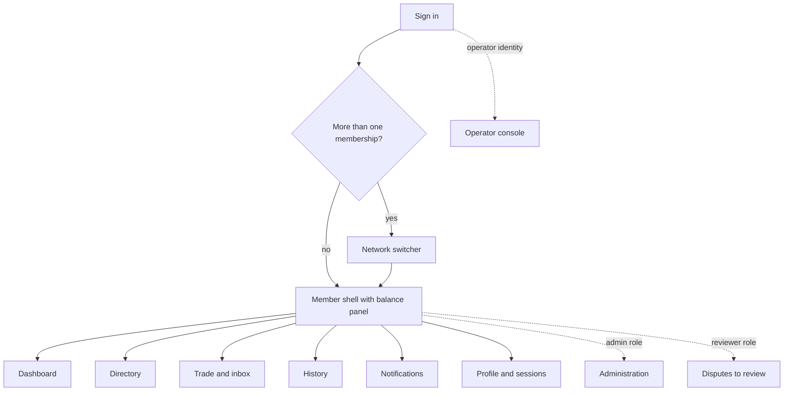

# UX and Accessibility Requirements

| Field | Value |
|---|---|
| Status | Draft |
| Owner role | Product designer |
| Last updated | 2026-11-11 |
| Scope | Information architecture, the core MVP screens (as required content and behavior, not layouts), the presentation rules for balances and transaction states, interaction and feedback rules, responsive behavior, accessibility conformance, content and localization rules, and the content rules for email notifications. Authoritative home for screens, presentation of balances, and accessibility ([00-conventions.md §7](00-conventions.md#7-authoritative-homes)). |
| Dependencies | [00-conventions.md](00-conventions.md), [01-product-vision-and-scope.md](01-product-vision-and-scope.md), [02-personas-roles-and-journeys.md](02-personas-roles-and-journeys.md), [03-domain-model-and-mutual-credit-rules.md](03-domain-model-and-mutual-credit-rules.md) |
| Related documents | [04-functional-requirements.md](04-functional-requirements.md), [07-api-and-integration-contract.md](07-api-and-integration-contract.md), [09-security-privacy-and-abuse-resistance.md](09-security-privacy-and-abuse-resistance.md), [10-governance-and-network-operations.md](10-governance-and-network-operations.md), [12-quality-strategy-and-test-plan.md](12-quality-strategy-and-test-plan.md), [13-assumptions-risks-decisions-and-roadmap.md](13-assumptions-risks-decisions-and-roadmap.md) |

## 1. Purpose

This document states what the Circula web client MUST present and how it MUST behave so that members, administrators, reviewers, and operators can read balances correctly, act on transactions without ambiguity, and use every MVP journey with assistive technology. The client is a responsive web application that uses only the public API ([DEC-006](13-assumptions-risks-decisions-and-roadmap.md#dec-006)); every rule enforced here is a presentation of a rule owned elsewhere, chiefly the [domain model](03-domain-model-and-mutual-credit-rules.md).

What this document is not:

- It contains no visual design: no palette, typography, spacing, iconography, or layouts. Those are deferred ([OQ-UX-1](#10-open-questions)).
- It contains no feature-level interaction specs: no step-by-step flows, wireframes, or microcopy beyond the wording rules that protect meaning. Journeys are in [02-personas-roles-and-journeys.md](02-personas-roles-and-journeys.md); capability acceptance criteria are in [04-functional-requirements.md](04-functional-requirements.md).
- It never restates a ledger rule. Where a screen must show a rule's outcome, it cites the DOM identifier.

Requirement identifiers and reserved ranges:

| Range | Topic | Section |
|---|---|---|
| UX-001 to UX-009 | Information architecture | [2](#2-information-architecture) |
| UX-010 to UX-039 | Core screens | [3](#3-core-screens-for-the-mvp) |
| UX-040 to UX-059 | Balance and state presentation | [4](#4-balance-presentation-rules) |
| UX-060 to UX-079 | Interaction and feedback | [5](#5-interaction-and-feedback-requirements) |
| UX-080 to UX-089 | Responsive layout | [6](#6-responsive-layout) |
| UX-090 to UX-119 | Accessibility | [7](#7-accessibility) |
| UX-120 to UX-129 | Content and localization | [8](#8-content-and-localization) |
| UX-130 to UX-139 | Email notification content | [9](#9-email-notification-content-rules) |
| UX-140 to UX-199 | Reserved for later use (P2 and post-MVP screens) | none |

Priorities follow [00-conventions.md §4](00-conventions.md#4-priority-levels). Every requirement here is P0 unless marked.

## 2. Information architecture

**UX-001 — Role-based top-level navigation.** (P0) The client MUST show each signed-in person only the top-level destinations their role in the active network allows ([PER-008](02-personas-roles-and-journeys.md#per-008)). A destination the person may not use MUST NOT appear; a direct link to it MUST show the same denial message as the API ([UX-063](#ux-063)). Destinations:

| Destination | Member | Administrator | Reviewer | Operator |
|---|---|---|---|---|
| Dashboard (balance, pending, recent history) | Yes | Yes | Yes | No |
| Directory (members, listings) | Yes | Yes | Yes | No |
| Trade (propose, inbox of items awaiting me) | Yes | Yes | Yes | No |
| History (ledger view, disputes I am party to) | Yes | Yes | Yes | No |
| Notifications | Yes | Yes | Yes | Yes |
| Profile and sessions | Yes | Yes | Yes | Yes |
| Disputes to review | No | If policy lets administrators review ([PER-026](02-personas-roles-and-journeys.md#per-026)) | Yes | No |
| Administration (members, policy, adjustments, audit log, exports) | No | Yes | No | No |
| Operator console (instance level) | No | No | No | Yes |

*Rationale:* [PER-005](02-personas-roles-and-journeys.md#per-005) holds roles per membership, so the visible navigation depends on the active network. Hiding is a convenience only; enforcement is server-side ([PER-008](02-personas-roles-and-journeys.md#per-008)).

Plain-text summary: after sign-in, a person with several memberships picks a network, then lands in the member shell, which always carries the balance panel and the common destinations. Administration and dispute review appear only for people holding those roles in that network. The operator console is reached from the sign-in directly and is outside any network shell.

**UX-002 — Network switcher.** (P0) A person with more than one membership MUST have a network switcher in the page header on every screen. It MUST list each network by name and show the person's role and membership status in it. Switching MUST change the whole shell (navigation, balance panel, unit name, decimal places, language of network-authored text) and MUST NOT carry any form input, selection, or cached amount across networks. The active network name MUST be shown in text on every screen and in the browser tab title, so that no amount is ever read without its network context ([DOM-005](03-domain-model-and-mutual-credit-rules.md#dom-005)).
*Rationale:* one person's balances in two networks are unrelated and use different units; confusing them is a correctness risk, not a cosmetic one.

**UX-003 — Balance always visible in the member shell.** (P0) The balance panel ([UX-040](#ux-040)) MUST be visible on every member-shell screen without scrolling or opening a menu at desktop and tablet widths, and as a persistent compact bar at phone width that expands to the full panel by activation. Administration screens that are not part of the member shell (setup wizard, audit log, exports) MAY omit it but MUST offer a link back to it.
*Rationale:* [VIS-001](01-product-vision-and-scope.md#vis-001) and [DOM-014](03-domain-model-and-mutual-credit-rules.md#dom-014): no balance change should be out of sight.

**UX-004 — Consistent landmarks and naming.** (P0) Each screen MUST have exactly one `main` landmark, one primary heading naming the screen, a navigation landmark for the top-level destinations, and a header landmark holding the network switcher, notifications entry, and profile entry. Destination names MUST be the same in navigation, page headings, breadcrumbs, and browser tab titles.

**UX-005 — Deep links.** (P0) Every transaction, listing, dispute, ledger entry, and member detail MUST have a stable URL that opens that object in the correct network, after sign-in if required. A link to an object in another of the person's networks MUST switch the network after telling the person which network it will open.

## 3. Core screens for the MVP

Screen traceability (screen to journeys and permissions):

| Screen | Requirement | Journeys | Permissions |
|---|---|---|---|
| Sign in and recovery | [UX-010](#ux-010) | [JRN-009](02-personas-roles-and-journeys.md#jrn-009), [JRN-001](02-personas-roles-and-journeys.md#jrn-001) | none (pre-authentication) |
| Network join | [UX-011](#ux-011) | [JRN-001](02-personas-roles-and-journeys.md#jrn-001) | [PER-012](02-personas-roles-and-journeys.md#per-012), [PER-013](02-personas-roles-and-journeys.md#per-013) |
| Dashboard | [UX-012](#ux-012) | [JRN-004](02-personas-roles-and-journeys.md#jrn-004) | [PER-027](02-personas-roles-and-journeys.md#per-027) |
| Directory and listings | [UX-013](#ux-013) | [JRN-002](02-personas-roles-and-journeys.md#jrn-002) | [PER-017](02-personas-roles-and-journeys.md#per-017) |
| Propose, detail, reversal, inbox | [UX-014](#ux-014) to [UX-018](#ux-018) | [JRN-003](02-personas-roles-and-journeys.md#jrn-003) | [PER-018](02-personas-roles-and-journeys.md#per-018) to [PER-022](02-personas-roles-and-journeys.md#per-022) |
| History | [UX-019](#ux-019) | [JRN-004](02-personas-roles-and-journeys.md#jrn-004) | [PER-027](02-personas-roles-and-journeys.md#per-027) |
| Disputes | [UX-020](#ux-020), [UX-021](#ux-021) | [JRN-005](02-personas-roles-and-journeys.md#jrn-005) | [PER-025](02-personas-roles-and-journeys.md#per-025), [PER-026](02-personas-roles-and-journeys.md#per-026) |
| Administration | [UX-022](#ux-022) to [UX-029](#ux-029) | [JRN-006](02-personas-roles-and-journeys.md#jrn-006), [JRN-007](02-personas-roles-and-journeys.md#jrn-007) | [PER-011](02-personas-roles-and-journeys.md#per-011) to [PER-016](02-personas-roles-and-journeys.md#per-016), [PER-024](02-personas-roles-and-journeys.md#per-024), [PER-029](02-personas-roles-and-journeys.md#per-029), [PER-031](02-personas-roles-and-journeys.md#per-031) |
| Notifications, profile, sessions | [UX-030](#ux-030), [UX-031](#ux-031) | [JRN-008](02-personas-roles-and-journeys.md#jrn-008) | [PER-030](02-personas-roles-and-journeys.md#per-030) |
| Abuse reports, notice board, rules, welcome, succession contact, verification, network status | [UX-033](#ux-033) to [UX-039](#ux-039) | [JRN-006](02-personas-roles-and-journeys.md#jrn-006) | [PER-011](02-personas-roles-and-journeys.md#per-011) to [PER-016](02-personas-roles-and-journeys.md#per-016) |
| Operator console | [UX-032](#ux-032) | none (operator procedures in [11-deployment-operations-and-support.md](11-deployment-operations-and-support.md)) | [PER-010](02-personas-roles-and-journeys.md#per-010), [PER-032](02-personas-roles-and-journeys.md#per-032) |

Each subsection states what the screen MUST contain and which behaviors it MUST exhibit. Layout is not specified. All screens also satisfy sections 4 to 7.

**UX-010 — Sign in and account recovery.** (P0) Journey context: [JRN-009](02-personas-roles-and-journeys.md#jrn-009), [JRN-001](02-personas-roles-and-journeys.md#jrn-001). Sign-in takes email and password and, where the person enabled a second factor, a one-time code. Recovery is initiated from the sign-in screen by email address only and MUST show the same confirmation text whether or not the address is known. Fields MUST accept paste and password-manager autofill and MUST carry correct `autocomplete` tokens; no screen MAY require transcribing a code from an image or solving a puzzle as the only way in (WCAG 3.3.8, [UX-111](#ux-111)). Lockout and rate-limit behavior are owned by [09-security-privacy-and-abuse-resistance.md](09-security-privacy-and-abuse-resistance.md); the screen MUST present such a state with the time after which retry is possible.

**UX-011 — Network join (invite or apply).** (P0) Journey: [JRN-001](02-personas-roles-and-journeys.md#jrn-001). Entry from an invitation link or, where the network's entry mode ([DOM-095](03-domain-model-and-mutual-credit-rules.md#dom-095)) allows, from an application form. The screen MUST show before the person commits: the network name, its description of what a credit represents ([DOM-081](03-domain-model-and-mutual-credit-rules.md#dom-081)), the default credit limit that would apply, whether balances are visible to other members ([DOM-096](03-domain-model-and-mutual-credit-rules.md#dom-096)), and the invitation expiry date ([DOM-099](03-domain-model-and-mutual-credit-rules.md#dom-099)). An applicant MUST see a status page (pending, approved, declined) reachable from the sign-in.

**UX-012 — Dashboard.** (P0) Journey: [JRN-004](02-personas-roles-and-journeys.md#jrn-004). Contains the balance panel of [UX-040](#ux-040), a count and list of items awaiting my action (link to [UX-018](#ux-018)), the most recent history entries (link to [UX-019](#ux-019)), and the network account balance with its explanation ([UX-046](#ux-046)). When the account is over limit, [UX-045](#ux-045) applies at the top of the screen.

**UX-013 — Directory and listings.** (P0) Journey: [JRN-002](02-personas-roles-and-journeys.md#jrn-002). Browse offers and requests; filter by type (offer or request), category, free-text search, and listing status; sort by newest. A member directory MUST show only fields the member's profile and network policy make visible ([DOM-097](03-domain-model-and-mutual-credit-rules.md#dom-097)) and MUST NOT show another member's balance unless policy [DOM-096](03-domain-model-and-mutual-credit-rules.md#dom-096) is `visible_to_members`. Listing detail shows description, member, status, and an action to propose a trade that pre-fills [UX-014](#ux-014) with the listing reference. Create and edit forms for the member's own listings MUST validate inline ([UX-060](#ux-060)) and MUST show the listing status (active, paused, closed). Listings are pointers to a possible trade and MUST NOT display a price in any unit that implies a posted amount; any suggested amount is labeled as the lister's suggestion.

**UX-014 — Propose transaction.** (P0) Journey: [JRN-003](02-personas-roles-and-journeys.md#jrn-003). Fields: counterparty (member search), direction, amount, description, optional listing reference.

| Direction label shown | Meaning | Mapping |
|---|---|---|
| "I provided" | I gave goods or services to the counterparty | I am the payee (credited); counterparty is the payer (debited) |
| "I received" | I received goods or services from the counterparty | I am the payer (debited); counterparty is the payee (credited) |

The form MUST NOT use the words payer or payee as labels; it MUST restate the mapping after the amount is entered in a sentence such as "Your balance will go up by 40 credits when {name} accepts" or "Your balance will go down by 40 credits when {name} accepts". When the payer's available credit is below the entered amount, the form MUST show a non-blocking warning stating the payer's available credit and that acceptance may fail with the error shown in [UX-061](#ux-061) ([DOM-021](03-domain-model-and-mutual-credit-rules.md#dom-021)); the submit control MUST stay enabled. The warning is shown for the proposer's own account as exact figures; for the counterparty's account it MUST be shown only if policy [DOM-096](03-domain-model-and-mutual-credit-rules.md#dom-096) lets the proposer see that balance, otherwise it MUST say "may not have enough available credit" without figures. The form MUST show the proposal expiry date computed from [DOM-100](03-domain-model-and-mutual-credit-rules.md#dom-100) before submission, and the per-transaction maximum ([DOM-104](03-domain-model-and-mutual-credit-rules.md#dom-104)) when set.

**UX-015 — Transaction detail.** (P0) Journey: [JRN-003](02-personas-roles-and-journeys.md#jrn-003). Shows: status as text and icon ([UX-050](#ux-050)); both parties by display name with their direction in "provided/received" wording; amount; description; listing link; proposed, expiry, and completed dates; a timeline of status changes in order with actor and time; the list of failed acceptance attempts with time, error message, and code ([DOM-022](03-domain-model-and-mutual-credit-rules.md#dom-022)); a "disputed" marker while a dispute is not resolved ([DOM-064](03-domain-model-and-mutual-credit-rules.md#dom-064)); for a reversed transaction, a link to the reversal entry, and for a reversal entry, a link to the original ([DOM-030](03-domain-model-and-mutual-credit-rules.md#dom-030)). Available actions depend on status and role: accept, decline, cancel, request reversal, raise dispute ([DOM-023](03-domain-model-and-mutual-credit-rules.md#dom-023), [DOM-024](03-domain-model-and-mutual-credit-rules.md#dom-024), [DOM-060](03-domain-model-and-mutual-credit-rules.md#dom-060)). An action not currently allowed MUST be absent or disabled with a stated reason, never silently inert.

**UX-016 — Explaining a failed acceptance.** (P1) When a failed acceptance attempt carries `limit_exceeded` or `positive_limit_exceeded`, the detail screen SHOULD show the figures involved for the viewer's own account, and for the other party's account only when visible under [DOM-096](03-domain-model-and-mutual-credit-rules.md#dom-096).

**UX-017 — Reversal request and withdrawal.** (P0) Journey: [JRN-003](02-personas-roles-and-journeys.md#jrn-003). Reachable from the detail of a `Completed` transaction while the mutual-reversal window is open ([DOM-101](03-domain-model-and-mutual-credit-rules.md#dom-101)); after it the entry point shows the closing date. The screen MUST show whether the other party has already requested reversal, the reason field, the window end date, and that the reversal posts when the second request is recorded ([DOM-031](03-domain-model-and-mutual-credit-rules.md#dom-031)). A requester MUST be able to withdraw the request until the second one arrives. Where a dispute is open on the transaction the screen MUST say that a mutual reversal will be recorded as the dispute's resolution ([DOM-034](03-domain-model-and-mutual-credit-rules.md#dom-034)). The confirmation of [UX-064](#ux-064) applies to the second request.

**UX-018 — Inbox of proposals awaiting my action.** (P0) Journey: [JRN-003](02-personas-roles-and-journeys.md#jrn-003). Lists `Proposed` transactions where my action is possible (as counterparty: accept or decline; as proposer: nothing, shown in a separate "waiting for others" list with cancel), pending reversal requests, disputes awaiting my response, and, for administrators, adjustments awaiting my approval and applications awaiting a decision. Each row MUST show counterparty, direction wording, amount, expiry date, and a primary action that leads to the detail screen; accepting directly from the list MUST use the same confirmation dialog as the detail screen ([UX-064](#ux-064)). The nav entry MUST carry a count in text (not only a badge color) that is announced to assistive technology.

**UX-019 — History (ledger view).** (P0) Journey: [JRN-004](02-personas-roles-and-journeys.md#jrn-004). A table ordered by ledger sequence ([DOM-010](03-domain-model-and-mutual-credit-rules.md#dom-010)), newest first by default, oldest first on request. Columns: sequence number, date and time, description, counterparty, amount provided or received (signed, [UX-041](#ux-041)), running balance after the entry, state ([UX-050](#ux-050)). Each row MUST link to its origin ([DOM-007](03-domain-model-and-mutual-credit-rules.md#dom-007)): the transaction, reversal request or dispute resolution, or the adjustment record, and adjustments MUST show their reason code and text to the account holder. Filters: date range, counterparty, type (trade, reversal, adjustment), disputed only. The running balance column MUST equal the account balance after each entry as served by the API ([DOM-003](03-domain-model-and-mutual-credit-rules.md#dom-003)); the client MUST NOT compute it by summing a partially loaded page. Pagination controls MUST state the range shown. The screen MUST link to member self-export ([UX-029](#ux-029)).

**UX-020 — Dispute raise.** (P0) Journey: [JRN-005](02-personas-roles-and-journeys.md#jrn-005). Reachable from a history row or transaction detail while the dispute window is open ([DOM-102](03-domain-model-and-mutual-credit-rules.md#dom-102)); after the window the entry point MUST show the closing date instead of an action. The form takes a reason in free text and shows, before submit, the statement that raising a dispute does not change balances or freeze credit ([DOM-064](03-domain-model-and-mutual-credit-rules.md#dom-064)). Only one open dispute per event ([DOM-060](03-domain-model-and-mutual-credit-rules.md#dom-060)): where one exists the entry point links to it.

**UX-021 — Dispute detail and review.** (P0) Journey: [JRN-005](02-personas-roles-and-journeys.md#jrn-005). Shows status (Open, Under review, Resolved), subject event with link, both parties' statements, the reviewer once assigned, the timeline, and, once resolved, the outcome (dismissed, reversed, adjusted, withdrawn) with reasoning and a link to any resulting ledger event ([DOM-062](03-domain-model-and-mutual-credit-rules.md#dom-062)). A reviewer sees the resolution form, which requires an outcome and reasoning text, and, for `adjusted`, the accounts, amount, and reason of the correction, with the exact-balances confirmation of [UX-064](#ux-064). Where [DOM-111](03-domain-model-and-mutual-credit-rules.md#dom-111) holds the remedy pending, the screen MUST say "decided, remedy awaiting administrator confirmation"; where the confirming administrator declines the remedy, it MUST say "remedy declined by {administrator}: reviewer must record a new resolution", and the reviewer sees the resolution form again. A confirming administrator who is a party or the deciding reviewer MUST NOT see a confirm action ([DOM-062](03-domain-model-and-mutual-credit-rules.md#dom-062), `reviewer_ineligible`). The appeal entry point shows the appeal window end date ([DOM-063](03-domain-model-and-mutual-credit-rules.md#dom-063)).

**UX-022 — Administrator network setup wizard.** (P0) Journey: [JRN-006](02-personas-roles-and-journeys.md#jrn-006). A multi-step screen for a network in `Setup` status. The choices of the default credit limit ([DOM-090](03-domain-model-and-mutual-credit-rules.md#dom-090)), the maximum credit limit ([DOM-091](03-domain-model-and-mutual-credit-rules.md#dom-091)), and the credit unit name, symbol, and decimal places ([DOM-094](03-domain-model-and-mutual-credit-rules.md#dom-094)) MUST be explicit: no pre-selected value, and the step MUST NOT allow continuing until each has been chosen. The decimal-places step MUST state that the value cannot be changed after the first posting. The final step MUST summarize every chosen value and require confirmation before the network leaves `Setup`. Progress MUST be shown in text ("Step 2 of 5") and the person MUST be able to return to earlier steps without losing input.

**UX-023 — Policy editor.** (P0) Journey: [JRN-006](02-personas-roles-and-journeys.md#jrn-006). Shows the policy version in force with its effective time and author, every catalogue item of [DOM section 11](03-domain-model-and-mutual-credit-rules.md#11-network-policy-catalogue-versus-platform-invariants) grouped by topic with its recommended default, and the history of versions with change notes ([DOM-017](03-domain-model-and-mutual-credit-rules.md#dom-017)). Saving requires a change note (non-empty) and an effective time (default: now). Before saving the screen MUST show a diff of changed values and the statement that existing events are not altered retroactively. Items that a policy cannot relax ([DOM-018](03-domain-model-and-mutual-credit-rules.md#dom-018)) MUST NOT appear as editable fields. A version scheduled for a future effective time (at most 180 days ahead, [DOM-017](03-domain-model-and-mutual-credit-rules.md#dom-017)) MUST be shown as scheduled with a cancel action that requires confirmation and is audited; an effective time in the past MUST be rejected with the message of `validation_failed`. Announcement of changes to members is owned by [10-governance-and-network-operations.md](10-governance-and-network-operations.md).

**UX-024 — Members list and member detail (administrator).** (P0) Journeys: [JRN-006](02-personas-roles-and-journeys.md#jrn-006), [JRN-007](02-personas-roles-and-journeys.md#jrn-007). The list shows display name, membership status, roles, balance, credit limit, available credit, and an over-limit indicator ([UX-045](#ux-045)); it is filterable by status and by over-limit and sortable by balance. Member detail adds positive limit, pending totals, history link, and actions: change limit (with reason; changing a limit creates no ledger event, [DOM-054](03-domain-model-and-mutual-credit-rules.md#dom-054)), suspend and reinstate with mandatory reason ([PER-014](02-personas-roles-and-journeys.md#per-014)), remove, assign roles ([PER-016](02-personas-roles-and-journeys.md#per-016)), and freeze and unfreeze the account with mandatory reason ([DOM-016](03-domain-model-and-mutual-credit-rules.md#dom-016), [DOM-064](03-domain-model-and-mutual-credit-rules.md#dom-064)); the freeze confirmation MUST state that the account can no longer take part in new trades but can still receive reversals and adjustments, and unfreeze MUST state that the account takes part in trades again. The suspend action MUST state that the member's proposed transactions will be cancelled ([DOM-072](03-domain-model-and-mutual-credit-rules.md#dom-072)). A departure that is blocked MUST show the specific blocking condition ([DOM-070](03-domain-model-and-mutual-credit-rules.md#dom-070), [DOM-071](03-domain-model-and-mutual-credit-rules.md#dom-071)).

**UX-025 — Adjustments (administrator).** (P0) Journey: [JRN-006](02-personas-roles-and-journeys.md#jrn-006). The form takes type ([DOM-040](03-domain-model-and-mutual-credit-rules.md#dom-040)), accounts, amount, reason code from the policy list ([DOM-106](03-domain-model-and-mutual-credit-rules.md#dom-106)) and a mandatory free-text reason, related references, and the limit-override flag with its own reason ([DOM-042](03-domain-model-and-mutual-credit-rules.md#dom-042)). Where second-administrator approval is required ([DOM-107](03-domain-model-and-mutual-credit-rules.md#dom-107)) the resulting adjustment MUST show state "awaiting approval by another administrator" until approved, and the initiator MUST NOT see an approve action on it ([DOM-043](03-domain-model-and-mutual-credit-rules.md#dom-043)). When the acting administrator holds the counterparty account, or the only administrator would act on both sides, the form MUST show a self-dealing warning stating what the platform will do under policy [DOM-110](03-domain-model-and-mutual-credit-rules.md#dom-110): reject, or post with a flag visible to all members. Every adjustment screen and list MUST show its state with a text label: `pending_approval` ("awaiting approval by another administrator"), `posted`, `rejected` (with the rejecting administrator's reason), or `expired` ("not approved in time, nothing was posted") ([DOM-041](03-domain-model-and-mutual-credit-rules.md#dom-041)); the approving administrator sees approve and reject actions, reject requiring a reason. An adjustment appears in the affected holders' history with its reason ([UX-019](#ux-019)).

**UX-026 — Audit log (administrator).** (P0) Journey: [JRN-006](02-personas-roles-and-journeys.md#jrn-006). A table of audit events of the active network ([DOM-012](03-domain-model-and-mutual-credit-rules.md#dom-012)) with time, actor, action, object (linked), and outcome; filterable by date range, actor, action type, and object. Break-glass access by the platform operator MUST be listed here with its reason and time window ([UX-032](#ux-032)). The screen is read-only and MUST NOT offer edit or delete controls.

**UX-027 — Applications and invitations queue (administrator).** (P0) Journey: [JRN-001](02-personas-roles-and-journeys.md#jrn-001). Lists pending applications and outstanding invitations with date, expiry ([DOM-099](03-domain-model-and-mutual-credit-rules.md#dom-099)), and status; approve and decline ([PER-013](02-personas-roles-and-journeys.md#per-013)) and send or revoke an invitation ([PER-012](02-personas-roles-and-journeys.md#per-012)). Approving MUST show the credit limit the new member will receive ([DOM-090](03-domain-model-and-mutual-credit-rules.md#dom-090)). A decline MUST allow a reason that is shown to the applicant.

**UX-028 — Network exports (administrator).** (P0) Journey: [JRN-006](02-personas-roles-and-journeys.md#jrn-006). Starts a network export (members, accounts, full ledger, policy versions, audit log) in CSV or JSON ([PER-031](02-personas-roles-and-journeys.md#per-031)). The screen MUST state what the export contains, that the export is itself audited ([DOM-012](03-domain-model-and-mutual-credit-rules.md#dom-012)), and that amounts are integers in minor units with the network's decimal places stated in the file header or manifest ([DEC-005](13-assumptions-risks-decisions-and-roadmap.md#dec-005)). Progress and completion MUST be announced ([UX-100](#ux-100)).

**UX-029 — Member self-export.** (P0) Reachable from profile and history. Offers own profile, account history, transactions, and disputes in CSV or JSON ([PER-030](02-personas-roles-and-journeys.md#per-030)), with the same statements as [UX-028](#ux-028).

**UX-030 — Notification list.** (P1) An in-app list of notifications ([DOM-114](03-domain-model-and-mutual-credit-rules.md#dom-114)), newest first, each with event type, text following [UX-130](#ux-130), time, read state shown in text, and a link to the object. A mark-all-as-read control and a per-person preference page for optional events are provided; the preference page MUST show the mandatory email events as always on and not switchable ([UX-130](#ux-130)).

**UX-031 — Profile and sessions.** (P0) Display name and the optional profile fields ([DOM-098](03-domain-model-and-mutual-credit-rules.md#dom-098)), email and password change, optional second-factor management, language and locale preference ([UX-120](#ux-120)), the list of active sessions with device description, last-used time, and a revoke control for each and for all others, and links to leave a network ([JRN-008](02-personas-roles-and-journeys.md#jrn-008)) and to self-export. Leaving shows the blocking conditions of [DOM-070](03-domain-model-and-mutual-credit-rules.md#dom-070) in text before the person starts.

**UX-032 — Operator console.** (P0) Reachable only by a platform operator identity ([PER-004](02-personas-roles-and-journeys.md#per-004)). Minimal: list of networks with status, creation of a network in `Setup` with the first administrator ([PER-010](02-personas-roles-and-journeys.md#per-010)), instance health summary owned by [11-deployment-operations-and-support.md](11-deployment-operations-and-support.md), suspend, reinstate, and close actions for any network with the confirmation of [UX-039](#ux-039), a control to trigger the ledger verification of [DOM-003](03-domain-model-and-mutual-credit-rules.md#dom-003) with the result view of [UX-038](#ux-038), the succession contact record of [UX-037](#ux-037) (readable without break-glass because it holds no ledger data), and a break-glass entry ([PER-032](02-personas-roles-and-journeys.md#per-032), [PER-033](02-personas-roles-and-journeys.md#per-033)). Within a break-glass session the console is read-only except for the administrator grant of SEC-142: the grant screen MUST state that dual control applies (a second operator must approve; a single-operator instance cannot perform it), MUST show its state (awaiting second operator, approved, rejected), MUST be offered only when the network has no Active administrator, and MUST state that every active member will be notified; the granted role is an ordinary administrator role. Export is not available under break-glass. The break-glass entry MUST be visually and textually separate from routine functions, MUST require a recorded justification and a time limit before any network data is shown, and MUST display a persistent banner stating the network, the reason, and the time remaining while active (the time box is set per SEC-140: default 4 hours, maximum 24 hours). The console MUST NOT contain any control that posts a ledger event or changes policy ([PER-007](02-personas-roles-and-journeys.md#per-007)).

**UX-033 — Abuse report form and administrator report queue.** (P1) Any member can open the report form from a listing, a member profile, and a transaction: it takes the reported object, a category, and free text, and confirms that the report was received. The administrator queue lists reports with status Open, Actioned, or Dismissed, the reporter (visible to administrators only, never in exports to other roles), the reported object, and age. The reporter MUST be told, in the notification list ([UX-030](#ux-030)), when the report is closed. A report about an administrator MUST NOT offer that administrator a close action, and the screen MUST say so ([SEC-061](09-security-privacy-and-abuse-resistance.md#sec-061), [SEC-062](09-security-privacy-and-abuse-resistance.md#sec-062), [SEC-065](09-security-privacy-and-abuse-resistance.md#sec-065)).

**UX-034 — Notice board.** (P1) A list of notices posted by administrators for the network, newest first, readable by every active member. Administrators see a form with title and text to post a notice; posting is audited. The screen MUST state that a notice is not a ledger entry and does not change any balance or policy.

**UX-035 — Rules statement page.** (P1) A page showing the network's current rules statement as published text with its policy version and effective time, readable by every member and by applicants before joining. Administrators can edit it through the policy editor ([UX-023](#ux-023)); a change MUST be shown with a change note and notified like any policy version.

**UX-036 — Welcome screen.** (P0) Shown once, on first sign-in after the membership becomes Active ([FR-009](04-functional-requirements.md#fr-009)), and reachable again from the help entry. It MUST state, in the network's own words where the network has described its valuation convention, what a credit represents in this network: an accounting unit recording mutual obligations among members, which the platform does not exchange, redeem, or value outside the network ([DOM-080](03-domain-model-and-mutual-credit-rules.md#dom-080), [DOM-081](03-domain-model-and-mutual-credit-rules.md#dom-081)). It MUST also explain that a negative balance is normal and means the member has received more than provided ([UX-041](#ux-041)), show the member's credit limit, and link to the rules statement ([UX-035](#ux-035)). Dismissing it records that it was seen and MUST NOT block use of the app.

**UX-037 — Succession contact (administrator).** (P1) Administrators can view and set the succession contact of the network ([FR-069](04-functional-requirements.md#fr-069)): who the platform operator should reach if no administrator is active. The screen MUST state that the contact holds no access to the network and that the record is readable by the platform operator without break-glass; changes are saved as a new policy version with a change note.

**UX-038 — Ledger verification result view.** (P0) Shows, for administrators of the network and for the platform operator in the console ([UX-032](#ux-032)), the latest result of the ledger verification ([FR-057](04-functional-requirements.md#fr-057)): time, number of accounts and events checked, the sum of balances, and any discrepancy naming the account and both values. A consistent result MUST be stated in words ("sum is 0 credits, no discrepancy"), not by color alone ([UX-050](#ux-050)). The operator's view MUST NOT show ledger contents. A run action is offered with a status message while it runs.

**UX-039 — Network suspend, reinstate, and close.** (P0) Operator actions (console, [UX-032](#ux-032)) and, where [GOV-082](10-governance-and-network-operations.md#gov-082) allows, administrator requests. Each opens a confirmation ([UX-064](#ux-064)) that requires a reason and states the consequences ([DOM-016](03-domain-model-and-mutual-credit-rules.md#dom-016)): suspend means no new trades are completed while administrators can still post reversals and adjustments, and every member is notified; reinstate means trading resumes; close means no ledger event of any kind can be posted afterwards, is available only when every account is Closed at zero (otherwise the blocking accounts are listed, `closure_blocked`), prompts a final export first, and notifies every member. While a network is suspended, member screens show the network-status banner of section 5 stating the status.

## 4. Balance presentation rules

**UX-040 — Balance panel.** (P0) The balance panel shows, for the active network: (a) balance, formatted per [UX-041](#ux-041) with its explanatory phrase; (b) available credit next to the balance with a formula control ([UX-042](#ux-042)); (c) credit limit; (d) pending incoming and pending outgoing totals ([UX-043](#ux-043)); (e) the positive limit and headroom when a positive limit is set ([DOM-051](03-domain-model-and-mutual-credit-rules.md#dom-051)); (f) the over-limit notice when applicable ([UX-045](#ux-045)). The panel MUST present the same figures the API returns and MUST NOT derive balance or available credit locally ([DOM-003](03-domain-model-and-mutual-credit-rules.md#dom-003)).

Balance panel content (field order is not prescribed):

| Field | Source | Label wording (minimum) | Shown when |
|---|---|---|---|
| Balance | [DOM-003](03-domain-model-and-mutual-credit-rules.md#dom-003) | "Your balance" with phrase of [UX-041](#ux-041) | always |
| Available credit | [DOM-050](03-domain-model-and-mutual-credit-rules.md#dom-050) | "Available credit" with formula control | always |
| Credit limit | [DOM-050](03-domain-model-and-mutual-credit-rules.md#dom-050) | "Credit limit" | always |
| Positive limit and headroom | [DOM-051](03-domain-model-and-mutual-credit-rules.md#dom-051) | "Most you can hold" and "Room left" | only when a positive limit is set |
| Pending incoming | [DOM-028](03-domain-model-and-mutual-credit-rules.md#dom-028) | "Incoming, not yet posted" | always, 0 shown as "0 credits" |
| Pending outgoing | [DOM-028](03-domain-model-and-mutual-credit-rules.md#dom-028) | "Outgoing, not yet posted" | always, 0 shown as "0 credits" |
| Over-limit notice | [DOM-052](03-domain-model-and-mutual-credit-rules.md#dom-052) | per [UX-045](#ux-045) | only when over limit |
| Account status | [DOM-016](03-domain-model-and-mutual-credit-rules.md#dom-016) | "Active", "Frozen: you can view but not trade", "Closed" | always; a frozen account MUST show its restriction in text |

**UX-041 — Sign and direction unmistakable.** (P0) Every signed amount MUST carry: a sign character (the Unicode minus sign U+2212 for negative, a plus sign for positive, no sign only for zero), the unit name, and an explanatory phrase. Required wording for the balance:

| Balance | Required presentation (example, 0 decimal places, unit "credits") |
|---|---|
| Negative | "−40 credits · you have received more than you have provided" |
| Positive | "+40 credits · you have provided more than you have received" |
| Zero | "0 credits · you have provided and received equal amounts" |

Meaning MUST NOT depend on color, position, or an icon alone; any color or icon used is redundant with the sign and phrase. In tables, rows MUST give the direction in words ("provided" or "received") in a column or visually hidden text so that a screen reader announces "received 40 credits", not only "−40". A negative balance MUST NOT be described as a debt owed to the platform or to a person ([DOM section 3.5](03-domain-model-and-mutual-credit-rules.md#35-balance-available-credit-and-pending-totals)).
Acceptance criteria:

- Given balance −40 in a network with unit "credits" and 0 decimal places, the dashboard text contains "−40 credits" (with U+2212) and the phrase "you have received more than you have provided".
- Given the same page rendered in grayscale, or read by a screen reader, the direction of the balance is still stated in words.
- Given a ledger row with amount 40 where the viewer is the payer, a screen reader announces the direction word "received" with the amount.

*Rationale:* the most frequent misreading in mutual-credit systems is a negative number taken as a failure or a debt; the sign alone is also lost when read aloud or printed in grayscale.

**UX-042 — Available credit with formula.** (P0) Available credit MUST be shown adjacent to the balance, in the same text size class, with a control (keyboard-focusable, not hover-only) that reveals the formula "available credit = balance + credit limit" filled with the member's own figures, for example "60 = −40 + 100". The revealed text MUST be reachable by touch and by screen reader and dismissible with Escape.

**UX-043 — Pending totals separate and labeled.** (P0) Pending incoming and pending outgoing totals MUST be two separate labeled figures, each followed by the words "not yet posted", and each linking to the inbox list that makes it up ([DOM-028](03-domain-model-and-mutual-credit-rules.md#dom-028)). The panel MUST state, in a short text next to them, that pending trades do not change balance or available credit. Pending totals MUST NOT be summed into, or subtracted from, the balance or available credit figures.

**UX-044 — Amounts from integer minor units.** (P0) The client MUST format every amount from the integer minor-unit value using the network's decimal places and unit name or symbol ([DEC-005](13-assumptions-risks-decisions-and-roadmap.md#dec-005), [DOM-094](03-domain-model-and-mutual-credit-rules.md#dom-094)), using integer arithmetic for any scaling, and MUST NOT round or truncate. Amount input MUST accept only digits and the locale's decimal separator, MUST reject more fractional digits than the network allows (rather than rounding them), and MUST show the parsed value back before submission. Grouping separators follow the locale ([UX-121](#ux-121)).

| Minor units (integer) | Decimal places | Locale example | Displayed |
|---|---|---|---|
| 4000 | 2 | decimal point | 40.00 credits |
| 4005 | 2 | decimal comma | 40,05 credits |
| 40 | 0 | any | 40 credits |
| 123456789 | 2 | grouping with spaces | 1 234 567,89 credits |

An input of 40.005 into a 2-decimal network is rejected with `invalid_amount`; it is not shown as 40.01 or 40.00. The unit name MUST accompany every amount outside tables where the column header already states it.

**UX-045 — Over-limit announced.** (P0) When an account is over limit ([DOM-052](03-domain-model-and-mutual-credit-rules.md#dom-052)), the member shell MUST show on the dashboard and balance panel a text notice stating that the account is over its credit limit (or positive limit), the amount by which it is exceeded, and what that means ("you cannot accept or propose trades that debit your account until your balance is back within the limit"; wording adjusted for the positive limit). The notice MUST also be announced on page load through a live region ([UX-100](#ux-100)). Administrators' member list shows the same state and excess ([UX-024](#ux-024)). A reversal or adjustment that causes the state MUST be named as its cause in the notice when known ([DOM-032](03-domain-model-and-mutual-credit-rules.md#dom-032), [DOM-042](03-domain-model-and-mutual-credit-rules.md#dom-042)).

**UX-046 — Network account balance visible to all members.** (P0) Every active member MUST be able to see the network account balance ([DOM-053](03-domain-model-and-mutual-credit-rules.md#dom-053)) from the dashboard, with a plain-language explanation: the network account records adjustments such as write-offs; a negative figure is the loss the community shares; it is not owed to any person. The explanation MUST link to the list of the network account's ledger events (kind, type, amount, reason code, date), visible to every active member ([DOM-053](03-domain-model-and-mutual-credit-rules.md#dom-053)). The counterparty of each event MUST be shown by name only when policy [DOM-096](03-domain-model-and-mutual-credit-rules.md#dom-096) is `visible_to_members` or the event carries the `self_dealing` flag ([DOM-043](03-domain-model-and-mutual-credit-rules.md#dom-043)); otherwise it MUST be shown as "an unnamed member".

**UX-047 — Balances of others.** (P0) Another member's balance MUST be shown only when [DOM-096](03-domain-model-and-mutual-credit-rules.md#dom-096) is `visible_to_members` or the viewer is an administrator or an assigned reviewer with permission ([PER-028](02-personas-roles-and-journeys.md#per-028)). When hidden, the screen MUST show nothing in its place that could be mistaken for zero (no "0", no empty cell without a text alternative); a visually hidden "not shown" text MUST be present where a column exists. Whether the default stays `hidden` is [OQ-UX-2](#10-open-questions).

**UX-050 — States distinguished visually and textually.** (P0) The states Completed, Proposed (pending), Declined, Cancelled, Expired, Reversed, and the marker Disputed MUST each have a distinct text label, and MAY additionally have a distinct icon and color. The label MUST appear in lists, detail screens, history rows, and emails. A reversed transaction MUST show "Reversed" and a link to its reversal; a reversal entry MUST show "Reversal of {transaction}". "Disputed" MUST be a separate marker shown in addition to the status, in both parties' histories ([DOM-064](03-domain-model-and-mutual-credit-rules.md#dom-064)). Pending entries MUST NOT appear within the posted-history table interleaved as if posted; they appear in their own section labeled "not yet posted" or flagged with that text.

State labels (minimum content; icon and color are optional and redundant):

| State | Text label | Shown with | Ledger effect stated in the label help text |
|---|---|---|---|
| `Proposed` | "Pending, not yet posted" | expiry date | "Does not change any balance until accepted" |
| `Completed` | "Completed" | completed date | "Posted to both balances" |
| `Declined` | "Declined" | who and when | "Nothing was posted" |
| `Cancelled` | "Cancelled" | who and when | "Nothing was posted" |
| `Expired` | "Expired" | expiry date | "Nothing was posted" |
| `Reversed` | "Reversed" | link to reversal | "Undone by a later entry; both entries remain in the history" |
| Disputed marker | "Disputed" | dispute status | "Balances are unchanged while the dispute is open" |
| `limit override` entry | "Over limit by design" | cause | "Posted although it takes an account past its limit" |

**UX-051 — Credit-unit language.** (P0) Interface text, including emails, help, errors, and empty states, MUST NOT use the words "pay", "payment", "money", "currency", "funds", "cash", "deposit", or "price in" any national currency, and MUST NOT show exchange rates or conversions ([DOM-080](03-domain-model-and-mutual-credit-rules.md#dom-080), [DOM-081](03-domain-model-and-mutual-credit-rules.md#dom-081)). Approved vocabulary: "credit" and the network's unit name, "trade", "provided", "received", "balance", "available credit", "credit limit". The words payer and payee are internal and MUST NOT appear in member-facing text. A build-time check of all string resources against this list is required ([QA](12-quality-strategy-and-test-plan.md)). The one place the network describes its valuation convention is its free-text description ([DOM-080](03-domain-model-and-mutual-credit-rules.md#dom-080)); that text is authored by the network and is displayed unaltered.

**UX-052 — Same rules in email.** (P0) The rules of [UX-041](#ux-041) to [UX-044](#ux-044), [UX-050](#ux-050), and [UX-051](#ux-051) apply unchanged to email bodies, subjects, and the plain-text alternative.

## 5. Interaction and feedback requirements

Screen state matrix (every screen of section 3 MUST define each state in text):

| State | Requirement |
|---|---|
| Loading | Announced; layout does not shift focus ([UX-069](#ux-069)) |
| Empty | Says why and what to do |
| Partial failure | Names what did not load; retry; loaded content kept |
| Denied | Role message per [UX-063](#ux-063) |
| Network not `Active` | A banner stating the network status and that viewing remains possible; trade and posting controls disabled with reason ([DOM-016](03-domain-model-and-mutual-credit-rules.md#dom-016)) |
| Account `Frozen` | A banner stating the restriction; trade controls disabled with reason; history, export, and dispute controls remain |
| Over limit | [UX-045](#ux-045) |

**UX-060 — Forms and inline validation.** (P0) Every form field with a rule MUST validate on leaving the field and again on submit; the message MUST appear next to the field, be programmatically associated with it, and name the rule in words ("Enter a whole number of credits, 1 or more"). On a failed submit the client MUST show a summary of errors at the top that receives focus and links to each field. Required fields are marked in text, not only with an asterisk or color. Entered values MUST be preserved after a failed submit. Client-side validation is a convenience only: the server result is authoritative, and a server rejection MUST be mapped per [UX-061](#ux-061) and placed at the field when the code concerns one.

**UX-061 — Error code to message map.** (P0) Every error code of [DOM section 5.1](03-domain-model-and-mutual-credit-rules.md#51-error-codes-raised-by-transaction-rules) MUST have a human message and a next step in the client, as below. Placeholders in braces are filled from the response. The raw code MUST be available in a "details" disclosure for support, never as the only text. The wording is the minimum content; translations ([UX-122](#ux-122)) keep the same content.

| Code | Message shown | What to do next (shown with the message) |
|---|---|---|
| `network_not_active` | "This network is not accepting trades right now." | "Try again when the network is active. Contact the network administrators if you think this is wrong." |
| `account_not_active` | "{name}'s account, or yours, cannot take part in new trades because it is {frozen or closed}." | "Contact the administrators of {network}. You can still view your history." |
| `same_account` | "You cannot trade with yourself." | "Choose a different member as the counterparty." |
| `not_a_party` | "You are not allowed to act on this trade." | "Open the trade from your own inbox, or ask the other member to act." |
| `invalid_amount` | "The amount must be a whole number of {unit} between 1 and {max}, with at most {n} decimal places." | "Correct the amount and submit again." |
| `description_required` | "Describe what was provided or received." | "Enter a short description and submit again." |
| `limit_exceeded` | "This trade would take the balance below the credit limit: available credit is {available} {unit}, the trade is {amount} {unit}." Shown to the acceptor without the other member's figures unless visible under [DOM-096](03-domain-model-and-mutual-credit-rules.md#dom-096). | "Nothing was posted and the trade is still proposed until {expiry}. The proposer can cancel it; an administrator can raise the limit; then you can accept again." |
| `positive_limit_exceeded` | "This trade would take the balance above the positive limit of {limit} {unit}." | "Nothing was posted and the trade is still proposed until {expiry}. Ask an administrator about the limit, or decline." |
| `transaction_expired` | "This proposal expired on {date}." | "Nothing was posted. Ask the other member to propose again." |
| `invalid_transition` | "This trade is now {status}, so that action is no longer available." | "Reload to see the current status." |
| `self_dealing_not_allowed` | "You cannot act for the network account and the other party at the same time." | "Ask another administrator to act, or approve." |
| `idempotency_conflict` | "This request was already submitted with different details." | "Check the trade list for the earlier request. Start a new one if you meant different details." |
| `confirmation_required` | "This trade is at or above {threshold} {unit} and needs one more confirmation from {name}." | "Confirm before {expiry}; the trade is not posted until you do." |

Codes o| `window_closed` | "The time allowed for this action has ended." | "Nothing was changed. If you think it still needs attention, contact an administrator of {network}." |
| `already_reversed` | "This trade was already reversed, so it cannot be reversed or disputed again." | "Open the reversal entry in the history to see what was recorded." |
| `not_disputable` | "A reversal entry cannot be disputed." | "Raise a dispute on the original trade instead, or contact an administrator." |
| `dispute_already_open` | "A dispute on this entry is already open." | "Open the existing dispute to add your statement or follow its progress." |
| `reviewer_ineligible` | "You cannot review or confirm this item because you are a party to it or decided it." | "Ask another administrator or reviewer to act." |
| `departure_blocked` | "Leaving is not possible yet: {blocking conditions}." | "Settle each listed item (balance to zero, trades answered, disputes resolved), then try again, or ask an administrator for help." |
| `closure_blocked` | "The network cannot be closed yet: these accounts are not closed at zero: {accounts}." | "Close or adjust each listed account to zero, then try again." |
| `decimal_places_locked` | "The number of decimal places cannot be changed after the first trade is recorded." | "Keep the current setting." |
| `policy_value_out_of_range` | "{field} must be between {min} and {max}." | "Correct the named fields and save again." |
| `last_administrator` | "This would leave the network without an active administrator." | "Appoint another administrator first, then try again." |
| `setup_incomplete` | "The network cannot be opened yet: {settings} still need a choice." | "Choose the listed settings in the setup wizard, then open the network." |
| `invitation_expired` | "This invitation expired on {expires_at}." | "Ask the person who invited you to send a new invitation." |
| `not_permitted_by_policy` | "This network's rules do not allow this action." | "Read the rules statement, or ask an administrator of {network} whether the rule can change." |
utside DOM section 5.1 (authentication, authorization, validation, rate limiting, unavailable service) are defined in [07-api-and-integration-contract.md](07-api-and-integration-contract.md) and [09-security-privacy-and-abuse-resistance.md](09-security-privacy-and-abuse-resistance.md); the client MUST show for each a message, the state of the object ("nothing was changed"), and a next step, per [JRN-009](02-personas-roles-and-journeys.md#jrn-009) item 3. Rate limiting (HTTP 429) MUST show the wait time from `Retry-After`. An unknown code MUST show a generic message with the request reference for support and MUST state whether the action took effect when the response says so, and otherwise MUST say the outcome is unknown and direct the person to the history screen to check before retrying.

**UX-062 — Network and server failure states.** (P0) When a state-changing request ends without a response (timeout or lost connection), the client MUST say that the outcome is unknown, MUST offer a retry that reuses the same idempotency key ([DOM-011](03-domain-model-and-mutual-credit-rules.md#dom-011)), and MUST NOT show the action as done or as failed until the server replies.

**UX-063 — Denied actions.** (P0) A permission denial MUST state that the person's role does not allow the action, without exposing whether the object exists when the person has no right to know ([PER-008](02-personas-roles-and-journeys.md#per-008)).

**UX-064 — Confirmation for irreversible actions.** (P0) Accept, reverse (request or perform), adjust, approve an adjustment, resolve a dispute with a ledger remedy, and depart MUST each open a confirmation dialog that states: what will be recorded; the affected account holders by name; the exact balance of each affected account before and after, with the unit; that the entry cannot be edited or deleted afterwards and can only be answered by a further entry ([DOM-002](03-domain-model-and-mutual-credit-rules.md#dom-002), [DOM-026](03-domain-model-and-mutual-credit-rules.md#dom-026)); and, for accept, whether the result leaves the account near or over limit. Figures shown "after" are a preview computed by the server on the current state and MUST be labeled "if posted now", because another trade may post first ([DOM-009](03-domain-model-and-mutual-credit-rules.md#dom-009)). The dialog's confirm control MUST be named with the action ("Accept trade of 40 credits"), not "OK". Declined, cancelled, and withdrawn actions are reversible by a new proposal and need no figures but MUST still be confirmed when they discard text the person has entered.

**UX-065 — Idempotent submit.** (P0) Every state-changing control MUST disable itself and show a progress state on first activation and MUST send one idempotency key per user intent, regenerated only after the person edits the form or starts a new intent ([DOM-011](03-domain-model-and-mutual-credit-rules.md#dom-011), [JRN-009](02-personas-roles-and-journeys.md#jrn-009)). Double-click, double Enter, browser back and re-submit, and reload on a result page MUST NOT create a second object; a repeated outcome MUST display the original result. The disabled state MUST be exposed to assistive technology and a status message MUST say "Submitting".

Acceptance criteria:

- Two activations of the same submit control within 1 second produce exactly one request outcome, one object, and at most one ledger event.
- Reloading the result page after a successful submit shows the original result and creates nothing.
- After the person edits any field following a failure, the next submit uses a new key.

**UX-066 — No optimistic UI for ledger actions.** (P0) The client MUST NOT display a ledger-affecting result (transaction Completed, balance changed, reversal posted, adjustment posted, departure complete) until the server has confirmed it. Before confirmation the control shows "Submitting" and the balance panel is unchanged. After confirmation the client MUST re-read balance, available credit, and pending totals from the API rather than computing them. List filtering, drafts, and non-ledger preferences MAY be optimistic.

Acceptance criteria:

- With the API response delayed by 10 seconds, the balance panel and the transaction status show their prior values and "Submitting" until the response arrives.
- With the API returning `limit_exceeded`, no screen at any time showed the transaction as Completed.
*Rationale:* a shown-but-unposted balance is a silent inconsistency in the product whose promise is no silent balance mutation ([DOM-014](03-domain-model-and-mutual-credit-rules.md#dom-014)).

**UX-067 — Concurrent change handling.** (P0) When the data on screen is older than the server state (another party acted, or the proposal expired), the action's response MUST lead to the updated detail with a message naming what changed ([UX-061](#ux-061) `invalid_transition`). The client MUST refresh the inbox, detail, and balance panel at least when the window regains focus and after any action in the session, and SHOULD poll no more often than once per 60 seconds while the window is visible.

**UX-068 — Session timeout warning.** (P0) The client MUST warn before a session ends ([JRN-009](02-personas-roles-and-journeys.md#jrn-009) item 5): at least 2 minutes before expiry (session length is set in [09-security-privacy-and-abuse-resistance.md](09-security-privacy-and-abuse-resistance.md)) a dialog states the time remaining and offers "Stay signed in" by a single keyboard-operable action, giving at least 20 seconds to respond (WCAG 2.2.1). When the session ends the client MUST preserve unsent form input in memory for the sign-in return in the same tab, except fields holding secrets, and MUST say so; if preservation is not possible it MUST say that entered data was not saved. A confirmation dialog left open MUST NOT post after re-authentication without a fresh confirmation.

**UX-069 — Empty, loading, and partial states.** (P0) Every list MUST define an empty state in text that says why it is empty and what the person can do; loading MUST be announced; a partial load failure MUST name what did not load and offer retry without discarding what loaded.

## 6. Responsive layout

**UX-080 — Breakpoints.** (P0) The client MUST adapt to three width classes as recommended defaults: phone (below 600 CSS px), tablet (600 to 1023), desktop (1024 and above). Every MVP screen MUST be fully functional in all three; no function MAY exist only at one class.

**UX-081 — Reflow.** (P0) At a viewport width of 320 CSS px, and at 400% browser zoom of a 1280 px window, every screen MUST present its content without horizontal scrolling of the page (WCAG 1.4.10), except the ledger table of [UX-019](#ux-019), which MAY scroll horizontally inside its own container provided that the date, description, signed amount, and running balance remain reachable and a row can alternatively be read as a stacked card at phone width. Content MUST NOT be clipped or overlap at 200% text size.

Acceptance criteria:

- At 320 CSS px width the document's horizontal scroll width equals its client width on every screen of the traceability table, except inside the ledger container.
- The propose form, the accept dialog, and the balance panel remain fully operable at 320 px and 400% zoom.

**UX-082 — Touch targets.** (P0) Every interactive control MUST be at least 24 by 24 CSS px with spacing per WCAG 2.5.8; primary actions (accept, decline, submit, confirm) and navigation items MUST be at least 44 by 44 CSS px at phone and tablet widths. Destructive and confirming controls MUST NOT be adjacent without at least 8 CSS px separation.

**UX-083 — Input modes and orientation.** (P0) The screen MUST work in portrait and landscape (WCAG 1.3.4). Amount fields MUST request a numeric keyboard on touch devices; email, password, and one-time code fields MUST use the correct input types and `autocomplete` tokens.

**UX-084 — Browser support baseline.** (P0) The client MUST function without a native app or plugin in the current and previous major releases of the evergreen desktop and mobile browsers; the exact list is an open decision ([OQ-UX-4](#10-open-questions)). The client MUST function with JavaScript-delivered content only if the sign-in and static pages remain readable with a clear message when scripting fails.

## 7. Accessibility

**UX-090 — Conformance target.** (P0) Every MVP screen, dialog, and email MUST conform to WCAG 2.2 Level AA ([W3C Recommendation, accessed 2026-11-11](https://www.w3.org/TR/WCAG22/)). A conformance statement listing known exceptions with dates MUST ship with each release; an exception to a Level A criterion blocks release. Conformance is verified by automated checks and manual keyboard and screen-reader passes per [12-quality-strategy-and-test-plan.md](12-quality-strategy-and-test-plan.md).

**UX-091 — Keyboard operation of every journey.** (P0) Every step of [JRN-001](02-personas-roles-and-journeys.md#jrn-001) to [JRN-008](02-personas-roles-and-journeys.md#jrn-008) MUST be completable with keyboard only, with no keyboard trap and no step that requires pointer hover, drag, or timed input. Any interaction that can be done by dragging (for example reordering) MUST have a single-pointer or keyboard alternative (WCAG 2.5.7). Shortcuts using single printable keys MUST be absent or switchable off (WCAG 2.1.4).

Keyboard acceptance matrix (each row MUST pass with keyboard only and with a screen reader; the checks are executed by QA, [12-quality-strategy-and-test-plan.md](12-quality-strategy-and-test-plan.md)):

| Journey | Keyboard-only checks that MUST pass |
|---|---|
| [JRN-001](02-personas-roles-and-journeys.md#jrn-001) Join | Open invitation, read network terms, accept, reach dashboard; apply and view application status |
| [JRN-002](02-personas-roles-and-journeys.md#jrn-002) Listings | Filter, open detail, create, edit, pause a listing |
| [JRN-003](02-personas-roles-and-journeys.md#jrn-003) Trade | Choose counterparty, set direction, enter amount, submit; accept, decline, cancel; request and withdraw reversal; confirmation dialogs |
| [JRN-004](02-personas-roles-and-journeys.md#jrn-004) Balances | Read panel, open formula, page and filter the ledger, follow a row to its origin, self-export |
| [JRN-005](02-personas-roles-and-journeys.md#jrn-005) Dispute | Raise, respond, review, resolve with each outcome, withdraw |
| [JRN-006](02-personas-roles-and-journeys.md#jrn-006) Administer | Complete setup wizard, edit policy with change note, post and approve an adjustment, read audit log, export |
| [JRN-007](02-personas-roles-and-journeys.md#jrn-007) Suspend | Find member, suspend with reason, reinstate |
| [JRN-008](02-personas-roles-and-journeys.md#jrn-008) Leave | Read blocking conditions, leave, request departure with a non-zero balance |

**UX-092 — Focus order and visibility.** (P0) Focus order MUST follow reading order. Focus MUST be visible on every control with a contrast of at least 3:1 against adjacent colors and MUST NOT be hidden by sticky headers, the compact balance bar, or banners (WCAG 2.4.7, 2.4.11). A "skip to main content" link MUST be the first focusable element. Opening a dialog MUST move focus into it and trap it there, and closing MUST return focus to the control that opened it. After a form error, focus MUST move to the error summary ([UX-060](#ux-060)). After a successful action, focus MUST remain on or move to the result heading, never to the document start.

**UX-093 — Screen-reader semantics.** (P0) Controls MUST have accessible names that include their visible label (WCAG 2.5.3). Native elements MUST be preferred over custom roles. Headings MUST form a hierarchy without skipped levels. Icons conveying state MUST have text alternatives, and decorative icons MUST be hidden from assistive technology. Dialogs use the dialog role with an accessible name and description (the description states the figures of [UX-064](#ux-064)).

**UX-094 — Tables.** (P0) The ledger ([UX-019](#ux-019)), members list, audit log, and any other tabular data MUST use real table markup with a caption, column headers, and row headers where a row has an identifying cell; sortable columns expose their sort state; the signed amount cell exposes direction in words ([UX-041](#ux-041)). Tables MUST NOT be used for layout. The stacked card form at phone width MUST preserve header-to-value association.

**UX-095 — Status not by color alone.** (P0) No state, validation result, over-limit condition, or required marker MAY be conveyed by color alone (WCAG 1.4.1); [UX-041](#ux-041) and [UX-050](#ux-050) apply. Text contrast MUST be at least 4.5:1 (3:1 for large text and for UI component boundaries and state indicators, WCAG 1.4.3 and 1.4.11) in every theme, including any dark theme. The color palette itself is deferred ([OQ-UX-3](#10-open-questions)).

**UX-096 — Text resize and spacing.** (P0) Content MUST remain usable at 200% text-only resize and with the text-spacing overrides of WCAG 1.4.12, with no loss of content or function, and MUST use relative units for text. Page zoom to 400% is governed by [UX-081](#ux-081). The client MUST NOT disable pinch zoom.

**UX-097 — Reduced motion and flashing.** (P0) Animations and transitions MUST be limited to those that convey state, MUST honor the operating system "reduce motion" preference by removing non-essential motion, and MUST NOT flash more than three times per second. No content MAY auto-advance, scroll, or update in a way the person cannot pause, except live status messages ([UX-100](#ux-100)).

**UX-098 — Language.** (P0) The document `lang` attribute MUST match the language of the interface, and passages in another language (for example a member-authored listing or the network's description) SHOULD carry their own `lang` where the language is known. The page title MUST describe the screen and the network ([UX-002](#ux-002)).

**UX-099 — Error identification and prevention.** (P0) Errors MUST be identified in text, described, and suggest correction where known (WCAG 3.3.1, 3.3.3). For submissions that create ledger events or change policy, the person MUST be able to review before final submission and to correct input (WCAG 3.3.4); [UX-064](#ux-064) satisfies this for ledger actions and [UX-023](#ux-023) for policy. Previously entered information in the same flow MUST NOT be required again (WCAG 3.3.7), except where re-entry is essential for security.

**UX-100 — Live announcements.** (P0) The client MUST announce through a polite live region, without moving focus: (a) after the server confirms a posting that changes the person's balance, the new balance and available credit with sign and direction wording ("Trade posted. Your balance is now −40 credits. You have received more than you have provided. Available credit 60 credits."); (b) a change of status of a transaction the person is viewing; (c) loading, completion, and failure of exports and long operations; (d) the over-limit notice on load ([UX-045](#ux-045)); (e) the count of items awaiting action when it changes. A change caused by another party's action (for example the counterparty accepts while the screen is open) MUST be announced the same way when the client learns of it. Announcements MUST NOT repeat on unchanged state. Error announcements that block progress use the assertive level.

Acceptance criteria:

- With a screen reader running, accepting a trade announces the new balance within 2 seconds of the server response and focus remains on the control or result heading.
- A balance change caused by the counterparty while the dashboard is open is announced once.
- The announcement text contains the sign character as a word ("minus") or the explanatory phrase, so that the direction is audible.

**UX-101 — Time limits.** (P0) Any time limit set by the client or the session MUST allow the person to turn off, adjust, or extend it per WCAG 2.2.1 ([UX-068](#ux-068)); object time limits measured in days (invitation validity, proposal expiry, dispute and appeal windows) are shown as calendar dates with time zone and are not subject to this rule ([JRN-009](02-personas-roles-and-journeys.md#jrn-009) item 5).

Mapping of WCAG 2.2 success criteria that need explicit design attention in Circula to the requirement that addresses them (this is not the full criteria list; all Level A and AA criteria apply under [UX-090](#ux-090)):

| WCAG 2.2 criterion | Where addressed |
|---|---|
| 1.1.1 Non-text content | [UX-093](#ux-093) |
| 1.3.1 Info and relationships | [UX-094](#ux-094), [UX-004](#ux-004) |
| 1.3.4 Orientation | [UX-083](#ux-083) |
| 1.4.1 Use of color | [UX-041](#ux-041), [UX-095](#ux-095) |
| 1.4.3, 1.4.11 Contrast | [UX-095](#ux-095) |
| 1.4.4, 1.4.12 Resize, text spacing | [UX-096](#ux-096) |
| 1.4.10 Reflow | [UX-081](#ux-081) |
| 2.1.1, 2.1.2, 2.1.4 Keyboard | [UX-091](#ux-091) |
| 2.2.1 Timing adjustable | [UX-068](#ux-068), [UX-101](#ux-101) |
| 2.3.1 Three flashes | [UX-097](#ux-097) |
| 2.4.1 Bypass blocks | [UX-092](#ux-092) |
| 2.4.7, 2.4.11 Focus visible and not obscured | [UX-092](#ux-092), [UX-112](#ux-112) |
| 2.5.3 Label in name | [UX-093](#ux-093) |
| 2.5.7 Dragging movements | [UX-091](#ux-091) |
| 2.5.8 Target size (minimum) | [UX-082](#ux-082) |
| 3.1.1 Language of page | [UX-098](#ux-098) |
| 3.2.6 Consistent help | [UX-110](#ux-110) |
| 3.3.1, 3.3.3, 3.3.4 Errors and prevention | [UX-060](#ux-060), [UX-099](#ux-099) |
| 3.3.7 Redundant entry | [UX-099](#ux-099) |
| 3.3.8 Accessible authentication | [UX-111](#ux-111) |
| 4.1.3 Status messages | [UX-100](#ux-100) |

**UX-110 — Consistent help.** (P1) Where a help or support contact mechanism appears, it MUST appear in the same relative place on every screen (WCAG 3.2.6), and MUST link to the network administrators' contact route.

**UX-111 — Accessible authentication.** (P0) Authentication MUST NOT depend on a cognitive function test (memorizing, transcribing, solving) unless an alternative is offered or a mechanism assists (paste, password manager, email link, authenticator code with paste) (WCAG 3.3.8).

**UX-112 — Focus not obscured by dialogs and banners.** (P0) The break-glass banner of [UX-032](#ux-032), the session warning of [UX-068](#ux-068), and any cookie or consent notice MUST NOT cover the focused control (WCAG 2.4.11); they MUST be reachable by keyboard and dismissible, except the break-glass banner, which MUST NOT be dismissible while the access is active.

**UX-113 — Emails and documents.** (P0) Email notifications MUST have a plain-text part, semantic HTML with headings and a logical reading order, and sufficient contrast per [UX-095](#ux-095); exported files are data formats and are outside this requirement, but the screens that deliver them are in scope.

**UX-114 — Accessibility testing evidence.** (P0) Each release MUST record: an automated scan result for every MVP screen in its main states (empty, filled, error, over-limit, disputed), a keyboard-only pass of every JRN, and a screen-reader pass of the balance, propose, accept, history, and dispute journeys with at least one desktop and one mobile screen reader combination. The combinations are an open decision ([OQ-UX-5](#10-open-questions)).

## 8. Content and localization

**UX-120 — Plain language.** (P0) Member-facing text MUST be written for a reading level of lower secondary school or below, use the glossary terms of [00-conventions.md §6](00-conventions.md#6-shared-glossary) in their member form (credit, trade, provided, received, available credit), avoid abbreviations unless defined at first use on the screen, and avoid negatives in questions ("Do you want to accept this trade?", not "Do you not wish to decline?"). Sentences stating a consequence MUST name the object and the effect ("Your balance will change from −40 to −90 credits").

**UX-121 — Numbers, dates, and times by locale.** (P0) Numbers, grouping, decimal separators, dates, and times MUST be formatted per the person's selected locale (default: browser preference, then the network's default locale). Dates that matter for deadlines MUST show the time zone or be rendered in the person's time zone with the zone named. The ISO 8601 form MUST be available in exports and details disclosure. Locale formatting MUST NOT change the integer minor-unit value or the rounding rule ([UX-044](#ux-044)).

**UX-122 — Translation-ready strings.** (P0) All member-facing strings, including error messages ([UX-061](#ux-061)) and email templates ([UX-130](#ux-130)), MUST be held in resource files keyed by identifier, not concatenated from fragments, with plural and gender-neutral forms supported by the message format, and with placeholders named. The MVP ships at least one language; the first language is an open decision ([OQ-UX-6](#10-open-questions)). Network-authored text (description, listings, policy change notes) is not translated by the platform.

**UX-123 — Right-to-left readiness.** (P1) Layout SHOULD use logical (start and end) rather than physical (left and right) properties, SHOULD mirror navigation and progress indicators in right-to-left locales, and SHOULD keep numerals, the unit, and the minus sign in a single directional run so that "−40 credits" is not reordered (bidirectional isolation). The minus-sign rule of [UX-041](#ux-041) holds in every locale.

**UX-124 — Network-specific unit text.** (P0) The unit name and symbol MUST come from the network configuration ([DOM-094](03-domain-model-and-mutual-credit-rules.md#dom-094)) in every screen and email, with correct plural agreement where the language requires it. A unit named by the network with a word on the forbidden list of [UX-051](#ux-051) MUST be rejected by the setup wizard with a message that names the word and explains the rule.

## 9. Email notification content rules

The notification set, triggers, and delivery are owned by [04-functional-requirements.md](04-functional-requirements.md); this section states what an email MUST and MUST NOT contain. The mandatory notification set is the one listed in FR-084 ([04-functional-requirements.md](04-functional-requirements.md)); it collects the notices required by [DOM-014](03-domain-model-and-mutual-credit-rules.md#dom-014) (reversals, adjustments, and dispute-driven events on the holder's account), [DOM-017](03-domain-model-and-mutual-credit-rules.md#dom-017) (policy versions created and taking effect), [DOM-024](03-domain-model-and-mutual-credit-rules.md#dom-024) (proposals cancelled), [DOM-041](03-domain-model-and-mutual-credit-rules.md#dom-041) (adjustment pending, approved, rejected, expired), [DOM-062](03-domain-model-and-mutual-credit-rules.md#dom-062) (dispute status), and [DOM-072](03-domain-model-and-mutual-credit-rules.md#dom-072) (membership status), together with the security and governance notices FR-084 adds; other events follow policy [DOM-114](03-domain-model-and-mutual-credit-rules.md#dom-114).

**UX-130 — Mandatory notification content.** (P0) Each mandatory notification MUST state:

| Element | Requirement |
|---|---|
| Event | What happened in plain words: "reversal", "adjustment", "dispute resolved", "suspended", with the state label of [UX-050](#ux-050) |
| Network | The network name |
| Amount | Amount with sign, unit, and direction wording for the recipient ("You received 40 credits", "40 credits were taken off your balance by an administrator") formatted per [UX-044](#ux-044) |
| Counterparty | The other member's display name, or "the network account" for adjustments against it |
| Reason | For reversals, adjustments, and resolutions, the reason code label and the author-entered reason text; for adjustments the acting role (administrator), not a personal note beyond the reason |
| Resulting balance | The recipient's balance after the event with sign and explanatory phrase ([UX-041](#ux-041)), and over-limit notice when the event caused it ([UX-045](#ux-045)) |
| How to respond | The dispute window end date for events that can be disputed ([DOM-060](03-domain-model-and-mutual-credit-rules.md#dom-060)) |
| Link | A link to the object in the app (the transaction, dispute, adjustment, or history entry) requiring sign-in; the link opens the correct network ([UX-005](#ux-005)) |
| Time | Date and time of the event with time zone |

The subject line MUST contain the network name and the event in words, and MUST NOT contain the amount or the balance, so that figures are not exposed in notification previews ([OQ-UX-8](#10-open-questions)).

Illustrative content for a reversal notification (placeholder data; not a template and not a visual design):

| Part | Example text |
|---|---|
| Subject | "Example Network: a trade on your account was reversed" |
| Event | "A reversal was posted on your account. Reason: error in amount (administrator note: amount entered twice)." |
| Amount and direction | "40 credits were taken off your balance." |
| Counterparty | "Counterparty: member A." |
| Resulting balance | "Your balance is now 0 credits · you have provided and received equal amounts." |
| Response | "You can raise a dispute on this entry until 2026-12-11." |
| Link | "View this entry in your history" with the app address |

**UX-131 — What an email MUST NOT contain.** (P0) No email MAY contain: a password, a one-time code outside recovery and second-factor messages, a session token, a long-lived credential, or an API token; the full audit detail of an event (actor identity data beyond what the recipient could see in the app, IP addresses, device data); another member's balance unless visible under [DOM-096](03-domain-model-and-mutual-credit-rules.md#dom-096); personal data of third parties beyond the display name of the counterparty; or any word on the list of [UX-051](#ux-051). A recovery or invitation link MUST be single-purpose, expire at a stated date ([DOM-099](03-domain-model-and-mutual-credit-rules.md#dom-099) for invitations), and state that the recipient can ignore the message if it was not requested. Link and token generation is owned by [09-security-privacy-and-abuse-resistance.md](09-security-privacy-and-abuse-resistance.md).

**UX-132 — Non-mandatory notification content.** (P1) Other notifications (proposal received, proposal accepted, declined, cancelled, expired, dispute opened, application decision, invitation) SHOULD follow the same element table, with the following differences: a proposal-received message MUST state the expiry date and that the trade is not posted until the recipient accepts; a message about a trade that could not be accepted MUST carry the plain-language form of the error of [UX-061](#ux-061) and state that nothing was posted.

**UX-133 — Failure to deliver.** (P0) When an email cannot be delivered the app MUST show, in the notification list ([UX-030](#ux-030)) and on the affected object, that the notification was attempted and the time ([DOM-014](03-domain-model-and-mutual-credit-rules.md#dom-014)); the platform MUST NOT treat email as the only way to learn of a balance change. The history screen is the source of truth.

## 10. Open questions

| ID | Question | Decision needed | Decided by |
|---|---|---|---|
| OQ-UX-1 | Which visual design system, typography, and component library (if any) will the client use? | Choose or commission a design system that can meet [UX-090](#ux-090); record as a DEC entry. | Project owner with product designer |
| OQ-UX-2 | Should balances of other members ([DOM-096](03-domain-model-and-mutual-credit-rules.md#dom-096)) stay `hidden` by default, given that visibility helps trust in small networks and harms privacy? | Confirm the default or change it. The UI works with either ([UX-047](#ux-047)). | Project owner with the first pilot network |
| OQ-UX-3 | Color palette for sign, state, and warning indicators, including a dark theme. | Choose a palette that meets [UX-095](#ux-095) contrast in all themes; the rules above hold regardless of palette. | Product designer |
| OQ-UX-4 | Exact browser and operating-system support list and minimum versions. | Fix the list for [UX-084](#ux-084) and for the test matrix. | Product designer with QA lead |
| OQ-UX-5 | Which screen-reader and browser combinations are the required test set? | Name combinations for [UX-114](#ux-114). | QA lead with product designer |
| OQ-UX-6 | Which language or languages ship in the MVP, and who translates and reviews them? | Choose first locales for [UX-122](#ux-122) and the translation process. | Project owner |
| OQ-UX-7 | Exactly which events form the mandatory email set? [DOM-014](03-domain-model-and-mutual-credit-rules.md#dom-014) fixes reversals, adjustments, and dispute-driven events, and [DOM-072](03-domain-model-and-mutual-credit-rules.md#dom-072) membership notices, but [DOM-114](03-domain-model-and-mutual-credit-rules.md#dom-114) refers to a "mandatory set" without listing it. | Resolved: answered by FR-084 in [04-functional-requirements.md](04-functional-requirements.md); [UX-130](#ux-130) matches. | Functional requirements owner |
| OQ-UX-8 | Should amounts and balances be omitted from email bodies (not just subjects) for privacy on shared devices and previews, with a link only? | Choose between figures in body (current text of [UX-130](#ux-130)) and link-only. A counsel or privacy question if the choice is driven by regulation. | Project owner with security reviewer |
| OQ-UX-9 | Is a reserved-credit model ever adopted ([OQ-DOM-1](03-domain-model-and-mutual-credit-rules.md#14-open-questions))? If so, [UX-040](#ux-040) and [UX-043](#ux-043) change. | Confirm [DEC-004](13-assumptions-risks-decisions-and-roadmap.md#dec-004) before design work begins. | Project owner |
| OQ-UX-10 | Should the 44 CSS px primary target size ([UX-082](#ux-082)) apply at desktop width as well? | Decide whether the stricter value applies at all widths. | Product designer |

## 11. Change history

| Date | Change |
|---|---|
| 2026-11-11 | Initial draft. |
| 2026-11-11 | Consistency review fixes. |
