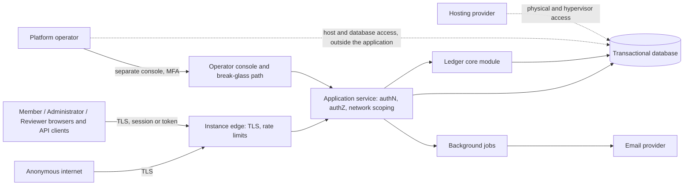

# Security, Privacy, and Abuse-Resistance Baseline

| Field | Value |
|---|---|
| Status | Draft |
| Owner role | Security reviewer |
| Last updated | 2026-11-11 |
| Scope | Assets, actors, and trust assumptions of a Circula instance; a practical threat model; requirement-level controls for authentication, authorization, account recovery, administrator misuse, abuse reporting, rate limiting, input handling, transport and session handling, logging, secrets, backups, data minimization and visibility, operator break-glass access, incident response, supply chain, and multi-network isolation; what must be verified; what this baseline does not claim. Authoritative home for rate limiting, lockout, abuse reporting, break-glass procedure, and the profile field set. |
| Dependencies | [00-conventions.md](00-conventions.md) (terms, ID scheme, baseline decisions), [01-product-vision-and-scope.md](01-product-vision-and-scope.md) (goals and non-goals), [02-personas-roles-and-journeys.md](02-personas-roles-and-journeys.md) (roles and permissions matrix), [03-domain-model-and-mutual-credit-rules.md](03-domain-model-and-mutual-credit-rules.md) (ledger invariants, policy catalogue, error codes) |
| Related documents | [04-functional-requirements.md](04-functional-requirements.md), [05-system-architecture.md](05-system-architecture.md), [06-data-model-ledger-and-audit.md](06-data-model-ledger-and-audit.md), [07-api-and-integration-contract.md](07-api-and-integration-contract.md), [08-ux-and-accessibility.md](08-ux-and-accessibility.md), [10-governance-and-network-operations.md](10-governance-and-network-operations.md), [11-deployment-operations-and-support.md](11-deployment-operations-and-support.md), [12-quality-strategy-and-test-plan.md](12-quality-strategy-and-test-plan.md), [13-assumptions-risks-decisions-and-roadmap.md](13-assumptions-risks-decisions-and-roadmap.md) |

## 1. Purpose and how to read

This document is the security, privacy, and abuse-resistance **baseline** for the Circula MVP. It states requirements an implementation must meet and a test can check. It is not a design, not an audit, and not a certification.

How it was produced: this baseline was drafted with AI assistance from the repository's specifications and widely used public guidance. It has not been reviewed by an independent security assessor, no code exists to assess, and no penetration test has been run. Its threat likelihoods are qualitative judgments. Before this document moves to `Accepted`, a human security reviewer MUST review it ([SEC-183](#sec-183)).

Reading rules:

- Ledger rules are defined in [03-domain-model-and-mutual-credit-rules.md](03-domain-model-and-mutual-credit-rules.md) and only cited here. Where a DOM rule is itself a security control (for example consent, [DOM-008](03-domain-model-and-mutual-credit-rules.md#dom-008), or no self-dealing, [DOM-043](03-domain-model-and-mutual-credit-rules.md#dom-043)), this document maps threats to it and adds only what the DOM rule does not say.
- Permissions are defined in the matrix of [02-personas-roles-and-journeys.md](02-personas-roles-and-journeys.md) (PER-010 to PER-032). This document requires how they are enforced, not what they are.
- Numeric values marked **threshold needs product decision** are recommended defaults collected in [OQ-SEC-2](#8-open-questions). An implementation ships them as configurable instance settings unless stated otherwise.
- Error codes proposed here (`unauthenticated`, `forbidden`, `not_found`, `rate_limited`, `reauthentication_required`, `reviewer_ineligible`, `validation_failed`) are authentication and validation codes for the API's problem-details vocabulary; their final spelling is owned by [07-api-and-integration-contract.md](07-api-and-integration-contract.md).

### 1.1 Primary sources

| Source | URL | Used for |
|---|---|---|
| BCP 14 (RFC 2119, RFC 8174) | https://www.rfc-editor.org/info/bcp14 (accessed 2026-11-11) | Normative keywords |
| NIST SP 800-63B, Digital Identity Guidelines: Authentication and Lifecycle Management | https://pages.nist.gov/800-63-3/sp800-63b.html (accessed 2026-11-11); implementers check for the current revision | Password length, blocked lists, no composition or rotation, throttling |
| OWASP Application Security Verification Standard | https://owasp.org/www-project-application-security-verification-standard/ (accessed 2026-11-11) | Verification target ([SEC-182](#sec-182)) |
| RFC 9106, Argon2 | https://www.rfc-editor.org/rfc/rfc9106 (accessed 2026-11-11) | Password hashing default |
| RFC 6238, TOTP | https://www.rfc-editor.org/rfc/rfc6238 (accessed 2026-11-11) | Second factor |
| RFC 6797, HTTP Strict Transport Security | https://www.rfc-editor.org/rfc/rfc6797 (accessed 2026-11-11) | HSTS |
| RFC 9116, security.txt | https://www.rfc-editor.org/rfc/rfc9116 (accessed 2026-11-11) | Disclosure contact |
| RFC 9457, Problem Details for HTTP APIs | https://www.rfc-editor.org/rfc/rfc9457 (accessed 2026-11-11) | Error bodies including `rate_limited` |
| RFC 9562, UUIDs | https://www.rfc-editor.org/rfc/rfc9562 (accessed 2026-11-11) | Opaque identifiers ([SEC-022](#sec-022)); format owned by [06-data-model-ledger-and-audit.md](06-data-model-ledger-and-audit.md) |
| WCAG 2.2 | https://www.w3.org/TR/WCAG22/ (accessed 2026-11-11) | Accessibility constraint on challenge tests ([SEC-075](#sec-075)) |

Specific Argon2id, bcrypt, and PBKDF2 parameter values in [SEC-004](#sec-004) follow widely published OWASP password-storage guidance and SHOULD be re-checked against current guidance at implementation time.

### 1.2 Traceability to the authoring brief

| Brief topic | Section |
|---|---|
| Assets, actors, trust assumptions, threat model | 2, 3, 4 |
| Authentication, authorization, account recovery | 5.1, 5.2, 5.3 |
| Administrator misuse, transaction disputes, fraud and abuse reporting | 5.4, 5.5 |
| Rate limiting, secure logging, backups, incident response | 5.6, 5.9, 5.11, 5.14 |
| Data minimization, network-level visibility, export controls | 5.12 |
| No anonymity, cryptographic, or compliance claims without evidence | 7 |

Identifier ranges:

| Range | Topic |
|---|---|
| SEC-001 to SEC-019 | Authentication |
| SEC-020 to SEC-039 | Authorization and data-at-rest integrity |
| SEC-040 to SEC-049 | Account recovery and invitations |
| SEC-050 to SEC-059 | Administrator and reviewer misuse controls |
| SEC-060 to SEC-069 | Abuse reporting |
| SEC-070 to SEC-079 | Rate limiting and anti-automation |
| SEC-080 to SEC-089 | Input validation and output encoding |
| SEC-090 to SEC-099 | Transport and browser security |
| SEC-100 to SEC-109 | Logging |
| SEC-110 to SEC-114 | Secrets and configuration |
| SEC-115 to SEC-119 | Backups |
| SEC-120 to SEC-139 | Data minimization, visibility, exports, privacy |
| SEC-140 to SEC-149 | Operator break-glass access |
| SEC-150 to SEC-159 | Incident response and vulnerability disclosure |
| SEC-160 to SEC-169 | Supply chain and build |
| SEC-170 to SEC-179 | Multi-network isolation |
| SEC-180 to SEC-189 | Security verification |

## 2. Assets

| Asset | What it is | Property that matters most | Harm if lost |
|---|---|---|---|
| Ledger integrity | Ledger events and postings of every network ([DOM-001](03-domain-model-and-mutual-credit-rules.md#dom-001) to [DOM-010](03-domain-model-and-mutual-credit-rules.md#dom-010)) | Integrity, attribution | Members can no longer trust any balance; the network may end. |
| Balances and limits | Derived balances, credit limits, positive limits, over-limit state | Integrity; confidentiality where [DOM-096](03-domain-model-and-mutual-credit-rules.md#dom-096) is `hidden` | Unbounded negative balances, socialized losses, embarrassment or social pressure on members. |
| Consent records | Proposer and acceptor of each transaction, reversal requests, confirmations ([DOM-008](03-domain-model-and-mutual-credit-rules.md#dom-008)) | Integrity, non-forgeability by other roles | A member's balance moves without their agreement. |
| Audit log | Append-only audit events ([DOM-012](03-domain-model-and-mutual-credit-rules.md#dom-012)) | Integrity, completeness, restricted access | Misuse cannot be detected or explained afterwards. |
| Identity credentials | Password hashes, TOTP secrets, recovery codes, session identifiers, reset and invitation tokens, personal access tokens | Confidentiality | Account takeover; actions attributed to the wrong person. |
| Personal data | Email addresses, display names, profile fields, listings, free-text descriptions, dispute statements, IP addresses in logs | Confidentiality, minimization | Exposure of who trades with whom, who has a negative balance, contact details; harassment. |
| Policy configuration | Versioned network policy ([DOM-017](03-domain-model-and-mutual-credit-rules.md#dom-017)) | Integrity, attribution | Silent change of limits or approval rules. |
| Backups | Full copies of the instance database and configuration | Confidentiality, restorability | Bulk leak of every network's data, or inability to recover. |
| Availability | The service accepting reads and state changes | Availability | Members cannot record trades; proposals expire unaccepted ([DOM-025](03-domain-model-and-mutual-credit-rules.md#dom-025)). |
| Network isolation | Separation between networks on one instance ([DEC-001](13-assumptions-risks-decisions-and-roadmap.md#dec-001)) | Confidentiality, integrity | Members or administrators of one network read or change another network's data. |
| Operator credentials | Operator console accounts, database and host credentials, email provider credentials, signing keys | Confidentiality | Every network on the instance is exposed at once. |

## 3. Actors and trust assumptions

Plain-text summary: all member, administrator, and reviewer traffic reaches the application service through one TLS edge with rate limiting; the application performs authentication, authorization, and network scoping before calling the ledger core or the database ([DEC-006](13-assumptions-risks-decisions-and-roadmap.md#dec-006), [DEC-010](13-assumptions-risks-decisions-and-roadmap.md#dec-010)). The platform operator uses a separate console and the break-glass path. The operator and the hosting provider also have access below the application (host, database, backups) that the software cannot prevent; this baseline handles that access with procedure, detection, and honesty rather than technical prevention.

| Actor | Trusted to | Not trusted to |
|---|---|---|
| Anonymous internet | Nothing. May reach the login, sign-up, recovery, invitation-acceptance pages, and public listings where [DOM-097](03-domain-model-and-mutual-credit-rules.md#dom-097) is `public_read`. | Learn whether an email address has an identity; read member data; send unbounded requests. |
| Member | Act on their own account within [PER-017](02-personas-roles-and-journeys.md#per-017) to [PER-030](02-personas-roles-and-journeys.md#per-030); give or withhold consent for their own account. | Act for another account; see balances hidden by policy; see other networks; see who reported them. |
| Network administrator | Configure policy, manage memberships and roles, post adjustments and administrator reversals, export network data, read the network audit log ([PER-011](02-personas-roles-and-journeys.md#per-011) to [PER-031](02-personas-roles-and-journeys.md#per-031)). | Supply a member's consent ([DOM-008](03-domain-model-and-mutual-credit-rules.md#dom-008)); act on both sides of a network-account event ([DOM-043](03-domain-model-and-mutual-credit-rules.md#dom-043)); act unseen (every action notified or visible, [SEC-051](#sec-051)); set or read member passwords or MFA secrets; see other networks or the person's other memberships. |
| Dispute reviewer | Read the subject event, statements, and the parties' relevant postings for assigned disputes; record a resolution ([PER-026](02-personas-roles-and-journeys.md#per-026)). | Review a dispute they are party to ([DOM-061](03-domain-model-and-mutual-credit-rules.md#dom-061), [PER-006](02-personas-roles-and-journeys.md#per-006)); post remedies without the confirmation that [DOM-111](03-domain-model-and-mutual-credit-rules.md#dom-111) requires. |
| Platform operator | Run, upgrade, back up, and restore the instance; create networks and assign the first administrator ([PER-010](02-personas-roles-and-journeys.md#per-010)); suspend a network as incident containment; use break-glass read access ([SEC-140](#sec-140)). | Hold any role inside a network ([PER-007](02-personas-roles-and-journeys.md#per-007)); write to any ledger ([SEC-142](#sec-142)); read network data outside a recorded break-glass session. **Honest limit:** an operator with database or host access can technically read everything and alter rows; the software can only detect ledger alteration ([SEC-028](#sec-028)) and record procedural access ([SEC-145](#sec-145)). Members trust the operator organization. |
| Email provider | Deliver messages to the addresses given. | Keep message contents confidential beyond its own terms. Messages therefore carry the minimum content ([SEC-086](#sec-086)) and single-use, short-lived tokens only ([SEC-040](#sec-040)). |
| Hosting provider | Provide compute, storage, and network as contracted. | Not read stored data. **Honest limit:** encryption at rest under keys held on the same host does not protect against the hosting provider; backups are encrypted with keys held apart from the backup storage ([SEC-115](#sec-115)). |
| Software supply chain | Libraries, build tools, and base images the project pins and reviews ([SEC-160](#sec-160)). | Be free of malicious or vulnerable code. Controlled by pinning, scanning, and review, not by trust. |

## 4. Threat model

Threat labels `T01` to `T24` are local to this table and are not requirement identifiers. Likelihood and impact are qualitative (Low, Medium, High) for a small community network on a self-hosted instance with no special targeting. Residual risk is the risk left after the listed controls are implemented.

| # | Threat (STRIDE category) | Likelihood | Impact | Controls | Residual risk |
|---|---|---|---|---|---|
| T01 | Credential stuffing with passwords reused from other breaches (Spoofing) | High | High | [SEC-002](#sec-002), [SEC-003](#sec-003), [SEC-005](#sec-005), [SEC-008](#sec-008), [SEC-009](#sec-009), [SEC-070](#sec-070) | Medium: members without MFA who reuse a password that is not yet in the blocked list. |
| T02 | Session theft via cross-site scripting, network interception, or a shared device (Spoofing) | Medium | High | [SEC-010](#sec-010), [SEC-011](#sec-011), [SEC-012](#sec-012), [SEC-082](#sec-082), [SEC-090](#sec-090) to [SEC-095](#sec-095) | Low to Medium: malware on the member's own device. |
| T03 | Cross-site request forgery causing a proposal, acceptance, or administrator action (Tampering) | Medium | High | [SEC-092](#sec-092), [SEC-093](#sec-093), [SEC-025](#sec-025) | Low. |
| T04 | Account recovery takeover through a compromised or guessed reset link, an email-change race, or MFA-reset abuse (Spoofing) | Medium | High | [SEC-040](#sec-040) to [SEC-046](#sec-046), [SEC-015](#sec-015), [SEC-071](#sec-071) | Medium: an attacker who controls the member's mailbox controls recovery unless MFA is enrolled. |
| T05 | Administrator self-dealing through the network account (Elevation, Tampering) | Medium | High | [DOM-043](03-domain-model-and-mutual-credit-rules.md#dom-043), [DOM-110](03-domain-model-and-mutual-credit-rules.md#dom-110), [SEC-024](#sec-024), [SEC-050](#sec-050), [SEC-054](#sec-054) | Medium in single-administrator networks: disclosure replaces prevention. |
| T06 | Administrator limit inflation for self or allies (Elevation) | Medium | Medium | [DOM-050](03-domain-model-and-mutual-credit-rules.md#dom-050), [DOM-091](03-domain-model-and-mutual-credit-rules.md#dom-091), [SEC-025](#sec-025), [SEC-054](#sec-054), [SEC-055](#sec-055) | Medium: within the network maximum the change is legitimate; detection relies on other administrators reading alerts. |
| T07 | Fake write-offs or forfeitures to move credits to or from favored members (Tampering) | Low | High | [DOM-040](03-domain-model-and-mutual-credit-rules.md#dom-040) to [DOM-042](03-domain-model-and-mutual-credit-rules.md#dom-042), [DOM-053](03-domain-model-and-mutual-credit-rules.md#dom-053), [DOM-107](03-domain-model-and-mutual-credit-rules.md#dom-107), [SEC-051](#sec-051), [SEC-056](#sec-056) | Low to Medium: the network account balance is visible, so losses cannot be hidden, only explained away. |
| T08 | Mass adjustments or mass suspensions by one compromised or hostile administrator (Tampering, Denial) | Low | High | [SEC-025](#sec-025), [SEC-055](#sec-055), [SEC-074](#sec-074), [DOM-107](03-domain-model-and-mutual-credit-rules.md#dom-107) | Medium: corrections are possible but laborious; prevention depends on approval policy. |
| T09 | Reviewer collusion with one party of a dispute (Tampering) | Medium | Medium | [DOM-061](03-domain-model-and-mutual-credit-rules.md#dom-061), [DOM-063](03-domain-model-and-mutual-credit-rules.md#dom-063), [DOM-111](03-domain-model-and-mutual-credit-rules.md#dom-111), [DOM-113](03-domain-model-and-mutual-credit-rules.md#dom-113), [SEC-024](#sec-024), [SEC-057](#sec-057) | Medium: social collusion is a governance problem; software makes outcomes visible and appealable. |
| T10 | Cross-network data access by changing identifiers in requests (IDOR) in a multi-network instance (Information disclosure) | Medium | High | [SEC-020](#sec-020) to [SEC-023](#sec-023), [SEC-170](#sec-170) to [SEC-175](#sec-175) | Low, provided the isolation tests of [SEC-170](#sec-170) cover every operation. |
| T11 | Replay or duplicate posting of a state-changing request (Tampering) | High (accidental) | Medium | [DOM-011](03-domain-model-and-mutual-credit-rules.md#dom-011), [SEC-093](#sec-093), [SEC-005](#sec-005) (TOTP single use) | Low. |
| T12 | Race to double-spend available credit by concurrent acceptances (Tampering) | Medium | Medium | [DOM-009](03-domain-model-and-mutual-credit-rules.md#dom-009), [SEC-181](#sec-181) | Low. |
| T13 | Direct database tampering with postings, balances, or audit events by someone with database access (Tampering, Repudiation) | Low | High | [DOM-002](03-domain-model-and-mutual-credit-rules.md#dom-002), [DOM-003](03-domain-model-and-mutual-credit-rules.md#dom-003), [SEC-028](#sec-028), [SEC-104](#sec-104), [SEC-145](#sec-145) | Medium: a privileged attacker can rewrite consistently; detection is likely but not guaranteed ([section 7](#7-explicit-non-claims)). |
| T14 | Personal data leaking through operational logs, error messages, backups, or exports (Information disclosure) | Medium | Medium | [SEC-101](#sec-101), [SEC-102](#sec-102), [SEC-106](#sec-106), [SEC-115](#sec-115), [SEC-125](#sec-125) | Low to Medium. |
| T15 | Operator break-glass abuse: reading network data without cause, or extending access silently (Information disclosure, Elevation) | Low | High | [PER-033](02-personas-roles-and-journeys.md#per-033), [SEC-140](#sec-140) to [SEC-145](#sec-145) | Medium: operator below-application access ([section 3](#3-actors-and-trust-assumptions)). |
| T16 | Denial of service: request floods, proposal spam, invitation spam, export floods (Denial) | Medium | Medium | [SEC-070](#sec-070) to [SEC-078](#sec-078) | Medium: volumetric attacks beyond the instance's capacity are an operations matter ([11-deployment-operations-and-support.md](11-deployment-operations-and-support.md)). |
| T17 | Harassment through listings, profile text, transaction descriptions, or dispute statements (no STRIDE category; abuse) | Medium | Medium | [SEC-060](#sec-060) to [SEC-066](#sec-066), [SEC-080](#sec-080) to [SEC-083](#sec-083), [SEC-074](#sec-074) | Medium: moderation depends on administrators acting. |
| T18 | Fake accounts and sybil memberships to gain extra credit limits (Spoofing) | Medium | Medium | [DOM-095](03-domain-model-and-mutual-credit-rules.md#dom-095) (approval), [SEC-076](#sec-076), [SEC-124](#sec-124) | Medium: approval by people who know the applicant is the real control. |
| T19 | Phishing that imitates invitation, notification, or reset emails (Spoofing) | Medium | High | [SEC-086](#sec-086), [SEC-073](#sec-073), [SEC-012](#sec-012), [SEC-005](#sec-005) | Medium: members can still be deceived by look-alike domains. |
| T20 | Supply-chain compromise of a dependency, build tool, or release artifact (Tampering) | Low | High | [SEC-160](#sec-160) to [SEC-165](#sec-165) | Medium. |
| T21 | Insider at the hosting provider reading disks or snapshots (Information disclosure) | Low | High | [SEC-115](#sec-115), [SEC-111](#sec-111) | Medium to High for live data: not preventable by the application ([section 7](#7-explicit-non-claims)). |
| T22 | Privilege persistence after role removal or suspension (Elevation) | Medium | Medium | [SEC-026](#sec-026), [SEC-011](#sec-011) | Low. |
| T23 | Enumeration of members or email addresses via login, recovery, invitation, or error responses (Information disclosure) | High | Low | [SEC-009](#sec-009), [SEC-041](#sec-041), [SEC-027](#sec-027) | Low. |
| T24 | Injection (query, script, CSV formula, email header) through free text (Tampering) | Medium | High | [SEC-081](#sec-081) to [SEC-086](#sec-086) | Low. |

## 5. Requirements by area

### 5.1 Authentication

**SEC-001 — Platform identity separate from membership.** Authentication MUST be performed against a platform-level identity (email address plus password, [DEC-007](13-assumptions-risks-decisions-and-roadmap.md#dec-007)), independent of any network membership. A successful login MUST NOT by itself grant any network permission; permissions come only from memberships ([PER-005](02-personas-roles-and-journeys.md#per-005)). (P0)
*Rationale:* one login across several networks without letting one network's role leak into another.

**SEC-002 — Password policy by length, not composition.** The platform MUST accept passwords of at least 12 and at most 128 characters (recommended defaults; threshold needs product decision), counted as Unicode code points after NFC normalization, including spaces and any printable character. It MUST NOT impose composition rules (required digits, symbols, case), MUST NOT require periodic rotation, MUST allow pasting into the password field, and MUST NOT truncate passwords. A password change is required only after evidence of compromise. (P0)
*Rationale:* follows NIST SP 800-63B guidance on memorized secrets; composition rules and rotation push people toward predictable passwords.

**SEC-003 — Blocked-password check.** At registration and password change the platform SHOULD reject passwords found in a list of common and known-breached passwords, with a message that says why. The list MUST be usable offline (shipped with the release or loaded by the operator). If an external breach-lookup service is used, the platform MUST send only a truncated hash prefix, never the password or full hash, and MUST accept the password when the service is unreachable (fail open, with the local list still applied). (P1)
*Rationale:* the main defense against credential stuffing (T01) for members without MFA.

**SEC-004 — Password hashing.** Passwords MUST be stored only as salted hashes produced by a memory-hard or deliberately slow password-hashing function with a unique random salt of at least 128 bits per hash. Recommended default: **Argon2id** ([RFC 9106](https://www.rfc-editor.org/rfc/rfc9106), accessed 2026-11-11) with at least 19 MiB memory, 2 iterations, parallelism 1, tuned so one verification takes 100 to 500 ms on the instance hardware. Alternatives where Argon2id is unavailable: scrypt; bcrypt with cost 10 or higher (inputs limited to 72 bytes, so the platform MUST pre-hash or reject longer inputs rather than truncate silently); PBKDF2-HMAC-SHA-256 with at least 600,000 iterations where a validated-module requirement applies. Algorithm and parameters MUST be stored with each hash, and a hash with outdated parameters MUST be re-computed at the next successful login. A pepper held in the secret store ([SEC-110](#sec-110)) MAY be added. (P0)
*Rationale:* a database leak (T13, T21) must not yield usable passwords quickly.

**SEC-005 — TOTP second factor.** The platform MUST offer time-based one-time-password (TOTP, [RFC 6238](https://www.rfc-editor.org/rfc/rfc6238), accessed 2026-11-11) enrollment to every identity, with 30-second steps, 6 digits, and acceptance of at most one step of clock drift either way. Enrollment MUST be confirmed by entering a valid code before it takes effect. A code MUST be accepted at most once (a second use within its validity window is rejected). TOTP secrets MUST be stored encrypted with a key from the secret store. Enrolling and removing a second factor MUST be audited and notified by email to the identity. (P0 for availability; enrollment by members is optional, SHOULD be encouraged in the interface.)
*Rationale:* the strongest MVP control against T01, T04, and T19 that needs no SMS or hardware.

**SEC-006 — Second factor for administrators and operators.** Operator console accounts MUST have a second factor enrolled before any operator action is allowed. For network administrators, the instance MUST provide a setting "require second factor for administrators"; recommended default **on** (open decision [OQ-SEC-1](#8-open-questions)). When on, an administrator without an enrolled second factor MUST be able to sign in and act as a member but MUST receive `reauthentication_required` with an enrollment prompt for every administrator-only operation. A network MAY require a second factor for all its members (P2). (P0)
*Rationale:* an administrator account controls every member's limits and adjustments (T05 to T08).

**SEC-007 — Recovery codes.** On enrolling a second factor the platform MUST issue 10 single-use recovery codes, each with at least 50 bits of entropy, show them once, and store only their hashes. Using a code MUST be audited, MUST email the identity, and MUST show how many codes remain. Generating a new set MUST invalidate all earlier codes. (P0)
*Rationale:* lost phones are routine; without codes every loss becomes a manual recovery case (T04).

**SEC-008 — Login throttling and temporary lockout.** For each identity the platform MUST apply, after 5 consecutive failed logins, an increasing delay between attempts, and after 10 failed logins within 15 minutes a temporary lockout of login for that identity for 15 minutes (recommended defaults; threshold needs product decision). A lockout MUST NOT be permanent, MUST NOT block password recovery, and MUST be notified once per lockout by email to the identity with the time and approximate source. Source-address limits apply in addition ([SEC-072](#sec-072)). A successful login resets the consecutive-failure count. (P0)
*Rationale:* slows guessing (T01) without letting an attacker permanently lock out a member.

**SEC-009 — No account-existence disclosure at login.** Failed logins MUST return the same response, status code, and error code (`unauthenticated`) whether the email is unknown, the password is wrong, the identity is locked, or the second factor is wrong; the lockout itself is communicated only by email. Response time for an unknown email MUST include a password-hash computation so that timing does not reveal existence. (P0)
*Rationale:* prevents enumeration (T23) that feeds targeted phishing.

**SEC-010 — Sessions.** A session identifier MUST contain at least 128 bits from a cryptographically secure random source, be stored server-side only as a hash, and be sent to browsers only in a cookie per [SEC-092](#sec-092). A new identifier MUST be issued at login, at second-factor verification, at any role change of the identity, and at password change. Recommended defaults (threshold needs product decision, [OQ-SEC-4](#8-open-questions)): idle timeout 7 days and absolute lifetime 30 days for ordinary sessions; idle timeout 30 minutes for operator console sessions. Logout MUST invalidate the session server-side. (P0)
*Rationale:* occasional use from phones (PER-001) favors long sessions; theft (T02) favors short ones; revocation compensates.

**SEC-011 — Session listing and revocation.** An identity MUST be able to list its active sessions (creation time, last use, approximate device and location) and revoke any one or all. Password change and password reset MUST revoke all other sessions. An administrator MAY revoke all sessions of a member of their network ([SEC-046](#sec-046)); because sessions belong to the identity, this signs the person out everywhere (open decision [OQ-SEC-6](#8-open-questions)), and it MUST be audited in the network audit log and notified to the member. A revoked session MUST be rejected on every request that starts after the revocation commits. (P0)
*Rationale:* revocation is the remedy for T02 and T22.

**SEC-012 — No secrets in URLs.** Session identifiers, personal access tokens, passwords, TOTP codes, and recovery codes MUST NOT appear in any URL. The only secrets that may appear in a URL are the single-use email tokens of [SEC-040](#sec-040) and [SEC-048](#sec-048); a page reached through such a URL MUST send `Referrer-Policy: no-referrer`, MUST exchange the token on first use, and MUST NOT load third-party resources. (P0)
*Rationale:* URLs leak through history, logs, referrer headers, and shared screenshots (T02, T14).

**SEC-013 — Personal access tokens.** When personal access tokens are provided, each token MUST be shown once, stored only as a hash, carry an expiry (maximum 1 year, recommended default 90 days), be limited to the networks and read or write scopes the identity selects, be listed and revocable by the identity, and carry a recognizable prefix so leaked tokens can be found by secret scanning. A token MUST NOT authorize the operations that require fresh authentication ([SEC-025](#sec-025)). (P1)
*Rationale:* integrations need non-interactive access without the full power of an interactive administrator session.

**SEC-014 — Re-authentication for identity changes.** Changing the password, changing the email address, removing the second factor, generating new recovery codes, and creating a personal access token MUST require the current password and, if enrolled, a second-factor code, entered within the preceding 5 minutes. (P0)
*Rationale:* a stolen session must not be convertible into permanent account takeover (T02 to T04).

**SEC-015 — Email address change.** A new email address MUST take effect only after a single-use confirmation token sent to the new address is used. The old address MUST be notified of the change with the time and an instruction for reporting an unwanted change; the notice MUST NOT contain a link that reverts the change by itself. (P0)
*Rationale:* email is the recovery channel; silently moving it is the usual takeover path (T04).

**SEC-016 — Authentication events audited.** In addition to the authentication events [DOM-012](03-domain-model-and-mutual-credit-rules.md#dom-012) lists, the platform MUST record as instance-level audit events: second-factor enrollment and removal, recovery-code generation and use, email change requests and completions, password changes, lockouts, and personal access token creation and revocation. (P0)
*Rationale:* these are the events an incident investigation needs first.

### 5.2 Authorization and data-at-rest integrity

**SEC-020 — Server-side check on every operation.** Every API operation MUST declare the permission from the matrix ([PER-010](02-personas-roles-and-journeys.md#per-010) to [PER-032](02-personas-roles-and-journeys.md#per-032)) it requires, and the server MUST evaluate it on every request before any state is read or changed, as [PER-008](02-personas-roles-and-journeys.md#per-008) requires. An operation without a declared permission MUST be denied (deny by default), and an automated check in the build MUST fail when an operation lacks a declaration. (P0)
*Rationale:* one path ([DEC-006](13-assumptions-risks-decisions-and-roadmap.md#dec-006)) means one place where every check must happen.

**SEC-021 — Network scoping.** For every operation on a network-scoped object, the server MUST derive the network from the stored object (not from a client-supplied network identifier alone), MUST verify that the acting identity holds a membership in that network whose status and roles permit the operation, and MUST include the network in every database query and command that touches network data. (P0)
*Rationale:* the isolation that [DEC-001](13-assumptions-risks-decisions-and-roadmap.md#dec-001) promises is enforced only in software (T10).

**SEC-022 — Object-level checks.** Beyond role checks, the server MUST verify the actor's relation to the specific object: party to the transaction, holder of the account, raiser or assigned reviewer of the dispute, author of the listing. Opaque, non-sequential identifiers MUST be used externally but MUST NOT be relied on as an access control. (P0)
*Rationale:* identifiers leak through shared links and exports; possession of one is not authority (T10).

**SEC-023 — Membership status gates.** A membership that is not `Active` MUST be denied every state-changing operation except those [10-governance-and-network-operations.md](10-governance-and-network-operations.md) explicitly keeps for `Suspended` or `Departed` members (for example own-data export, [PER-030](02-personas-roles-and-journeys.md#per-030)). (P0)
*Rationale:* suspension must stop activity immediately (T22).

**SEC-024 — Recusal and self-dealing checks server-side.** The server MUST enforce [DOM-043](03-domain-model-and-mutual-credit-rules.md#dom-043) (error `self_dealing_not_allowed`) and the reviewer recusal of [DOM-061](03-domain-model-and-mutual-credit-rules.md#dom-061) and [PER-006](02-personas-roles-and-journeys.md#per-006) (error `reviewer_ineligible`) on the identity, not only the membership: the check compares the person behind each role, so that one identity cannot satisfy two sides through two memberships. Where [DOM-113](03-domain-model-and-mutual-credit-rules.md#dom-113) is `separate_people_required`, granting the second role to the same membership MUST be rejected. (P0)
*Rationale:* T05 and T09.

**SEC-025 — Fresh authentication for high-impact administrator actions.** Posting an adjustment, posting an administrator reversal, changing a credit limit or positive limit, granting or removing the administrator or reviewer role, changing network policy, suspending or removing a member, and starting a network export SHOULD require that the administrator entered their password or a second-factor code within the preceding 15 minutes (recommended default; threshold needs product decision); otherwise the server returns `reauthentication_required`. (P1)
*Rationale:* limits the harm of a stolen or unattended administrator session and of CSRF (T03, T06, T08).

**SEC-026 — Revocation takes effect immediately.** A role removal, membership suspension, or departure MUST take effect for every request that starts after the change commits. Any cache of permissions MUST be invalidated by the change or MUST NOT be used for authorization. (P0)
*Rationale:* T22.

**SEC-027 — Uniform denial responses.** A request for an object in a network the actor has no membership in, or for an object the actor may not know exists, MUST receive the same response as for a non-existent object (`not_found`). A request the actor may know about but may not perform MUST receive `forbidden` without naming data the actor cannot otherwise see ([PER-008](02-personas-roles-and-journeys.md#per-008)). (P0)
*Rationale:* prevents probing across networks (T10, T23).

**SEC-028 — Database privilege separation and tamper detection.** The runtime database credential SHOULD lack permission to update or delete rows of ledger events, postings, and audit events where the store supports such grants; schema migrations MUST use a separate credential used only during upgrades ([11-deployment-operations-and-support.md](11-deployment-operations-and-support.md)). The balance verification of [DOM-003](03-domain-model-and-mutual-credit-rules.md#dom-003) MUST run at least daily per network and after every restore, and a discrepancy MUST alert the operator and every administrator of the affected network. Hash-chaining of ledger and audit records as additional tamper evidence is an open decision ([OQ-SEC-8](#8-open-questions)). (P0 for verification; P1 for privilege separation)
*Rationale:* [DOM-002](03-domain-model-and-mutual-credit-rules.md#dom-002) is a rule for the software; T13 is someone bypassing the software.

**SEC-029 — Operator console separation.** Operator functions MUST be served through a console that is separate from member-facing operations, requires operator accounts distinct from member identities, and offers no operation that changes a network's ledger, policy, or roles, except the network creation and first-administrator assignment of [PER-010](02-personas-roles-and-journeys.md#per-010), network suspension and reinstatement, and the exception in [SEC-142](#sec-142). (P0)
*Rationale:* [PER-007](02-personas-roles-and-journeys.md#per-007); operator power must be enumerable.

### 5.3 Account recovery and invitations

**SEC-040 — Password reset token.** A password reset MUST use a token of at least 128 bits of randomness, sent only to the identity's confirmed email address, stored only as a hash, valid for 30 minutes (recommended default), usable once, and invalidated when a newer token is issued, when the password changes, or when the email address changes. (P0)
*Rationale:* T04.

**SEC-041 — No account-existence disclosure in recovery.** The recovery request MUST return the same message and status for known and unknown addresses ("If an account exists for this address, we have sent instructions"). For an unknown address the platform MUST NOT send any email (recommended default; prevents the recovery form from being used to send mail to arbitrary addresses). (P0)
*Rationale:* T23.

**SEC-042 — Effects of a reset.** Completing a password reset MUST revoke every session of the identity, SHOULD revoke its personal access tokens (the confirmation page states which were revoked), MUST be audited, and MUST email the identity's address with the time and the instruction to contact an administrator or the operator if the reset was not theirs. (P0)
*Rationale:* a reset after takeover must evict the attacker (T04).

**SEC-043 — Reset does not bypass the second factor.** For an identity with an enrolled second factor, completing a password reset MUST also require a valid TOTP code or an unused recovery code. Without either, the person follows [SEC-045](#sec-045). (P0)
*Rationale:* otherwise mailbox compromise defeats MFA (T04).

**SEC-044 — Recovery attempt notification.** Every recovery request for an existing identity MUST be audited. When more than 3 recovery emails are requested for one identity within 24 hours (recommended default), further requests MUST be refused silently for the rest of that period while the response to the requester stays unchanged. (P0)
*Rationale:* stops the recovery flow being used to flood a mailbox (T16).

**SEC-045 — Recovery after losing the second factor.** A person who has lost both the second factor and all recovery codes MUST be able to request second-factor removal by email confirmation, after which a waiting period of 72 hours (recommended default; open decision [OQ-SEC-5](#8-open-questions)) begins. During the waiting period the platform MUST email the address at the start and daily, MUST cancel the request when the identity signs in with the second factor, and MUST NOT remove the factor early. After the period the factor is removed, all sessions revoked, and every network in which the identity holds the administrator role MUST have its other administrators notified. (P0)
*Rationale:* a self-service path that an attacker with brief mailbox access cannot complete unnoticed.

**SEC-046 — Administrators cannot reset credentials.** No network administrator, reviewer, or operator function MAY set, read, or reset a member's password, second factor, or recovery codes, or view password hashes. An administrator MAY revoke a member's sessions ([SEC-011](#sec-011)). An operator MAY trigger a standard reset email to the address on file but MUST NOT choose the new password. (P0)
*Rationale:* a credential known to two people cannot attribute consent ([DOM-008](03-domain-model-and-mutual-credit-rules.md#dom-008)).

**SEC-047 — Recovery rate limits.** Recovery and second-factor-removal requests MUST be subject to per-identity limits ([SEC-044](#sec-044)) and per-source limits ([SEC-072](#sec-072)). (P0)
*Rationale:* T16, T04.

**SEC-048 — Invitation tokens.** An invitation token MUST be at least 128 bits of randomness, stored only as a hash, valid for the invitation window ([DOM-099](03-domain-model-and-mutual-credit-rules.md#dom-099)), usable once, and invalidated on revocation. Accepting an invitation addressed to an email that already has an identity MUST require signing in to that identity; accepting with a different identity MUST be refused. (P0)
*Rationale:* an intercepted invitation must not let someone else take the invited place (T18, T19).

### 5.4 Administrator and reviewer misuse controls

**SEC-050 — Misuse threats mapped to platform rules.** The platform MUST implement the following mapping; each listed DOM policy MUST be configurable per [PER-034](02-personas-roles-and-journeys.md#per-034), and its current value MUST be readable by every active member of the network. (P0)

| Misuse | Rule that prevents or exposes it | Additional SEC control |
|---|---|---|
| Self-dealing through the network account (T05) | [DOM-043](03-domain-model-and-mutual-credit-rules.md#dom-043), [DOM-110](03-domain-model-and-mutual-credit-rules.md#dom-110) | [SEC-024](#sec-024), [SEC-054](#sec-054) |
| Unilateral adjustments, fake write-offs (T07, T08) | [DOM-041](03-domain-model-and-mutual-credit-rules.md#dom-041), [DOM-107](03-domain-model-and-mutual-credit-rules.md#dom-107), [DOM-053](03-domain-model-and-mutual-credit-rules.md#dom-053) | [SEC-051](#sec-051), [SEC-055](#sec-055), [SEC-056](#sec-056) |
| Unilateral reversals (T08) | [DOM-031](03-domain-model-and-mutual-credit-rules.md#dom-031), [DOM-108](03-domain-model-and-mutual-credit-rules.md#dom-108) | [SEC-025](#sec-025), [SEC-051](#sec-051) |
| Limit inflation (T06) | [DOM-050](03-domain-model-and-mutual-credit-rules.md#dom-050), [DOM-091](03-domain-model-and-mutual-credit-rules.md#dom-091) | [SEC-054](#sec-054) |
| Dispute remedies without oversight (T09) | [DOM-111](03-domain-model-and-mutual-credit-rules.md#dom-111), [DOM-061](03-domain-model-and-mutual-credit-rules.md#dom-061) | [SEC-057](#sec-057) |
| Removing other administrators to gain sole control | [PER-006](02-personas-roles-and-journeys.md#per-006) (last-administrator floor), [PER-016](02-personas-roles-and-journeys.md#per-016) | [SEC-053](#sec-053), [SEC-054](#sec-054) |

*Rationale:* administrator misuse is the most direct abuse path ([DOM-043](03-domain-model-and-mutual-credit-rules.md#dom-043) rationale); controls must be traceable to threats.

**SEC-051 — Every administrator action on a member is notified.** In addition to the ledger notifications of [DOM-014](03-domain-model-and-mutual-credit-rules.md#dom-014), the affected member MUST be notified by email and in-app of every administrator action that changes their account limits, account status, membership status, roles, or listings, with the acting administrator's display name, the reason, and the time. Notification attempts MUST be audited. These notices are part of the mandatory notification set of FR-084 in [04-functional-requirements.md](04-functional-requirements.md). (P0)
*Rationale:* misuse that the target sees immediately is misuse that gets challenged.

**SEC-052 — Administrators and reviewers visible.** Every active member MUST be able to see the current list of the network's administrators and reviewers, with the date each role was granted. (P0)
*Rationale:* members must know who can act on their account.

**SEC-053 — Last-administrator floor under all paths.** The floor of [PER-006](02-personas-roles-and-journeys.md#per-006) MUST be enforced for role removal, suspension, departure, and identity closure alike, and an administrator MUST NOT be able to remove or suspend another administrator without that action being notified to every administrator ([SEC-054](#sec-054)). (P0)
*Rationale:* a takeover often starts by removing co-administrators.

**SEC-054 — Alerts to all administrators.** Every administrator of a network MUST be notified by email and in-app when: an administrator or reviewer role is granted or removed; an administrator is suspended or removed; network policy changes; a credit limit is set above the network default credit limit ([DOM-090](03-domain-model-and-mutual-credit-rules.md#dom-090)) (recommended threshold; threshold needs product decision); an event with the `self_dealing` flag is posted; a network export is started; a break-glass session on the network starts ([SEC-141](#sec-141)). The acting administrator receives the notice too. (P0)
*Rationale:* co-administrators are the first line of oversight (T05, T06, T08).

**SEC-055 — Mass-action alert.** When one administrator performs more than 10 adjustments, administrator reversals, limit changes, or suspensions in any 24-hour period (recommended default; threshold needs product decision), every other administrator MUST be alerted with a list of the actions, and further such actions by that administrator in the period MUST require fresh authentication ([SEC-025](#sec-025)) for each. (P1)
*Rationale:* T08; ordinary administration rarely needs bursts.

**SEC-056 — Network-account activity summary for members.** Every active member SHOULD be able to see, per calendar month, the count and total amount of adjustments by type that debited or credited the network account, and the administrators who initiated them, without member identities beyond what [DOM-096](03-domain-model-and-mutual-credit-rules.md#dom-096) and [DOM-110](03-domain-model-and-mutual-credit-rules.md#dom-110) already disclose. (P1)
*Rationale:* the visible network-account balance ([DOM-053](03-domain-model-and-mutual-credit-rules.md#dom-053)) shows that losses exist; the summary shows who recorded them (T07).

**SEC-057 — Reviewer accountability.** Both parties MUST see the reviewer's identity, outcome, and reasoning of every resolution. Administrators MUST be able to list resolutions by reviewer with outcomes. The eligibility of the confirming administrator for a remedy under [DOM-111](03-domain-model-and-mutual-credit-rules.md#dom-111) is governed by [DOM-062](03-domain-model-and-mutual-credit-rules.md#dom-062). (P0)
*Rationale:* collusion (T09) is hard to prevent but easy to make visible; appeals ([DOM-063](03-domain-model-and-mutual-credit-rules.md#dom-063)) need the record.

### 5.5 Transaction disputes and abuse reporting

Transaction disputes are ledger matters and follow [DOM-060](03-domain-model-and-mutual-credit-rules.md#dom-060) to [DOM-064](03-domain-model-and-mutual-credit-rules.md#dom-064). Abuse reports, defined here, concern conduct (harassment, spam, suspected fraud, fake accounts) and never change balances.

**SEC-060 — Report a listing, member, or transaction.** An active member MUST be able to report a listing, a member of the same network, or a transaction they can see, choosing a category (`harassment`, `spam`, `suspected_fraud`, `fake_account`, `inappropriate_content`, `other`) and adding free text up to the limit of [SEC-080](#sec-080). The reporter MUST receive confirmation that the report was received. (P0)
*Rationale:* T17, T18; administrators cannot act on what they do not hear.

**SEC-061 — Report queue.** Administrators MUST have a queue of the network's reports with statuses `Open`, `Actioned`, `Dismissed`, each closure carrying a reason text. The reporter MUST be notified when their report is closed, with the status but not the details of any action against another member. (P0)
*Rationale:* reports that vanish discourage reporting.

**SEC-062 — Reporter confidentiality.** The reporter's identity MUST be visible to the network's administrators only and MUST NOT be shown to the reported member or included in any member export of the reported member. (P0)
*Rationale:* protects reporters from retaliation in small communities.

**SEC-063 — Reports audited.** Creating, assigning, and closing a report MUST create network audit events. The audit event MUST record the report identifier and category but not the free text. (P0)
*Rationale:* moderation decisions are administrator actions and need the same accountability.

**SEC-064 — No automatic penalties.** The platform MUST NOT suspend a member, hide or pause a listing, change a limit, or alter any other state automatically because of the number or content of reports. Every consequence MUST be an attributed administrator action under [SEC-051](#sec-051). (P0)
*Rationale:* automatic penalties invite brigading; governance belongs to people ([VIS-017](01-product-vision-and-scope.md#vis-017)).

**SEC-065 — Reports about administrators.** A report naming an administrator, or a listing or transaction of an administrator, MUST be visible to every administrator of the network, and the reported administrator MUST NOT be able to close it. If the reported administrator is the only administrator, the reporter MUST be told before submitting that no other administrator will see it and shown the network's governance contact ([10-governance-and-network-operations.md](10-governance-and-network-operations.md)); routing to anyone else is open decision [OQ-SEC-13](#8-open-questions). (P0)
*Rationale:* the reported person must not judge their own case.

**SEC-066 — Member blocking.** A member-to-member block (rejecting proposals from a chosen member) is deferred. (P2)
*Rationale:* recorded to fix the boundary; MVP relies on reports and administrator action against harassment through proposals.

### 5.6 Rate limiting and anti-automation

**SEC-070 — Layered limits.** The platform MUST apply rate limits per identity, per source address (IPv4 address or IPv6 /64 prefix), and per network for the operations in [SEC-072](#sec-072). Limits MUST be evaluated before costly work (password hashing, export generation, email sending). Limit values MUST be instance settings. (P0)
*Rationale:* T01, T16; the authoritative home for limits is this document.

**SEC-071 — Limit response.** A request over a limit MUST receive HTTP status 429 with a `Retry-After` header in seconds and a problem-details body ([RFC 9457](https://www.rfc-editor.org/rfc/rfc9457), accessed 2026-11-11) with code `rate_limited`, and MUST NOT reveal which other identities or addresses share the limit. Login and recovery endpoints MUST apply [SEC-009](#sec-009) and [SEC-041](#sec-041) first, so that a 429 does not reveal account existence. Limit hits MUST be counted in operational metrics. (P0)
*Rationale:* clients need a predictable signal; QA verifies it ([12-quality-strategy-and-test-plan.md](12-quality-strategy-and-test-plan.md)).

**SEC-072 — Recommended default limits.** (P0 for the existence of each limit; every number: threshold needs product decision, [OQ-SEC-2](#8-open-questions).)

| Operation | Per identity | Per source address | Per network |
|---|---|---|---|
| Login attempts | [SEC-008](#sec-008) | 30 per 15 minutes | — |
| Identity registration | — | 5 per hour | — |
| Recovery and second-factor removal requests | 3 per 24 hours ([SEC-044](#sec-044)) | 10 per hour | — |
| Transaction proposals | 30 per hour, 200 per 24 hours | 60 per hour | 2,000 per hour |
| Open `Proposed` transactions as proposer | 50 at once | — | — |
| Invitations sent | 50 per 24 hours | — | 200 per 24 hours |
| Re-sending an invitation to one address | 3 per 24 hours | — | — |
| Listing creation or edit | 20 per hour | 40 per hour | — |
| Abuse reports | 10 per 24 hours | — | — |
| Member self-export | 5 per hour | — | — |
| Network export | 3 per 24 hours | — | 3 per 24 hours |
| Any authenticated request | 600 per minute | 1,200 per minute | — |

*Rationale:* values allow ordinary use by the personas in [02-personas-roles-and-journeys.md](02-personas-roles-and-journeys.md) and stop scripted floods.

**SEC-073 — Invitation abuse.** Invitation emails MUST be sent only by administrators (or members where policy permits, [PER-012](02-personas-roles-and-journeys.md#per-012)), MUST be counted against [SEC-072](#sec-072), and MUST name the inviting network and inviter display name using the fixed template of [SEC-086](#sec-086). An address that has declined or reported an invitation from a network SHOULD NOT receive another from that network for 30 days. (P0)
*Rationale:* invitation email is the most attractive phishing and spam vector (T19).

**SEC-074 — Proposal and listing spam.** Proposals and listings over the limits of [SEC-072](#sec-072) MUST be rejected with `rate_limited`. Declining a proposal MUST be possible in one action from the notification view. (P0)
*Rationale:* T16, T17: unsolicited proposals are both spam and a harassment channel.

**SEC-075 — Challenge tests (CAPTCHA) are an open decision.** The MVP MUST NOT depend on a third-party challenge service. Whether to add a challenge on registration, recovery, or join-link applications, and which kind, is open decision [OQ-SEC-3](#8-open-questions); the design SHOULD leave an extension point at those three steps. (P1)
*Rationale:* third-party challenges send member data to another party and create accessibility barriers ([08-ux-and-accessibility.md](08-ux-and-accessibility.md)).

**SEC-076 — Sybil resistance.** An identity MUST confirm its email address before applying to any network. Administrators reviewing an application MUST see the applicant's display name, email address, and application text, and whether a prior membership in the same network existed and how it ended ([DOM-076](03-domain-model-and-mutual-credit-rules.md#dom-076)). The platform MUST NOT claim to detect duplicate persons. (P0)
*Rationale:* T18; in small networks the real control is administrator approval under [DOM-095](03-domain-model-and-mutual-credit-rules.md#dom-095) by people who know the applicant.

**SEC-077 — Export limits.** Exports MUST be generated by background jobs, counted against [SEC-072](#sec-072), and limited to one running export per identity per network at a time. (P0)
*Rationale:* exports are expensive and contain bulk personal data (T14, T16).

**SEC-078 — Behavior under overload.** When the instance is overloaded, the platform SHOULD reject new requests with 503 and `Retry-After` rather than accept requests it cannot complete, and MUST NOT partially apply a state change ([DOM-001](03-domain-model-and-mutual-credit-rules.md#dom-001)). Volumetric protection in front of the instance is an operations matter ([11-deployment-operations-and-support.md](11-deployment-operations-and-support.md)). (P1)
*Rationale:* T16.

### 5.7 Input validation and output encoding

**SEC-080 — Field lengths.** The server MUST reject (`validation_failed`) input outside these bounds, counted in Unicode code points after NFC normalization (recommended defaults; threshold needs product decision): display name 1–64; email address 3–254 (bytes); listing title 1–120; listing description 0–5,000; transaction description 1–500; reason text 1–1,000; dispute statement 1–5,000; abuse report text 0–2,000; profile free-text field 0–1,000; invitation personal message 0–500; network name 1–100; network description 0–5,000. The request body size MUST be capped at 64 KiB for all MVP operations. (P0)
*Rationale:* bounds protect storage, rendering, and abuse handling (T16, T17).

**SEC-081 — Encoding and characters.** The server MUST accept only valid UTF-8, MUST normalize text to NFC before storing, MUST reject control characters other than line feed and tab in multi-line fields, and MUST reject bidirectional override and isolate control characters and zero-width characters in display names, listing titles, and network names. (P0)
*Rationale:* prevents display-name spoofing of administrators and impersonation (T17, T19).

**SEC-082 — Free text rendered as text.** All member-supplied text MUST be rendered as plain text with line breaks preserved, encoded for its output context (HTML body, HTML attribute, script data, URL, email body). The MVP MUST NOT render HTML or Markdown from member input. (P0)
*Rationale:* removes the stored cross-site scripting class (T02, T24).

**SEC-083 — Link rendering.** Recommended default (open decision [OQ-SEC-7](#8-open-questions)): text matching an `http` or `https` URL in listings and profile fields is shown as a link that displays the full URL as its text, opens with `rel="noopener noreferrer nofollow ugc"`, and is never shortened or replaced by a title. URLs with any other scheme MUST NOT be turned into links. Transaction descriptions, dispute statements, and reason texts MUST NOT be linkified. Alternative: no linkification anywhere. (P0)
*Rationale:* listings often carry useful links; full-URL display reduces deceptive links (T19).

**SEC-084 — No file uploads in the MVP.** The MVP MUST NOT accept file uploads of any kind (avatars, attachments, imports); the API MUST reject multipart and binary request bodies. Uploads are deferred (P2) and require their own review. (P0)
*Rationale:* removes a whole class of storage, malware, and personal-data risks.

**SEC-085 — Injection resistance.** All database access MUST use parameterized queries or an equivalent mechanism that never concatenates input into query text. Server-side validation MUST be complete without the client ([DEC-006](13-assumptions-risks-decisions-and-roadmap.md#dec-006)). Amounts MUST be parsed and bounded as integers per [DOM-006](03-domain-model-and-mutual-credit-rules.md#dom-006). CSV exports MUST prefix any cell beginning with `=`, `+`, `-`, `@`, tab, or carriage return with a single quote. (P0)
*Rationale:* T24, including spreadsheet formula injection through exports.

**SEC-086 — Email content.** Outbound emails MUST use fixed templates in which member-supplied values (display names, network name, personal message) appear only as plain text; header values MUST NOT contain line breaks; links MUST point only to the instance's configured origin; emails MUST NOT contain balances, transaction descriptions, or dispute text, only a statement that something happened and a link to view it after signing in. Each email SHOULD tell the recipient that the instance never asks for a password by email. The operator SHOULD configure sender authentication for the sending domain ([11-deployment-operations-and-support.md](11-deployment-operations-and-support.md)). (P0)
*Rationale:* T19, T14; the email provider is not trusted with content.

### 5.8 Transport and browser security

**SEC-090 — TLS required.** All client traffic MUST use TLS 1.2 or later (TLS 1.3 preferred). Plain HTTP requests MUST be redirected to HTTPS without processing, or refused; the API MUST refuse plain HTTP. Connections from the application to the database and email provider MUST be encrypted whenever they cross a network not controlled by the operator. (P0)
*Rationale:* T02.

**SEC-091 — HSTS.** Every HTTPS response MUST carry `Strict-Transport-Security` with `max-age` of at least 31,536,000 seconds ([RFC 6797](https://www.rfc-editor.org/rfc/rfc6797), accessed 2026-11-11); `includeSubDomains` is an operator choice. (P0)
*Rationale:* prevents downgrade on later visits.

**SEC-092 — Cookie attributes.** The session cookie MUST be set with `Secure`, `HttpOnly`, `SameSite=Lax` (or `Strict`), `Path=/`, no `Domain` attribute, and the `__Host-` name prefix. No other cookie MAY carry authentication state. (P0)
*Rationale:* T02, T03.

**SEC-093 — CSRF defense.** Every state-changing request authenticated by cookie MUST be rejected unless its `Origin` header (or, where absent, `Sec-Fetch-Site: same-origin`) matches the instance origin, in addition to the `SameSite` attribute; a synchronizer token MAY be used as an alternative. State-changing operations MUST NOT be reachable with GET or HEAD. Requests authenticated by personal access token in an `Authorization` header are exempt. (P0)
*Rationale:* T03; acceptances and adjustments are high-value forgery targets.

**SEC-094 — Content Security Policy.** Every HTML response MUST carry a Content Security Policy that at minimum sets `default-src 'self'`, `script-src 'self'` without `'unsafe-inline'` or `'unsafe-eval'`, `object-src 'none'`, `base-uri 'none'`, `form-action 'self'`, and `frame-ancestors 'none'`. All scripts, styles, and fonts MUST be served from the instance origin. (P0)
*Rationale:* limits the impact of any injection (T02, T24) and clickjacking.

**SEC-095 — Other headers.** Responses MUST carry `X-Content-Type-Options: nosniff` and `Referrer-Policy: strict-origin-when-cross-origin` (or stricter; `no-referrer` on token pages per [SEC-012](#sec-012)). Authenticated responses containing personal data MUST carry `Cache-Control: no-store`. A `Permissions-Policy` SHOULD disable camera, microphone, and geolocation access. (P0)
*Rationale:* T02, T14; shared devices are common among the personas.

**SEC-096 — Cross-origin access.** The API MUST NOT allow credentialed cross-origin requests. Cross-origin access with personal access tokens MAY be enabled by the operator for listed origins only. (P0)
*Rationale:* T03, T10.

### 5.9 Secure logging

Two logs exist: the **audit log** of [DOM-012](03-domain-model-and-mutual-credit-rules.md#dom-012) (contents and retention in [06-data-model-ledger-and-audit.md](06-data-model-ledger-and-audit.md); access per [PER-029](02-personas-roles-and-journeys.md#per-029)) and **operational logs** (requests, errors, jobs) used by the operator ([11-deployment-operations-and-support.md](11-deployment-operations-and-support.md)).

**SEC-100 — Logs are separate.** Operational logs MUST NOT be used as the audit log, and network administrators MUST NOT be given access to operational logs. (P0)
*Rationale:* operational logs cross networks; the audit log is network-scoped.

**SEC-101 — Never logged.** Neither log MAY contain: passwords (including failed attempts), password hashes, TOTP secrets or codes, recovery codes, session identifiers, reset or invitation tokens, personal access tokens, secret configuration values, request bodies of authentication endpoints, or the free text of listings, transaction descriptions, dispute statements, reason texts, or reports. Operational logs MUST record request paths with query strings removed or with secret-bearing parameters redacted. (P0)
*Rationale:* T14; logs are copied more widely than databases.

**SEC-102 — Masked identifiers in operational logs.** Operational logs SHOULD identify people by opaque identity or membership identifier; email addresses, where needed, SHOULD be masked (for example `m***@example.org`) or replaced by a keyed hash. Source IP addresses MAY be logged and MUST be deleted after the retention of [SEC-105](#sec-105). (P0)
*Rationale:* minimization ([VIS-028](01-product-vision-and-scope.md#vis-028)).

**SEC-103 — Always logged.** The platform MUST record the audit events of [DOM-012](03-domain-model-and-mutual-credit-rules.md#dom-012) and [SEC-016](#sec-016), plus: authorization denials (operational log, with operation and acting identity), rate-limit hits, break-glass events ([SEC-140](#sec-140)), abuse-report events ([SEC-063](#sec-063)), and administrator views of another member's balance or profile (recommended default for [OQ-PER-5](02-personas-roles-and-journeys.md#5-open-questions): record views of individual member detail pages, not list views). Each entry MUST carry a UTC timestamp from a synchronized clock and a request identifier that links audit and operational entries. (P0)
*Rationale:* investigations need both what happened and what was refused.

**SEC-104 — Log integrity and access.** The audit log is append-only ([06-data-model-ledger-and-audit.md](06-data-model-ledger-and-audit.md)); [SEC-028](#sec-028) applies to it. Operational logs SHOULD be shipped off the application host to storage the application credential cannot modify or delete. Access to operational logs MUST be limited to named operator accounts, and the operator SHOULD keep a record of who accessed them. (P1)
*Rationale:* an intruder's first step is to remove traces (T13).

**SEC-105 — Log retention.** Audit events store truncated client addresses at write ([DATA-056](06-data-model-ledger-and-audit.md#data-056)); operational logs MAY hold full client addresses for 30 days (recommended default, open decision [OQ-SEC-12](#8-open-questions)); audit log as the ledger ([06-data-model-ledger-and-audit.md](06-data-model-ledger-and-audit.md)). Expired entries MUST be deleted by an automated job. (P0)
*Rationale:* data not kept cannot leak; the retention periods are also counsel questions.

**SEC-106 — Error responses.** Error responses MUST NOT contain stack traces, query text, file paths, internal hostnames, configuration values, or data from another network; they carry a problem-details body with a code and a request identifier. (P0)
*Rationale:* T14, T10.

### 5.10 Secrets and configuration

**SEC-110 — Secrets outside code and images.** Secrets (database credentials, session and token keys, TOTP encryption key, email provider credential, backup encryption key reference, optional pepper) MUST be supplied at runtime from environment variables or a secret store, MUST NOT be committed to the repository or baked into release artifacts, and MUST NOT appear in logs, error responses, exports, or the operator console. The service MUST refuse to start if a required secret is missing or equals a value published in documentation or examples. (P0)
*Rationale:* T20, T21; leaked images and repositories are a common source of credentials.

**SEC-111 — Rotation.** Every secret MUST be rotatable without data loss: signing and encryption keys through key identifiers that let old material be verified or decrypted during a rotation period; credentials by replacement. The procedure and recommended interval are owned by [11-deployment-operations-and-support.md](11-deployment-operations-and-support.md). Rotation after suspected compromise MUST be possible within 1 hour of the decision. (P0)
*Rationale:* incident containment (section 5.14).

**SEC-112 — Least privilege for credentials.** The email provider credential SHOULD permit sending only; the runtime database credential follows [SEC-028](#sec-028); backup storage credentials on the application host SHOULD permit writing new backups but not deleting or reading existing ones. (P1)
*Rationale:* limits the blast radius of an application compromise.

**SEC-113 — Safe defaults in configuration.** A fresh installation MUST start with every control in this document at its recommended default, debug output off, and no default operator password; the first operator account MUST be created through a one-time setup token printed to the operator's console. (P0)
*Rationale:* most self-hosted deployments run with defaults.

**SEC-114 — Operator accounts are individual.** Operator console accounts MUST be individual, named, and second-factor protected ([SEC-006](#sec-006)); shared operator accounts MUST NOT be supported. (P0)
*Rationale:* attribution of operator actions ([DOM-012](03-domain-model-and-mutual-credit-rules.md#dom-012)).

### 5.11 Backups

**SEC-115 — Encrypted, access-controlled backups.** Backups MUST be encrypted before leaving the instance host, with a key that is not stored alongside the backups, and MUST be readable only by named operator accounts. Each restore and each backup download MUST be recorded as an instance-level audit event. (P0)
*Rationale:* a backup is a copy of every network (T14, T21).

**SEC-116 — Restore is tested.** A restore of a recent backup MUST be tested on the schedule set in [11-deployment-operations-and-support.md](11-deployment-operations-and-support.md) (recommended default: quarterly), and every restore MUST run the balance verification of [DOM-003](03-domain-model-and-mutual-credit-rules.md#dom-003) for every network before service resumes. (P0)
*Rationale:* an untested backup is a hope, not a control.

**SEC-117 — Backup retention and personal data.** Backups contain personal data and MUST expire: recommended default 35 days (open decision [OQ-SEC-12](#8-open-questions)). Pseudonymization and deletion actions performed in the live system ([SEC-126](#sec-126)) MUST be recorded so that, after any restore, actions taken after the backup's creation are re-applied before service resumes. (P0)
*Rationale:* deletions must not be undone by a restore.

**SEC-118 — Backups are not network exports.** Instance backups MUST NOT be handed to network administrators; a network leaving an instance receives a network export ([PER-031](02-personas-roles-and-journeys.md#per-031)). (P0)
*Rationale:* a backup contains other networks.

### 5.12 Data minimization, visibility, exports, and privacy

**SEC-120 — Collected fields.** The MVP MUST collect no personal data beyond the following. Any addition requires an update to this table. (P0)

| Field | Level | Purpose | Required | Visible to |
|---|---|---|---|---|
| Email address | Identity | Login, recovery, notifications ([DEC-007](13-assumptions-risks-decisions-and-roadmap.md#dec-007)) | Yes | The person; administrators of networks where the person has a membership (for that membership); operator |
| Password hash, second-factor secret, recovery-code hashes | Identity | Authentication | Hash yes; others optional | Nobody (stored only) |
| Display name | Membership | Identify the member inside the network | Yes | Active members of that network; public only where [DOM-097](03-domain-model-and-mutual-credit-rules.md#dom-097) is `public_read`, and only alongside listings |
| Contact text (free text, for example phone or preferred contact method) | Membership | Arrange trades | Per [DOM-098](03-domain-model-and-mutual-credit-rules.md#dom-098) | Active members of that network |
| Locality (free text, coarse, for example neighborhood) | Membership | Find nearby members | Per [DOM-098](03-domain-model-and-mutual-credit-rules.md#dom-098) | Active members of that network |
| About text | Membership | Describe skills and interests | Per [DOM-098](03-domain-model-and-mutual-credit-rules.md#dom-098) | Active members of that network |
| Show email to members (yes/no) | Membership | Let a member opt in to sharing the email | No; default no | Setting only |
| Application text | Membership | Administrator approval ([DOM-095](03-domain-model-and-mutual-credit-rules.md#dom-095)) | No | Administrators of that network |
| Listings, transactions, disputes, reports | Network objects | Core function | As per DOM | Per [PER-017](02-personas-roles-and-journeys.md#per-017) to [PER-030](02-personas-roles-and-journeys.md#per-030) and [SEC-062](#sec-062) |
| Session metadata (approximate device, source address) | Identity | Session listing, abuse defense | Automatic | The person; operator |

The platform MUST NOT collect date of birth, government identifiers, postal address as a structured field, gender, photographs, or precise location in the MVP.
*Rationale:* [VIS-012](01-product-vision-and-scope.md#vis-012), [VIS-028](01-product-vision-and-scope.md#vis-028); this table is the profile minimum set that [DOM](03-domain-model-and-mutual-credit-rules.md) section 3.3 refers to.

**SEC-121 — Profile visibility default.** Profile fields MUST be visible only to active members of the same network, and to administrators of that network, unless a field's row in [SEC-120](#sec-120) says otherwise. No profile field other than display name MAY be shown publicly, whatever [DOM-097](03-domain-model-and-mutual-credit-rules.md#dom-097) is set to. (P0)
*Rationale:* narrower visibility by default ([VIS-028](01-product-vision-and-scope.md#vis-028)).

**SEC-122 — Email address visibility.** A member's email address MUST NOT be shown to other members unless that member has opted in for that membership. (P0)
*Rationale:* email addresses are the most reusable identifier for harassment and phishing.

**SEC-123 — Balance visibility.** Balance visibility MUST follow [DOM-096](03-domain-model-and-mutual-credit-rules.md#dom-096), [DOM-053](03-domain-model-and-mutual-credit-rules.md#dom-053), and [PER-028](02-personas-roles-and-journeys.md#per-028) on every surface, including listings, the member directory, search results, notifications, emails, exports, and API responses. (P0)
*Rationale:* a hidden balance that leaks through one secondary surface is not hidden.

**SEC-124 — No cross-network linkage.** No member, reviewer, or administrator of one network MAY see, through any interface or export, that a person holds a membership in another network, including through shared display names, identity identifiers, or email addresses. Network-scoped responses MUST expose membership identifiers, never identity identifiers. Only the person and the operator see the set of a person's memberships. (P0)
*Rationale:* membership in a given community can itself be sensitive; [DOM](03-domain-model-and-mutual-credit-rules.md) section 3.3 states nothing links memberships at the ledger level.

**SEC-125 — Export controls.** Exports MUST follow this table, MUST be audited ([DOM-012](03-domain-model-and-mutual-credit-rules.md#dom-012)), and MUST be delivered as a download that requires an authenticated session of the requesting identity (never a bearer link). Export files MUST be deleted 7 days after the file is completed (recommended default) and MUST be downloadable only by the requester. (P0)

| Export | Who | Contains | Excludes |
|---|---|---|---|
| Member self-export | The member ([PER-030](02-personas-roles-and-journeys.md#per-030)) | Own profile, own account history, own transactions with counterparty display names, own disputes and statements, own listings | Other members' balances or profiles; reporter identities; audit entries about others |
| Network export | Administrators of the network ([PER-031](02-personas-roles-and-journeys.md#per-031)) | Members (display name, email, status, roles, profile fields), accounts, full ledger, policy versions, audit log, disputes | Password and second-factor data, sessions, tokens, other networks, operational logs, the free text of abuse reports (counts and categories only, open decision [OQ-SEC-13](#8-open-questions)) |
| Break-glass | Operator | Not permitted ([SEC-144](#sec-144)) | — |

*Rationale:* T14; exports are the largest legitimate data flow out of the instance.

**SEC-126 — Departure and pseudonymization.** On departure, the member's profile fields and active listings MUST stop being shown to members immediately. After the retention period of [06-data-model-ledger-and-audit.md](06-data-model-ledger-and-audit.md), the display name on historic records MUST be replaced by a stable pseudonym (for example "Former member 7F3A") per [DOM-074](03-domain-model-and-mutual-credit-rules.md#dom-074), profile fields and application text MUST be deleted, and account identifiers and amounts MUST remain. (P0)
*Rationale:* ledger history must survive ([DOM-074](03-domain-model-and-mutual-credit-rules.md#dom-074)); personal data need not.

**SEC-127 — Deletion requests and ledger immutability.** When a person asks for their data to be deleted, the platform MUST: close the identity when no membership is in a status other than `Departed`, `Expired`, `Revoked`, or `Rejected`; delete the email address, credentials, sessions, and tokens; apply [SEC-126](#sec-126) to every membership without waiting for the retention period where governance allows; and retain ledger events, postings, transactions, and their descriptions unchanged ([DOM-002](03-domain-model-and-mutual-credit-rules.md#dom-002), [DOM-026](03-domain-model-and-mutual-credit-rules.md#dom-026)), because other members' balances depend on them. The platform MUST tell the person, before confirming, which records will remain. Whether this behavior satisfies erasure rights in a given jurisdiction is counsel question [OQ-SEC-9](#8-open-questions). (P0)
*Rationale:* describes behavior honestly without making a compliance claim.

**SEC-128 — No tracking or third-party analytics.** The client MUST NOT load third-party analytics, advertising, social-media, or tracking scripts or pixels. Any product telemetry is off by default on self-hosted instances and governed by [11-deployment-operations-and-support.md](11-deployment-operations-and-support.md). (P0)
*Rationale:* minimization; [SEC-094](#sec-094) would block such scripts anyway.

**SEC-129 — Privacy notice inputs.** The platform MUST let the operator publish a privacy notice and a contact address shown on registration and in every page footer, and MUST let each network add a network-specific notice shown on joining. The content is the operator's and network's responsibility (counsel question [OQ-SEC-11](#8-open-questions)). (P0)
*Rationale:* the software cannot write a lawful notice but must provide the place for one.

### 5.13 Operator break-glass access

Recommended position (chosen): **break-glass is read-only for ledger and network state.** One named exception applies outside break-glass: the succession contact record of GOV-053 is readable in the operator console without a break-glass session, because it holds no ledger data. Ledger corrections always go through a network administrator using the normal API. The single exception is assigning an administrator to a network that has none able to act ([SEC-142](#sec-142)).

**SEC-140 — Break-glass procedure.** A break-glass session MUST: be started by a named individual operator account with a second factor and fresh authentication; name one network; record a reason category (`incident`, `support_request`, `data_repair_diagnosis`, `legal_request`) and free-text reason; have a time box with recommended default 4 hours and maximum 24 hours, after which access ends automatically; and SHOULD require approval by a second operator account (dual control) before it starts, with the instance setting recommended default **on** where the instance has two or more operators. Extending a session MUST create a new break-glass record. Start, every data view, extension, and end MUST be audit events ([DOM-012](03-domain-model-and-mutual-credit-rules.md#dom-012)) in the affected network's audit log and the instance audit log. (P0)
*Rationale:* [PER-033](02-personas-roles-and-journeys.md#per-033) delegates the details here; T15.

**SEC-141 — Visibility to administrators.** Every administrator of the affected network MUST be notified when a break-glass session starts, with the operator's name, reason category, reason text, and time box. Notification MAY be deferred only when a second operator records that notification would hinder an active incident, and then for at most 7 days; the deferral and its reason MUST be shown to the administrators when the notice is sent. Break-glass records MUST stay visible to the network's administrators for as long as the audit log exists. (P0)
*Rationale:* operator access must be exceptional and visible ([PER-033](02-personas-roles-and-journeys.md#per-033)).

**SEC-142 — No ledger writes through break-glass.** A break-glass session MUST NOT create, alter, or delete any ledger event, posting, transaction, dispute, adjustment, limit, policy value, or membership status. The only permitted state change is assigning the administrator role to an existing active member of a network that has no administrator able to act, when the procedure in [10-governance-and-network-operations.md](10-governance-and-network-operations.md) (GOV-054) has been followed. The granted role is an ordinary administrator role with no expiry; only the break-glass session itself is time-boxed ([SEC-140](#sec-140)). The grant always requires dual control regardless of the instance setting, so a single-operator instance cannot perform it, and it MUST be notified to every active member of the network. (P0)
*Rationale:* allowing operator ledger writes "through the normal API with the operator flagged" was considered and rejected: it gives the operator authority members never granted ([VIS-019](01-product-vision-and-scope.md#vis-019)), and every legitimate correction can be made by an administrator with an adjustment that members can dispute ([DOM-041](03-domain-model-and-mutual-credit-rules.md#dom-041)). Network suspension, which stops ordinary transactions and new memberships without changing any ledger event (administrator reversals and adjustments remain possible, [DOM-016](03-domain-model-and-mutual-credit-rules.md#dom-016)), remains available to the operator outside break-glass for containment ([SEC-156](#sec-156)).

**SEC-143 — Separate, read-only path.** Break-glass access MUST be served through the operator console, never by giving the operator a membership or a member session, and MUST present data read-only. Personal data shown MUST be limited to what the reason category needs; free text MUST be hidden until the operator expands it, and each expansion is a recorded view. (P0)
*Rationale:* [PER-033](02-personas-roles-and-journeys.md#per-033) requires a separate path; per-view records make scope creep visible.

**SEC-144 — No bulk export through break-glass.** A break-glass session MUST NOT export or download network data in bulk. Data needed for a legal request MUST be obtained through a documented process involving the network's administrators where the request permits (counsel question [OQ-SEC-11](#8-open-questions)). (P0)
*Rationale:* T15.

**SEC-145 — Below-application access is recorded.** Any operator session with direct database or host access that can read network data MUST be preceded by a break-glass record for each network concerned or, for instance-wide maintenance, an instance-level maintenance record with reason and time box, notified to all administrators of all networks when it involves reading network data. This is a procedural requirement of [11-deployment-operations-and-support.md](11-deployment-operations-and-support.md); the software cannot enforce it, and [SEC-028](#sec-028) detects ledger alteration. (P0)
*Rationale:* honest treatment of the trust limit in [section 3](#3-actors-and-trust-assumptions).

### 5.14 Incident response and vulnerability disclosure

**SEC-150 — Severity levels.** The operator's incident procedure MUST classify incidents as follows (recommended defaults): (P0)

| Level | Definition | Examples | Acknowledge within | Containment target |
|---|---|---|---|---|
| SEV1 | Ledger integrity or bulk personal data confirmed or likely compromised | [DOM-003](03-domain-model-and-mutual-credit-rules.md#dom-003) discrepancy; database or backup leak; cross-network exposure | 1 hour | 24 hours |
| SEV2 | Compromise of individual accounts or administrator accounts; exploitable vulnerability with no evidence of use | Administrator takeover; break-glass misuse | 4 hours | 72 hours |
| SEV3 | Abuse or degraded protection with limited impact | Sustained credential stuffing; spam wave | 1 business day | 7 days |
| SEV4 | Weakness with no current exposure | Outdated dependency without known exploit path | 5 business days | Next release |

*Rationale:* shared vocabulary for small operator teams; times are recommendations for volunteer operators and need a product decision ([OQ-SEC-2](#8-open-questions)).

**SEC-151 — Roles.** Each incident MUST have a named incident lead and a named communications contact (one person MAY hold both on small instances). The operator records both in the incident record. (P0)
*Rationale:* incidents stall without an owner.

**SEC-152 — Notification to administrators.** For SEV1 and SEV2 incidents affecting a network, the operator MUST notify that network's administrators within 72 hours of confirming the incident (recommended default), stating what happened, which data or balances are affected, what has been done, and what members should do. Legal notification duties toward authorities or individuals are counsel question [OQ-SEC-10](#8-open-questions) and may impose shorter deadlines. (P0)
*Rationale:* administrators are accountable to their members and must hear first.

**SEC-153 — Notification to members.** The platform MUST provide the operator and administrators a way to send one notice by email and in-app to every active member of an affected network. For ledger-integrity incidents, the notice MUST include the result of the [DOM-003](03-domain-model-and-mutual-credit-rules.md#dom-003) verification after recovery. For credential incidents, the platform MUST support forcing password reset and session revocation for a chosen set of identities or all identities on the instance. (P0)
*Rationale:* [VIS-022](01-product-vision-and-scope.md#vis-022): nothing happens silently, including incidents.

**SEC-154 — Post-incident review.** Every SEV1 and SEV2 incident MUST have a written review within 14 days, covering timeline, cause, impact, and actions with owners; a summary MUST be shared with the affected networks' administrators. (P0)
*Rationale:* repeated incidents come from unreviewed ones.

**SEC-155 — Coordinated vulnerability disclosure.** The project SHOULD publish a vulnerability disclosure policy in the repository (`SECURITY.md`) naming a security contact address, the expected acknowledgment time (recommended 3 business days), a target fix window (recommended 90 days), and safe-harbor wording reviewed by counsel. Instances SHOULD publish a `security.txt` file ([RFC 9116](https://www.rfc-editor.org/rfc/rfc9116), accessed 2026-11-11) pointing to the operator's contact. Security fixes SHOULD be released with an advisory that lets operators judge urgency. (P1)
*Rationale:* self-hosted operators depend on the project to tell them what to patch.

**SEC-156 — Containment by network suspension.** As containment for a SEV1 ledger-integrity incident, the operator MAY suspend a network (network lifecycle in [DOM](03-domain-model-and-mutual-credit-rules.md) section 3.2.1), which stops ordinary transactions and new memberships, while administrator reversals and adjustments remain possible ([DOM-016](03-domain-model-and-mutual-credit-rules.md#dom-016)); the suspension MUST be audited, carry a reason, and be notified to administrators and members. Reinstatement by the operator MUST follow the same rules. (P0)
*Rationale:* stopping postings is reversible and changes no balance.

**SEC-157 — Secret rotation after compromise.** On suspicion that a secret has leaked, the operator MUST be able to rotate it per [SEC-111](#sec-111) and, for session-signing material, revoke all sessions instance-wide. (P0)
*Rationale:* containment for T13, T20, T21.

### 5.15 Supply chain and build

**SEC-160 — Pinned dependencies.** Every dependency MUST be pinned to an exact version with an integrity hash in a committed lockfile, and release builds MUST install only from the lockfile. Adding or upgrading a dependency MUST be a reviewed change. (P0)
*Rationale:* T20.

**SEC-161 — Vulnerability scanning.** Continuous integration MUST scan dependencies and release artifacts against public vulnerability databases on every change and at least weekly on the default branch. A known vulnerability rated critical or high that affects shipped code MUST block a release unless a recorded decision accepts it with a reason. (P0)
*Rationale:* T20; operators install what the project ships.

**SEC-162 — Signed releases and checksums.** Release artifacts SHOULD be signed and MUST be published with checksums; installation documentation MUST describe how to verify them. (P1)
*Rationale:* lets operators detect tampered downloads.

**SEC-163 — Software bill of materials.** Each release SHOULD include a software bill of materials in a standard machine-readable format (recommended default SPDX; alternative CycloneDX; open decision [OQ-SEC-17](#8-open-questions)). (P1)
*Rationale:* operators can check whether a newly announced vulnerability affects them.

**SEC-164 — Repository protection.** The default branch SHOULD be protected: changes by reviewed pull request only, required passing checks, and a second reviewer for changes to the ledger core, authentication, authorization, and break-glass modules. Maintainers with write access SHOULD use a second factor on the code host. (P1)
*Rationale:* T20 starts with a compromised maintainer account more often than with a compromised library.

**SEC-165 — No runtime third-party code.** The client MUST NOT load code from third-party origins at runtime ([SEC-094](#sec-094)); every client asset is part of the release. Release images, if provided, SHOULD use a minimal base and contain no build tools or secrets. (P0)
*Rationale:* a script served from elsewhere is an unreviewed dependency.

### 5.16 Multi-network isolation

**SEC-170 — Isolation test for every operation.** The test suite MUST include, for every API operation, an automated test using two networks on one instance that verifies an identity whose memberships are only in network A cannot read, list, search, export, or change any object of network B, and receives the responses of [SEC-027](#sec-027). A new operation without such a test MUST fail the build ([12-quality-strategy-and-test-plan.md](12-quality-strategy-and-test-plan.md)). (P0)
*Rationale:* T10 is the defining risk of a multi-network instance.

**SEC-171 — Same person in two networks.** Isolation tests MUST also cover an identity that is a member of A and an administrator of B: administrator powers in B MUST NOT apply to A, and nothing in A's responses may reveal the B membership ([SEC-124](#sec-124)). (P0)
*Rationale:* the realistic attacker already has a legitimate account.

**SEC-172 — Background jobs scoped.** Every background job that touches network data (expiry sweeps, exports, notifications, verification) MUST carry exactly one network identifier or be an explicitly instance-wide job whose output contains no network data; a network export MUST contain only that network's records. (P0)
*Rationale:* jobs run outside request authorization and are an easy place to lose scoping.

**SEC-173 — Search and directories scoped.** Member directories, listing search, and autocomplete MUST return only objects of the network in the request's scope; public listings of a `public_read` network ([DOM-097](03-domain-model-and-mutual-credit-rules.md#dom-097)) MUST NOT reveal anything about other networks. (P0)
*Rationale:* search indexes are commonly shared across tenants.

**SEC-174 — Notifications scoped.** Each email and in-app notification MUST concern exactly one network and name it, and MUST NOT include content from another network. (P0)
*Rationale:* a misaddressed digest leaks across networks.

**SEC-175 — Caches keyed by network.** Any cache of network data MUST include the network identifier in its key and MUST be invalidated per network. (P0)
*Rationale:* cache-key collisions are a classic cross-tenant leak.

## 6. Security verification

**SEC-180 — What must be tested.** [12-quality-strategy-and-test-plan.md](12-quality-strategy-and-test-plan.md) MUST include automated tests for at least the following. (P0)

| Area | Test | Requirements |
|---|---|---|
| Authorization | Every operation denied for every role the matrix does not allow; deny-by-default build check | [SEC-020](#sec-020) to [SEC-027](#sec-027) |
| Isolation | Two-network tests per operation; same person in two networks | [SEC-170](#sec-170) to [SEC-175](#sec-175) |
| Self-dealing and recusal | Single and multiple administrator networks, both [DOM-110](03-domain-model-and-mutual-credit-rules.md#dom-110) values; reviewer who is a party; same identity through two memberships | [SEC-024](#sec-024), [SEC-057](#sec-057) |
| Authentication | Password bounds; no composition rule; hash parameters upgraded on login; TOTP single use and drift; recovery codes single use | [SEC-002](#sec-002) to [SEC-007](#sec-007) |
| Throttling | Lockout timing and expiry; 429 with `Retry-After`; limits per identity, address, and network | [SEC-008](#sec-008), [SEC-070](#sec-070) to [SEC-074](#sec-074) |
| Enumeration | Identical responses for unknown and known emails in login, recovery, invitation | [SEC-009](#sec-009), [SEC-041](#sec-041) |
| Recovery | Token single use, expiry, invalidation; sessions revoked; second factor still required | [SEC-040](#sec-040) to [SEC-045](#sec-045) |
| Sessions | Rotation on login and privilege change; revocation effective on next request; cookie attributes | [SEC-010](#sec-010), [SEC-011](#sec-011), [SEC-092](#sec-092) |
| Browser | CSRF rejection without matching `Origin`; CSP and other headers present; stored script payloads rendered inert | [SEC-082](#sec-082), [SEC-093](#sec-093) to [SEC-095](#sec-095) |
| Logging | Log capture during the full test suite contains none of the [SEC-101](#sec-101) items (searched for seeded test secrets and free-text markers) | [SEC-101](#sec-101), [SEC-106](#sec-106) |
| Exports | Contents match [SEC-125](#sec-125); CSV formula prefixing; files expire; download needs requester session | [SEC-085](#sec-085), [SEC-125](#sec-125) |
| Break-glass | No write operation reachable; notifications sent; time box ends access | [SEC-140](#sec-140) to [SEC-143](#sec-143) |
| Backups | Restore test runs [DOM-003](03-domain-model-and-mutual-credit-rules.md#dom-003) verification; deletions re-applied after restore | [SEC-116](#sec-116), [SEC-117](#sec-117) |

*Rationale:* each control in section 5 needs a test that fails when it regresses.

**SEC-181 — Concurrency and replay tests.** The concurrent-acceptance and idempotent-retry behaviors of [DOM-009](03-domain-model-and-mutual-credit-rules.md#dom-009) and [DOM-011](03-domain-model-and-mutual-credit-rules.md#dom-011) MUST be tested under parallel load, as specified in [12-quality-strategy-and-test-plan.md](12-quality-strategy-and-test-plan.md), including a replayed request carrying a different session. (P0)
*Rationale:* T11, T12.

**SEC-182 — Review against a public verification standard.** Before the first release, the implementation SHOULD be reviewed against the [OWASP Application Security Verification Standard](https://owasp.org/www-project-application-security-verification-standard/) (accessed 2026-11-11), Level 2 as the recommended target, with each unmet requirement recorded as accepted risk or follow-up. Before any hosted offering, an independent penetration test SHOULD be performed. Neither result MAY be described as certification or compliance. (P1)
*Rationale:* a structured external checklist catches what a project-specific baseline misses.

**SEC-183 — Human review of this baseline.** This document MUST be reviewed by a human with application-security experience before its status changes to `Accepted`, and re-reviewed when a capability that changes the threat model is added (for example uploads, messaging, or federation). (P0)
*Rationale:* section 1: this baseline is AI-assisted and unaudited.

## 7. Explicit non-claims

Circula and this baseline do **not** claim:

| Not claimed | What is true instead |
|---|---|
| Anonymity or pseudonymity of members | Members are identified to their network by display name and to administrators and the operator by email ([VIS-020](01-product-vision-and-scope.md#vis-020)). Trading activity is visible according to policy. |
| Cryptographic ledger guarantees | The ledger is append-only by software rule and verified by recomputation ([DOM-002](03-domain-model-and-mutual-credit-rules.md#dom-002), [DOM-003](03-domain-model-and-mutual-credit-rules.md#dom-003)). No signatures, consensus, or distributed ledger ([VIS-016](01-product-vision-and-scope.md#vis-016)). Someone with database access can alter records consistently; detection is likely, not certain ([SEC-028](#sec-028)). |
| Protection from the operator or hosting provider | Members trust whoever runs the instance. Break-glass makes in-application access visible; it cannot stop below-application access ([SEC-145](#sec-145)). |
| End-to-end encryption | Data is encrypted in transit and backups are encrypted; the live database is readable by the service. |
| Regulatory compliance | No statement here means that any deployment complies with privacy, consumer-protection, money-services, or other law. Those are counsel questions ([section 8](#8-open-questions)). |
| Detection of fraud or fake persons | The platform records, limits, notifies, and lets people report; it does not judge intent or identity ([SEC-064](#sec-064), [SEC-076](#sec-076)). |
| A completed security assessment | See [section 1](#1-purpose-and-how-to-read) and [SEC-183](#sec-183). |

## 8. Open questions

| ID | Question | Decision needed | Decided by |
|---|---|---|---|
| OQ-SEC-1 | Is a second factor mandatory for network administrators? | Confirm recommended default "required, instance setting on" ([SEC-006](#sec-006)) or make it optional. | Project owner |
| OQ-SEC-2 | Numeric thresholds: password length, lockout counts, rate limits, mass-action and limit-change alert thresholds, fresh-authentication window, incident timelines. | Accept or change the recommended defaults in [SEC-002](#sec-002), [SEC-008](#sec-008), [SEC-025](#sec-025), [SEC-054](#sec-054), [SEC-055](#sec-055), [SEC-072](#sec-072), [SEC-080](#sec-080), [SEC-150](#sec-150). | Product owner with security reviewer |
| OQ-SEC-3 | Should registration, recovery, or join-link applications use a challenge test (CAPTCHA or alternative), and which kind? | Yes/no per step; accessibility and third-party data flow assessment ([SEC-075](#sec-075)). | Project owner |
| OQ-SEC-4 | Session idle and absolute lifetimes. | Accept 7 days idle / 30 days absolute for members ([SEC-010](#sec-010)) or shorten. | Product owner |
| OQ-SEC-5 | Second-factor loss: is a 72-hour self-service waiting period sufficient, or is operator-assisted verification required? | Recovery path in [SEC-045](#sec-045). | Project owner with security reviewer |
| OQ-SEC-6 | Should an administrator's session revocation sign the person out of all networks (identity-level) or only block that network until re-login? | Scope of [SEC-011](#sec-011). | Product owner |
| OQ-SEC-7 | Link rendering: full-URL linkification in listings and profiles, or no links at all? | Confirm [SEC-083](#sec-083) default. | Product owner |
| OQ-SEC-8 | Should ledger and audit records be hash-chained for tamper evidence, with periodic external anchoring of the chain head? | Yes/no; does not change non-claims in section 7 ([SEC-028](#sec-028)). | Project owner with domain modeler |
| OQ-SEC-9 | Counsel question: does the deletion behavior of [SEC-127](#sec-127) (ledger records and descriptions retained, personal data removed or pseudonymized) satisfy erasure rights in the jurisdictions of the first networks? | Counsel review before launch; possible redaction mechanism for descriptions, which would need a DOM change. | Project owner with counsel |
| OQ-SEC-10 | Counsel question: which breach-notification duties and deadlines apply to operators and networks? | Whether [SEC-152](#sec-152) timelines must be shortened or extended to authorities. | Project owner with counsel |
| OQ-SEC-11 | Counsel question: who is responsible for personal data (operator, network, or both), what privacy notice is needed, how legal requests for data are handled, and whether cross-border transfers to email or hosting providers raise questions. | Roles, notice templates, legal-request process ([SEC-129](#sec-129), [SEC-144](#sec-144)). | Project owner with counsel |
| OQ-SEC-12 | Retention periods for operational logs, backups, and closed-network ledgers. Export-file part: Resolved by FR-095 and DATA-080 (7 days after the file is completed). | Accept 30 days operational logs (full addresses allowed, [SEC-105](#sec-105)) and 35 days backups ([SEC-117](#sec-117)); audit events store truncated addresses at write (DATA-056); ledger retention is owned by DATA. Also a counsel question. | Project owner with counsel |
| OQ-SEC-13 | Where does a report against a network's only administrator go, and do network exports include abuse-report text? | Routing rule for [SEC-065](#sec-065); export content in [SEC-125](#sec-125). | Project owner with governance owner |
| OQ-SEC-14 | Is operator assignment of an administrator to a network with no administrator able to act acceptable, and under what governance procedure? Procedure defined by GOV-054; project-owner confirmation still open. | Confirm the single break-glass write exception in [SEC-142](#sec-142). | Project owner with governance owner |
| OQ-SEC-15 | Should a member-to-member block move into the MVP? | Scope of [SEC-066](#sec-066). | Product owner |
| OQ-SEC-16 | Is administrator approval plus email confirmation enough sybil resistance, or are stronger checks (for example vouching by existing members) needed? | Scope of [SEC-076](#sec-076). | Product owner with pilot networks |
| OQ-SEC-17 | Which signing method and SBOM format do releases use? | Tooling for [SEC-162](#sec-162), [SEC-163](#sec-163). | Maintainers |
| OQ-SEC-18 | Blocked-password list source: shipped list only, or optional external range lookup? | Data-flow choice in [SEC-003](#sec-003). | Project owner |

## 9. Change history

| Date | Change |
|---|---|
| 2026-11-11 | Initial draft. |
| 2026-11-11 | Consistency review fixes. |
