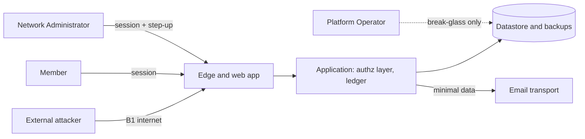
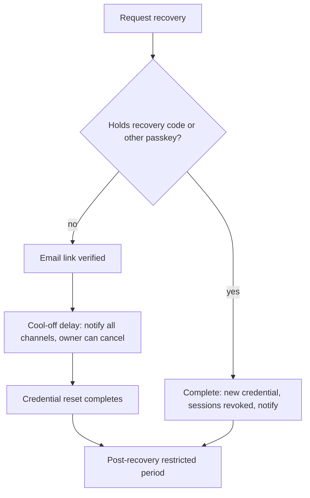

# 09 — Security, Privacy and Abuse Resistance

| Field | Value |
|---|---|
| Status | Draft |
| Owner role | Security and privacy lead |
| Last updated | 2026-10-21 |
| Scope | Assets, actors and trust assumptions; a practical threat model; security requirements for authentication, sessions, authorization, recovery, administrator and operator misuse, abuse and fraud, rate limiting, logging, data protection, backups, secrets, incident response, vulnerability disclosure and supply chain; privacy requirements (inventory, visibility, retention, minors); mapping to OWASP ASVS 5.0.0 and OWASP API Security Top 10 2023 |
| Depends on | [00](00-conventions.md), [02](02-personas-roles-and-journeys.md), [03](03-domain-model-and-mutual-credit-rules.md), [05](05-architecture-and-trust-boundaries.md), [06](06-data-ledger-and-audit.md), [07](07-api-and-integration-contract.md), [11](11-deployment-operations-and-support.md), [19](19-legal-and-regulatory-open-questions.md) |
| Open questions | Section 10 (`SEC-OD-1` to `SEC-OD-15`); legal questions are routed to [19](19-legal-and-regulatory-open-questions.md) |

## 1. Purpose and scope

Circula holds a ledger of promises between neighbours. The money-like risk is not theft of currency (the credit unit is an accounting unit, see INV-014) but loss of **trust**: a falsified balance, a take-over of someone's account, an administrator quietly moving value, a rival reading who owes whom, or a fake member extracting goods and services and vanishing. This document defines how the Platform resists those outcomes and what it honestly cannot promise.

In scope: the Platform software and the requirements a deployment must meet. Out of scope: physical security of a deployer's premises, the legal characterisation of any security duty, and deployment mechanics (owned by [11](11-deployment-operations-and-support.md)). Architectural zones (Z0 to Z5) and trust boundaries (B1 to B4) are defined in [05](05-architecture-and-trust-boundaries.md) and are used here without redefinition.

Hard limits on claims (see SEC-112): the Platform does **not** offer anonymity, does **not** make cryptographic guarantees about the ledger beyond what [06](06-data-ledger-and-audit.md) states about tamper evidence, and does **not** assert compliance with any law or standard. Every legal or regulatory duty is "a question for counsel" in [19](19-legal-and-regulatory-open-questions.md).

## 2. Definitions used here

Terms (Network, Member, Network Administrator, Dispute Reviewer, Platform Operator, Trade, Adjustment, Reversal, Audit Event, credit unit) are as in [00 §5.1](00-conventions.md) and the [glossary](14-glossary.md). Additional terms used in this document only:

| Term | Meaning |
|---|---|
| **Principal** | An authenticated identity acting through a session or API credential. |
| **Sensitive action** | An action in the list under SEC-035; protected by `admin_quorum`, step-up authentication and an Audit Event. |
| **Step-up** | Fresh re-authentication (within the window in SEC-009) required before a sensitive operation. |
| **Break-glass** | Time-boxed, reasoned, second-person-approved, audited Platform Operator access to Network content (SEC-042). |
| **Review signal** | An advisory indicator shown to Network Administrators that a pattern may merit human review; never an automatic sanction (SEC-047). |
| **Security log** | Operational log of authentication and security events; distinct from Audit Events ([06 §10](06-data-ledger-and-audit.md)) and from the ledger (SEC-066). |

## 3. Assets

| # | Asset | Why it matters | Primary protection |
|---|---|---|---|
| A1 | **Ledger** (Journal Entries, Postings, balances) | Core promise: balances are correct and only change by consented, rule-conforming actions | INV-001 to INV-013; SEC-018 to SEC-025, SEC-035 to SEC-043 |
| A2 | **Audit Events** | Evidence of who did what; basis of dispute and governance | INV-010; SEC-041, SEC-063 |
| A3 | **Credentials and sessions** (passkeys, password verifiers, TOTP seeds, recovery tokens, session tokens, API credentials) | Take-over equals acting as a Member | SEC-001 to SEC-017, SEC-026 to SEC-034 |
| A4 | **Member personal data** (name, email, contact details, area, listings text, Trade notes) | Privacy harm, stalking, spam, social-engineering fuel | SEC-099 to SEC-111 |
| A5 | **Financial-like behavioural data** (who trades with whom, balances, trade history) | Reveals relationships, hardship, business activity | SEC-101, SEC-103 |
| A6 | **Dispute evidence and free-text** | Highly sensitive, adversarial context | SEC-025, SEC-050, SEC-074 |
| A7 | **Network rules and role assignments** (policy parameters, `admin_quorum`, role grants) | Governs everything else; changing them is privilege escalation | SEC-035, SEC-036 |
| A8 | **Secrets and keys** (datastore credentials, signing and encryption keys, mail-transport credentials) | Compromise bypasses application controls | SEC-072, SEC-073 |
| A9 | **Backups and exports** | Full copy of A1 to A6 outside normal access controls | SEC-068 to SEC-071, SEC-105, SEC-106 |
| A10 | **Availability of the write path** | A Network that cannot post Trades loses its function | SEC-055, SEC-059 |
| A11 | **Source code, build pipeline and releases** | Supply-chain compromise reaches every deployment | SEC-088 to SEC-098 |
| A12 | **Reputation of the Network and of "not money" framing** | Misleading claims create harm and legal exposure | SEC-112 |

## 4. Actors and trust assumptions

### 4.1 Actors

| Actor | Capability (summary) | Treated as |
|---|---|---|
| Member (`member`) | Acts on own account, listings, disputes; sees Network-local directory per policy | Untrusted for authorization; may be honest, careless or malicious |
| Network Administrator (`network_admin`) | Configures rules, Adjustments, Reversals, membership decisions, exports within one Network | Trusted with Network governance but **not** unconditionally: misuse controls apply (§6.5) |
| Dispute Reviewer (`dispute_reviewer`) | Reads and decides assigned Disputes | Trusted only for assigned cases; conflict rules apply |
| Platform Operator (`platform_operator`) | Runs infrastructure; no ledger-posting power; no default content access | Semi-trusted: can technically reach data; controlled by break-glass, logging and separation of duties |
| External attacker | Anonymous internet access; may hold stolen credentials or a phished session | Untrusted |
| Malicious insider | Any of the above acting against the Network (rogue admin, operator staff member, colluding members, compromised developer) | Modelled explicitly in §5 |
| Automated agents | Bots, scrapers, credential-stuffing tools | Untrusted |

### 4.2 Trust assumptions (explicit)

1. The deployer keeps host and datastore administrators few, named and vetted. Staff with Z3 or host access **can** technically read stored Network content; SEC-043 and SEC-068 reduce, but do not eliminate, that exposure (consistent with [05 §6.3](05-architecture-and-trust-boundaries.md)).
2. A Network's members are mostly honest neighbours. The design optimises for **limiting damage and making misuse visible**, not for adversarial financial settings. Losses to a defaulting Member are a governance matter ([10](10-governance-and-network-operations.md), [03 §7](03-domain-model-and-mutual-credit-rules.md)), reduced here by limits and review signals.
3. Email is a weak identity channel (mailboxes get compromised). Recovery therefore never relies on email alone for high-impact outcomes without delay and notification (SEC-029, SEC-030).
4. Browsers and devices of Members may be compromised; the Platform limits the impact of a single stolen session (SEC-009, SEC-014) but cannot protect a fully compromised device.
5. Third-party services (email transport, hosting) can read what is sent to them; messages carry minimal data ([05 §6.3](05-architecture-and-trust-boundaries.md), [17](17-notifications-and-communications.md)).
6. Cryptographic and framework libraries are assumed correct when current and patched; the Platform tracks them under SEC-088 to SEC-091.

## 5. Threat model

STRIDE categories: **S**poofing, **T**ampering, **R**epudiation, **I**nformation disclosure, **D**enial of service, **E**levation of privilege. Row labels `T01`..`T33` are local to this document and are not requirement IDs. Residual risk is the author's initial rating (L/M/H) after the listed mitigations; it is re-assessed per release (SEC-096).

| Row | Threat | STRIDE | Asset | Mitigations (requirements) | Residual |
|---|---|---|---|---|---|
| T01 | Credential stuffing and password guessing against logins | S | A3 | SEC-001, SEC-003, SEC-004, SEC-010, SEC-055, SEC-061, SEC-065 | M |
| T02 | Phishing of Member or administrator credentials | S | A3 | SEC-001 (passkeys are origin-bound), SEC-007, SEC-009, SEC-031, SEC-112 | M |
| T03 | Session theft, session fixation, cross-site request forgery | S, E | A3 | SEC-012 to SEC-016, SEC-075 | L |
| T04 | Account takeover through recovery or email change | S | A3 | SEC-026 to SEC-034, SEC-031 | M |
| T05 | Bait-and-switch: proposal edited after the counterparty is shown it | T | A1 | SEC-053; INV-002; INV-012 | L |
| T06 | Replay or double submission of a Trade | T | A1 | INV-009 (idempotency); SEC-053 | L |
| T07 | Direct tampering with ledger rows by insider or attacker with datastore access | T | A1, A2 | INV-003; SEC-041; SEC-042; SEC-043; SEC-061 (see also [05 §6](05-architecture-and-trust-boundaries.md) and [06 §6.4](06-data-ledger-and-audit.md) on tamper evidence) | M |
| T08 | Cross-Network data access or posting | I, E | A1, A4 | SEC-022; INV-011; SEC-019; SEC-057 | L |
| T09 | Broken object-level authorization (guessing another Member's account, Trade or Dispute ID) | I | A1, A4, A6 | SEC-018 to SEC-021, SEC-057 | L |
| T10 | Privilege escalation to `network_admin` or `dispute_reviewer` | E | A7 | SEC-020, SEC-023, SEC-035, SEC-036 | L |
| T11 | Rogue administrator moves value (Adjustment, credit-limit change, self-dealing) | T, E | A1 | SEC-035 to SEC-040; INV-010; INV-012 | M |
| T12 | Platform Operator abuse (reading content, impersonation, "fixing" balances) | I, E | A1, A4 | SEC-024, SEC-042 to SEC-044; INV-012 | M |
| T13 | Member repudiates a Trade ("I never agreed") | R | A1, A2 | SEC-053; SEC-061; INV-010; [06 §10](06-data-ledger-and-audit.md) | L |
| T14 | Administrator or operator denies or hides an action | R | A2 | SEC-041, SEC-063, SEC-066 | L |
| T15 | Sybil fake members extract goods and services then vanish (credit-limit extraction) | T | A1 | SEC-045 to SEC-048; `default_credit_limit`, `max_credit_limit`, `max_trade_amount` | H (inherent; governance mitigates) |
| T16 | Collusive wash or ring trading to launder reputation or move value from a sybil to a real account | T | A1, A12 | SEC-047, SEC-049 | M |
| T17 | Enumeration of members, emails and accounts through login, recovery, invitation or error differences | I | A4 | SEC-026, SEC-056, SEC-057 | L |
| T18 | Bulk scraping of directory and profiles | I | A4 | SEC-058, SEC-103, SEC-055 | M |
| T19 | Social engineering of administrators or support to reset credentials or approve changes | S | A3, A7 | SEC-033, SEC-034, SEC-035, SEC-043 | M |
| T20 | Impersonation of the Platform, an administrator or "support" to extract credentials or acceptance | S | A3 | SEC-031 (authenticated sender domain, no credential requests), SEC-052, SEC-112 | M |
| T21 | Dispute abuse: harassment, retaliation, flooding | D, R | A6 | SEC-050, SEC-051 | M |
| T22 | Dispute Reviewer collusion or conflict of interest | T | A1, A6 | SEC-025, SEC-050, SEC-037 | M |
| T23 | Denial of service by request flood or expensive operations | D | A10 | SEC-055, SEC-059, SEC-060; Network quotas in [05 §7](05-architecture-and-trust-boundaries.md) | M |
| T24 | Bulk exfiltration through exports | I | A4, A5 | SEC-105, SEC-106 | M |
| T25 | Sensitive data or secrets leaked in logs, errors or analytics | I | A3, A4 | SEC-062, SEC-064, SEC-077, SEC-102 | L |
| T26 | Theft or misuse of backups | I | A9 | SEC-068 to SEC-071 | M |
| T27 | Supply-chain compromise (dependency, build pipeline, release artifact) | T, E | A11 | SEC-088 to SEC-093, SEC-098 | M |
| T28 | Secret leakage (repository, image, CI) | I | A8 | SEC-072, SEC-073, SEC-092 | L |
| T29 | Unwanted Trade-proposal spam or harassment | D | A4 | SEC-051, SEC-055; per-Principal open-proposal quota ([15](15-lifecycle-state-machines.md)) | L |
| T30 | Destruction or ransomware against datastore and backups | D | A1, A9 | SEC-070; backup and restore requirements in [11 §6](11-deployment-operations-and-support.md) | M |
| T31 | Injection (query, script, template, header) and stored XSS through free text | T, I, E | A1 to A4 | SEC-052, SEC-075, SEC-076 | L |
| T32 | Invitation or notification mechanism abused as email spam relay | D, S | A12 | SEC-048, SEC-055, SEC-031 | L |
| T33 | Race conditions that breach credit limits or double-spend | T | A1 | INV-005, INV-006, INV-009; concurrency in [06 §8](06-data-ledger-and-audit.md) | L |

## 6. Security requirements

Verification codes: **T** test, **I** inspection, **A** analysis, **D** demonstration/drill. Priorities per [00 §2](00-conventions.md). Numeric defaults that need a product decision carry `[DECISION NEEDED: SEC-OD-n]`.

### 6.1 Authentication

Standards basis: NIST SP 800-63B-4 (final July 2025, via the [technical-standards research note](../notes/research-technical-standards.md); not re-fetched for this document, see §11) and OWASP ASVS 5.0.0 chapter V6 (fetched 2026-10-21). ASVS 5.0.0 requires at least 8 characters with 15 strongly recommended (6.2.1), no composition rules (6.2.5), acceptance of at least 64 characters (6.2.9), no periodic rotation (6.2.10) and a breached-password check (6.2.12).

| ID | Pri | Requirement | Rationale | Verification |
|---|---|---|---|---|
| SEC-001 | P0 | The Platform **MUST** support passkeys (WebAuthn discoverable credentials, including synced passkeys) as a primary sign-in method, bound to the Platform's relying-party origin, and **MUST** allow a Principal to register more than one passkey. | Phishing-resistant sign-in; origin binding defeats look-alike sites (T02). | T: registration and sign-in with two authenticators; sign-in attempt from a different origin fails |
| SEC-002 | P0 | The Platform **MUST** offer a fallback of password plus TOTP (RFC 6238). SMS or voice one-time codes **MUST NOT** be accepted as the only second factor. | Accessible fallback without relying on telephone-network channels. | T, I |
| SEC-003 | P0 | Password policy **MUST** be length-based: minimum 15 characters when the password is the only factor and no fewer than 8 when combined with another factor, maximum accepted length at least 64 characters, all Unicode accepted, **no** composition rules, **no** periodic forced rotation, paste and password-managers permitted. `[DECISION NEEDED: SEC-OD-1]` selects 15 universally (recommended) or 8 with a second factor. | Current NIST/ASVS guidance; composition rules and rotation reduce security. | T: boundary lengths 7/8/14/15/64/128; paste into field |
| SEC-004 | P0 | New or changed passwords **MUST** be checked against a list of breached and commonly used passwords (local list or a k-anonymity range query that never sends the full password or hash); matches **MUST** be rejected with a plain-language message. | Blocks credential-stuffing material (T01). | T: known-bad password rejected; network capture shows no full hash leaves the Platform |
| SEC-005 | P0 | Password verifiers **MUST** be stored with a memory-hard, salted, tunable-cost password hashing function (for example Argon2id) using parameters at or above current OWASP Password Storage guidance; TOTP seeds and recovery codes **MUST** be stored encrypted (seeds) or hashed (codes); parameters **MUST** be upgradable on next sign-in. | Limits offline cracking after a data breach. | I: configuration review; T: verifier upgrade on login |
| SEC-006 | P0 | Adding, removing or changing any credential (passkey, password, TOTP) or the sign-in email **MUST** require step-up (SEC-009), **MUST** notify the Principal on all verified channels (SEC-031), and **MUST** invalidate all other sessions. | A stolen session cannot silently entrench itself. | T: change flow with stale session is refused; notification and session invalidation observed |
| SEC-007 | P0 | `network_admin` and `dispute_reviewer` Principals **MUST** authenticate with a passkey or with password plus TOTP in every session. `platform_operator` Principals **MUST** use a phishing-resistant authenticator (passkey or hardware security key) and **MUST NOT** use password plus TOTP alone. | Elevated roles are the target of T02, T10, T12. | T: role-bearing account without second factor cannot obtain a privileged session |
| SEC-008 | P1 | Ordinary Members **SHOULD** be prompted at enrolment and again after 30 days to register a passkey or TOTP; whether a second factor is mandatory for all Members is `[DECISION NEEDED: SEC-OD-2]` (recommended default: optional for Members, mandatory for roles in SEC-007). | Balances adoption (older, low-tech communities) against risk. | D, I |
| SEC-009 | P0 | Sensitive operations **MUST** require step-up: authentication within the last 10 minutes `[DECISION NEEDED: SEC-OD-3]` for credential changes, email change, export request, any Sensitive action (SEC-035), session revocation of others, and acceptance of a Trade at or above a Network-configurable amount (deployment default: none, as acceptance is already a deliberate step). | Limits impact of a hijacked or unattended session. | T: operation refused with `step_up_required` when authentication is older than the window |
| SEC-010 | P0 | Failed authentication **MUST** be throttled (progressive delay per account and per source) and **MUST NOT** hard-lock an account for a long period on the basis of failed attempts alone; error responses **MUST** be identical whether the identifier exists or not (SEC-056). | Prevents both guessing and lock-out denial of service. | T: 20 failures produce delays, not lock; response bodies and timing compared |
| SEC-011 | P1 | After first sign-in the Platform **SHOULD** prompt the Principal to hold at least two recovery means (second passkey, or one-time recovery codes shown once and stored hashed) and **SHOULD** show recovery readiness in account settings. | Reduces use of the weaker lost-all-factors path (SEC-029). | D |

### 6.2 Session management

| ID | Pri | Requirement | Rationale | Verification |
|---|---|---|---|---|
| SEC-012 | P0 | Session tokens **MUST** be opaque, generated by a cryptographically secure generator with at least 128 bits of entropy, stored server-side only as a hash, and **MUST NOT** appear in URLs, logs or error messages. | Unguessable, non-leaking sessions. | I, T: log scan for token values |
| SEC-013 | P0 | Browser sessions **MUST** use cookies with `Secure`, `HttpOnly`, `SameSite=Lax` or stricter and the `__Host-` prefix; state-changing requests authenticated by cookie **MUST** carry an anti-CSRF defence (token or equivalent verified server-side). | Mitigates T03. | T: cross-origin forged request fails |
| SEC-014 | P0 | Sessions **MUST** have both an idle and an absolute timeout. Proposed defaults `[DECISION NEEDED: SEC-OD-3]`: Member idle 7 days, absolute 30 days; `network_admin` and `dispute_reviewer` idle 30 minutes, absolute 12 hours; `platform_operator` idle 15 minutes, absolute 8 hours. | Bounded exposure; stricter for powerful roles. | T with clock control |
| SEC-015 | P0 | A new session identifier **MUST** be issued on sign-in, on step-up, and on any role or privilege change; logout **MUST** invalidate the session server-side immediately. | Prevents fixation and lingering access. | T |
| SEC-016 | P1 | A Principal **SHOULD** be able to list active sessions (approximate device, last-used time, truncated address) and revoke any or all others; revocation **MUST** take effect within 60 seconds. | Self-service containment. | T, D |
| SEC-017 | P0 | API credentials (if issued, see [07 §4](07-api-and-integration-contract.md)) **MUST** be scoped to one Network and a named permission set, expire (default 90 days), be stored hashed, be shown once, be revocable, never be accepted in query strings, and **MUST NOT** carry more authority than their creator holds at the moment of use. | Least-privilege machine access (API2, API5). | T, I |

### 6.3 Authorization and Network isolation

| ID | Pri | Requirement | Rationale | Verification |
|---|---|---|---|---|
| SEC-018 | P0 | Authorization **MUST** be decided by a single central policy layer that denies by default; every operation, route and background job **MUST** declare the permission it needs, and an operation without a declaration **MUST** fail startup or CI. | Eliminates ad hoc, forgotten checks (API5). | I: automated route inventory vs declarations; T |
| SEC-019 | P0 | Every access to a Network-scoped object (account, Trade, Listing, Dispute, Audit Event, export) **MUST** check that the Principal may access that specific object; an object outside the Principal's scope **MUST** produce the same not-found response as a nonexistent object (no 403/404 oracle). | Object-level authorization (API1); prevents existence leaks. | T: matrix of principals × foreign objects |
| SEC-020 | P0 | The permission matrix in [02 §5](02-personas-roles-and-journeys.md) **MUST** be encoded as an executable test table; every cell (allow and deny) **MUST** be exercised in the release gate. | Keeps spec and code aligned. | T: generated tests, coverage report = 100% of matrix cells |
| SEC-021 | P0 | Responses **MUST** include only fields the caller's role and the Network's `balance_visibility` and `directory_visibility` permit; request bodies **MUST** be parsed against explicit allow-lists so clients cannot set server-controlled fields (role, `credit_limit`, state, `network_id`, identifiers). | Property-level authorization and mass assignment (API3). | T: injected extra fields ignored or rejected; field-visibility tests per role |
| SEC-022 | P0 | The Network context **MUST** be derived from the authenticated route and the Principal's membership, never from a client-supplied body field alone, and **MUST** be applied by the data-access layer ([05 §7.3](05-architecture-and-trust-boundaries.md)); each Network-scoped endpoint family **MUST** have a cross-Network negative test in the release gate. | Tenant isolation (T08, INV-011). | T |
| SEC-023 | P0 | Role changes, suspension, closure and revocation **MUST** be effective for new requests within 60 seconds on all running instances; authorization decisions **MUST NOT** rely on role claims cached in a token for longer than that. | Quick removal of a rogue or compromised administrator. | T: demote role, issue request after 60 s |
| SEC-024 | P0 | There **MUST** be exactly three code paths that create ledger Postings: Trade completion, Adjustment and Reversal; no role, API credential or maintenance tool **MUST** be able to call the Posting interface otherwise, and `platform_operator` **MUST NOT** be able to invoke any of the three. | INV-012, INV-004 enforcement. | I: code search of callers; T: operator-role attempt refused |
| SEC-025 | P0 | A Principal **MUST NOT** review or view evidence for a Dispute to which they are a party, or in which an administrator-recorded relationship (declared conflict) exists; a Dispute Reviewer **MUST** see only Disputes assigned to them and the evidence attached to those. | Fair process; limits disclosure (T22). | T |

### 6.4 Account recovery and anti-takeover

Design: recovery should be easy for an honest forgetful Member and costly and visible for an attacker. Paths, strongest to weakest: (1) sign in with another registered passkey; (2) recovery code; (3) email link plus cool-off; (4) administrator-assisted.

| ID | Pri | Requirement | Rationale | Verification |
|---|---|---|---|---|
| SEC-026 | P0 | The recovery request, registration and invitation-acceptance responses **MUST** be identical in content, status and (within measurement tolerance) timing whether or not the address is registered; the outcome is communicated only to the mailbox owner. | No enumeration oracle (T17). | T: response and timing comparison over ≥ 1,000 requests |
| SEC-027 | P0 | Recovery tokens **MUST** be single-use, at least 128 bits of entropy, stored hashed, valid for at most 15 minutes, invalidated when a newer token is issued or a credential changes, and bound to the requesting recovery attempt. | Standard hygiene. | T |
| SEC-028 | P0 | Following a recovery link the Principal **MUST NOT** be signed in automatically; they **MUST** set a new credential first. A recovery completed without a currently registered credential **MUST** remove all previously registered passkeys, TOTP seeds and recovery codes and **MUST** revoke all sessions and API credentials. | A prior attacker's foothold does not survive recovery. | T |
| SEC-029 | P0 | If the Principal cannot present a registered credential or recovery code, completion of recovery **MUST** wait for a cool-off period (default 72 hours `[DECISION NEEDED: SEC-OD-5]`) during which the Platform notifies every verified channel and the old sign-in email, provides a cancel link that works without signing in, and blocks completion if cancelled. | The real owner has time to notice and stop a hostile recovery. | T with clock control; D |
| SEC-030 | P0 | For a restricted period after any credential reset or lost-factor recovery (default 24 hours `[DECISION NEEDED: SEC-OD-5]`), the account **MUST NOT** be allowed to change its sign-in email, export data or become an administrator, and **MUST** be limited in debiting Trades (accepting a Trade as Recipient, or proposing as Recipient) to a deployment-level cap (recommended: 10% of `credit_limit`; options: none allowed, no cap). | Limits value extraction by a successful attacker. | T |
| SEC-031 | P0 | Security notifications (recovery requested/completed/cancelled, credential or email change, new-device sign-in, break-glass access involving the Member's Network, Adjustment or Reversal of the Member's account) **MUST** be sent to all verified channels. All Platform email **MUST** be sent from a domain authenticated with SPF, DKIM and DMARC; no message **MUST** ask for a password, code or token to be sent back or entered on a page reached from a link in the message other than the single-use recovery or verification flow. | Detection; anti-impersonation (T20). | I, T: message-template review and header check |
| SEC-032 | P0 | Changing the sign-in email **MUST** require step-up, verification of the new address, and notification to the old address with a revert link valid for 72 hours. | Closes the email-change takeover path. | T |
| SEC-033 | P1 | Where a Member has lost access to email and all factors, the Network **MAY** use administrator-assisted recovery: it **MUST** require `admin_quorum` distinct Network Administrators (minimum two where the Network has two or more), an out-of-band identity check per a procedure documented in [10](10-governance-and-network-operations.md), delivery of a recovery link to a **new** address (never display of a secret to the administrator), the cool-off of SEC-029 and a restricted period of SEC-030, and an Audit Event. An administrator **MUST NOT** use this path for their own account. | Community Networks need a human fallback; two-person rule limits abuse (T19). | T, D |
| SEC-034 | P0 | `platform_operator` **MUST NOT** have a capability to reset a Member's or Network Administrator's credential or sign-in email in hosted operation. Lock-out of the last Network Administrator **MUST** be resolved by a documented deployment procedure requiring two operators and out-of-band verification with the Network's contact, with an Audit Event visible to the Network `[DECISION NEEDED: SEC-OD-6]` (self-hosted deployers are their own operator and follow the same procedure). | Operator cannot become a takeover vector (T12, T19). | I, D |

### 6.5 Administrator and operator misuse controls

Administrators have real power: they configure limits, post Adjustments and decide membership. The controls make misuse **require collusion, be visible to the affected Member, and be attributable**. They cannot eliminate misuse by a determined majority of administrators; that is a governance risk in [10](10-governance-and-network-operations.md).

| ID | Pri | Requirement | Rationale | Verification |
|---|---|---|---|---|
| SEC-035 | P0 | The following **Sensitive actions** **MUST** be executed only after `admin_quorum` distinct Network Administrators have approved the same request (initiator counts as one; approvals expire after 24 hours and bind to the exact parameters): Adjustment; Reversal not arising from a resolved Dispute; granting or revoking `network_admin` or `dispute_reviewer`; lowering `admin_quorum`; raising an individual `credit_limit` above `default_credit_limit`; changing `max_credit_limit`; full-Network or all-Member personal-data export; Network closure; lifting a ban. Each requires step-up (SEC-009) and writes an Audit Event naming initiator and approvers (INV-010). | The two-person rule where it counts (T10, T11). | T: single administrator cannot complete with `admin_quorum` = 2; replayed approval for changed parameters refused |
| SEC-036 | P0 | `admin_quorum` **MUST NOT** exceed the number of active Network Administrators; lowering it **MUST** itself be a Sensitive action subject to `policy_notice_days` (D-11), and saving `admin_quorum` = 1 **MUST** display a plain statement that one administrator can act alone on Sensitive actions. For Networks with `admin_quorum` = 1 the Platform **MUST** still apply SEC-037, SEC-038 and SEC-040. `[DECISION NEEDED: SEC-OD-6]` records whether single-administrator Networks may perform Adjustments above a Network-level amount (recommended: allowed, but with delayed effect of 24 hours for amounts above `max_trade_amount`, cancellable by the affected Member's report). | Small Networks run with one administrator; transparency substitutes for a second approver. | T, I |
| SEC-037 | P0 | No Principal **MUST** be allowed to initiate, approve or decide an Adjustment, Reversal, credit-limit change, suspension, ban or Dispute resolution that affects their own account, or an account for which they have a declared conflict; if no eligible approver exists the action **MUST** be refused with an explanation. | Self-dealing prohibition (T11, T22). | T |
| SEC-038 | P0 | Every Adjustment and Reversal **MUST** be visible to the affected Member in their history and by notification, showing amount, direction, reason, acting capacity and (per [06 §10.3](06-data-ledger-and-audit.md)) the administrator identity; the Platform **MUST NOT** provide any option to suppress or defer that notification. | INV-012 transparency. | T |
| SEC-039 | P0 | Adjustments and Reversals **MUST** carry a reason category from a closed list plus free text of at least 20 characters; an empty or placeholder reason **MUST** be refused. | Accountability. | T |
| SEC-040 | P1 | The Platform **SHOULD** alert all Network Administrators (and, if only one exists, include in the Network's periodic summary to every Member) when one administrator's Adjustments, Reversals or credit-limit changes exceed thresholds in a rolling 30 days `[DECISION NEEDED: SEC-OD-7]` (proposed: more than 5 actions or total absolute amount above 10 × `max_trade_amount`). | Detects slow misuse. | T |
| SEC-041 | P0 | Audit Events **MUST** be immutable through every application interface; no role (including `network_admin`) **MUST** be able to edit, delete or hide them, and administrator exports or sensitive views of Audit Events **SHOULD** themselves be audited ([06 §10.3](06-data-ledger-and-audit.md)). | Non-repudiation (T14). | T |
| SEC-042 | P0 | Break-glass access by a `platform_operator` to Network content **MUST**: (a) be requested with reason and incident or ticket reference; (b) be approved by a second operator; (c) write an Audit Event visible to that Network's administrators **before** access is granted, and access **MUST** be impossible if that write fails; (d) be limited to the named Network, read-only, and time-boxed (default 4 hours, maximum 24 hours `[DECISION NEEDED: SEC-OD-8]`); (e) have session activity recorded or commands logged; (f) expire automatically. `[DECISION NEEDED: SEC-OD-8]` also covers an optional Network-level consent step before access outside an Sev-1 incident. | Operator cannot silently read content (T12). | T, D: expiry, failure-closed behaviour, visibility to administrators |
| SEC-043 | P0 | Operators **MUST NOT** hold standing access to production datastores or Network content; production access credentials **MUST** be issued per break-glass grant, expire with it, and the operator console **MUST** show only aggregates and health data by default ([05 §4](05-architecture-and-trust-boundaries.md)). | Least privilege. | I: access-list review; T |
| SEC-044 | P1 | Operator accounts **SHOULD** be reviewed at least quarterly, removed within 24 hours of role change or departure, and each operator **MUST** use a personal named account (no shared accounts); see [11 §11](11-deployment-operations-and-support.md). | Insider-risk hygiene. | I |

### 6.6 Fraud, abuse and disputes

Mutual credit has one dominant loss mode: a Member (often a fake or short-lived one) takes value up to their negative floor and never provides in return. Wash trading nets to zero in the ledger, so its harm is mostly to reputation signals and to the sybil-to-accomplice transfer of limits. The Platform therefore (1) keeps limits small by default and growing with proven reciprocity, (2) makes patterns visible to humans, and (3) does not automate punishment.

| ID | Pri | Requirement | Rationale | Verification |
|---|---|---|---|---|
| SEC-045 | P0 | Credit limits, `min_trade_amount`, `max_trade_amount` and `max_balance` **MUST** be enforced on the server at posting time on every path, independent of any client; a Member's `credit_limit` **MUST** default to `default_credit_limit` and **MUST NOT** exceed `max_credit_limit`. | INV-005, INV-006; defence against T15, T33. | T: bypass attempts via API and concurrent requests |
| SEC-046 | P1 | The Platform **SHOULD** mark Memberships younger than a deployment-level age (default 30 days) as "new" in administrator views and in review signals, and administrator guidance in [10](10-governance-and-network-operations.md) **SHOULD** recommend low initial `credit_limit` and staged increases. | Probation limits sybil gains. | I, T |
| SEC-047 | P1 | The Platform **SHOULD** compute review signals visible only to `network_admin`, within a single Network, with documented definitions: (a) reciprocal or circular Trade chains among a small set of accounts above a threshold; (b) a new Member who reaches a negative balance near their floor within a short interval; (c) concentration of a Member's Trades with one counterparty; (d) clusters of accounts joined by one inviter or one source address range; (e) abnormally frequent Trades just under `max_trade_amount`. Signals **MUST** be labelled as advisory, show the data behind them, **MUST NOT** trigger automatic suspension, limit change or visibility to other Members, and **MUST NOT** correlate data across Networks. | Human review with evidence; avoids opaque scoring (see LEG-Q-26 on trust scores). | T with seeded patterns; I: no automated sanction path |
| SEC-048 | P1 | Invitations **SHOULD** record the inviter; administrators **SHOULD** be able to see invitation lineage; per-inviter invitation quotas and rate limits (SEC-055) **MUST** apply; invitation emails **MUST** use a fixed template that does not carry free-text from the inviter. | Sybil and spam-relay control (T15, T32). | T |
| SEC-049 | P0 | Any Member **MUST** be able to report a Member, Listing or Trade to the Network's administrators with a category and free text, separately from a Dispute; the reporter's identity **MUST** be hidden from the reported party by default; reports **MUST** appear in an administrator queue with status and an Audit Event on resolution. | Fraud and abuse reporting channel. | T |
| SEC-050 | P0 | Dispute abuse controls: only a party may open a Dispute; only within `dispute_window_days`; a per-Member cap on simultaneously open Disputes (default 3 `[DECISION NEEDED: SEC-OD-4]`); repeated `resolved_rejected` Disputes by one Member against the same counterparty **MUST** appear as an administrator review signal; evidence visible only to parties, the assigned Dispute Reviewer and, for `escalated`, the Network Administrators handling it. | Prevents harassment and retaliation (T21). | T |
| SEC-051 | P1 | A Member **SHOULD** be able to block another Member from proposing Trades to them or contacting them; the blocked party **MUST** receive a neutral failure message that does not reveal the block; blocks **MUST NOT** affect already-posted ledger entries or an open Dispute. | Harassment control (T29). | T |
| SEC-052 | P0 | User-supplied text (profiles, Listings, Trade notes, Dispute text) **MUST** be stored and rendered as plain text with context-correct output encoding; HTML and script **MUST NOT** be interpreted; URLs **MAY** be shown but **MUST NOT** be automatically fetched by the server; length limits per field **MUST** apply. | Stored XSS and phishing-by-listing (T20, T31). | T: payload corpus; I |
| SEC-053 | P0 | An acceptance **MUST** bind to the exact proposal state it was shown (version, amount, direction, parties); any change to a proposal after display **MUST** invalidate pending acceptance; the confirmation shown to the accepting Member **MUST** state who is debited and credited and the amount ([08](08-ux-and-accessibility.md)). | Anti bait-and-switch; non-repudiation (T05, T13). | T: modify between display and accept; acceptance fails with a conflict |
| SEC-054 | P1 | Administrators **SHOULD** be able to remove or pause a Listing through a moderation action that records a reason, notifies the owner, and writes an Audit Event. | Content moderation (`removed` Listing state). | T |

### 6.7 Rate limiting, enumeration and availability

The contract (headers, status codes, quotas as domain rules) is in [07 §12](07-api-and-integration-contract.md). Thresholds are owned here.

| ID | Pri | Requirement | Rationale | Verification |
|---|---|---|---|---|
| SEC-055 | P0 | The Platform **MUST** enforce the limits below by default, all configurable per deployment `[DECISION NEEDED: SEC-OD-4]`, per Principal, per source address and per Network, with throttling before state change. | Resource consumption and sensitive-flow abuse (API4, API6). | T: load test crossing each limit |
| SEC-056 | P0 | Login, recovery, registration, invitation acceptance, email change and error messages **MUST NOT** reveal whether an identifier is registered, which factor failed, or whether an account is suspended (suspended Members see their state only after successful authentication). | Enumeration resistance. | T |
| SEC-057 | P0 | Identifiers exposed to clients **MUST** be opaque and non-guessable (D-03); the Platform **MUST NOT** rely on identifier secrecy for authorization and **MUST NOT** expose sequential counters (including Trade numbers) across Members. | Defence in depth for T09. | I, T |
| SEC-058 | P1 | Directory search **MUST** require authentication unless `directory_visibility` = `public_listings`, enforce minimum query length (3 characters), cap result pages (≤ 50), apply the per-Principal search limit, and detect and throttle systematic enumeration (sequential or exhaustive query patterns); public listings **MUST NOT** expose contact details or ledger data. | Scraping resistance (T18). | T |
| SEC-059 | P1 | A Network Administrator **SHOULD** be able to pause invitations, registrations and Trade proposals for the Network (audited); a Platform Operator **MUST** be able to throttle or suspend a single Network without affecting others, with an Audit Event ([05 §7](05-architecture-and-trust-boundaries.md)). | Containment of abuse waves. | D |
| SEC-060 | P1 | Public unauthenticated endpoints (registration under `membership_mode` = `open`, recovery request) **SHOULD** be protected by an abuse challenge that has an accessible alternative and does not require a cognitive test (WCAG 2.2 SC 3.3.8), see [08](08-ux-and-accessibility.md). | Bot resistance without excluding people. | T, D |

Default limits for SEC-055 (windows are sliding):

| Operation | Limit | Notes |
|---|---|---|
| Sign-in attempts | 10 failures per account per 15 min, then progressive delay (1 s doubling to 15 min); 100 failures per source address per 15 min | No hard lock (SEC-010) |
| TOTP verification | 5 failures per 5 min, then delay | |
| Recovery requests | 3 per account per hour; 20 per source address per hour | Silent beyond limit (SEC-026) |
| Registration / invitation acceptance | 10 per source address per hour | |
| `create_invitation` | 20 per Member per day; 200 per administrator per day | |
| `propose_trade` | 20 per Principal per hour | Aligned with the starting point in [07 §12](07-api-and-integration-contract.md) |
| Directory search | 30 per Principal per minute | |
| Report or Dispute creation | 10 per Member per day | Plus SEC-050 cap |
| `request_export` | 5 per Principal per day; 1 concurrent per Network | |
| General reads / mutations | 600 / 60 per Principal per minute | |

### 6.8 Logging, monitoring and alerting

Log streams and retention proposals are in [11 §7.3](11-deployment-operations-and-support.md); this section sets the security content.

| ID | Pri | Requirement | Rationale | Verification |
|---|---|---|---|---|
| SEC-061 | P0 | The security log **MUST** record: sign-in success and failure (with reason code, not the credential), step-up, session revocation, credential and email changes, recovery steps, rate-limit blocks, authorization denials, role changes, quorum approvals and rejections, break-glass lifecycle, export requests and downloads, and administrative actions on Memberships. Each record **MUST** carry timestamp (UTC), event type, opaque Network and Principal identifiers, correlation identifier and outcome. | Detection and forensics. | T: event emitted per action |
| SEC-062 | P0 | Logs **MUST NOT** contain passwords, tokens, recovery codes, TOTP seeds, full email addresses, names, free-text content, Dispute evidence or request bodies; a CI test **MUST** inject canary secrets and personal values through every endpoint and fail if any appears in logs or error output. | Prevent T25; OWASP Logging guidance. | T: canary scan |
| SEC-063 | P0 | Security logs **MUST** be shipped off the application host to a store the application runtime cannot modify or delete, with access limited to named security roles and tamper evidence (append-only or periodic hash anchoring). | Attacker or insider cannot erase traces (T14). | I, T |
| SEC-064 | P1 | Source addresses **SHOULD** be stored truncated or keyed-hashed (rotating key) in application logs and retained in clear only for the shortest period needed for abuse handling `[DECISION NEEDED: SEC-OD-15]`, consistent with the proposal in [11 §7.3](11-deployment-operations-and-support.md). | Privacy-preserving logs. | I |
| SEC-065 | P0 | Alerts **MUST** exist, with an owner, for: sign-in failure spikes; any break-glass grant; any Sensitive action executed with `admin_quorum` = 1 above the SEC-040 threshold; recovery completion; privilege change; ledger invariant check failure or reconciliation mismatch (Sev-1 in [11](11-deployment-operations-and-support.md)); audit-write failures; mass export; rate-limit exhaustion on one Network. | Timely response. | D: seeded events trigger alerts |
| SEC-066 | P0 | The security log, Audit Events and the ledger **MUST** remain distinct: Audit Events record governance acts and are retained per [06](06-data-ledger-and-audit.md); the security log records technical events and is retained per [11](11-deployment-operations-and-support.md); neither **MUST** be used to alter the other. | Clear evidence model. | I |

### 6.9 Data protection, backups, keys and secrets

| ID | Pri | Requirement | Rationale | Verification |
|---|---|---|---|---|
| SEC-067 | P0 | All external and inter-zone traffic **MUST** use TLS 1.2 or higher (1.3 preferred) with certificate validation; HTTP **MUST** redirect to HTTPS; HSTS **MUST** be sent with a max-age of at least 12 months on hosted deployments. | Confidentiality, integrity in transit. | T: scanner |
| SEC-068 | P0 | The datastore, file store and every backup **MUST** be encrypted at rest. The documentation **MUST** state that encryption at rest does not protect against an authorised host administrator. | Honest protection (A9). | I |
| SEC-069 | P0 | Backups **MUST** be written with credentials that cannot read, alter or delete production data and cannot be altered or deleted by the application runtime; backup encryption keys **MUST NOT** be stored with the backups; restore and read access to backups **MUST** be limited to named roles and treated as break-glass (SEC-042). | Backup theft and tampering (T26). | I, D |
| SEC-070 | P1 | At least one backup copy **SHOULD** be immutable or offline for the retention period (write-once storage or equivalent) so that compromise of production credentials cannot destroy all copies. | Ransomware resilience (T30). | D |
| SEC-071 | P0 | Backup retention **MUST** be bounded and documented; after any restore, closure/erasure operations performed since the backup **MUST** be re-applied (an erasure log is kept for at least the backup retention period) before the restored system serves users. | Keeps erasure meaningful (D-09; LEG-Q-27). | D: restore drill with seeded erasure |
| SEC-072 | P0 | Secrets **MUST** be injected at runtime from a secret store or protected file; **MUST NOT** appear in source control, container or build images, logs, URLs or the file store; automated secret scanning **MUST** run on every commit/pull request and on history for the repository. | A8; [05 §6.3](05-architecture-and-trust-boundaries.md). | T: seeded canary secret blocks merge |
| SEC-073 | P0 | A secret and key inventory **MUST** exist (name, purpose, owner, store, rotation interval, last rotated); each secret **MUST** be rotatable without data loss; suspected compromise **MUST** lead to rotation within 24 hours; session-signing/encryption keys **MUST** support overlapping validity so rotation does not sign everyone out unless intended; the rotation procedure **MUST** be exercised annually. | Limits blast radius. | D, I |
| SEC-074 | P1 | The Platform **SHOULD** support application-level encryption of selected high-sensitivity free-text fields (Dispute evidence, administrator notes) with keys held outside the datastore `[DECISION NEEDED: SEC-OD-12]`; the documentation **MUST** state what remains readable (identifiers, amounts, timestamps, states). | Limits insider/backup exposure; consistent with [05 §6.3](05-architecture-and-trust-boundaries.md). | T, I |
| SEC-075 | P0 | Web responses **MUST** carry a Content-Security-Policy that forbids inline script and framing by other origins, `X-Content-Type-Options: nosniff`, a restrictive `Referrer-Policy`, and cache controls preventing storage of authenticated pages; authenticated pages **MUST NOT** load third-party scripts, fonts or trackers, and any required third-party asset **MUST** use subresource integrity. | Browser-side defence (T03, T31). | T: header scanner |
| SEC-076 | P0 | All input **MUST** be validated server-side against a schema (type, length, range, format); data access **MUST** use parameterised or equivalent injection-safe interfaces; amounts **MUST** be parsed from decimal text to integer minor units with strict grammar and range (no floating point, [00 §5.2](00-conventions.md)); any future file upload **MUST** be blocked until a file-handling security review (type, size, storage outside web root, malware scanning, no server-side fetch) is complete. | Injection and parsing attacks. | T: fuzz corpus; I |
| SEC-077 | P0 | Errors returned to clients **MUST** use the problem-details format in [07](07-api-and-integration-contract.md) and **MUST NOT** disclose stack traces, query text, internal identifiers of other Members, library versions or file paths; debug modes **MUST** be disabled in production builds. | Information-leak prevention. | T, I |

### 6.10 Incident response

Severity levels, timelines and the general lifecycle are in [11 §11](11-deployment-operations-and-support.md); this section adds security-specific requirements. Security incident: any event that actually or potentially compromises confidentiality, integrity or availability of A1 to A9.

| Security incident class | Default severity |
|---|---|
| Suspected ledger invariant violation, unauthorised ledger write, operator or administrator privilege breach | Sev-1 |
| Confirmed exposure of Network content or credentials, compromise of a signing or encryption key | Sev-1 |
| Account takeover campaign, credential-stuffing causing lockouts or fraud, vulnerability exploited in production | Sev-1 or Sev-2 by impact |
| Vulnerability reported but not exploited | Sev-2 to Sev-4 by severity (SEC-085) |
| Single-account takeover handled by support | Sev-3 |

| ID | Pri | Requirement | Rationale | Verification |
|---|---|---|---|---|
| SEC-078 | P0 | The incident procedure in [11 §11](11-deployment-operations-and-support.md) **MUST** include a security annex with the classification above, decision rights, a contact list, an evidence-handling rule (snapshot before change), and a rule that no one alters ledger or Audit data to "clean up". | Orderly, defensible response. | I; tabletop |
| SEC-079 | P0 | The Platform **MUST** provide operable containment tools: revoke all sessions for a Principal, for a Network, and globally; disable a credential type; force credential reset for a Network; rotate secrets (SEC-073); put a Network or the Platform in maintenance mode. Each **MUST** write an Audit Event or security-log record and be exercised in a drill at least annually. | Rapid containment. | D |
| SEC-080 | P0 | Evidence (logs, snapshots, configuration) **MUST** be preserved with integrity checks and restricted access for the duration of the investigation. | Forensics. | I |
| SEC-081 | P0 | When personal data exposure is confirmed or suspected, the Operator **MUST** notify affected Network Administrators within the time in [11 §11](11-deployment-operations-and-support.md) with plain-language facts; whether and when notification to regulators or Members is legally required, who must give it and by when is **a question for counsel** ([LEG-Q-32](19-legal-and-regulatory-open-questions.md)); notification templates **MUST NOT** assert any legal position. | Enables Networks to act without the Platform claiming a legal conclusion. | I: counsel review of templates |
| SEC-082 | P1 | After credential exposure, the Platform **SHOULD** force credential reset and session revocation for affected Principals, and member-facing messages **SHOULD** say what happened, what data was involved, what the Member should do and what the Platform did, without minimising or speculating. | Member protection and trust. | D |
| SEC-083 | P0 | Every Sev-1 or Sev-2 security incident **MUST** have a blameless review within 5 business days with corrective actions tracked to closure and the threat model (§5) updated if a new threat class appeared. | Learning loop. | I |

### 6.11 Vulnerability disclosure

| ID | Pri | Requirement | Rationale | Verification |
|---|---|---|---|---|
| SEC-084 | P0 | The repository **MUST** contain a `SECURITY.md` at its root that states: supported versions; how to report privately (monitored mailbox and the repository's private advisory feature); what to include; what is in and out of scope (production member data, social engineering, denial of service against hosted deployments); testing rules (use your own accounts; do not access, modify or retain other Members' data; stop on seeing personal data and report it); that reports are handled confidentially; and how reporters are credited. | Predictable intake. | I |
| SEC-085 | P0 | The policy **MUST** commit to targets `[DECISION NEEDED: SEC-OD-11]`: acknowledgement within 3 business days; triage and severity within 10 business days; fix or mitigation targets of 30 days (critical or high) and 90 days (medium or low) from triage, with coordinated disclosure after a fix is available or after 90 days, whichever is earlier, by agreement. Severity **SHOULD** be scored with CVSS and adjusted for ledger-integrity impact. | Measurable commitments. | I, D: dry-run report |
| SEC-086 | P1 | Hosted deployments **SHOULD** publish a `security.txt` (RFC 9116) pointing at the same contact; fixed vulnerabilities **SHOULD** be published as security advisories with affected and fixed versions and, where eligible, a CVE identifier. | Findability; downstream awareness. | I |
| SEC-087 | P1 | Any statement of legal protection for good-faith researchers (safe-harbour wording) or any bounty promise **MUST** be reviewed by counsel before publication; until then `SECURITY.md` **MUST** state only the process and **MUST NOT** promise immunity or payment. | Legal exposure is a question for counsel (add to [19](19-legal-and-regulatory-open-questions.md)). | I |

### 6.12 Supply chain and secure development

| ID | Pri | Requirement | Rationale | Verification |
|---|---|---|---|---|
| SEC-088 | P0 | All dependencies **MUST** be declared with lock files that pin exact versions and integrity hashes; builds **MUST** be reproducible from the lock files and **MUST NOT** fetch unpinned code at build or run time. | Supply-chain control (T27). | T, I |
| SEC-089 | P0 | Dependencies and base images **MUST** be scanned for known vulnerabilities on every pull request and daily; remediation targets from advisory publication: critical 7 days, high 30 days, medium 90 days, or a recorded exception with compensating control and expiry `[DECISION NEEDED: SEC-OD-11]`. | Timely patching. | T: CI report; I: exceptions register |
| SEC-090 | P1 | Each release **SHOULD** ship a software bill of materials in a standard format (CycloneDX or SPDX). | Downstream deployers can assess exposure. | I |
| SEC-091 | P1 | Release artifacts **SHOULD** be built by an isolated, scripted pipeline and published with signed provenance and checksums; target build-integrity level `[DECISION NEEDED: SEC-OD-13]` (recommended: SLSA v1.0 Build Level 2). | Tamper evidence for what deployers run. | I |
| SEC-092 | P0 | CI/CD **MUST** use least-privilege short-lived tokens, pin third-party actions/plugins to immutable references, forbid secrets exposure to untrusted pull requests, require protected branches with required reviews and passing checks, and require signed or verified commits on release branches. | Pipeline hardening. | I |
| SEC-093 | P0 | Changes touching authentication, authorization, ledger posting, recovery, export or logging code **MUST** be listed in code-owner rules and require review by at least two people, one a designated security reviewer. | Insider/compromised-developer control. | I: repository settings |
| SEC-094 | P0 | The secure development lifecycle gates in the table below **MUST** be implemented and recorded in [12](12-quality-strategy-and-test-plan.md). | Consistent assurance. | I |
| SEC-095 | P0 | Before the first production launch of any hosted multi-Network deployment, an independent security assessment (penetration test and design review) **MUST** be completed, high and critical findings fixed, and the report summary available to Network Administrators on request; self-hosting guidance **MUST** recommend the same. | Independent assurance of a trust product. | I |
| SEC-096 | P1 | The threat model in §5 **SHOULD** be reviewed at least once per release that changes a trust boundary, role, credential type or data flow, and on every Sev-1 or Sev-2 security incident. | Keeps it alive. | I |
| SEC-097 | P1 | Every fixed security vulnerability **SHOULD** get a regression test; money-amount parsing, API request parsing and recovery flows **SHOULD** be fuzzed in CI or nightly. | Prevents regressions. | I |
| SEC-098 | P1 | New dependencies **SHOULD** be justified at review (maintenance status, ownership, licence, transitive count); packages performing install-time script execution **SHOULD** be avoided or sandboxed. | Smaller attack surface. | I |

| Gate | Stage | Required evidence |
|---|---|---|
| G1 Design | Any feature touching roles, data flows, credentials or exports | Threat-model delta (§5 rows added/changed); privacy inventory delta (SEC-099); decision recorded if it adds a Sensitive action |
| G2 Pull request | Every PR | Review per SEC-093 where applicable; static analysis clean or triaged; secret scan; dependency scan; unit tests for authorization decisions |
| G3 Merge to release branch | Every release candidate | Full authorization matrix test (SEC-020); cross-Network negative tests (SEC-022); canary log scan (SEC-062); rate-limit tests (SEC-055); ledger invariant suite ([12](12-quality-strategy-and-test-plan.md)) |
| G4 Release | Every release | SBOM and provenance (if adopted); ASVS L2 checklist delta signed off (SEC-115); no open critical/high without recorded exception; upgrade/rollback tested |
| G5 Pre-launch and yearly | First hosted launch, then annually or after major change | Independent assessment (SEC-095); restore drill; incident tabletop; secret-rotation exercise (SEC-073) |

## 7. Privacy requirements

Privacy statements describe product behaviour. Whether the behaviour satisfies a law, who is controller or processor (baseline D-08), and what legal basis applies are questions for counsel ([LEG-Q-24, LEG-Q-25](19-legal-and-regulatory-open-questions.md)). See also the [regulatory and privacy research note](../notes/research-regulatory-privacy-questions.md).

### 7.1 Data minimisation inventory (baseline)

| Category | Fields | Purpose | Visible to | Proposed retention (see SEC-107) |
|---|---|---|---|---|
| Account identity | Sign-in email, credential verifiers, TOTP seed, passkey public keys | Authentication, recovery, notifications | Member (own), nobody else; operators technically | Until closure + 30 days (then deleted) |
| Profile | Display name, optional bio, optional area (coarse), optional contact fields the Member chooses to publish | Directory and trust | Per `directory_visibility`; contact fields only if opted in | Until closure (anonymised at closure) |
| Membership | Network, state, role, join/leave dates, inviter | Governance | Member (own), administrators | Per Network record rules; personal links removed at closure |
| Ledger | Opaque account ID, amounts, timestamps, Trade metadata, Trade note | Core function | Parties; administrators; per `balance_visibility` | Retained (opaque IDs only after closure, D-09); note text removed at closure |
| Audit Events | Actor, target, reason, timestamps | Accountability | Per [06 §10.3](06-data-ledger-and-audit.md) | Per [06](06-data-ledger-and-audit.md) `[DECISION NEEDED: SEC-OD-9]` |
| Listings | Offer/Request text | Directory | Per `directory_visibility` | Archived Listings deleted after 12 months |
| Disputes and reports | Statements, evidence | Resolution | Parties, assigned reviewer, handling administrators | 24 months after resolution `[DECISION NEEDED: SEC-OD-9]` |
| Security log | Event type, truncated/hashed address, opaque IDs | Defence | Security roles | 12 months (proposal in [11](11-deployment-operations-and-support.md)) |
| Notifications queue | Recipient address, template ID, minimal parameters | Delivery | Operator systems | 30 days after delivery |

| ID | Pri | Requirement | Rationale | Verification |
|---|---|---|---|---|
| SEC-099 | P0 | A data inventory like the table above, at field level, **MUST** be kept for every field that is or may be personal data (category, purpose, visibility, retention, deletion/anonymisation behaviour); a CI check **MUST** fail when a schema field marked personal is missing from it. | Minimisation made verifiable. | T: CI check; I |
| SEC-100 | P0 | The Platform **MUST NOT** collect or store: government identifiers, dates of birth, payment card or bank data, precise location, biometric data (other than passkey public keys), contact-list uploads, device fingerprints beyond what SEC-016 needs, or any data from third-party social sign-in in MVP. Adding any such field is a G1 gate event. | Minimisation; reduces breach and legal impact. | I: schema review |
| SEC-101 | P0 | Privacy-by-default settings **MUST** apply to new Memberships unless the Network chooses otherwise at setup: email never visible to other Members; contact fields empty and unpublished; area coarse and optional; profile visible only to Network members (`directory_visibility` = `members`); and `balance_visibility` set to the most restrictive value that keeps administrator duties workable. Recommended default `admins` `[DECISION NEEDED: SEC-OD-14]`; the authoritative default lives in [16](16-network-policy-catalog.md). | Privacy by default; lets Networks choose transparency deliberately. | T: default values on a new Network |
| SEC-102 | P0 | The Platform **MUST NOT** embed third-party analytics, advertising, social widgets or session-replay tooling on authenticated pages; operational metrics **MUST** be aggregate and contain no personal data. | Prevents silent disclosure (T25). | I, T: network trace of pages |
| SEC-103 | P0 | `balance_visibility` and `directory_visibility` **MUST** be enforced server-side on every surface that could reveal the data: list/detail APIs, search, exports, notifications, audit views, statements and error messages. | Consistent privacy (T18). | T: per-surface visibility test |
| SEC-104 | P0 | A Member's email, legal name (if collected) and contact fields **MUST NOT** be disclosed to other Members unless the Member published that field; Trade counterparties see display name and the Trade, nothing more; Platform messages **MUST** relay between Members without exposing addresses if messaging exists. | Limits stalking and spam. | T |
| SEC-105 | P0 | Exports **MUST** follow [18](18-data-export-and-portability.md) and additionally: a Member can export only data about their own account (with counterparty data redacted per Network policy, [LEG-Q-28](19-legal-and-regulatory-open-questions.md)); administrator exports containing personal data require step-up and, for full-Network or all-Member data, quorum (SEC-035); each export is audited with requester, scope and time, and is rate limited (SEC-055). | Exfiltration control (T24). | T |
| SEC-106 | P1 | Export files **SHOULD** be delivered only through an authenticated download from the Platform (never as an email attachment), expire after 7 days or first download whichever is earlier `[DECISION NEEDED: SEC-OD-9]`, be encrypted at rest while held, and be deleted on expiry. | Limits lingering copies. | T |
| SEC-107 | P0 | A retention schedule **MUST** exist for every row of the inventory and be enforced by scheduled jobs that produce an operational record of each run; retention values proposed above are defaults pending `[DECISION NEEDED: SEC-OD-9]` and counsel ([LEG-Q-33](19-legal-and-regulatory-open-questions.md)). | Storage limitation. | T: job removes seeded expired records |
| SEC-108 | P0 | On Membership `closed`, the Platform **MUST**, per D-09, delete or anonymise profile, contact, Listings, free-text notes and credentials; replace personal references in Audit Events with the opaque account identifier; and retain ledger rows keyed by opaque account IDs only. Reversal of anonymisation **MUST NOT** be possible from Platform data alone. The legal effect of this design is [LEG-Q-27](19-legal-and-regulatory-open-questions.md). | Supports data-subject outcomes without breaking INV-003. | T: closure test on seeded data |
| SEC-109 | P1 | The Platform **SHOULD** give Network Administrators (and the Operator for hosted deployments) a tracked workflow for access, correction and deletion requests, recording receipt date, action, outcome and who decided; what must be granted or refused is for counsel. | Operational support for privacy obligations. | D |
| SEC-110 | P0 | **Minors.** The MVP **MUST NOT** provide accounts for, or collect data intended for, persons below the minimum age; sign-up **MUST** require an attestation that the person is at least the minimum age; no date of birth is collected. Minimum age and any guardian/sub-account model are `[DECISION NEEDED: SEC-OD-10]` (options: 18 and no minors; 16; guardian-linked sub-accounts as P2); recommended default is 18 with youth participation deferred to a P2 design, pending [LEG-Q-30](19-legal-and-regulatory-open-questions.md). | Avoids unreviewed children's data processing. | T, I |
| SEC-111 | P1 | Display names **MAY** differ from legal names; a Network **MAY** require real names as its own rule, but the Platform **MUST NOT** treat a display name as a verified identity. | Safety for vulnerable Members; honesty about identity. | I |
| SEC-112 | P0 | Product copy, documentation and marketing **MUST NOT** claim or imply: anonymity; that data is "unhackable" or "fully secure"; that the ledger is cryptographically guaranteed beyond the tamper-evidence documented in [06](06-data-ledger-and-audit.md); that the Platform or any Network complies with any law or standard; or that the credit unit is money, an investment or redeemable (INV-014). The documentation **MUST** state who can see what (including Operator technical access, SEC-043). | Honest claims; avoids misleading users. | I: copy review checklist |
| SEC-113 | P1 | Before any feature that profiles Members (trust or reputation scores), shares data across Networks, or adds automated decisions, a privacy impact assessment **SHOULD** be completed and recorded ([LEG-Q-26](19-legal-and-regulatory-open-questions.md) on DPIA). | Guards against creep. | I |
| SEC-114 | P1 | For hosted deployments the Operator **SHOULD** publish the list of sub-processors (for example email transport), hosting region(s) and categories of data they receive; changes **SHOULD** be announced to Network Administrators in advance (period per counsel, [LEG-Q-31](19-legal-and-regulatory-open-questions.md)). | Transparency. | I |

## 8. Mapping to standards

The Platform sets **OWASP ASVS 5.0.0, Level 2** as its application-security baseline `[DECISION NEEDED: SEC-OD-2 confirms L2; L3 considered for authentication and logging of administrator and operator functions]`. This is a design target and test checklist, not a claim of certification or compliance. ASVS 5.0.0 (released 2025-05-30) has 17 chapters; chapter list verified from the project repository on 2026-10-21.

| ASVS 5.0.0 chapter | Applies | Where addressed |
|---|---|---|
| V1 Encoding and Sanitization | Yes | SEC-052, SEC-076 |
| V2 Validation and Business Logic | Yes (business logic is the ledger and limits) | SEC-045, SEC-053, SEC-076; INV-005, INV-006, INV-009; [03](03-domain-model-and-mutual-credit-rules.md) |
| V3 Web Frontend Security | Yes | SEC-013, SEC-052, SEC-075 |
| V4 API and Web Service | Yes | SEC-017 to SEC-022, SEC-055, SEC-077; [07](07-api-and-integration-contract.md) |
| V5 File Handling | Not in MVP (no uploads) | SEC-076 gate before enablement |
| V6 Authentication | Yes | SEC-001 to SEC-011, SEC-026 to SEC-034 |
| V7 Session Management | Yes | SEC-012 to SEC-016 |
| V8 Authorization | Yes | SEC-018 to SEC-025, SEC-035 to SEC-044 |
| V9 Self-contained Tokens | Only if signed tokens are adopted | Opaque server-side sessions (SEC-012); revisit via ADR |
| V10 OAuth and OIDC | Not in MVP (D-07 email + passkey/TOTP); applicable if external sign-in or delegated API access is added | SEC-100 gate |
| V11 Cryptography | Yes | SEC-005, SEC-027, SEC-068, SEC-073, SEC-074 |
| V12 Secure Communication | Yes | SEC-067; [05](05-architecture-and-trust-boundaries.md) |
| V13 Configuration | Yes | SEC-072, SEC-073, SEC-075, SEC-077, SEC-088 to SEC-092 |
| V14 Data Protection | Yes | SEC-062, SEC-099 to SEC-108 |
| V15 Secure Coding and Architecture | Yes | SEC-088 to SEC-098; [05](05-architecture-and-trust-boundaries.md) |
| V16 Security Logging and Error Handling | Yes | SEC-061 to SEC-066, SEC-077 |
| V17 WebRTC | No | N/A |

| ID | Pri | Requirement | Rationale | Verification |
|---|---|---|---|---|
| SEC-115 | P0 | A requirement-level ASVS 5.0.0 L2 checklist (each requirement marked met, not applicable with reason, or deferred with decision) **MUST** be maintained in the repository and reviewed at each release (gate G4). | Traceable assurance. | I |
| SEC-116 | P1 | The API test suite **SHOULD** contain at least one named test per OWASP API Security Top 10 2023 item as mapped below, and the mapping **SHOULD** be updated if a newer edition is published. | Concrete API coverage. | I, T |

OWASP API Security Top 10 2023 mapping:

| Item | Risk | Coverage |
|---|---|---|
| API1 Broken Object Level Authorization | Foreign Trade/account/Dispute access | SEC-019, SEC-022, SEC-057 |
| API2 Broken Authentication | Weak login, token handling | SEC-001 to SEC-017, SEC-026 to SEC-034 |
| API3 Broken Object Property Level Authorization | Over-exposed fields, mass assignment | SEC-021, SEC-103 |
| API4 Unrestricted Resource Consumption | Floods, expensive exports/searches | SEC-055, SEC-058, SEC-059; body-size limits in [07 §12](07-api-and-integration-contract.md) |
| API5 Broken Function Level Authorization | Member calling admin functions | SEC-018, SEC-020, SEC-023, SEC-024 |
| API6 Unrestricted Access to Sensitive Business Flows | Proposal spam, invitation abuse, export abuse, wash trading | SEC-047, SEC-048, SEC-055, SEC-105 |
| API7 Server Side Request Forgery | URL fetching | SEC-052 (no server-side fetch of user URLs); [05](05-architecture-and-trust-boundaries.md) egress rule |
| API8 Security Misconfiguration | Headers, debug modes, defaults | SEC-072, SEC-075, SEC-077, SEC-067 |
| API9 Improper Inventory Management | Undocumented or old endpoints | SEC-018 (route inventory), version policy in [07](07-api-and-integration-contract.md) |
| API10 Unsafe Consumption of APIs | Trusting upstream services | SEC-088, SEC-098; email transport minimal-data rule (SEC-031) |

## 9. Interaction with other documents

| Topic | Authoritative home | This document's contribution |
|---|---|---|
| Role and permission matrix | [02](02-personas-roles-and-journeys.md) | Test obligation (SEC-020), conflict rules (SEC-025, SEC-037) |
| Ledger invariants and Adjustment/Reversal rules | [03](03-domain-model-and-mutual-credit-rules.md), [15](15-lifecycle-state-machines.md) | Misuse controls around them (§6.5) |
| Audit event model, hashes | [06](06-data-ledger-and-audit.md) | Immutability and visibility obligations (SEC-038, SEC-041) |
| Rate-limit contract, error format | [07](07-api-and-integration-contract.md) | Threshold values (SEC-055) |
| Incident severity, logging streams, backups | [11](11-deployment-operations-and-support.md) | Security annex and content rules (§6.8, §6.10) |
| Notification content | [17](17-notifications-and-communications.md) | Security notification set (SEC-031) |
| Exports | [18](18-data-export-and-portability.md) | Controls on who may export and delivery (SEC-105, SEC-106) |
| Governance procedures (identity checks, conflict declaration) | [10](10-governance-and-network-operations.md) | Platform hooks they depend on |
| Legal questions | [19](19-legal-and-regulatory-open-questions.md) | LEG-Q-24/26/27/28/30/31/32/33 referenced; additional question requested (SEC-087) |

## 10. Assumptions and open decisions

Decision identifiers `SEC-OD-n` are local; the decision log owner ([13](13-assumptions-risks-decisions-roadmap.md)) should register them as `DEC-` entries with status *Proposed default*.

| ID | Decision | Options | Recommended default |
|---|---|---|---|
| SEC-OD-1 | Password minimum length | (a) 15 for all; (b) 15 password-only, 8 with second factor | (a) 15 for all |
| SEC-OD-2 | Second factor for ordinary Members; ASVS level | (a) optional for Members, mandatory for roles; (b) mandatory for all; (c) ASVS L3 for admin/operator functions | (a), ASVS L2 |
| SEC-OD-3 | Session timeouts and step-up window | See SEC-014 and SEC-009 values | As stated |
| SEC-OD-4 | Rate-limit defaults and dispute cap | See SEC-055 table, SEC-050 | As stated |
| SEC-OD-5 | Recovery cool-off and restricted period | (a) 72 h / 24 h; (b) 24 h / 24 h; (c) 7 d / 72 h for Networks with larger balances | (a) 72 h / 24 h; trade cap 10% of `credit_limit` |
| SEC-OD-6 | Single-administrator Network safeguards and last-admin lockout | (a) delayed large Adjustments plus transparency; (b) require two administrators before Adjustments; (c) none | (a); lockout via two-operator procedure |
| SEC-OD-7 | Admin-activity alert thresholds | Count/amount per 30 days | 5 actions or 10 × `max_trade_amount` |
| SEC-OD-8 | Break-glass duration and Network consent | (a) 4 h default, 24 h max, consent only outside Sev-1; (b) always require Network consent; (c) operator-only | (a) |
| SEC-OD-9 | Retention periods (audit, disputes, exports, notifications) | See §7.1 | As proposed, subject to counsel (LEG-Q-33) |
| SEC-OD-10 | Minimum age and minors | 18 / 16 / guardian sub-accounts later | 18; defer youth model |
| SEC-OD-11 | Vulnerability response and patch SLAs, safe harbour, bounty | See SEC-085, SEC-089, SEC-087 | As stated; no bounty or immunity until counsel reviews |
| SEC-OD-12 | Field-level encryption scope | None / Dispute evidence and admin notes / all free text | Dispute evidence and admin notes (P1) |
| SEC-OD-13 | Build-integrity target | SLSA v1.0 Build L1 / L2 / L3 | L2 |
| SEC-OD-14 | Default `balance_visibility` | `self`, `admins`, `members` | `admins` (authority: [16](16-network-policy-catalog.md)) |
| SEC-OD-15 | Source-address handling and retention | Truncate /24 and /48; keyed hash; full for 14 days | Truncate in application logs; full only in edge log for 14 days |

Assumptions and canon notes:

- The canon policy-parameter list has no parameter for "brokered" Sensitive actions beyond `admin_quorum`; thresholds in SEC-036 and SEC-040 are therefore deployment-level settings, not Network policy parameters. If the policy catalog owner wants them as parameters, that is a change to [00 §5.6](00-conventions.md).
- `platform_operator` lockout-recovery and break-glass settings are deployment-level (D-01), not Network policy.
- Break-glass approval by a second operator assumes at least two operator staff; a single-operator deployment cannot meet SEC-042(b) and **MUST** document a compensating control (for example an external reviewer) as a recorded exception. This is a self-hosting constraint to reflect in [11](11-deployment-operations-and-support.md).
- No canon contradictions were found. The canon gives `balance_visibility` options but no default; this document recommends one (SEC-OD-14) and defers to doc 16.

## 11. References

Internal: [00 Conventions](00-conventions.md) · [02 Personas and roles](02-personas-roles-and-journeys.md) · [03 Domain model](03-domain-model-and-mutual-credit-rules.md) · [05 Architecture and trust boundaries](05-architecture-and-trust-boundaries.md) · [06 Data, ledger and audit](06-data-ledger-and-audit.md) · [07 API contract](07-api-and-integration-contract.md) · [08 UX and accessibility](08-ux-and-accessibility.md) · [10 Governance](10-governance-and-network-operations.md) · [11 Deployment and operations](11-deployment-operations-and-support.md) · [12 Quality strategy](12-quality-strategy-and-test-plan.md) · [13 Assumptions, risks, decisions](13-assumptions-risks-decisions-roadmap.md) · [14 Glossary](14-glossary.md) · [15 Lifecycle state machines](15-lifecycle-state-machines.md) · [16 Policy catalog](16-network-policy-catalog.md) · [17 Notifications](17-notifications-and-communications.md) · [18 Export and portability](18-data-export-and-portability.md) · [19 Legal questions](19-legal-and-regulatory-open-questions.md) · [Technical standards note](../notes/research-technical-standards.md) · [Regulatory and privacy note](../notes/research-regulatory-privacy-questions.md)

External (access date 2026-10-21 unless noted):

- OWASP ASVS 5.0.0 chapter list and V6 requirements 6.2.1, 6.2.5, 6.2.9, 6.2.10, 6.2.12 (fetched): <https://github.com/OWASP/ASVS/tree/v5.0.0/5.0/en> ; <https://raw.githubusercontent.com/OWASP/ASVS/v5.0.0/5.0/en/0x15-V6-Authentication.md>
- NIST SP 800-63B-4, Authentication and Authenticator Management, final July 2025: <https://csrc.nist.gov/pubs/sp/800/63/b/4/final> . **Not re-verified at source for this document**: the NIST hosts were unreachable from the authoring environment. Password-policy values in SEC-003 are consistent with ASVS 5.0.0 (fetched) and with the [technical-standards note](../notes/research-technical-standards.md); the clause-level figures (15 / 8 / 64) should be confirmed in the publication before baseline.
- OWASP API Security Top 10 2023: <https://owasp.org/API-Security/editions/2023/en/0x00-header/> (cited via the technical-standards note; confirm no later edition at baseline)
- OWASP Cheat Sheet Series (Password Storage, Session Management, Forgot Password, Logging, CSRF): <https://cheatsheetseries.owasp.org/> (cited via note)
- W3C WebAuthn: <https://www.w3.org/TR/webauthn-3/> ; FIDO passkeys: <https://fidoalliance.org/passkeys/>
- RFC 6238 (TOTP): <https://www.rfc-editor.org/rfc/rfc6238> ; RFC 9116 (security.txt): <https://www.rfc-editor.org/rfc/rfc9116>
- SLSA v1.0: <https://slsa.dev/spec/v1.0/> ; CycloneDX: <https://cyclonedx.org/> ; SPDX: <https://spdx.dev/>
- WCAG 2.2 SC 3.3.8 Accessible Authentication (Minimum): <https://www.w3.org/TR/WCAG22/#accessible-authentication-minimum>
