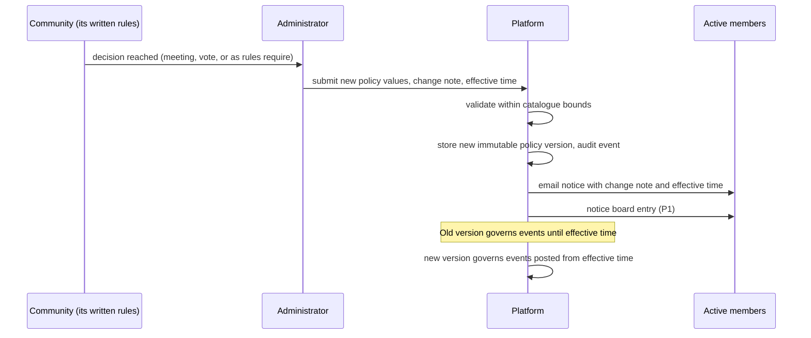
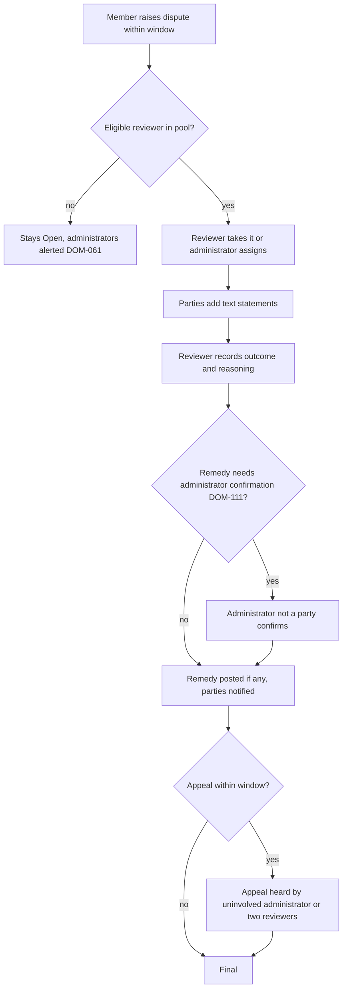

# Governance and Network Operations

| Field | Value |
|---|---|
| Status | Draft |
| Owner role | Product owner |
| Last updated | 2026-11-11 |
| Scope | What a network administrator can configure, how policy changes are decided, announced, and recorded, and the human processes around membership, administrator succession, disputes, negative balances, suspension, closure, and transparency. Separates **governance policy** (what a community decides and writes in its own rules) from **software enforcement** (what the platform enforces or records). |
| Dependencies | [00-conventions.md](00-conventions.md), [03-domain-model-and-mutual-credit-rules.md](03-domain-model-and-mutual-credit-rules.md) (invariants and the policy catalogue DOM-090 to DOM-114), [02-personas-roles-and-journeys.md](02-personas-roles-and-journeys.md) (roles and permissions) |
| Related documents | [01-product-vision-and-scope.md](01-product-vision-and-scope.md), [04-functional-requirements.md](04-functional-requirements.md), [06-data-model-ledger-and-audit.md](06-data-model-ledger-and-audit.md), [08-ux-and-accessibility.md](08-ux-and-accessibility.md), [09-security-privacy-and-abuse-resistance.md](09-security-privacy-and-abuse-resistance.md), [11-deployment-operations-and-support.md](11-deployment-operations-and-support.md), [12-quality-strategy-and-test-plan.md](12-quality-strategy-and-test-plan.md), [13-assumptions-risks-decisions-and-roadmap.md](13-assumptions-risks-decisions-and-roadmap.md) |

## 1. Purpose

Circula networks govern themselves ([VIS-024](01-product-vision-and-scope.md#vis-024)). The platform fixes a small set of invariants ([03-domain-model-and-mutual-credit-rules.md](03-domain-model-and-mutual-credit-rules.md) section 4) and a catalogue of configurable policy values (DOM-090 to DOM-114). Everything else a community needs to run fairly, such as who may join, how disagreements are heard, and what happens when a member cannot settle, is decided by people and written in the network's own rules.

This document does three things. It explains the meaning of each configurable value so an administrator can choose deliberately. It describes the recommended human processes, using words such as SHOULD only for recommended network practice and for behavior the software offers. It states, for each process, what the software enforces or records, so that nobody expects the platform to carry out a decision it only records.

Two kinds of statement appear throughout:

| Kind | Marked by | Meaning |
|---|---|---|
| **Software requirement** | MUST, SHOULD, MAY on a platform behavior, with priority | A test can check it. Binds the implementation. |
| **Governance recommendation** | Labelled "Governance recommendation" and written as SHOULD or MAY | Guidance for a network's own written rules. Not enforced and not tested. A network may choose differently without a recorded decision. |

Each topic section ends with a two-column table: left, what the community decides; right, what the software enforces or records.

### 1.1 Identifier ranges

| Range | Topic |
|---|---|
| GOV-001 to GOV-009 | Purpose, boundary between policy and enforcement |
| GOV-010 to GOV-019 | Configurable policy (walk of DOM-090 to DOM-114) |
| GOV-020 to GOV-029 | Policy change: decision, announcement, record |
| GOV-030 to GOV-039 | Member onboarding |
| GOV-040 to GOV-049 | Member offboarding |
| GOV-050 to GOV-059 | Administrator succession |
| GOV-060 to GOV-069 | Dispute handling process |
| GOV-070 to GOV-079 | Negative-balance recovery and default |
| GOV-080 to GOV-089 | Service suspension (member, network) |
| GOV-090 to GOV-099 | Network closure and data export |
| GOV-100 to GOV-109 | Transparency to members |
| GOV-110 to GOV-119 | Challenges to administrator decisions |
| GOV-120 to GOV-129 | Governance templates |

### 1.2 Boundary rule

**GOV-001 — Policy is recorded, not enforced, unless the catalogue says otherwise.** (P0) The platform MUST enforce only the invariants of [03-domain-model-and-mutual-credit-rules.md](03-domain-model-and-mutual-credit-rules.md) section 4 and the values of the policy catalogue (DOM-090 to DOM-114). For every governance process in this document that is not backed by a catalogue value, the platform MUST NOT block, schedule, or perform the process automatically; it MUST record the administrator's decision, reason, and actor as audit events ([DOM-012](03-domain-model-and-mutual-credit-rules.md#dom-012)) and notify affected members where this document says so.
*Rationale:* a community's rules can be anything; software that silently enforced one community's practice (for example an automatic suspension after 60 days over limit) would be a policy nobody voted for.

**GOV-002 — Administrators act for the network, under its written rules.** (P0) Every administrator action that changes policy, membership, roles, limits, or posts an adjustment MUST require a reason text and MUST appear in the network audit log with the acting membership ([PER-009](02-personas-roles-and-journeys.md#per-009), [DOM-013](03-domain-model-and-mutual-credit-rules.md#dom-013)).
*Rationale:* the audit trail is how members can ask whether an administrator followed the network's own rules.

**GOV-003 — Network rules statement.** (P1) A network MAY store a free-text rules statement (and a separate free-text description of what one credit represents, see [GOV-035](#gov-035)). The platform MUST show the current rules statement to applicants before they submit an application, and to members from the network's home screen. Edits to the rules statement MUST be versioned and announced under [GOV-021](#gov-021) as a policy change.
*Rationale:* a member can only be bound by rules they could read; the platform gives the rules a fixed, visible place but attaches no behavior to their content.

| Policy (community decides) | Software enforces / records |
|---|---|
| The content of the network's written rules: purpose, values, eligibility, conduct, consequences. | Enforces only invariants and catalogue values. Records administrator decisions with reason and actor. Shows the rules statement (P1) and keeps its version history. |

## 2. What a network administrator can configure

An administrator configures exactly the catalogue in [03-domain-model-and-mutual-credit-rules.md](03-domain-model-and-mutual-credit-rules.md) section 11. Allowed values and recommended defaults live there and are not repeated here. The table gives the governance meaning of each value and the questions a community should settle in its written rules before choosing.

**GOV-010 — Policy areas and their governance meaning.** (P0) The administrator interface MUST expose every catalogue value DOM-090 to DOM-114 and no other network-wide behavior switch. The areas below describe what each value means for the community.

| Area | Policy values | Governance meaning and typical choices |
|---|---|---|
| Credit capacity | [DOM-090](03-domain-model-and-mutual-credit-rules.md#dom-090), [DOM-091](03-domain-model-and-mutual-credit-rules.md#dom-091), [DOM-092](03-domain-model-and-mutual-credit-rules.md#dom-092), [DOM-093](03-domain-model-and-mutual-credit-rules.md#dom-093) | How much a new member may receive before providing anything, how far an administrator may stretch that for trusted members, whether hoarding is capped, and how large a shared loss the network will carry. Small networks often start modestly and raise limits for members with a record; some networks set the network account unbounded because losses are shared by decision, not by a cap. Mandatory choice at setup for DOM-090 and DOM-091 because trading cannot start without them. |
| Unit | [DOM-094](03-domain-model-and-mutual-credit-rules.md#dom-094) | The name, symbol, and decimal places members see. The decimal places cannot change after the first posting, so the community should decide with its smallest practical unit of service in mind (for example whether quarter-hours matter). |
| Membership | [DOM-095](03-domain-model-and-mutual-credit-rules.md#dom-095), [DOM-098](03-domain-model-and-mutual-credit-rules.md#dom-098), [DOM-099](03-domain-model-and-mutual-credit-rules.md#dom-099) | Who may enter and what they must tell the network. Trade-off between growth and trust: invite-only suits networks built on existing relationships; application with approval suits networks that want to meet people first. See section 4. |
| Visibility | [DOM-096](03-domain-model-and-mutual-credit-rules.md#dom-096), [DOM-097](03-domain-model-and-mutual-credit-rules.md#dom-097) | Whether members see each other's balances and whether outsiders can read the directory. Visible balances create social accountability and also social pressure; hidden balances protect members and rely on administrators and the visible network account instead. |
| Trading windows | [DOM-100](03-domain-model-and-mutual-credit-rules.md#dom-100), [DOM-101](03-domain-model-and-mutual-credit-rules.md#dom-101), [DOM-104](03-domain-model-and-mutual-credit-rules.md#dom-104), [DOM-105](03-domain-model-and-mutual-credit-rules.md#dom-105) | How long a proposal stays open, how long members may undo a trade by agreement, whether a single trade has a ceiling, and whether large trades need a second confirmation. Longer windows suit slow-moving services; ceilings and confirmation suit networks wary of one large trade exhausting a member's capacity. |
| Disputes | [DOM-102](03-domain-model-and-mutual-credit-rules.md#dom-102), [DOM-103](03-domain-model-and-mutual-credit-rules.md#dom-103), [DOM-111](03-domain-model-and-mutual-credit-rules.md#dom-111), [DOM-113](03-domain-model-and-mutual-credit-rules.md#dom-113) | How long after a trade a member may object, whether a ruling can be appealed, whether an administrator checks a reviewer's remedy before it is posted, and whether the same person may be both administrator and reviewer. See section 7. |
| Corrections | [DOM-106](03-domain-model-and-mutual-credit-rules.md#dom-106), [DOM-107](03-domain-model-and-mutual-credit-rules.md#dom-107), [DOM-108](03-domain-model-and-mutual-credit-rules.md#dom-108), [DOM-109](03-domain-model-and-mutual-credit-rules.md#dom-109) | The vocabulary of reasons recorded with reversals and adjustments, how many administrators must agree before an adjustment posts, how long administrators may undo a trade without the members' agreement, and whether the network may move credits by decision (levy, grant). Each switch moves power between administrators and members; a community should write down why it chose its setting. |
| Departure | [DOM-112](03-domain-model-and-mutual-credit-rules.md#dom-112) | What happens to a leaving member's positive balance. See section 5. |
| Self-dealing | [DOM-110](03-domain-model-and-mutual-credit-rules.md#dom-110) | Whether a sole administrator may transact with the network account for their own benefit, with the event shown to all members. Networks with one administrator who also performs a role for the network (for example newsletter editing, credited from the network account) may need it on; networks with two or more administrators have a different administrator act instead ([DOM-043](03-domain-model-and-mutual-credit-rules.md#dom-043)). |
| Notifications | [DOM-114](03-domain-model-and-mutual-credit-rules.md#dom-114) | Which events beyond the mandatory set send email. Does not affect the notices required by [GOV-021](#gov-021). |

**GOV-011 — Explicit setup choices.** (P0) The platform MUST NOT let a network leave `Setup` until DOM-090, DOM-091, and DOM-094 have been chosen explicitly (section 11 of the domain model marks them as set at setup), and MUST record the first policy version with the administrator's reason text "initial setup".
*Rationale:* the platform has no basis to guess a community's capacity or unit.

**GOV-012 — What cannot be configured.** (P0) The administrator interface MUST NOT offer a control for any invariant (double-entry, zero-sum, append-only history, consent for ordinary transactions, atomic limit checks, audit coverage, the network account, no conversion of credits). A request through the API that attempts to set one MUST be rejected by the platform with a validation error.
*Rationale:* [DOM-018](03-domain-model-and-mutual-credit-rules.md#dom-018); a governance process cannot be allowed to switch off the guarantees every member relies on.

**GOV-013 — Role separation.** (P1) Governance recommendation: networks with at least four active members SHOULD choose `separate_people_required` for DOM-113, so that the person who decides a dispute is not the person who administers the network and posts remedies. Small networks MAY keep `allowed`. The platform enforces whichever value is chosen.
*Rationale:* separation of reviewing and administering is the cheapest check on administrator power.

| Policy (community decides) | Software enforces / records |
|---|---|
| Every value in the table above, within catalogue bounds, and why it was chosen. | Rejects values outside bounds ([DOM-018](03-domain-model-and-mutual-credit-rules.md#dom-018)); requires explicit setup choices; records each version ([DOM-017](03-domain-model-and-mutual-credit-rules.md#dom-017)). |

## 3. How policy changes are decided, announced, and recorded

Plain-text summary: the community decides outside the software, by whatever procedure its rules set. An administrator then enters the new values with a change note and an effective time. The platform validates, stores a new immutable version, records an audit event, and notifies every active member by email (and on the notice board in P1). Events posted before the effective time are judged under the old version; events from the effective time under the new one.

**GOV-020 — Every policy change carries a change note and an effective time.** (P0) The platform MUST require, for each new policy version ([DOM-017](03-domain-model-and-mutual-credit-rules.md#dom-017)): the administrator's reason (the change note, plain text, shown to members unchanged) and an effective time. The effective time MUST default to the moment of saving and MAY be set to a later time up to 180 days ahead. The platform MUST reject an effective time in the past.
*Rationale:* a future effective time is the software hook that lets a network give notice; without it, a notice period would be a promise the software cannot keep.

**GOV-021 — Notification of every policy change.** (P0) On saving a new policy version the platform MUST email every Active member of the network, and MUST attempt delivery to every Suspended member, with: which values changed (old value and new value), the change note, the effective time, and the name of the acting administrator. This notice MUST NOT be disabled by DOM-114. Delivery attempts MUST be audited. A version saved with a future effective time MUST be announced again when it takes effect, with a one-line email.
*Rationale:* [DOM-014](03-domain-model-and-mutual-credit-rules.md#dom-014) covers events on a member's own account only; a change of limits or windows alters every member's position and must not be silent ([VIS-022](01-product-vision-and-scope.md#vis-022)).

**GOV-022 — Pending versions are visible and revocable.** (P1) Until its effective time, a saved version MUST be shown to members as "scheduled", and an administrator MAY cancel it with a reason; cancellation MUST notify members under GOV-021. After its effective time a version is never edited; a later version supersedes it.
*Rationale:* cancelling an announced change is cheaper than a second change after it took effect.

**GOV-023 — Notice period for adverse changes.** (P1) Governance recommendation: a network SHOULD set the effective time at least **14 days** after the announcement for (a) any reduction of a default or maximum credit limit (DOM-090, DOM-091), (b) any shortening of a window (DOM-100 to DOM-103), (c) a move toward a more restrictive entry mode, and (d) any switch that enables administrator powers ([DOM-107](03-domain-model-and-mutual-credit-rules.md#dom-107) to [DOM-109](03-domain-model-and-mutual-credit-rules.md#dom-109)). Changes that only widen member rights MAY take effect at once. The platform MUST NOT enforce this period. When a change in these categories is saved with an effective time less than 14 days ahead, the platform SHOULD show the administrator a warning naming the recommendation, and MUST record in the audit event whether the warning was shown and accepted.
*Rationale:* members need time to complete trades and plan around a lower limit; the figure is a recommended default, an open decision recorded as [OQ-GOV-1](#18-open-questions).

**GOV-024 — Urgent changes.** (P1) Governance recommendation: an administrator MAY set an immediate effective time to protect the network (for example lowering a limit during suspected abuse) and SHOULD say so in the change note. The platform treats such a change like any other: versioned, audited, announced.
*Rationale:* the audit and notice are what make an urgent change accountable.

**GOV-025 — Announcement channels.** (P1) Email is the MVP channel ([DEC-007](13-assumptions-risks-decisions-and-roadmap.md#dec-007)). The platform SHOULD also provide a **network notice board**: a chronological list, visible to Active members, to which administrators MAY post text announcements (title, body, posted time, author) and to which every policy change is added automatically as an entry linking to the policy version. Notice-board entries MUST NOT be editable after posting; an administrator MAY post a correction. Announcements about matters that are not policy (events, holidays, reminders) use the same board but create no policy version.
*Rationale:* email alone is lost in inboxes; a board gives later members a place to read what was announced before they joined. The notice board is P1; if it slips, email alone satisfies [GOV-021](#gov-021).

**GOV-026 — Policy decision process.** (P1) Governance recommendation: a network SHOULD write down who may propose a change, how members are consulted, what majority or consensus applies, and who enters the result. The platform records only the administrator's entry and change note, not the vote; the change note SHOULD cite the decision (for example "agreed at general meeting, minutes in shared folder").
*Rationale:* the platform cannot verify a vote; it can make the claim of authority visible to every member.

| Policy (community decides) | Software enforces / records |
|---|---|
| Who may propose and approve changes; the notice period (recommended 14 days for limit reductions, window changes, and enabling administrator powers); when urgency justifies immediate effect. | New immutable version with change note, actor, effective time ([DOM-017](03-domain-model-and-mutual-credit-rules.md#dom-017)); email to all members ([GOV-021](#gov-021)); scheduled and cancelled states (P1); notice board (P1); warning when recommended notice is not given. Does not enforce the notice period. |

## 4. Member onboarding

**GOV-030 — Entry mode governs the route in.** (P0) The platform MUST apply the entry mode in DOM-095: with `invite_only`, only invitations lead to Active membership; with the other modes, an application creates a `Pending` membership that stays without trading rights until an administrator approves or rejects it with a reason ([PER-013](02-personas-roles-and-journeys.md#per-013), [JRN-001](02-personas-roles-and-journeys.md#jrn-001)).

**GOV-031 — Invitation flow.** (P0) An administrator MAY invite by email address ([PER-012](02-personas-roles-and-journeys.md#per-012)). The platform MUST send the invitation, honor the validity window (DOM-099), show the administrator the invitation status (`Invited`, `Expired`, `Revoked`, accepted), allow revocation by the administrator, and record who invited whom. An invitation MUST NOT create an account or limit until accepted.
*Rationale:* the record of who vouched for whom is the main trust signal the platform can keep.

**GOV-032 — Approval criteria are governance.** (P1) Governance recommendation: a network SHOULD write down its approval criteria (for example residence in an area, a sponsor among existing members, a conversation before approval, an offered service) and SHOULD apply them the same way to every applicant. The platform MUST record the approving or rejecting administrator, the decision time, and the reason text, and MUST notify the applicant of the outcome with the reason. The platform MUST NOT evaluate criteria.
*Rationale:* the software cannot know what "a good fit" means to a community.

**GOV-033 — Identity verification is not a software function.** (P0) The platform verifies control of an email address ([DEC-007](13-assumptions-risks-decisions-and-roadmap.md#dec-007)) and nothing else about a person. It MUST NOT claim, in any interface or notification, that a member's name, address, or identity has been verified. Whether and how a network checks that people are who they say (meeting in person, a sponsor, documents held outside the platform) is governance policy. The approval record in GOV-032 is the only trace the software keeps.
*Rationale:* identity assurance would carry privacy and regulatory consequences ([OQ-GOV-4](#18-open-questions)); not claiming it avoids implying a guarantee ([DOM-081](03-domain-model-and-mutual-credit-rules.md#dom-081)).

**GOV-034 — Initial credit limit.** (P0) A new member account MUST take the default credit limit (DOM-090) and positive limit (DOM-092). An administrator MAY set a different limit when approving, within DOM-091, with a reason, as a [DOM-050](03-domain-model-and-mutual-credit-rules.md#dom-050) change. Governance recommendation: networks SHOULD give every new member the same starting limit unless their written rules define a graded scheme (for example a lower limit during the first three months), and SHOULD tell the member the limit and when it will be reviewed. The platform does not schedule reviews.
*Rationale:* equal starting treatment is the simplest defence against favoritism; graded schemes are a governance choice, applied by an administrator by hand.

**GOV-035 — Welcome information states what a credit represents.** (P0) Before a membership becomes `Active`, the platform MUST show the new member a welcome screen and include in the acceptance or approval email: the network's own free-text description of what one credit represents, the starting credit limit, and the statements required by [DOM-080](03-domain-model-and-mutual-credit-rules.md#dom-080) and [DOM-081](03-domain-model-and-mutual-credit-rules.md#dom-081) (the credit is an accounting unit of this network, not redeemable through the platform, and no one is guaranteed to accept it). The platform MUST record that the member saw the welcome statement (an audit event with the policy version). The network's description is required text before the network leaves `Setup`.
*Rationale:* the most common misunderstanding in new networks is that a balance is a claim on someone; the platform states what it is and what it is not.

**GOV-036 — Rejected applications.** (P1) Governance recommendation: a network SHOULD tell applicants how to ask for reconsideration (see [GOV-112](#gov-112)). The platform keeps the rejected application and its reason for the period set in [06-data-model-ledger-and-audit.md](06-data-model-ledger-and-audit.md) ([OQ-PER-6](02-personas-roles-and-journeys.md#5-open-questions)).

| Policy (community decides) | Software enforces / records |
|---|---|
| Entry mode; who may invite; approval criteria; how identity is checked outside the platform; starting limit scheme; what a credit represents. | Applies the entry mode; sends and expires invitations; blocks trading until Active; records inviter, approver, reason, decision time; shows the welcome statement and records that it was seen; applies default limits. Verifies email control only. |

## 5. Member offboarding

**GOV-040 — Voluntary departure.** (P0) A member MAY leave under [DOM-070](03-domain-model-and-mutual-credit-rules.md#dom-070) and [DOM-071](03-domain-model-and-mutual-credit-rules.md#dom-071) ([JRN-008](02-personas-roles-and-journeys.md#jrn-008)). When the conditions do not hold the platform MUST show the blocking condition in text. Before confirming, the platform MUST offer the member's own data export ([PER-030](02-personas-roles-and-journeys.md#per-030)).

**GOV-041 — Settlement expectations are governance.** (P1) Governance recommendation: a network's written rules SHOULD say what a leaving member with a negative balance is expected to do (for example provide services to bring the balance to zero within a stated period) and what a leaving member with a positive balance may do (offer to members, forfeit to the network, see DOM-112). The platform provides the request path of DOM-071 and records the administrator's closing adjustment; it does not track or enforce settlement.
*Rationale:* the ledger can record an outcome; only the community decides what is fair.

**GOV-042 — Removal by administrator.** (P0) An administrator MAY remove a member under [DOM-072](03-domain-model-and-mutual-credit-rules.md#dom-072) ([PER-015](02-personas-roles-and-journeys.md#per-015)). The platform MUST require a reason text, MUST notify the member with the reason and with the challenge route defined by the network ([GOV-112](#gov-112)), and MUST keep the member's read access to own history and own data export for the retention period stated in [06-data-model-ledger-and-audit.md](06-data-model-ledger-and-audit.md) ([OQ-PER-3](02-personas-roles-and-journeys.md#5-open-questions)). Governance recommendation: a network SHOULD suspend first (section 9) and remove only after the member has had the chance to respond.
*Rationale:* removal ends a member's ability to trade; the reason and route to challenge are the due process the software can carry.

**GOV-043 — Rejoining.** (P1) A departed person who reapplies gets a new membership and a new account ([DOM-076](03-domain-model-and-mutual-credit-rules.md#dom-076)); no balance carries over. The platform SHOULD show administrators that a prior membership existed, when it ended, and whether it ended by departure, removal, or write-off, subject to [09-security-privacy-and-abuse-resistance.md](09-security-privacy-and-abuse-resistance.md). Governance recommendation: networks SHOULD state whether a member whose balance was written off may rejoin and on what conditions (for example only after the community's loss has been made good by service to the network).
*Rationale:* a written-off balance is a loss other members bear; whether to readmit is a judgment about trust.

**GOV-044 — Listings of departing members.** (P1) The platform SHOULD close active listings of a member at departure and tell the member before confirming ([JRN-008](02-personas-roles-and-journeys.md#jrn-008)). The treatment of listings of a suspended member is an open decision owned by [OQ-PER-3](02-personas-roles-and-journeys.md#5-open-questions).

| Policy (community decides) | Software enforces / records |
|---|---|
| What a leaver is expected to do to settle; whether to suspend before removing; what is said to the member; whether and when someone may rejoin. | Departure only at zero or with an administrator's closing adjustment; removal needs a reason and notifies the member; history is kept ([DOM-074](03-domain-model-and-mutual-credit-rules.md#dom-074)); new membership on rejoining with no balance carried; audit of each step. |

## 6. Administrator succession

**GOV-050 — At least one administrator, always.** (P0) The platform MUST apply [PER-006](02-personas-roles-and-journeys.md#per-006): it MUST reject role removal, suspension, or departure of the last Active administrator, and the rejection MUST tell the actor to assign another administrator first.

**GOV-051 — Two administrators recommended.** (P1) Governance recommendation: every network SHOULD have at least two Active administrators. Two administrators allow [DOM-043](03-domain-model-and-mutual-credit-rules.md#dom-043) (no acting on both sides), second-administrator approval (DOM-107, DOM-108) and the confirmation of dispute remedies (DOM-111) to work. The platform SHOULD show a persistent notice to the sole administrator of a network that has only one Active administrator, and the administrator list of [GOV-100](#gov-100) MUST show how many administrators are Active.
*Rationale:* a one-administrator network has no check on its administrator and no continuity if that person is unavailable.

**GOV-052 — Handover procedure.** (P1) Governance recommendation, for a planned handover: (1) the incoming person is a member in good standing and has accepted in writing; (2) an outgoing administrator assigns the administrator role to them ([PER-016](02-personas-roles-and-journeys.md#per-016)); (3) the incoming administrator signs in and confirms they can see the administrator screens; (4) the outgoing administrator hands over off-platform items the platform does not hold (domain or hosting contact, minutes, the written rules, the succession contact); (5) the outgoing administrator's role is removed, with a reason such as "handover"; (6) the network is told by a notice board entry or email. The platform MUST record steps (2) and (5) as role-change audit events and MUST notify the member whose role changes.

**GOV-053 — Network succession contact.** (P1) The platform SHOULD let administrators register, in network settings, a **succession contact**: the name of a member and a free-text description of the network's written rule that designates who takes over when no administrator can act. The contact is stored as part of the network record, versioned, and visible to the platform operator for use under GOV-054. Registering or changing it MUST be audited and announced as a policy change under GOV-021.
*Rationale:* the operator cannot judge who legitimately speaks for a community; a record made earlier by the administrators can.

**GOV-054 — Sole administrator unreachable.** (P0) When a network's only Active administrator becomes unreachable (cannot sign in, has died, or is otherwise unavailable), the platform operator MAY, through the break-glass procedure ([PER-033](02-personas-roles-and-journeys.md#per-033), detail in [09-security-privacy-and-abuse-resistance.md](09-security-privacy-and-abuse-resistance.md)), grant the administrator role to one Active member **designated by the network's own written rules** (for example the registered succession contact, or the member named by a written decision of the community). The operator MUST NOT choose the member by its own judgment, MUST record the evidence relied on (the written rule and a statement that the administrator cannot be reached after a stated number of attempts), and the grant MUST be time-boxed, reason-logged, audited ([DOM-012](03-domain-model-and-mutual-credit-rules.md#dom-012)), and shown to the network's administrators and members afterwards. The grant MUST NOT post any transaction or adjustment and MUST NOT change policy; the new administrator does that through the normal interface.
Recommended default for the attempts and waiting time before the operator acts: three attempts over 14 days (open decision, [OQ-GOV-2](#18-open-questions)). When the network has no written rule designating a member, the operator MUST NOT grant the role and the network SHOULD be offered the closure path or a decision by its members recorded outside the platform; this is a counsel question where members dispute the designation ([OQ-GOV-3](#18-open-questions)).
*Rationale:* a network without an administrator cannot approve members, resolve disputes, or close; but an operator who picks administrators would have a role inside networks that PER-007 forbids.

**GOV-055 — Dormant administrators.** (P1) Governance recommendation: networks SHOULD define when an administrator counts as dormant (for example no sign-in for 90 days) and what follows (a reminder, then removal of the role by another administrator). The platform SHOULD show each administrator's last sign-in time to the other administrators of the same network. It MUST NOT remove roles automatically.
*Rationale:* a dormant administrator weakens [GOV-051](#gov-051) without anyone noticing.

| Policy (community decides) | Software enforces / records |
|---|---|
| Number of administrators (two or more recommended); how successors are chosen; who is the succession contact; dormancy threshold and consequence; what is handed over off-platform. | Never zero Active administrators ([PER-006](02-personas-roles-and-journeys.md#per-006)); role changes audited and notified; succession contact stored and versioned (P1); operator break-glass grant to a designated member only, time-boxed and visible; last sign-in shown to administrators (P1). |

## 7. Dispute handling process

Plain-text summary: a member raises a dispute; if no eligible reviewer exists it waits open and administrators are alerted. A reviewer is assigned, hears both parties in writing, and records an outcome. Where policy requires it, an uninvolved administrator confirms the remedy before it posts. Either party may appeal once within the appeal window; after the appeal, or when the window passes, the matter is final.

**GOV-060 — Reviewer pool.** (P1) Governance recommendation: a network SHOULD appoint at least three members with the `reviewer` role who are not administrators (when the network has at least ten Active members), chosen by the method its rules set (election, rotation, appointment). The platform lists current reviewers to administrators and, when no eligible reviewer exists for a dispute, behaves per [DOM-061](03-domain-model-and-mutual-credit-rules.md#dom-061).
*Rationale:* with fewer than three reviewers a party to the dispute can disqualify the pool.

**GOV-061 — Assignment and timelines.** (P1) Governance recommendation, recommended defaults a network MAY change: a reviewer takes or is assigned a dispute within 3 days of its being raised; the reviewer records an outcome within 14 days of assignment; the parties are given 5 days to add their statements before the outcome. The platform SHOULD show each dispute's age and time in each status to administrators and SHOULD remind a reviewer by email when a dispute has been Under review for 10 days. The platform MUST NOT resolve a dispute automatically on expiry of any period; an administrator MAY reassign a dispute whose reviewer has not acted, with a reason, and the reassignment MUST be audited.
*Rationale:* delay is the usual way disputes fail communities; automatic resolution would be the software deciding.

**GOV-062 — Conflict of interest.** (P0) The platform MUST enforce [DOM-061](03-domain-model-and-mutual-credit-rules.md#dom-061) and [PER-006](02-personas-roles-and-journeys.md#per-006): a reviewer holding either account of the subject event, or the administrator who initiated a subject adjustment, cannot take or resolve the dispute. Governance recommendation: a reviewer SHOULD also decline when they have a close personal or business relationship with a party or have a stake in the outcome, and SHOULD say so to an administrator, who reassigns. The platform cannot detect these relationships; reassignment is recorded with its reason.

**GOV-063 — Evidence is text in the MVP.** (P1) Parties and reviewers exchange plain-text statements attached to the dispute; the platform stores them with author and time. File and image evidence is deferred (P2). Governance recommendation: a network SHOULD ask parties to describe agreements, dates, and messages exchanged in the statement, and reviewers SHOULD ask clarifying questions in the dispute thread rather than off-platform so the record is complete.
*Rationale:* a text-only record keeps the attack surface and storage obligations small ([09-security-privacy-and-abuse-resistance.md](09-security-privacy-and-abuse-resistance.md)); it also keeps the reasoning visible to both parties.

**GOV-064 — Outcomes and their meaning.** (P0) The platform offers the four outcomes of [DOM-062](03-domain-model-and-mutual-credit-rules.md#dom-062) and requires reasoning text. Governance recommendation: reviewers SHOULD choose `dismissed` when the transaction was agreed and the service was provided as described, `reversed` when it was not provided or was mistaken in amount to the whole transaction, and `adjusted` when partial settlement is fair (the correction states amounts and accounts). Reasoning SHOULD refer to the network's written rules. A remedy that would breach a limit on the other party's account follows the rule in [DOM-032](03-domain-model-and-mutual-credit-rules.md#dom-032) and is announced to the parties as over limit.

**GOV-065 — Administrator confirmation.** (P0) The platform MUST apply DOM-111. Governance recommendation: networks SHOULD keep the default `adjustments_only` or choose `all_remedies`; `none` leaves reviewers' remedies without a second check and suits only networks where reviewers are separate from administrators and elected. The confirming administrator MUST NOT be a party and, where [DOM-113](03-domain-model-and-mutual-credit-rules.md#dom-113) allows, SHOULD NOT be the reviewer.

**GOV-066 — Appeal hearer.** (P1) Governance recommendation: an appeal SHOULD be heard by an administrator who was not previously involved in the dispute (not the reviewer, not the confirming administrator, not a party), or, where no such administrator exists, by two reviewers who were not involved, who record one joint outcome. The platform MUST record who heard the appeal ([section 9.4 of the domain model](03-domain-model-and-mutual-credit-rules.md#94-appeal-record)), refuse a hearer who is a party to the subject event or the reviewer of the original dispute, and notify both parties.
*Rationale:* an appeal heard by the original decider is a repeat of the decision.

**GOV-067 — What an appeal may change; finality.** (P0) An appeal outcome is `upheld` or `overturned` ([DOM-063](03-domain-model-and-mutual-credit-rules.md#dom-063)). The earlier resolution and events remain unedited; an overturned outcome leads to a new reversal or adjustment referencing the appeal, subject to the same confirmation policy as in GOV-065. Governance recommendation: an appeal SHOULD be limited to (a) a procedural fault (a conflicted reviewer, a party not heard), (b) new information the party could not reasonably have given earlier, or (c) a remedy that is inconsistent with the reasoning. The appeal decision is final: the platform MUST NOT allow a second appeal. Where DOM-103 is 0 the platform MUST NOT offer an appeal.
*Rationale:* finality gives members certainty; a defined scope stops appeals becoming a second hearing on the same facts.

| Policy (community decides) | Software enforces / records |
|---|---|
| Size and selection of the reviewer pool; timelines for assignment and decision; what the community expects of reviewers; guidance on outcomes; who hears appeals and on what grounds. | Reviewer exclusion for parties and initiating administrator; assignment and alerts; four outcomes with required reasoning; optional administrator confirmation (DOM-111); text statements with author and time; one appeal per dispute with hearer recorded; remedies as new events referencing the dispute or appeal; all notifications and audit. No automatic resolution. |

## 8. Negative-balance recovery and default

A negative balance is an obligation to the community in the community's unit, not a debt to the platform or a monetary claim ([DOM-073](03-domain-model-and-mutual-credit-rules.md#dom-073)). The platform never pursues it.

**GOV-070 — The platform boundary.** (P0) For negative balances the platform provides only: over-limit visibility to the member and to administrators ([DOM-052](03-domain-model-and-mutual-credit-rules.md#dom-052)); suspension ([DOM-072](03-domain-model-and-mutual-credit-rules.md#dom-072)); the `write_off` adjustment ([DOM-040](03-domain-model-and-mutual-credit-rules.md#dom-040)); and the visible network account balance ([DOM-053](03-domain-model-and-mutual-credit-rules.md#dom-053)). It MUST NOT compute or display interest or penalties on a balance, MUST NOT send demands, collection notices, or reminders that state an amount owed in national currency, and MUST NOT offer an export or report intended for use as a claim in national currency.
*Rationale:* DOM-073 and [DEC-008](13-assumptions-risks-decisions-and-roadmap.md#dec-008).

**GOV-071 — Recommended recovery ladder.** (P1) Governance recommendation: a network's written rules SHOULD define steps such as these, with the waiting time for each:

| Step | What happens | What the platform offers |
|---|---|---|
| 1. Reminder | An administrator reminds a member who has stayed over limit or near it for a stated period (recommended default: 30 days) that others are waiting for service. | Over-limit list for administrators; the member sees their own state. Reminders are sent by the administrator by hand, as plain-text messages that state the balance in the network's unit only (P1: message through the platform). |
| 2. Conversation | An administrator or a member of a standing committee talks to the member about what is preventing them from providing. | Nothing. The conversation is off-platform; an administrator MAY note its date in the member's record (P2). |
| 3. Trading plan | The member and the network agree a plan: kinds of service the member will offer, expected rate, review date. | Nothing enforces a plan. An administrator MAY adjust the member's credit limit with a reason. |
| 4. Suspension | If the plan is not followed, an administrator suspends the member under section 9. | Suspension with reason and notification ([DOM-072](03-domain-model-and-mutual-credit-rules.md#dom-072)); the member still sees history and may provide service to others only by the network's decision outside the platform. |
| 5. Write-off | When the network declares default, an administrator posts a `write_off` with reason `default` and, where policy requires it, a second administrator approves. | Adjustment event, notification, the network account balance becomes more negative and is visible to every member. |

The platform MUST NOT automate any step (no scheduled reminders, suspension, or write-off).

**GOV-072 — Declaring default is a recorded decision.** (P0) The platform MUST NOT have a "default" membership status. The administrator's decision to declare default is recorded as the reason text and reason code `default` ([DOM-106](03-domain-model-and-mutual-credit-rules.md#dom-106)) on the write-off adjustment. Governance recommendation: the written rules SHOULD say who may declare default (for example two administrators together, or the general meeting) and the member SHOULD be told in writing before the write-off.
*Rationale:* a stored default status would invite automatic consequences; the visible adjustment is the record.

**GOV-073 — Absorbing the loss is a community matter.** (P1) A write-off moves the loss to the network account, which every member can see ([DOM-053](03-domain-model-and-mutual-credit-rules.md#dom-053)). Governance recommendation: networks SHOULD decide, in advance, how a negative network account balance will be handled (for example accepted as a permanent feature, worked down by members providing service to the network and receiving a `policy_transfer` credit where DOM-109 allows it, or reduced by a rule on future joiners). The platform has no automatic repayment.
*Rationale:* an unexplained, growing negative network balance erodes trust.

**GOV-074 — External agreements are outside the platform.** (P1) A network MAY make its own agreements with members outside the platform, for example a written undertaking to provide services, or an arrangement in national currency. The platform neither carries out, tracks, nor verifies them, and MUST NOT state or suggest that it does. Whether such an agreement is enforceable, and what obligations it creates for the network and for the platform operator, is a counsel question ([OQ-GOV-5](#18-open-questions)).

| Policy (community decides) | Software enforces / records |
|---|---|
| What counts as default; how long to wait; the ladder of steps; who declares default; how the shared loss is handled; any agreement outside the platform. | Over-limit state visible; suspension; write-off adjustment with reason and notification; network account balance visible to all. No interest, penalties, collection, automatic steps, or national-currency claims. |

## 9. Service suspension of a member and of a network

**GOV-080 — Member suspension.** (P0) An administrator MAY suspend a member with a reason ([PER-014](02-personas-roles-and-journeys.md#per-014), [JRN-007](02-personas-roles-and-journeys.md#jrn-007)). The platform MUST freeze the member's account ([DOM-016](03-domain-model-and-mutual-credit-rules.md#dom-016)), cancel the member's `Proposed` transactions ([DOM-024](03-domain-model-and-mutual-credit-rules.md#dom-024)), notify the member by email with the reason and the challenge route, record who suspended and when, and keep read access to own history and own data export. A frozen account MAY still take reversals and adjustments, so a dispute outcome or a write-off can be carried out. The platform MUST refuse to suspend the last Active administrator.
Governance recommendation: written rules SHOULD state grounds (for example abuse of other members, repeated failure to follow a trading plan, a security concern with the login), SHOULD require notice to the member before suspension except for urgent safety grounds, and SHOULD set a review date after which the suspension is lifted or the member is removed.

**GOV-081 — Reinstatement.** (P0) An administrator MAY reinstate a suspended member with a reason; the platform MUST unfreeze the account, notify the member, and audit the change. Reinstatement does not restore cancelled proposals. A suspension that lasts beyond the review date is not lifted by the platform.

**GOV-082 — Network suspension by an administrator.** (P1) A network administrator MAY suspend the network's trading (for example during a rules review) with a reason text; the platform MUST then post no ledger event ([DOM-016](03-domain-model-and-mutual-credit-rules.md#dom-016)), allow no new memberships, keep everything readable, notify every member by email with the reason and expected duration (recorded, not enforced), and allow reinstatement by an administrator. Dispute resolutions pending a remedy remain pending.
*Rationale:* pausing trading is a safe way to settle a serious disagreement without destroying history.

**GOV-083 — Network suspension by the platform operator.** (P0) The operator MAY suspend a network for abuse, legal, or commercial-terms reasons. This is an operator policy; its grounds, notice, and reinstatement are defined in [11-deployment-operations-and-support.md](11-deployment-operations-and-support.md). The platform MUST apply the same software behavior as GOV-082 (DOM-016), MUST record the operator's reason as an instance-level audit event ([DOM-012](03-domain-model-and-mutual-credit-rules.md#dom-012)) visible to the network's administrators, and MUST notify the network's administrators by email. The operator suspends from the operations interface only; this action is not a break-glass read of network data, and it does not grant the operator any ledger role ([PER-007](02-personas-roles-and-journeys.md#per-007)). Governance recommendation (for the operator): give administrators advance notice except where delay would cause harm.
*Rationale:* operators need a way to stop a harmful network without access to its ledger.

**GOV-084 — Suspension is not a sanction on the balance.** (P0) Suspension, of a member or a network, MUST NOT change any balance, limit, or posting. Any change to a balance is a separate adjustment with its own reason.

| Policy (community decides) | Software enforces / records |
|---|---|
| Grounds for suspension; notice before it; review date; whether a network pauses itself; operator's grounds and notice (operator policy). | Account freeze, cancellation of proposals, notifications, reasons, actors, audit; no ledger events while the network is suspended; no automatic lifting; network status changes visible to members. |

## 10. Network closure and data export

**GOV-090 — Deciding to close.** (P1) Governance recommendation: the written rules SHOULD say who may decide closure (for example a majority of members at a meeting) and give at least 30 days of notice. The platform does not schedule closure; the decision is recorded as the reason text on the closure action.

**GOV-091 — Closure steps.** (P0) Before closure the administrators bring every member account and the network account to zero with closing adjustments ([DOM-071](03-domain-model-and-mutual-credit-rules.md#dom-071), [DOM-075](03-domain-model-and-mutual-credit-rules.md#dom-075)). The platform MUST list the accounts that block closure with their balances, MUST reject closure while any exists, and on closure MUST make the ledger read-only and keep it exportable. Recommended order: announce, optionally suspend trading, ask members to settle among themselves, take a final export, post closing adjustments with reason `governance`, close member accounts, close network. Closing adjustments are disputable within the dispute window ([DOM-041](03-domain-model-and-mutual-credit-rules.md#dom-041)), so a network SHOULD allow that window to run before closing, or accept that the window continues to be available after closure only for reading.
*Rationale:* a closure with a non-zero balance would end the zero-sum ledger with someone holding an unrecorded claim.

**GOV-092 — Final export.** (P0) The platform MUST let an administrator export the whole network (members, accounts, full ledger, policy versions, audit log) in CSV and JSON ([PER-031](02-personas-roles-and-journeys.md#per-031)) at any time, including after closure, and MUST audit each export ([DOM-012](03-domain-model-and-mutual-credit-rules.md#dom-012)). On closure the platform MUST prompt the closing administrator to take an export and MUST record whether one was taken. Each member MUST retain self-export of their own data ([PER-030](02-personas-roles-and-journeys.md#per-030)) after closure for the retention period.
Who receives the final export is a governance decision: governance recommendation: the network SHOULD name in its rules who keeps the export (a named administrator, an elected custodian, or the members who ask for it) and SHOULD tell members that personal data in the export is that custodian's to protect. Whether the administrator or the network is a data controller for the export is a counsel question ([OQ-GOV-6](#18-open-questions)).

**GOV-093 — Retention after closure.** (P0) The platform MUST keep the closed network's ledger unchanged for the retention period of [06-data-model-ledger-and-audit.md](06-data-model-ledger-and-audit.md) (recommended default 7 years; open decision and counsel question), then the operator's deletion procedure in [11-deployment-operations-and-support.md](11-deployment-operations-and-support.md) applies. The platform MAY pseudonymize departed members' display names after retention ([DOM-074](03-domain-model-and-mutual-credit-rules.md#dom-074)). Governance recommendation: the network SHOULD tell members how long data remains after closure.

**GOV-094 — Communication to members.** (P0) On closure the platform MUST email every member (including departed members whose email is still held, subject to [09-security-privacy-and-abuse-resistance.md](09-security-privacy-and-abuse-resistance.md)) stating the closure time, that history remains readable and exportable for the retention period, and how to take a self-export. Governance recommendation: the announcement of intent to close SHOULD be sent separately, with the 30-day period of GOV-090, through the notice board (P1) and email.

| Policy (community decides) | Software enforces / records |
|---|---|
| Who decides closure and with how much notice; how members settle; who keeps the final export; what members are told. | Rejects closure unless all accounts are at zero; read-only ledger; exports of members, accounts, ledger, policy versions, audit log in CSV and JSON; audited exports; closure notification; retention. |

## 11. Transparency to members

**GOV-100 — Administrators and reviewers are listed.** (P0) Every Active member MUST be able to see, in the network's home screen, the names of the current administrators and reviewers (display names) and how to contact them through the platform. The list MUST change when roles change.
*Rationale:* members cannot challenge a decision if they cannot tell who holds power.

**GOV-101 — Policy version history is visible.** (P0) Every Active member MUST be able to read the current policy and every earlier version: values, change note, acting administrator, announced time, effective time. A version cannot be hidden or deleted. Values that are administrator-only operational settings (DOM-114) are excluded from the member view.
*Rationale:* [DOM-017](03-domain-model-and-mutual-credit-rules.md#dom-017) keeps versions; members need to see them to know which rules applied to a past event.

**GOV-102 — Network account balance is visible.** (P0) The platform MUST show the network account's balance to every Active member ([DOM-053](03-domain-model-and-mutual-credit-rules.md#dom-053)), regardless of the balance-visibility policy DOM-096, with a text label stating that it records the network's shared adjustments, and a link to the adjustment log of [GOV-103](#gov-103).

**GOV-103 — Adjustment log visible to members.** (P1) The platform SHOULD provide every Active member with a list of all adjustment events in the network (date, type, reason code, amount, network account direction, administrator who posted, dispute reference where any), in summary form: the member accounts involved are shown by display name only when the member is a party, and otherwise as "a member" unless [DOM-110](03-domain-model-and-mutual-credit-rules.md#dom-110) disclosure applies. This is the **recommended default**; networks MAY restrict the list to administrators. Whether the default list shows account identities, only summaries, or only totals is an open decision ([OQ-GOV-7](#18-open-questions)).
*Rationale:* adjustments are the platform's exception to member consent; visibility is the community's check on them, balanced against the privacy of a member whose balance was written off.

**GOV-104 — Self-dealing disclosure.** (P0) Events carrying the `self_dealing` flag ([DOM-043](03-domain-model-and-mutual-credit-rules.md#dom-043), [DOM-110](03-domain-model-and-mutual-credit-rules.md#dom-110)) MUST be visible to every Active member in the network's event list with the administrator named, regardless of balance visibility. Governance recommendation: a network with one administrator SHOULD set DOM-110 on only if it has also decided, in its written rules, which roles an administrator may be credited for from the network account and how they are reviewed.

**GOV-105 — Audit access for members.** (P1) A member sees events about their own account and membership through their history ([PER-029](02-personas-roles-and-journeys.md#per-029)). Whether reviewers or all members may see the network audit log is policy-dependent in the permissions matrix; the recommended default is administrators only for the audit log and the summary views of GOV-100 to GOV-104 for everyone else.

| Policy (community decides) | Software enforces / records |
|---|---|
| Whether to show balances to members (DOM-096); whether the adjustment log is summary, detailed, or administrator-only; which roles an administrator may be credited for. | Shows administrator and reviewer list, policy versions, network account balance, self-dealing events always; adjustment log summary by default (P1); audit trail of all changes. |

## 12. Challenges to administrator decisions beyond disputes

Disputes ([DOM-060](03-domain-model-and-mutual-credit-rules.md#dom-060)) cover completed transactions and adjustments. Other administrator decisions have no dispute record in the MVP.

**GOV-110 — Decisions covered.** (P1) Governance recommendation: a network SHOULD give members a way to challenge at least these administrator decisions: rejection of an application; suspension or removal; a change of credit limit for that member; refusal of a closing adjustment or of a departure; a refusal to confirm a dispute remedy.

**GOV-111 — The software records decision, reason, and notice.** (P0) For each decision in GOV-110 the platform MUST record the deciding administrator, the time, and the reason text, and MUST notify the affected person with the reason by email, including (where the network has set one) the challenge route of GOV-112. A decision without a reason MUST be rejected by the platform.
*Rationale:* a person who has no stated reason cannot challenge a decision.

**GOV-112 — Challenge route is governance.** (P1) The network SHOULD record in its rules statement ([GOV-003](#gov-003)) a challenge route: to whom the affected person writes (for example an administrator not involved, a committee, or the general meeting), the response time (recommended default 14 days), and who decides. The platform shows the rules statement in the notification and in the affected person's own screens. The platform provides a text message path to administrators, so the person can send a challenge; the reply and outcome are handled by the network and, where they change a status or limit, by an ordinary audited administrator action.
*Rationale:* the MVP has no appeal workflow beyond disputes; making the route visible is the minimum.

**GOV-113 — Structured challenge workflow is deferred.** (P2) A platform-supported workflow for challenging membership, suspension, and limit decisions (status, hearer, outcome, deadlines) is deferred. Until then, GOV-111 and GOV-112 apply.

| Policy (community decides) | Software enforces / records |
|---|---|
| Which decisions can be challenged; to whom; within what time; who decides and on what grounds. | Mandatory reason; notification of the person with the reason; audit of the decision and of any later status or limit change; message path to administrators (P1). No enforced appeal workflow beyond disputes (P2). |

## 13. Governance templates

This section lists topics a network's written rules SHOULD cover. It is not legal text, and no wording is provided. The checklist is shown to administrators during setup as non-binding prompts (P1), and each item links to the section above.

**GOV-120 — Checklist of topics for a network's written rules.** (P1)

| # | Topic | Section | Decided |
|---|---|---|---|
| 1 | Purpose of the network, what one credit represents, and what it is not | [GOV-035](#gov-035) | |
| 2 | Who may join, how applicants are approved, how identity is checked | [GOV-030](#gov-030) to [GOV-033](#gov-033) | |
| 3 | Starting credit limit, when limits are reviewed, who may change them | [GOV-034](#gov-034) | |
| 4 | Who administers; number of administrators; succession contact; dormancy | [GOV-050](#gov-050) to [GOV-055](#gov-055) | |
| 5 | How rules are changed; who proposes and approves; notice period | [GOV-023](#gov-023), [GOV-026](#gov-026) | |
| 6 | Reviewer pool, timelines, conflicts, appeals | [GOV-060](#gov-060) to [GOV-067](#gov-067) | |
| 7 | What happens when a member stays over limit; recovery steps; who declares default | [GOV-071](#gov-071), [GOV-072](#gov-072) | |
| 8 | Handling of the network's shared loss | [GOV-073](#gov-073) | |
| 9 | Grounds for suspension and removal; notice; review date | [GOV-080](#gov-080) | |
| 10 | Leaving, settlement expectations, positive balance on departure, rejoining | [GOV-040](#gov-040) to [GOV-043](#gov-043) | |
| 11 | What members can see: balances, adjustments, administrators, rules versions | [GOV-100](#gov-100) to [GOV-105](#gov-105) | |
| 12 | How decisions other than disputes can be challenged | [GOV-110](#gov-110) to [GOV-112](#gov-112) | |
| 13 | Closure: who decides, notice, who keeps the final export | [GOV-090](#gov-090), [GOV-092](#gov-092) | |
| 14 | External agreements and legal status of the group (counsel to advise) | [GOV-074](#gov-074) | |
| 15 | Data handling: what the network keeps outside the platform, who has access | [GOV-092](#gov-092) | |

Reserved: GOV-121 to GOV-129 for further templates (for example a sample timeline for a first meeting), added without renumbering.

## 14. Worked governance scenarios

Three short scenarios show where the decision sits and what the platform records. Names are placeholders.

| Scenario | Community decides | Platform does |
|---|---|---|
| **Lowering the default limit.** A network of 40 members finds that new members spend their starting capacity in the first month. | At the general meeting, members agree to cut the default limit (DOM-090) from 100 to 60 credits, starting in 14 days. Administrator A1 enters the change. | Saves a new policy version with change note "agreed at general meeting" and effective time 14 days ahead; emails all 40 members the old and new values; shows the version as scheduled; at the effective time applies it to accounts created afterwards (existing accounts keep their own limits, [DOM-050](03-domain-model-and-mutual-credit-rules.md#dom-050)) and emails a one-line confirmation. |
| **Member leaves with a negative balance.** D, at -150 with limit 200, stops responding. | After reminder, conversation, and a trading plan that was not followed (the ladder, [GOV-071](#gov-071)), two administrators agree to declare default and tell D in writing. | Suspension with reason and notice; later a `write_off` of 150 with reason `default` (second administrator approves where DOM-107 is on); D's account closes at zero; the network account shows -150 to every member; D can still export own data. Nothing is sent to D that states an amount in national currency. |
| **Sole administrator disappears.** M, the only administrator, has not signed in for months and cannot be reached. | The network's written rules name member S as successor and S has the rules statement and a member-minuted decision. A member tells the operator. | The operator confirms the attempts and the written rule, uses break-glass to grant S the administrator role for a limited time, and records the evidence; the grant is audited and shown to members; S then registers a second administrator and a succession contact through the normal interface. |

## 15. Responsibility map

| Concern | Network (administrators, members) | Platform operator | Platform software |
|---|---|---|---|
| Written rules | Writes, adopts, changes | None | Stores statement and versions (P1) |
| Policy values | Chooses and justifies | None | Validates, versions, announces |
| Who joins | Decides | None | Records, notifies |
| Identity of members | Verifies outside the platform | None | Verifies email control only |
| Dispute outcomes | Reviewers and administrators decide | None | Records, posts remedies, prevents conflicts |
| Negative balances | Decides default and handling | None | Shows, suspends, writes off on instruction |
| Administrator unavailable | Designates successor in advance | Break-glass grant to designated member only | Never zero administrators; audits |
| Network suspension for abuse, legal, or commercial-terms reasons | Informed | Decides ([11-deployment-operations-and-support.md](11-deployment-operations-and-support.md)) | Applies status, audits |
| Closure and final export | Decides, keeps export | Retention and deletion | Closure checks, export, read-only ledger |

## 16. Requirement summary by priority

| Priority | Identifiers |
|---|---|
| P0 | GOV-001, 002, 010, 011, 012, 020, 021, 030, 031, 033, 034, 035, 040, 042, 050, 054, 062, 064, 065, 067, 070, 072, 080, 081, 083, 084, 091, 092, 093, 094, 100, 101, 102, 104, 111 |
| P1 | GOV-003, 013, 022, 023, 024, 025, 026, 032, 036, 041, 043, 044, 051, 052, 053, 055, 060, 061, 063, 066, 071, 073, 074, 082, 090, 103, 105, 110, 112, 120 |
| P2 | GOV-113 |

## 17. Out of scope

Legal text for a network's rules; election or voting software; settlement mechanisms outside the ledger; identity verification services; structured challenge workflow (P2, [GOV-113](#gov-113)); file and image evidence for disputes (P2, [GOV-063](#gov-063)); automated reminders and automatic default handling (not planned, [GOV-071](#gov-071)); federation between networks ([DOM-005](03-domain-model-and-mutual-credit-rules.md#dom-005)).

## 18. Open questions

| ID | Question | Decision needed | Decided by |
|---|---|---|---|
| OQ-GOV-1 | Is 14 days the right recommended notice period for limit reductions and window changes, and should the platform ever enforce a minimum? | Confirm recommended default and that it is warning-only (GOV-023). | Product owner |
| OQ-GOV-2 | How many contact attempts and how long a wait before the operator may use break-glass to grant the administrator role (recommended: three attempts over 14 days), and what evidence is needed? | Confirm the procedure with the security reviewer and operator policy. | Product owner with Security reviewer |
| OQ-GOV-3 | What happens when members dispute who the written rules designate as successor, or no rule exists? Counsel question: legal standing of the operator's grant and of the designated member. | Whether the operator may act, and under what indemnity, before launch. | Project owner with counsel |
| OQ-GOV-4 | Does any network use case require stronger identity assurance than email control, and would offering it create regulatory obligations? Counsel question. | Confirm identity verification stays out of scope. | Project owner with counsel |
| OQ-GOV-5 | May networks make external agreements about negative balances (written undertakings, arrangements in national currency), and what exposure does that create for the network, its administrators, and the operator? Counsel question. | Whether the platform must display a statement on this in the welcome text or the rules screen. | Project owner with counsel |
| OQ-GOV-6 | Is a network a legal entity, and who is the data controller for network data in a hosted deployment (network, administrators, operator)? Who holds the final export after closure? Counsel question. | Roles and responsibilities to record in operator terms and the privacy documentation. | Project owner with counsel |
| OQ-GOV-7 | What is the default visibility of the adjustment log to all members (identities, summary, totals only)? | Confirm GOV-103 default and privacy treatment of written-off members. | Product owner with Security reviewer |
| OQ-GOV-8 | Should the policy-change notice be a mandatory email that DOM-114 cannot disable (as GOV-021 requires)? Proposed: yes, and add the item to DOM-014's mandatory set. | Reconcile with the domain model. | Domain modeler, Product owner |
| OQ-GOV-9 | Should the notice board be P1 (as here) or deferred, leaving email only? | Scope of the MVP. | Product owner |
| OQ-GOV-10 | Should the recommended reviewer pool size and dispute timelines (GOV-060, GOV-061) be shown as defaults in the interface or only in documentation? | UX decision. | Product owner with UX lead |

## 19. Change history

| Date | Change |
|---|---|
| 2026-11-11 | Initial draft. |
