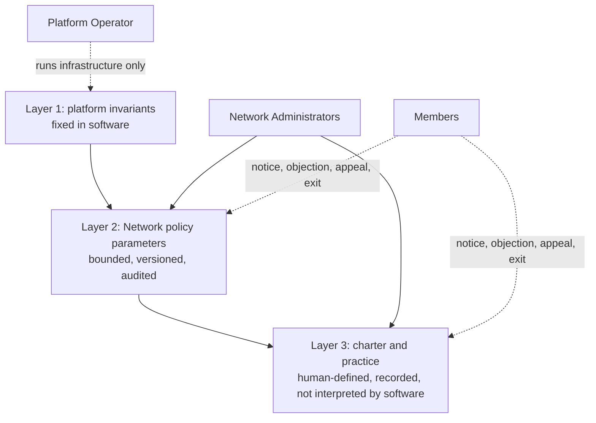
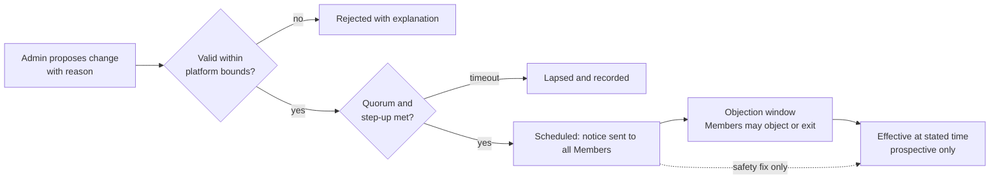
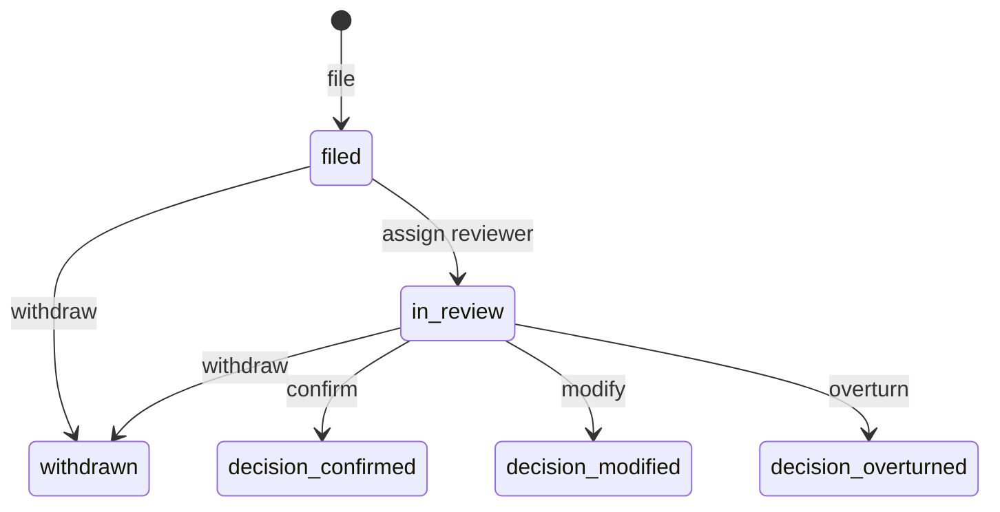
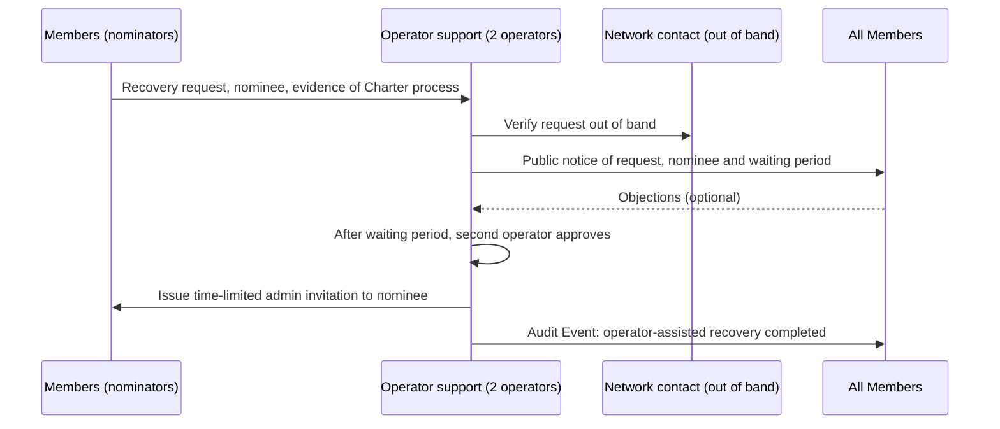
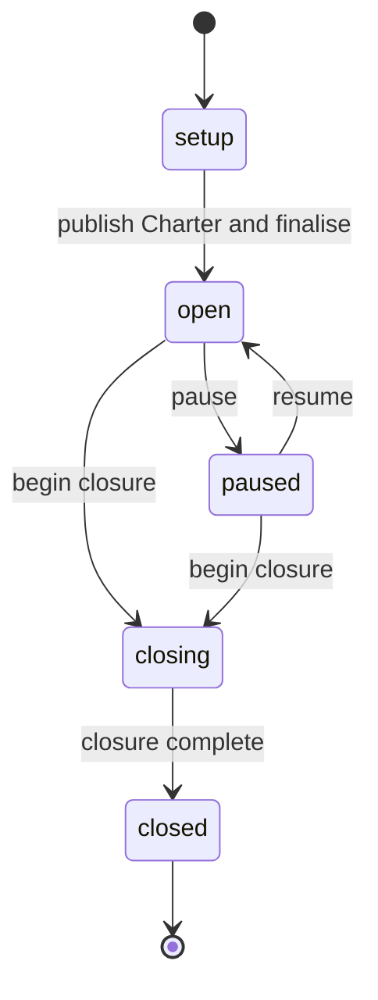

# 10 — Governance and Network Operations

| Field | Value |
|---|---|
| Status | Draft |
| Owner role | Governance and community-operations lead |
| Last updated | 2026-10-21 |
| Scope | How a Network is governed: which rules a Network Administrator may configure and which are platform-fixed; how rule changes are announced, versioned and recorded; challenge and appeal of decisions; onboarding and offboarding; administrator succession and loss of all administrators; dispute handling procedure; negative-balance recovery and default handling; service suspension, pause, closure and data export; the split between human governance policy and software enforcement; a Network charter template; recommended policy sets for three archetypes |
| Depends on | [00 — Conventions and canon](00-conventions.md), [03 — Domain model](03-domain-model-and-mutual-credit-rules.md), [15 — Lifecycle state machines](15-lifecycle-state-machines.md), [16 — Network policy catalog](16-network-policy-catalog.md) |
| Open questions | See section 14; consolidated in [13 — Assumptions, risks, decisions](13-assumptions-risks-decisions-roadmap.md) |

## 1. Purpose and scope

Circula keeps a community's books; it does not run the community. A Network decides who may join, how much exposure it tolerates, how disagreements are settled and what happens when someone cannot or will not honour a negative balance. This document specifies the **governance procedures the Platform must make possible and the boundaries it enforces** so that those human decisions are transparent, contestable and recorded, and so that no governance choice can break a ledger invariant.

It is the single authoritative home for:

- the division of powers between the Platform (fixed invariants), the Network (configurable policy) and the community (charter and practice) (section 3);
- the procedure for changing, announcing, versioning and recording policy (section 5; the parameter data model and effective-dating rules live in [16](16-network-policy-catalog.md));
- the appeal procedure for decisions that affect a Member (section 6);
- onboarding, offboarding, administrator succession and recovery from the loss of all administrators (sections 7 and 8);
- the dispute handling procedure around the lifecycle in [15 section 5](15-lifecycle-state-machines.md) (section 9);
- negative-balance recovery and default handling options (section 10);
- Network pause, Operator service suspension, closure and data return (section 11);
- the charter template and archetype presets (section 13 and Appendix A).

Out of scope: state-machine mechanics ([15](15-lifecycle-state-machines.md)); balance arithmetic and invariants ([03](03-domain-model-and-mutual-credit-rules.md)); parameter ranges and defaults ([16](16-network-policy-catalog.md)); export file formats ([18](18-data-export-and-portability.md)); notification content ([17](17-notifications-and-communications.md)); legal characterisation of any rule. Anything that depends on a jurisdiction (enforceability of a negative balance, treatment of a write-off, consumer or tax consequences, a Network's own legal form) is **a question for counsel** and is routed to [19](19-legal-and-regulatory-open-questions.md); this document never asserts that a design is lawful or compliant.

## 2. Definitions used here

Canon terms (Network, Member, Network Administrator, Dispute Reviewer, Platform Operator, Adjustment, Reversal, Dispute, Audit Event, credit unit) are used exactly as in [00 section 5.1](00-conventions.md) and [14](14-glossary.md). Terms local to this document:

| Term | Meaning |
|---|---|
| **Governance policy** | A rule decided by people (the Network's admins, panel or membership) and published in the charter or Network rules text. Software may record, remind and surface it, but does not interpret it. |
| **Software enforcement** | Behaviour the Platform performs or refuses unconditionally, because a platform invariant or a stored policy parameter dictates it. |
| **Charter** | The Network's published, versioned governance document (template in Appendix A): purpose, membership, unit, limits, disputes, amendments. The `rules text` of FR-NET-005 is the Charter. |
| **Charter version** | A numbered edition of the Charter with a publication date; each Member's acceptance of a version is recorded. |
| **Decision** | A governance act affecting a named person or object: application rejection, suspension or reinstatement, administrative removal, ban flag, Listing removal, per-member credit limit change, Adjustment, Reversal, Dispute resolution. |
| **Appeal** | A governance record (this document) by which an affected person asks for a Decision to be reviewed by someone who did not take it. Not a Dispute: Disputes concern Trades between Members; Appeals concern Decisions by the Network's officers. |
| **Appeal contact** | A person or body named in the Charter, outside the Network's administrator group, who hears an Appeal when no unconflicted administrator exists (for example a trusted local mediator). Software stores the contact route; it does not give the contact any ledger power. |
| **Network operating status** | Network-level status: `setup`, `open`, `paused`, `closing`, `closed` (section 11). Distinct from Membership and Trade states. |
| **Operator hold** | A deployment-level restriction placed on a Network by the Platform Operator: `read_only` or `suspended` (section 11.3). Not a Network operating status. |
| **Policy version** | An immutable, numbered snapshot of the full policy set with an effective time ([16](16-network-policy-catalog.md)). |
| **Notice period** | The interval between approval of a policy change and its effective time, at least `policy_notice_days` (D-11). |
| **Safety fix** | A policy change that takes effect before the notice period elapses because delay would increase risk of harm; only permitted for the tightening changes listed in [16](16-network-policy-catalog.md). |

## 3. Governance model: three layers

Governance in Circula is layered so that responsibility is unambiguous.

| Layer | Owner | Changed by | Examples | Where specified |
|---|---|---|---|---|
| **1. Platform invariants** | Platform (software) | Software release under the project's decision process; never by a Network or Operator configuration | Append-only ledger, atomic double-entry posting, no unilateral debit, correction only by Reversal/Adjustment, Network isolation, no redemption or cash-out (INV-001..INV-014) | [03 section 4](03-domain-model-and-mutual-credit-rules.md) |
| **2. Network policy** | The Network's administrators (within bounds) | Policy change procedure, section 5 | `default_credit_limit`, `membership_mode`, `dispute_window_days`, `departure_settlement_mode`, `admin_quorum` | [16](16-network-policy-catalog.md) |
| **3. Charter and community practice** | The community | Charter amendment procedure, section 5.5 | Purpose, member obligations, how appeals are heard, in-kind work-off norms, who counts as a conflict of interest | Appendix A |

The diagram reads: the Operator touches only the deployment under layer 1; administrators govern layers 2 and 3; Members hold the rights of notice, objection, appeal and exit over both.

| ID | Pri | Requirement | Rationale | Verification |
|---|---|---|---|---|
| GOV-001 | P0 | The Platform MUST NOT offer any administrator, Operator or configuration option that disables, weakens or bypasses an invariant INV-001..INV-014, and MUST NOT offer a policy parameter outside the catalog in [16](16-network-policy-catalog.md). | A Network's governance cannot be allowed to corrupt its own ledger. | Inspection: configuration schema contains only catalogued parameters; test: each invariant-affecting setting attempt is rejected |
| GOV-002 | P0 | Each Network MUST publish, before leaving `setup`, a Charter (the rules text of FR-NET-005) that at minimum states the sections listed in Appendix A.1 headings 1 to 12. The Platform MUST present Appendix A as a starting template and MUST NOT pre-fill legal claims. | Members consent to rules they can read; the Charter is the human half of governance. | Demo: opening a Network without a Charter is blocked; template contains the headings |
| GOV-003 | P0 | The Platform MUST store Charter versions (number, text, publication time, publishing admin, reason) and MUST record each Member's acceptance of a Charter version (Member, version, time) at join and at each material amendment. | Proves which rules a Member agreed to; supports appeals. | Test: acceptance record exists for every active Member; history of versions listable |
| GOV-004 | P0 | The Platform MUST present to every Member a plain-language "what the Network can and cannot do to my balance" statement drawn from the fixed list in section 12.2, independent of the Network's Charter text. | The Charter cannot contradict platform behaviour; Members get the same baseline everywhere. | Inspection of Member-facing page against section 12.2 |
| GOV-005 | P1 | The Platform SHOULD show Members an aggregate governance summary per quarter [DECISION NEEDED: governance summary cadence], derived from Audit Events: counts of policy changes, suspensions, removals, Adjustments (count and total in each direction), Reversals, Disputes by outcome, Appeals by outcome. Counts only; no personal data. | Accountability of administrators to the community. | Test: counts equal Audit Event query results |

## 4. What a Network Administrator can and cannot configure

### 4.1 Configurable by Network Administrators

All values are bounded by [16](16-network-policy-catalog.md), changed under section 5, and recorded as Audit Events (INV-010).

| Area | Administrator power | Needs quorum (`admin_quorum`) |
|---|---|---|
| Unit identity | `unit_name`, `unit_symbol`, `unit_scale`: set during `setup` only; frozen once any Journal Entry exists (INV-013) | Yes (setup finalisation) |
| Membership | `membership_mode`; approve or reject applicants; invitations; suspend, reinstate, remove, ban flag; assign `dispute_reviewer` and `network_admin` roles | Suspend, reinstate, remove, ban flag, `network_admin` grant: yes. Approve/reject applicant: no |
| Exposure | `default_credit_limit`, `max_credit_limit`, `max_balance`, `min_trade_amount`, `max_trade_amount`; per-member `credit_limit` overrides within `max_credit_limit` | Parameters: yes. Per-member override: yes |
| Timing | `proposal_expiry_days`, `dispute_window_days`, `dispute_review_sla_days`, `inactivity_threshold_days` | Dispute windows: yes; others: no |
| Visibility | `balance_visibility`, `directory_visibility` | Yes |
| Departure | `departure_settlement_mode` | Yes |
| Governance | `policy_notice_days`, `admin_quorum` | Yes |
| Corrections | Adjustment; Reversal as Dispute remedy | Yes (DOM-032) |
| Content moderation | Remove a Listing with reason | No |
| Communication | Announcements, policy notices, Charter versions | No (Charter amendment: see 5.5) |
| Network state | Pause, resume, begin closure | Pause/resume: no. Closure: yes |

### 4.2 Never configurable (platform-fixed)

| Fixed rule | Source |
|---|---|
| An administrator cannot create, accept, decline or cancel a Trade for a Member; value changes are Adjustments only, always visible to the affected Member | INV-012, FR-ADM-010 |
| No edit or deletion of any Journal Entry or Posting; correction by Reversal or Adjustment only | INV-003, INV-004 |
| No interest, demurrage, fee, decay, expiry of balances, or automatic write-off | DOM-015, DOM-044 |
| No redemption, cash-out, fiat or crypto conversion; no money-like claims in copy | INV-014, DOM-001 |
| Policy changes are prospective and never alter a posted entry or a `departing` Membership's snapshotted mode | DOM-049, DOM-039 |
| Platform Operator holds no ledger-posting power and no default access to Network content | INV-012, FR-ADM-017 |
| An administrator cannot approve, decide or execute a matter in which they are a party | FR-ADM-015 |
| A Member can always view and export their own balance and history, including while `suspended` or `departing` | LIF-034 |
| Every Adjustment, Reversal, policy change, role change and Dispute resolution produces an Audit Event | INV-010 |
| The Network cannot be left with no `active` `network_admin` except by the closure procedure | LIF-033 |

| ID | Pri | Requirement | Rationale | Verification |
|---|---|---|---|---|
| GOV-006 | P0 | The admin console MUST show, next to each setting, whether it is configurable now, locked (and why), subject to notice, or requires quorum, using the mutability classes of [16 section 3](16-network-policy-catalog.md). | Administrators cannot misjudge what a change will do. | Demo: every catalogued parameter displays its class |
| GOV-007 | P0 | The console MUST NOT present any control that would require the software to violate section 4.2; attempts through the API MUST be rejected with the invariant named. | Defence in depth; same rule in UI and API. | Test: API calls for each row of 4.2 rejected |

## 5. Announcing, versioning and recording changes

### 5.1 Policy change procedure

Text: a proposal is validated against platform bounds, approved by the required number of distinct, step-up-authenticated administrators, becomes a *scheduled* policy version with a published effective time at least `policy_notice_days` ahead, is announced to every Member, and takes effect prospectively. During the notice period Members may object or leave. Version and status data are specified in [16 section 5](16-network-policy-catalog.md).

| ID | Pri | Requirement | Rationale | Verification |
|---|---|---|---|---|
| GOV-008 | P0 | A policy change MUST require a mandatory written reason, validation against the catalog bounds, and (for parameters classed sensitive in [16](16-network-policy-catalog.md)) approvals from `admin_quorum` distinct administrators with step-up authentication (FR-ADM-002, FR-ADM-018). | Limits unilateral misuse. | Test with quorum 1, 2, 3; stale session |
| GOV-009 | P0 | Approval of a policy change MUST create a scheduled policy version whose effective time is at least `policy_notice_days` (as in force at approval) after approval, except a safety fix under GOV-012. Changing `policy_notice_days` itself MUST use the larger of the old and new value as its own notice. | Prevents shortening notice to bypass notice (D-11). | Test: change `policy_notice_days` 14 to 1; the change itself takes effect after 14 days |
| GOV-010 | P0 | Every Member MUST be notified at approval with: parameter, old value, new value, reason, effective time (UTC and Network-local with offset), what changes for them in words (including how many Members are affected where computable), how to object, how to leave. The notice MUST be retained in the policy history. | Informed consent; accessibility ([08](08-ux-and-accessibility.md)). | Test: notice content assertions; history list contains notice |
| GOV-011 | P0 | A policy change MUST apply prospectively only: it MUST NOT alter any posted entry, any Trade already `completed`, any `departing` Membership's snapshotted mode (DOM-039), or the SLA and window values already snapshotted on an open Dispute (LIF-024). | Rules apply to the future. | Test per snapshot; replay of ledger yields identical balances |
| GOV-012 | P0 | A safety fix MAY take effect before the notice period only if (a) every changed parameter is on the safety-eligible list in [16 section 6.3](16-network-policy-catalog.md); (b) a written justification is recorded; (c) at least two distinct administrators approve whenever two or more `active` administrators exist, regardless of `admin_quorum`; (d) Members are notified at approval, stating that it is a safety fix and why; (e) the justification is published in the policy history. | Fast tightening in an emergency without opening a path to arbitrary instant rule changes. | Test: ineligible parameter safety flag rejected; single-admin approval rejected when two admins exist |
| GOV-013 | P0 | A scheduled change that fails to reach quorum within the approval timeout [DECISION NEEDED: policy approval timeout, aligned with FR-ADM-002 recommended 7 days] MUST lapse, and the lapse MUST be recorded and visible to administrators. | No stale proposals applying later. | Test with clock control |
| GOV-014 | P0 | A scheduled version MAY be withdrawn by administrators (same quorum as approval, with reason) at any time before its effective time; Members MUST be notified. Only the most recently scheduled version MAY be withdrawn first (later versions depend on it). | Correct mistakes before they bite; keep the version chain linear. | Test: withdraw out of order rejected |
| GOV-015 | P0 | The policy history MUST be visible to every Member: version, parameter changes, reason, proposing and approving administrators (by display name), approval time, effective time, status. | Transparency of who decided. | Test: history visible to a plain Member; fields present |
| GOV-016 | P1 | During the notice period of a change that tightens a Member's position (lower `default_credit_limit`, lower `max_credit_limit`, lower `max_balance`, shorter `dispute_window_days`, a `departure_settlement_mode` change, stricter `membership_mode` for existing Members) a Member who requests departure MUST be offered the pre-change `departure_settlement_mode`, because the mode is snapshotted at `departing` (DOM-039). | A real exit right during notice. | Test: depart during notice; old mode applied after the new one becomes effective |
| GOV-017 | P1 | Members MUST be able to file an **objection** to a scheduled change (free text, one per Member per version). Administrators MUST see the count. When objections reach 10% of `active` Members and at least 3 Members [DECISION NEEDED: objection response threshold], administrators MUST publish a written response in the policy history before the effective time; the Platform MUST show the response to all Members but MUST NOT block the change. | A voice without turning software into a voting system. | Test: threshold crossing creates a response requirement and a reminder |

### 5.2 Ratification practice (non-software)

A Charter MAY require that certain changes (for example raising `max_credit_limit`, or changing `departure_settlement_mode`) be ratified by a members' meeting or vote before administrators submit them. Software support in MVP is limited to a free-text `ratification reference` field on the policy change; the Platform neither runs nor verifies votes. Software-run member voting is deferred (P2, [DECISION NEEDED: member voting in scope after MVP]).

### 5.3 Role changes and other administrative acts

| ID | Pri | Requirement | Rationale | Verification |
|---|---|---|---|---|
| GOV-018 | P0 | Role grants and revocations (`network_admin`, `dispute_reviewer`) MUST take effect immediately (FR-ADM-012), record reason, notify the Member and appear in the Network's public "who administers this Network" list (display names and roles only). | Members can see who holds power. | Test: list reflects changes within one minute |
| GOV-019 | P0 | A `network_admin` grant MUST require the grantee's explicit acceptance before the role takes effect, and `admin_quorum` approvals. | No one is made an administrator without knowing. | Test: grant pending until accepted |
| GOV-020 | P1 | The Platform SHOULD display, to every administrator, a pending-work view of: proposals awaiting approval, Adjustments/Reversals pending (LIF-044), Disputes beyond SLA, Appeals due, applicants waiting, Memberships `departing` beyond the settlement window. | Prevents silent stalls in volunteer-run Networks. | Demo; counts match the underlying queries |

### 5.4 Network contact and rules text edits

Editing description, contact route, public-field settings and the Appeal contact is permitted at any time by a `network_admin`, MUST record an Audit Event (FR-NET-008) and, for the Appeal contact and Charter text, MUST follow 5.5.

### 5.5 Charter amendments

| ID | Pri | Requirement | Rationale | Verification |
|---|---|---|---|---|
| GOV-021 | P0 | A Charter amendment MUST be published as a new Charter version, notified to all Members with a diff or summary of changes and reason, and take effect no earlier than `policy_notice_days` after publication unless it is a correction of a typographical error that changes no meaning (recorded as such). | The Charter is subject to the same notice rule as parameters. | Test: version effective date; typographical flag requires reason |
| GOV-022 | P1 | A *material* amendment (as marked by the publishing administrators from a list: limits, disputes, appeals, departure, closure, admin powers) MUST require every active Member to re-accept the Charter version at next sign-in; Members who decline MAY request departure under their pre-change snapshotted rules; the Platform MUST NOT suspend a Member merely for not yet re-accepting during the notice period. | Consent to material change with an exit. | Test: re-acceptance prompt; decline path leads to departure flow |

## 6. Challenge and appeal of decisions

### 6.1 Principles

1. Every Decision that affects a person is notified with the reason and the route to challenge it (LIF-032, LIF-047).
2. An Appeal is heard by someone who did not take, approve or benefit from the Decision.
3. An Appeal does not by itself suspend the Decision (the Decision shows "under appeal", FR-ADM-020), except where this section says otherwise; the Appeal is prioritised.
4. An Appeal can lead to correction only through the existing, auditable mechanisms: reinstatement, a new Listing state transition, a corrected per-member limit, a counter-Adjustment, or (for Disputes) as stated below. An Appeal never edits history.
5. Software supports the record, the timers and the independence rules. The weighing of the evidence is human.

### 6.2 Appealable decisions

| Decision | Appellant | Heard by | Filing window | Decision due | While pending | Possible ledger effect of an overturned outcome |
|---|---|---|---|---|---|---|
| Application rejected (MB3) | Applicant | An administrator who did not decide it | 30 days from notice | 14 days | Applicant stays `rejected`; account unused | None |
| Suspension (MB4) or ban flag | Suspended Member | Administrators not involved in the suspension | 30 days | 7 days (expedited) | Suspension in force; read-only access retained (DOM-042) | None (reinstatement is MB5) |
| Administrative removal (MB6 by `remove`) | Departing Member | Administrators not involved | 30 days; or until `closed` if sooner | 7 days (expedited) | `departing` proceeds; if appeal succeeds before `closed`, outcome is a new Membership offer, because `departing` has no way back (canon) | None directly |
| Listing removal (LS6) | Listing owner | Administrator who did not remove it | 30 days | 14 days | Listing stays `removed` | None (owner creates a new draft, FR-LST-009) |
| Per-member `credit_limit` lowered or over-limit status | Affected Member | Administrators not involved | 30 days | 14 days | Limit in force | None (limit reset prospectively) |
| Adjustment | Affected Member | Administrators who did not initiate or approve it | 60 days | 14 days | Entry stands | Counter-Adjustment (new entry linked to original and to the Appeal) |
| Dispute resolution (`resolved_*`) | Either party | Administrators who are not parties and not the deciding Reviewer | 14 days from resolution | 14 days | Resolution stands | Counter-Adjustment linked to the Dispute and Appeal; no second Reversal path (DOM-029). See assumption GOV-A3 |
| Dispute `escalated` outcome | Either party | Appeal contact if no unconflicted administrator | 14 days | 14 days | As above | As above |

Windows and due times are `[DECISION NEEDED: appeal filing windows and due times]` with the values above as recommended defaults; they are platform constants in MVP, not Network parameters (see assumption GOV-A2).

### 6.3 Appeal record and statuses

An **Appeal** is a GOV-local record (not a lifecycle object of [15](15-lifecycle-state-machines.md); see assumption GOV-A1) with:

| Field | Content |
|---|---|
| `appeal_id` | Opaque identifier (D-03) |
| `decision_ref` | Type and identifier of the Decision, and the Audit Event of the Decision |
| `appellant` | Membership or applicant reference |
| `grounds` | One or more of `factual_error`, `procedural_error`, `disproportionate`, `conflict_of_interest`, `new_evidence`, `other` |
| `statement` | Free text, length-limited |
| `status` | `filed` → `in_review` → `decision_confirmed` \| `decision_modified` \| `decision_overturned`; `filed`/`in_review` → `withdrawn` |
| `reviewers` | One or more Memberships (or the Appeal contact reference) |
| `reasoning` | Written reasoning, visible to the appellant and the Decision-maker |
| `due_at` | From the table above |

Text: an Appeal is filed, assigned to an independent reviewer, and ends in exactly one of three outcomes or is withdrawn. Terminal statuses accept only annotations.

| ID | Pri | Requirement | Rationale | Verification |
|---|---|---|---|---|
| GOV-023 | P0 | Every Decision listed in 6.2 MUST be notified to the affected person with reason, the filing window and the route to appeal, and MUST show an "appeal route" on the Decision's detail page for as long as the window is open. | Due process (LIF-032). | Test per decision type |
| GOV-024 | P0 | The Platform MUST let the appellant file an Appeal within the window with grounds and statement; filing MUST mark the Decision "under appeal" (FR-ADM-020), notify the reviewers and set `due_at`. A suspended, `departing` or `rejected` person MUST be able to file (LIF-034). | Access to appeal does not depend on status. | Test from each status |
| GOV-025 | P0 | An Appeal MUST NOT be assignable to, or decided by, any person who took, approved, executed or was a party to the Decision, or who is a party to the underlying Dispute or Trade; the Platform MUST enforce this by identity and by declared conflicts (GOV-044). | Independence. | Authorisation tests |
| GOV-026 | P0 | If no unconflicted administrator exists (for example a Network with one administrator who made the Decision), the Platform MUST route the Appeal to the Appeal contact named in the Charter, and if none is named MUST notify all Members of the stall and offer the appellant the export and departure routes. | Small Networks need a lawful fallback; no silent denial. | Test: single-admin Network; appeal contact route |
| GOV-027 | P0 | The Appeal outcome MUST be recorded with written reasoning, an Audit Event (INV-010) and a notice to the appellant and the Decision-maker. Outcomes: `decision_confirmed` (no change); `decision_modified` (a replacement Decision, executed through the normal flows); `decision_overturned` (Decision revoked through the normal flows). | Closed, traceable outcomes. | Test |
| GOV-028 | P0 | An Appeal outcome with ledger effect MUST be executed only as an Adjustment between the Member Account and a System Account, linked to the original entry or Dispute and to the Appeal, subject to `admin_quorum`, DOM-030..DOM-033 and the rule that an administrator cannot act on their own account (DOM-032). | INV-004; no ledger shortcut for appeals. | Test: no other path exists |
| GOV-029 | P0 | An Appeal not decided by `due_at` MUST be flagged overdue to all administrators and the appellant, escalate to the Appeal contact if one is named, and MUST NOT resolve itself in any direction. | No silent expiry that favours either side. | Test with clock control |
| GOV-030 | P1 | An appellant MAY withdraw an Appeal; one Appeal per Decision per appellant is permitted, and a further Appeal on the same Decision requires new evidence (`new_evidence` ground). | Prevents appeal loops while allowing genuinely new facts. | Test |
| GOV-031 | P1 | The appellant MUST be able to see the Appeal's status, reviewers' display names and due date, and to export the Appeal record with their data (PRT scope in [18](18-data-export-and-portability.md)). | Transparency; portability. | Test |

Appeals about the Platform Operator's actions (service suspension, break-glass) are not heard here; they follow the Operator's support route ([11 section 11](11-deployment-operations-and-support.md)).

## 7. Onboarding and offboarding

### 7.1 Onboarding

| Mode | Path | Admin involvement |
|---|---|---|
| `invite` | Invitation by an administrator (or a Member: by default Members may invite, with at most 3 open invitations each, FR-MEM-007/008; a Network may restrict invitations to administrators only; the Charter states which applies) → acceptance → automatic admission (MB1/MB2) | Invitation only |
| `approval` | Application → `applicant` → admin review → `active` or `rejected` | Per application |
| `open` | Application → automatic admission | Rules/abuse monitoring |

| ID | Pri | Requirement | Rationale | Verification |
|---|---|---|---|---|
| GOV-032 | P0 | Before becoming `active`, the person MUST see and accept the current Charter version, the section 12.2 statement, and the minimum-age confirmation required by [19](19-legal-and-regulatory-open-questions.md) (LEG-G-13). Acceptance is recorded (GOV-003). | Informed entry; jurisdictional questions kept with counsel. | Test: admission blocked without acceptance |
| GOV-033 | P0 | An applicant rejection MUST carry a reason code and written reason, MUST notify the applicant with the appeal route (6.2), and MUST NOT retain applicant data longer than the minimisation limit set in [09](09-security-privacy-and-abuse.md) after the Appeal window closes. | Fairness and privacy. | Test: notification; data-retention job |
| GOV-034 | P1 | A Network SHOULD be able to apply graduated trust at onboarding: a lower initial `credit_limit` than `default_credit_limit` for new Members (set as a per-member override at admission), with a documented review point in the Charter. The review is a human act; the Platform MUST NOT raise limits automatically in MVP. | Mitigates new-member risk (PER-OD-6) without hidden automation. | Demo: admission with override; no automatic raise |
| GOV-035 | P1 | The Platform SHOULD show newly admitted Members a first-steps page: how to create a Listing, how to propose a Trade, what a negative balance means (obligation to provide goods or services, not a debt in national currency, DOM-001), the Network's limits, and how to ask for help. | Reduces early disengagement. | UX walkthrough ([08](08-ux-and-accessibility.md)) |
| GOV-036 | P0 | Admission MUST create exactly one Membership and Member Account per person per Network (DOM-003, DOM-005); a person re-joining after `rejected` or `closed` gets a new Membership and a new account with no inherited balance or history, and the Network MAY see that a prior Membership existed only if retention rules allow (a pseudonymous "previously a Member" flag with date, no balance) [DECISION NEEDED: rejoin visibility]. | Prevents laundering of defaults while protecting privacy. | Test |

### 7.2 Offboarding

Voluntary departure, administrative removal and ban follow MB6/MB7 and DOM-035..DOM-041. This section adds the governance steps.

| ID | Pri | Requirement | Rationale | Verification |
|---|---|---|---|---|
| GOV-037 | P0 | Before a Member confirms a voluntary departure, the Platform MUST show the current balance, the `departure_settlement_mode` that will be snapshotted, the exact entry that would be posted at finalisation (DOM-038, Example E in [03](03-domain-model-and-mutual-credit-rules.md)), the settlement window, the export option, and a statement that the Platform provides no redemption or cash-out. | Informed exit. | UX test; entry preview equals actual entry |
| GOV-038 | P0 | An administrative removal or ban MUST record a reason, MUST be taken under `admin_quorum` (MB6), MUST notify the Member with the reason and the appeal route, and MUST be offered the same `member_self` export as any departing Member (LIF-034). | Due process; portability. | Test |
| GOV-039 | P0 | A negative-balance Member who departs MUST receive no more than one pre-departure notification about the balance and MUST NOT be pursued by Platform-generated dunning (DOM-040). Any contact beyond that is a human act outside the Platform and, where it involves enforcement, a question for counsel (LEG-Q-08, LEG-Q-23). | Proportionate; avoids Platform-run collection. | Test: notification count |
| GOV-040 | P1 | When a `departing` Membership passes the settlement window with a non-zero balance in `settle` mode, administrators MUST receive an alert and the case MUST appear on the pending-work view (GOV-020); the decision to apply `write_off` or `community_fund` is taken under quorum with a recorded reason (DOM-037). | Prevents silent stalls and silent write-offs. | Test |
| GOV-041 | P1 | On `closed`, personal data handling follows D-09 and the owning documents ([09](09-security-privacy-and-abuse.md), [18](18-data-export-and-portability.md)); the Network keeps the opaque account identifier in the ledger and Audit Events but not the person's identity. Open Disputes in which the person is a party continue with a pseudonymised party (see 9.6). | D-09; continuity of governance records. | Inspection |

## 8. Administrators: roles, succession and recovery from loss of all administrators

### 8.1 Healthy administration

| ID | Pri | Requirement | Rationale | Verification |
|---|---|---|---|---|
| GOV-042 | P0 | A Network MAY open with one `network_admin` but the console MUST show a persistent single-point-of-failure notice (FR-NET-007) until at least two `active` administrators exist; the Charter template recommends at least three for any Network with more than 30 Members [DECISION NEEDED: recommended administrator count]. | Key-person risk is the commonest community-network failure mode ([prior-art notes](../notes/research-prior-art-mutual-credit.md) 2.4). | Demo |
| GOV-043 | P1 | The Platform SHOULD support, as roles, separation of duties among administrators in practice (for example a treasurer-style administrator for Adjustments, a mediator for Appeals) by recording an optional free-text "portfolio" label on each administrator for display only; it MUST NOT grant different powers by label. | Spreads burnout without a new permission model. | Inspection: label has no authorisation effect |
| GOV-044 | P0 | Each administrator and Dispute Reviewer MUST be able to declare a conflict of interest against a Member (relation: household, family, business partner, employer, other) in a private register visible to administrators; the Platform MUST treat declared conflicts as barring assignment to Disputes, Appeals and approvals that involve that Member, in addition to the party checks of DOM-046 and FR-ADM-015. | Small Networks know each other; self-declaration extends the hard-coded checks. | Test: declared conflict blocks assignment |
| GOV-045 | P1 | Administrators SHOULD be reminded of Charter-defined term dates (for example annual re-confirmation of roles) and the Platform SHOULD list who holds each role and since when; term limits are Charter content, not enforced. | Rotation is a human policy. | Inspection |
| GOV-046 | P1 | An administrator who has not authenticated for 60 days [DECISION NEEDED: administrator inactivity flag] MUST be flagged to the other administrators and, after a further 30 days, to all Members as "administrator inactive"; no powers change automatically. | Detects abandoned seats before they become a lock-out. | Test with clock control |

### 8.2 Succession (planned)

| Step | Action | Software support |
|---|---|---|
| 1 | Outgoing administrator nominates a successor among `active` Members | Role grant request (GOV-019) |
| 2 | Successor accepts; other administrators approve to `admin_quorum` | Acceptance and approval; Audit Event |
| 3 | Hand-over checklist completed (Appendix B) | Checklist stored as a Network record |
| 4 | Outgoing administrator resigns the role | Role revocation; LIF-033 prevents leaving the Network with none |
| 5 | Members informed | Announcement (FR-ADM-014) and the public administrators list (GOV-018) |

| ID | Pri | Requirement | Rationale | Verification |
|---|---|---|---|---|
| GOV-047 | P0 | An administrator MUST be able to resign their role at any time provided another `active` administrator exists (LIF-033); resignation is an Audit Event and does not alter any pending decision, except that `admin_quorum` MUST be re-validated (FR-ADM-003) and, if it now exceeds the number of administrators, the resignation MUST be rejected until quorum is lowered by the existing quorum process. | No deadlock. | Test: 2 admins quorum 2, one resigns: rejected |
| GOV-048 | P1 | The Platform SHOULD provide a hand-over view for an incoming administrator listing: open Disputes, Appeals, pending approvals, scheduled policy versions, administrators list, Charter version history, Appeal contact, outstanding `departing` Memberships, and the date of the last export. | Continuity. | Demo |

### 8.3 Loss of all administrators (recovery)

Causes: all administrators locked out of authentication; incapacitated or unreachable; the community wants to replace administrators who will not act. The Platform Operator cannot reset credentials in hosted operation (SEC-034) and holds no ledger powers (INV-012), so recovery must restore *administrator authority to the community*, not to the Operator.

| ID | Pri | Requirement | Rationale | Verification |
|---|---|---|---|---|
| GOV-049 | P0 | If a Network has no `active` `network_admin` who can authenticate, recovery MUST be possible through an **operator-assisted recovery procedure** that (a) is initiated by a request from at least the greater of 3 Members and 10% of `active` Members [DECISION NEEDED: recovery nomination threshold], naming a nominee who is an `active` Member; (b) is verified out of band with the Network's registered contact route, where one exists (SEC-034); (c) is executed by two distinct Platform Operator staff; and (d) never lets any Platform Operator staff become `network_admin`, nominate the nominee, or choose among nominees. | Restores authority to the community without making the Operator a power. | Procedure inspection; test: operator accounts cannot be granted `network_admin` by the procedure |
| GOV-050 | P0 | Before the procedure executes, all `active` Members MUST be notified of the request, the nominee, and a waiting period of at least 7 days [DECISION NEEDED: recovery waiting period] during which any Member may object; objections from at least the same threshold as GOV-049(a) MUST stop the procedure and refer it to the closure or Charter process; any still-reachable administrator MUST be notified immediately and MAY cancel the request. | Prevents a faction capturing an unattended Network. | Test: objection stops; admin cancel |
| GOV-051 | P0 | The procedure MUST write an Audit Event visible to the Network's Members (not only administrators) naming the two operator staff accounts, the request, verification outcome, the nominee and the time, before the invitation is issued; if the Audit Event cannot be written, the procedure MUST fail closed. | Transparency; consistent with OPS-074 and SEC-042. | Test with forced audit failure |
| GOV-052 | P0 | The recovery outcome MUST be a single-use, time-limited invitation (default 72 hours) to the nominee to accept the `network_admin` role through the ordinary acceptance flow with their own authentication (GOV-019). The Operator MUST NOT see, set or reset the nominee's credentials (SEC-034). | No credential takeover vector. | Test |
| GOV-053 | P0 | For 72 hours after a recovery-granted `network_admin` role takes effect, the new administrator MUST NOT be able to post an Adjustment, apply a Reversal, change any sensitive parameter, grant `network_admin` roles, or begin closure; all Members have been notified. Other administrative functions (moderation, Disputes, Appeals, announcements, applicant handling) are available. | Limits the damage window of a successful social-engineering attack. | Test: attempted actions rejected during window |
| GOV-054 | P0 | When recovery is needed in a self-hosted deployment, the deployer acts as Operator and the same procedure applies, with the two roles filled by two distinct named custodians (OPS-003) where the deployment has them; a deployment with one custodian MUST document the residual risk in its operations record. | D-01 parity. | Inspection |
| GOV-055 | P1 | The Charter template (Appendix A) MUST contain a succession clause naming how members may nominate administrators if none can act, so that the evidence required by GOV-049 exists before it is needed. | Recovery needs a basis. | Template inspection |
| GOV-056 | P1 | Whether an operator-assisted recovery is itself acceptable in a given jurisdiction or deployment contract, and who bears liability for a wrongful recovery, is a question for counsel ([19](19-legal-and-regulatory-open-questions.md) LEG-Q-20, LEG-Q-24). | No legal conclusion asserted. | Cross-reference present |

## 9. Dispute handling procedure

State mechanics are in [15 section 5](15-lifecycle-state-machines.md) and domain rules in DOM-045..DOM-048; the user-facing capabilities are FR-DSP-001..FR-DSP-015. This section is the human procedure and its timelines.

### 9.1 Roles

| Role | Who | Powers | Limits |
|---|---|---|---|
| Raiser / Respondent | The two Trade parties | Raise, respond, add evidence, withdraw (raiser), consent to settlement | Raiser cannot also review |
| Dispute Reviewer | A Member holding `dispute_reviewer` | Self-assign (DS2), request information, propose settlement, decide (DS3..DS5), escalate (DS7) | Not a party; no declared conflict; sees only what the Dispute needs (PER-005) |
| Network Administrator | `network_admin` | Assign reviewers, execute ledger remedies under quorum, escalate on SLA breach | Cannot execute a remedy affecting self (FR-ADM-015) |
| Appeal reviewer | Independent admin or Appeal contact | Hear Appeals (section 6) | Not involved in the original decision |

### 9.2 Timeline

Let SLA = `dispute_review_sla_days`.

| Event | Target time from `open` | Source |
|---|---|---|
| Respondent notified | Immediately (DS1) | LIF DS1 |
| Respondent statement due | Within SLA / 2 [DECISION NEEDED: response period, FR-DSP-004] | FR-DSP-004 |
| Reviewer assigned | Within 2 days [DECISION NEEDED: assignment target] | GOV |
| Mediation offer made by reviewer | Within the first half of SLA | GOV |
| Decision | Within SLA | `dispute_review_sla_days` |
| Overdue flag to admins and parties | At SLA | DOM-048 |
| Automatic escalation (DS7) | At 2 x SLA [DECISION NEEDED: automatic escalation threshold] | 15 section 5.3 |
| Ledger remedy executed | Within the pending lifetime of the Reversal or Adjustment | 15 section 7 |
| Appeal window | 14 days from resolution | 6.2 |

### 9.3 Procedure

1. **Raise.** A Trade party raises a Dispute with reason category, description and the remedy sought. Category "did not agree" (a claim that the raiser never authorised a Trade) is routed to the abuse queue as well (FR-DSP-014).
2. **Respond.** The other party adds a statement. Both may attach evidence within the limits of FR-DSP-005.
3. **Review.** A Reviewer without conflict starts review (DS2). The Reviewer reads the Trade record, the history record of TR2 (balances before and after, LIF-018), the statements and evidence. The Reviewer may ask each party questions through the Dispute thread; all exchanges stay inside the Dispute record.
4. **Mediate first.** The Reviewer SHOULD invite the parties to agree on a remedy before deciding. Agreement is recorded as settlement terms with each party's consent (DS5, LIF-023).
5. **Decide.** The Reviewer records written reasoning and one outcome.
6. **Execute.** A ledger remedy runs through the admin quorum flow (15 section 5.2). The Dispute stays `under_review` until the remedy posts.
7. **Notify and close.** Both parties are notified with reasoning and the Appeal route.

### 9.4 Outcomes and ledger consequences

| Outcome (state) | Meaning | Allowed remedies (DOM-047) | Ledger consequence |
|---|---|---|---|
| Upheld (`resolved_upheld`) | The raiser's complaint is accepted | Reversal of the completed Trade; Adjustment; cancel a still-`proposed` Trade; no ledger remedy | Reversal: exact negation entry; Adjustment: one Member Account against a System Account; cancel: none |
| Rejected (`resolved_rejected`) | Complaint not accepted | None | None; Trade unchanged |
| Settled (`resolved_settled`) | Parties agreed terms | Any of the above, per the terms, or none | As per remedy; the terms are the record |
| Withdrawn (`withdrawn`) | Raiser withdrew | None | None |
| Escalated (`escalated`) | Referred to admin or outside process | Executed afterwards by an Adjustment or Reversal referencing the Dispute | See 15 assumption L-2 |

Examples of the reviewer's choice (guidance, not software logic): a service not delivered, amount agreed: Reversal. Service delivered but quality contested, partial refund agreed: settlement with an Adjustment or counter-Trade (partial Reversal is unsupported, DOM-029). Both parties acknowledge a posting error: Reversal by joint request, no Dispute needed (DOM-028 a).

### 9.5 Requirements

| ID | Pri | Requirement | Rationale | Verification |
|---|---|---|---|---|
| GOV-057 | P0 | The Platform MUST schedule and display, to both parties and all administrators, the dates in 9.2 for each Dispute, computed from `open` time and the policy values snapshotted at DS1 (LIF-024). | Predictability. | Test with clock control and mid-dispute policy change |
| GOV-058 | P0 | Reviewer assignment MUST exclude parties, declared conflicts (GOV-044) and persons in the same declared relationship group as a party; if no eligible reviewer exists, DS7 with reason `no_eligible_reviewer` MUST be used and the Dispute routed under GOV-059. | Impartiality in small Networks (LIF-022). | Test |
| GOV-059 | P0 | An `escalated` Dispute MUST be handled by an administrator who is not a party and has no declared conflict; if none exists, by the Appeal contact; the receiving person MUST record the outcome as an Audit Event and, for any ledger action, as an Adjustment or Reversal referencing the Dispute. | Escalation has an owner. | Test |
| GOV-060 | P0 | Parties MUST see the reviewer's identity (PER-OD-8) and MAY object to the assigned reviewer for conflict within 2 days of assignment [DECISION NEEDED: reviewer objection period]; a valid objection reassigns without counting against the SLA. | Perceived impartiality. | Test |
| GOV-061 | P0 | Decisions MUST carry written reasoning in plain language that addresses the remedy sought; an empty or template-only reasoning MUST be rejected by minimum length [DECISION NEEDED: minimum reasoning length, recommended 100 characters]. | Fairness; quality of record. | Test |
| GOV-062 | P1 | The Platform SHOULD provide the reviewer a one-page case summary: Trade facts, balances before and after (LIF-018), both statements, evidence list, prior Disputes between the same pair (count only), reviewer's conflict declarations. | Reduces reviewer workload. | Demo |
| GOV-063 | P1 | If the same Member is the respondent in three or more Disputes within 90 days [DECISION NEEDED: repeat-respondent flag], the Platform SHOULD flag this to administrators as input to a human decision; it MUST NOT act automatically. | Pattern awareness without automated punishment (DOM-044 spirit). | Test |
| GOV-064 | P0 | Evidence MUST be limited to what the Dispute needs; reviewers MUST NOT be given other Members' balances or profiles beyond the Trade facts (PER-005), and evidence files MUST NOT be exported with Network-wide packages unless the parties' consent or the legal-basis decision in [19](19-legal-and-regulatory-open-questions.md) permits. | Privacy; LEG-Q-28. | Inspection; export test |

### 9.6 Disputes and departure

When a party departs while a Dispute is open, the Dispute continues with the departing party's identity pseudonymised once the Membership is `closed` (15 section 9.1). If the remedy needs a Reversal and an account is `closed`, the remedy is an Adjustment (DOM-026). The remaining party is told that the counterparty has left; the departed party's statements remain in the record in pseudonymised form.

## 10. Negative-balance recovery and default handling

A **negative balance** is an obligation to provide goods or services to the Network, not a debt in national currency (canon 5.2). A **default** is a negative balance at departure, or a negative Member who is unresponsive (DOM section 7). Circula provides tools and records; the community chooses the remedy. The Platform never collects, converts or demands national currency.

### 10.1 Policy options a Network may choose

| Option | What it is | How the Network chooses it | What the software does | What the software does not do |
|---|---|---|---|---|
| **A. In-kind work-off** | The Member provides services to Members until the balance returns within agreed range | Charter clause; per-case agreement recorded as a note | Shows the Member their `available_to_spend` and trend; flags over-limit accounts; the Member's Trades with other Members earn credit normally | Does not schedule, assign or measure work; does not compel |
| **B. Payment plan (in units)** | An agreed target: balance to reach X by date Y | Agreement recorded as an administrator note visible to the Member | Reminders on the dates the administrators set (informational); the over-limit flag (DOM-012) | Does not debit; does not enforce dates; does not create interest or penalties |
| **C. Limit reduction or freeze** | Lowering the per-member `credit_limit` so no further debits occur | Administrator action (quorum), reason, notice to Member | Account becomes over limit: cannot be debited by any Trade, still creditable (DOM-012); Audit Event; appealable (6.2) | Does not alter the balance |
| **D. Suspension** | Pausing the Membership while talking | Administrator action (quorum), reason | Blocks new Trades (DOM-042); read-only access to own balance, history, Disputes, appeals | Does not post anything; must not be used as a debt-collection threat beyond the Charter |
| **E. Write-off** | The Network absorbs the shortfall against `network_clearing` | `departure_settlement_mode = write_off` at departure, or a quorum decision during `departing`, or an Adjustment (reason `default_write_off`) for a non-departing Member | Posts the entry, flags it, notifies the Member, Audit Event | Not automatic; never silent |
| **F. Community fund** | The shortfall is recorded against `community_fund` so it is visible as a Network-level cost | `departure_settlement_mode = community_fund`, or Adjustment against `community_fund` with reason `community_fund_cover` (DOM-030) | Posts the entry; the fund balance is shown by `balance_visibility` rules (DOM-040) | Does not replenish the fund (deferred, DOM section 10 A-1) |
| **G. Mixed ladder** | A Charter-defined sequence of A to F | Charter | Provides the tools in sequence | Does not run the ladder |

Positive-balance departure (release to the Network) is handled in DOM-038; no option redeems it.

### 10.2 Recommended escalation ladder (Charter content; informational example)

| Stage | Trigger (human judgement; not software) | Step | Typical elapsed |
|---|---|---|---|
| 0 | Member at or near `-credit_limit` | Friendly note; offer help listing services | Day 0 |
| 1 | Over limit, or negative and inactive (flag per `inactivity_threshold_days`) | Administrator contact; option A or B agreed | Day 30 |
| 2 | No response, no plan | Limit freeze (C); notice | Day 60 |
| 3 | Still no response | Suspension (D) with reason and appeal route | Day 90 |
| 4 | Member departs or is removed | Settlement under `departure_settlement_mode`; decision on E or F under quorum | After departure |

These day counts are illustrative guidance for Charters, not Platform defaults, and are `[DECISION NEEDED: ladder defaults shown in Charter template]`.

### 10.3 Requirements

| ID | Pri | Requirement | Rationale | Verification |
|---|---|---|---|---|
| GOV-065 | P0 | The Platform MUST NOT automatically post any entry, suspend, limit or remove a Member by reason of a negative balance, unpaid plan, or inactivity; all such steps are explicit administrator actions (DOM-044, LIF-010). | No silent mutation. | 5-year idle simulation |
| GOV-066 | P0 | Every recovery step that changes a Member's position (limit change, suspension, write-off Adjustment, community-fund Adjustment) MUST carry a reason, an Audit Event and a notification to the Member including the Appeal route, and MUST appear in the Member's history. | Transparency; DOM-031. | Test per step |
| GOV-067 | P0 | A write-off or community-fund Adjustment of a non-departing Member MUST use reason codes `default_write_off` or `community_fund_cover`, MUST be approved by `admin_quorum` administrators who are not the Member, and MUST leave a visible entry in the Network summary of write-offs (count and total, no names) according to `balance_visibility` (DOM-040). | Community sees the cost it bears. | Test |
| GOV-068 | P0 | The Platform MUST support recording a free-text *agreement note* (plan, work-off, target date) on a Member with a typed visibility of `member_and_admins`; the note MUST be visible to the Member, exportable, and carry no enforcement behaviour. | Plans exist without the software enforcing them. | Test: no state or ledger effect from a note's date |
| GOV-069 | P1 | The Platform SHOULD send informational reminders to the Member and to administrators on dates the administrators set on an agreement note, not more than one reminder per date. | Gentle follow-up (DOM-040: no dunning). | Test |
| GOV-070 | P0 | The Platform MUST NOT contact third parties about a Member's balance, MUST NOT provide credit reporting, lien, charge or collection features, and MUST NOT offer a "payoff in national currency" action. Any such practice by a Network is outside the Platform and a question for counsel (LEG-Q-08, LEG-Q-23). | INV-014; DOM section 7. | Inspection; feature absence |
| GOV-071 | P1 | The admin console SHOULD show a recovery view listing Members who are over limit, negative and inactive, or `departing` beyond the settlement window, with age and the notes attached, but without exposing balances beyond what `balance_visibility` and PER-030 allow to administrators. | Case management without surveillance. | Demo |
| GOV-072 | P1 | The Charter template MUST state the Network's chosen options and ladder, and the Platform SHOULD link the Charter section to `departure_settlement_mode` in the settings screen so a mismatch is visible. | Consistency between human and stored policy. | Inspection |

## 11. Network pause, service suspension, closure and data export

### 11.1 Network operating status

| Status | Meaning | New Trades | New Members | Reads and export |
|---|---|---|---|---|
| `setup` | Parameters being set; Charter unpublished | No | No | Admins only |
| `open` | Normal operation | Yes | Per `membership_mode` | Yes |
| `paused` | Administrator-imposed temporary stop (FR-NET-010) | No | No | Yes |
| `closing` | Orderly shut-down in progress (11.4) | Settlement Trades only (see GOV-079) | No | Yes |
| `closed` | Archived, read-only | No | No | Export only |

### 11.2 Administrator pause

| ID | Pri | Requirement | Rationale | Verification |
|---|---|---|---|---|
| GOV-073 | P1 | An administrator MUST be able to pause a Network with a reason: no new proposals or acceptances, Trade expiry timers continue, Listings remain visible, reads and exports work, all Members notified; resume reverses it. `proposed` Trades keep their `expires_at` (DOM-021). Pause is an Audit Event and creates no ledger entry. | Time to resolve an incident or dispute without destroying data; FR-NET-010. | Test |
| GOV-074 | P1 | A pause lasting longer than 90 days [DECISION NEEDED: maximum pause duration] MUST be flagged to all Members and the Operator, as a prompt to resume or begin closure; it MUST NOT end by itself. | Prevents zombie Networks. | Test with clock control |

### 11.3 Operator service suspension

The Platform Operator may need to restrict a Network (abuse, legal order, security incident, loss of contact, unpaid service where subscriptions exist in future).

| Hold | Effect | Export | Ledger |
|---|---|---|---|
| `read_only` | No proposals, acceptances or admin ledger actions; reads work | Yes | Unchanged |
| `suspended` | Members cannot sign in; administrators can sign in to export and to read the notice | Yes (OPS-005) | Unchanged |

| ID | Pri | Requirement | Rationale | Verification |
|---|---|---|---|---|
| GOV-075 | P0 | An Operator hold MUST be applied only by an Operator action that records reason, reference and duration (or review date), writes an Audit Event visible to the Network's administrators and Members (OPS-074), and notifies the Network's administrators by every verified channel before or at application, except where doing so would defeat an urgent security response, in which case the notice follows within 24 hours. | Transparency; consistent with SEC-059. | Test |
| GOV-076 | P0 | An Operator hold MUST NOT alter any ledger record, policy, role or Membership state, MUST NOT delete data, and MUST leave Network export available (OPS-005). | A hold is a pause, not a seizure. | Test: ledger digest before and after |
| GOV-077 | P0 | The Network's administrators MUST be able to contest an Operator hold through the Operator's support route and the hold MUST show its reason and reference to them; Operator decisions are outside the Appeal process of section 6. | Separation of Network governance and Operator governance. | Inspection |
| GOV-078 | P1 | A hold exceeding 30 days [DECISION NEEDED: maximum hold before review] MUST trigger an Operator review and notification to administrators and a prompt to export. | No indefinite limbo. | Test with clock control |

### 11.4 Closure

Closure is an administrator-initiated, member-protective procedure. It reuses the Membership lifecycle ([15 section 6](15-lifecycle-state-machines.md)) for every Member, so no balance disappears without the same disclosure and entries as an individual departure.

| Step | Governance action | Software behaviour |
|---|---|---|
| 1. Decision | Administrators (quorum, step-up) begin closure with reason and a closure plan (residual-balance treatment, effective dates, designated archive recipients); Charter ratification practice is followed outside software | Network → `closing`; Audit Event; new Members and non-settlement Trades blocked |
| 2. Notice | At least 30 days [DECISION NEEDED: minimum closure notice] | All Members notified with plan and export link; Listings archived at the end of the notice period |
| 3. Settlement window | Members settle toward zero by Trades | Only Trades that move a balance toward zero without crossing it (the DOM-035 rule) are accepted |
| 4. Residual treatment | Administrators confirm the residual treatment for balances still non-zero: `write_off` or `community_fund` (not `settle`, which cannot finish a Network) | Quorum decision recorded; Members told the exact entry before it posts |
| 5. Quiesce | Postings halted; final reconciliation ([18 section 9](18-data-export-and-portability.md)) | Each remaining Membership → `departing` → `closed` via MB6/MB7 with the chosen settlement entries; the last-admin guard is lifted for closure (LIF-033) |
| 6. Export | Member exports available throughout; `network_closure` package to the designated recipients | Manifest and digest verified; recipient acknowledgement recorded |
| 7. Archive | Network → `closed`; read-only export access for the closed-archive period | Disposal after the period per [06](06-data-ledger-and-audit.md) and OPS-007 |

| ID | Pri | Requirement | Rationale | Verification |
|---|---|---|---|---|
| GOV-079 | P0 | In `closing`, the Platform MUST accept only Trades that satisfy the departing-Member rule of DOM-035 for **both** parties, MUST reject all other proposals, and MUST cancel remaining `proposed` Trades that no longer satisfy it (TR4 reason `membership_closed` or `network_closing`). This is the reading of FR-NET-011 "new Trades are blocked" adopted here (assumption GOV-A5). | Allows balances to be reduced to zero by mutual trade without new exposure. | Test table across balance signs |
| GOV-080 | P0 | Closure MUST NOT begin or complete while any Dispute is `under_review` without administrators recording per Dispute whether it is to be resolved, escalated or withdrawn before step 5; at step 5 remaining non-terminal Disputes MUST be moved to `escalated` with reason `network_closure`. | No Disputes lost silently. | Test |
| GOV-081 | P0 | Before any residual entry posts, each affected Member MUST be notified of the sign, destination System Account and that the Platform provides no redemption or cash-out (DOM-038), at least 14 days [DECISION NEEDED: residual notice period] before the entry. The residual **amount** is shown in-app only (the notification and any email are neutral and carry no balance or amount, per no-balances-in-email in [17](17-notifications-and-communications.md) and SEC-031); the email says only that a closure notice is waiting in the app. | Informed, not surprising; no balances in email. | Test: email body contains no amount |
| GOV-082 | P0 | Every Member MUST be offered a `member_self` export before their Membership is `closed`, and the closing sequence MUST wait for the export to be generated or declined for Members who have asked for one; failures of the export MUST be reported to administrators. | Portability before pseudonymisation (D-09). | Test |
| GOV-083 | P0 | The `network_closure` package MUST be generated after quorum approval, delivered to the designated recipients and verified per [18 section 9](18-data-export-and-portability.md) (PRT-041, PRT-045); the Network MUST NOT reach `closed` before at least one recipient acknowledgement is recorded or the Charter-defined timeout [DECISION NEEDED: acknowledgement timeout] lapses. | Data return is the exit guarantee. | Test |
| GOV-084 | P0 | A closure MAY be cancelled by administrators under quorum at any time before step 5 begins; Members are notified; the Network returns to `open` (or `paused`) and no entry is reversed because no closure entry has yet been posted. | Reversibility before the point of no return. | Test |
| GOV-085 | P1 | Charter obligations about distributing any assets the Network holds outside Circula (for example a bank account held by an organisation) are outside the Platform and a question for counsel ([19](19-legal-and-regulatory-open-questions.md) LEG-Q-23). | Boundaries of the Platform. | Cross-reference present |

### 11.5 Data export during governance events

| ID | Pri | Requirement | Rationale | Verification |
|---|---|---|---|---|
| GOV-086 | P0 | Administrators MUST be able to request a Network export in any Network status including `paused`, `closing`, an Operator hold and `closed` (OPS-005, PRT scope in [18](18-data-export-and-portability.md)); a full Network export MUST require `admin_quorum` approval and step-up and MUST be an Audit Event naming the export type and recipient. | Exit rights; controlled access to personal data. | Test per status |
| GOV-087 | P0 | Members MUST be able to export their own data in every Membership state until `closed`, and for the closed-archive period where their account identity remains linkable (D-09). | Portability. | Test |

## 12. Governance policy versus software enforcement

### 12.1 Matrix

| Topic | Governance policy (human, Network-defined) | Software enforcement (Platform) |
|---|---|---|
| Who may join | Charter eligibility and values; interview or vouching practice | `membership_mode` flow; identity and invitation checks; Charter acceptance recorded |
| How much a Member may owe | The Network's tolerance and review rhythm | `credit_limit` floor on every Trade (INV-005); `max_credit_limit` bound |
| Accumulation of credit | Hoarding norms | Optional `max_balance` (INV-006) |
| Size of a Trade | What counts as normal activity | `min_trade_amount`, `max_trade_amount` at acceptance (DOM-014) |
| Fair value of an exchange | Community norms on rates, hours equivalence | None: amount is whatever the parties agree (DOM-006) |
| Disputes | How hard to try mediation; what evidence is persuasive; what remedy fits | Roles, conflict checks, timers, closed remedy set (DOM-047), Audit Events |
| Corrections | When a correction is justified | Only via Reversal/Adjustment with reason, quorum and notification |
| Negative balances | Work-off, plans, ladder, forgiveness | Over-limit blocking, flags, reminders; explicit write-off entries only |
| Leaving | Settlement norms | `departure_settlement_mode`; zero balance at `closed` (INV-016) |
| Moderation | What content breaches the rules | `removed` state with reason, notice, appeal route |
| Administrator accountability | Terms, rotation, behaviour norms | Quorum, step-up, conflict blocks, Audit Events, public administrators list |
| Rule changes | Whether members must ratify | Notice, versions, history, prospective effect, objection record |
| Closure | Why and how to wind down | Closure state, member-by-member settlement, export, verification |
| Legal form and status of the Network | Counsel-led | Nothing; never asserted by the software |

### 12.2 What the Platform guarantees to every Member (fixed list)

1. Your balance changes only by a Journal Entry; you can see every entry that touched it.
2. No administrator or Operator can make you buy or sell: a Trade needs your acceptance.
3. A correction is a new entry that you can see, with a reason and notification; nothing is deleted.
4. The unit is an accounting unit: not money, not an investment, not redeemable by the Platform.
5. Rule changes apply after notice and never rewrite what has already happened.
6. You can see who administers the Network and the history of rule changes.
7. You can ask for a decision to be reviewed by someone who did not take it.
8. You can export your own data and leave; what happens to your balance is shown to you first.

| ID | Pri | Requirement | Rationale | Verification |
|---|---|---|---|---|
| GOV-088 | P0 | The Member-facing guarantee page (GOV-004) MUST reproduce the eight items of 12.2 in the Network's language setting (English only in MVP, D-13), and the Charter editor MUST warn on text that appears to contradict them (simple keyword checks: "redeem", "cash out", "interest", "refund in cash", "invest") without blocking publication. | Prevents accidental money-like claims (DOM-001) while leaving the Charter in the community's hands. | Test: warning shown for the listed words; page content equals the list |
| GOV-089 | P0 | The Platform MUST NOT attempt to interpret Charter text or enforce it beyond the stored parameters; any Charter statement not backed by a parameter is advisory, and the settings screen MUST say so. | Honest boundaries between policy and enforcement. | Inspection |

## 13. Recommended default policy sets for three archetypes

Values below are the authoritative starting points that [16 section 7](16-network-policy-catalog.md) uses for its archetype columns and example documents; they are recommendations for a Network's first draft, not requirements. All numbers are `[DECISION NEEDED: archetype preset values]` and are unit-relative: the unit has no assumed money value (INV-014). Amounts are shown in whole units at `unit_scale = 2`.

| Parameter | Small neighbourhood LETS | Time bank | Small-business trade network |
|---|---|---|---|
| Unit label (illustrative) | "seeds" (`sd`) | "hours" (`h`) | "credits" (`cr`) |
| `membership_mode` | `approval` | `approval` | `invite` |
| `default_credit_limit` / `max_credit_limit` | 50.00 / 200.00 | 10.00 / 20.00 | 1000.00 / 5000.00 |
| `max_balance` | none | 100.00 | 10000.00 |
| `min_trade_amount` / `max_trade_amount` | 1.00 / 100.00 | 0.25 / 8.00 | 1.00 / 2500.00 |
| `proposal_expiry_days` | 14 | 14 | 7 |
| `dispute_window_days` / `dispute_review_sla_days` | 30 / 7 | 30 / 7 | 60 / 5 |
| `balance_visibility` / `directory_visibility` | `members` / `members` | `admins` / `members` | `admins` / `members` |
| `inactivity_threshold_days` | 180 | 180 | 90 |
| `departure_settlement_mode` | `settle` | `community_fund` | `settle` |
| `policy_notice_days` | 14 | 14 | 30 |
| `admin_quorum` | 1 (2 when 3 or more administrators) | 1 (2 when 3 or more) | 2 |

### 13.1 Rationale

**Small neighbourhood LETS.** Participants know each other; transparency builds trust and social pressure is the main enforcement mechanism, so balances are visible to Members. A moderate limit lets newcomers receive before they have earned, with a per-member raise by history. No balance cap is needed at neighbourhood scale. `settle` on departure keeps the obligation visible and avoids a silent write-off; the fallback decision (DOM-037) exists for unavoidable cases. Quorum 1 reflects volunteer scarcity, with a recommendation to move to 2 as soon as three administrators exist; the single-point-of-failure notice (GOV-042) and succession checklist (Appendix B) mitigate burnout. Governance overlay: informal mediation by a Reviewer, Charter allows a trusted local mediator as Appeal contact (GOV-026), in-kind work-off (option A) as the first recovery step.

**Time bank.** The unit is time, which community norms treat as equal across people; the design priority is reciprocity without anyone falling far behind or amassing very large balances. Low limits and a balance cap reflect the shared sense that an hour is an hour. Small trade sizes (down to a quarter hour) reflect typical task lengths. Balances are not shown to other Members (`admins`) to avoid creating a "ranking" of contribution. Because the intent is giving and receiving rather than a ledger of obligation, a Member who departs with a shortfall is recorded against the `community_fund`, making the cost visible in aggregate without pursuing the person (DOM-040). Governance overlay: coordinator-style administrators, a stronger onboarding and orientation step (GOV-035), and Appeals heard by a different coordinator. Safeguarding of vulnerable Members, background checks and minimum-age rules are Network policy and a question for counsel (LEG-Q-30), not software enforcement.

**Small-business trade network.** Members are businesses with commercial sensitivity and larger sums, so entry is by invitation, balances are visible to administrators only, limits and trade sizes are much larger and a positive cap restrains one-sided accumulation. Short proposal expiry and shorter SLAs fit invoicing cycles; a longer `dispute_window_days` allows delivery and acceptance periods. Notice is 30 days so that members can plan around limit changes, and quorum 2 prevents unilateral credit decisions. `settle` forces the obligation to be met by supplying goods or services, with a quorum-recorded write-off or fund decision as the exception. Governance overlay: a separate credit-review rhythm (Charter), per-member limits set from a declared capacity (human assessment, recorded as an agreement note), and the explicit reminder that credits are an accounting unit and that tax and trade-law treatment of business-to-business trades in units is a question for counsel (LEG-Q-01, LEG-Q-03).

## 14. Assumptions and open decisions

| Ref | Item | Options | Recommended default |
|---|---|---|---|
| GOV-A1 | The Appeal record and statuses are GOV-local and not a lifecycle machine in [15](15-lifecycle-state-machines.md). 15's owner should confirm or adopt it. | Keep local / add to 15 | Keep local; add to 15 at next revision |
| GOV-A2 | Appeal windows, due times, recovery thresholds and closure notice are platform constants in MVP, not Network parameters. | Constants / add to catalog | Constants (smaller catalog); revisit after pilots |
| GOV-A3 | An overturned Dispute outcome is executed as a counter-Adjustment rather than a second Reversal path, because DOM-028 limits Reversal to upheld or settled Disputes and DOM-029 bars reversal of reversals. Alternative: allow re-opening the Dispute (needs `escalated` → `resolved_*`, assumption L-2). | Counter-Adjustment / allow re-resolve | Counter-Adjustment |
| GOV-A4 | Network operating statuses (`setup`, `open`, `paused`, `closing`, `closed`) are defined here, not in canon 5.3. 15 may adopt them. | Local here / canon addition | Local here; propose canon addition |
| GOV-A5 | FR-NET-011 says new Trades are blocked in closure. This spec reads that as "other than Trades that move both balances toward zero" (GOV-079), because otherwise members could not settle. If 04 intends a complete block, closure must settle only by `write_off`/`community_fund`. | Settlement Trades allowed / full block | Settlement Trades allowed |
| GOV-A6 | Closure applies MB6/MB7 to every Member, so each closed Membership holds a zero balance (INV-016) and the System Accounts retain any residual; the archive records these. | — | Accept |
| GOV-A7 | Operator holds (`read_only`, `suspended`) are deployment attributes owned by [11](11-deployment-operations-and-support.md); this document defines their governance effect only. | — | Accept |
| GOV-A8 | The default `balance_visibility` is `admins`, because administrators need balances to manage limits; PER-030 gives administrators visibility of flags under `self`. | `self` / `admins` / `members` | `admins` |
| GOV-A9 | Member-run voting is not in MVP. | MVP / P2 | P2 |
| GOV-A10 | Platform constants use the day counts above; to be registered as decisions in [13](13-assumptions-risks-decisions-roadmap.md). | — | Register |

Decisions flagged in the text, with recommended defaults: governance summary cadence (quarterly); policy approval timeout (7 days); objection response threshold (10% and at least 3 Members); member invitations (Members may invite, maximum 3 open, as default; administrators-only option per Network; invitation lifetime 14 days, FR-MEM-007); rejoin visibility (pseudonymous previous-Membership flag); recommended administrator count (3 above 30 Members); administrator inactivity flag (60 days then 30); recovery nomination threshold (greater of 3 Members and 10%); recovery waiting period (7 days); reviewer assignment target (2 days); reviewer objection period (2 days); minimum reasoning length (100 characters); repeat-respondent flag (3 in 90 days); maximum pause (90 days); maximum hold before review (30 days); minimum closure notice (30 days); residual notice (14 days); acknowledgement timeout (30 days); appeal windows and due times (section 6.2); ladder defaults (illustrative only); archetype preset values (section 13).

Legal and regulatory: enforceability of negative balances and write-offs, treatment of released positive balances, Network legal form and asset distribution on closure, liability for operator-assisted recovery, safeguarding and minimum-age rules, tax treatment of earned units: **questions for counsel**, routed to [19](19-legal-and-regulatory-open-questions.md) (LEG-Q-01, LEG-Q-03, LEG-Q-08, LEG-Q-20, LEG-Q-22, LEG-Q-23, LEG-Q-24, LEG-Q-30).

Cross-document needs: [04](04-functional-requirements.md) to add FR for the Appeal record, agreement notes, conflict register, objections, Charter versions/acceptance and Network operating status; [06](06-data-ledger-and-audit.md) to carry the corresponding entities and policy version stamp on Trades; [11](11-deployment-operations-and-support.md) to carry the recovery procedure runbook and Operator hold mechanics; [15](15-lifecycle-state-machines.md) to adopt or acknowledge Network status and Appeal statuses; [17](17-notifications-and-communications.md) for notices named here.

## 15. References

- [00 — Conventions and canon](00-conventions.md)
- [02 — Personas, roles and journeys](02-personas-roles-and-journeys.md) (JRN-006, PER-005, PER-030, PER-OD-6, PER-OD-8)
- [03 — Domain model and mutual-credit rules](03-domain-model-and-mutual-credit-rules.md)
- [04 — Functional requirements](04-functional-requirements.md) (FR-ADM, FR-DSP, FR-NET)
- [09 — Security, privacy and abuse](09-security-privacy-and-abuse.md) (SEC-034, SEC-042, SEC-059)
- [11 — Deployment, operations and support](11-deployment-operations-and-support.md) (OPS-003, OPS-005, OPS-007, OPS-074)
- [15 — Lifecycle state machines](15-lifecycle-state-machines.md)
- [16 — Network policy catalog](16-network-policy-catalog.md)
- [18 — Data export and portability](18-data-export-and-portability.md)
- [19 — Legal and regulatory open questions](19-legal-and-regulatory-open-questions.md)
- Prior-art research (accessed 2026-10-21; items marked unverified there are not relied on here): [research-prior-art-mutual-credit](../notes/research-prior-art-mutual-credit.md), sections 2.2 (default and departure handling), 2.3 (dispute patterns), 2.4 (admin burnout, key-person risk) and 3 (recommendations 7, 9, 10, 15)
- Regulatory and privacy research: [research-regulatory-privacy-questions](../notes/research-regulatory-privacy-questions.md)

## Appendix A. Network charter template

Networks publish a Charter before leaving `setup` (GOV-002). The headings are fixed; the italic guidance is replaced by the Network's own words. The Charter makes no legal claim; it describes how the community agrees to operate. Whether and how it is legally binding is a question for counsel ([19](19-legal-and-regulatory-open-questions.md)).

### A.1 Headings and guidance

| # | Heading | What to write | Linked parameters |
|---|---|---|---|
| 1 | Name and purpose | Who we are, why this Network exists, who it is for, area or sector | — |
| 2 | The unit | Name and symbol; a statement that the unit is an accounting unit that records what Members provide and receive; that it is not money or an investment and the software provides no redemption; what the unit is loosely pegged to in community practice if anything (for example "one hour of time") without implying a currency value | `unit_name`, `unit_symbol`, `unit_scale` |
| 3 | Membership | Who may join; how (`invite`, `approval`, `open`); what we ask of Members (offer something, respond to proposals, honour what you accept); minimum age confirmation; conduct expectations | `membership_mode` |
| 4 | Limits | The standard allowance a new Member can go negative; how it can be raised or lowered and who decides; any cap on accumulated credit; minimum and maximum Trade size | `default_credit_limit`, `max_credit_limit`, `max_balance`, `min_trade_amount`, `max_trade_amount` |
| 5 | Trades | How Members agree what a fair exchange is (community norm; software sets no prices); how long proposals stay open | `proposal_expiry_days` |
| 6 | Visibility and privacy | Who sees balances and listings; what data is collected; who the Network considers the data controller (a question for counsel) | `balance_visibility`, `directory_visibility` |
| 7 | Disputes | The process of section 9 in the Network's words: who the Reviewers are, how conflicts are handled, time limits, possible outcomes | `dispute_window_days`, `dispute_review_sla_days` |
| 8 | Appeals | How to challenge a decision; who hears it; the Appeal contact; time limits (6.2) | — |
| 9 | Negative balances and defaults | Which options of 10.1 we use, in what order; what happens when a Member cannot or will not balance; no collection outside the community unless the Charter says so and counsel agrees | `inactivity_threshold_days` |
| 10 | Leaving | How to leave; what happens to a positive or negative balance on departure; the export | `departure_settlement_mode` |
| 11 | Administrators | How administrators are chosen; terms and rotation; how many approvals sensitive actions need; conflict-of-interest rule; succession and what members do if no administrator can act (GOV-055) | `admin_quorum` |
| 12 | Changing the rules | Notice period; objection and ratification practice; how the Charter is amended; which changes members vote on | `policy_notice_days` |
| 13 | Closure | Conditions for winding down; notice; treatment of residual balances; who receives the archive | — |
| 14 | The software service | Who operates the service; how to reach them; export and exit rights; link to the operator's service description (OPS-004) | — |

### A.2 Example wording (neighbourhood LETS)

> **2. The unit.** Our unit is the *seed* (sd). It is how we keep count of what members give and receive. Seeds are not money and cannot be exchanged for money by the software. A balance below zero means you have received more than you have provided and are expected to provide to other members over time. We do not set prices; members agree each exchange.
>
> **9. Negative balances.** If a member stays at their limit for 30 days an administrator will contact them to agree a plan, which may include providing services, a lower limit, or a pause. We do not charge fees or interest. If a member leaves with a negative balance, the administrators propose how the shortfall is handled and tell all members.

## Appendix B. Administrator hand-over checklist

| # | Item | Done by |
|---|---|---|
| 1 | Successor is an `active` Member, has accepted the `network_admin` role and uses a passkey or TOTP | Successor |
| 2 | Successor has read the Charter, this governance specification's Network-facing guide and the section 12.2 guarantees | Successor |
| 3 | Open Disputes, Appeals, pending Adjustments/Reversals and scheduled policy versions reviewed (GOV-048) | Both |
| 4 | Appeal contact and Network contact route confirmed | Outgoing |
| 5 | Last full export taken and stored by at least two administrators (Network package, ARC-024) | Outgoing |
| 6 | Conflict declarations updated (GOV-044) | Both |
| 7 | Recovery contacts: at least three Members willing to act as nominators under GOV-049 are known | Outgoing |
| 8 | Outgoing administrator's role revoked or retained as agreed; Members informed | Both |
