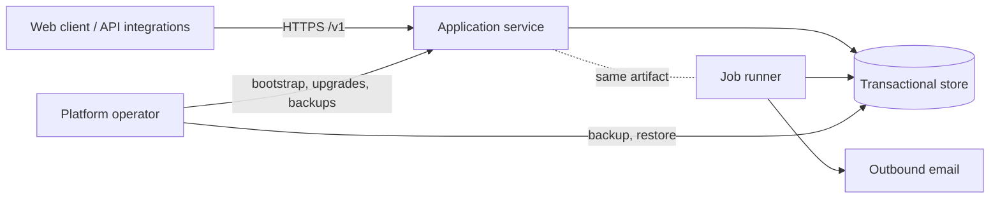
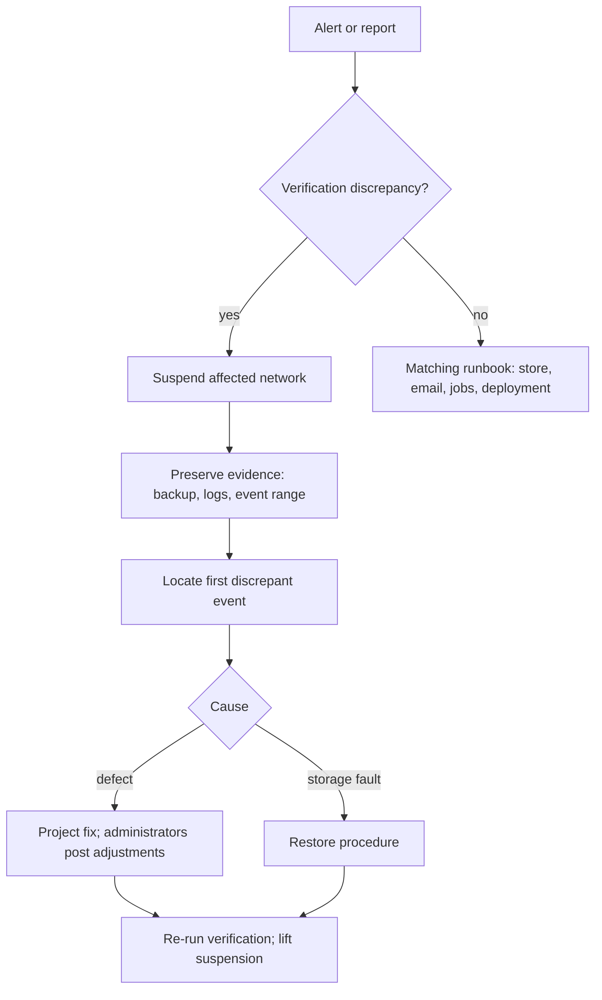

# Deployment, Operations, and Support

| Field | Value |
|---|---|
| Status | Draft |
| Owner role | Platform operator lead |
| Last updated | 2026-11-11 |
| Scope | How a Circula instance is deployed, configured, started, backed up, restored, monitored, upgraded, scaled, supported, and recovered after failure, for self-hosted and hosted operation. Defines operator obligations and the documentation the project ships. Does not select infrastructure vendors. |
| Dependencies | [00-conventions.md](00-conventions.md), [03-domain-model-and-mutual-credit-rules.md](03-domain-model-and-mutual-credit-rules.md), [02-personas-roles-and-journeys.md](02-personas-roles-and-journeys.md) |
| Related documents | [05-system-architecture.md](05-system-architecture.md) (topology, components), [06-data-model-ledger-and-audit.md](06-data-model-ledger-and-audit.md) (retention, migration principles), [09-security-privacy-and-abuse-resistance.md](09-security-privacy-and-abuse-resistance.md) (secrets, logging, incident response, break-glass), [10-governance-and-network-operations.md](10-governance-and-network-operations.md) (suspension policy, announcements), [12-quality-strategy-and-test-plan.md](12-quality-strategy-and-test-plan.md) (restore drills, isolation tests), [13-assumptions-risks-decisions-and-roadmap.md](13-assumptions-risks-decisions-and-roadmap.md) |

## 1. Purpose

The ledger rules in [03-domain-model-and-mutual-credit-rules.md](03-domain-model-and-mutual-credit-rules.md) hold only if the instance that runs them is installed, configured, backed up, observed, and upgraded in ways that cannot silently damage the ledger. This document states those operational requirements at the level of observable behavior. It is written for the **platform operator** (an organization or person running an instance; see [PER-004](02-personas-roles-and-journeys.md#per-004)) and for the project team that ships the software and its documentation.

Design rules applied throughout:

1. The operator has no role inside any network ([PER-007](02-personas-roles-and-journeys.md#per-007)). Every operational procedure in this document is achievable without editing ledger data and without reading network data outside the break-glass path ([PER-033](02-personas-roles-and-journeys.md#per-033)).
2. Ledger errors are never repaired by editing storage. They are corrected through adjustments posted by network administrators ([DOM-002](03-domain-model-and-mutual-credit-rules.md#dom-002), [DOM-040](03-domain-model-and-mutual-credit-rules.md#dom-040)).
3. Anything the operator must do to keep the ledger intact (backups, verification, upgrades) has an alert when it has not happened.
4. Numeric thresholds are recommended defaults marked "threshold needs product decision" until the project owner accepts them.

Identifier ranges reserved by topic:

| Range | Topic |
|---|---|
| OPS-001 to OPS-009 | Deployment models and components |
| OPS-010 to OPS-019 | Environments |
| OPS-020 to OPS-029 | Configuration and secrets |
| OPS-030 to OPS-039 | Installation, first run, health |
| OPS-040 to OPS-059 | Backup and restore |
| OPS-060 to OPS-079 | Monitoring and alerting |
| OPS-080 to OPS-099 | Upgrades and migrations |
| OPS-100 to OPS-109 | Scaling and capacity |
| OPS-110 to OPS-129 | Support responsibilities |
| OPS-130 to OPS-149 | Failure recovery runbook outlines |
| OPS-150 to OPS-159 | Hosted-deployment specifics |
| OPS-160 to OPS-169 | Self-hosted specifics |

## 2. Supported deployment models

Per [DEC-001](13-assumptions-risks-decisions-and-roadmap.md#dec-001), Circula is self-hostable first, a hosted offering runs the same software, and one instance hosts many networks. Isolation between networks is enforced in software by network scoping on every query and command, so the models below differ in who operates the instance and how many networks share it, not in which code runs.

| Model | Operator | Networks per instance | Status |
|---|---|---|---|
| Self-hosted, single network | The community itself or a volunteer | One | Supported (P0) |
| Self-hosted, multi-network | A federation, cooperative, or service group | Many | Supported (P0) |
| Hosted, multi-network | The project or a third party that offers the service | Many, unrelated communities | Supported if a hosted offering is launched (P1); open decision [OQ-OPS-1](#15-open-questions) |

**OPS-001 — One release artifact for every model.** (P0) The project MUST publish a single release artifact per version from which all three models are deployed. No model MAY depend on code, feature flags compiled in, or schema variants that the other models lack. The recommended default artifact is a container image; the project MUST also document a bare-process deployment (run the application service directly on a host with the same configuration schema).
*Rationale:* [DEC-001](13-assumptions-risks-decisions-and-roadmap.md#dec-001) requires the hosted offering to run the same software; two artifacts would give two behaviors to test.
*Acceptance:* the release pipeline output lists one artifact digest per version; the install guide ([OPS-160](#ops-160)) covers both container and bare-process start.

**OPS-002 — Minimum components.** (P0) A deployment MUST provide exactly these four components, matching [DEC-010](13-assumptions-risks-decisions-and-roadmap.md#dec-010):

| Component | Operator-facing requirement |
|---|---|
| Application service | Serves the public API and the web client from the same release; stateless between requests apart from the store. |
| Transactional store | Satisfies [OPS-003](#ops-003). |
| Job runner | Runs scheduled and queued work (expiry sweep per [DOM-025](03-domain-model-and-mutual-credit-rules.md#dom-025), outbox delivery, verification job). MAY run inside the application process; when separate, it is the same release artifact started in job mode. |
| Outbound email | A provider or relay reachable by the application, meeting [OPS-004](#ops-004). |

*Rationale:* naming the minimum set lets a single-network community run on one small host and lets a hosted operator scale parts separately without changing semantics.

**OPS-003 — Transactional store checklist.** (P0) Per [DEC-009](13-assumptions-risks-decisions-and-roadmap.md#dec-009), the operator MUST provision a store that offers all of the following, and the application MUST refuse to start against a store whose startup self-check ([OPS-032](#ops-032)) reports otherwise:

- [ ] ACID transactions: a posting and its audit event commit together or not at all.
- [ ] Serializable isolation or an equivalent guarantee that makes [DOM-009](03-domain-model-and-mutual-credit-rules.md#dom-009) and [DOM-010](03-domain-model-and-mutual-credit-rules.md#dom-010) hold under concurrent requests.
- [ ] Point-in-time recovery capability, or a documented equivalent that meets [OPS-044](#ops-044).
- [ ] Durable writes: an acknowledged commit survives a process or host crash.
- [ ] Encryption at rest, or a host-level equivalent the operator documents ([09-security-privacy-and-abuse-resistance.md](09-security-privacy-and-abuse-resistance.md) owns the requirement).
- [ ] Access restricted to the application service and the migration tool by credentials the operator can rotate ([OPS-024](#ops-024)).

*Rationale:* a store that cannot post atomically cannot satisfy the ledger invariants; the checklist is vendor-neutral so any provider meeting it qualifies.

**OPS-004 — Outbound email requirements.** (P0) Any email provider or relay MUST support authenticated submission over an encrypted channel, report per-message delivery failure back to the application (synchronous refusal or bounce notification), and accept the sending domain's sender-authentication records. The application MUST send through the outbox so that a provider outage delays but does not lose mandatory notifications ([DOM-014](03-domain-model-and-mutual-credit-rules.md#dom-014); [OPS-131](#ops-131)).
*Rationale:* email is the MVP channel for invitations, notifications, and recovery ([DEC-007](13-assumptions-risks-decisions-and-roadmap.md#dec-007)).

**OPS-005 — No vendor selection.** (P0) Specifications and shipped documentation MUST describe infrastructure by capability (OPS-002 to OPS-004). Example configurations for specific vendors MAY appear in community-maintained documentation outside the specification set and MUST NOT be a requirement.
*Rationale:* the repository contains no evidence for choosing a vendor.

Plain-text summary: clients reach the application service over HTTPS; the application service and the job runner (same release artifact, possibly the same process) use one transactional store; the job runner sends email through an outbound provider; the operator manages deployment, backups, and upgrades but is outside the ledger.

## 3. Environments

**OPS-010 — Three environments.** (P0) The project MUST define and document local development, staging, and production environments. Staging is REQUIRED for any operator running more than one network or any hosted offering (P0) and RECOMMENDED for single-network self-hosting.

| Environment | Purpose | Data | Email | Break-glass |
|---|---|---|---|---|
| Local development | Build and test | Generated fixtures only | Captured locally; never sent to real addresses | Not applicable |
| Staging | Rehearse upgrades, migrations, restores, isolation tests | Generated fixtures, or pseudonymized per [OPS-012](#ops-012) | Captured or restricted to an allow-list of test addresses | Same procedure as production, exercised in drills |
| Production | Real networks | Real data | Real provider | [OPS-141](#ops-141) |

**OPS-011 — Parity rules.** (P0) Staging MUST run the same release artifact, the same configuration schema, the same store engine family and major version, and the same job runner mode as production. Differences (sizes, hostnames, credentials) MUST be limited to configuration values. The staging deployment MUST run the release candidate and the upgrade procedure ([OPS-082](#ops-082)) before production does.
*Rationale:* a rehearsal on a different stack proves nothing about the migration.

**OPS-012 — Data separation.** (P0) Test data MUST be generated, never exported from production. Production data MUST NOT be copied to a lower environment unless first pseudonymized: member display names, email addresses, descriptions, listing text, and free-text reasons replaced by generated values, with ledger structure (amounts, sequence, status, limits) preserved so migrations and verification can be tested. The pseudonymization tool is part of the release artifact; a copy made without it is an incident under [09-security-privacy-and-abuse-resistance.md](09-security-privacy-and-abuse-resistance.md). Retention and personal-data rules are owned by [06-data-model-ledger-and-audit.md](06-data-model-ledger-and-audit.md).
*Rationale:* members' trading history and contact details are personal data; lower environments are less protected.
*Acceptance:* a pseudonymized staging copy contains no production email address or display name (checked by a scripted scan), and its verification job ([DOM-003](03-domain-model-and-mutual-credit-rules.md#dom-003)) reports no discrepancy.

**OPS-013 — Outbound email isolation in lower environments.** (P0) Local development and staging MUST be unable to deliver email to addresses outside a configured allow-list, enforced by configuration validation at startup ([OPS-022](#ops-022)).
*Rationale:* a staging copy must never email real members.

## 4. Configuration and secrets

**OPS-020 — Configuration surface.** (P0) All deployment-specific behavior MUST be set through environment variables or a configuration file, or both, with a documented schema listing for each key: name, type, allowed values, default (or "required"), whether it is a secret, and the first release that supported it. The configuration reference ([OPS-164](#ops-164)) is generated from the same schema the application validates against.
*Rationale:* a reference that is generated from the validator cannot disagree with it.

**OPS-021 — Secrets handling.** (P0) Secrets (session signing keys, email provider credentials, store credentials, bootstrap token, any token-hashing key) MUST be supplied only through environment variables or an operator-managed secret store. Secrets MUST NOT appear in the repository, in container images or release artifacts, in configuration files committed to version control, in log output, in error responses, in metrics labels, or in backups of configuration ([OPS-040](#ops-040)). Logging rules are owned by [09-security-privacy-and-abuse-resistance.md](09-security-privacy-and-abuse-resistance.md).
*Acceptance:* a scripted scan of the release artifact and of logs from the QA suite finds no value from a set of planted canary secrets.

**OPS-022 — Startup validation.** (P0) On start, the application MUST validate the full configuration before accepting traffic or starting jobs, and MUST exit with a non-zero status on any failure. The message MUST name each missing or invalid key and the rule it broke, and MUST NOT print any configured value. All failures are reported in one run, not one per restart.
*Acceptance:* starting with a required key removed exits non-zero within 10 seconds (threshold needs product decision) and prints the key name; the output contains no configured value.

**OPS-023 — Safe defaults.** (P0) A configuration that omits an optional key MUST yield the safer behavior (for example, refuse non-encrypted store connections, refuse outbound email to non-allow-listed addresses in non-production environments). A key that weakens a protection MUST be named so the weakening is evident (for example `ALLOW_INSECURE_*`) and MUST cause a warning at startup and a visible flag in the health detail ([OPS-033](#ops-033)). The application MUST refuse such keys when the environment is declared production.

**OPS-024 — Rotation without downtime.** (P1) Rotation MUST be documented for each of the following, and the application SHOULD support the zero-downtime form:

| Secret | Zero-downtime form |
|---|---|
| Session signing keys | The application accepts a current key plus one or more previous keys for verification and signs only with the current key. After the longest session lifetime elapses, the previous key is removed. Revoking a key early signs affected members out and the runbook states that effect. |
| Email provider credentials | The application accepts a new credential on reload or rolling restart; submissions in flight at the switch are retried through the outbox. |
| Store credentials | The operator creates a second credential, deploys it, confirms connections, then revokes the first. The application reconnects with the new credential on rolling restart. |
| Bootstrap token | Single use ([OPS-030](#ops-030)); no rotation needed. |

*Rationale:* a compromised secret must be replaceable without taking members offline; the three listed secrets are the ones a compromise most plausibly affects. Rotation after a suspected compromise follows incident response in [09-security-privacy-and-abuse-resistance.md](09-security-privacy-and-abuse-resistance.md).

## 5. Installation and first run

**OPS-030 — Bootstrap of the first operator identity.** (P0) A new instance with an empty store MUST create no default accounts and no default credentials. The operator creates the first operator identity through a one-time bootstrap token: the token is supplied by environment or secret store, is valid for one use, is invalidated on first successful use or after a configured lifetime (recommended default 24 hours; threshold needs product decision), and its use is recorded as an audit event at instance level ([DOM-012](03-domain-model-and-mutual-credit-rules.md#dom-012)). Once any operator identity exists, the bootstrap path MUST refuse all requests. The new identity MUST be prompted to set a password meeting the policy in [09-security-privacy-and-abuse-resistance.md](09-security-privacy-and-abuse-resistance.md) and SHOULD be prompted to enrol a second factor before any further operator action.
*Rationale:* default credentials are the most common way self-hosted instances are taken over.
*Acceptance:* a second request with the same token is refused; an instance with no bootstrap token configured and no operator identity starts but reports `not_initialised` in health detail.

**OPS-031 — First-network creation.** (P0) After bootstrap, the operator creates a network in status Setup and assigns its first administrator ([PER-010](02-personas-roles-and-journeys.md#per-010), [PER-016](02-personas-roles-and-journeys.md#per-016)). The operator MUST NOT be able to choose that administrator's password. The administrator receives an invitation by email.

**OPS-032 — Startup self-checks.** (P0) Before reporting ready, the application MUST check: the store is reachable and meets the isolation and durability properties of [OPS-003](#ops-003) that can be tested from the client side; all migrations required by the release are applied; the clock offset against the store is within a configured tolerance (recommended default 5 seconds; threshold needs product decision); the job runner has registered its schedules; and the outbound email provider accepts a connectivity test (failure is a warning, not a block, so the application can serve while the provider recovers).

**OPS-033 — Health endpoints.** (P0) The application MUST expose, without authentication and without returning network data or secrets:

| Endpoint purpose | Returns success when | Use |
|---|---|---|
| Liveness | The process can handle a request. It does not check the store. | Restart the process if it fails repeatedly. |
| Readiness | OPS-032 checks pass and the store answers a trivial transaction. | Remove the instance from request routing if it fails; do not restart. |
| Health detail (operator-authenticated) | Reports version, applied migration identifier, job runner state, last verification result and age, outbox backlog size, and any insecure-configuration flags. | Operator dashboards and the monitoring in section 7. |

The paths are an [07-api-and-integration-contract.md](07-api-and-integration-contract.md) decision; recommended defaults `/healthz` (liveness) and `/readyz` (readiness).
*Rationale:* separating liveness from readiness prevents a store outage from causing a restart loop that makes recovery slower.

## 6. Backup and restore

**OPS-040 — What is backed up.** (P0) The operator MUST back up: the whole transactional store, which includes ledger events, postings, audit events, memberships, policies and policy versions, and uploaded content, as one consistent snapshot or one point-in-time-recoverable stream; and the instance configuration without secret values (the key names and non-secret values). Secrets MUST NOT be stored in plaintext in any backup; the operator keeps them in the secret store or an encrypted escrow they control. The backup MUST NOT be assembled from separate per-table copies taken at different moments.
*Rationale:* a restore whose ledger events and postings come from different moments would fail the verification in [OPS-045](#ops-045).

**OPS-041 — Frequency.** (P0) Recommended defaults, each marked threshold needs product decision:

| Deployment | Mechanism | Minimum |
|---|---|---|
| Any store offering continuous or point-in-time capture | Continuous log capture plus a full snapshot at least weekly | Capture lag no more than 5 minutes |
| Store without point-in-time capture | Full snapshot | At least every 24 hours |
| Hosted | Continuous capture | Mandatory |

**OPS-042 — Encryption and off-site copy.** (P0) Backups MUST be encrypted before leaving the primary site, with keys held separately from the backup medium. At least one copy MUST be stored in a failure domain different from the primary store (a different site, account, or provider). The operator MUST test that the key is available to a person other than the one who created the backup.
*Rationale:* a backup in the same failure domain as the store is lost with it; a backup nobody can decrypt is not a backup.

**OPS-043 — Retention aligned with data retention.** (P0) Backup retention MUST NOT shorten the ledger retention period and MUST NOT lengthen the retention of personal data beyond what [06-data-model-ledger-and-audit.md](06-data-model-ledger-and-audit.md) states: when personal data is pseudonymized or erased there ([DOM-074](03-domain-model-and-mutual-credit-rules.md#dom-074)), backups older than the stated backup-expiry period (recommended default 35 days; threshold needs product decision) MUST be destroyed, and a restore from a backup older than that period MUST re-apply recorded erasures before the instance serves traffic. Whether backups are in scope of an erasure request is a counsel question ([OQ-OPS-6](#15-open-questions)).

**OPS-044 — Recovery objectives.** (P0) The operator documentation MUST state the instance's recovery point objective (RPO) and recovery time objective (RTO). Recommended defaults, threshold needs product decision:

| Objective | Hosted | Self-hosted |
|---|---|---|
| RPO (maximum data-loss window) | 1 hour | 24 hours |
| RTO (time to restored service) | 4 hours | 4 hours |

A self-hosted operator who cannot meet a default MUST record the actual values; the application does not enforce them. The hosted operator MUST alert when backup age exceeds the RPO ([OPS-062](#ops-062)).

**OPS-045 — Restore procedure and success criterion.** (P0) The backup/restore guide ([OPS-162](#ops-162)) MUST document a step-by-step restore to a clean environment. A restore is successful only when all of the following hold:

1. The application starts against the restored store and reports ready.
2. The verification job ([DOM-003](03-domain-model-and-mutual-credit-rules.md#dom-003), [DOM-004](03-domain-model-and-mutual-credit-rules.md#dom-004)) runs for every network and reports no discrepancy.
3. For every network, ledger sequence numbers are contiguous from the first event to the last ([DOM-010](03-domain-model-and-mutual-credit-rules.md#dom-010)).
4. Recorded erasures are re-applied ([OPS-043](#ops-043)).
5. The most recent ledger event in the restored store is no older than the operator's RPO relative to the failure, or the operator has announced the data-loss window ([OPS-089](#ops-089)).

*Rationale:* "the database came up" is not evidence that the ledger is intact; the verification job is.

**OPS-046 — Restore drills.** (P0) The operator MUST perform a full restore to a clean environment at least every quarter, record the date, backup used, elapsed time, and result of each criterion in OPS-045, and keep the record for two years (threshold needs product decision). The project MUST include an automated restore test in its release verification ([12-quality-strategy-and-test-plan.md](12-quality-strategy-and-test-plan.md), backup and restore test). A failed drill is treated as a failed backup and alerts per [OPS-062](#ops-062).
*Rationale:* untested backups routinely fail when needed.

**OPS-047 — Restore after data loss and member impact.** (P0) Restoring to a point before the failure loses ledger events committed after that point. The operator MUST NOT re-create lost events by hand. Members affected are informed by network administrators using the announcement path in [10-governance-and-network-operations.md](10-governance-and-network-operations.md); the operator supplies the sequence range of the loss for each network, and event details recovered from other sources (for example application logs or member exports) are re-entered only as ordinary transactions or administrator adjustments by the parties involved.
*Rationale:* a hand-inserted event would bypass [DOM-002](03-domain-model-and-mutual-credit-rules.md#dom-002) and [DOM-012](03-domain-model-and-mutual-credit-rules.md#dom-012).

## 7. Monitoring and alerting

**OPS-060 — Required metrics.** (P0) The application and job runner MUST expose, in a documented machine-readable format (recommended default: a text exposition format widely supported by monitoring tools; alternatives recorded in [OQ-OPS-4](#15-open-questions)), at least:

| Group | Metrics |
|---|---|
| Requests | Rate, error rate by status class, latency distribution by operation, rate-limited responses (HTTP 429) |
| Ledger | Posting latency distribution; count of failed postings by error code (the section 5.1 vocabulary in [03-domain-model-and-mutual-credit-rules.md](03-domain-model-and-mutual-credit-rules.md)); count of ledger events by type per network |
| Jobs | Age of the oldest unswept expired proposal ([DOM-025](03-domain-model-and-mutual-credit-rules.md#dom-025)); outbox backlog count and age of oldest message; last run time and duration of each scheduled job; job failures |
| Verification | Last completion time, result, and number of discrepancies from the verification job ([DOM-003](03-domain-model-and-mutual-credit-rules.md#dom-003), [DOM-004](03-domain-model-and-mutual-credit-rules.md#dom-004)), per network |
| Store | Connection pool use, connection errors, query errors, replication or capture lag where applicable |
| Host | Disk use and growth rate on store and log volumes |
| Backup | Age of the newest successful backup; result of the last restore drill |

Metrics MUST NOT carry member identifiers, email addresses, or free text as labels. Network identifier labels are allowed in operator-only metrics and MUST NOT be exposed to network administrators.
*Rationale:* the listed metrics are those whose absence would hide a ledger-affecting fault.

**OPS-061 — Verification job.** (P0) The verification job MUST run at least daily on every instance and before and after every migration and restore, per [QA](12-quality-strategy-and-test-plan.md). It MUST be able to run for a single network without locking other networks' postings. Any discrepancy MUST raise the highest-severity alert ([OPS-062](#ops-062)) and trigger the procedure in [OPS-140](#ops-140). The job MUST NOT correct anything.
*Rationale:* silent drift is the failure the ledger design exists to expose ([DOM-003](03-domain-model-and-mutual-credit-rules.md#dom-003)); correction by software would be an unrecorded balance change ([DOM-014](03-domain-model-and-mutual-credit-rules.md#dom-014)).

**OPS-062 — Alert set.** (P0) Hosted operators MUST configure, and self-hosted operators SHOULD configure, at least these alerts. Thresholds are recommended defaults, threshold needs product decision.

| Condition | Severity | Default threshold |
|---|---|---|
| Verification job reports any discrepancy | Page immediately | Any |
| Verification job has not completed | High | No success in 26 hours |
| Newest successful backup older than RPO | High | Hosted 1 hour; self-hosted 24 hours |
| Restore drill overdue | Medium | Over 100 days since last success |
| Store unreachable or readiness failing | High | 2 minutes |
| Expiry sweep age ([DOM-025](03-domain-model-and-mutual-credit-rules.md#dom-025)) | High | Oldest unswept proposal older than 60 minutes past expiry |
| Outbox backlog age | High | Oldest message older than 30 minutes |
| Request error rate (server errors) | High | Above 2 percent over 5 minutes |
| Posting latency | Medium | 95th percentile above 1 second over 10 minutes |
| Disk | Medium then High | 80 percent, then 90 percent |
| Certificate expiry | Medium | 21 days |
| Repeated rate-limit responses from one source | Informational, forwarded to abuse handling | Per [09-security-privacy-and-abuse-resistance.md](09-security-privacy-and-abuse-resistance.md) |

**OPS-063 — Logs.** (P0) Application and job logs MUST be structured (one machine-parseable record per event), carry a request correlation identifier and network identifier where one applies, and MUST NOT contain secrets, passwords, session tokens, full email addresses of members, or free-text transaction descriptions. Log retention for operational logs is the operator's choice within [09-security-privacy-and-abuse-resistance.md](09-security-privacy-and-abuse-resistance.md). Logs are not the audit log; audit events ([DOM-012](03-domain-model-and-mutual-credit-rules.md#dom-012)) live in the store.

**OPS-064 — Traces.** (P1) The application SHOULD emit distributed-trace spans for each API request, each ledger posting, and each outbound email, with the same redaction rules as OPS-063, so that posting latency can be broken down by store time and application time.

**OPS-065 — Availability target.** (P1) The hosted operator SHOULD publish an availability target for the API, measured monthly on the readiness endpoint from outside the operator's network. Recommended default 99.5 percent per calendar month excluding announced maintenance (threshold needs product decision, [OQ-OPS-3](#15-open-questions)). Self-hosted operators set their own target; the project makes no availability promise for self-hosted instances.

**OPS-066 — Status communication to administrators.** (P1) The operator MUST have a channel that network administrators can read without logging in (a status page or a feed) and MUST notify administrators by email of planned maintenance at least 7 days ahead (threshold needs product decision), of read-only periods ([OPS-088](#ops-088)), and of incidents that affect their networks, per [09-security-privacy-and-abuse-resistance.md](09-security-privacy-and-abuse-resistance.md) incident response. Administrators relay notices to members under [10-governance-and-network-operations.md](10-governance-and-network-operations.md).

## 8. Upgrades and migrations

**OPS-080 — Versioning and release notes.** (P0) Releases MUST carry a version identifier. Recommended default: semantic versioning (major.minor.patch), where a major version signals a breaking change to the public API or to operator procedures, a minor adds capability with a forward migration, and a patch contains fixes with no schema change. Every release MUST ship release notes stating: changes by area, migration notes (whether the schema or data changes, expected duration for a store of stated size, whether the migration is reversible without restore), breaking-change flags (API, configuration keys, operator procedures), and security fixes. API versioning (`/v1`) is owned by [07-api-and-integration-contract.md](07-api-and-integration-contract.md).
*Rationale:* operators plan maintenance from the notes; an unflagged breaking change is a failed upgrade waiting to happen.

**OPS-081 — Compatibility window.** (P0) The release notes of each release MUST state the oldest version from which an in-place upgrade is supported. Recommended default: an instance must step through every minor version in order and may skip patch versions. Open decision ([OQ-OPS-2](#15-open-questions)): allow skipping up to a stated number of minors, or support only the previous minor. The application MUST refuse to start migrations from an unsupported version and MUST name the supported path.

**OPS-082 — Upgrade procedure.** (P0) The upgrade guide ([OPS-161](#ops-161)) MUST describe, in this order:

1. Read release notes and the compatibility statement ([OPS-081](#ops-081)); rehearse on staging ([OPS-011](#ops-011)).
2. Announce planned maintenance ([OPS-066](#ops-066)).
3. Take a backup and verify it is restorable to the extent possible without a full drill (checksum, decryption, catalogue listing).
4. Enter read-only mode where the release notes require it ([OPS-088](#ops-088)).
5. Apply migrations under the principles in [06-data-model-ledger-and-audit.md](06-data-model-ledger-and-audit.md).
6. Run the verification job for every network; any discrepancy stops the upgrade and invokes [OPS-140](#ops-140) ([DOM-003](03-domain-model-and-mutual-credit-rules.md#dom-003)).
7. Start the new application version, pass the smoke test ([OPS-083](#ops-083)), leave read-only mode.
8. Announce completion with the version and any behavior changes.

**OPS-083 — Smoke test.** (P0) The project MUST ship a smoke test that an operator can run against a deployed instance in a designated test network: sign in, read balance, propose and accept a transaction between two test members, read history, request an export, and run the verification job. It MUST create only data in the designated test network. The smoke test is the post-upgrade gate; the full scenarios are in [12-quality-strategy-and-test-plan.md](12-quality-strategy-and-test-plan.md).

**OPS-084 — Migrations preserve the ledger.** (P0) A migration MUST NOT delete, rewrite, or reorder ledger events or postings, MUST NOT change a posted amount, and MUST leave every balance, as derived by the verification job, unchanged unless the release notes name a deliberate correction reviewed under [06-data-model-ledger-and-audit.md](06-data-model-ledger-and-audit.md). A migration that restructures storage MUST prove equality of the full set of account balances before and after, in its own run output.
*Rationale:* the append-only rule ([DOM-002](03-domain-model-and-mutual-credit-rules.md#dom-002)) applies to operators and releases as much as to users.

**OPS-085 — Rollback.** (P0) Rollback after migrations have been applied is the restore procedure ([OPS-045](#ops-045)) from the backup taken in step 3 of OPS-082, plus the documented data-loss window: all ledger events posted since that backup are lost. Release notes MUST state whether a migration is reversible without restore. Where it is reversible, the guide documents the reverse step, and the choice between reverse and restore is made before the upgrade begins. Rolling back the application artifact alone, when migrations are unchanged, is permitted.
*Rationale:* making the cost explicit before the upgrade lets operators choose a read-only window that reduces the loss to zero.

**OPS-086 — Zero events lost by design when possible.** (P1) When the upgrade enters read-only mode ([OPS-088](#ops-088)) before the backup is taken, no ledger events are posted between backup and rollback, and the data-loss window for rollback is zero. The upgrade guide SHOULD recommend this ordering for every release that includes a migration.

**OPS-087 — Rolling deployment constraints.** (P1) Releases SHOULD declare whether they support mixed versions running together during a rolling deployment. Where they do not, the guide states that all instances stop before migrations begin.

**OPS-088 — Maintenance window and read-only mode.** (P1) The application SHOULD provide an operator-controlled read-only mode in which reads succeed and every state-changing call is refused with a documented error and a `Retry-After` hint, for all networks or per network, so that migrations and backups run against a ledger that is not changing. Entering and leaving read-only mode is an instance-level audit event ([DOM-012](03-domain-model-and-mutual-credit-rules.md#dom-012)). Members see a notice that states the expected end time. Pending proposals continue to age ([DOM-025](03-domain-model-and-mutual-credit-rules.md#dom-025)) and the expiry sweep runs when the mode ends.

**OPS-089 — Announcing data loss.** (P0) If a restore loses ledger events, the operator MUST notify each affected network's administrators with the sequence range and time range of the loss within 24 hours of service resuming (threshold needs product decision), before any member-facing statement is made that implies the ledger is complete.

## 9. Scaling and capacity

**OPS-100 — Reference sizing.** (P1) The project SHOULD publish a reference deployment (application service, store, job runner sizes) validated by load tests ([12-quality-strategy-and-test-plan.md](12-quality-strategy-and-test-plan.md)) for a stated number of networks N and members per network M, with the measured posting latency and request rate. The values of N and M for the MVP are a product decision ([OQ-OPS-5](#15-open-questions)); recommended starting figures for discussion: a single instance supports N = 20 networks of M = 500 members with the alert thresholds of OPS-062 holding at the 95th percentile.

**OPS-101 — Vertical first.** (P1) The documented growth path is vertical: larger application, store, and job runner resources on a single instance. Capacity guidance MUST state the metrics from OPS-060 that indicate saturation (store connection pool exhaustion, posting latency, disk growth).

**OPS-102 — Horizontal API tier.** (P2) Running several application instances against one store MAY be supported only if serialization of postings per network ([DOM-009](03-domain-model-and-mutual-credit-rules.md#dom-009), [DOM-010](03-domain-model-and-mutual-credit-rules.md#dom-010)) is enforced by the store, not by process-local state, and a concurrency test with instances in parallel passes ([12-quality-strategy-and-test-plan.md](12-quality-strategy-and-test-plan.md)). Architecture is owned by [05-system-architecture.md](05-system-architecture.md). More than one job runner active at once MUST NOT cause duplicate sweeps, duplicate emails, or duplicate verification discrepancies; the store provides the lock or lease.
*Rationale:* a ledger shared across processes is correct only if the order of postings is decided by one authority.

**OPS-103 — Growth monitoring.** (P1) The operator SHOULD review store size, posting volume per network, and disk growth rate quarterly and record the projected date at which a threshold in OPS-062 would be crossed.

## 10. Support responsibilities

Three parties support an instance: the **platform operator**, the **network administrator** of each network, and the **software project** (maintainers who ship releases and documentation). In a single-network self-hosted instance one person or group may hold the operator and administrator roles; they are still distinct duties because [PER-007](02-personas-roles-and-journeys.md#per-007) bars the operator role from the ledger.

**OPS-110 — Support responsibility table.** (P0) The documentation MUST publish the following allocation. "Self" means self-hosted; "Hosted" means a hosted deployment.

| Issue | Platform operator | Network administrator | Software project |
|---|---|---|---|
| Member cannot sign in (forgotten password, lost email access) | Self: runs the recovery flow if the member has lost email access and the administrator confirms identity ([09-security-privacy-and-abuse-resistance.md](09-security-privacy-and-abuse-resistance.md)). Hosted: same, via the hosted support channel. | Confirms the person's identity within the network; starts recovery where policy lets them. | Documents the flow. |
| Lost second factor | Resets the factor only after the administrator's identity confirmation and with an audit event; never reveals the secret. | Confirms identity. | Documents the flow. |
| Ledger question ("why did my balance change") | Never edits or explains ledger content; points the member to the administrator. | Reads the account history and audit log; explains; where a correction is needed, posts an adjustment ([DOM-040](03-domain-model-and-mutual-credit-rules.md#dom-040)) or resolves a dispute. | Fixes defects reported with evidence. |
| Suspected ledger discrepancy | Runs [OPS-140](#ops-140). | Receives notice; handles member communication. | Triage of defects; releases fixes. |
| Abuse report (member behavior) | Handles reports about the instance as a whole or about an administrator; applies network suspension where [OPS-152](#ops-152) allows. | Handles reports about a member under network policy ([10-governance-and-network-operations.md](10-governance-and-network-operations.md)). | None. |
| Data export request (member) | None; the member self-exports ([PER-030](02-personas-roles-and-journeys.md#per-030)). The operator helps only if the product path fails. | Directs the member to self-export. | Fixes export defects. |
| Data export request (network) | Hosted: runs export on request when the administrator cannot ([OPS-151](#ops-151)). | Runs network export ([PER-031](02-personas-roles-and-journeys.md#per-031)). | Fixes export defects. |
| Deletion request | Carries out instance-level steps the product provides; never deletes ledger events ([DOM-074](03-domain-model-and-mutual-credit-rules.md#dom-074)). | Handles departure and the member-facing explanation. | Documents what is pseudonymized and what is retained; legal basis is a counsel question ([OQ-OPS-6](#15-open-questions)). |
| Security incident | Leads containment and notification at instance level per [09-security-privacy-and-abuse-resistance.md](09-security-privacy-and-abuse-resistance.md). | Relays notices to members. | Provides fixes and advisories. |
| Outage or degraded service | Restores service; posts status ([OPS-066](#ops-066)). | Relays to members. | Supports diagnosis from logs the operator shares. |
| Software defect, feature request | Reports upstream with redacted logs. | Reports through the operator. | Triage and release. |
| Installation and upgrade help (self-hosted) | Primary. | Not applicable. | Community support channel and shipped documentation ([OPS-160](#ops-160) to [OPS-164](#ops-164)); response commitments are an open decision ([OQ-OPS-7](#15-open-questions)). |

**OPS-111 — Operator never edits the ledger.** (P0) No support procedure in the documentation MAY instruct a person to modify, insert, or delete ledger events, postings, or audit events in storage. A member's or administrator's request that implies it MUST be answered with the adjustment or dispute path.
*Rationale:* [DOM-002](03-domain-model-and-mutual-credit-rules.md#dom-002).

**OPS-112 — Support ticket data handling.** (P0) Support requests received by the operator and project MUST be handled so that: members are asked for the minimum data (never passwords, second-factor codes, or full ledger exports); attachments with personal data are accessible only to named support staff and deleted at a stated period after closure (recommended default 90 days; threshold needs product decision); tickets reference members by network and opaque identifier rather than copying balances or transaction descriptions; and access to network data to answer a ticket goes through break-glass ([OPS-141](#ops-141)), not through the support tool. Privacy obligations are owned by [09-security-privacy-and-abuse-resistance.md](09-security-privacy-and-abuse-resistance.md).

**OPS-113 — Identity confirmation before account-level support.** (P0) The operator MUST NOT change email address, reset a password, or reset a second factor for a login identity on the strength of an unauthenticated request alone. The documented procedure requires confirmation by a network administrator of a network where the person is a member, or another factor defined in [09-security-privacy-and-abuse-resistance.md](09-security-privacy-and-abuse-resistance.md), and records an instance-level audit event.

**OPS-114 — Support contacts per network.** (P1) Each network SHOULD display to its members the contact route for administrators and, for hosted instances, the operator's contact route for account-recovery escalation, so that members are never directed to the operator for ledger questions.

## 11. Failure recovery runbook outlines

These are outlines. The project MUST turn each into a full runbook in the operator documentation before the MVP ships ([OPS-165](#ops-165)). Each runbook states detection, containment, recovery, verification, and communication.

Plain-text summary: a verification discrepancy leads to suspending the affected network, preserving evidence, locating the first discrepant event, then either correcting through a defect fix plus administrator adjustments or restoring from backup, followed by a verification re-run and lifting the suspension; other alerts go to their own runbooks.

**OPS-130 — Store unavailable.** (P0) Outline: (1) detect through readiness failure and store alerts; (2) the application MUST fail state-changing calls with a documented retryable error and MUST NOT accept a posting it cannot commit; reads MAY return a documented error; (3) operator restores or fails over the store; (4) on return, confirm readiness, run the verification job, drain the outbox; (5) notify administrators if the outage exceeded the status-communication threshold. Idempotent retry by clients ([DOM-011](03-domain-model-and-mutual-credit-rules.md#dom-011)) means a request retried after recovery has the same effect as the first.

**OPS-131 — Email provider down.** (P0) Outline: mandatory notifications ([DOM-014](03-domain-model-and-mutual-credit-rules.md#dom-014)) accumulate in the outbox with bounded retry; the application keeps serving; the outbox backlog alert fires ([OPS-062](#ops-062)); the operator fixes credentials or switches provider; on recovery the backlog drains in creation order; messages older than their useful life (invitations past expiry) are marked expired rather than sent. Members can still see the same events in the in-app notification list and account history.

**OPS-132 — Job runner stalled.** (P0) Outline: detect through job last-run age and expiry sweep age ([OPS-060](#ops-060)); restart the job runner; confirm schedules registered; confirm backlog drained; consequence while stalled: expired proposals still cannot be accepted because acceptance checks expiry itself ([DOM-025](03-domain-model-and-mutual-credit-rules.md#dom-025), [DOM-022](03-domain-model-and-mutual-credit-rules.md#dom-022)), but notifications and verification are delayed. A stalled verification job is itself an alert.

**OPS-133 — Partial deployment.** (P0) Outline: detect through health detail showing a version or migration mismatch across instances, or smoke test failure; containment: stop the older instances or enter read-only mode; recovery: complete the rollout if migrations are applied and the release is sound, otherwise the rollback in [OPS-085](#ops-085); verify with the verification job and the smoke test. The application MUST refuse to serve state-changing requests when its code version expects a different migration identifier than the store reports.

**OPS-134 — Disk full or store growth.** (P1) Outline: alert at OPS-062 thresholds; free space only from operational logs and temporary files, never from ledger or audit tables; expand storage; confirm store health; run verification.

**OPS-140 — Suspected ledger discrepancy.** (P0) Procedure:

1. **Freeze** the affected network or networks by suspension (network status Suspended, [03-domain-model-and-mutual-credit-rules.md](03-domain-model-and-mutual-credit-rules.md) section 3.2.1) or, where the discrepancy spans networks, instance read-only mode ([OPS-088](#ops-088)). Suspension follows [OPS-152](#ops-152) and the notification rules in [10-governance-and-network-operations.md](10-governance-and-network-operations.md).
2. **Preserve evidence**: take a backup of the current state; retain verification output, application logs, and the metadata for the first discrepant sequence number. Do not alter anything.
3. **Investigate**: identify the first event after which balances differ from postings or the sum is not zero ([DOM-004](03-domain-model-and-mutual-credit-rules.md#dom-004)); decide between a software defect, a storage fault, or an unauthorized change. Unauthorized change is a security incident ([09-security-privacy-and-abuse-resistance.md](09-security-privacy-and-abuse-resistance.md)).
4. **Correct only by the sanctioned routes**: a cached balance that differs from postings is rebuilt by the application's documented rebuild operation, which derives balances from postings ([DOM-003](03-domain-model-and-mutual-credit-rules.md#dom-003)) and records an audit event; a posting-level error is corrected only by adjustments posted by network administrators ([DOM-040](03-domain-model-and-mutual-credit-rules.md#dom-040), [DOM-041](03-domain-model-and-mutual-credit-rules.md#dom-041)); a storage fault is corrected by restore ([OPS-045](#ops-045)).
5. **Never edit storage directly.** Direct edits to ledger or audit data are prohibited ([OPS-111](#ops-111)).
6. **Verify and lift**: re-run verification for the network; unsuspend only when it reports no discrepancy.
7. **Communicate**: administrators first, with the affected sequence range; members through administrators.
8. **Review**: a written post-incident record is attached to the instance audit log and the project defect tracker.

*Acceptance:* the QA suite includes a fault-injection test that corrupts a cached balance in a test instance; the verification job reports it; the rebuild operation restores equality; no ledger event is modified.

**OPS-141 — Break-glass procedure steps.** (P0) Break-glass access is the only route by which the operator reaches a network's data ([PER-033](02-personas-roles-and-journeys.md#per-033)); its controls are owned by [09-security-privacy-and-abuse-resistance.md](09-security-privacy-and-abuse-resistance.md). The operational procedure MUST be:

1. A named operator records a reason and a reference to the support request or incident, and the access window (time box per [SEC-140](09-security-privacy-and-abuse-resistance.md#sec-140): default 4 h, maximum 24 h).
2. A second operator or the operator lead approves where the instance has more than one operator; a single-operator instance records a self-approval flagged as such, except for the administrator grant of [SEC-142](09-security-privacy-and-abuse-resistance.md#sec-142), which always needs a second operator; a single-operator instance cannot perform it.
3. Access is granted through a path separate from the normal interface, with read-only scope by default.
4. Every action is logged as an audit event visible to the affected network's administrators afterward ([DOM-012](03-domain-model-and-mutual-credit-rules.md#dom-012)).
5. Access expires at the end of the window; extension is a new request.
6. The operator files a closing note stating what was viewed and why.
Break-glass confers no posting authority ([PER-033](02-personas-roles-and-journeys.md#per-033)).

## 12. Hosted-deployment specifics

**OPS-150 — Isolation tests before each release.** (P0) A hosted operator MUST NOT release to production until the network-isolation tests defined in [12-quality-strategy-and-test-plan.md](12-quality-strategy-and-test-plan.md) pass against the release candidate on staging, covering every API operation ([DEC-001](13-assumptions-risks-decisions-and-roadmap.md#dec-001), [DOM-005](03-domain-model-and-mutual-credit-rules.md#dom-005)). The result is recorded per release.
*Rationale:* in a shared instance, a missing network filter on one query exposes every network.

**OPS-151 — Per-network export on request.** (P0) A hosted operator MUST be able to produce, within 10 working days of a request from a network's administrators (threshold needs product decision), the network export defined in [PER-031](02-personas-roles-and-journeys.md#per-031) in the formats of [07-api-and-integration-contract.md](07-api-and-integration-contract.md), using the product's export path, and the export MUST be audited ([DOM-012](03-domain-model-and-mutual-credit-rules.md#dom-012)). The operator MUST NOT produce an export of one network on a request from anyone who is not an administrator of that network, except under a legal request handled as a counsel question ([OQ-OPS-6](#15-open-questions)).

**OPS-152 — Network suspension policy.** (P0) The hosted operator MUST publish terms stating the grounds on which it may suspend a network (recommended: abuse affecting other networks or third parties, a legal requirement, a ledger discrepancy under [OPS-140](#ops-140), non-compliance with the hosting terms), the notice given to administrators, and the route to appeal. Suspension is the network status Suspended in [03-domain-model-and-mutual-credit-rules.md](03-domain-model-and-mutual-credit-rules.md); it stops ordinary transactions (`transaction_completed` events) and new memberships; administrator reversals and adjustments remain possible ([DOM-016](03-domain-model-and-mutual-credit-rules.md#dom-016)); it preserves all history and administrator read access. Governance of suspension, notice, and reinstatement is owned by [10-governance-and-network-operations.md](10-governance-and-network-operations.md). Suspension is an instance-level audit event.

**OPS-153 — Data location and controller.** (P0) The hosted operator MUST document where each network's data is stored and processed, and who determines purposes and means (the operator, the network, or jointly). Which party is a data controller or processor, whether cross-border transfers apply, and what notices members receive are counsel questions ([OQ-OPS-6](#15-open-questions)); this document records only that the documentation of location and roles MUST exist before launch.

**OPS-154 — Billing out of scope.** (P0) Billing, pricing, invoicing, and any charge the hosted operator makes for the service are out of scope for these specifications and for the platform. The software MUST NOT include billing logic, and no operational procedure here depends on one. Networks' credit units are not used for any charge by the operator ([DEC-008](13-assumptions-risks-decisions-and-roadmap.md#dec-008), [DOM-080](03-domain-model-and-mutual-credit-rules.md#dom-080)).

**OPS-155 — Per-network operational independence.** (P1) A hosted operator SHOULD be able to enter read-only mode, suspend, or export for one network without affecting the others ([OPS-088](#ops-088), [OPS-061](#ops-061)).

## 13. Self-hosted specifics

**OPS-160 — Install guide.** (P0) The project MUST ship an install guide covering: prerequisites by capability (OPS-002 to OPS-004), container and bare-process start, first-run bootstrap ([OPS-030](#ops-030)), health checks ([OPS-033](#ops-033)), a sample single-host deployment, and the smoke test ([OPS-083](#ops-083)). A reader can reach a ready instance with one network using only this guide.

**OPS-161 — Upgrade guide.** (P0) The upgrade guide follows [OPS-082](#ops-082), links each release's notes, and states the supported upgrade paths ([OPS-081](#ops-081)).

**OPS-162 — Backup and restore guide.** (P0) The guide covers OPS-040 to OPS-047: what to back up, example schedules by store capability, encryption and off-site copy, the restore steps, the success criteria of [OPS-045](#ops-045), and a drill record template ([OPS-046](#ops-046)).

**OPS-163 — Security hardening checklist.** (P0) The project MUST ship a checklist (content owned by [09-security-privacy-and-abuse-resistance.md](09-security-privacy-and-abuse-resistance.md)) covering at least transport encryption, store access restriction, secret handling ([OPS-021](#ops-021)), second-factor enrolment for operator identities, firewalling of the store, and log redaction. Each item is a verifiable statement the operator can mark done.

**OPS-164 — Configuration reference.** (P0) A generated configuration reference ([OPS-020](#ops-020)) lists every key and is regenerated on every release; keys added, changed, or removed are flagged in release notes ([OPS-080](#ops-080)).

**OPS-165 — Runbooks.** (P0) The documentation set includes full runbooks expanding OPS-130 to OPS-134 and OPS-140 to OPS-141, and a monitoring guide mapping the alerts of [OPS-062](#ops-062) to the runbook to follow.

**OPS-166 — Documentation completeness gate.** (P0) A release MUST NOT be published when any document in OPS-160 to OPS-165 is absent or describes a configuration key or procedure that the release removed, as determined by a documentation check in the release pipeline.

**OPS-167 — Self-hosted operators and networks' administrators.** (P1) The install guide SHOULD tell a single-community operator who also administers the network how to keep the operator identity and the administrator membership separate (distinct login identity or distinct role usage), so that operator actions remain distinguishable in audit events.

## 14. Traceability to other specifications

| Operational need | Rule here | Rule it depends on |
|---|---|---|
| Ledger cannot be hand-edited | [OPS-111](#ops-111), [OPS-140](#ops-140) | [DOM-002](03-domain-model-and-mutual-credit-rules.md#dom-002), [DOM-040](03-domain-model-and-mutual-credit-rules.md#dom-040) |
| Restore is proven by verification | [OPS-045](#ops-045), [OPS-046](#ops-046) | [DOM-003](03-domain-model-and-mutual-credit-rules.md#dom-003), [DOM-004](03-domain-model-and-mutual-credit-rules.md#dom-004), [DOM-010](03-domain-model-and-mutual-credit-rules.md#dom-010) |
| Store must post atomically | [OPS-003](#ops-003), [OPS-102](#ops-102) | [DOM-009](03-domain-model-and-mutual-credit-rules.md#dom-009), [DEC-009](13-assumptions-risks-decisions-and-roadmap.md#dec-009) |
| Expiry sweep is monitored | [OPS-060](#ops-060), [OPS-132](#ops-132) | [DOM-025](03-domain-model-and-mutual-credit-rules.md#dom-025) |
| Email outage cannot lose mandatory notices | [OPS-004](#ops-004), [OPS-131](#ops-131) | [DOM-014](03-domain-model-and-mutual-credit-rules.md#dom-014) |
| Operator has no network role | [OPS-110](#ops-110), [OPS-141](#ops-141) | [PER-007](02-personas-roles-and-journeys.md#per-007), [PER-033](02-personas-roles-and-journeys.md#per-033) |
| Hosted isolation | [OPS-150](#ops-150) | [DEC-001](13-assumptions-risks-decisions-and-roadmap.md#dec-001), [DOM-005](03-domain-model-and-mutual-credit-rules.md#dom-005) |

## 15. Open questions

| ID | Question | Decision needed | Decided by |
|---|---|---|---|
| OQ-OPS-1 | Will a hosted offering exist at launch, and who operates it? | Decide whether section 12 is in the MVP or deferred; name the hosting party. | Project owner |
| OQ-OPS-2 | Upgrade compatibility window: step through every minor (recommended), allow skipping N minors, or only previous minor? | Policy stated in release notes ([OPS-081](#ops-081)). | Project owner |
| OQ-OPS-3 | Availability target for hosted (recommended 99.5 percent monthly) and any commitment for self-hosted. | Accept or change the figure; decide whether it is published. | Project owner |
| OQ-OPS-4 | Metrics and trace formats: which exposition format is the default; whether to commit to a vendor-neutral tracing standard. | Pick defaults recorded in the configuration reference. | Platform operator lead with architecture owner |
| OQ-OPS-5 | MVP capacity target: N networks by M members per instance. | Fix N and M for load testing ([OPS-100](#ops-100)). | Project owner |
| OQ-OPS-6 | Data-controller and processor roles for hosted and self-hosted; whether backups fall within erasure requests; legal-request handling for network exports; cross-border storage. (Counsel question.) | Written advice before a hosted launch. | Project owner with counsel |
| OQ-OPS-7 | Project support commitments to self-hosting operators (channel, response targets, supported versions and their duration). | Define support policy and end-of-support rules. | Project owner |
| OQ-OPS-8 | RPO, RTO, backup frequency, drill cadence, and other thresholds marked "threshold needs product decision" in this document. | Accept or replace each default. | Project owner |
| OQ-OPS-9 | Bootstrap token lifetime and whether a second operator must approve the first break-glass use on single-operator instances. Resolved in part: the dual-control question is answered by SEC-140 and SEC-142 (the administrator grant always needs a second operator; see [OPS-141](#ops-141)). The bootstrap-token lifetime stays open. | Accept recommended default for the token lifetime ([OPS-030](#ops-030)). | Platform operator lead with security reviewer |

## 16. Change history

| Date | Change |
|---|---|
| 2026-11-11 | Initial draft. |
| 2026-11-11 | Consistency review fixes. |
