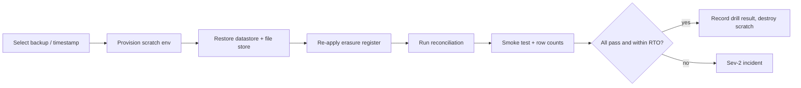
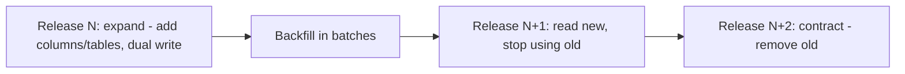
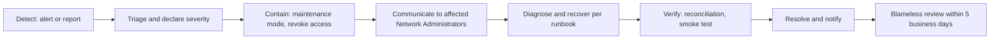

# 11 — Deployment, Operations and Support

| Field | Value |
|---|---|
| Status | Draft |
| Owner role | Platform operations lead |
| Last updated | 2026-10-21 |
| Scope | Supported deployment models; environments; configuration and secrets; backup, restore and drills; monitoring, alerting and logging; upgrades, migrations, release and versioning; ledger reconciliation job; support responsibilities; incident handling; failure-recovery runbook outlines; separate operational requirements for hosted and self-hosted deployments; capacity planning |
| Depends on | [00 — Conventions and canon](00-conventions.md), [05 — Architecture and trust boundaries](05-architecture-and-trust-boundaries.md), [06 — Data, ledger and audit](06-data-ledger-and-audit.md), [09 — Security, privacy and abuse](09-security-privacy-and-abuse.md) |
| Open questions | OPS-OD-1 to OPS-OD-10 in section 15; consolidated in [13 — Assumptions, risks, decisions](13-assumptions-risks-decisions-roadmap.md) |

## 1. Purpose and scope

Circula keeps a community's books. If operations fail, trust in a Network fails. This document states what a Platform Operator MUST be able to do, and what the software MUST provide so that small, volunteer-run communities and professional hosts can do it safely: deploy, observe, back up, restore, upgrade, support members, and recover from failure without ever compromising the ledger invariants (INV-001 to INV-014).

The Platform Operator operates infrastructure; it holds **no ledger-posting powers** and no default access to Network content ([05 section 7.2](05-architecture-and-trust-boundaries.md#72-platform-operation-versus-network-governance)). Many operations below therefore have a Network-governance counterpart in [10 — Governance and network operations](10-governance-and-network-operations.md); this document covers the technical and service side only.

Out of scope: choice of vendors or tools (D-02); legal terms of hosting, controller/processor roles, breach-notification duties (questions for counsel, see [19](19-legal-and-regulatory-open-questions.md)); hosted subscriptions and billing (out of MVP scope, D-01).

Where a threshold needs a product decision it is marked `[DECISION NEEDED: OPS-OD-n]` and listed in section 15. Targets are proposals until accepted.

## 2. Definitions used here

Terms are as in [00 section 5.1](00-conventions.md#51-vocabulary-exact-spellings), [05 section 2](05-architecture-and-trust-boundaries.md#2-definitions-used-here) and the [glossary](14-glossary.md). Local terms:

| Term | Meaning |
|---|---|
| **Deployment** | One running installation under one Platform Operator, hosting one or more Networks. |
| **Hosted deployment** | Topology T3 in [05 section 8.1](05-architecture-and-trust-boundaries.md#81-centralized-versus-self-hostable-d-01): a Platform Operator runs a deployment for unrelated Networks. |
| **Self-hosted deployment** | Topologies T1 and T2: the Operator is the Network's own people or a host organisation for a group of Networks. |
| **RPO / RTO** | Recovery Point Objective: maximum tolerable data loss measured in time. Recovery Time Objective: maximum tolerable time to restore service. |
| **SLI / SLO** | Service level indicator (a measured ratio or latency) and objective (target for the indicator over a window). |
| **Restore drill** | A scripted restore of a backup into an isolated scratch environment, followed by verification (section 6.3). |
| **Expand/contract** | Schema change in compatible steps: add (expand), migrate data and code, remove old (contract) in a later release (section 8.2). |
| **Break-glass access** | Time-limited, reasoned, logged operator access to Network content ([05 section 6](05-architecture-and-trust-boundaries.md#6-trust-boundaries), [09](09-security-privacy-and-abuse.md)). |
| **Maintenance mode** | A deployment-wide or per-Network state in which reads work and writes are rejected with an explicit message. |
| **Sev-1 to Sev-4** | Incident severities defined in section 11.1. |

## 3. Deployment models

### 3.1 Options and recommendation

Per D-01 and [05 section 8](05-architecture-and-trust-boundaries.md#8-deployment-topology-and-structure) the baseline is **one codebase supporting both**. The operational consequences are:

| Model | Who operates | Operational maturity assumed | Strength | Operational risk | Recommendation |
|---|---|---|---|---|---|
| **Self-hosted single Network (T1)** | The Network's volunteer or contractor | Low to moderate; one or two technically able people | Autonomy, privacy | Backup neglected; operator turnover | Supported with a guided, scripted path and a pre-flight checker (OPS-088 to OPS-094) |
| **Self-hosted multi-Network (T2)** | A host organisation | Moderate | Shared effort across groups | Blast radius across Networks | Supported |
| **Operator-hosted multi-tenant (T3)** | A Platform Operator with on-call capability | High | Communities without sysadmins can participate | Concentration of trust and risk; legal exposure | Supported as configuration; subscriptions and billing out of MVP scope |

### 3.2 Requirements: deployment models

| ID | Pri | Requirement | Rationale | Verification |
|---|---|---|---|---|
| **OPS-001** | P0 | The project **MUST** ship install and operate documentation sufficient for T1 and T2 on a single commodity host, and the same artifact and schema **MUST** serve T3 (05 ARC-028). | A community must be able to run it without the project. | Clean-room install by someone who has not worked on the project, timed (D). |
| **OPS-002** | P0 | Every deployment **MUST** have a named accountable Platform Operator (person or organisation) recorded in its operations record, and every Network in it **MUST** be able to see who that is and how to reach them. | Accountability and support routing. | Inspection of record and Network "about this service" page (I). |
| **OPS-003** | P0 | Each deployment **MUST** keep an operations record containing: topology, software version, datastore and file-store locations, backup schedule and destination, date and result of last restore drill, and at least two named backup and access custodians (three for T3). | Prevents single-person failure; supports handover. | Operations record exists and is current at each release gate (I). |
| **OPS-004** | P0 | A hosted deployment **MUST** publish, before onboarding any Network, a service description stating: availability objective, support hours, backup policy and retention, data location, sub-service providers, maintenance policy, and Network export and termination rights. Legal terms are drafted with counsel. | Informed Network decision. | Document exists and is linked from the Network onboarding flow (I). |
| **OPS-005** | P0 | A Network **MUST** be able to export all of its data at any time, including while suspended by the Platform Operator, and for at least 30 days after termination of hosting [DECISION NEEDED: OPS-OD-1: post-termination export window]. | No lock-in (A7 in 05). | Export test on a suspended Network (T). |
| **OPS-006** | P1 | Migration between hosted and self-hosted (either direction) **MUST** work through the Network package (05 ARC-024) with identical balances verified by reconciliation, and **MUST** be rehearsed in every release gate. | Escape hatch for D-01. | Cross-deployment migration test in CI/staging (T). |
| **OPS-007** | P0 | Closing a Network or decommissioning a deployment **MUST** follow a documented procedure: final export offered, confirmation by Network Administrators meeting `admin_quorum`, deletion of live data, backup expiry per the retention policy, and a deletion record kept without personal data. | Honours erasure expectations (D-09) and prevents accidental deletion. | Runbook walk-through plus test in staging (D, T). |
| **OPS-008** | P0 | Provisioning a Network **MUST** be an Operator action that creates an empty Network and an invitation for its first Network Administrator(s); the Operator **MUST NOT** obtain a Member or Network Administrator role as part of provisioning (see [02](02-personas-roles-and-journeys.md)). | Separation of duties (INV-012). | Provisioning test and role inspection (T). |

## 4. Environments

| Environment | Purpose | Data | Message transport | Access |
|---|---|---|---|---|
| **Development** | Individual development | Synthetic only | Local sink | Developers |
| **Test (CI)** | Automated tests on every change; ephemeral | Synthetic generated | Sink that captures messages | CI only |
| **Staging** | Production-like rehearsal: migrations, restore drills, load tests, release candidates | Synthetic at Standard scale; or irreversibly anonymised copy | Sink (never real recipients) | Operators, release engineers |
| **Production** | Real Networks | Real | Real transport | Operators under B4 controls ([05](05-architecture-and-trust-boundaries.md#62-boundary-table)) |

Text: one build is promoted unchanged through Test, Staging and Production; only configuration differs. A scratch restore environment is created on demand from production backups and destroyed after verification.

| ID | Pri | Requirement | Rationale | Verification |
|---|---|---|---|---|
| **OPS-009** | P0 | The artifact deployed to Production **MUST** be byte-identical to the artifact that passed Staging; environment differences **MUST** be configuration only. | Eliminates "works in staging" drift. | Artifact digest comparison in release record (I). |
| **OPS-010** | P0 | Production personal data **MUST NOT** be copied to Development, Test or Staging unless irreversibly anonymised; the anonymisation procedure **MUST** be scripted and verified to retain referential integrity and balances. | Data minimisation. | Script test and scan of staging for real email addresses (T). |
| **OPS-011** | P0 | Non-production environments **MUST NOT** be able to send messages to real recipients. | Prevents accidental mass mail. | Test that transport credentials absent and sink active (T). |
| **OPS-012** | P0 | Staging **MUST** be able to host a synthetic dataset at the Standard envelope ([05 section 9.1](05-architecture-and-trust-boundaries.md#91-performance-envelope-sizing-assumptions)) for load tests and migration rehearsals, and a generator for that dataset **MUST** be maintained in the repository. | Reproducible capacity evidence. | Dataset generation run (T). |
| **OPS-013** | P1 | Self-hosted deployments **SHOULD** have a way to create a scratch environment (a second host, an ephemeral container set, or a local machine) for restore drills; a staging environment is **OPTIONAL** for T1. | Small groups cannot always run staging. | Documentation inspection (I). |
| **OPS-014** | P1 | Each environment **SHOULD** be creatable from versioned declarative description so a lost environment can be rebuilt. | Recovery from site loss. | Rebuild test of Staging (T). |

## 5. Configuration and secrets

Two distinct kinds of configuration exist and **MUST NOT** be mixed:

| Kind | Owned by | Examples | Stored in | Change control |
|---|---|---|---|---|
| **Deployment configuration** | Platform Operator | datastore address, listener ports, transport settings, log level, rate-limit defaults, feature switches, backup destination | Environment variables or mounted files; versioned declaratively | Operator change process; logged |
| **Network policy** | Network governance | `credit_limit` values, `membership_mode`, `proposal_expiry_days`, `policy_notice_days`, and the rest of [16](16-network-policy-catalog.md) | Datastore as versioned policy records | Network Administrators, notice period (D-11), Audit Event |

| ID | Pri | Requirement | Rationale | Verification |
|---|---|---|---|---|
| **OPS-015** | P0 | Deployment configuration **MUST** be supplied via environment variables or mounted files and **MUST** be validated at start-up against a documented schema; the process **MUST** refuse to start (fail fast with a clear message naming the key) on a missing or malformed required value, and **MUST NOT** start with default or example secrets. | Prevents silent misconfiguration. | Start-up tests with each required key missing (T). |
| **OPS-016** | P0 | Network policy **MUST NOT** be settable through deployment configuration or operator tooling; it is changed only through the Network governance interface with notice and audit (INV-010, D-11). | Separation of platform operation from governance. | Code search and test that the Operator console has no policy write (T, I). |
| **OPS-017** | P0 | Secrets (datastore credentials, session-signing keys, message-transport credentials, backup encryption keys, operator credentials) **MUST NOT** appear in source control, build artifacts, images, logs, error messages, backups of configuration or the file store; they **MUST** be injected at runtime. | Prevents credential leakage (05 ARC-018). | Secret scan of repository, artifact and log samples (T). |
| **OPS-018** | P0 | Secrets **MUST** be rotatable without data loss; session-signing and similar keys **MUST** support at least two valid keys at once so rotation does not log everyone out or invalidate pending work. | Operational hygiene and compromise response. | Rotation test: rotate each secret class in staging, verify service continuity (T). |
| **OPS-019** | P0 | A secrets inventory (name, purpose, holder, rotation interval, last rotated) **MUST** exist per deployment; default rotation intervals: operator credentials per policy in [09](09-security-privacy-and-abuse.md); service credentials at least every 12 months and on any suspected exposure, personnel change or restore from untrusted media [DECISION NEEDED: OPS-OD-2: rotation interval]. | Accountability. | Inventory review at release gate (I). |
| **OPS-020** | P0 | Backup encryption keys **MUST** be stored separately from the backups and **MUST** be recoverable by at least two custodians; loss of the key is treated as loss of backups. | Prevents unrecoverable backups. | Key recovery drill included in restore drill (T). |
| **OPS-021** | P1 | Configuration changes in production **SHOULD** be applied from a reviewed, versioned change and **MUST** produce a record (who, when, what, previous value excluding secrets). | Traceability. | Sample audit of changes (I). |
| **OPS-022** | P0 | The repository **MUST** include an example configuration file with every key, safe defaults and comments, containing no real secrets; the pre-flight check (OPS-089) **MUST** flag unsafe settings (debug on, plaintext listeners, example secrets, wildcard origins). | Safe self-hosting. | Pre-flight tests with unsafe fixtures (T). |

## 6. Backup, restore and drills

### 6.1 Objectives

| Tier | Applies to | RPO (data loss) | RTO (restore time) | Mechanism class |
|---|---|---|---|---|
| **Hosted (T3)** | Production hosted deployments | at most 5 minutes | at most 4 hours | Continuous change-log archiving plus periodic full backups, offsite copy |
| **Self-host recommended** | T1/T2 following the reference procedure | at most 15 minutes | at most 8 hours | Continuous archiving if possible; otherwise hourly incremental |
| **Self-host minimum** | T1 with the simple scripted backup | at most 24 hours | at most 24 hours | Nightly full backup, offsite copy |

[DECISION NEEDED: OPS-OD-3: RPO/RTO per tier.] Rationale for the hosted values: a Network's ledger is low-volume, so 5 minutes of loss is a handful of Trades at most, which the Members involved can re-enter and re-confirm. Proposed values match the research note ([technical standards, section 7](../notes/research-technical-standards.md)) and are adjustable defaults.

Retention proposal: point-in-time recovery window 14 days; daily full backups 14 days; weekly 8 weeks; monthly 12 months [DECISION NEEDED: OPS-OD-4: retention]. Retention must be reconciled with erasure (D-09): backups hold data until they expire, so restore procedures re-apply erasures (OPS-029).

### 6.2 Requirements: backup and restore

| ID | Pri | Requirement | Rationale | Verification |
|---|---|---|---|---|
| **OPS-023** | P0 | Every deployment **MUST** have automated, scheduled backups of the datastore and file store meeting its tier's RPO, and **MUST** raise an alert when the age of the newest successful backup exceeds RPO. | Backups that do not run are not backups. | Disable backup in staging; alert fires within one RPO interval (T). |
| **OPS-024** | P0 | Backups **MUST** be encrypted at rest and in transit, and at least one copy **MUST** be stored in a different failure domain from the primary (3-2-1 principle: three copies, two media types, one offsite). Where the destination supports it, the offsite copy **SHOULD** be immutable for its retention period. | Resilience to loss, ransomware and operator error. | Configuration inspection; attempt deletion of offsite copy by operator credentials (T, I). |
| **OPS-025** | P0 | A backup **MUST** be consistent: it **MUST** capture a state in which every Journal Entry has its Postings, every cached balance matches (INV-002, INV-008), and the Audit Events preceding the capture point are present. | A restore must be usable without manual repair. | Restore and reconcile (T). |
| **OPS-026** | P0 | Each deployment **MUST** complete a restore drill into an isolated scratch environment at least every 7 days for hosted deployments (automated), and at least every 90 days for self-hosted deployments (using the provided script) [DECISION NEEDED: OPS-OD-5: drill frequency]. | Untested backups fail when needed. | Drill record with date, backup identifier, duration, outcome (I). |
| **OPS-027** | P0 | A restore drill passes only if: (a) restore completes within the tier RTO; (b) the application starts and passes a smoke test; (c) the reconciliation job (section 9) passes on the restored data with zero findings; (d) row counts and the latest Journal Entry identifier match the source at the backup point; (e) encryption keys were recovered by a custodian other than the person who configured them. A failed drill is a Sev-2 incident. | Objective pass criteria. | Drill automation outputs these five results (T). |
| **OPS-028** | P0 | Point-in-time restore to a chosen timestamp within the PITR window **MUST** be supported for the datastore. | Recovery from logical corruption or bad deployment. | Restore to timestamp test (T). |
| **OPS-029** | P0 | The Platform **MUST** keep an erasure and anonymisation register (identifier, time, action, no personal data) so that, after any restore, anonymisations performed after the backup point are re-applied before the restored system serves traffic (D-09). | A restore must not resurrect erased personal data. | Restore across an erasure; verify data stays anonymised (T). |
| **OPS-030** | P0 | After any restore, the system **MUST NOT** accept writes until the reconciliation job has passed, and **MUST** then record an Audit Event of the restore (time, backup used, data-loss window). Affected Network Administrators **MUST** be notified of the loss window. | Prevents compounding errors; honesty about what was lost. | Restore runbook test (T, D). |
| **OPS-031** | P1 | After a restore with non-zero data loss, the Platform **SHOULD** list Trades proposed or accepted within the loss window (known from notification and edge logs retained outside the datastore) to help Members re-enter them. | Reduces harm. | Simulated loss window test (D). |
| **OPS-032** | P0 | Backups **MUST NOT** be restorable into a production-reachable environment by anyone without the operator-plane credentials and the key custodians. | Backups hold everything. | Access-control inspection (I). |
| **OPS-033** | P1 | The Network package (05 ARC-024) **SHOULD** be usable as an additional, Network-level logical backup, independent of the physical backup mechanism. | Defence against format-specific failures. | Package restore into scratch and reconcile (T). |
| **OPS-034** | P1 | Backup and restore tooling **MUST** be versioned with the software and restores from the previous N-1 release's backup **MUST** be supported. | Rollback after upgrade (section 8). | CI restore of N-1 backup (T). |

### 6.3 Restore verification flow

## 7. Monitoring, alerting and logging

### 7.1 Service level indicators and objectives (proposals)

| SLI | Definition | Proposed SLO (hosted) | Window | Source |
|---|---|---|---|---|
| **Availability, write path** | Proportion of Trade acceptance and sign-in requests, excluding client errors (4xx), that complete without server error or timeout | 99.5 percent (`[DECISION NEEDED: OPS-OD-6]`, consistent with ARC-OD-2 in 05) | 30 days | Edge and application metrics |
| **Availability, read path** | Same for balance, history and directory reads | 99.5 percent | 30 days | Same |
| **Trade acceptance latency** | Server-side time from request received to response | p95 at most 300 ms, p99 at most 1 s at the Standard envelope (05 ARC-040) | 30 days | Application metrics |
| **Balance/history read latency** | As above | p95 at most 150 ms | 30 days | Application metrics |
| **Outbox freshness** | Age of oldest unprocessed Outbox event | at most 5 minutes at p99 | 7 days | Job runner |
| **Notification delivery** | Proportion of notifications handed to the transport within 10 minutes of the event | 95 percent | 7 days | Job runner, transport receipts |
| **Reconciliation** | Proportion of scheduled reconciliation runs completing with zero findings | 100 percent | Ever | Reconciliation records |
| **Backup freshness** | Age of newest successful backup | at most RPO | Continuous | Backup tooling |
| **Restore drill** | Last successful restore drill age | at most drill interval | Continuous | Drill records |
| **Export duration** | Time to complete a Network export at the Standard envelope | at most 15 minutes (05 ARC-046) | 30 days | Job runner |

An error budget of 0.5 percent over 30 days (about 3.6 hours) follows from the availability SLO. When the budget is exhausted, feature releases **SHOULD** pause in favour of reliability work until the window recovers.

### 7.2 Alerts

| Severity of alert | Condition (examples) | Action |
|---|---|---|
| **Page (immediate human)** | Reconciliation finding; ledger write error rate above 1 percent for 5 minutes; datastore unreachable; backup older than RPO; certificate expires in less than 3 days; suspected unauthorized operator access; disk or storage above 90 percent | Start incident (section 11) |
| **Ticket (same business day)** | Outbox oldest event above 15 minutes; job failures above threshold; p95 latency above SLO for 1 hour; restore drill failed; certificate expires in less than 21 days; storage forecast shows exhaustion in less than 30 days; dependency advisory (high) | Create work item |
| **Informational** | Capacity thresholds at 60 percent; slow queries trend | Weekly review |

### 7.3 Logging

| Log stream | Contents | Contains | Must not contain | Retention proposal |
|---|---|---|---|---|
| **Application log** | Request outcome, errors, job runs | Timestamp (UTC), level, correlation identifier, opaque Network identifier, opaque actor identifier, route, status, duration | Passwords, tokens, secrets, email addresses, free-text content, amounts tied to named people | 30 days |
| **Security log** | Sign-in success/failure, recovery, step-up, role change, operator break-glass, rate-limit blocks | Same identifiers plus event type and source address (truncated or hashed per [09](09-security-privacy-and-abuse.md)) | Credentials | 12 months |
| **Edge log** | Request line, status, bytes, source address | Minimal | Query strings with tokens | 14 days |
| **Audit Events** | Governance record (not a log; owned by [06](06-data-ledger-and-audit.md)) | As defined there | | Per 06 |

[DECISION NEEDED: OPS-OD-7: log retention periods and source-address handling.]

### 7.4 Requirements: monitoring and logging

| ID | Pri | Requirement | Rationale | Verification |
|---|---|---|---|---|
| **OPS-035** | P0 | The Platform **MUST** expose metrics for each SLI in section 7.1 through a vendor-neutral, documented export mechanism, and **MUST** work without any external monitoring service (a built-in status view for Operators is acceptable). | Self-hosters need visibility without third parties. | Metric catalogue test; run with no external sink (T). |
| **OPS-036** | P0 | Each deployment **MUST** define the page-level alerts of section 7.2 and a destination for them (a person or rota); an alert with no recipient is non-conformant. | Alerts must reach someone. | Fire a test alert end to end at each release gate (T). |
| **OPS-037** | P0 | Logs **MUST** be structured, UTC-timestamped, carry the correlation identifier (05 ARC-012) and **MUST NOT** contain secrets, credentials, session tokens, email addresses or Network free-text content. | Privacy (A8). | Log-scan tests over the full acceptance suite (T). |
| **OPS-038** | P0 | Security-relevant events (sign-in failure bursts, recovery, role change, credit-limit change, Adjustment, break-glass) **MUST** be recorded in the security log and, where governance-relevant, as Audit Events; Operators **MUST NOT** be able to edit or delete either. | Detect and prove misuse. | Attempted modification by operator test (T). |
| **OPS-039** | P0 | Every user-visible error page **MUST** display the correlation identifier as a support code, so a Member can quote it to support without sharing content. | Enables support without content access. | UI check on error pages (T). |
| **OPS-040** | P1 | The built-in status view **SHOULD** show: version, schema version, migration status, last backup, last restore drill, last reconciliation result, job queue depth and oldest-job age, certificate expiry, and storage headroom. | Single place to see health. | Status view test (T). |
| **OPS-041** | P0 | Health endpoints **MUST** distinguish liveness (process up), readiness (can serve) and dependency health (datastore, file store, transport) without exposing detail to unauthenticated callers beyond up/down. | Safe load balancing and diagnosis. | Endpoint tests (T). |
| **OPS-042** | P1 | A hosted deployment **MUST** publish a status page showing current incidents and planned maintenance, hosted outside the main service's failure domain. | Communication during outage. | Status page failover check (I). |
| **OPS-043** | P1 | Operators **SHOULD** be able to trace a single request across the application log, security log and job executions via the correlation identifier. | Fast diagnosis. | Trace test (T). |
| **OPS-044** | P2 | The Platform **MAY** support distributed trace export in a vendor-neutral format; it **MUST** be off by default. | Optional depth. | Configuration test (T). |
| **OPS-045** | P0 | Telemetry sent outside the deployment, if any, **MUST** be opt-in, aggregate-only, documented, and **MUST NOT** include Member-level or Network content data (05 ARC-030). | Privacy and sovereignty. | Egress observation test (T). |
| **OPS-046** | P1 | Clock synchronisation **MUST** be monitored; a drift beyond 2 seconds from a trusted time source **MUST** raise a ticket-level alert. | Expiry and notice logic depend on time (05 ARC-051). | Skewed-clock test (T). |

## 8. Upgrades, migrations, release and versioning

### 8.1 Versioning policy

| Artifact | Scheme | Rule |
|---|---|---|
| **Software release** | Semantic Versioning (MAJOR.MINOR.PATCH) | PATCH: fixes with no schema or contract change; MINOR: backward-compatible features and expand-only migrations; MAJOR: contract removals and incompatible changes |
| **Public API** | Version identifier in the path/media type, defined in [07](07-api-and-integration-contract.md) | Independent of software version; deprecations announced at least 6 months ahead [DECISION NEEDED: OPS-OD-8] |
| **Database schema** | Monotonic migration number, forward-only | Every release declares the minimum and maximum compatible schema numbers |
| **Export format** | Version identifier in each export ([18](18-data-export-and-portability.md)) | Older formats remain importable |
| **Policy catalog** | Version in [16](16-network-policy-catalog.md) | Policy records note the catalog version used |

Support policy proposal: the latest MINOR and the previous MINOR receive security and data-integrity fixes; MAJOR versions are supported for at least 12 months after the next MAJOR [DECISION NEEDED: OPS-OD-8: support window].

### 8.2 Migration approach

Schema changes use expand/contract so each release runs against the previous release's schema (N-1):

Rollback does not use down-migrations. Application rollback is always possible to the previous release because of N-1 compatibility; a schema that has been contracted is not rolled back, it is fixed forward or restored from backup with point-in-time recovery.

### 8.3 Release gate

### 8.4 Requirements: upgrades and releases

| ID | Pri | Requirement | Rationale | Verification |
|---|---|---|---|---|
| **OPS-047** | P0 | Every release **MUST** be labelled under the versioning scheme of section 8.1 and **MUST** ship release notes that state: user-visible changes, schema migrations, required operator actions, configuration changes, security fixes, and the rollback procedure. | Operators can plan. | Release checklist (I). |
| **OPS-048** | P0 | Schema migrations **MUST** be forward-only, idempotent (safe to re-run after interruption), versioned, and follow expand/contract so release N runs correctly against schema N-1 and N. | Rolling upgrade and rollback safety. | CI runs the previous release's test suite against the new schema and the new suite against the previous schema (T). |
| **OPS-049** | P0 | Migrations **MUST** never alter or delete existing Journal Entries or Postings (INV-003); migrations that touch ledger tables (adding columns, indexes) **MUST** be verified by comparing row counts and a content checksum of ledger records before and after, and by a clean reconciliation run. | Ledger immutability through upgrades. | Migration rehearsal records the before/after comparison (T). |
| **OPS-050** | P0 | A verified backup (or, for hosted deployments, a PITR position) taken immediately before any production migration **MUST** exist, and the upgrade tooling **MUST** refuse to proceed without confirmation of it. | Recovery path. | Upgrade tool test (T). |
| **OPS-051** | P0 | Every migration **MUST** be rehearsed on a staging copy at the Standard dataset size before production, with measured duration and lock behaviour recorded; long-held exclusive locks on write paths **MUST** be avoided and a lock wait limit **MUST** be set. | Predictable maintenance. | Rehearsal record (I). |
| **OPS-052** | P0 | Upgrades **MUST** be runnable by one operator with a documented command sequence, and **MUST** report success only after migrations applied, application healthy, and reconciliation passed. | Simple, safe self-hosting. | Scripted upgrade test in CI (T). |
| **OPS-053** | P0 | Where an upgrade requires write downtime, the deployment **MUST** enter maintenance mode (reads available, writes rejected with an explanatory message and expected duration), and hosted deployments **MUST** announce the window at least 72 hours in advance except for urgent security fixes. | Predictability and honesty. | Maintenance mode test (T). |
| **OPS-054** | P0 | The release gate of section 8.3 **MUST** pass before any release is published; a failing item blocks the release unless waived through a decision-log entry naming the risk. | Quality gate. | Gate records (I). |
| **OPS-055** | P0 | Release artifacts **MUST** be published with checksums and a signature verifiable by operators, and with a machine-readable list of components and versions (software bill of materials). | Supply-chain trust. | Verification procedure documented and tested (T). |
| **OPS-056** | P0 | Security fixes rated critical **MUST** be released as a PATCH within 7 days of confirmation and high within 30 days, with an advisory published through a channel self-hosters can subscribe to [DECISION NEEDED: OPS-OD-9: patch targets]. | Self-hosters need timely fixes. | Advisory process audit (I). |
| **OPS-057** | P1 | Risky behavioural changes **SHOULD** be released behind a deployment-level switch, defaulting off, for one release before becoming default. | Safer rollout. | Release record (I). |
| **OPS-058** | P0 | A change that alters ledger semantics (posting rules, limit enforcement, rounding) **MUST** be a MINOR or MAJOR release with an ADR, a data-compatibility statement, and property tests re-run (see [05 ARC-036](05-architecture-and-trust-boundaries.md#92-quality-attribute-table)). | Highest-risk area. | ADR and test evidence (I, T). |
| **OPS-059** | P0 | Application rollback to the previous release **MUST** be tested in staging for every release, and the rollback procedure **MUST** state when it is not possible (after a contracting migration). | Recovery from a bad release. | Rollback rehearsal (T). |
| **OPS-060** | P1 | Dependencies **MUST** be scanned for known vulnerabilities in CI, and unmaintained dependencies **SHOULD** be reviewed at least quarterly. | Reduce exposure. | CI scan; quarterly review record (T, I). |

## 9. Ledger reconciliation job

Reconciliation proves the ledger invariants hold on stored data. It is read-only and never repairs the ledger itself.

### 9.1 Checks

| Check | Statement | Invariant | Severity if failed |
|---|---|---|---|
| R1 | Every Journal Entry's Postings sum to zero | INV-001 | Sev-1 |
| R2 | For each Network, the sum of all Posting amounts across Member and System Accounts is zero | INV-007 | Sev-1 |
| R3 | For each account, cached balance equals the sum of its Postings | INV-008 | Sev-1 |
| R4 | No Journal Entry's Postings reference accounts of more than one Network, or a Network other than the entry's own | INV-011 | Sev-1 |
| R5 | Every `completed` Trade has exactly one Journal Entry of type `trade` with matching amount, accounts and sign (Recipient negative, Provider positive); every Trade-type Journal Entry belongs to exactly one `completed` or `reversed` Trade | INV-002, 00 section 5.2 | Sev-1 |
| R6 | Every `reversed` Trade and every Reversal links to a prior `completed` entry exactly once and negates it exactly | INV-004 | Sev-1 |
| R7 | Every Adjustment, Reversal, policy change, role change and dispute resolution has a matching Audit Event with actor, time, reason and target | INV-010 | Sev-1 |
| R8 | Idempotency keys are unique per scope and each maps to one outcome | INV-009 | Sev-2 |
| R9 | `unit_scale` and unit identity are unchanged since the first Journal Entry | INV-013 | Sev-1 |
| R10 | Ledger and Audit append-only evidence: checksums or hash-chain values of already-verified ranges are unchanged since the previous run | INV-003 | Sev-1 |
| R11 | Informational: Member Accounts currently below `-credit_limit` or above `max_balance` (can legitimately occur after a policy change or Adjustment; INV-005 and INV-006 constrain Trade postings only) are listed for Network Administrators | INV-005, INV-006 | Info |
| R12 | No object in the file store is referenced by a record that is absent, and no export file outlives its expiry | housekeeping | Sev-3 |

### 9.2 Requirements: reconciliation

| ID | Pri | Requirement | Rationale | Verification |
|---|---|---|---|---|
| **OPS-061** | P0 | The Platform **MUST** include a reconciliation job implementing R1 to R12, runnable on demand per Network or per deployment, scheduled automatically, and runnable against a restored copy. | Continuous proof of correctness. | Unit tests per check with seeded faults; run in production (T). |
| **OPS-062** | P0 | Schedule: a full run **MUST** execute at least daily per Network; an incremental run (entries since the last verified watermark) **SHOULD** execute at least hourly; a full run **MUST** also execute after every migration, restore, and release gate. | Detect drift quickly. | Scheduler configuration test (T). |
| **OPS-063** | P0 | The job **MUST** run on a consistent snapshot, read-only, at low priority, and **MUST NOT** block or slow Trade acceptance beyond the latency SLO; a full run at the Standard envelope **SHOULD** complete within 10 minutes [DECISION NEEDED: ARC-OD-1 in 05 sets the envelope]. | No user impact. | Load test with concurrent reconciliation (T). |
| **OPS-064** | P0 | Each run **MUST** store a result record (Network identifier, time, checks run, counts examined, findings with identifiers only, duration, software version) that is itself append-only and retained at least 12 months. | Evidence trail. | Record schema test (T). |
| **OPS-065** | P0 | Any finding at Sev-1 **MUST** raise a page-level alert, **MUST** place the affected Network in maintenance mode (writes rejected) until an Operator acknowledges the finding and a documented disposition exists, and **MUST** create an Audit Event. A finding must never be auto-suppressed. | Stops compounding damage (A2 in 05). | Seeded-fault test (T). |
| **OPS-066** | P0 | The job **MUST** be able to rebuild cached balances from Postings (INV-008) as a separate, explicitly invoked, audited Operator action that changes only derived data and never Journal Entries or Postings. | Fixing cache drift without touching the ledger. | Rebuild test: ledger checksum unchanged (T). |
| **OPS-067** | P0 | Ledger-level errors (R1, R2, R4 to R6, R9, R10) **MUST NOT** be repaired by editing records; remedies are limited to restore from backup (section 12 runbook R2) or Network-authorised Reversal/Adjustment through the normal Posting interface with Audit Event (INV-003, INV-004, INV-012). | Preserves the ledger's trust model. | Runbook review; test that the Operator tooling has no ledger-write command (I, T). |
| **OPS-068** | P1 | Results **SHOULD** be summarised to Network Administrators as a human-readable "ledger checked on date, no issues" indicator, with no cross-Network disclosure. | Builds trust in the books (see [01](01-product-vision-and-scope.md) trust goals). | UI test (T). |

## 10. Support responsibilities

### 10.1 Support tiers

| Tier | Who | Handles |
|---|---|---|
| **L0** | In-product help and documentation | How-to, glossary, balance meaning |
| **L1** | Network Administrators | Membership, local rules, listings moderation, Member questions, first-line dispute handling |
| **L2** | Platform Operator support | Sign-in and recovery problems that self-service cannot solve, outages, export failures, suspected abuse of the Platform |
| **L3** | Engineering | Defects, data-integrity issues, migrations |

### 10.2 Responsibilities matrix

R = responsible, A = accountable, C = consulted, I = informed, "—" = no role. The Operator column applies to the Operator of the deployment, who may be the same people as Network Administrators in T1 (separation of roles still applies, section 7 of 05).

| Activity | Member | Network Administrator | Dispute Reviewer | Platform Operator |
|---|---|---|---|---|
| Account sign-in and recovery for oneself | R, A | I | — | C (solves delivery or system problems; **cannot** recover on a user's behalf, no impersonation) |
| Questions about balances and meaning | R (own) | A, R | — | I |
| Membership approval, suspension, departure | I | A, R | C | — |
| Listing moderation | R (own listings) | A, R | — | — |
| Disputes | R (raise) | A (process) | R (review) | — |
| Corrections to balances | I | A, R (Adjustment/Reversal with reason) | C | **Not permitted** (no ledger-posting role) |
| Network policy changes | I | A, R (notice per D-11) | — | — |
| Exporting own data | A, R | I | — | C (if job fails) |
| Exporting Network data | — | A, R | — | C (if job fails) |
| Service outage or degraded performance | I | I (relay) | — | A, R |
| Backups, restores, drills | — | I | — | A, R |
| Security incident affecting the Platform | I | I | — | A, R |
| Abuse of the Platform (spam networks, attacks) | I | C | — | A, R |
| Abuse inside a Network (harassment, fraud between Members) | R (report) | A, R | C | C (only if a platform control is needed) |
| Break-glass access to Network content | I (via Network) | I, with right to see the Audit Event | — | R, with approval per B4 |
| Legal requests concerning a Network | — | C | — | R (route to counsel; do not assert compliance, see [19](19-legal-and-regulatory-open-questions.md)) |
| Hosting termination or decommissioning | — | A (with `admin_quorum`) | — | R |

### 10.3 Requirements: support

| ID | Pri | Requirement | Rationale | Verification |
|---|---|---|---|---|
| **OPS-069** | P0 | Each Network **MUST** display its Network Administrator contact route, and the deployment **MUST** display the Platform Operator's support route and expected response times; Members **MUST** be told which one to use for which problem. | Prevents misrouted requests. | UI inspection (I). |
| **OPS-070** | P0 | Operator support **MUST** be able to diagnose a Member's problem using the support code (correlation identifier) and metadata only, without access to Network content; if content is needed, the break-glass procedure applies with Member or Network Administrator consent where practicable. | Support without privacy erosion. | Walk-through of three support scenarios using only metadata (D). |
| **OPS-071** | P0 | Account recovery **MUST** be performed only by the account holder through the recovery journey; neither Network Administrators nor Operators **MUST** be given a tool to take over, reset on behalf of, or impersonate a Member. | Prevents takeover and INV-012 abuse. | Tool inventory (I). |
| **OPS-072** | P1 | Hosted deployments **SHOULD** target first response to support requests within: Sev-1 per section 11; otherwise 2 business days [DECISION NEEDED: OPS-OD-10: support hours and response times]. Self-hosted community support is best effort and **MUST** be described as such in documentation. | Honest expectations. | Support metrics (M). |
| **OPS-073** | P1 | A knowledge base of common problems and a Network Administrator handbook ([10](10-governance-and-network-operations.md)) **SHOULD** be available in-product. | Reduces L2 load. | Content inspection (I). |
| **OPS-074** | P0 | Support and Operator actions that affect a Network (suspension of service, restore, break-glass, maintenance mode) **MUST** be recorded as Audit Events visible to that Network's Administrators. | Transparency. | Event generation tests (T). |

## 11. Incident handling

### 11.1 Severity

| Level | Definition (examples) | Acknowledge (hosted) | Update cadence | Staffing |
|---|---|---|---|---|
| **Sev-1** | Any suspected ledger invariant violation; data loss; unauthorised ledger write or privilege breach; confirmed exposure of Network content; write path down more than 30 minutes | 30 minutes in staffed hours, 2 hours otherwise | Hourly | On-call plus incident lead [DECISION NEEDED: OPS-OD-10] |
| **Sev-2** | Significant degradation; failed restore drill; one Network blocked; backup older than RPO; reconciliation job failing to run | 4 hours | Every 4 hours | Business hours plus on-call |
| **Sev-3** | Minor degradation, single-feature failures, delayed notifications | 2 business days | On change | Business hours |
| **Sev-4** | Questions, cosmetic issues | 5 business days | — | Backlog |

### 11.2 Lifecycle

### 11.3 Requirements: incidents

| ID | Pri | Requirement | Rationale | Verification |
|---|---|---|---|---|
| **OPS-075** | P0 | Each deployment **MUST** have a written incident procedure naming roles (incident lead, communicator, scribe), contact routes, and the severity table above or a documented alternative. | Orderly response. | Document inspection; tabletop exercise per year (I, D). |
| **OPS-076** | P0 | For Sev-1 incidents, affected Network Administrators **MUST** be notified within 1 hour of confirmation, with plain language on what is affected and what is not, including whether balances are safe. | Trust. | Incident drill (D). |
| **OPS-077** | P0 | For incidents involving personal data exposure, the Operator **MUST** notify affected Network Administrators within 24 hours of confirmation so that the Network can take its own steps; whether legal notification duties apply, to whom and by when is a question for counsel ([19](19-legal-and-regulatory-open-questions.md)) and **MUST NOT** be asserted in incident messages. | Enables obligations to be met without claiming a legal position. | Template review by counsel (I). |
| **OPS-078** | P0 | On a suspected invariant violation the response **MUST** be: place the Network in maintenance mode, preserve evidence (snapshot of datastore and logs), run reconciliation to scope the problem, then follow runbook R3 or R2; no data **MUST** be altered before the snapshot. | Protects evidence and data. | Runbook drill with seeded fault (D). |
| **OPS-079** | P0 | Every Sev-1 and Sev-2 incident **MUST** have a blameless post-incident review within 5 business days that records timeline, root cause, impact, what worked, corrective actions with owners, and a summary shared with affected Network Administrators. | Learning and transparency. | Review records (I). |
| **OPS-080** | P1 | Incident communications templates (outage, maintenance, data-loss window, security) **SHOULD** exist in advance and be reviewed for the "not money" wording rules in [01](01-product-vision-and-scope.md) section 4.1. | Speed and consistent language. | Template inspection (I). |
| **OPS-081** | P0 | Operator accounts **MUST** be disabled promptly on role change or departure (target within 24 hours), and operator access **MUST** be reviewed at least quarterly. | Insider risk. | Access review record (I). |
| **OPS-082** | P1 | An incident that results in an Operator action on a Network (maintenance mode, restore, break-glass) **MUST** produce Audit Events per OPS-074. | Transparency. | Test (T). |

## 12. Failure-recovery runbook outlines

Every runbook below **MUST** exist as a maintained, step-by-step document, tested at least annually (a game day) or at each use. Outlines state intent, not tool commands.

| Runbook | Trigger | First actions | Recovery path | Verification before reopening writes |
|---|---|---|---|---|
| **R1 Application or host failure** | Health checks fail; process crash loop | Confirm scope (one instance or all); check recent deployment; fail over or restart; roll back application if release-related (OPS-059) | Replace failed instance; stateless design (05 ARC-031) | Smoke test; Outbox draining |
| **R2 Datastore loss or logical corruption** | Datastore unavailable; corrupted data discovered | Maintenance mode; snapshot evidence; choose full restore or point-in-time before corruption | Restore (section 6), re-apply erasure register (OPS-029) | Reconciliation clean; notify of data-loss window (OPS-030) |
| **R3 Reconciliation finding** | Alert from section 9 | Maintenance mode for affected Network; identify check and records; determine cause (software defect, operator action, storage fault) | Cache drift: rebuild derived balances (OPS-066). Ledger fault: restore to before the fault, or Network-authorised Adjustment/Reversal; fix defect; add regression test | Reconciliation clean; Audit Event; post-incident review |
| **R4 Failed migration** | Upgrade error or post-upgrade failures | Stop; do not retry blindly; assess whether schema is expand-only | If compatible: roll back application to N-1. Otherwise forward-fix or PITR restore (OPS-050) | Reconciliation clean; rehearsal gap noted |
| **R5 Secret or credential compromise** | Suspected leak, departing custodian, malicious access | Revoke and rotate affected secrets (OPS-018); invalidate sessions; review security log for the window | Re-issue credentials; review for ledger access (there should be none, ARC-014); notify per OPS-076/077 | Rotation verified; access review |
| **R6 Operator account compromise** | Unexpected break-glass, odd operator activity | Disable operator account; review Audit Events and security log; check for configuration changes | Restore known-good configuration; re-enrol credentials with dual control | Independent review; notify Network Administrators |
| **R7 Message transport outage or poor reputation** | Outbox backlog; bounce spike | Confirm backlog; switch transport per configuration; throttle | Drain Outbox; verify no loss; adjust templates if flagged | Delivery SLI recovered |
| **R8 Storage exhaustion** | Storage above 90 percent or forecast breach | Page; stop exports; free derived data such as old export files; extend storage | Capacity change (section 14) | Headroom restored; ticket for forecast |
| **R9 Job backlog** | Outbox/job age above threshold | Check failing handler; pause offending job type | Fix defect; replay (handlers idempotent, ARC-006) | Age within SLO |
| **R10 Certificate or domain expiry** | Alert at 21/3 days | Renew; verify chain | Automate renewal | End-to-end browser check |
| **R11 Site or provider loss (disaster)** | Primary failure domain unavailable | Declare Sev-1; confirm backups in other failure domain | Rebuild environment from declarative description (OPS-014); restore | Reconciliation; DNS cut-over verified |
| **R12 Network suspension for platform abuse** | Operator determines misuse of the service | Operator suspends service for that Network, preserving data and export rights; Audit Event; notify Network Administrators | Resolve with Network governance; lift or terminate under OPS-007 | Network Administrators informed |
| **R13 Hand-over / migration to another host** | Operator change, hosting termination, self-host move | Produce Network package (OPS-006); freeze writes; verify counts | Restore at target; compare reconciliation | Balances identical; DNS/communications |
| **R14 Hostile load or abuse spike** | Rate-limit block surge, scraping, credential stuffing | Tighten edge limits; per-Network limits (05 ARC-027) | Block sources at the edge; no membership actions by Operator | Normal traffic restored |

| ID | Pri | Requirement | Rationale | Verification |
|---|---|---|---|---|
| **OPS-083** | P0 | Runbooks R1 to R14 **MUST** exist before the first production Network is onboarded, in the repository docs (self-host) and the operator handbook (hosted), with named roles and tested steps. | Preparedness. | Documentation inspection (I). |
| **OPS-084** | P0 | R2, R3, R4 and R11 **MUST** be exercised in staging at least once per year and after significant architecture change, with results recorded and gaps fixed. | Runbooks decay untested. | Exercise records (I). |
| **OPS-085** | P0 | Runbooks **MUST NOT** instruct any procedure that edits, deletes or inserts Journal Entries or Postings directly (INV-003, INV-004). | Platform invariant. | Runbook review checklist (I). |

## 13. Operational requirements by deployment kind

### 13.1 Hosted deployments (T3)

| ID | Pri | Requirement | Rationale | Verification |
|---|---|---|---|---|
| **OPS-086** | P0 | A hosted deployment **MUST** keep the datastore redundant across at least two failure domains with automatic or documented fast failover, and a backup copy in a third location or provider; failover **MUST** be rehearsed at least annually. | Meets RPO/RTO. | Failover rehearsal (T). |
| **OPS-087** | P0 | Hosted operations **MUST** include on-call coverage for Sev-1 per section 11.1, two-person control for production data access (B4, ARC-OD-5), quarterly access review (OPS-081), and a published status page (OPS-042). | Accountability for others' ledgers. | Rota and access review records (I). |

### 13.2 Self-hosted deployments (T1/T2)

| ID | Pri | Requirement | Rationale | Verification |
|---|---|---|---|---|
| **OPS-088** | P0 | The project **MUST** supply a reference deployment (declarative description) for a single host, with datastore, application, job runner, edge and backup components preconfigured to defaults that satisfy the Self-host minimum tier of section 6.1, and instructions to reach the Self-host recommended tier. | Safe by default. | Clean-room install and backup/restore test (D, T). |
| **OPS-089** | P0 | The project **MUST** supply a pre-flight/health command that checks: configuration validity and unsafe settings, time synchronisation, certificate validity and expiry, migration status, backup age and last restore drill, free storage, and reconciliation status, and returns a non-zero exit code for blocking problems. | Non-experts need a checklist they can run. | Pre-flight fixtures test (T). |
| **OPS-090** | P0 | The project **MUST** supply scripted backup, restore and restore-drill tooling for the reference deployment, and documentation that a backup custodian can follow without developer assistance. | Backups are the most common self-host failure. | Custodian walk-through (D). |
| **OPS-091** | P0 | Self-hosted installations **MUST** have no mandatory outbound connections to the project, and **MUST** receive update and security-advisory information through a pull-only channel (feed or mailing list) the operator chooses to subscribe to (05 ARC-030). | Sovereignty and privacy. | Egress observation test (T). |
| **OPS-092** | P1 | The documentation **MUST** include a hardening checklist (host patching, firewall, administrator accounts, TLS, backup key custody) and a statement of what the project does and does not guarantee for self-hosters. | Realistic expectations. | Document inspection (I). |
| **OPS-093** | P1 | The documentation **SHOULD** include a hand-over guide so a new Operator or custodian can take over using the operations record (OPS-003, runbook R13) with at least two people trained at any time. | Volunteer turnover. | Hand-over exercise (D). |
| **OPS-094** | P1 | Upgrades **MUST** be offered as a single documented command sequence with automatic pre-upgrade backup verification (OPS-050) and automatic rollback of the application on failed health check where schema is compatible. | Reduces self-host upgrade risk. | Scripted upgrade and failure test (T). |
| **OPS-095** | P1 | A multi-Network self-host (T2) **MUST** expose per-Network maintenance mode, per-Network export and per-Network restore-to-scratch so that one group's problem does not require stopping others. | Blast-radius control. | T2 tests (T). |

## 14. Capacity planning

### 14.1 Indicative sizing (to be validated by load test)

Assumptions: Journal Entry plus Postings plus indexes about 1 KiB; Audit Events about 0.5 KiB; listings and profiles modest; growth linear. Backup storage about 3 times primary storage with retention of section 6.1.

| Envelope | Application | Datastore | Storage 5-year forecast (ledger and audit) | Notes |
|---|---|---|---|---|
| Pilot (to 300 Members/Network, to 10 Networks) | 1 process of 2 vCPU, 2 GiB | Same host acceptable; 2 GiB memory | Under 5 GiB | Meets ARC-045 on 2 vCPU/4 GiB host |
| Standard (to 2,000 Members/Network, to 500 Networks, 20,000 entries/day) | 2 or more stateless processes of 2 vCPU, 4 GiB each; 1 job runner | 8 vCPU, 32 GiB memory, fast storage; replica for failover | About 50 GiB ledger and audit (20,000 per day over 5 years is roughly 36.5 million entries) plus content | Validate with ARC-040 load test |
| Stretch (to 10,000 Members/Network, to 2,000 Networks, 100,000 entries/day) | Scale out processes; separate job runners | Vertical scale; partition candidates evaluated | About 250 GiB | Triggers re-evaluation per 05 section 8.2 if targets are missed |

### 14.2 Requirements: capacity

| ID | Pri | Requirement | Rationale | Verification |
|---|---|---|---|---|
| **OPS-096** | P0 | The project **MUST** publish a sizing guide based on measured load tests at Pilot and Standard envelopes, stating the hardware used, results against ARC-040, and the formula for storage growth. | Evidence not guesswork. | Load-test report (T). |
| **OPS-097** | P0 | Operators **MUST** review capacity at least quarterly (hosted) or at each major upgrade (self-hosted) against: sustained CPU, memory and datastore utilisation, storage growth with a 12-month forecast, job queue age, p95 latency, and backup duration versus RPO. | Prevents surprise saturation. | Review records (I). |
| **OPS-098** | P0 | Capacity thresholds **MUST** be alerted: informational at 60 percent sustained utilisation, ticket at 75 percent, page at 90 percent; storage forecast under 30 days to exhaustion is a ticket. | Time to act. | Alert tests (T). |
| **OPS-099** | P1 | A load test at 2 times the current measured peak **SHOULD** be run before each MAJOR release and on any change to the ledger write path. | Regression protection. | Load-test records (T). |
| **OPS-100** | P1 | Backup duration and restore duration **MUST** be measured at each drill and compared with RPO/RTO; if projected growth would exceed RTO within 12 months, a ticket **MUST** be raised. | Objectives must stay achievable as data grows. | Drill record trend (I). |

## 15. Assumptions and open decisions

| ID | Decision / assumption | Options | Recommended default |
|---|---|---|---|
| OPS-OD-1 | Post-termination export window (OPS-005) | 30 days; 90 days; indefinitely on request | 30 days minimum, 90 days recommended |
| OPS-OD-2 | Service credential rotation interval (OPS-019) | 6, 12, 24 months | 12 months and on events |
| OPS-OD-3 | RPO/RTO per tier (section 6.1) | Stricter (1 min / 1 h hosted); looser | Hosted 5 min / 4 h; self-host recommended 15 min / 8 h; minimum 24 h / 24 h |
| OPS-OD-4 | Backup retention (section 6.1) | PITR 7 or 14 or 30 days; monthly 6 or 12 months | PITR 14 days, daily 14, weekly 8, monthly 12; Networks may request shorter to support erasure |
| OPS-OD-5 | Restore drill frequency (OPS-026) | Weekly/monthly/quarterly | Hosted weekly (automated); self-host quarterly |
| OPS-OD-6 | Availability SLO for hosted (section 7.1) | 99.5; 99.9 | 99.5 percent (aligned with ARC-OD-2 in [05](05-architecture-and-trust-boundaries.md#12-assumptions-and-open-decisions)) |
| OPS-OD-7 | Log retention and source-address handling (section 7.3) | As proposed; shorter; hashed addresses | As proposed with truncated addresses; final per [09](09-security-privacy-and-abuse.md) |
| OPS-OD-8 | API deprecation notice and release support window | 3/6/12 months; latest-only | 6-month API notice; latest and previous MINOR supported |
| OPS-OD-9 | Security patch targets (OPS-056) | 7/30 days; 3/14 days | Critical 7 days, high 30 days |
| OPS-OD-10 | Hosted support hours and Sev-1 staffing | Business-hours only; extended; 24x7 | Business-hours plus on-call for Sev-1 only; revisit with scale |
| Assumption | A Platform Operator for hosted use exists as an organisation outside this repository; staffing, funding and legal form are not specified here | | Roadmap in [13](13-assumptions-risks-decisions-roadmap.md) |
| Assumption | The chosen datastore supports consistent backups and point-in-time recovery | | Checked at ADR time |
| Assumption | Legal duties of hosts and Networks (data processing roles, breach notification, retention) are not asserted | | A question for counsel; see [19](19-legal-and-regulatory-open-questions.md) |
| Canon note | No conflict found. 00 section 5.2 defines INV-005/006 as constraining Trade postings, hence reconciliation check R11 is informational, not an invariant failure | | |

## 16. References

Internal:
- [00 — Conventions and canon](00-conventions.md)
- [05 — Architecture and trust boundaries](05-architecture-and-trust-boundaries.md)
- [06 — Data, ledger and audit](06-data-ledger-and-audit.md)
- [07 — API and integration contract](07-api-and-integration-contract.md)
- [09 — Security, privacy and abuse](09-security-privacy-and-abuse.md)
- [10 — Governance and network operations](10-governance-and-network-operations.md)
- [12 — Quality strategy and test plan](12-quality-strategy-and-test-plan.md)
- [13 — Assumptions, risks, decisions, roadmap](13-assumptions-risks-decisions-roadmap.md)
- [16 — Network policy catalog](16-network-policy-catalog.md)
- [18 — Data export and portability](18-data-export-and-portability.md)
- [19 — Legal and regulatory open questions](19-legal-and-regulatory-open-questions.md)
- Research: [technical standards, section 7 Operations](../notes/research-technical-standards.md)

External (accessed 2026-10-21; background knowledge, not re-fetched, re-check before external citation):
- Semantic Versioning 2.0.0: <https://semver.org/>
- The Twelve-Factor App (configuration, logs, disposability): <https://12factor.net/>
- OWASP Logging Cheat Sheet: <https://cheatsheetseries.owasp.org/cheatsheets/Logging_Cheat_Sheet.html>
- W3C Trace Context: <https://www.w3.org/TR/trace-context/>
- Parallel change / expand-contract migration pattern: <https://martinfowler.com/bliki/ParallelChange.html>
