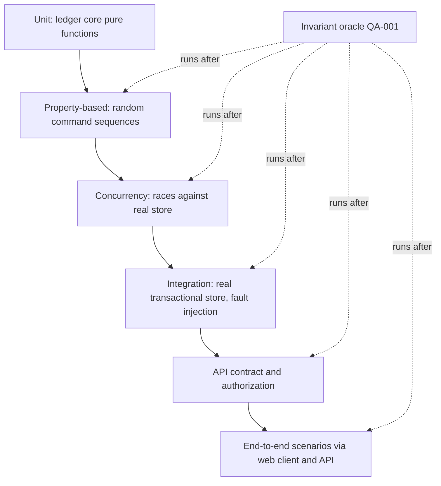
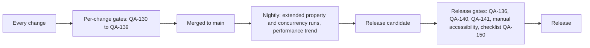

# Quality Strategy and Test Plan

| Field | Value |
|---|---|
| Status | Draft |
| Owner role | Quality lead |
| Last updated | 2026-11-11 |
| Scope | What "correct" means for Circula and how it is verified: the test layers and what each must cover (ledger invariants, concurrency, retries, authorization, disputes, policy versioning, migrations, backup restoration, exports, accessibility, notifications, security, performance, operations), test data and determinism rules, measurable quality gates, scenario-based end-to-end acceptance tests, and the release readiness checklist. Defines when the balance verification operation of [DOM-003](03-domain-model-and-mutual-credit-rules.md#dom-003) runs. |
| Dependencies | [00-conventions.md](00-conventions.md) (terms, IDs, baseline decisions), [01-product-vision-and-scope.md](01-product-vision-and-scope.md) (goals and success measures), [02-personas-roles-and-journeys.md](02-personas-roles-and-journeys.md) (permissions matrix, journeys), [03-domain-model-and-mutual-credit-rules.md](03-domain-model-and-mutual-credit-rules.md) (every rule under test) |
| Related documents | [04-functional-requirements.md](04-functional-requirements.md), [05-system-architecture.md](05-system-architecture.md), [06-data-model-ledger-and-audit.md](06-data-model-ledger-and-audit.md), [07-api-and-integration-contract.md](07-api-and-integration-contract.md), [08-ux-and-accessibility.md](08-ux-and-accessibility.md), [09-security-privacy-and-abuse-resistance.md](09-security-privacy-and-abuse-resistance.md), [10-governance-and-network-operations.md](10-governance-and-network-operations.md), [11-deployment-operations-and-support.md](11-deployment-operations-and-support.md), [13-assumptions-risks-decisions-and-roadmap.md](13-assumptions-risks-decisions-and-roadmap.md) |

## 1. Purpose

This document is the authoritative home for test layers, quality gates, and end-to-end scenarios ([00-conventions.md §7](00-conventions.md#7-authoritative-homes)). It does not define product behavior: every expected result below is derived from a rule owned elsewhere and cites it. When a test here and a rule elsewhere disagree, the rule wins and this document is corrected.

The plan is technology-neutral. It names no test framework, language, database, or cloud service. Where a tool category is needed (property-based testing library, automated WCAG rule engine, dependency scanner), the category is named and the choice is left to the implementation team.

Identifier ranges are reserved by topic:

| Range | Topic |
|---|---|
| QA-001 to QA-009 | Quality goals and traceability |
| QA-010 to QA-019 | Unit tests |
| QA-020 to QA-029 | Property-based tests |
| QA-030 to QA-039 | Concurrency tests |
| QA-040 to QA-049 | Integration tests against a real transactional store |
| QA-050 to QA-059 | API contract tests |
| QA-060 to QA-069 | Authorization and isolation tests |
| QA-070 to QA-079 | Dispute and policy-versioning tests |
| QA-080 to QA-089 | Migration, backup/restore, and export tests |
| QA-090 to QA-099 | Accessibility and UX state tests |
| QA-100 to QA-109 | Notification and security tests |
| QA-110 to QA-119 | Performance and operational tests |
| QA-120 to QA-129 | Test data and determinism |
| QA-130 to QA-149 | Quality gates |
| QA-150 to QA-159 | Release readiness |
| E2E-001 to E2E-049 | Scenario-based end-to-end acceptance tests |

## 2. Quality goals

"Correct" for Circula means: **after every test that changes state, every ledger invariant [DOM-001](03-domain-model-and-mutual-credit-rules.md#dom-001) through [DOM-018](03-domain-model-and-mutual-credit-rules.md#dom-018) holds**, every permission in the [matrix](02-personas-roles-and-journeys.md#32-matrix) is enforced exactly as written, and every user-visible outcome matches the rule that governs it. The goals [VIS-001](01-product-vision-and-scope.md#vis-001) (reconstructable balances), [VIS-002](01-product-vision-and-scope.md#vis-002) (consent), [VIS-003](01-product-vision-and-scope.md#vis-003) (limits under concurrency), [VIS-007](01-product-vision-and-scope.md#vis-007) (disputes), [VIS-008](01-product-vision-and-scope.md#vis-008) (audit), [VIS-009](01-product-vision-and-scope.md#vis-009) (export fidelity), and [VIS-011](01-product-vision-and-scope.md#vis-011) (accessibility) set the success measures this plan turns into gates.

**QA-001 — Invariant oracle after every state-changing test.** (P0) The test suite MUST provide one reusable invariant oracle that, given a network, checks: every ledger event has exactly two postings of equal amount, one debit and one credit, on two different accounts of that network ([DOM-001](03-domain-model-and-mutual-credit-rules.md#dom-001), [DOM-005](03-domain-model-and-mutual-credit-rules.md#dom-005)); every account balance and every posting's `resulting balance` equals the derivation from postings ([DOM-003](03-domain-model-and-mutual-credit-rules.md#dom-003)); the sum of all balances is zero at every sequence position ([DOM-004](03-domain-model-and-mutual-credit-rules.md#dom-004)); sequence numbers are contiguous from 1 with no gaps or reuse, and replay up to any position reproduces the recorded resulting balances ([DOM-010](03-domain-model-and-mutual-credit-rules.md#dom-010)); every event has exactly one origin and authority ([DOM-007](03-domain-model-and-mutual-credit-rules.md#dom-007), [DOM-013](03-domain-model-and-mutual-credit-rules.md#dom-013)); every event records a policy version ([DOM-017](03-domain-model-and-mutual-credit-rules.md#dom-017)); every transaction is in one permitted state ([DOM-020](03-domain-model-and-mutual-credit-rules.md#dom-020)); and the store content for all earlier events is byte-for-byte unchanged since the previous oracle run ([DOM-002](03-domain-model-and-mutual-credit-rules.md#dom-002)). Every unit-with-store, property, concurrency, integration, contract, authorization, dispute, migration, restore, and end-to-end test that changes ledger state MUST run the oracle at its end and fail if any check fails.
*Rationale:* a test that passes its own assertion while leaving the ledger inconsistent is a passing test of a broken system. The oracle is independent of the production verification operation so that a defect in one is caught by the other.

**QA-002 — Rule-to-test traceability.** (P0) Every DOM rule with a MUST, every PER matrix row, and every DOM 5.1 error code MUST be referenced by at least one automated test, by identifier in the test's name or metadata. CI MUST produce a traceability report listing each identifier and the tests that reference it, and MUST fail when a P0 identifier has zero tests.
*Rationale:* makes coverage of rules, not lines, the primary measure.

**QA-003 — One path under test.** (P0) End-to-end, contract, and authorization tests MUST drive the system only through the public API or the web client that uses it ([DEC-006](13-assumptions-risks-decisions-and-roadmap.md#dec-006)). Test fixtures MUST NOT write ledger, membership, or policy data directly to the store (see [QA-123](#qa-123)).
*Rationale:* a fixture that bypasses the API can create states the product cannot reach and hide defects in the path members use.

**QA-004 — Policy values at default, boundary, and outside range.** (P0) For each policy in the catalogue ([DOM-090](03-domain-model-and-mutual-credit-rules.md#dom-090) to [DOM-114](03-domain-model-and-mutual-credit-rules.md#dom-114)) the suite MUST test the recommended default, each bound of the allowed range, and one value outside each bound, which MUST be rejected ([DOM-018](03-domain-model-and-mutual-credit-rules.md#dom-018)). Policies "set at setup" MUST be tested for rejection of network activation without an explicit value ([DOM-090](03-domain-model-and-mutual-credit-rules.md#dom-090)).
*Rationale:* policy is the only configurable surface; its edges are where invariants are most likely to be relaxed by mistake.

### 2.1 Invariant traceability

| Invariant | Primary test layers | End-to-end scenarios |
|---|---|---|
| [DOM-001](03-domain-model-and-mutual-credit-rules.md#dom-001) balanced pairs, atomic | [QA-021](#qa-021), [QA-041](#qa-041), oracle | All |
| [DOM-002](03-domain-model-and-mutual-credit-rules.md#dom-002) append-only | [QA-042](#qa-042), [QA-080](#qa-080), oracle | [E2E-005](#e2e-005), [E2E-009](#e2e-009) |
| [DOM-003](03-domain-model-and-mutual-credit-rules.md#dom-003) derived balances, verification | [QA-021](#qa-021), [QA-044](#qa-044), [QA-116](#qa-116) | [E2E-013](#e2e-013), [E2E-017](#e2e-017) |
| [DOM-004](03-domain-model-and-mutual-credit-rules.md#dom-004) zero-sum | [QA-021](#qa-021), [QA-083](#qa-083) | All |
| [DOM-005](03-domain-model-and-mutual-credit-rules.md#dom-005) no cross-network postings | [QA-062](#qa-062) | [E2E-014](#e2e-014) |
| [DOM-006](03-domain-model-and-mutual-credit-rules.md#dom-006) integer amounts | [QA-012](#qa-012), [QA-055](#qa-055) | [E2E-001](#e2e-001) |
| [DOM-007](03-domain-model-and-mutual-credit-rules.md#dom-007) one origin | Oracle, [QA-070](#qa-070) | [E2E-005](#e2e-005), [E2E-006](#e2e-006) |
| [DOM-008](03-domain-model-and-mutual-credit-rules.md#dom-008) consent | [QA-060](#qa-060), [QA-064](#qa-064) | [E2E-001](#e2e-001) |
| [DOM-009](03-domain-model-and-mutual-credit-rules.md#dom-009) atomic limit checks | [QA-022](#qa-022), [QA-030](#qa-030), [QA-032](#qa-032) | [E2E-003](#e2e-003) |
| [DOM-010](03-domain-model-and-mutual-credit-rules.md#dom-010) total order, replay | [QA-021](#qa-021), [QA-082](#qa-082) | [E2E-017](#e2e-017) |
| [DOM-011](03-domain-model-and-mutual-credit-rules.md#dom-011) idempotency | [QA-031](#qa-031), [QA-054](#qa-054) | [E2E-015](#e2e-015) |
| [DOM-012](03-domain-model-and-mutual-credit-rules.md#dom-012) audit | [QA-043](#qa-043), [QA-085](#qa-085) | All |
| [DOM-013](03-domain-model-and-mutual-credit-rules.md#dom-013) authority | Oracle, [QA-070](#qa-070) | [E2E-006](#e2e-006), [E2E-007](#e2e-007) |
| [DOM-014](03-domain-model-and-mutual-credit-rules.md#dom-014) no silent change | [QA-100](#qa-100), [QA-101](#qa-101) | [E2E-005](#e2e-005), [E2E-011](#e2e-011) |
| [DOM-015](03-domain-model-and-mutual-credit-rules.md#dom-015) account cardinality | [QA-021](#qa-021), [QA-065](#qa-065) | [E2E-009](#e2e-009), [E2E-010](#e2e-010) |
| [DOM-016](03-domain-model-and-mutual-credit-rules.md#dom-016) status gates | [QA-013](#qa-013), [QA-033](#qa-033) | [E2E-011](#e2e-011) |
| [DOM-017](03-domain-model-and-mutual-credit-rules.md#dom-017) policy versioning | [QA-075](#qa-075), [QA-076](#qa-076) | [E2E-012](#e2e-012) |
| [DOM-018](03-domain-model-and-mutual-credit-rules.md#dom-018) policy cannot relax invariants | [QA-004](#qa-004), [QA-077](#qa-077) | [E2E-008](#e2e-008) |

## 3. Test layers

Plain-text summary: tests are layered from pure unit tests of the ledger core, through property-based and concurrency tests, integration tests against a real transactional store, API contract and authorization tests, up to end-to-end scenarios. The invariant oracle of QA-001 runs after every state-changing test at every layer above unit. Specialized suites (disputes, policy versioning, migration, restore, export, accessibility, notifications, security, performance, operations) sit at the layer that matches what they exercise and are listed below.

### 3.1 Unit tests

**QA-010 — Ledger core tested in isolation.** (P0) The ledger core module ([DEC-010](13-assumptions-risks-decisions-and-roadmap.md#dec-010)) MUST have unit tests that exercise its interface (post event, verify balances, read history) without the application layer, HTTP, or email. Pure decision functions (limit checks, amount validation, transition validity, policy range validation) MUST be testable with no store at all.
*Rationale:* the ledger core is the component whose defects corrupt data; it must be testable without anything else running.

**QA-011 — Limit check boundary table.** (P0) The limit check of [DOM-027](03-domain-model-and-mutual-credit-rules.md#dom-027) MUST pass every row of this table (credit limit 100 unless stated, 0 decimal places):

| Payer balance | Payer limit | Payee balance | Payee positive limit | Amount | Expected |
|---|---|---|---|---|---|
| 0 | 100 | 0 | unset | 100 | pass (payer −100) |
| 0 | 100 | 0 | unset | 101 | `limit_exceeded` |
| −60 | 100 | 0 | unset | 40 | pass (payer −100) |
| −60 | 100 | 0 | unset | 41 | `limit_exceeded` |
| −101 | 100 | 0 | unset | 1 | `limit_exceeded` (over limit, rule 3) |
| −80 | 0 | 0 | unset | 1 | `limit_exceeded` (limit lowered below balance, [DOM-050](03-domain-model-and-mutual-credit-rules.md#dom-050)) |
| 0 | 0 | 0 | unset | 1 | `limit_exceeded` |
| 0 | 100 | 190 | 200 | 10 | pass (payee 200) |
| 0 | 100 | 190 | 200 | 11 | `positive_limit_exceeded` |
| 0 | 100 | 201 | 200 | 1 | `positive_limit_exceeded` |
| −100 | 100 | 200 | 200 | 1 | `limit_exceeded` and `positive_limit_exceeded` both reported, or the first in the order defined in [07-api-and-integration-contract.md](07-api-and-integration-contract.md) |
| NET at −10,000 | unbounded | 0 | unset | 500 | pass ([DOM-093](03-domain-model-and-mutual-credit-rules.md#dom-093)) |

*Rationale:* off-by-one errors at the limit are the most likely limit defect; every boundary is enumerated.

**QA-012 — Amount validation table.** (P0) Amount validation ([DOM-006](03-domain-model-and-mutual-credit-rules.md#dom-006), [DOM-104](03-domain-model-and-mutual-credit-rules.md#dom-104)) MUST reject with `invalid_amount`: 0; −1; a non-integer number (`40.5`); a numeric string with a decimal separator (`"40.5"`); a number in exponent notation; an amount above the per-transaction maximum when one is set (maximum 50, amount 51); and an amount above the largest value the storage representation in [06-data-model-ledger-and-audit.md](06-data-model-ledger-and-audit.md) holds. It MUST accept 1, the per-transaction maximum itself, and the largest storable value. A test MUST also show that summing balances near the storable maximum is rejected before overflow rather than wrapping.
*Rationale:* the integer-only rule is easiest to break at interface edges and on overflow.

**QA-013 — Transaction state machine table.** (P0) For each of the six states in [DOM-020](03-domain-model-and-mutual-credit-rules.md#dom-020) and each action (accept, decline, cancel, expire, reverse, request reversal), a unit test MUST assert either the single permitted target state or rejection with `invalid_transition`. Account status gates ([DOM-016](03-domain-model-and-mutual-credit-rules.md#dom-016)) MUST be tested for each account status (`Active`, `Frozen`, `Closed`) × each event kind (transaction, reversal, adjustment) × each network status (`Setup`, `Active`, `Suspended`, `Closed`).
*Rationale:* the state machine is small enough to test exhaustively.

**QA-014 — Policy validation units.** (P0) Each policy's range validator MUST be unit-tested at both bounds and one step outside ([QA-004](#qa-004)), including decimal places becoming immutable after the first posting ([DOM-006](03-domain-model-and-mutual-credit-rules.md#dom-006)).
*Rationale:* low-cost confirmation of [DOM-018](03-domain-model-and-mutual-credit-rules.md#dom-018).

### 3.2 Property-based tests

**QA-020 — Generated command sequences.** (P0) A property-based suite MUST generate random sequences, of random length from 1 to at least 200 commands, over a network of 2 to at least 12 member accounts plus the network account, drawing from: propose, accept, decline, cancel, advance clock (to trigger expiry), request mutual reversal, withdraw reversal request, administrator reversal, adjustment (each type in [DOM-040](03-domain-model-and-mutual-credit-rules.md#dom-040), with and without limit override), credit limit change (raise, lower, lower below balance), positive limit set/unset, freeze, unfreeze, suspend, reinstate, raise dispute, resolve dispute (each outcome), policy change (any catalogue value within range), and depart. Amounts MUST be drawn with extra weight on values within 2 of each account's remaining available credit, and commands MUST include invalid ones (wrong actor, wrong state, expired) at a rate of at least 10%.
*Rationale:* hand-written examples cover the paths authors think of; generated sequences cover the interleavings they do not.

**QA-021 — Invariants after every generated sequence.** (P0) After every command of every generated sequence the suite MUST assert [DOM-001](03-domain-model-and-mutual-credit-rules.md#dom-001), [DOM-003](03-domain-model-and-mutual-credit-rules.md#dom-003), [DOM-004](03-domain-model-and-mutual-credit-rules.md#dom-004), and [DOM-015](03-domain-model-and-mutual-credit-rules.md#dom-015); after the final command it MUST run the full oracle ([QA-001](#qa-001)) including [DOM-010](03-domain-model-and-mutual-credit-rules.md#dom-010) reconstruction at every sequence position and the [DOM-020](03-domain-model-and-mutual-credit-rules.md#dom-020) state machine over each transaction's audited transition history. The suite MUST also compare the system's balances, transaction states, and error codes against a sequential reference model written independently of the production ledger core.
*Rationale:* the reference model catches wrong-but-consistent behavior that invariants alone allow (for example a limit check that is consistently too lenient).

**QA-022 — Random concurrency in generated sequences.** (P0) The generator MUST group commands into concurrent batches (batch size 1 to at least 8) executed in parallel against a real transactional store ([QA-040](#qa-040)). For each batch the suite MUST check that the observed outcome (which commands succeeded, the error codes of those that failed, the resulting balances) equals the outcome of at least one serial order of the same commands in the reference model ([DOM-009](03-domain-model-and-mutual-credit-rules.md#dom-009)).
*Rationale:* serializability is the property [DOM-009](03-domain-model-and-mutual-credit-rules.md#dom-009) requires; checking against all serial orders tests it directly.

**QA-023 — Shrinking and replay.** (P0) On failure the property suite MUST shrink the failing case to a minimal sequence (fewest commands, smallest amounts, fewest accounts) and MUST print the generator seed and the shrunk sequence in a form that replays the failure deterministically with one command. Failing seeds found in CI MUST be added to a permanent regression corpus that runs on every change.
*Rationale:* a 200-step failing sequence is not debuggable; a 4-step one is.

**QA-024 — Case counts.** (P0) The number of generated cases per run is a gate ([QA-131](#qa-131)).
*Rationale:* the count trades CI time against search depth and needs an explicit value.

### 3.3 Concurrency tests

All concurrency tests run against a real transactional store with the isolation configuration used in production ([QA-040](#qa-040)), repeat each race at least 100 times per run with varied timing, and run the oracle after each repetition.

**QA-030 — Double-spend race.** (P0) With a payer near its limit and N `Proposed` transactions accepted concurrently by N different counterparties, exactly the subset that some serial order would post MUST post, and every other acceptance MUST fail with `limit_exceeded`, leave its transaction `Proposed`, and append a failed acceptance attempt ([DOM-022](03-domain-model-and-mutual-credit-rules.md#dom-022)). Mandatory cases: payer at −80, limit 100, N = 2 × 15 (exactly one posts); payer at −80, N = 10 × 5 (exactly four post, payer ends at −100); payer at 0, N = 50 × 3 (exactly 33 post, payer ends at −99). See [E2E-003](#e2e-003).
*Rationale:* [DOM-009](03-domain-model-and-mutual-credit-rules.md#dom-009), worked example 3 in [doc 03 §13](03-domain-model-and-mutual-credit-rules.md#13-worked-examples).

**QA-031 — Concurrent duplicate idempotency keys.** (P0) At least 20 concurrent requests carrying the same idempotency key and payload (propose, accept, raise dispute, adjustment, membership change) MUST produce exactly one object and at most one ledger event, and every response MUST carry the same outcome and object identifier ([DOM-011](03-domain-model-and-mutual-credit-rules.md#dom-011)). The same key with a different payload sent concurrently MUST yield one success and `idempotency_conflict` for the others.
*Rationale:* a retry storm after a timeout sends duplicates in parallel, not one after another.

**QA-032 — Concurrent limit change and acceptance.** (P0) An administrator lowering a payer's limit while a counterparty accepts a transaction that is valid only under the old limit MUST produce one of the two serial outcomes: either the posting happened under the old limit (and the account may then be over limit, [DOM-052](03-domain-model-and-mutual-credit-rules.md#dom-052)) or the acceptance failed with `limit_exceeded` under the new limit. The recorded policy and limit values on the event and the audit order MUST agree with the outcome.
*Rationale:* limit changes are not ledger events ([DOM-054](03-domain-model-and-mutual-credit-rules.md#dom-054)) but still race with them.

**QA-033 — Concurrent terminal actions on one transaction.** (P0) For each pair of {accept, decline, cancel, expiry sweep, suspension of either party, network suspension} run concurrently on one `Proposed` transaction, exactly one MUST take effect, the transaction MUST end in exactly one state, and the losing action MUST fail with `invalid_transition` (or the status-gate code of [DOM-016](03-domain-model-and-mutual-credit-rules.md#dom-016)). Accept versus suspension MUST never yield a posting on a `Frozen` account.
*Rationale:* [DOM-020](03-domain-model-and-mutual-credit-rules.md#dom-020) and [DOM-024](03-domain-model-and-mutual-credit-rules.md#dom-024) under races.

**QA-034 — Concurrent reversal paths.** (P0) Concurrent second mutual-reversal request, administrator reversal, and dispute resolution `reversed` on the same `Completed` transaction MUST produce exactly one reversal event ([DOM-033](03-domain-model-and-mutual-credit-rules.md#dom-033)); when a dispute is open, the result MUST be recorded as the dispute's resolution ([DOM-034](03-domain-model-and-mutual-credit-rules.md#dom-034)).
*Rationale:* three authorities can reverse one transaction; only one may.

### 3.4 Integration tests against a real transactional store

**QA-040 — Real store, production isolation.** (P0) Integration, concurrency, and property-with-concurrency tests MUST run against the same kind of transactional store, at the same isolation configuration, that the deployment instructions in [11-deployment-operations-and-support.md](11-deployment-operations-and-support.md) prescribe ([DEC-009](13-assumptions-risks-decisions-and-roadmap.md#dec-009)). In-memory substitutes MAY be used for unit tests only.
*Rationale:* concurrency defects depend on the store's actual locking and isolation behavior.

**QA-041 — Atomicity under injected failure.** (P0) Using a fault-injection hook available only in test builds, the suite MUST abort the posting operation at each step: after the event is written and before either posting; between the first and second posting; after both postings and before the transaction status change; after the status change and before commit; and by terminating the process mid-operation. In each case, after recovery: no event or posting of the attempt exists, the transaction is still `Proposed`, balances are unchanged, and a retry with the same idempotency key posts exactly once ([DOM-001](03-domain-model-and-mutual-credit-rules.md#dom-001), [DOM-011](03-domain-model-and-mutual-credit-rules.md#dom-011)). The same injection points MUST be exercised for reversal, adjustment, and departure-with-write-off ([DOM-071](03-domain-model-and-mutual-credit-rules.md#dom-071)).
*Rationale:* atomicity claims are only credible when partial writes have been forced and shown not to persist.

**QA-042 — Append-only enforcement at the store.** (P0) Connected with the application's own store credentials, the suite MUST attempt to update and to delete a ledger event, a posting, and an audit event, and MUST observe the store refusing each attempt ([DOM-002](03-domain-model-and-mutual-credit-rules.md#dom-002)). The test MUST also confirm that no API operation exists whose effect is to modify or remove a posting.
*Rationale:* application code can have bugs; store-level denial makes append-only hold even then. How the store enforces it is specified in [06-data-model-ledger-and-audit.md](06-data-model-ledger-and-audit.md).

**QA-043 — Audit coverage.** (P0) For each action class in [DOM-012](03-domain-model-and-mutual-credit-rules.md#dom-012), a test MUST perform the action and assert exactly one audit event with actor, action, object, network, timestamp, and request context ([PER-009](02-personas-roles-and-journeys.md#per-009)), and MUST assert that a rejected action records no state-change audit event (failed logins and failed acceptance attempts are recorded as their own event types). Audit coverage MUST be 100% of the [DOM-012](03-domain-model-and-mutual-credit-rules.md#dom-012) action classes ([VIS-008](01-product-vision-and-scope.md#vis-008) measure 3).
*Rationale:* audit gaps are invisible in normal use.

**QA-044 — Verification operation detects corruption.** (P0) In a disposable store, a test with privileged store access MUST corrupt data in each of these ways and assert that the production verification operation ([DOM-003](03-domain-model-and-mutual-credit-rules.md#dom-003)) reports a discrepancy naming the network, account, and sequence position: change one posting amount; remove one posting; change a `resulting balance`; insert an event with a sequence number lower than an existing one; insert a posting on an account of another network. With uncorrupted data it MUST report no discrepancy.
*Rationale:* a verification job that never fails is untested.

### 3.5 API contract tests

**QA-050 — Operation catalogue coverage.** (P0) Every operation in the catalogue of [07-api-and-integration-contract.md](07-api-and-integration-contract.md) MUST have contract tests for its success response shape, each documented error response, its authentication requirement, and its network scoping. CI MUST fail when an operation in the catalogue has no contract test or when the running service exposes an operation not in the catalogue.
*Rationale:* the API is the only path ([DEC-006](13-assumptions-risks-decisions-and-roadmap.md#dec-006)); undocumented operations are untested paths.

**QA-051 — Every domain error code produced.** (P0) Each code in [DOM 5.1](03-domain-model-and-mutual-credit-rules.md#51-error-codes-raised-by-transaction-rules) MUST be produced by at least one contract test through the API:

| Code | Minimal triggering case | Also covered by |
|---|---|---|
| `network_not_active` | Propose in a `Suspended` network | [QA-013](#qa-013) |
| `account_not_active` | Propose to a `Frozen` account | [E2E-011](#e2e-011) |
| `same_account` | Payer equals payee | [QA-013](#qa-013) |
| `not_a_party` | C accepts a transaction between A and B; A accepts own proposal | [QA-060](#qa-060) |
| `invalid_amount` | Amount 0 | [QA-012](#qa-012) |
| `description_required` | Empty description | — |
| `limit_exceeded` | A at −80 proposes 30 to C; C accepts | [E2E-002](#e2e-002) |
| `positive_limit_exceeded` | Payee at 190 with positive limit 200 receives 11 | [QA-011](#qa-011) |
| `transaction_expired` | Accept after `expires at` | [E2E-001](#e2e-001) |
| `invalid_transition` | Accept a `Declined` transaction | [QA-013](#qa-013) |
| `self_dealing_not_allowed` | Single administrator, [DOM-110](03-domain-model-and-mutual-credit-rules.md#dom-110) off | [E2E-008](#e2e-008) |
| `idempotency_conflict` | Same key, different amount | [E2E-015](#e2e-015) |
| `confirmation_required` | Threshold 50 enabled, accept 60, attempt to read as posted | [QA-070](#qa-070) |
| `window_closed` | Mutual reversal requested on day 8 of a 7-day window; dispute on day 31 of a 30-day window | [E2E-004](#e2e-004) |
| `already_reversed` | Administrator reversal of, or dispute on, a transaction already `Reversed` | [QA-073](#qa-073) |
| `not_disputable` | Dispute raised on a `reversal` event | [QA-073](#qa-073) |
| `dispute_already_open` | Second dispute on a ledger event with an `Open` dispute | [QA-073](#qa-073) |
| `reviewer_ineligible` | Reviewer who holds an account of the subject event takes the dispute; confirming administrator who is the deciding reviewer | [QA-063](#qa-063) |
| `departure_blocked` | Departure of a member with balance −40, or with a `Proposed` transaction, or an open dispute | [E2E-009](#e2e-009) |
| `closure_blocked` | Close a network while an account holds balance 10 | [QA-065](#qa-065) |
| `decimal_places_locked` | Change decimal places from 0 to 2 after the first posting | — |
| `policy_value_out_of_range` | Set the default credit limit to 400 when the maximum is 300; set an account limit of 301 | [QA-077](#qa-077) |
| `last_administrator` | Remove the administrator role from the only Active administrator | [QA-065](#qa-065) |
| `setup_incomplete` | Activate a network in `Setup` before every "set at setup" policy is chosen | — |
| `invitation_expired` | Accept an invitation on day 15 of a 14-day validity window | [E2E-020](#e2e-020) |
| `not_permitted_by_policy` | Member sends an invitation while [DOM-115](03-domain-model-and-mutual-credit-rules.md#dom-115) is `off`; `policy_transfer` adjustment while [DOM-109](03-domain-model-and-mutual-credit-rules.md#dom-109) is `off` | — |

Authentication, validation, rate-limit, and not-found codes defined in [07-api-and-integration-contract.md](07-api-and-integration-contract.md) MUST be covered the same way.
*Rationale:* the codes are part of the rules; a code never produced in tests is either dead or untested.

**QA-052 — Problem-details shape.** (P0) Every error response MUST be validated against the RFC 9457 problem-details schema extended as [07-api-and-integration-contract.md](07-api-and-integration-contract.md) specifies (including the `code` member), MUST carry the HTTP status documented for that code, and MUST NOT include stack traces, store messages, or identifiers of objects the caller cannot see ([PER-008](02-personas-roles-and-journeys.md#per-008)).
*Rationale:* clients branch on `code`; leaks in error bodies are a common disclosure path.

**QA-053 — Pagination stability on ledger history.** (P0) For an account with at least 1,000 postings, walking the history with cursor pagination at page sizes 1, 50, and the maximum MUST return every posting exactly once in sequence order. While the walk is in progress, a concurrent writer MUST post at least 100 new events on the same account; the walk MUST contain no duplicates and no omissions among postings that existed when the walk began, and new postings MUST appear in their sequence position or not at all as the contract defines. A cursor from one network used against another MUST be rejected.
*Rationale:* members reconcile history page by page; a duplicated or missing row looks like a silent balance change ([DOM-014](03-domain-model-and-mutual-credit-rules.md#dom-014)).

**QA-054 — Idempotency replay behavior.** (P0) A repeated request with the same `Idempotency-Key` and payload MUST return the original status code and body and the replay indicator defined in [07-api-and-integration-contract.md](07-api-and-integration-contract.md); a missing key on a state-changing operation MUST be rejected with the validation code defined there; keys MUST be scoped to the acting identity (the same key from a different identity creates an independent object); and key retention MUST be tested at the documented retention boundary.
*Rationale:* [DOM-011](03-domain-model-and-mutual-credit-rules.md#dom-011) and worked example 6.

**QA-055 — Integer amounts on the wire.** (P0) Contract tests MUST confirm that every amount and balance in every response and export is an integer in minor units ([DEC-005](13-assumptions-risks-decisions-and-roadmap.md#dec-005)), including for a network with 2 decimal places (balance of 10.50 credits is returned as `1050`), and that requests carrying non-integer amounts are rejected with `invalid_amount`.
*Rationale:* floating-point values entering through the API is the most likely way [DOM-006](03-domain-model-and-mutual-credit-rules.md#dom-006) is broken.

**QA-056 — Rate-limit response shape.** (P0) Exceeding a documented rate limit MUST return HTTP 429 with a `Retry-After` header and a problem-details body; a request after the indicated interval MUST succeed. Limits themselves are owned by [09-security-privacy-and-abuse-resistance.md](09-security-privacy-and-abuse-resistance.md).
*Rationale:* clients need a uniform signal to back off.

### 3.6 Authorization and isolation tests

**QA-060 — Permissions matrix, generated.** (P0) The suite MUST generate one test per cell of the matrix ([PER-010](02-personas-roles-and-journeys.md#per-010) to [PER-032](02-personas-roles-and-journeys.md#per-032) and [PER-035](02-personas-roles-and-journeys.md#per-035) to [PER-049](02-personas-roles-and-journeys.md#per-049)) for each actor state: Active member, administrator, reviewer, platform operator (normal path), Suspended member, Departed member, unauthenticated caller, and member of another network. An Allowed cell MUST NOT produce an authorization error (a domain error such as `limit_exceeded` is acceptable). A Not allowed cell MUST produce the authorization error of [07-api-and-integration-contract.md](07-api-and-integration-contract.md) and MUST leave state, balances, and the audit log of state changes unchanged ([PER-008](02-personas-roles-and-journeys.md#per-008)). The matrix MUST be machine-readable so that a change to [02-personas-roles-and-journeys.md](02-personas-roles-and-journeys.md) regenerates the tests. Notes-column restrictions (counterparty only, proposer only, own account only) MUST each have a negative test.
*Rationale:* a hand-written subset of the matrix drifts from the matrix.

**QA-061 — Policy-dependent cells.** (P0) Each Policy-dependent cell (for example [PER-012](02-personas-roles-and-journeys.md#per-012), [PER-026](02-personas-roles-and-journeys.md#per-026), [PER-028](02-personas-roles-and-journeys.md#per-028)) MUST be tested under every policy value and under a new network with no change, which MUST behave as the recommended default ([PER-034](02-personas-roles-and-journeys.md#per-034)). Balance visibility `hidden` MUST be tested on every response that could carry another member's balance (directory, profile, transaction detail, search, export), not only on the balance endpoint.
[PER-029](02-personas-roles-and-journeys.md#per-029) is not policy-dependent: the reviewer scope is fixed (events of disputes assigned to that reviewer only), and a test MUST show that a reviewer cannot read audit events of disputes not assigned to them.
*Rationale:* visibility leaks happen on secondary views.

**QA-062 — Cross-network access (IDOR).** (P0) For every resource type the API exposes (network, policy version, membership, account, balance, transaction, ledger event, posting history, listing, dispute, appeal, adjustment, audit event, export, notification), an identity authenticated only in network A MUST request the resource of network B by its identifier through every operation that accepts that identifier (read, list filter, state change, export), and MUST receive the response [07-api-and-integration-contract.md](07-api-and-integration-contract.md) specifies for a resource outside the caller's networks, identical in status, body, and timing class to the response for a non-existent identifier. An identity that is administrator in B and member in A MUST NOT be able to use B authority in A ([PER-005](02-personas-roles-and-journeys.md#per-005)). A proposal naming accounts in two networks MUST be rejected with no object created ([DOM-005](03-domain-model-and-mutual-credit-rules.md#dom-005)). See [E2E-014](#e2e-014).
*Rationale:* isolation is enforced by network scoping in software ([DEC-001](13-assumptions-risks-decisions-and-roadmap.md#dec-001)); one unscoped query breaks it.

**QA-063 — Recusal and acting on both sides.** (P0) Tests MUST show: a reviewer who holds either account of the subject event cannot take, be assigned, or resolve the dispute ([DOM-061](03-domain-model-and-mutual-credit-rules.md#dom-061), [PER-006](02-personas-roles-and-journeys.md#per-006)); the administrator who initiated a disputed adjustment cannot review it; a party cannot confirm a remedy ([DOM-062](03-domain-model-and-mutual-credit-rules.md#dom-062)); an administrator cannot act for the network account against their own member account nor approve their own adjustment ([DOM-043](03-domain-model-and-mutual-credit-rules.md#dom-043)); with no eligible reviewer the dispute stays `Open` and administrators are alerted; and with [DOM-113](03-domain-model-and-mutual-credit-rules.md#dom-113) `separate_people_required`, assigning both roles to one membership is rejected.
*Rationale:* recusal rules are the platform's defense against self-review.

**QA-064 — Operator separation and break-glass.** (P0) Through the normal API, a platform operator identity MUST be denied every network action in the matrix except [PER-010](02-personas-roles-and-journeys.md#per-010) and the operator cells of [PER-037](02-personas-roles-and-journeys.md#per-037) (verification trigger, [FR-058](04-functional-requirements.md#fr-058)), [PER-038](02-personas-roles-and-journeys.md#per-038) (network suspension and reinstatement, [SEC-156](09-security-privacy-and-abuse-resistance.md#sec-156)), and [PER-040](02-personas-roles-and-journeys.md#per-040) (the administrator grant of [SEC-142](09-security-privacy-and-abuse-resistance.md#sec-142)). Through the break-glass path, access MUST require a justification, MUST end at the time limit, MUST create audit events visible to that network's administrators, and MUST NOT permit posting any event, except that the only permitted state change is the dual-control administrator grant of [SEC-142](09-security-privacy-and-abuse-resistance.md#sec-142) ([PER-033](02-personas-roles-and-journeys.md#per-033)). No role can supply a member's consent ([DOM-008](03-domain-model-and-mutual-credit-rules.md#dom-008)): an administrator accepting a transaction between two other members MUST receive `not_a_party`.
*Rationale:* operator and administrator power are the two highest-impact abuse paths.

**QA-065 — Governance continuity.** (P0) Removing the administrator role from, suspending, or departing the last Active administrator MUST be rejected ([PER-006](02-personas-roles-and-journeys.md#per-006)); a new Active membership MUST have exactly one member account; the network account MUST exist from network creation and MUST NOT be closable while the network is `Active` or `Suspended` ([DOM-015](03-domain-model-and-mutual-credit-rules.md#dom-015)).
*Rationale:* a network without an administrator or without its network account cannot be corrected.

### 3.7 Dispute tests

**QA-070 — Outcomes × confirmation policy.** (P0) For each outcome in [DOM-062](03-domain-model-and-mutual-credit-rules.md#dom-062) (`dismissed`, `reversed`, `adjusted`, `withdrawn`) and each value of [DOM-111](03-domain-model-and-mutual-credit-rules.md#dom-111) (`none`, `adjustments_only`, `all_remedies`), a test MUST assert: whether the remedy posts immediately or waits for confirmation by a non-party administrator; that the dispute stays `Under review` while a remedy is pending; that the remedy event has authority `dispute_resolution` and references the dispute ([DOM-007](03-domain-model-and-mutual-credit-rules.md#dom-007), [DOM-013](03-domain-model-and-mutual-credit-rules.md#dom-013)); that `reversed` on an adjustment subject is rejected; and that both parties are notified ([DOM-014](03-domain-model-and-mutual-credit-rules.md#dom-014)). The large-amount confirmation of [DOM-029](03-domain-model-and-mutual-credit-rules.md#dom-029) MUST be tested in the same suite (threshold 50: an accepted 60 stays `Proposed` with `confirmation_required` until the payer confirms; confirmation after expiry fails).
*Rationale:* twelve combinations, each with a different ledger effect.

**QA-071 — Mutual reversal during a dispute.** (P0) While a dispute on a transaction is `Open` or `Under review`, both parties requesting reversal within the window MUST produce one reversal event recorded as the dispute's resolution with outcome `reversed` and reasoning "mutual consent", and the dispute MUST become `Resolved` ([DOM-034](03-domain-model-and-mutual-credit-rules.md#dom-034)). No second reversal and no independent reversal record may exist.
*Rationale:* the one place where two reversal authorities meet by design.

**QA-072 — Appeal record.** (P0) Tests MUST show: one appeal per dispute; appeal rejected after the appeal window ([DOM-103](03-domain-model-and-mutual-credit-rules.md#dom-103)) and always rejected when the window is 0; an appeal never changes the dispute's status from `Resolved` or edits the resolution ([DOM-063](03-domain-model-and-mutual-credit-rules.md#dom-063)); an `overturned` appeal's ledger consequence is a new reversal or adjustment referencing the appeal. Who may hear the appeal is tested per [10-governance-and-network-operations.md](10-governance-and-network-operations.md).
*Rationale:* appeals are the only path back from a resolution; they must not rewrite history.

**QA-073 — Dispute raising rules.** (P0) Tests MUST show: raising after the dispute window ([DOM-102](03-domain-model-and-mutual-credit-rules.md#dom-102)) is rejected; a second dispute on the same event while one is open is rejected; a dispute on a `reversal` event is rejected ([DOM-060](03-domain-model-and-mutual-credit-rules.md#dom-060)); a non-party cannot raise; raising changes no balance, available credit, or account status, and both parties' histories mark the event as disputed until `Resolved` ([DOM-064](03-domain-model-and-mutual-credit-rules.md#dom-064)).
*Rationale:* disputes hold no amounts ([DEC-004](13-assumptions-risks-decisions-and-roadmap.md#dec-004)).

**QA-074 — Adjustment approval and reviewer departure.** (P0) Tests MUST show: with [DOM-107](03-domain-model-and-mutual-credit-rules.md#dom-107) on, an adjustment is created `pending_approval`, posts nothing, and moves to `posted` only when a second, different administrator approves it; a rejection with a reason leaves it `rejected` with no ledger event; an unapproved adjustment becomes `expired` after the proposal expiry window with no ledger event; each of the pending, approved, rejected, and expired transitions notifies the holder of every member account involved ([DOM-041](03-domain-model-and-mutual-credit-rules.md#dom-041)); and approval by the initiating administrator is rejected with `self_dealing_not_allowed`. For a dispute `Under review`, when the assigned reviewer's membership is suspended or departs, or the `reviewer` role is removed, the dispute MUST return to `Open` and administrators MUST be alerted; the dispute MUST NOT resolve while `Open` without an eligible reviewer ([DOM-061](03-domain-model-and-mutual-credit-rules.md#dom-061)).
*Rationale:* an unposted adjustment must never move a balance, and a dispute must never sit with a reviewer who can no longer act.

### 3.8 Policy-versioning tests

**QA-075 — Every evaluation records its version.** (P0) Every ledger event MUST record the policy version in force at posting, and every transaction MUST record the version at proposal and, separately, at completion ([DOM-017](03-domain-model-and-mutual-credit-rules.md#dom-017)). Every policy change MUST create a new immutable version with actor, effective time, and change note, and an audit event with old and new values ([VIS-004](01-product-vision-and-scope.md#vis-004)).
*Rationale:* reviewers must see which rules applied.

**QA-076 — No retroactive effect.** (P0) For each policy, a change made while objects exist that depend on it MUST NOT alter those objects: an existing proposal's `expires at` is unchanged by a new expiry window; a completed event's recorded version is unchanged; an open dispute is unchanged. Evaluations after the effective time MUST use the new version. See [E2E-012](#e2e-012).
*Rationale:* [DOM-017](03-domain-model-and-mutual-credit-rules.md#dom-017).

**QA-077 — Policy cannot relax invariants.** (P0) For each catalogue entry, out-of-range values MUST be rejected through the API ([DOM-018](03-domain-model-and-mutual-credit-rules.md#dom-018)), and no combination of in-range values generated by the property suite ([QA-020](#qa-020)) may cause an oracle failure.
*Rationale:* the policy catalogue is the complete configurable surface.

### 3.9 Migration, backup/restore, and export tests

**QA-080 — Migrations on a seeded ledger.** (P0) Every release candidate MUST apply all schema and data migrations, in order, to a ledger seeded by the generator of [QA-120](#qa-120) under the previous released version (at least 3 networks, at least 10,000 ledger events including every event kind and adjustment type, at least one departed member, at least one closed network). The verification operation ([DOM-003](03-domain-model-and-mutual-credit-rules.md#dom-003)) MUST pass before and after. The canonical form of every ledger event, posting, and audit event (as defined in [06-data-model-ledger-and-audit.md](06-data-model-ledger-and-audit.md)) MUST be identical before and after, compared by per-network digest; balances, sequence numbers, and identifiers MUST be unchanged. Migrations MUST also be tested on an empty instance.
*Rationale:* migrations are the one routine operation that touches every row of the append-only ledger.

**QA-081 — Downgrade is a restore drill.** (P0) The supported way back from a failed upgrade is restoring the pre-upgrade backup ([11-deployment-operations-and-support.md](11-deployment-operations-and-support.md)). Every release candidate MUST pass a drill: back up under version N−1, upgrade to N, restore the backup onto N−1, run verification, and confirm the restored instance accepts a new posting with the next sequence number.
*Rationale:* reverse migrations on an append-only ledger are riskier than a tested restore.

**QA-082 — Backup and restore.** (P0) A test MUST take a backup of a seeded instance, post further events, restore the backup onto a fresh instance, and assert: verification passes; every network sums to zero; each network's sequence is contiguous from 1 to the last pre-backup sequence ([DOM-010](03-domain-model-and-mutual-credit-rules.md#dom-010)); balances equal those recorded at backup time; events posted after the backup are absent; idempotency keys recorded before the backup still replay their original outcome; the restore completes within the recovery time objective of [11-deployment-operations-and-support.md](11-deployment-operations-and-support.md). See [E2E-017](#e2e-017).
*Rationale:* an untested backup is not a backup.

**QA-083 — Export recomputation.** (P0) For member self-export ([PER-030](02-personas-roles-and-journeys.md#per-030)) and administrator network export ([PER-031](02-personas-roles-and-journeys.md#per-031)), an independent recomputation tool that shares no code with the platform MUST read only the exported files and recompute every balance; each MUST equal the balance returned by the API at the export's stated sequence position. For network export, the recomputed sum MUST be zero and the exported sequence MUST match the ledger's ([VIS-009](01-product-vision-and-scope.md#vis-009) measure 10).
*Rationale:* an export is only useful if it is complete enough to reconstruct the ledger without Circula.

**QA-084 — Format agreement and identifier round-trip.** (P0) The JSON and CSV exports of the same scope and sequence position MUST contain the same set of records with identical field values; every identifier in an export MUST resolve through the API to the same object for a caller with access; amounts MUST be integers in minor units; and an export of a network with 2 decimal places MUST state the decimal places so that `1050` is unambiguous.
*Rationale:* two formats that disagree make neither trustworthy.

**QA-085 — Export scope and audit.** (P0) A member self-export MUST contain only the data [PER-030](02-personas-roles-and-journeys.md#per-030) lists and MUST NOT contain other members' balances or personal data beyond what policy shows that member in the product. Every export MUST create an audit event ([DOM-012](03-domain-model-and-mutual-credit-rules.md#dom-012)). Export of a `Closed` network MUST remain available ([DOM-075](03-domain-model-and-mutual-credit-rules.md#dom-075)).
*Rationale:* exports are a bulk disclosure path.

### 3.10 Accessibility and UX state tests

**QA-090 — Automated WCAG 2.2 AA checks.** (P0) An automated WCAG 2.2 Level AA rule engine MUST run on every MVP screen listed in [08-ux-and-accessibility.md](08-ux-and-accessibility.md), in each state that changes content (empty, populated, error for each DOM 5.1 code shown on that screen, loading, over-limit, pending), at viewport widths 320 px and 1280 px, in light and dark presentation if both exist. The gate is zero violations ([QA-135](#qa-135)).
*Rationale:* automated rules catch about a third of issues cheaply; they are the floor, not the whole check.

**QA-091 — Manual keyboard-only pass.** (P0) Before each release, a tester MUST complete every MVP journey ([JRN-001](02-personas-roles-and-journeys.md#jrn-001) to [JRN-008](02-personas-roles-and-journeys.md#jrn-008)) using keyboard only at 320 px and at 1280 px width, recording for each step: visible focus, logical focus order, no keyboard trap, and the completion result ([VIS-011](01-product-vision-and-scope.md#vis-011)). Any journey that cannot be completed is a release blocker. See [E2E-016](#e2e-016).
*Rationale:* keyboard operability is a MUST; automated tools cannot confirm task completion.

**QA-092 — Screen reader pass on balance and transaction screens.** (P0) Before each release, a tester MUST complete propose, accept, decline, view balance, view history, and raise dispute with at least two screen reader and browser combinations ([OQ-QA-7](#8-open-questions)), confirming that the balance sign and meaning are announced in words, that a balance change after acceptance is announced without moving focus, and that each error code shown is announced with its message.
*Rationale:* balance direction is the main comprehension risk ([VIS-006](01-product-vision-and-scope.md#vis-006)).

**QA-093 — Balance rendering states.** (P0) Component or end-to-end tests MUST assert the rendering rules of [08-ux-and-accessibility.md](08-ux-and-accessibility.md) for: balance −40 (negative sign shown as text, meaning stated in words, not conveyed by color alone); balance 0 (no sign); balance +40; available credit 60 next to balance −40 with limit 100; over-limit balance −110 with limit 100 (state and exceeded amount 10 shown, [DOM-052](03-domain-model-and-mutual-credit-rules.md#dom-052)); pending outgoing 30 shown separately and not added to the balance ([DOM-028](03-domain-model-and-mutual-credit-rules.md#dom-028)); network account balance −150 shown to every member ([DOM-053](03-domain-model-and-mutual-credit-rules.md#dom-053)); a network with 2 decimal places showing `1050` minor units as 10.50; and a disputed event marked in history ([DOM-064](03-domain-model-and-mutual-credit-rules.md#dom-064)). Interface text MUST be checked for terms prohibited by [DOM-080](03-domain-model-and-mutual-credit-rules.md#dom-080) by an automated scan of all translatable strings.
*Rationale:* sign errors in display are indistinguishable, to a member, from ledger errors.

**QA-094 — Error messages per code.** (P0) Every DOM 5.1 code MUST have a human-readable message in the web client, and a test MUST trigger each code through the UI and assert the message is shown and associated with the relevant control.
*Rationale:* the codes are the vocabulary the UI must use ([DOM 5.1](03-domain-model-and-mutual-credit-rules.md#51-error-codes-raised-by-transaction-rules)).

### 3.11 Notification and security tests

**QA-100 — Mandatory notifications attempted and audited.** (P0) For each event in the mandatory set of [DOM-014](03-domain-model-and-mutual-credit-rules.md#dom-014) and the related MUST notifications (system cancellation [DOM-024](03-domain-model-and-mutual-credit-rules.md#dom-024); suspension, reinstatement, removal [DOM-072](03-domain-model-and-mutual-credit-rules.md#dom-072); adjustments [DOM-041](03-domain-model-and-mutual-credit-rules.md#dom-041); dispute remedies [DOM-062](03-domain-model-and-mutual-credit-rules.md#dom-062)), a test MUST assert that a notification to each affected holder is recorded in the fake outbox ([QA-122](#qa-122)) and that the attempt is audited. Turning off optional notifications under [DOM-114](03-domain-model-and-mutual-credit-rules.md#dom-114) MUST NOT suppress any mandatory one. The mandatory notification set of [FR-084](04-functional-requirements.md#fr-084) is the oracle: the test MUST cover every row of it, including the scheduled-version notice of [DOM-017](03-domain-model-and-mutual-credit-rules.md#dom-017) to Active and Suspended members, the network-suspension and administrator-grant notices to all members, and the pending, approved, rejected, and expired adjustment notices. The full set of notification triggers is owned by [04-functional-requirements.md](04-functional-requirements.md).
*Rationale:* "no silent balance change" is a product promise ([VIS-022](01-product-vision-and-scope.md#vis-022)).

**QA-101 — Delivery failure and retry.** (P0) With the fake email transport set to fail, a committed ledger event MUST still be committed, its notification record MUST exist, delivery MUST be retried per the schedule in [11-deployment-operations-and-support.md](11-deployment-operations-and-support.md), each attempt MUST be audited, and when the transport recovers exactly one message per recipient per event MUST be delivered. A failure in notification creation MUST NOT leave a ledger event without its notification record (both exist or neither, per [05-system-architecture.md](05-system-architecture.md)).
*Rationale:* email outages are routine; they must neither block the ledger nor lose notices.

**QA-102 — Authentication abuse controls.** (P0) Tests MUST verify the login, recovery, and invitation rate limits and lockout behavior defined in [09-security-privacy-and-abuse-resistance.md](09-security-privacy-and-abuse-resistance.md): the documented threshold is enforced (one attempt below passes, at the threshold returns 429 or lockout as specified); responses do not reveal whether an email has an identity; TOTP, when enabled, is required and replayed codes are rejected.
*Rationale:* credential stuffing is the most likely attack on a small instance.

**QA-103 — Recovery flows.** (P0) Tests MUST show that recovery tokens are single-use, expire at the documented time, are invalidated by a later token request and by password change, and that successful recovery revokes existing sessions if [09-security-privacy-and-abuse-resistance.md](09-security-privacy-and-abuse-resistance.md) requires it. Each recovery event MUST be audited ([DOM-012](03-domain-model-and-mutual-credit-rules.md#dom-012)).
*Rationale:* recovery is a login path that bypasses the password.

**QA-104 — Session revocation.** (P0) A revoked session (by the user, by password change, by recovery, or by an administrator path where one exists) MUST be refused on its next request, including a request already authorized for a long-running export; personal access tokens (P1) MUST follow the same rule.
*Rationale:* revocation that takes effect later than the next request leaves a window.

**QA-105 — CSRF and response headers.** (P0) For every state-changing operation reachable from a browser session, a cross-site request without the CSRF protection specified in [09-security-privacy-and-abuse-resistance.md](09-security-privacy-and-abuse-resistance.md) MUST be rejected. Every response MUST carry the security headers and cookie attributes that document lists; a test MUST assert each header's presence and value on HTML, API, and export responses.
*Rationale:* configuration regressions are silent unless asserted.

**QA-106 — Dependency and secret scanning.** (P0) Every change MUST be scanned for known vulnerabilities in direct and transitive dependencies and in the container or package image, and for committed secrets. Results feed the gate in [QA-134](#qa-134). A software bill of materials SHOULD be produced per release.
*Rationale:* most exploitable defects in small projects arrive through dependencies.

### 3.12 Performance and operational tests

**QA-110 — Load profile and reference environment.** (P1) Performance tests MUST run on the reference environment defined in [11-deployment-operations-and-support.md](11-deployment-operations-and-support.md) (recommended default: the smallest documented self-hosting configuration) with a seeded instance of 20 networks, one of which has 1,000 members and 200,000 ledger events. Results MUST be recorded per release so that regressions are visible. All numeric targets in QA-111 to QA-113 are recommended defaults and **threshold needs product decision** ([OQ-QA-3](#8-open-questions)).
*Rationale:* volunteer-run instances use small machines ([VIS-010](01-product-vision-and-scope.md#vis-010)); targets must hold there.

**QA-111 — Posting latency.** (P1) With 50 concurrent active users issuing mixed reads and writes, acceptance of a transaction (request received to response sent, including the atomic posting) SHOULD complete at p95 ≤ 1,000 ms (the gate shared with [05-system-architecture.md](05-system-architecture.md) until phase-6 measurements exist) and p99 ≤ 2,000 ms. **Threshold needs product decision.**
*Rationale:* acceptance is the action members wait on.

**QA-112 — Concurrent acceptance throughput.** (P1) The instance SHOULD sustain at least 50 postings per second within one network on disjoint account pairs, and at least 10 per second on acceptances that all debit the same payer, with zero invariant violations and zero lost acceptances (every request ends in success or a domain error). **Threshold needs product decision.**
*Rationale:* serialization per account pair ([DOM-009](03-domain-model-and-mutual-credit-rules.md#dom-009)) must not serialize the whole network.

**QA-113 — History pagination.** (P1) Fetching any page of 50 postings for an account with 100,000 postings SHOULD complete at p95 ≤ 500 ms, with no growth in latency between the first and last page beyond 2×. **Threshold needs product decision.**
*Rationale:* offset-based paging degrades on long histories; cursor paging should not.

**QA-115 — Expiry sweep.** (P0) With an injected clock ([QA-121](#qa-121)), a `Proposed` transaction whose `expires at` is T MUST read as `Expired` on any read or action at or after T, and the scheduled sweep MUST transition it, with an audit event, no later than T + 60 minutes ([DOM-025](03-domain-model-and-mutual-credit-rules.md#dom-025)). The test MUST cover 10,000 expiring proposals at the same T, and sweep restart after a job-runner crash mid-sweep (no proposal skipped, none transitioned twice). Pending second-administrator adjustments ([DOM-041](03-domain-model-and-mutual-credit-rules.md#dom-041)) and large-amount confirmations ([DOM-029](03-domain-model-and-mutual-credit-rules.md#dom-029)) MUST be covered by the same test.
*Rationale:* the sweep is a SHOULD with a measurable bound.

**QA-116 — Verification job cadence.** (P0) The verification operation of [DOM-003](03-domain-model-and-mutual-credit-rules.md#dom-003) MUST run: at the end of every state-changing automated test (through the oracle or directly); before and after every migration and after every restore, and before the instance accepts writes; at least once every 24 hours per network in every deployed instance ([ARCH-061](05-system-architecture.md#arch-061), [OPS-061](11-deployment-operations-and-support.md#ops-061); [OQ-QA-8](#8-open-questions)); and on demand by the platform operator (any network) and by administrators (their own network). A failure MUST raise the alert defined in [11-deployment-operations-and-support.md](11-deployment-operations-and-support.md), and an operational test MUST show that a corrupted test instance ([QA-044](#qa-044)) raises it.
*Rationale:* [DOM-003](03-domain-model-and-mutual-credit-rules.md#dom-003) assigns the cadence to this document.

## 4. Test data and determinism

**QA-120 — Seeded generators.** (P0) All generated test data (networks, members, command sequences, amounts) MUST come from generators driven by an explicit seed that is logged with every run. The same seed and the same build MUST produce the same data and, for single-threaded tests, the same results.
*Rationale:* a failure that cannot be reproduced cannot be fixed.

**QA-121 — Injected clock.** (P0) Every time-dependent rule (proposal expiry [DOM-100](03-domain-model-and-mutual-credit-rules.md#dom-100), mutual reversal window [DOM-101](03-domain-model-and-mutual-credit-rules.md#dom-101), dispute window [DOM-102](03-domain-model-and-mutual-credit-rules.md#dom-102), appeal window [DOM-103](03-domain-model-and-mutual-credit-rules.md#dom-103), invitation validity [DOM-099](03-domain-model-and-mutual-credit-rules.md#dom-099), administrator reversal window [DOM-108](03-domain-model-and-mutual-credit-rules.md#dom-108), recovery token expiry, session lifetime, rate-limit windows) MUST read time from a clock the tests can set and advance. No test may wait on wall-clock time to pass a window. Each window MUST be tested at T − 1 second, T, and T + 1 second, with the inclusive or exclusive boundary taken from the owning rule (`now < expires at` for expiry, [DOM-022](03-domain-model-and-mutual-credit-rules.md#dom-022)). All timestamps in tests are UTC.
*Rationale:* window boundaries are a frequent defect source and impossible to test reliably with real time.

**QA-122 — No real external services.** (P0) Automated tests MUST NOT send email through a real provider or call any external network service. Email MUST go to a fake outbox that records recipient, template, event reference, and attempt, and that can be set to fail. The test environment MUST block outbound network access other than to the store and test doubles.
*Rationale:* real providers make tests non-deterministic and could send mail to real addresses; all fixtures use `example.org` addresses.

**QA-123 — Fixtures through the public interface.** (P0) Ledger state in fixtures above the unit layer MUST be built through the public API or, for ledger-core integration tests, through the ledger core's interface. A balance precondition such as "A at −80" MUST be created by posting a real event (for example a completed transaction A → D of 80) and is written that way in every scenario below. Direct store writes are permitted only in corruption tests ([QA-044](#qa-044)) in a disposable store.
*Rationale:* [QA-003](#qa-003); preconditions created by writes the product cannot make would test unreachable states.

**QA-124 — Test isolation.** (P0) Each test MUST create its own network(s) and identities and MUST NOT depend on another test's data or run order, so that tests can run in parallel and in random order. The suite SHOULD randomize test order on every CI run and log the order seed.
*Rationale:* hidden coupling between tests produces flaky results.

**QA-125 — Injectable identifier generation.** (P0) Identifier and idempotency-key generators MUST be injectable so that tests can produce deterministic identifiers, while at least one contract test confirms that production identifiers are non-sequential and unguessable as specified in [06-data-model-ledger-and-audit.md](06-data-model-ledger-and-audit.md).
*Rationale:* deterministic tests without weakening production identifiers.

## 5. Quality gates

Plain-text summary: every change must pass the per-change gates before merging. Main runs extended property and concurrency suites nightly. A release candidate must additionally pass the migration and restore drills, all end-to-end scenarios, the performance check, the manual accessibility passes, and the release readiness checklist before release.

| Gate | Measure | Threshold | When | Threshold status |
|---|---|---|---|---|
| [QA-130](#qa-130) | Invariant, oracle, and traceability checks | 100% pass; zero P0 identifiers without tests | Every change | Fixed by invariants |
| [QA-131](#qa-131) | Property-test cases | ≥ 1,000 sequences per change; ≥ 100,000 nightly | Every change / nightly | Needs product decision |
| [QA-132](#qa-132) | Ledger core branch coverage | 100% | Every change | Recommended default |
| [QA-133](#qa-133) | Overall line coverage | Open; recommended ≥ 80% | Every change | Needs product decision |
| [QA-134](#qa-134) | Known high or critical vulnerabilities | 0 | Every change and release | Recommended default |
| [QA-135](#qa-135) | Automated accessibility violations | 0 | Every change | Fixed by WCAG 2.2 AA target |
| [QA-136](#qa-136) | Migration test and restore drill | Pass | Every release candidate | Fixed |
| [QA-137](#qa-137) | Contract and authorization tests | 100% pass | Every change | Fixed |
| [QA-138](#qa-138) | Skipped or disabled tests on main | 0 | Every change | Recommended default |
| [QA-139](#qa-139) | Flaky tests | Policy below | Continuous | Needs product decision |
| [QA-140](#qa-140) | End-to-end scenarios | All pass | Every release candidate; nightly | Fixed |
| [QA-141](#qa-141) | Performance targets | QA-111 to QA-113 | Every release candidate | Needs product decision |

**QA-130 — Invariant suites gate every change.** (P0) A change MUST NOT merge to main unless all unit, property, concurrency, integration, and oracle checks pass and the traceability report ([QA-002](#qa-002)) shows no P0 identifier without a test. There is no override for this gate.
*Rationale:* [VIS-001](01-product-vision-and-scope.md#vis-001) and [VIS-003](01-product-vision-and-scope.md#vis-003) measures are fixed at 100%.

**QA-131 — Property test volume.** (P0) Each change MUST run at least 1,000 generated sequences across the property suite, plus the full regression corpus ([QA-023](#qa-023)); main MUST run at least 100,000 nightly, with new failing seeds opened as P0 defects. **Threshold needs product decision** ([OQ-QA-1](#8-open-questions)).
*Rationale:* recommended values balance a per-change budget of minutes with nightly depth.

**QA-132 — Ledger core coverage.** (P0) The ledger core module MUST have 100% branch coverage from unit and integration tests, measured per change. Uncoverable branches (defensive checks for impossible states) MUST be listed with a justification reviewed by the Quality lead.
*Rationale:* the module is small and every branch decides whether a balance moves.

**QA-133 — Overall coverage.** (P1) Overall coverage of the service SHOULD be reported per change and SHOULD NOT decrease by more than 1 percentage point in one change. The absolute threshold is open (recommended default 80% line coverage). **Threshold needs product decision** ([OQ-QA-2](#8-open-questions)).
*Rationale:* outside the ledger core, rule traceability ([QA-002](#qa-002)) is the stronger measure; line coverage guards against neglect.

**QA-134 — Vulnerability gate.** (P0) A change or release MUST NOT ship with a known vulnerability rated high or critical (recommended scale: CVSS base score ≥ 7.0) in shipped code or dependencies, unless a recorded waiver names the vulnerability, why it is not exploitable in Circula, and an expiry date no later than 30 days ([OQ-QA-10](#8-open-questions)). Committed secrets block merge without waiver.
*Rationale:* a waiver with an expiry keeps the gate honest without blocking on unexploitable findings.

**QA-135 — Accessibility gate.** (P0) The automated checks of [QA-090](#qa-090) MUST report zero violations for a change to merge. Manual passes ([QA-091](#qa-091), [QA-092](#qa-092)) MUST pass before release; every finding that blocks completion of a journey or misannounces a balance is a release blocker.
*Rationale:* WCAG 2.2 AA is a MUST for MVP screens ([08-ux-and-accessibility.md](08-ux-and-accessibility.md)).

**QA-136 — Migration and restore before release.** (P0) A release candidate MUST pass [QA-080](#qa-080), [QA-081](#qa-081), and [QA-082](#qa-082) on the release build, with results attached to the release record.
*Rationale:* upgrade and recovery are where volunteer operators most need confidence ([VIS-027](01-product-vision-and-scope.md#vis-027)).

**QA-137 — Contract and authorization gate.** (P0) All contract ([QA-050](#qa-050) to [QA-056](#qa-056)) and authorization ([QA-060](#qa-060) to [QA-065](#qa-065)) tests MUST pass for a change to merge. A change to the operation catalogue or permissions matrix MUST update the tests in the same change.
*Rationale:* the API is the only path; its contract is a gate, not a report.

**QA-138 — No skipped tests on main.** (P0) Main MUST contain zero skipped, disabled, or conditionally excluded tests, except tests excluded by a platform condition that CI also runs on another platform. A test that cannot pass is fixed, or the change that broke it is reverted, or the test is deleted with its replacement in the same change.
*Rationale:* a skipped invariant test is an unverified invariant.

**QA-139 — Flaky-test policy.** (P0) CI MUST NOT retry a failed test to obtain a pass. A test that fails and then passes on the same build is flaky and MUST be recorded as a defect; flakiness in property, concurrency, integration, or ledger end-to-end suites MUST be treated as a suspected [DOM-009](03-domain-model-and-mutual-credit-rules.md#dom-009) defect at P0 until diagnosed. Recommended default: other flaky tests are fixed within 5 working days, during which their failures still block merge. **Threshold needs product decision** ([OQ-QA-9](#8-open-questions)).
*Rationale:* in a ledger, intermittent failures are often real races.

**QA-140 — End-to-end scenarios.** (P0) Every scenario in section 6 MUST pass on the release build against a deployment built from the documented installation procedure ([11-deployment-operations-and-support.md](11-deployment-operations-and-support.md)), and SHOULD run nightly on main. [E2E-016](#e2e-016) has an automated part (every run) and a manual part (each release).
*Rationale:* the scenarios are the acceptance criteria for the MVP as a whole.

**QA-141 — Performance gate.** (P1) A release candidate SHOULD meet [QA-111](#qa-111) to [QA-113](#qa-113). Until thresholds are decided, results are recorded and a regression of more than 20% against the previous release on any measure MUST be explained in the release record. **Threshold needs product decision** ([OQ-QA-3](#8-open-questions)).
*Rationale:* targets cannot gate until agreed; trends can.

## 6. Scenario-based end-to-end acceptance tests

### 6.1 Standard fixture and notation

Every scenario starts from the **standard fixture F1** unless it says otherwise, built through the API ([QA-123](#qa-123)), with the clock injected at T0 ([QA-121](#qa-121)). Numbers follow the worked examples of [doc 03 §13](03-domain-model-and-mutual-credit-rules.md#13-worked-examples).

| Item | F1 value |
|---|---|
| Network N1 | `Active`, unit "credits", 0 decimal places, policy version v1 |
| Policy v1 | default credit limit 100 ([DOM-090](03-domain-model-and-mutual-credit-rules.md#dom-090)); maximum credit limit 300 ([DOM-091](03-domain-model-and-mutual-credit-rules.md#dom-091)); positive limit unset; network account credit limit unbounded; balance visibility `hidden`; proposal expiry 14 days; mutual reversal window 7 days; dispute window 30 days; appeal window 14 days; per-transaction maximum unset; large-amount confirmation disabled; second-administrator approval `off`; administrator reversal 30 days, approval off; self-dealing disclosure `off`; dispute remedy confirmation `adjustments_only`; positive balance on departure `transfer_then_forfeit_remainder`; admin and reviewer may be same person `allowed`. All other values at recommended defaults. |
| Memberships | Members A, B, C, D; administrators M and M2 (each also holds a member account); reviewer R. Emails `a@example.org`, `b@example.org`, and so on. |
| Accounts | One member account each, all balances 0; network account NET at 0; no ledger events. |
| Network N2 | `Active`, its own policy; administrator Q; member X. Identity of M also holds a plain member membership in N2. |

Notation: "A → B 40" is a transaction with payer A, payee B, amount 40. "seq n" is the network ledger sequence number. "Seed A → D 80" means A proposes and D accepts through the API before the scenario's steps. Every scenario ends with the invariant oracle ([QA-001](#qa-001)) on every network touched; "Invariants checked" lists the ones the scenario targets specifically.

### 6.2 Scenarios

**E2E-001 — Full trade lifecycle.** (P0)

| Field | Content |
|---|---|
| Actors | A, B, C |
| Preconditions | F1. |
| Steps | 1. A proposes A → B 40, description "two hours of garden work". 2. B views pending incoming. 3. B accepts. 4. B proposes B → C 25; C declines with reason "not agreed". 5. A proposes A → C 10; A cancels. 6. A proposes A → C 10 (P5) at T0. 7. Clock advances to T0 + 14 days + 1 second; C attempts to accept P5. 8. Clock advances to T0 + 14 days + 60 minutes; read P5. |
| Expected outcome | After 2: balances all 0; A pending outgoing 40, B pending incoming 40; A available credit 100 ([DOM-028](03-domain-model-and-mutual-credit-rules.md#dom-028)). After 3: seq 1 `transaction_completed`, debit A 40 (resulting −40), credit B 40 (resulting +40), authority `mutual_consent`, actors A and B; A available credit 60. After 4: B → C `Declined`, visible to both with reason; no ledger event. After 5: `Cancelled`, reason `proposer`. Step 7: `transaction_expired`; P5 shows `Expired`. Step 8: P5 `Expired` with an audit event from the sweep. Final: A −40, B +40, C 0, D 0, NET 0, sum 0; one ledger event. |
| Invariants checked | DOM-001, DOM-003, DOM-004, DOM-008, DOM-020 (every transition audited) |
| Links | [DOM-021](03-domain-model-and-mutual-credit-rules.md#dom-021) to [DOM-025](03-domain-model-and-mutual-credit-rules.md#dom-025), [JRN-003](02-personas-roles-and-journeys.md#jrn-003), [JRN-004](02-personas-roles-and-journeys.md#jrn-004), [04-functional-requirements.md](04-functional-requirements.md) |

*Rationale:* the core journey, with every terminal state of a proposal.

**E2E-002 — Limit exceeded, limit raised, accepted.** (P0)

| Field | Content |
|---|---|
| Actors | A, C, M |
| Preconditions | F1; seed A → D 80 (seq 1: A −80, D +80). |
| Steps | 1. A proposes A → C 30. 2. C accepts. 3. M sets A's credit limit to 400. 4. M sets A's credit limit to 150 with reason. 5. C accepts again. 6. M lowers A's credit limit to 100 with reason. 7. A proposes A → B 1; B accepts. |
| Expected outcome | Step 2: `limit_exceeded` (−80 − 30 = −110 < −100); transaction stays `Proposed`; failed attempt appended (time, C, `limit_exceeded`); A notified; no ledger event. Step 3: rejected (above maximum 300, [DOM-091](03-domain-model-and-mutual-credit-rules.md#dom-091)); limit stays 100. Step 4: limit 150; audit event with reason; no ledger event, sequence still 1 ([DOM-054](03-domain-model-and-mutual-credit-rules.md#dom-054)). Step 5: seq 2, A −110, C +30; A available credit 40. Step 6: A over limit by 10 ([DOM-052](03-domain-model-and-mutual-credit-rules.md#dom-052)), visible to A and administrators; no ledger event. Step 7: `limit_exceeded` (over-limit rule 3). Final: A −110, C +30, D +80, B 0, NET 0, sum 0. |
| Invariants checked | DOM-003, DOM-004, DOM-009, DOM-012, DOM-017 |
| Links | [DOM-027](03-domain-model-and-mutual-credit-rules.md#dom-027), [DOM-050](03-domain-model-and-mutual-credit-rules.md#dom-050), worked example 2, [JRN-003](02-personas-roles-and-journeys.md#jrn-003), [JRN-006](02-personas-roles-and-journeys.md#jrn-006) |

*Rationale:* the limit path members are most likely to meet.

**E2E-003 — Concurrent acceptances race.** (P0)

| Field | Content |
|---|---|
| Actors | A, B, C |
| Preconditions | F1; seed A → D 80 (seq 1). Proposals P1: A → B 15 and P2: A → C 15. |
| Steps | 1. B accepts P1 and C accepts P2 in parallel, released by a barrier. 2. Repeat the scenario 100 times from a fresh fixture. 3. Variant: from a fresh F1 with seed A → D 80, A proposes ten transactions A → B 5; ten parallel acceptances. |
| Expected outcome | Each run: exactly one of P1, P2 `Completed` at seq 2; A −95; winner +15; the other stays `Proposed` with a failed attempt `limit_exceeded`; D +80; sum 0. Which one wins is unspecified. Variant: exactly four `Completed`, A −100, B +20, six `Proposed` with `limit_exceeded`; sequence 1 to 5. In 100 runs, zero runs with A below −100. |
| Invariants checked | DOM-009, DOM-004, DOM-010 |
| Links | worked example 3, [QA-030](#qa-030), [VIS-003](01-product-vision-and-scope.md#vis-003) |

*Rationale:* the double-spend race through the full stack, not only the ledger core.

**E2E-004 — Mutual reversal within window, refused outside it.** (P0)

| Field | Content |
|---|---|
| Actors | A, B, C |
| Preconditions | F1; at T0 seed A → B 40 (seq 1: A −40, B +40). |
| Steps | 1. T0 + 2 days: A requests reversal. 2. T0 + 3 days: B requests reversal. 3. A requests reversal of the same transaction again. 4. T0 + 4 days: seed A → C 20 (seq 3). 5. T0 + 5 days: A requests reversal of it. 6. T0 + 11 days + 1 second: C requests reversal. |
| Expected outcome | After 1: no ledger change; B sees the pending request. After 2: seq 2 `reversal`, debit B 40 (resulting 0), credit A 40 (resulting 0), authority `mutual_consent`; transaction `Reversed` with reference to seq 2; seq 1 postings unchanged; both notified. Step 3: `invalid_transition` ([DOM-033](03-domain-model-and-mutual-credit-rules.md#dom-033)). Step 6: rejected with the window-elapsed code of [07-api-and-integration-contract.md](07-api-and-integration-contract.md) ([OQ-QA-5](#8-open-questions)); no ledger event. Final: A −20, B 0, C +20, NET 0, sum 0; events seq 1 to 3. |
| Invariants checked | DOM-002, DOM-007, DOM-013 |
| Links | [DOM-030](03-domain-model-and-mutual-credit-rules.md#dom-030), [DOM-031](03-domain-model-and-mutual-credit-rules.md#dom-031), [DOM-101](03-domain-model-and-mutual-credit-rules.md#dom-101), [PER-022](02-personas-roles-and-journeys.md#per-022) |

*Rationale:* the consent-based correction path and its window boundary.

**E2E-005 — Dispute resolved as reversed, then appealed.** (P0)

| Field | Content |
|---|---|
| Actors | A, B, R |
| Preconditions | F1; at T0 seed A → B 40 (seq 1). |
| Steps | 1. T0 + 2 days: A raises a dispute, statement "work not done". 2. B raises a second dispute on seq 1. 3. B (a party) attempts to take the dispute as reviewer after M grants B the reviewer role. 4. R takes the dispute. 5. R resolves `reversed` with reasoning. 6. T0 + 5 days: B files an appeal. 7. B files a second appeal. |
| Expected outcome | After 1: dispute `Open`; balances unchanged A −40, B +40; seq 1 marked disputed in both histories ([DOM-064](03-domain-model-and-mutual-credit-rules.md#dom-064)). Step 2: rejected (one open dispute per event). Step 3: rejected ([DOM-061](03-domain-model-and-mutual-credit-rules.md#dom-061)). After 4: `Under review`. After 5: with [DOM-111](03-domain-model-and-mutual-credit-rules.md#dom-111) `adjustments_only` the reversal posts at once: seq 2, debit B 40 (0), credit A 40 (0), authority `dispute_resolution`, origin the dispute; transaction `Reversed`; dispute `Resolved`; A and B notified. After 6: appeal recorded; dispute stays `Resolved`; no ledger event. Step 7: rejected. Final: A 0, B 0, NET 0; seq 1 and 2 both present. |
| Invariants checked | DOM-002, DOM-007, DOM-013, DOM-014 |
| Links | [DOM-060](03-domain-model-and-mutual-credit-rules.md#dom-060) to [DOM-064](03-domain-model-and-mutual-credit-rules.md#dom-064), worked example 4, [JRN-005](02-personas-roles-and-journeys.md#jrn-005), [10-governance-and-network-operations.md](10-governance-and-network-operations.md) |

*Rationale:* the full dispute path including the appeal record.

**E2E-006 — Dispute resolved as adjusted with administrator confirmation.** (P0)

| Field | Content |
|---|---|
| Actors | A, B, R, M |
| Preconditions | F1; at T0 seed A → B 40 (seq 1). |
| Steps | 1. T0 + 1 day: A raises a dispute, "only half the work done". 2. R takes it. 3. R resolves `adjusted`: `correction` from B to A of 20, reason `dispute`. 4. A attempts to confirm the remedy. 5. M confirms. |
| Expected outcome | After 3: resolution recorded as decided; remedy pending; dispute `Under review`; balances unchanged A −40, B +40. Step 4: authorization error (A is a party and not an administrator). After 5: seq 2 `adjustment` type `correction`, debit B 20 (resulting +20), credit A 20 (resulting −20), authority `dispute_resolution`, references the dispute, confirmed by M; dispute `Resolved`; transaction 1 remains `Completed`; A and B notified. Final: A −20, B +20, NET 0, sum 0. |
| Invariants checked | DOM-007, DOM-013, DOM-014 |
| Links | [DOM-062](03-domain-model-and-mutual-credit-rules.md#dom-062), [DOM-111](03-domain-model-and-mutual-credit-rules.md#dom-111), [QA-070](#qa-070) |

*Rationale:* the default confirmation policy applied to the outcome it gates.

**E2E-007 — Adjustment requiring second-administrator approval.** (P0)

| Field | Content |
|---|---|
| Actors | M, M2, A, B |
| Preconditions | F1; at T0 seed A → B 50 (seq 1), agreed value was 30. T0 + 10 days (outside the mutual reversal window): M publishes policy v2 with [DOM-107](03-domain-model-and-mutual-credit-rules.md#dom-107) `all_adjustments`. |
| Steps | 1. M initiates `correction` from B to A of 20, reason `error_amount`, referencing transaction 1. 2. M attempts to approve it. 3. M2 approves. 4. M initiates `correction` from C to D of 5; nobody approves; clock advances 14 days + 1 second. |
| Expected outcome | After 1: adjustment pending; no ledger event; A −50, B +50. Step 2: rejected ([DOM-043](03-domain-model-and-mutual-credit-rules.md#dom-043); code per [OQ-QA-6](#8-open-questions)). After 3: seq 2, debit B 20 (+30), credit A 20 (−30), authority `second_administrator_approved`, actors M and M2, policy version v2; A and B notified. After 4: second adjustment expired unposted; C 0, D 0; no seq 3. Final: A −30, B +30, sum 0. |
| Invariants checked | DOM-013, DOM-014, DOM-017 |
| Links | [DOM-040](03-domain-model-and-mutual-credit-rules.md#dom-040) to [DOM-043](03-domain-model-and-mutual-credit-rules.md#dom-043), [PER-024](02-personas-roles-and-journeys.md#per-024) |

*Rationale:* the two-person rule is the main control on administrator adjustments.

**E2E-008 — Self-dealing guard under both policy settings.** (P0)

| Field | Content |
|---|---|
| Actors | S (only administrator of network N3), E (member of N3); M, M2 in N1 |
| Preconditions | Network N3 like N1 but with one administrator S and one member E; balance visibility `hidden`; [DOM-110](03-domain-model-and-mutual-credit-rules.md#dom-110) `off`. F1 for N1. |
| Steps | 1. S proposes NET → S 30 "newsletter editing". 2. S publishes policy v2 with DOM-110 `on`. 3. S proposes NET → S 30 and accepts for NET. 4. E views the network event list. 5. In N1, M proposes NET → M 30; M attempts to accept for NET. 6. M2 accepts for NET. |
| Expected outcome | Step 1: `self_dealing_not_allowed`; no transaction created. After 3: N3 seq 1 posted with `self_dealing` flag: NET −30, S +30. Step 4: E sees the event with the flag, S's display name, and amount, although E cannot see S's balance otherwise ([DOM-096](03-domain-model-and-mutual-credit-rules.md#dom-096)); E sees NET −30. Step 5: `self_dealing_not_allowed`; transaction stays `Proposed`. After 6: N1 seq 1, NET −30, M +30, no flag, actors M and M2. Both networks sum to 0. |
| Invariants checked | DOM-008, DOM-013, DOM-018 |
| Links | [DOM-043](03-domain-model-and-mutual-credit-rules.md#dom-043), [DOM-053](03-domain-model-and-mutual-credit-rules.md#dom-053), worked example 7 |

*Rationale:* the most direct administrator abuse path, under both settings.

**E2E-009 — Departure with negative balance, write-off, network account visible.** (P0)

| Field | Content |
|---|---|
| Actors | D, M, A, B |
| Preconditions | F1; M sets D's credit limit to 200; seed D → A 150 (seq 1: D −150, A +150); D proposes D → C 10 (P). |
| Steps | 1. D requests departure. 2. D cancels P. 3. M posts `write_off` from NET to D of 150, reason `default`, referencing D's membership, with departure. 4. A proposes A → D 5. 5. B views the network account and A's history. |
| Expected outcome | Step 1: request routed to administrators; direct departure refused naming both blocking conditions (non-zero balance, proposed transaction) ([DOM-070](03-domain-model-and-mutual-credit-rules.md#dom-070)). After 3: seq 2 `adjustment` `write_off`, debit NET 150 (resulting −150), credit D 150 (resulting 0), not blocked by D's limits ([DOM-042](03-domain-model-and-mutual-credit-rules.md#dom-042)); D's membership `Departed` and account `Closed`, atomically with or immediately after seq 2; D notified. Step 4: `account_not_active`. Step 5: B sees NET −150 ([DOM-053](03-domain-model-and-mutual-credit-rules.md#dom-053)) but not A's balance; A's history still shows seq 1 with D's account identifier ([DOM-074](03-domain-model-and-mutual-credit-rules.md#dom-074)). Final: A +150, D 0 (closed), NET −150, sum 0. |
| Invariants checked | DOM-002, DOM-004, DOM-015, DOM-016 |
| Links | [DOM-071](03-domain-model-and-mutual-credit-rules.md#dom-071), [DOM-073](03-domain-model-and-mutual-credit-rules.md#dom-073), worked example 5, [JRN-008](02-personas-roles-and-journeys.md#jrn-008), [10-governance-and-network-operations.md](10-governance-and-network-operations.md) |

*Rationale:* losses must be visible, not destroyed.

**E2E-010 — Departure at zero.** (P0)

| Field | Content |
|---|---|
| Actors | C, A, B |
| Preconditions | F1; seed A → C 20 (seq 1); seed C → B 20 (seq 2); C balance 0. C raises a dispute on seq 1. |
| Steps | 1. C requests departure. 2. C withdraws the dispute. 3. C requests departure. 4. A proposes A → C 5. 5. C is invited again and joins. |
| Expected outcome | Step 1: refused naming the open dispute. After 2: dispute `Resolved`, outcome `withdrawn`, no ledger event. After 3: membership `Departed` and account `Closed` in one atomic operation; no ledger event. Step 4: `account_not_active`. After 5: new membership and new account at 0 ([DOM-076](03-domain-model-and-mutual-credit-rules.md#dom-076)); administrators shown that a prior membership existed. Final: A −20, B +20, old C account 0 (closed), new C account 0, NET 0, sum 0. |
| Invariants checked | DOM-015, DOM-016, DOM-004 |
| Links | [DOM-070](03-domain-model-and-mutual-credit-rules.md#dom-070), [JRN-008](02-personas-roles-and-journeys.md#jrn-008) |

*Rationale:* the ordinary leaving path and its blocking conditions.

**E2E-011 — Suspension cancels proposals; corrections still possible.** (P0)

| Field | Content |
|---|---|
| Actors | M, A, B, C |
| Preconditions | F1; at T0 seed A → B 40 (seq 1). Proposals P1: B → C 10 (B proposer) and P2: A → B 5 (A proposer). |
| Steps | 1. T0 + 1 day: M suspends B with reason. 2. B (suspended) proposes B → A 5; separately C proposes C → B 5 to the `Frozen` account of B. 3. C attempts to accept P1. 4. M posts an administrator reversal of transaction 1, reason `not_delivered`. 5. M reinstates B. |
| Expected outcome | After 1: B `Suspended`, B's account `Frozen`; P1 and P2 `Cancelled` with status reason `account_frozen`, actor `system`; A, B, C notified; B notified of suspension. Step 2: B's own proposal is rejected by the authorization gate with `forbidden` ([DOM-016](03-domain-model-and-mutual-credit-rules.md#dom-016), [DOM §5.1](03-domain-model-and-mutual-credit-rules.md#51-error-codes-raised-by-transaction-rules)); C's proposal to the `Frozen` counterparty account is rejected with `account_not_active`. Step 3: `invalid_transition`. After 4: seq 2 `reversal`, debit B 40 (0), credit A 40 (0), authority `administrator` with reason; B and A notified ([DOM-014](03-domain-model-and-mutual-credit-rules.md#dom-014)). After 5: B `Active`, account `Active`; P1, P2 remain `Cancelled`. Final: A 0, B 0, C 0, NET 0. |
| Invariants checked | DOM-014, DOM-016, DOM-020 |
| Links | [DOM-024](03-domain-model-and-mutual-credit-rules.md#dom-024), [DOM-072](03-domain-model-and-mutual-credit-rules.md#dom-072), [DOM-108](03-domain-model-and-mutual-credit-rules.md#dom-108), [JRN-007](02-personas-roles-and-journeys.md#jrn-007) |

*Rationale:* suspension stops trading without stopping corrections.

**E2E-012 — Policy change mid-flight.** (P0)

| Field | Content |
|---|---|
| Actors | A, B, C, M |
| Preconditions | F1 (policy v1, expiry 14 days). |
| Steps | 1. T0: A proposes A → B 40 (P1). 2. T0 + 1 day: M publishes v2 with proposal expiry 3 days. 3. A proposes A → C 10 (P2). 4. T0 + 5 days: B accepts P1. 5. Read P2. 6. Read policy version v1. |
| Expected outcome | After 1: P1 `expires at` T0 + 14 days, proposal version v1. After 2: P1 `expires at` unchanged. After 3: P2 `expires at` T0 + 4 days, proposal version v2. After 4: seq 1, A −40, B +40; event policy version v2; P1 records proposal version v1 and completion version v2. Step 5: P2 `Expired`. Step 6: v1 values readable unchanged, with actor and effective time of v2 recorded separately. Final: A −40, B +40, sum 0. |
| Invariants checked | DOM-017, DOM-012 |
| Links | [DOM-017](03-domain-model-and-mutual-credit-rules.md#dom-017), [DOM-100](03-domain-model-and-mutual-credit-rules.md#dom-100), [QA-076](#qa-076), [JRN-006](02-personas-roles-and-journeys.md#jrn-006) |

*Rationale:* policy changes must apply forward only.

**E2E-013 — Member self-export and independent recomputation.** (P0)

| Field | Content |
|---|---|
| Actors | A, M |
| Preconditions | F1; seed A → B 40 (seq 1); seed C → A 25 (seq 2); seed A → D 10 (seq 3); mutual reversal of seq 3 (seq 4). |
| Steps | 1. A exports own data in JSON and in CSV. 2. Recompute A's balance from the exported postings with the independent tool ([QA-083](#qa-083)). 3. Resolve every exported identifier through the API as A. 4. M exports the network ledger in both formats and recomputes all balances. |
| Expected outcome | A's export holds 4 postings on A's account with resulting balances −40, −15, −25, −15; recomputed balance −15 equals the API balance; JSON and CSV records identical; every identifier resolves to the same object; amounts are integers; no other member's balance appears. Network export: A −15, B +40, C −25, D 0, NET 0; recomputed sum 0; sequence 1 to 4. Two export audit events. |
| Invariants checked | DOM-003, DOM-004, DOM-010, DOM-012 |
| Links | [PER-030](02-personas-roles-and-journeys.md#per-030), [PER-031](02-personas-roles-and-journeys.md#per-031), [VIS-009](01-product-vision-and-scope.md#vis-009), [JRN-004](02-personas-roles-and-journeys.md#jrn-004), [06-data-model-ledger-and-audit.md](06-data-model-ledger-and-audit.md) |

*Rationale:* exports are the network's guarantee against lock-in.

**E2E-014 — Cross-network isolation.** (P0)

| Field | Content |
|---|---|
| Actors | X (member of N2 only), M (administrator of N1, member of N2), A |
| Preconditions | F1 with N2; seed A → B 40 in N1 (N1 seq 1); seed X → Q 10 in N2 (N2 seq 1). |
| Steps | 1. X requests, by identifier, N1's network, policy, A's membership, A's account and balance, transaction seq 1, its ledger event, a listing, an audit event, and an export. 2. X proposes X → A 5 naming A's N1 account. 3. M, signed in, attempts in N2 to post an adjustment, view the audit log, and view X's balance. 4. Both networks are verified. |
| Expected outcome | Step 1: every request gets the response [07-api-and-integration-contract.md](07-api-and-integration-contract.md) defines for an unknown identifier, indistinguishable from a random identifier. Step 2: rejected; no object created in either network. Step 3: denied as a plain member of N2 ([PER-005](02-personas-roles-and-journeys.md#per-005)). Step 4: N1 sums to 0 (A −40, B +40), N2 sums to 0 (X −10, Q +10); N2 sequence ends at 1. |
| Invariants checked | DOM-005, DOM-004 |
| Links | [QA-062](#qa-062), [DEC-001](13-assumptions-risks-decisions-and-roadmap.md#dec-001), [09-security-privacy-and-abuse-resistance.md](09-security-privacy-and-abuse-resistance.md) |

*Rationale:* one instance hosts many networks; a leak between them is a breach.

**E2E-015 — Idempotent retry.** (P0)

| Field | Content |
|---|---|
| Actors | A, B |
| Preconditions | F1; a fault-injecting proxy between client and service that drops a chosen response. |
| Steps | 1. A sends propose A → B 40 with key `k1`; the response is dropped. 2. A retries with `k1`. 3. A sends `k1` with amount 45. 4. B accepts with key `k2`; the response is dropped; B retries with `k2`. 5. A sends 20 parallel proposals A → B 5 with key `k3`. 6. B sends its own proposal B → A 1 with key `k1`. |
| Expected outcome | Step 2: original transaction returned with the replay indicator; one transaction exists. Step 3: `idempotency_conflict`. Step 4: one ledger event seq 1 (A −40, B +40); the retry returns the same outcome. Step 5: exactly one new transaction; all 20 responses carry its identifier. Step 6: a new, independent transaction (keys are scoped to the identity). Final: A −40, B +40, sum 0; three transactions; one ledger event. |
| Invariants checked | DOM-011, DOM-001 |
| Links | worked example 6, [QA-031](#qa-031), [QA-054](#qa-054) |

*Rationale:* retries after timeouts are routine on community-run networks.

**E2E-016 — Keyboard-only trade completion.** (P0)

| Field | Content |
|---|---|
| Actors | A, B, using the web client with keyboard only |
| Preconditions | F1; viewport 320 px; for the manual part, B uses a screen reader ([QA-092](#qa-092)). |
| Steps | 1. A signs in, opens B's listing, proposes A → B 40 with a description, using only the keyboard. 2. A attempts to submit with the description empty. 3. B signs in, opens pending incoming, accepts with keyboard only. 4. B reads the updated balance. 5. Automated WCAG checks on every screen visited. |
| Expected outcome | Every control reachable and operable by keyboard with visible focus; no trap. Step 2: `description_required` message associated with the field and announced. After 3: seq 1, A −40, B +40; the balance change is announced to B without moving focus; balance read as positive 40 with its meaning in words. Step 5: zero violations. Final: A −40, B +40, sum 0. |
| Invariants checked | DOM-001, DOM-004 |
| Links | [QA-090](#qa-090) to [QA-093](#qa-093), [VIS-011](01-product-vision-and-scope.md#vis-011), [JRN-003](02-personas-roles-and-journeys.md#jrn-003), [08-ux-and-accessibility.md](08-ux-and-accessibility.md) |

*Rationale:* accessibility is verified on the journey that matters most.

**E2E-017 — Backup, restore, verify.** (P0)

| Field | Content |
|---|---|
| Actors | Platform operator, A, B |
| Preconditions | Instance seeded by the generator ([QA-120](#qa-120)) with fixed seed: 3 networks, at least 10,000 ledger events of every kind, including F1's N1. Per-network event counts, last sequence numbers, balances, and canonical digests recorded. |
| Steps | 1. Operator takes a backup per [11-deployment-operations-and-support.md](11-deployment-operations-and-support.md). 2. Post 3 more events in N1. 3. Restore the backup onto a fresh instance. 4. Run verification. 5. Retry, against the restored instance, a request whose idempotency key was used before the backup. 6. A proposes and B accepts a new transaction in N1. |
| Expected outcome | Step 4 passes before the instance accepts writes: every network sums to 0; every recomputed balance equals the recorded pre-backup balance; sequences run 1 to the recorded last number with no gaps; digests match; the 3 post-backup events are absent. Step 5 returns the original outcome. Step 6 posts at sequence (recorded last + 1). Restore duration recorded against the recovery time objective. |
| Invariants checked | DOM-002, DOM-003, DOM-004, DOM-010, DOM-011 |
| Links | [QA-082](#qa-082), [QA-116](#qa-116), [VIS-027](01-product-vision-and-scope.md#vis-027), [11-deployment-operations-and-support.md](11-deployment-operations-and-support.md) |

*Rationale:* the scenario volunteer operators will rely on in their worst week.

**E2E-018 — Network suspension by the operator, administrator correction, reinstatement.** (P0)

| Field | Content |
|---|---|
| Actors | Platform operator, M, A, B |
| Preconditions | F1; at T0 seed A → B 40 (seq 1). A has a `Proposed` transaction P1: A → B 5. |
| Steps | 1. Operator suspends N1 with reason category `incident` and reason text. 2. A proposes A → B 10. 3. B attempts to accept P1. 4. M posts a `correction` adjustment of 5 from B to A with reason. 5. Operator reinstates N1 with reason. 6. A proposes A → B 10 and B accepts. |
| Expected outcome | After 1: N1 `Suspended`, no balance changed, audit event with operator and reason; M, M2, A, B, C, D notified ([SEC-156](09-security-privacy-and-abuse-resistance.md#sec-156)). Steps 2 and 3: `network_not_active`; P1 unchanged. After 4: seq 2 `adjustment`, debit B 5 (35), credit A 5 (−35), authority `administrator`, posted while `Suspended` ([DOM-016](03-domain-model-and-mutual-credit-rules.md#dom-016)); A and B notified. After 5: N1 `Active`; all members notified; audit event. Step 6: seq 3 posts, balances A −45, B 45. No operator-authored ledger event exists. |
| Invariants checked | DOM-004, DOM-010, DOM-014, DOM-016 |
| Links | [FR-005](04-functional-requirements.md#fr-005), [SEC-156](09-security-privacy-and-abuse-resistance.md#sec-156), [GOV-082](10-governance-and-network-operations.md#gov-082), [QA-064](#qa-064), [QA-051](#qa-051) |

*Rationale:* suspension is containment that stops trading, changes no balance, and leaves corrections available.

**E2E-019 — Break-glass administrator grant.** (P0)

| Field | Content |
|---|---|
| Actors | Operator 1, Operator 2, M, M2, A, B, C, D (N1); N3 with sole administrator M3 and Active member A3 |
| Preconditions | F1 plus network N3 seeded through the generator ([QA-120](#qa-120)) in a state where its only administrator membership is not Active and A3 is the member designated by the network's written rule (state reached by seed data; the product path is owned by [GOV-054](10-governance-and-network-operations.md#gov-054)). Ledger of N1 and N3 recorded (last sequence numbers, digests). |
| Steps | 1. Operator 1 starts a break-glass session on N1 and attempts the administrator grant to B. 2. Operator 1 starts a break-glass session on N3 and attempts the grant to A3 with a single operator. 3. Operator 1 proposes the grant to A3 with the recorded evidence; Operator 2 approves it. 4. Operator 1 attempts a ledger write and a bulk export in the session. |
| Expected outcome | Step 1: `invalid_transition` because N1 has an Active administrator; no role change. Step 2: not performed; dual control is required even on a single-operator instance ([SEC-142](09-security-privacy-and-abuse-resistance.md#sec-142)). After 3: A3 holds an ordinary administrator role with no expiry; the session is time-boxed ([SEC-140](09-security-privacy-and-abuse-resistance.md#sec-140)); evidence record and audit events exist and are visible to N3 administrators; every Active member of N3 is notified, and administrators were notified at session start ([SEC-141](09-security-privacy-and-abuse-resistance.md#sec-141)). Step 4: both rejected. N1 and N3 last sequence numbers and digests are unchanged: no ledger write. |
| Invariants checked | DOM-002, DOM-010, DOM-012, DOM-014 |
| Links | [GOV-054](10-governance-and-network-operations.md#gov-054), [SEC-140](09-security-privacy-and-abuse-resistance.md#sec-140) to [SEC-144](09-security-privacy-and-abuse-resistance.md#sec-144), [PER-033](02-personas-roles-and-journeys.md#per-033), [QA-064](#qa-064) |

*Rationale:* the operator's one write path must be narrow, shared, and visible.

**E2E-020 — Invitation acceptance by sender type.** (P0)

| Field | Content |
|---|---|
| Actors | M, A, invitees E, G, H (no membership yet) |
| Preconditions | F1 with [DOM-115](03-domain-model-and-mutual-credit-rules.md#dom-115) `on` (v2, effective at T0), validity window 14 days ([DOM-099](03-domain-model-and-mutual-credit-rules.md#dom-099)). |
| Steps | 1. M invites E; E accepts at T0 + 1 day. 2. A invites G; G accepts at T0 + 1 day. 3. M approves G. 4. A invites H; H accepts at T0 + 15 days. |
| Expected outcome | After 1: E's membership `Active`, one member account at 0 with the default limit 100. After 2: G's membership `Pending`, no account is usable yet; administrators notified of the pending approval. After 3: G `Active` with one member account at 0. Step 4: `invitation_expired` with `expires_at`; no membership is created. A revoked invitation accepted later is rejected with `invalid_transition`. |
| Invariants checked | DOM-015, DOM-004 |
| Links | [DOM-095](03-domain-model-and-mutual-credit-rules.md#dom-095), [DOM-099](03-domain-model-and-mutual-credit-rules.md#dom-099), [DOM-115](03-domain-model-and-mutual-credit-rules.md#dom-115), [QA-051](#qa-051) |

*Rationale:* an administrator's invitation is the approval; a member's is not.

**E2E-021 — Abuse report lifecycle.** (P0)

| Field | Content |
|---|---|
| Actors | A, B, M, M2 |
| Preconditions | F1; B has an `Active` listing L1 and B is not an administrator. |
| Steps | 1. A reports L1 with category `spam` and text. 2. M closes the report as `Actioned` with a reason. 3. A reports B's second listing L2 and M2 closes the report as `Dismissed` with a reason. 4. B attempts to view the report and the reporter. |
| Expected outcome | After 1: report `Open` in the administrators' queue; administrators notified; creation audited with report identifier and category but not the text; L1 still `Active` (no automatic penalty). After 2: `Actioned` with M as handler; A notified of the closure with the status but not the details. After 3: `Dismissed`; A notified. Step 4: `not_found`; the reporter is absent from every export of B. No balance or limit changed. |
| Invariants checked | DOM-004, DOM-012 |
| Links | [FR-068](04-functional-requirements.md#fr-068), [SEC-060](09-security-privacy-and-abuse-resistance.md#sec-060) to [SEC-065](09-security-privacy-and-abuse-resistance.md#sec-065) |

*Rationale:* conduct reports are not ledger disputes and carry no automatic consequence.

## 7. Release readiness checklist

**QA-150 — Release readiness sign-off.** (P0) A release MUST NOT be published until the Quality lead (or a delegate named in the release record) has confirmed every item below with a link to evidence, and the operations items in [11-deployment-operations-and-support.md](11-deployment-operations-and-support.md) are complete.
*Rationale:* one checklist, one accountable role, evidence attached.

| # | Item | Evidence |
|---|---|---|
| 1 | Per-change gates [QA-130](#qa-130) to [QA-139](#qa-139) green on the release commit | CI run link |
| 2 | Nightly property run of at least 100,000 sequences green on the release commit or its parent ([QA-131](#qa-131)) | CI run link with seed |
| 3 | All E2E scenarios pass on a deployment built from the documented installation procedure ([QA-140](#qa-140)) | Test report |
| 4 | Migration test on a seeded previous-version ledger passes; digests match ([QA-080](#qa-080)) | Report with digests |
| 5 | Downgrade-by-restore drill and backup/restore test pass within the recovery time objective ([QA-081](#qa-081), [QA-082](#qa-082)) | Drill record with timings |
| 6 | Manual keyboard-only and screen reader passes complete, no blocking findings ([QA-091](#qa-091), [QA-092](#qa-092)) | Signed checklist per journey |
| 7 | Zero unwaived high or critical vulnerabilities; waivers unexpired ([QA-134](#qa-134)) | Scanner report |
| 8 | Performance results recorded; regressions over 20% explained ([QA-141](#qa-141)) | Performance report |
| 9 | Traceability report: every P0 DOM, PER, and FR identifier has at least one passing test ([QA-002](#qa-002)) | Report |
| 10 | Verification job and alert tested on the release build ([QA-116](#qa-116)) | Test record |
| 11 | Interface text scan for prohibited terms passes ([QA-093](#qa-093)) | Scan report |
| 12 | Upgrade notes state migrations, expected duration, and the restore path ([11-deployment-operations-and-support.md](11-deployment-operations-and-support.md)) | Release notes |
| 13 | Open P0 defects: zero; open P1 defects listed with decisions ([13-assumptions-risks-decisions-and-roadmap.md](13-assumptions-risks-decisions-and-roadmap.md)) | Defect list |

## 8. Open questions

| ID | Question | Decision needed | Decided by |
|---|---|---|---|
| OQ-QA-1 | How many generated property-test sequences per change and nightly? | Confirm or change 1,000 per change and 100,000 nightly ([QA-131](#qa-131)). | Quality lead with project owner |
| OQ-QA-2 | What overall coverage threshold, if any, gates merge? | Absolute threshold for [QA-133](#qa-133); recommended 80% line coverage. | Project owner |
| OQ-QA-3 | What latency, throughput, and pagination targets, and on which reference environment? | Thresholds for [QA-111](#qa-111) to [QA-113](#qa-113) and the reference environment in [11-deployment-operations-and-support.md](11-deployment-operations-and-support.md). | Project owner with operations owner |
| OQ-QA-4 | Resolved: [DOM-010](03-domain-model-and-mutual-credit-rules.md#dom-010) requires a contiguous, gapless sequence; restore and migration tests assert it. | None; kept for traceability. | Resolved |
| OQ-QA-5 | Resolved: [DOM §5.1](03-domain-model-and-mutual-credit-rules.md#51-error-codes-raised-by-transaction-rules) now defines `window_closed`, `dispute_already_open`, `departure_blocked`, `closure_blocked`, and `policy_value_out_of_range` (limit above maximum). | None; kept for traceability. | Resolved |
| OQ-QA-6 | Resolved: `self_dealing_not_allowed` now also covers initiating and approving the same adjustment ([DOM-043](03-domain-model-and-mutual-credit-rules.md#dom-043)). | None; kept for traceability. | Resolved |
| OQ-QA-7 | Which screen reader and browser combinations are required for the manual pass? | Recommended: two combinations on two operating systems, one desktop and one mobile ([QA-092](#qa-092)). | UX owner with Quality lead |
| OQ-QA-8 | Resolved: [ARCH-061](05-system-architecture.md#arch-061), [OPS-061](11-deployment-operations-and-support.md#ops-061), and [QA-116](#qa-116) require verification at least every 24 hours and before and after migrations and restores. | None; kept for traceability. | Resolved |
| OQ-QA-9 | How strict is the flaky-test policy outside ledger suites? | Confirm no automatic retry and a 5-working-day fix window ([QA-139](#qa-139)). | Quality lead |
| OQ-QA-10 | Which vulnerability severity scale and waiver period apply? | Confirm CVSS ≥ 7.0 and 30-day waivers ([QA-134](#qa-134)). | Security reviewer |
| OQ-QA-11 | Resolved: acceptance is evaluated under the policy in force at acceptance, so a lowered maximum fails with `invalid_amount` and the transaction stays `Proposed` ([DOM-022](03-domain-model-and-mutual-credit-rules.md#dom-022)). | None; kept for traceability. | Resolved |
| OQ-QA-12 | Is an independent external accessibility audit required before the first public release? | Whether [QA-091](#qa-091) and [QA-092](#qa-092) are sufficient. | Project owner |

## 9. Change history

| Date | Change |
|---|---|
| 2026-11-11 | Initial draft. |
| 2026-11-11 | Consistency review fixes. |
