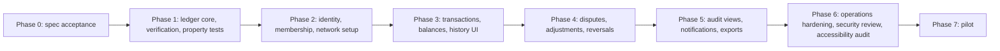

# Assumptions, Risks, Decisions, and Roadmap

| Field | Value |
|---|---|
| Status | Draft |
| Owner role | Project owner |
| Last updated | 2026-11-11 |
| Scope | The assumptions the specification set rests on and the impact if each is wrong; the decision log, holding the ten baseline decisions with their alternatives and one entry for every open question raised in documents 00 to 12; the major product, technical, operational, and governance risks with mitigations; the dependency order for building the MVP; the list of deferred sub-specifications; and the decision record template and process. |
| Dependencies | [00-conventions.md](00-conventions.md) (ID scheme, baseline decisions table, decision log obligations), [01-product-vision-and-scope.md](01-product-vision-and-scope.md) (MVP boundary and deferred items), [03-domain-model-and-mutual-credit-rules.md](03-domain-model-and-mutual-credit-rules.md) (the rules most decisions protect), and the open-questions tables of every document 00 to 12 |
| Related documents | [04-functional-requirements.md](04-functional-requirements.md), [05-system-architecture.md](05-system-architecture.md), [06-data-model-ledger-and-audit.md](06-data-model-ledger-and-audit.md), [07-api-and-integration-contract.md](07-api-and-integration-contract.md), [08-ux-and-accessibility.md](08-ux-and-accessibility.md), [09-security-privacy-and-abuse-resistance.md](09-security-privacy-and-abuse-resistance.md), [10-governance-and-network-operations.md](10-governance-and-network-operations.md), [11-deployment-operations-and-support.md](11-deployment-operations-and-support.md), [12-quality-strategy-and-test-plan.md](12-quality-strategy-and-test-plan.md), [Specification index](README.md) |

## 1. Purpose and how to use this document

This document is the single place where the project records what it assumes, what it has decided, what it has not decided, what could go wrong, and in which order the work should happen. It defines no product behavior of its own. Every rule it mentions has its home elsewhere and is cited by identifier.

How to use it:

| You want to | Go to |
|---|---|
| Know whether a premise behind the specifications still holds | [Section 2](#2-assumptions). Each assumption names the documents that depend on it; when one is found wrong, open a decision entry and update those documents. |
| Resolve an open question from any document | [Section 3](#decision-log). Find the `DEC-` entry that names the `OQ-` identifier, record the decision there, then update the source document's open-questions table to `Resolved` with a link back. |
| Deviate from a SHOULD | Add a decision entry with the reason, as [00-conventions.md](00-conventions.md#2-normative-language) requires. |
| Judge release or pilot readiness | [Section 4](#4-risks) for the risks and their indicators, [section 5](#5-roadmap-and-dependency-order) for phase exit criteria. |
| Record a new decision | Copy the template in [section 6](#6-decision-record-template-and-process). |

Identifier ranges used here:

| Range | Topic |
|---|---|
| ASM-001 to ASM-099 | Assumptions |
| DEC-001 to DEC-010 | Baseline decisions fixed by [00-conventions.md §8](00-conventions.md#8-baseline-decisions) |
| DEC-011 to DEC-039 | Product scope decisions |
| DEC-040 to DEC-079 | Technical decisions |
| DEC-080 to DEC-099 | Operations and quality thresholds |
| DEC-100 to DEC-119 | Governance decisions |
| DEC-120 to DEC-139 | Counsel questions |
| DEC-140 to DEC-149 | Specification process |
| DEC-150 to DEC-179 | Questions already resolved by a domain rule, kept for traceability |
| RISK-001 to RISK-099 | Risks |

Unused numbers inside a range are reserved for later entries of that topic.

## 2. Assumptions

Each assumption is a premise the specifications treat as true without proof. Basis is one of: **repo evidence** (stated in a specification or the authoring brief), **prompt** (stated in [the authoring brief](../../prompts/create-foundational-specs.md)), or **engineering judgment**.

| ID | Assumption (short form) | Basis | Validated by |
|---|---|---|---|
| [ASM-001](#asm-001) | First users are small to medium community networks | Repo evidence, prompt | Pilot ([DEC-020](#dec-020)) |
| [ASM-002](#asm-002) | Administrators are volunteers with limited technical skill | Engineering judgment | Pilot usability checks |
| [ASM-003](#asm-003) | Members use ordinary phones and browsers | Engineering judgment | Pilot device survey |
| [ASM-004](#asm-004) | Email deliverability is available to every instance | Repo evidence ([DEC-007](#dec-007)) | Operations monitoring |
| [ASM-005](#asm-005) | One transactional store per instance is enough at MVP scale | Repo evidence ([DEC-009](#dec-009), [DEC-010](#dec-010)) | Load tests ([DEC-080](#dec-080)) |
| [ASM-006](#asm-006) | Networks accept that the network account balance is visible to all members | Repo evidence ([DOM-053](03-domain-model-and-mutual-credit-rules.md#dom-053)) | Pilot interviews |
| [ASM-007](#asm-007) | Pilot networks exist and will take part in validation | Repo evidence ([OQ-VIS-3](01-product-vision-and-scope.md#9-open-questions)) | Named pilots |
| [ASM-008](#asm-008) | The project can be released as open source | Prompt, engineering judgment | License decision ([DEC-126](#dec-126)) |
| [ASM-009](#asm-009) | No legal counsel is engaged yet | Repo evidence (every counsel question is open) | Counsel engagement |
| [ASM-010](#asm-010) | Zero to two decimal places cover every network's unit | Repo evidence ([DEC-005](#dec-005)) | Pilot setup |
| [ASM-011](#asm-011) | Per-network posting volume tolerates serialized sequence assignment | Repo evidence ([DOM-010](03-domain-model-and-mutual-credit-rules.md#dom-010)) | Load tests |
| [ASM-012](#asm-012) | Operators can run one artifact, one store, scheduled jobs, and an email relay | Repo evidence ([OPS-002](11-deployment-operations-and-support.md#ops-002)) | Timed install walkthrough |
| [ASM-013](#asm-013) | Administrator approval plus email control is enough admission control | Repo evidence ([SEC-076](09-security-privacy-and-abuse-resistance.md#sec-076)) | Pilot abuse reports |
| [ASM-014](#asm-014) | The first pilots can work in one interface language per instance | Engineering judgment | Locale decision ([DEC-034](#dec-034)) |
| [ASM-015](#asm-015) | Instance clocks are synchronized to UTC within seconds | Repo evidence ([ARCH-081](05-system-architecture.md#arch-081)) | Startup self-checks |

<a id="asm-001"></a>**ASM-001 — First users are small to medium community networks.** Typical networks are local groups, time-banks, cooperatives, and trade circles of tens to a few hundred members whose members know one another ([01 §2](01-product-vision-and-scope.md#2-intended-users)); the starting sizing figure for discussion is 20 networks of 500 members per instance ([OPS-100](11-deployment-operations-and-support.md#ops-100)).
- *Basis:* repo evidence and prompt. *Impact if wrong:* networks of thousands of members raise posting concurrency within one network ([ASM-011](#asm-011)), directory and search load, and moderation volume; balance visibility and governance defaults tuned for small groups ([DEC-018](#dec-018)) may no longer fit.
- *Dependent documents:* 05, 06, 10, 11, 12 (sizing, concurrency strategy, performance gates).

<a id="asm-002"></a>**ASM-002 — Administrators are volunteers with limited technical skill.** Network administrators run the network in spare time, may change often, and cannot be expected to read logs or edit configuration files.
- *Basis:* engineering judgment from the problem statement ([01 §1](01-product-vision-and-scope.md#1-problem), items 1 and 6). *Impact if wrong:* low; more skilled administrators only make the plain-language requirements less critical. If right but ignored, administrators make errors that need reversals and adjustments, and succession fails ([RISK-006](#risk-006)).
- *Dependent documents:* 08 (plain-language administrator screens), 10 (two administrators recommended, [GOV-051](10-governance-and-network-operations.md#gov-051); succession), 11 (operator, not administrator, owns infrastructure).

<a id="asm-003"></a>**ASM-003 — Members use ordinary phones and browsers.** Members reach Circula from a current mobile or desktop browser, sometimes on shared or older devices, at widths down to 320 CSS px; no native app is required ([DEC-006](#dec-006)).
- *Basis:* engineering judgment. *Impact if wrong:* if a pilot community depends on feature phones or offline use, the web client cannot serve it and the deferred mobile or offline work becomes a prerequisite.
- *Dependent documents:* 08 ([UX-084](08-ux-and-accessibility.md#ux-084) browser baseline), 12 (device matrix).

<a id="asm-004"></a>**ASM-004 — Email deliverability is available.** Every instance can send email that reaches members' inboxes, through a relay or provider the operator configures ([OPS-004](11-deployment-operations-and-support.md#ops-004)).
- *Basis:* repo evidence ([DEC-007](#dec-007)). *Impact if wrong:* invitations, recovery, and the mandatory notifications ([DOM-014](03-domain-model-and-mutual-credit-rules.md#dom-014), [DOM-017](03-domain-model-and-mutual-credit-rules.md#dom-017)) fail; the outbox retries ([ARCH-086](05-system-architecture.md#arch-086)) but cannot deliver. Communities without reliable email would need a second channel, which is deferred.
- *Dependent documents:* 04, 05, 09 (recovery), 10 (announcements), 11 ([OPS-131](11-deployment-operations-and-support.md#ops-131)).

<a id="asm-005"></a>**ASM-005 — One transactional store per instance is enough at MVP scale.** A single store meeting [DEC-009](#dec-009), scaled vertically first ([OPS-101](11-deployment-operations-and-support.md#ops-101)), carries all networks of an instance.
- *Basis:* repo evidence ([DEC-009](#dec-009), [DEC-010](#dec-010)) and [ASM-001](#asm-001). *Impact if wrong:* sharding by network or a store per network ([DEC-054](#dec-054)) becomes necessary, which changes backup, migration, and isolation procedures.
- *Dependent documents:* 05, 06, 11.

<a id="asm-006"></a>**ASM-006 — Networks accept a visible network account balance.** The network account balance and its events are visible to every active member as a platform invariant ([DOM-053](03-domain-model-and-mutual-credit-rules.md#dom-053), [GOV-102](10-governance-and-network-operations.md#gov-102)), not a policy.
- *Basis:* repo evidence. *Impact if wrong:* a network that refuses to show accumulated write-offs cannot use Circula without a change to [DOM-053](03-domain-model-and-mutual-credit-rules.md#dom-053), which would weaken [DEC-003](#dec-003)'s purpose of making losses visible.
- *Dependent documents:* 03, 04, 08, 10.

<a id="asm-007"></a>**ASM-007 — Pilot networks exist for validation.** At least one real network will take part in usability checks (success measures 7 and 9 in [01 §7](01-product-vision-and-scope.md#7-success-measures)) and in the pilot phase.
- *Basis:* repo evidence ([OQ-VIS-3](01-product-vision-and-scope.md#9-open-questions), unresolved). *Impact if wrong:* several defaults that name "the first pilot network" as decider ([DEC-014](#dec-014), [DEC-018](#dec-018), [DEC-080](#dec-080)) stay unvalidated, and phase 7 cannot start ([RISK-014](#risk-014)).
- *Dependent documents:* 01, 03, 08, 09, 12.

<a id="asm-008"></a>**ASM-008 — The project is open-source-capable.** The specifications assume public source, public issue tracking, and coordinated vulnerability disclosure ([SEC-155](09-security-privacy-and-abuse-resistance.md#sec-155)); no license is chosen.
- *Basis:* prompt (self-hostable, inspectable) and engineering judgment. *Impact if wrong:* a closed license removes the self-hosting audience's ability to inspect the ledger and changes dependency licensing checks ([ARCH-103](05-system-architecture.md#arch-103)).
- *Dependent documents:* 01, 05, 09, 11. Decision: [DEC-126](#dec-126).

<a id="asm-009"></a>**ASM-009 — No legal counsel is engaged yet.** No counsel question in documents 00 to 12 has an answer; none of the specifications asserts compliance ([VIS-018](01-product-vision-and-scope.md#vis-018)).
- *Basis:* repo evidence. *Impact if wrong:* none on the design; answers, once obtained, may require product changes (for example a redaction mechanism, [DEC-122](#dec-122)). While true, no public launch or hosted offering may start ([RISK-008](#risk-008)).
- *Dependent documents:* all; decisions [DEC-120](#dec-120) to [DEC-129](#dec-129).

<a id="asm-010"></a>**ASM-010 — Zero to two decimal places cover every network's unit.** Hour-based networks use 0 or 2 decimals; credit-based networks use 0 to 2 ([DOM-094](03-domain-model-and-mutual-credit-rules.md#dom-094)).
- *Basis:* repo evidence ([DEC-005](#dec-005)). *Impact if wrong:* a network wanting minutes as a fraction of hours at finer precision would need a third decimal place; [DOM-006](03-domain-model-and-mutual-credit-rules.md#dom-006) and export formats change.
- *Dependent documents:* 03, 06, 07, 08.

<a id="asm-011"></a>**ASM-011 — Per-network posting volume tolerates serialized sequence assignment.** The contiguous per-network sequence ([DOM-010](03-domain-model-and-mutual-credit-rules.md#dom-010)) serializes postings within one network; community volumes are assumed far below the limit this imposes.
- *Basis:* repo evidence ([OQ-DATA-9](06-data-model-ledger-and-audit.md#10-open-questions), [QA-112](12-quality-strategy-and-test-plan.md#qa-112) throughput target). *Impact if wrong:* acceptance latency rises under load within a large network; the concurrency strategy ([DEC-050](#dec-050)) would have to change.
- *Dependent documents:* 05, 06, 12.

<a id="asm-012"></a>**ASM-012 — Operators can run the minimum topology.** A self-hosting operator can run one release artifact, one transactional store, the job runner, and an email relay, and follow written backup and upgrade guides ([OPS-002](11-deployment-operations-and-support.md#ops-002), [OPS-160](11-deployment-operations-and-support.md#ops-160)).
- *Basis:* repo evidence. *Impact if wrong:* self-hosting becomes impractical for the target communities and hosted operation ([DEC-084](#dec-084)) becomes the only realistic route.
- *Dependent documents:* 05, 11.

<a id="asm-013"></a>**ASM-013 — Administrator approval plus email control is enough admission control.** Communities know their members; no identity verification is performed by the software ([GOV-033](10-governance-and-network-operations.md#gov-033), [SEC-076](09-security-privacy-and-abuse-resistance.md#sec-076)).
- *Basis:* repo evidence. *Impact if wrong:* sybil accounts could draw credit up to the default limit and depart; stronger checks such as vouching ([OQ-SEC-16](09-security-privacy-and-abuse-resistance.md#8-open-questions)) would be needed.
- *Dependent documents:* 09, 10.

<a id="asm-014"></a>**ASM-014 — The first pilots can work in one interface language per instance.** The first locale set is undecided ([DEC-034](#dec-034)); the specifications require translatable text but assume pilots do not need several languages at once.
- *Basis:* engineering judgment. *Impact if wrong:* per-member language selection becomes part of the MVP.
- *Dependent documents:* 08.

<a id="asm-015"></a>**ASM-015 — Instance clocks are synchronized.** Expiry, windows, and policy effective times depend on server time in UTC ([ARCH-081](05-system-architecture.md#arch-081)).
- *Basis:* repo evidence. *Impact if wrong:* proposals expire early or late and window checks ([DOM-101](03-domain-model-and-mutual-credit-rules.md#dom-101) to [DOM-103](03-domain-model-and-mutual-credit-rules.md#dom-103)) give wrong results near boundaries.
- *Dependent documents:* 05, 11.

<a id="decision-log"></a>

## 3. Decision log

Status values: **Decided-baseline** (a recommended baseline that the specifications build on; it can be reopened by a new entry, never edited away) and **Open** (a recommended default exists; implementers do not treat it as settled). The project owner accepts a decision by changing its status to `Decided` with the date and the deciding role. Entries cite their source open questions; every `OQ-` identifier in documents 00 to 12 appears in at least one entry (see [section 3.11](#311-traceability-of-open-questions)).

### 3.1 Baseline decisions

These ten entries match [00-conventions.md §8](00-conventions.md#8-baseline-decisions) in numbering and meaning.

<a id="dec-001"></a>**DEC-001 — Self-hostable first; one instance hosts many isolated networks.**
- **Status:** Decided-baseline. **Date:** 2026-11-11.
- **Context:** Communities lose their history when it lives with one organizer ([01 §1](01-product-vision-and-scope.md#1-problem), item 6); small groups also cannot all run servers.
- **Options considered:** (a) Hosted-only centralized service. Pro: one operator, uniform upgrades, no install burden. Con: every network depends on one party; concentrates counsel questions and data-controller duties on that party; contradicts portability. (b) Self-host-only, one network per installation. Pro: isolation by process; simplest data ownership. Con: each small group must run infrastructure ([ASM-002](#asm-002)); no shared hosting by a federation or cooperative. (c) Both, from the same software, with many networks per instance and isolation enforced in software.
- **Decision:** (c). A hosted offering, if any, runs the same artifact ([OPS-001](11-deployment-operations-and-support.md#ops-001)).
- **Consequences:** network scoping on every query and command ([SEC-021](09-security-privacy-and-abuse-resistance.md#sec-021), [ARCH-037](05-system-architecture.md#arch-037), [DATA-002](06-data-model-ledger-and-audit.md#data-002)); isolation tests per operation and per release ([SEC-170](09-security-privacy-and-abuse-resistance.md#sec-170), [QA-062](12-quality-strategy-and-test-plan.md#qa-062), [OPS-150](11-deployment-operations-and-support.md#ops-150)); operator has no network role and uses break-glass only ([SEC-140](09-security-privacy-and-abuse-resistance.md#sec-140)); network portability between instances ([ARCH-053](05-system-architecture.md#arch-053)).
- **Reopen when:** an isolation failure reaches production ([RISK-004](#risk-004)), or the hosted decision ([DEC-084](#dec-084)) changes the operator model.

<a id="dec-002"></a>**DEC-002 — Double-entry, append-only ledger.**
- **Status:** Decided-baseline. **Date:** 2026-11-11.
- **Context:** Hand bookkeeping drifts and is edited after the fact ([01 §1](01-product-vision-and-scope.md#1-problem), item 1).
- **Options considered:** (a) Single stored balance per account, updated per trade. Pro: smallest model. Con: no derivation, so drift is undetectable; history is a side log. (b) Double-entry with editable postings. Pro: corrections in place. Con: history can be rewritten; audit depends on a second record. (c) Double-entry, immutable postings, corrections as new events.
- **Decision:** (c) ([DOM-001](03-domain-model-and-mutual-credit-rules.md#dom-001), [DOM-002](03-domain-model-and-mutual-credit-rules.md#dom-002), [DOM-003](03-domain-model-and-mutual-credit-rules.md#dom-003)).
- **Consequences:** reversals and adjustments are new events ([DOM-030](03-domain-model-and-mutual-credit-rules.md#dom-030), [DOM-040](03-domain-model-and-mutual-credit-rules.md#dom-040)); verification recomputes balances ([DATA-035](06-data-model-ledger-and-audit.md#data-035)); store-level append-only enforcement where available ([DATA-031](06-data-model-ledger-and-audit.md#data-031), [QA-042](12-quality-strategy-and-test-plan.md#qa-042)); erasure works on attributes, not records ([DATA-073](06-data-model-ledger-and-audit.md#data-073), see [DEC-122](#dec-122)).
- **Reopen when:** never for the accounting rule; storage realization may change under [DEC-009](#dec-009).

<a id="dec-003"></a>**DEC-003 — Every network has a network account.**
- **Status:** Decided-baseline. **Date:** 2026-11-11.
- **Context:** Write-offs must not destroy credits silently; the sum of balances must stay zero ([DOM-004](03-domain-model-and-mutual-credit-rules.md#dom-004)).
- **Options considered:** (a) Write-off reduces the member's debt with no counterparty. Pro: simple. Con: breaks zero-sum; losses invisible. (b) Losses spread automatically across all member accounts. Pro: zero-sum kept. Con: the software imposes a governance outcome; members' balances change without their act. (c) One system account per network as counterparty of write-offs and governance adjustments, with its balance visible to members.
- **Decision:** (c) ([DOM-015](03-domain-model-and-mutual-credit-rules.md#dom-015), [DOM-053](03-domain-model-and-mutual-credit-rules.md#dom-053)).
- **Consequences:** network account limits are policy ([DOM-093](03-domain-model-and-mutual-credit-rules.md#dom-093)); its balance is public within the network ([ASM-006](#asm-006)); self-dealing guards apply ([DOM-043](03-domain-model-and-mutual-credit-rules.md#dom-043)). Additional system accounts are [DEC-013](#dec-013).
- **Reopen when:** [DEC-013](#dec-013) is decided in favor of several system accounts.

<a id="dec-004"></a>**DEC-004 — Post at consent; pending transactions do not reserve credit.**
- **Status:** Decided-baseline. **Date:** 2026-11-11.
- **Context:** Limit checks must be correct under concurrent acceptances ([DOM-009](03-domain-model-and-mutual-credit-rules.md#dom-009)).
- **Options considered:** (a) Reservation model: a proposal reduces the payer's available credit until it completes, declines, or expires. Pro: an accepted proposal never fails for credit. Con: proposals can lock others' credit for up to the expiry window ([DOM-100](03-domain-model-and-mutual-credit-rules.md#dom-100)); release on expiry adds a job and new failure modes; spam proposals become a denial of credit. (b) No reservation; limits checked atomically when the second party consents.
- **Decision:** (b) ([DOM-027](03-domain-model-and-mutual-credit-rules.md#dom-027), [DOM-028](03-domain-model-and-mutual-credit-rules.md#dom-028)). The interface warns the proposer when available credit is short ([DOM-021](03-domain-model-and-mutual-credit-rules.md#dom-021)).
- **Consequences:** acceptance can fail with `limit_exceeded`; failed attempts are recorded and the proposer notified ([DOM-022](03-domain-model-and-mutual-credit-rules.md#dom-022)); concurrency tests cover the race ([QA-030](12-quality-strategy-and-test-plan.md#qa-030), [E2E-003](12-quality-strategy-and-test-plan.md#e2e-003)).
- **Reopen when:** see [DEC-011](#dec-011).

<a id="dec-005"></a>**DEC-005 — Integer amounts in minor units, 0 to 2 decimal places per network.**
- **Status:** Decided-baseline. **Date:** 2026-11-11.
- **Context:** Rounding drift would break [DOM-004](03-domain-model-and-mutual-credit-rules.md#dom-004).
- **Options considered:** (a) Floating-point amounts. Con: inexact sums. (b) Arbitrary-precision decimal type end to end. Pro: exact. Con: uneven support across stores and JSON parsers; text encoding ambiguity on the wire. (c) Integers in minor units with a per-network decimal count, bounded to 2^53 − 1 so JSON numbers stay exact ([DOM-006](03-domain-model-and-mutual-credit-rules.md#dom-006)).
- **Decision:** (c).
- **Consequences:** decimal places fixed after first posting (`decimal_places_locked`); API and exports carry integers ([API-006](07-api-and-integration-contract.md#api-006), [DATA-004](06-data-model-ledger-and-audit.md#data-004)); display formatting is the client's job.
- **Reopen when:** a network needs more than 2 decimal places ([ASM-010](#asm-010)).

<a id="dec-006"></a>**DEC-006 — Responsive web client over the public API only.**
- **Status:** Decided-baseline. **Date:** 2026-11-11.
- **Context:** Rules must be enforced once ([ARCH-060](05-system-architecture.md#arch-060)).
- **Options considered:** (a) Native apps first. Con: store-release pipelines and two codebases for a volunteer project. (b) Server-rendered client with a privileged internal path to the ledger. Pro: less API surface. Con: two enforcement paths that can diverge. (c) Responsive web application that uses only the public API.
- **Decision:** (c) ([ARCH-002](05-system-architecture.md#arch-002)).
- **Consequences:** the API carries the full operation catalogue; API and UI tests exercise one path ([QA-003](12-quality-strategy-and-test-plan.md#qa-003)); mobile apps deferred.
- **Reopen when:** [ASM-003](#asm-003) fails for a pilot community.

<a id="dec-007"></a>**DEC-007 — Email for invitations, notifications, and recovery.**
- **Status:** Decided-baseline. **Date:** 2026-11-11.
- **Context:** The MVP needs one out-of-band channel and the least identity data.
- **Options considered:** (a) SMS. Con: per-country providers and cost; phone numbers are more sensitive personal data. (b) No out-of-band channel. Con: no recovery without administrator resets, which [SEC-046](09-security-privacy-and-abuse-resistance.md#sec-046) forbids. (c) Push or messaging apps. Con: needs native apps or third-party accounts. (d) Email.
- **Decision:** (d).
- **Consequences:** email deliverability is an assumption ([ASM-004](#asm-004)) and a risk ([RISK-005](#risk-005)); outbox with retries ([ARCH-086](05-system-architecture.md#arch-086)); in-app list as a second view ([ARCH-010](05-system-architecture.md#arch-010)); email content rules in [DEC-053](#dec-053).
- **Reopen when:** a pilot community cannot use email reliably.

<a id="dec-008"></a>**DEC-008 — The credit unit is an accounting unit only.**
- **Status:** Decided-baseline. **Date:** 2026-11-11.
- **Context:** Conversion or redemption would bring regulatory questions into the ledger design ([OQ-VIS-1](01-product-vision-and-scope.md#9-open-questions)).
- **Options considered:** (a) Allow acquiring or redeeming credits against national currency through the platform. Con: needs external integrations and creates counsel questions that would shape the ledger. (b) Record an informational conversion rate per network. Con: implies a value the platform does not guarantee ([VIS-014](01-product-vision-and-scope.md#vis-014)). (c) Accounting unit only, no conversion.
- **Decision:** (c) ([DOM-080](03-domain-model-and-mutual-credit-rules.md#dom-080), [DOM-081](03-domain-model-and-mutual-credit-rules.md#dom-081)).
- **Consequences:** conversion is deferred and named as a non-goal ([VIS-013](01-product-vision-and-scope.md#vis-013)); external agreements stay outside the platform ([GOV-074](10-governance-and-network-operations.md#gov-074), [DEC-124](#dec-124)).
- **Reopen when:** never in the MVP; any change starts with counsel review.

<a id="dec-009"></a>**DEC-009 — Transactional store with serializable or equivalent guarantees.**
- **Status:** Decided-baseline. **Date:** 2026-11-11.
- **Context:** Limit checks and postings must commit together ([DOM-009](03-domain-model-and-mutual-credit-rules.md#dom-009)).
- **Options considered:** (a) Event-sourced append-only log store with balances as projections. Pro: history is the primary data; natural audit trail. Con: the limit check still needs a consistent read of the projection at write time, so it needs the same guarantee plus projection machinery; more components for volunteer operators. (b) Eventually consistent document or key-value store. Con: cannot guarantee the atomic check. (c) Any transactional store with serializable or equivalent isolation and the capabilities in [ARCH-095](05-system-architecture.md#arch-095); no vendor chosen.
- **Decision:** (c).
- **Consequences:** operator checklist [OPS-003](11-deployment-operations-and-support.md#ops-003); concurrency strategy [DEC-050](#dec-050); integration tests run on a real store ([QA-040](12-quality-strategy-and-test-plan.md#qa-040)).
- **Reopen when:** load tests show a single store cannot meet [DEC-080](#dec-080) targets.

<a id="dec-010"></a>**DEC-010 — Modular monolith with an isolated ledger core.**
- **Status:** Decided-baseline. **Date:** 2026-11-11.
- **Context:** The smallest design that keeps the ledger testable alone ([ARCH-067](05-system-architecture.md#arch-067)).
- **Options considered:** (a) Microservices (ledger, identity, notifications, listings as services). Pro: independent scaling and deployment. Con: ledger and audit writes would span services and need distributed transactions or sagas; operators run many processes. (b) Monolith without module boundaries. Con: ledger logic leaks into handlers and cannot be tested alone. (c) One deployable service plus store, job runner, and email relay, with the ledger core behind an explicit interface.
- **Decision:** (c) ([ARCH-001](05-system-architecture.md#arch-001), [ARCH-003](05-system-architecture.md#arch-003), [ARCH-004](05-system-architecture.md#arch-004)).
- **Consequences:** ledger core unit-tested in isolation with full branch coverage ([QA-010](12-quality-strategy-and-test-plan.md#qa-010), [QA-132](12-quality-strategy-and-test-plan.md#qa-132)); horizontal API replicas allowed ([ARCH-052](05-system-architecture.md#arch-052)).
- **Reopen when:** [ASM-005](#asm-005) fails.

### 3.2 Product scope decisions

<a id="dec-011"></a>**DEC-011 — Reservation model for proposed transactions.**
- **Status:** Open. **Date:** 2026-11-11. **Mirrors:** [OQ-DOM-1](03-domain-model-and-mutual-credit-rules.md#14-open-questions) (03), [OQ-UX-9](08-ux-and-accessibility.md#10-open-questions) (08).
- **Context:** [DEC-004](#dec-004) chose no reservation; screens [UX-040](08-ux-and-accessibility.md#ux-040) and [UX-043](08-ux-and-accessibility.md#ux-043) depend on it.
- **Options considered:** (a) Keep no reservation. Pro: no locked credit, no release job, fewer states. Con: accepted proposals can fail; members may not understand why. (b) Reserve at proposal. Pro: predictable acceptance. Con: griefing by proposal spam; expiry release adds failure modes; available credit no longer equals balance plus limit. (c) Reserve only for proposals the payer made (payer-initiated). Pro: payer chose to commit. Con: two rules for one state; still locks credit for up to 90 days.
- **Recommended default:** (a), confirming [DEC-004](#dec-004).
- **Consequences:** none beyond [DEC-004](#dec-004); UX design can start.
- **Reopen when:** pilot data shows failed acceptance attempts with `limit_exceeded` above a share of acceptances agreed by the project owner (threshold needs product decision).

<a id="dec-012"></a>**DEC-012 — Partial reversals.**
- **Status:** Open. **Date:** 2026-11-11. **Mirrors:** [OQ-DOM-2](03-domain-model-and-mutual-credit-rules.md#14-open-questions) (03).
- **Context:** [DOM-033](03-domain-model-and-mutual-credit-rules.md#dom-033) allows at most one full reversal per transaction.
- **Options considered:** (a) Full reversal plus a new transaction, or a `correction` adjustment. Pro: one reversal state, simple history. Con: two steps and two notifications for a small error. (b) Partial reversal events with an amount below the original. Pro: one step. Con: a transaction can be "partly reversed", several reversals per transaction, harder audit and dispute targeting.
- **Recommended default:** (a); partial reversals stay deferred (P2).
- **Consequences:** [DOM-033](03-domain-model-and-mutual-credit-rules.md#dom-033) unchanged; UX shows the two-step correction.
- **Reopen when:** pilot administrators record more than a handful of two-step corrections per month per network.

<a id="dec-013"></a>**DEC-013 — More than one system account per network.**
- **Status:** Open. **Date:** 2026-11-11. **Mirrors:** [OQ-DOM-3](03-domain-model-and-mutual-credit-rules.md#14-open-questions) (03).
- **Context:** [DOM-015](03-domain-model-and-mutual-credit-rules.md#dom-015) gives each network exactly one system account.
- **Options considered:** (a) One network account; purposes distinguished by reason codes ([DOM-106](03-domain-model-and-mutual-credit-rules.md#dom-106)). Pro: one balance for members to read. Con: a community fund and accumulated losses share one figure. (b) Named additional system accounts (for example losses, community fund). Pro: clearer reporting. Con: limits, visibility, and self-dealing rules multiply per account; members must read several figures.
- **Recommended default:** (a).
- **Consequences:** exports and the adjustment log filter by reason code.
- **Reopen when:** a pilot network needs a fund that members trade with directly.

<a id="dec-014"></a>**DEC-014 — Organizations as members.**
- **Status:** Open. **Date:** 2026-11-11. **Mirrors:** [OQ-DOM-4](03-domain-model-and-mutual-credit-rules.md#14-open-questions) (03).
- **Context:** Consent attribution ([DOM-008](03-domain-model-and-mutual-credit-rules.md#dom-008), [DOM-013](03-domain-model-and-mutual-credit-rules.md#dom-013)) is per person.
- **Options considered:** (a) Membership type with several authorized people, each acting under their own identity. Pro: consent stays attributable. Con: new role layer and permission rows. (b) One shared login for the organization. Pro: no new model. Con: shared credentials, second factor unusable, consent not attributable to a person. (c) Defer: an organization joins through one named person whose membership display name may be the organization.
- **Recommended default:** (c); multi-person organization accounts stay deferred (P2).
- **Consequences:** no schema for organization roles in the MVP.
- **Reopen when:** the first pilot network has organization members that need more than one acting person.

<a id="dec-015"></a>**DEC-015 — Self-service network creation.**
- **Status:** Open. **Date:** 2026-11-11. **Mirrors:** [OQ-PER-1](02-personas-roles-and-journeys.md#5-open-questions) (02), [OQ-FR-9](04-functional-requirements.md#14-open-questions) (04).
- **Context:** [PER-010](02-personas-roles-and-journeys.md#per-010) and [FR-001](04-functional-requirements.md#fr-001) assume the operator creates networks.
- **Options considered:** (a) Operator-only creation. Pro: the operator knows every network; no abuse surface. Con: the operator is a bottleneck on a hosted instance. (b) Self-service request with operator approval. Pro: scales hosting; operator keeps a gate. Con: new queue and abuse handling. (c) Open self-service. Con: spam networks; hosted operator exposure grows ([DEC-121](#dec-121)).
- **Recommended default:** (a) for the MVP; (b) is the candidate once a hosted offering exists.
- **Consequences:** operator documentation covers network creation ([OPS-031](11-deployment-operations-and-support.md#ops-031)).
- **Reopen when:** [DEC-084](#dec-084) decides a hosted offering.

<a id="dec-016"></a>**DEC-016 — Members may send invitations by default.**
- **Status:** Decided-baseline. **Date:** 2026-11-11. **Mirrors:** [OQ-PER-2](02-personas-roles-and-journeys.md#5-open-questions) (02), resolved at source by [DOM-115](03-domain-model-and-mutual-credit-rules.md#dom-115).
- **Context:** Policy [DOM-115](03-domain-model-and-mutual-credit-rules.md#dom-115) exists; recommended default `off`. Member-sent invitations always need administrator approval.
- **Options considered:** (a) `off`. Pro: fewer invitation-abuse paths ([SEC-073](09-security-privacy-and-abuse-resistance.md#sec-073)); administrators control growth. Con: administrator workload. (b) `on`. Pro: growth through members' contacts. Con: more invitations to review; spam risk.
- **Decision:** (a), as [DOM-115](03-domain-model-and-mutual-credit-rules.md#dom-115) states (default `off`; members invite only when it is on).
- **Consequences:** none on design; both values tested ([QA-061](12-quality-strategy-and-test-plan.md#qa-061)).
- **Reopen when:** pilot administrators report invitations as a bottleneck.

<a id="dec-017"></a>**DEC-017 — Challenge route and listings of suspended and departed members.**
- **Status:** Open. **Date:** 2026-11-11. **Mirrors:** [OQ-PER-3](02-personas-roles-and-journeys.md#5-open-questions) (02, open part), [OQ-FR-8](04-functional-requirements.md#14-open-questions) (04). The read and export part of [OQ-PER-3](02-personas-roles-and-journeys.md#5-open-questions) and all of [OQ-FR-7](04-functional-requirements.md#14-open-questions) are resolved ([DEC-163](#dec-163)).
- **Context:** History survives departure ([DOM-074](03-domain-model-and-mutual-credit-rules.md#dom-074)); disputes cover ledger events only ([DOM-060](03-domain-model-and-mutual-credit-rules.md#dom-060)); the structured challenge workflow is deferred ([GOV-113](10-governance-and-network-operations.md#gov-113)).
- **Options considered:** For challenges of a suspension or removal: (a) the governance route ([GOV-112](10-governance-and-network-operations.md#gov-112)). Pro: no new workflow. Con: no platform-tracked deadlines. (b) Reuse the dispute process. Con: disputes cover ledger events only ([DOM-060](03-domain-model-and-mutual-credit-rules.md#dom-060)). For listings: (c) hide while suspended and close at departure. Pro: no trades offered by members who cannot trade. Con: a reinstated member must republish. (d) Keep them visible. Con: members propose trades that cannot complete.
- **Recommended default:** (a) and (c) ([FR-028](04-functional-requirements.md#fr-028), [GOV-044](10-governance-and-network-operations.md#gov-044)).
- **Consequences:** none on the ledger; read and export rights are fixed by [DEC-163](#dec-163).
- **Reopen when:** counsel answers on retention ([DEC-123](#dec-123)) shorten the period, or [GOV-113](10-governance-and-network-operations.md#gov-113) is scheduled.

<a id="dec-018"></a>**DEC-018 — Default visibility of other members' balances.**
- **Status:** Open. **Date:** 2026-11-11. **Mirrors:** [OQ-UX-2](08-ux-and-accessibility.md#10-open-questions) (08).
- **Context:** Policy [DOM-096](03-domain-model-and-mutual-credit-rules.md#dom-096): `hidden` or `visible_to_members`, recommended `hidden`. The network account is always visible ([DOM-053](03-domain-model-and-mutual-credit-rules.md#dom-053)).
- **Options considered:** (a) `hidden`. Pro: privacy; no stigma for members with negative balances. Con: less peer accountability in small groups. (b) `visible_to_members`. Pro: trust and self-regulation in small networks. Con: exposes personal standing; may discourage newcomers.
- **Recommended default:** (a); networks may switch.
- **Consequences:** UI supports both ([UX-047](08-ux-and-accessibility.md#ux-047)).
- **Reopen when:** the first pilot network asks for visibility as the default.

<a id="dec-019"></a>**DEC-019 — Visibility of the adjustment log and network-account counterparties.**
- **Status:** Open. **Date:** 2026-11-11. **Mirrors:** [OQ-GOV-7](10-governance-and-network-operations.md#18-open-questions) (10, member-to-member part). The network-account part of [OQ-GOV-7](10-governance-and-network-operations.md#18-open-questions) and all of [OQ-FR-13](04-functional-requirements.md#14-open-questions) are resolved by [DOM-053](03-domain-model-and-mutual-credit-rules.md#dom-053) ([DEC-165](#dec-165)).
- **Context:** [GOV-103](10-governance-and-network-operations.md#gov-103) recommends a member-visible adjustment log in summary form. [DOM-053](03-domain-model-and-mutual-credit-rules.md#dom-053) shows counterparty names on network-account events only when [DOM-096](03-domain-model-and-mutual-credit-rules.md#dom-096) is `visible_to_members` or the event is flagged `self_dealing`.
- **Options considered:** for adjustments between member accounts: (a) Summary with "a member" for non-parties. (b) Full identities. Pro: accountability. Con: publishes who was corrected, contradicting `hidden`. (c) Totals only. Pro: privacy. Con: members cannot see individual governance acts. (d) Administrators only.
- **Recommended default:** (a), consistent with [DOM-053](03-domain-model-and-mutual-credit-rules.md#dom-053) for network-account events.
- **Consequences:** [GOV-103](10-governance-and-network-operations.md#gov-103) default confirmed.
- **Reopen when:** a pilot network's governance requires naming write-offs.

<a id="dec-020"></a>**DEC-020 — Pilot networks and usability participants.**
- **Status:** Open. **Date:** 2026-11-11. **Mirrors:** [OQ-VIS-3](01-product-vision-and-scope.md#9-open-questions) (01).
- **Context:** Several defaults defer to "the first pilot network" ([ASM-007](#asm-007)).
- **Options considered:** (a) Named pilot communities recruited before phase 3. Pro: real feedback on defaults. Con: depends on outreach. (b) Substitute panels of people matching the personas. Pro: available. Con: no real governance or trading behavior.
- **Recommended default:** (a), with (b) for the usability checks if no pilot is named before phase 3 ends.
- **Consequences:** phase 7 entry criteria ([section 5](#5-roadmap-and-dependency-order)).
- **Reopen when:** no pilot is named by the end of phase 2.

### 3.3 Product scope decisions with small option sets

All entries in this table have Status **Open** and Date 2026-11-11.

| ID | Mirrors | Context | Options considered (pro / con) | Recommended default | Consequences; reopen when |
|---|---|---|---|---|---|
| <a id="dec-030"></a>DEC-030 | [OQ-VIS-6](01-product-vision-and-scope.md#9-open-questions) | Interface says "credit unit" while each network names its unit ([DOM-094](03-domain-model-and-mutual-credit-rules.md#dom-094)). | (a) Per-network name and symbol only: no new controls / generic labels remain. (b) Also let networks rename generic labels: fits time-banks / translation burden. | (a) | Copy review with pilots; reopen when a pilot rejects the generic wording. |
| <a id="dec-031"></a>DEC-031 | [OQ-DOM-5](03-domain-model-and-mutual-credit-rules.md#14-open-questions) | Starter reason codes ([DOM-106](03-domain-model-and-mutual-credit-rules.md#dom-106)). | (a) Ship the starter list with translatable labels: consistent exports / list may not fit every network. (b) Empty list set at setup: tailored / setup burden. | (a); codes stable, labels translatable | Exports keep codes; reopen after pilot review. |
| <a id="dec-032"></a>DEC-032 | [OQ-FR-3](04-functional-requirements.md#14-open-questions) | Listing categories. | (a) Administrators maintain outside versioned policy, audited: light / no notice to members. (b) Part of policy versions: notified / noise for trivial edits. | (a) | Reopen if categories carry governance meaning. |
| <a id="dec-033"></a>DEC-033 | [OQ-FR-4](04-functional-requirements.md#14-open-questions) | [DOM-091](03-domain-model-and-mutual-credit-rules.md#dom-091) lowered below a granted limit. | (a) Keep and flag to administrators: no silent change ([DOM-054](03-domain-model-and-mutual-credit-rules.md#dom-054)) / inconsistent with new maximum. (b) Lower automatically: consistent / members lose credit without notice. (c) Block the policy change: safe / administrator friction. | (a) | Domain modeler to state in 03; reopen if flags pile up. |
| <a id="dec-034"></a>DEC-034 | [OQ-UX-6](08-ux-and-accessibility.md#10-open-questions) | MVP locales and translation process. | (a) One locale chosen with the first pilot, others community-translated later: small / excludes multilingual networks. (b) Several from the start: reach / review cost. | (a) ([ASM-014](#asm-014)) | [UX-122](08-ux-and-accessibility.md#ux-122) stays; reopen with second pilot language. |
| <a id="dec-037"></a>DEC-037 | [OQ-API-13](07-api-and-integration-contract.md#14-open-questions) | Scope of anonymous `public_read` ([DOM-097](03-domain-model-and-mutual-credit-rules.md#dom-097)). | (a) Directory, listings, network description: discoverability / exposes member names publicly. (b) Listings only: less exposure / harder to judge a network. | (b), because member names are personal data; networks wanting more can reopen | [SEC-121](09-security-privacy-and-abuse-resistance.md#sec-121) alignment; reopen with pilot demand. |
| <a id="dec-038"></a>DEC-038 | [OQ-SEC-15](09-security-privacy-and-abuse-resistance.md#8-open-questions) | Member-to-member blocking ([SEC-066](09-security-privacy-and-abuse-resistance.md#sec-066)). | (a) Defer: smaller MVP / harassment handled by reports. (b) MVP: personal control / interacts with trading and disputes. | (a) | Reopen when reports show repeated unwanted proposals. |
| <a id="dec-039"></a>DEC-039 | [OQ-SEC-16](09-security-privacy-and-abuse-resistance.md#8-open-questions) | Sybil resistance beyond approval and email ([SEC-076](09-security-privacy-and-abuse-resistance.md#sec-076)). | (a) Approval plus email ([ASM-013](#asm-013)). (b) Vouching by existing members: stronger / slower joining. | (a) | Reopen on a sybil incident in a pilot. |

### 3.4 Technical decisions

<a id="dec-040"></a>**DEC-040 — API protocol.**
- **Status:** Open. **Date:** 2026-11-11. **Mirrors:** [OQ-API-1](07-api-and-integration-contract.md#14-open-questions) (07).
- **Context:** One public API serves the web client and integrations ([DEC-006](#dec-006)).
- **Options considered:** (a) HTTP and JSON, resource-oriented, `/v1` prefix, cursor pagination, problem-details errors. Pro: browser-native; self-hosters' tooling is HTTP-centric; idempotency keys map to one request. Con: several round trips for composite screens. (b) GraphQL. Pro: one round trip per screen. Con: per-field authorization and query-cost limits add a second enforcement surface over the ledger; idempotency per mutation is harder. (c) gRPC. Pro: typed contracts. Con: browsers need a proxy layer.
- **Recommended default:** (a).
- **Consequences:** contract description per [DEC-064](#dec-064); error codes from [03 §5.1](03-domain-model-and-mutual-credit-rules.md#51-error-codes-raised-by-transaction-rules).
- **Reopen when:** a native client or integration shows a need (a) cannot meet.

<a id="dec-041"></a>**DEC-041 — External identifier format.**
- **Status:** Open. **Date:** 2026-11-11. **Mirrors:** [OQ-DATA-1](06-data-model-ledger-and-audit.md#10-open-questions) (06).
- **Context:** Identifiers are opaque and non-sequential externally ([DATA-020](06-data-model-ledger-and-audit.md#data-020)); the ledger sequence is separate ([DATA-023](06-data-model-ledger-and-audit.md#data-023)).
- **Options considered:** (a) UUID version 7 (RFC 9562). Pro: index locality; time-sortable. Con: exposes creation time to the millisecond. (b) UUID version 4. Pro: reveals nothing. Con: poorer index locality. (c) Other 128-bit random identifier with custom encoding. Con: non-standard tooling.
- **Recommended default:** (a); creation times are already visible to parties of each object.
- **Consequences:** identifier generation injectable for tests ([QA-125](12-quality-strategy-and-test-plan.md#qa-125)).
- **Reopen when:** the security reviewer finds the timestamp exposure material for some object type.

<a id="dec-042"></a>**DEC-042 — Personal access token format and lifetime.**
- **Status:** Open. **Date:** 2026-11-11. **Mirrors:** [OQ-API-2](07-api-and-integration-contract.md#14-open-questions) (07).
- **Context:** Tokens are P1 ([SEC-013](09-security-privacy-and-abuse-resistance.md#sec-013)); revocation must be immediate ([API-022](07-api-and-integration-contract.md#api-022)).
- **Options considered:** (a) Opaque random token with a recognizable prefix, stored hashed. Pro: secret scanning can detect leaks; revocation by lookup. Con: a store read per request. (b) Signed self-contained tokens. Pro: no lookup. Con: immediate revocation needs a deny list, which removes the benefit.
- **Recommended default:** (a), maximum lifetime 1 year with expiry required.
- **Consequences:** none on the ledger.
- **Reopen when:** request volume makes the lookup a measured bottleneck.

<a id="dec-043"></a>**DEC-043 — Deprecation period for an API major version.**
- **Status:** Open. **Date:** 2026-11-11. **Mirrors:** [OQ-API-3](07-api-and-integration-contract.md#14-open-questions) (07).
- **Context:** [API-063](07-api-and-integration-contract.md#api-063) signals deprecation and sunset.
- **Options considered:** (a) 12 months. Pro: time for volunteer integrators and slow self-hosted upgrades. Con: two versions maintained for a year. (b) 6 months. Pro: less maintenance. Con: integrations break on infrequently upgraded instances. (c) Tied to self-hosted release cadence (N releases). Con: duration unpredictable.
- **Recommended default:** (a).
- **Consequences:** release notes list sunset dates ([OPS-080](11-deployment-operations-and-support.md#ops-080)).
- **Reopen when:** a second major version is planned.

<a id="dec-044"></a>**DEC-044 — Rate-limit response headers.**
- **Status:** Open. **Date:** 2026-11-11. **Mirrors:** [OQ-API-4](07-api-and-integration-contract.md#14-open-questions) (07).
- **Context:** HTTP 429 with `Retry-After` is fixed ([SEC-071](09-security-privacy-and-abuse-resistance.md#sec-071), [API-071](07-api-and-integration-contract.md#api-071)); the IETF RateLimit header fields are an Internet-Draft whose status was not verified in this pass.
- **Options considered:** (a) `Retry-After` only. Pro: stable standard. Con: clients cannot pace before hitting limits. (b) Also the draft RateLimit fields at a pinned revision. Pro: clients pace themselves. Con: draft may change.
- **Recommended default:** (a) for `/v1`; add (b) when the draft is published as an RFC.
- **Consequences:** [QA-056](12-quality-strategy-and-test-plan.md#qa-056) checks `Retry-After` only.
- **Reopen when:** the draft becomes an RFC.

<a id="dec-045"></a>**DEC-045 — Hash-chain tamper evidence for ledger and audit events.**
- **Status:** Open. **Date:** 2026-11-11. **Mirrors:** [OQ-ARCH-3](05-system-architecture.md#12-open-questions) (05), [OQ-DATA-4](06-data-model-ledger-and-audit.md#10-open-questions) (06), [OQ-SEC-8](09-security-privacy-and-abuse-resistance.md#8-open-questions) (09).
- **Context:** Append-only rules stop application-level edits; anyone with store access can still alter rows ([ARCH-046](05-system-architecture.md#arch-046)). [DATA-057](06-data-model-ledger-and-audit.md#data-057) proposes a per-network chain.
- **Options considered:** (a) No chain; rely on store privileges ([SEC-028](09-security-privacy-and-abuse-resistance.md#sec-028)) and verification. Pro: simplest. Con: an infrastructure-level edit that keeps sums balanced is undetected. (b) Per-network hash chain over ledger events and audit events, verified by the verification job. Pro: detects edits and deletions after the fact. Con: chain must be computed inside the posting unit of work, adding contention on the sequence. (c) (b) plus periodic anchoring of chain heads in exports or to administrators by email. Pro: detection even if the whole store is rewritten. Con: anchoring procedure and support load.
- **Recommended default:** (b) as P1, with chain heads included in every network export (a light form of (c)). No claim of tamper-proofing may be made ([SEC-028](09-security-privacy-and-abuse-resistance.md#sec-028)).
- **Consequences:** migration and restore tests verify the chain ([QA-080](12-quality-strategy-and-test-plan.md#qa-080), [QA-082](12-quality-strategy-and-test-plan.md#qa-082)).
- **Reopen when:** posting latency targets ([DEC-086](#dec-086)) are missed because of the chain.

<a id="dec-046"></a>**DEC-046 — Client address storage in audit events.**
- **Status:** Open. **Date:** 2026-11-11. **Mirrors:** [OQ-DATA-3](06-data-model-ledger-and-audit.md#10-open-questions) (06).
- **Context:** [DATA-056](06-data-model-ledger-and-audit.md#data-056) forbids full addresses in audit events; full addresses live only in short-lived operational data.
- **Options considered:** (a) Truncated prefix (/24 IPv4, /48 IPv6). Pro: coarse location for investigations; little personal data. Con: weak attribution. (b) Keyed hash with rotating key. Pro: correlation within a key period. Con: key management; still personal data while the key exists. (c) No address. Pro: minimal data. Con: incident investigation loses a signal.
- **Recommended default:** (a). The privacy treatment of each option is part of the counsel question in [DEC-121](#dec-121).
- **Consequences:** [SEC-105](09-security-privacy-and-abuse-resistance.md#sec-105) truncation timing aligns.
- **Reopen when:** counsel or an incident review requires otherwise.

<a id="dec-047"></a>**DEC-047 — Challenge tests (CAPTCHA) on registration, recovery, and join links.**
- **Status:** Open. **Date:** 2026-11-11. **Mirrors:** [OQ-SEC-3](09-security-privacy-and-abuse-resistance.md#8-open-questions) (09).
- **Context:** [SEC-075](09-security-privacy-and-abuse-resistance.md#sec-075) forbids depending on a third-party challenge service.
- **Options considered:** (a) None; rely on rate limits ([SEC-070](09-security-privacy-and-abuse-resistance.md#sec-070)) and administrator approval. Pro: accessible; no third-party data flow. Con: automated sign-ups reach approval queues. (b) Self-hosted proof-of-work or accessible challenge. Pro: no third party. Con: cost for low-end phones ([ASM-003](#asm-003)). (c) Third-party challenge service. Con: forbidden by [SEC-075](09-security-privacy-and-abuse-resistance.md#sec-075); accessibility and data-flow problems.
- **Recommended default:** (a) for the MVP.
- **Consequences:** none.
- **Reopen when:** approval queues on any instance receive automated applications at a rate administrators report as unmanageable.

<a id="dec-048"></a>**DEC-048 — Audit of administrator and reviewer reads of personal data and balances.**
- **Status:** Open. **Date:** 2026-11-11. **Mirrors:** [OQ-PER-5](02-personas-roles-and-journeys.md#5-open-questions) (02), [OQ-DATA-6](06-data-model-ledger-and-audit.md#10-open-questions) (06).
- **Context:** [DOM-012](03-domain-model-and-mutual-credit-rules.md#dom-012) audits state changes; [DATA-076](06-data-model-ledger-and-audit.md#data-076) leaves read auditing open.
- **Options considered:** (a) Audit every read of another member's profile, email, or balance (`personal_data.read`). Pro: accountability for snooping. Con: audit volume; audit records themselves hold personal data. (b) Audit only bulk and export reads ([SEC-125](09-security-privacy-and-abuse-resistance.md#sec-125)). Pro: low volume. Con: individual snooping invisible. (c) Audit reads of balance and contact details only, aggregated per administrator per day. Pro: middle ground. Con: aggregation hides timing.
- **Recommended default:** (c).
- **Consequences:** an audit action in [DATA-051](06-data-model-ledger-and-audit.md#data-051); visible to other administrators.
- **Reopen when:** a misuse complaint in a pilot cannot be investigated with (c).

<a id="dec-049"></a>**DEC-049 — Retention of idempotency records.**
- **Status:** Decided-baseline. **Date:** 2026-11-11. **Mirrors:** [OQ-ARCH-12](05-system-architecture.md#12-open-questions) (05), [OQ-DATA-2](06-data-model-ledger-and-audit.md#10-open-questions) (06), [OQ-API-5](07-api-and-integration-contract.md#14-open-questions) (07), all resolved at source by [DATA-025](06-data-model-ledger-and-audit.md#data-025).
- **Context:** [DOM-011](03-domain-model-and-mutual-credit-rules.md#dom-011) requires at least a 24-hour replay window; [ARCH-078](05-system-architecture.md#arch-078), [DATA-025](06-data-model-ledger-and-audit.md#data-025), and [API-053](07-api-and-integration-contract.md#api-053) now agree.
- **Options considered:** (a) 24 hours. Pro: least storage. Con: offline clients retrying the next day may double-submit non-creating commands. (b) 7 days, plus permanent keys on created objects. Pro: covers weekend retries; created objects never duplicate. Con: storage for cached responses. (c) 30 days. Con: storage without a known need.
- **Decision:** (b), as [DATA-025](06-data-model-ledger-and-audit.md#data-025) states.
- **Consequences:** [QA-054](12-quality-strategy-and-test-plan.md#qa-054) tests the window boundary.
- **Reopen when:** storage growth for cached responses exceeds operator alert thresholds ([OPS-134](11-deployment-operations-and-support.md#ops-134)).

<a id="dec-050"></a>**DEC-050 — Concurrency strategy for atomic posting.**
- **Status:** Open. **Date:** 2026-11-11. **Mirrors:** [OQ-ARCH-1](05-system-architecture.md#12-open-questions) (05). [OQ-DATA-9](06-data-model-ledger-and-audit.md#10-open-questions) (06) is resolved by [DOM-010](03-domain-model-and-mutual-credit-rules.md#dom-010) ([DEC-159](#dec-159)).
- **Context:** [ARCH-076](05-system-architecture.md#arch-076) lists strategies; [DOM-010](03-domain-model-and-mutual-credit-rules.md#dom-010) now requires a contiguous sequence, which serializes postings per network ([ASM-011](#asm-011)).
- **Options considered:** (a) Row locks on the involved accounts plus a per-network sequence lock. Pro: works on common transactional stores; predictable. Con: one network's postings queue on the sequence lock. (b) Serializable isolation with bounded retry ([ARCH-077](05-system-architecture.md#arch-077)). Pro: no explicit locks. Con: retry storms under contention. (c) Single writer per network. Pro: no contention logic. Con: a process-level coordination component.
- **Recommended default:** (a). Gaps in the sequence are not an option: [DOM-010](03-domain-model-and-mutual-credit-rules.md#dom-010) treats a gap as a verification failure.
- **Consequences:** throughput target [QA-112](12-quality-strategy-and-test-plan.md#qa-112) measures it.
- **Reopen when:** [QA-112](12-quality-strategy-and-test-plan.md#qa-112) fails on the reference environment.

<a id="dec-051"></a>**DEC-051 — Verification job cadence.**
- **Status:** Decided-baseline. **Date:** 2026-11-11. **Mirrors:** [OQ-DATA-13](06-data-model-ledger-and-audit.md#10-open-questions) (06), [OQ-QA-8](12-quality-strategy-and-test-plan.md#8-open-questions) (12), resolved at source by [ARCH-061](05-system-architecture.md#arch-061), [OPS-061](11-deployment-operations-and-support.md#ops-061), [QA-116](12-quality-strategy-and-test-plan.md#qa-116).
- **Context:** [DATA-035](06-data-model-ledger-and-audit.md#data-035), [ARCH-061](05-system-architecture.md#arch-061), [OPS-061](11-deployment-operations-and-support.md#ops-061), and [QA-116](12-quality-strategy-and-test-plan.md#qa-116) now state one schedule.
- **Options considered:** (a) At least every 24 hours per network, and after every migration and restore. Pro: bounded detection delay; cheap for small networks. Con: up to a day of undetected drift. (b) (a) plus after every N postings. Pro: faster detection in busy networks. Con: extra load and a tuning value.
- **Decision:** (a): at least every 24 hours, and before and after every migration and restore.
- **Consequences:** alert on failure ([OPS-062](11-deployment-operations-and-support.md#ops-062)); handling per [DEC-052](#dec-052).
- **Reopen when:** a network's daily postings exceed the reference load ([DEC-080](#dec-080)).

<a id="dec-052"></a>**DEC-052 — Automatic posting halt on a verification discrepancy.**
- **Status:** Decided-baseline. **Date:** 2026-11-11. **Mirrors:** [OQ-ARCH-4](05-system-architecture.md#12-open-questions) (05), resolved at source by [OPS-140](11-deployment-operations-and-support.md#ops-140) step 1 and [SEC-156](09-security-privacy-and-abuse-resistance.md#sec-156).
- **Context:** Verification reports, never repairs ([DATA-036](06-data-model-ledger-and-audit.md#data-036)); [OPS-140](11-deployment-operations-and-support.md#ops-140) describes the response.
- **Options considered:** (a) Alert only. Pro: no outage from a false positive. Con: trading continues on a possibly wrong ledger. (b) Automatic halt of the network's postings until an operator clears it. Pro: contains damage. Con: a verification bug stops every trade. (c) Halt automatically only for a zero-sum failure ([DOM-004](03-domain-model-and-mutual-credit-rules.md#dom-004)) or a sequence gap ([DOM-010](03-domain-model-and-mutual-credit-rules.md#dom-010)); alert only for cache mismatches.
- **Decision:** the operator freezes the affected network by suspension on a suspected discrepancy ([OPS-140](11-deployment-operations-and-support.md#ops-140) step 1, [SEC-156](09-security-privacy-and-abuse-resistance.md#sec-156)); suspension semantics let administrators still correct ([DOM-016](03-domain-model-and-mutual-credit-rules.md#dom-016)). Automatic halting without an operator step, option (b) or (c), is not adopted.
- **Consequences:** [QA-044](12-quality-strategy-and-test-plan.md#qa-044) covers both classes.
- **Reopen when:** a discrepancy causes harm in the time before an operator acts.

<a id="dec-053"></a>**DEC-053 — Amounts and names in notification emails.**
- **Status:** Open. **Date:** 2026-11-11. **Mirrors:** [OQ-ARCH-6](05-system-architecture.md#12-open-questions) (05), [OQ-UX-8](08-ux-and-accessibility.md#10-open-questions) (08).
- **Context:** [ARCH-035](05-system-architecture.md#arch-035) requires minimal email content; [UX-130](08-ux-and-accessibility.md#ux-130) currently puts figures in the body; subjects never carry amounts.
- **Options considered:** (a) Amount and counterparty name in the body. Pro: members understand the event without signing in. Con: visible in previews and shared mailboxes. (b) Link only, with event kind. Pro: least exposure. Con: one more step; members on older phones may not sign in.
- **Recommended default:** (b) for adjustments, reversals, and dispute outcomes; (a) allowed by a network policy option. A regulatory driver for the choice would make this part of [DEC-121](#dec-121).
- **Consequences:** [UX-130](08-ux-and-accessibility.md#ux-130) and [SEC-086](09-security-privacy-and-abuse-resistance.md#sec-086) align.
- **Reopen when:** pilot members report link-only emails as unusable.

<a id="dec-054"></a>**DEC-054 — Separate store schema or database per network.**
- **Status:** Open. **Date:** 2026-11-11. **Mirrors:** [OQ-ARCH-10](05-system-architecture.md#12-open-questions) (05).
- **Context:** Isolation is enforced in software ([DEC-001](#dec-001)).
- **Options considered:** (a) Software scoping only, shared tables. Pro: one migration, one backup. Con: a scoping bug crosses networks. (b) Schema per network. Pro: defense in depth. Con: migrations run per network; cross-network operator tooling harder. (c) Database per network. Pro: strongest separation; per-network restore. Con: operator cost for many small networks.
- **Recommended default:** (a), backed by isolation tests on every operation.
- **Consequences:** [RISK-004](#risk-004) mitigation rests on tests.
- **Reopen when:** any isolation defect is found after release.

<a id="dec-055"></a>**DEC-055 — Mandatory second factor for network administrators.**
- **Status:** Open. **Date:** 2026-11-11. **Mirrors:** [OQ-SEC-1](09-security-privacy-and-abuse-resistance.md#8-open-questions) (09).
- **Context:** [SEC-006](09-security-privacy-and-abuse-resistance.md#sec-006) recommends "required, instance setting on" for administrators; operators always require it.
- **Options considered:** (a) Required by default, instance may turn off. Pro: administrator accounts move balances. Con: volunteer friction ([ASM-002](#asm-002)). (b) Optional, encouraged. Pro: easy onboarding. Con: compromise of an administrator account enables adjustments.
- **Recommended default:** (a).
- **Consequences:** recovery path [DEC-073](#dec-073) matters more.
- **Reopen when:** pilot administrators fail onboarding because of the second factor.

### 3.5 Technical decisions with small option sets

All entries in this table have Status **Open** and Date 2026-11-11.

| ID | Mirrors | Context | Options considered (pro / con) | Recommended default | Consequences; reopen when |
|---|---|---|---|---|---|
| <a id="dec-060"></a>DEC-060 | [OQ-ARCH-7](05-system-architecture.md#12-open-questions) | Read-only mode from a replica when the primary store is down ([ARCH-085](05-system-architecture.md#arch-085)). | (a) Defer: no replica requirement / members cannot read during outages. (b) Include: reads continue / replica lag shown as truth. | (a) | Reopen if outages exceed [DEC-082](#dec-082). |
| <a id="dec-061"></a>DEC-061 | [OQ-ARCH-8](05-system-architecture.md#12-open-questions) | Release packaging ([ARCH-050](05-system-architecture.md#arch-050)). | (a) Container image only: one artifact ([OPS-001](11-deployment-operations-and-support.md#ops-001)) / excludes hosts without containers. (b) Also a single executable or OS packages: reach / more build pipelines. | (a), plus a documented build-from-source path | Reopen on pilot operator demand. |
| <a id="dec-062"></a>DEC-062 | [OQ-ARCH-11](05-system-architecture.md#12-open-questions) | Synchronous exports for small networks ([ARCH-023](05-system-architecture.md#arch-023)). | (a) Always through the job runner: one path / slower for tiny networks. (b) Synchronous below a size: immediate / two paths to test. | (a) | Reopen if export waits annoy pilot members. |
| <a id="dec-063"></a>DEC-063 | [OQ-DATA-11](06-data-model-ledger-and-audit.md#10-open-questions) | Export packaging ([DATA-100](06-data-model-ledger-and-audit.md#data-100)). | (a) ZIP archive with JSON arrays and CSV: common tools / large files load in memory. (b) JSON Lines for large tables: streaming / less familiar. | (a); JSON Lines for ledger tables above a size | Reopen with export size evidence. |
| <a id="dec-064"></a>DEC-064 | [OQ-API-11](07-api-and-integration-contract.md#14-open-questions) | Contract description format ([API-115](07-api-and-integration-contract.md#api-115)). | (a) OpenAPI 3.1: tooling, JSON Schema alignment / verbose. (b) Other schema language: concise / less tooling. | (a) | Reopen never in `/v1`. |
| <a id="dec-065"></a>DEC-065 | [OQ-API-12](07-api-and-integration-contract.md#14-open-questions) | Base URI for problem `type` values ([API-030](07-api-and-integration-contract.md#api-030)). | (a) Project documentation domain: stable / none exists yet. (b) Instance-relative URI: no dependency / differs per instance. | (b) until a project domain exists, then (a) in a minor version | Reopen when a domain exists. |
| <a id="dec-066"></a>DEC-066 | [OQ-API-9](07-api-and-integration-contract.md#14-open-questions) | HTTP status for state-dependent rule failures. | (a) 409: signals conflict with current state / some clients expect 422. (b) 422. | (a) | [QA-052](12-quality-strategy-and-test-plan.md#qa-052) asserts it. |
| <a id="dec-067"></a>DEC-067 | [OQ-API-6](07-api-and-integration-contract.md#14-open-questions) | Credential operations exempt from stored-response replay ([API-050](07-api-and-integration-contract.md#api-050)). | (a) Exempt: no stored credentials / retries re-run login. (b) Replay without credentials: uniform / complex. | (a) | Security reviewer confirms. |
| <a id="dec-069"></a>DEC-069 | [OQ-UX-1](08-ux-and-accessibility.md#10-open-questions), [OQ-UX-3](08-ux-and-accessibility.md#10-open-questions) | Design system, component library, palette, dark theme. | (a) Adopt an existing accessible open-source design system: tested components / visual constraints. (b) Commission one: tailored / cost. | (a), chosen at the start of phase 3; palette validated against [UX-095](08-ux-and-accessibility.md#ux-095) | Recorded as a new decision when chosen. |
| <a id="dec-070"></a>DEC-070 | [OQ-UX-4](08-ux-and-accessibility.md#10-open-questions) | Browser and OS support list ([UX-084](08-ux-and-accessibility.md#ux-084)). | (a) Current and previous major of evergreen browsers: testable / excludes old devices. (b) Longer tail: reach / test cost. | (a), list fixed at phase 3 entry | Reopen with pilot device survey ([ASM-003](#asm-003)). |
| <a id="dec-071"></a>DEC-071 | [OQ-UX-5](08-ux-and-accessibility.md#10-open-questions), [OQ-QA-7](12-quality-strategy-and-test-plan.md#8-open-questions) | Required screen-reader and browser combinations. | (a) Two combinations on two operating systems, one desktop and one mobile ([QA-092](12-quality-strategy-and-test-plan.md#qa-092)): bounded / misses others. (b) Four combinations: coverage / time. | (a) | Reopen on a reported assistive-technology defect. |
| <a id="dec-072"></a>DEC-072 | [OQ-UX-10](08-ux-and-accessibility.md#10-open-questions) | 44 CSS px primary targets at desktop width ([UX-082](08-ux-and-accessibility.md#ux-082)). | (a) Phone and tablet only: denser desktop / inconsistency. (b) All widths: motor accessibility / layout space. | (b) | Reopen if desktop layouts fail review. |
| <a id="dec-073"></a>DEC-073 | [OQ-SEC-5](09-security-privacy-and-abuse-resistance.md#8-open-questions) | Recovery after second-factor loss ([SEC-045](09-security-privacy-and-abuse-resistance.md#sec-045)). | (a) 72-hour self-service wait with email warnings: no operator involvement / attacker with email control waits it out. (b) Operator-assisted verification: stronger / operator burden and identity data. | (a) | Reopen on a recovery-abuse incident. |
| <a id="dec-074"></a>DEC-074 | [OQ-SEC-2](09-security-privacy-and-abuse-resistance.md#8-open-questions), [OQ-SEC-4](09-security-privacy-and-abuse-resistance.md#8-open-questions) | Numeric security thresholds and session lifetimes ([SEC-002](09-security-privacy-and-abuse-resistance.md#sec-002), [SEC-008](09-security-privacy-and-abuse-resistance.md#sec-008), [SEC-010](09-security-privacy-and-abuse-resistance.md#sec-010), [SEC-072](09-security-privacy-and-abuse-resistance.md#sec-072)). | (a) Accept the recommended defaults in 09 (members 7 days idle, 30 days absolute): consistent / unvalidated. (b) Shorter sessions: exposure / sign-in friction. | (a) | Reopen after pilot telemetry on lockouts. |
| <a id="dec-075"></a>DEC-075 | [OQ-SEC-6](09-security-privacy-and-abuse-resistance.md#8-open-questions) | Scope of an administrator's session revocation ([SEC-011](09-security-privacy-and-abuse-resistance.md#sec-011)). | (a) Block that network only until re-login: no cross-network effect ([SEC-124](09-security-privacy-and-abuse-resistance.md#sec-124)) / other sessions remain. (b) Identity-wide sign-out: thorough / one network affects others. | (a) | Reopen if compromised identities span networks. |
| <a id="dec-076"></a>DEC-076 | [OQ-SEC-7](09-security-privacy-and-abuse-resistance.md#8-open-questions) | Link rendering in listings and profiles ([SEC-083](09-security-privacy-and-abuse-resistance.md#sec-083)). | (a) Linkify full http(s) URLs with safe attributes: useful / phishing links. (b) No links: least risk / copy-paste friction. | (a) | Reopen on phishing reports. |
| <a id="dec-077"></a>DEC-077 | [OQ-SEC-17](09-security-privacy-and-abuse-resistance.md#8-open-questions) | Release signing and SBOM format ([SEC-162](09-security-privacy-and-abuse-resistance.md#sec-162), [SEC-163](09-security-privacy-and-abuse-resistance.md#sec-163)). | (a) SPDX SBOM and keyless or key-based signing chosen by maintainers: standard / tooling choice. (b) CycloneDX. | SPDX; signing method chosen before first release | Reopen never after first release without notice. |
| <a id="dec-078"></a>DEC-078 | [OQ-SEC-18](09-security-privacy-and-abuse-resistance.md#8-open-questions) | Blocked-password list ([SEC-003](09-security-privacy-and-abuse-resistance.md#sec-003)). | (a) Shipped list only: no outbound data flow / list ages. (b) Optional external range lookup: current / outbound dependency. | (a); (b) as an operator option, off by default | Reopen with operator demand. |
| <a id="dec-079"></a>DEC-079 | [OQ-OPS-4](11-deployment-operations-and-support.md#15-open-questions), [OQ-OPS-9](11-deployment-operations-and-support.md#15-open-questions) (open part) | Metrics and trace exposition format; bootstrap token lifetime ([OPS-030](11-deployment-operations-and-support.md#ops-030)). The dual-control part of [OQ-OPS-9](11-deployment-operations-and-support.md#15-open-questions) is resolved ([DEC-167](#dec-167)). | (a) A vendor-neutral open metrics and tracing format, recommended defaults in 11: portable / one more dependency. (b) Logs only: simple / weak monitoring. | (a); accept the 11 defaults | Recorded in the configuration reference ([OPS-164](11-deployment-operations-and-support.md#ops-164)). |

### 3.6 Operations and quality thresholds

<a id="dec-080"></a>**DEC-080 — MVP capacity target per instance and per network.**
- **Status:** Open. **Date:** 2026-11-11. **Mirrors:** [OQ-VIS-2](01-product-vision-and-scope.md#9-open-questions) (01), [OQ-ARCH-5](05-system-architecture.md#12-open-questions) (05), [OQ-OPS-5](11-deployment-operations-and-support.md#15-open-questions) (11).
- **Context:** Sizing, latency targets, and load tests need a reference load ([OPS-100](11-deployment-operations-and-support.md#ops-100), [QA-110](12-quality-strategy-and-test-plan.md#qa-110)).
- **Options considered:** (a) 20 networks of 500 members per instance, with ledger events per day derived from pilot estimates. Pro: matches [ASM-001](#asm-001); testable on modest hardware. Con: may undersize a hosted instance. (b) 200 networks of 1,000 members. Pro: headroom for hosting. Con: drives design toward sharding prematurely.
- **Recommended default:** (a), recorded before architecture moves to `Review`.
- **Consequences:** inputs to [DEC-082](#dec-082), [DEC-086](#dec-086), [DEC-050](#dec-050).
- **Reopen when:** a hosted offering ([DEC-084](#dec-084)) projects more networks than (a).

<a id="dec-081"></a>**DEC-081 — Recovery point, recovery time, backup frequency, and drill cadence.**
- **Status:** Open. **Date:** 2026-11-11. **Mirrors:** [OQ-ARCH-2](05-system-architecture.md#12-open-questions) (05), [OQ-OPS-8](11-deployment-operations-and-support.md#15-open-questions) (11).
- **Context:** [ARCH-063](05-system-architecture.md#arch-063) and [OPS-044](11-deployment-operations-and-support.md#ops-044) state RPO 1 hour hosted and 24 hours self-hosted, RTO 4 hours; [OPS-041](11-deployment-operations-and-support.md#ops-041) and [OPS-046](11-deployment-operations-and-support.md#ops-046) state frequency and quarterly drills. All are marked "threshold needs product decision".
- **Options considered:** (a) Hosted RPO 1 hour, self-hosted 24 hours, RTO 4 hours, quarterly drills, as in 11. Pro: continuous capture is common; a lost hour of trades is recoverable by members re-proposing. Con: hosted operator must run continuous capture. (b) Hosted RPO 24 hours. Pro: snapshot-only operation. Con: up to a day of lost trades and member impact ([OPS-047](11-deployment-operations-and-support.md#ops-047)). (c) Hosted RPO near zero by synchronous replication. Con: operator cost beyond MVP need.
- **Recommended default:** (a).
- **Consequences:** restore drill timing is a release gate ([QA-136](12-quality-strategy-and-test-plan.md#qa-136), [QA-150](12-quality-strategy-and-test-plan.md#qa-150) item 5).
- **Reopen when:** a drill misses the RTO.

<a id="dec-082"></a>**DEC-082 — Availability target.**
- **Status:** Open. **Date:** 2026-11-11. **Mirrors:** [OQ-ARCH-2](05-system-architecture.md#12-open-questions) (05), [OQ-OPS-3](11-deployment-operations-and-support.md#15-open-questions) (11).
- **Context:** [ARCH-063](05-system-architecture.md#arch-063) and [OPS-065](11-deployment-operations-and-support.md#ops-065) recommend 99.5% monthly for hosted, excluding announced maintenance; no commitment for self-hosted.
- **Options considered:** (a) 99.5%, published. Pro: about 3.6 hours of downtime per month fits a single-store topology. Con: a published figure creates expectations. (b) 99.9%. Con: needs redundancy beyond the minimum topology. (c) Unpublished internal target. Pro: no commitment. Con: administrators cannot plan.
- **Recommended default:** (a), published only if a hosted offering exists.
- **Consequences:** status communication ([OPS-066](11-deployment-operations-and-support.md#ops-066)).
- **Reopen when:** [DEC-084](#dec-084) is decided.

<a id="dec-083"></a>**DEC-083 — Upgrade compatibility window (version skipping).**
- **Status:** Open. **Date:** 2026-11-11. **Mirrors:** [OQ-OPS-2](11-deployment-operations-and-support.md#15-open-questions) (11).
- **Context:** Migrations are forward-only and verified ([DATA-090](06-data-model-ledger-and-audit.md#data-090), [DATA-093](06-data-model-ledger-and-audit.md#data-093)).
- **Options considered:** (a) Step through every minor version. Pro: each migration tested once against its predecessor. Con: slow catch-up for neglected instances. (b) Allow skipping up to N minors. Pro: easier for self-hosters. Con: N×N migration test matrix. (c) Only from the previous minor, enforced. Con: same as (a) with refusal.
- **Recommended default:** (a), with the upgrade tool refusing to skip ([OPS-081](11-deployment-operations-and-support.md#ops-081)).
- **Consequences:** [QA-080](12-quality-strategy-and-test-plan.md#qa-080) tests each step on a seeded ledger.
- **Reopen when:** self-hosters report catch-up upgrades as a support burden.

<a id="dec-084"></a>**DEC-084 — Hosted offering at launch.**
- **Status:** Open. **Date:** 2026-11-11. **Mirrors:** [OQ-OPS-1](11-deployment-operations-and-support.md#15-open-questions) (11).
- **Context:** [DEC-001](#dec-001) permits hosting with the same software; 11 section 12 describes hosted obligations.
- **Options considered:** (a) No hosted offering at launch; pilots self-host or are hosted informally by the project under self-hosted rules. Pro: no service commitments; counsel questions on controller roles can wait. Con: pilots need a technical operator. (b) Hosted offering at launch by a named party. Pro: low barrier for communities. Con: requires [DEC-121](#dec-121) answers, availability commitments, and support.
- **Recommended default:** (a).
- **Consequences:** hosted-only requirements stay specified but are not phase 7 gates.
- **Reopen when:** a party offers to operate hosting and counsel questions [DEC-120](#dec-120) and [DEC-121](#dec-121) are answered.

<a id="dec-085"></a>**DEC-085 — Coverage and property-test volume thresholds.**
- **Status:** Open. **Date:** 2026-11-11. **Mirrors:** [OQ-QA-1](12-quality-strategy-and-test-plan.md#8-open-questions) (12), [OQ-QA-2](12-quality-strategy-and-test-plan.md#8-open-questions) (12).
- **Context:** [QA-131](12-quality-strategy-and-test-plan.md#qa-131) states 1,000 sequences per change and 100,000 nightly; [QA-133](12-quality-strategy-and-test-plan.md#qa-133) leaves overall coverage open (recommended 80% line); ledger core is 100% branch ([QA-132](12-quality-strategy-and-test-plan.md#qa-132)).
- **Options considered:** (a) Accept the 12 defaults. Pro: per-change budget of minutes. Con: unvalidated against CI capacity. (b) No overall threshold, only the no-decrease rule. Pro: avoids gaming. Con: neglect possible. (c) Higher volumes (10,000 per change). Con: slow merges.
- **Recommended default:** (a).
- **Consequences:** CI capacity sized in phase 1.
- **Reopen when:** per-change gate time exceeds 20 minutes.

<a id="dec-086"></a>**DEC-086 — Performance targets and reference environment.**
- **Status:** Open. **Date:** 2026-11-11. **Mirrors:** [OQ-QA-3](12-quality-strategy-and-test-plan.md#8-open-questions) (12).
- **Context:** [QA-111](12-quality-strategy-and-test-plan.md#qa-111) and [ARCH-063](05-system-architecture.md#arch-063) now share a p95 ≤ 1,000 ms acceptance gate until phase 6 measurements exist; [QA-112](12-quality-strategy-and-test-plan.md#qa-112) and [QA-113](12-quality-strategy-and-test-plan.md#qa-113) state 50 postings per second on disjoint pairs and 500 ms history pages; all are marked "threshold needs product decision".
- **Options considered:** (a) Tighter gate (p95 300 ms) on the reference environment of [OPS-100](11-deployment-operations-and-support.md#ops-100). Pro: tight feedback. Con: may fail on modest hardware. (b) The shared 1-second p95 as the gate and tighter figures as tracked goals. Pro: realistic for self-hosted hardware. Con: weaker signal.
- **Recommended default:** (b) until the reference environment is measured in phase 6, then reconsider (a).
- **Consequences:** [QA-141](12-quality-strategy-and-test-plan.md#qa-141) gate threshold.
- **Reopen when:** phase 6 measurements exist.

<a id="dec-087"></a>**DEC-087 — Operational, export, and authentication-audit retention periods.**
- **Status:** Open. **Date:** 2026-11-11. **Mirrors:** [OQ-SEC-12](09-security-privacy-and-abuse-resistance.md#8-open-questions) (09, open part), [OQ-DATA-10](06-data-model-ledger-and-audit.md#10-open-questions) (06). The export-file part of [OQ-SEC-12](09-security-privacy-and-abuse-resistance.md#8-open-questions) and all of [OQ-FR-10](04-functional-requirements.md#14-open-questions) are resolved ([DEC-166](#dec-166)).
- **Context:** Recommended: operational logs 30 days (full addresses allowed), audit events store truncated addresses at write ([DATA-056](06-data-model-ledger-and-audit.md#data-056)), backups 35 days, instance authentication audit 400 days ([SEC-105](09-security-privacy-and-abuse-resistance.md#sec-105), [SEC-117](09-security-privacy-and-abuse-resistance.md#sec-117), [DATA-080](06-data-model-ledger-and-audit.md#data-080)).
- **Options considered:** (a) Accept these. Pro: minimal personal data; covers monthly incident review. Con: long-running investigations lose data. (b) Longer (logs 90 days, backups 90 days). Pro: forensics. Con: more personal data retained.
- **Recommended default:** (a). Whether any jurisdiction requires different periods is part of [DEC-121](#dec-121).
- **Consequences:** backup retention never shortens ledger retention ([OPS-043](11-deployment-operations-and-support.md#ops-043)).
- **Reopen when:** counsel answers [DEC-121](#dec-121) or [DEC-123](#dec-123).

<a id="dec-088"></a>**DEC-088 — Personal-data retention after a terminal membership.**
- **Status:** Open. **Date:** 2026-11-11. **Mirrors:** [OQ-DATA-8](06-data-model-ledger-and-audit.md#10-open-questions) (06). [OQ-PER-6](02-personas-roles-and-journeys.md#5-open-questions) (02) is resolved by [DATA-080](06-data-model-ledger-and-audit.md#data-080) ([DEC-164](#dec-164)); what remains open is earlier pseudonymization on request and the response deadlines.
- **Context:** `Rejected` applications and `Departed` memberships hold personal data; [DOM-076](03-domain-model-and-mutual-credit-rules.md#dom-076) creates a new membership on rejoining; [DATA-074](06-data-model-ledger-and-audit.md#data-074) pseudonymizes departed members.
- **Options considered:** (a) 2 years after the terminal state, then pseudonymize; rejected applications 90 days; administrators see prior memberships of a reapplicant only by display name and dates. Pro: lets administrators recognize returning people. Con: personal data kept beyond need for some. (b) Pseudonymize at departure. Pro: minimal data. Con: history becomes hard to read for remaining members. (c) Earlier pseudonymization on request, within a response deadline set by counsel.
- **Recommended default:** (a) with (c) available; deadlines are part of [DEC-122](#dec-122).
- **Consequences:** [SEC-126](09-security-privacy-and-abuse-resistance.md#sec-126), [DATA-082](06-data-model-ledger-and-audit.md#data-082) align.
- **Reopen when:** counsel answers [DEC-122](#dec-122).

| ID | Mirrors | Context | Options considered (pro / con) | Recommended default | Consequences; reopen when |
|---|---|---|---|---|---|
| <a id="dec-090"></a>DEC-090 | [OQ-VIS-4](01-product-vision-and-scope.md#9-open-questions) (open part) | Thresholds for success measures 4 to 7, 9, and 11; measure 8 is resolved ([DEC-169](#dec-169)) ([01 §7](01-product-vision-and-scope.md#7-success-measures)). | (a) Track without thresholds through the pilot, set them after: evidence-based / no early target. (b) Set guesses now: early target / arbitrary. | (a); set at phase 7 exit | Measures 7 and 9 need [DEC-020](#dec-020). |
| <a id="dec-091"></a>DEC-091 | [OQ-OPS-7](11-deployment-operations-and-support.md#15-open-questions) | Support commitments to self-hosting operators. | (a) Best-effort public channel, latest two minor versions supported: honest for a volunteer project / no guarantee. (b) Response targets: predictability / unfunded commitment. | (a) | Reopen with a funded maintainer. |
| <a id="dec-092"></a>DEC-092 | [OQ-QA-9](12-quality-strategy-and-test-plan.md#8-open-questions) | Flaky-test policy outside ledger suites ([QA-139](12-quality-strategy-and-test-plan.md#qa-139)). | (a) No automatic retry, 5-working-day fix window: signal kept / blocks merges. (b) One automatic retry: smoother merges / hides races. | (a) | Reopen if flaky quarantine grows beyond 10 tests. |
| <a id="dec-093"></a>DEC-093 | [OQ-QA-10](12-quality-strategy-and-test-plan.md#8-open-questions) | Vulnerability scale and waivers ([QA-134](12-quality-strategy-and-test-plan.md#qa-134)). | (a) CVSS ≥ 7.0 blocks, 30-day waivers: standard / CVSS imprecise. (b) Exploitability-based triage: precise / judgment. | (a) | Security reviewer confirms. |
| <a id="dec-094"></a>DEC-094 | [OQ-QA-12](12-quality-strategy-and-test-plan.md#8-open-questions) | External accessibility audit before first public release. | (a) Internal passes ([QA-091](12-quality-strategy-and-test-plan.md#qa-091), [QA-092](12-quality-strategy-and-test-plan.md#qa-092)) plus one external audit before public release: independent evidence / cost. (b) Internal only. | (a), scheduled in phase 6 | [RISK-012](#risk-012) mitigation. |
| <a id="dec-095"></a>DEC-095 | [OQ-DATA-14](06-data-model-ledger-and-audit.md#10-open-questions) | Retention of abuse reports and notice-board entries; no period is set in any document. | (a) Keep with the network's audit events for the ledger retention period: complete record / reporter identity and reason text kept for years. (b) Erase reporter reference and reason text after the personal-data period of [DATA-080](06-data-model-ledger-and-audit.md#data-080) (2 years), keep the outcome: aligned minimization / older reports lose context. | (b), 2 years, aligned with [DATA-080](06-data-model-ledger-and-audit.md#data-080) personal data | Adds a row to [DATA-080](06-data-model-ledger-and-audit.md#data-080); reopen when counsel answers [DEC-121](#dec-121). |

### 3.7 Governance decisions

<a id="dec-100"></a>**DEC-100 — Succession when the sole administrator is unreachable.**
- **Status:** Open. **Date:** 2026-11-11. **Mirrors:** [OQ-GOV-2](10-governance-and-network-operations.md#18-open-questions) (10), [OQ-SEC-14](09-security-privacy-and-abuse-resistance.md#8-open-questions) (09, project-owner confirmation part). The [OQ-SEC-14](09-security-privacy-and-abuse-resistance.md#8-open-questions) procedure is defined by [GOV-054](10-governance-and-network-operations.md#gov-054) ([DEC-168](#dec-168)).
- **Context:** [GOV-054](10-governance-and-network-operations.md#gov-054) lets the operator grant the administrator role, through break-glass, to a member designated by the network's written rules; [SEC-142](09-security-privacy-and-abuse-resistance.md#sec-142) makes this the single break-glass write exception; [GOV-053](10-governance-and-network-operations.md#gov-053) records a succession contact.
- **Options considered:** (a) Three contact attempts over 14 days, grant only to the designated member, evidence recorded and shown to the network afterwards. Pro: avoids operator judgment; bounded wait. Con: networks with no written rule stay stuck. (b) Members elect a successor by an in-platform vote. Pro: no operator role. Con: voting is a deferred feature and invites disputes. (c) No operator grant; the network is closed and re-created. Con: loses continuity of accounts.
- **Recommended default:** (a); the legal standing of the grant is [DEC-129](#dec-129).
- **Consequences:** [QA-065](12-quality-strategy-and-test-plan.md#qa-065) tests governance continuity; the grant always needs a second operator ([DEC-167](#dec-167), [DEC-170](#dec-170)).
- **Reopen when:** a succession case in a pilot cannot be resolved by (a).

<a id="dec-101"></a>**DEC-101 — Who hears an appeal.**
- **Status:** Open. **Date:** 2026-11-11. **Mirrors:** none; recommendation [GOV-066](10-governance-and-network-operations.md#gov-066) recorded here.
- **Context:** Appeals within the [DOM-103](03-domain-model-and-mutual-credit-rules.md#dom-103) window are recorded per [03 §9.4](03-domain-model-and-mutual-credit-rules.md#94-appeal-record).
- **Options considered:** (a) An uninvolved administrator, or two uninvolved reviewers jointly. Pro: independence. Con: small networks may lack uninvolved people. (b) Any administrator other than a party. Pro: always possible. Con: the confirming administrator may hear their own decision. (c) A members' meeting outside the platform, recorded by an administrator. Pro: community legitimacy. Con: slow; recording only.
- **Recommended default:** (a), with (c) as the fallback the network's rules name.
- **Consequences:** platform refuses parties and the original reviewer as hearers.
- **Reopen when:** pilots report appeals that cannot be heard.

<a id="dec-102"></a>**DEC-102 — Dormant administrators.**
- **Status:** Open. **Date:** 2026-11-11. **Mirrors:** none; recommendation [GOV-055](10-governance-and-network-operations.md#gov-055) recorded here.
- **Context:** Administrators who stop acting leave networks without governance ([RISK-006](#risk-006)).
- **Options considered:** (a) Show last sign-in to other administrators; networks define dormancy (for example 90 days); no automatic removal. Pro: community decides. Con: relies on another active administrator. (b) Automatic role removal after a period. Pro: hygiene. Con: can remove the last administrator; violates [GOV-050](10-governance-and-network-operations.md#gov-050) intent. (c) Automatic reminder emails to the dormant administrator and peers. Pro: prompts action. Con: notification noise.
- **Recommended default:** (a) plus (c) as an optional reminder.
- **Consequences:** none on the ledger.
- **Reopen when:** succession cases ([DEC-100](#dec-100)) arise from dormancy.

<a id="dec-103"></a>**DEC-103 — Settlement expectations on departure.**
- **Status:** Open. **Date:** 2026-11-11. **Mirrors:** none; recommendation [GOV-041](10-governance-and-network-operations.md#gov-041) recorded here.
- **Context:** Departure with a non-zero balance goes through [DOM-071](03-domain-model-and-mutual-credit-rules.md#dom-071); default handling is limited to [DOM-073](03-domain-model-and-mutual-credit-rules.md#dom-073) mechanisms.
- **Options considered:** (a) Written rules state expectations; the platform records the request and closing adjustment only. Pro: no debt-collection features ([DOM-073](03-domain-model-and-mutual-credit-rules.md#dom-073)). Con: inconsistent practice across networks. (b) Platform tracks a settlement plan with deadlines. Con: resembles debt tracking; counsel exposure.
- **Recommended default:** (a).
- **Consequences:** the rules checklist covers it ([GOV-120](10-governance-and-network-operations.md#gov-120)).
- **Reopen when:** never in the MVP without counsel input ([DEC-124](#dec-124)).

| ID | Mirrors | Context | Options considered (pro / con) | Recommended default | Consequences; reopen when |
|---|---|---|---|---|---|
| <a id="dec-104"></a>DEC-104 | [OQ-GOV-1](10-governance-and-network-operations.md#18-open-questions) | Notice period for limit reductions and window changes ([GOV-023](10-governance-and-network-operations.md#gov-023)). | (a) 14 days recommended, warning-only: time to adapt / not enforced. (b) Enforced minimum: protection / blocks urgent changes ([GOV-024](10-governance-and-network-operations.md#gov-024)). | (a) | Reopen if members report surprise reductions. |
| <a id="dec-106"></a>DEC-106 | [OQ-GOV-10](10-governance-and-network-operations.md#18-open-questions) | Reviewer pool size and dispute timelines as interface defaults ([GOV-060](10-governance-and-network-operations.md#gov-060), [GOV-061](10-governance-and-network-operations.md#gov-061)). | (a) Documentation only: no false precision / less guidance. (b) Shown as defaults: guidance / looks enforced. | (a), with a link from the dispute settings screen | UX decision at phase 4. |
| <a id="dec-107"></a>DEC-107 | [OQ-SEC-13](09-security-privacy-and-abuse-resistance.md#8-open-questions) | Reports naming a network's only administrator; abuse-report text in exports ([SEC-065](09-security-privacy-and-abuse-resistance.md#sec-065), [SEC-125](09-security-privacy-and-abuse-resistance.md#sec-125)). | (a) Route to the operator's abuse contact and the succession contact ([GOV-053](10-governance-and-network-operations.md#gov-053)); exclude report text from exports: protects reporters / operator involvement. (b) Stay in the network queue. Con: the administrator sees reports about themselves. | (a) | Reopen with operator feedback. |

### 3.8 Counsel questions

Each entry records the exact product behavior under review and the decision needed before launch. No entry contains or implies a legal conclusion. All have Status **Open**; the recommended default is a process, never an answer.

<a id="dec-120"></a>**DEC-120 — Money-services, securities, tax, and consumer-protection review.**
- **Status:** Open. **Date:** 2026-11-11. **Mirrors:** [OQ-VIS-1](01-product-vision-and-scope.md#9-open-questions) (01).
- **Product behavior under review:** members record credit balances in a network-named unit; balances may be negative within limits ([DOM-050](03-domain-model-and-mutual-credit-rules.md#dom-050)); administrators write off balances against the network account ([DOM-040](03-domain-model-and-mutual-credit-rules.md#dom-040)); no conversion or redemption ([DEC-008](#dec-008)); a hosted operator may run many networks ([DEC-001](#dec-001)).
- **Options considered:** (a) Obtain review for the jurisdictions of the first pilots before any launch. (b) Launch pilots as private closed groups first and review before public launch. Con of (b): exposure during the pilot is unknown.
- **Decision needed before launch:** which jurisdictions apply and what review, wording, or product change each requires. **Recommended default:** (a).
- **Consequences:** blocks phase 7 public announcement; does not block phases 0 to 6.
- **Reopen when:** a new jurisdiction is added.

<a id="dec-121"></a>**DEC-121 — Data-controller and processor roles, privacy notice, legal requests, and cross-border transfers.**
- **Status:** Open. **Date:** 2026-11-11. **Mirrors:** [OQ-ARCH-9](05-system-architecture.md#12-open-questions) (05), [OQ-GOV-6](10-governance-and-network-operations.md#18-open-questions) (10), [OQ-OPS-6](11-deployment-operations-and-support.md#15-open-questions) (11), [OQ-SEC-11](09-security-privacy-and-abuse-resistance.md#8-open-questions) (09).
- **Product behavior under review:** one operator stores many networks' member data ([OPS-153](11-deployment-operations-and-support.md#ops-153)); administrators see and export member data ([SEC-125](09-security-privacy-and-abuse-resistance.md#sec-125)); the operator can access data only by break-glass ([SEC-140](09-security-privacy-and-abuse-resistance.md#sec-140)); email goes through a third-party relay; backups contain personal data for 35 days ([SEC-117](09-security-privacy-and-abuse-resistance.md#sec-117)); networks may not be legal entities; a closed network's final export is held by a person the rules name ([GOV-092](10-governance-and-network-operations.md#gov-092)).
- **Options considered:** (a) Ask counsel for a role allocation per deployment model (self-hosted, hosted) and templates for the privacy notice inputs ([SEC-129](09-security-privacy-and-abuse-resistance.md#sec-129)). (b) Publish a neutral notice template and leave allocation to each operator. Con of (b): operators lack the expertise ([ASM-002](#asm-002)).
- **Decision needed before launch:** roles and responsibilities to record in operator terms and privacy documentation; legal-request handling; data-location requirements for hosted instances; whether backups fall within erasure requests. **Recommended default:** (a), before any hosted launch.
- **Consequences:** may change retention ([DEC-087](#dec-087)) and client-address storage ([DEC-046](#dec-046)).
- **Reopen when:** the hosting party or jurisdiction changes.

<a id="dec-122"></a>**DEC-122 — Deletion requests versus ledger immutability.**
- **Status:** Open. **Date:** 2026-11-11. **Mirrors:** [OQ-DATA-7](06-data-model-ledger-and-audit.md#10-open-questions) (06), [OQ-SEC-9](09-security-privacy-and-abuse-resistance.md#8-open-questions) (09).
- **Product behavior under review:** on a deletion request the platform closes the identity, removes or pseudonymizes personal attributes, and retains ledger records and free-text descriptions, statements, and reasons unchanged ([SEC-127](09-security-privacy-and-abuse-resistance.md#sec-127), [DATA-073](06-data-model-ledger-and-audit.md#data-073), [DATA-075](06-data-model-ledger-and-audit.md#data-075), [DOM-002](03-domain-model-and-mutual-credit-rules.md#dom-002)).
- **Options considered:** (a) Keep the current behavior and add, only if counsel requires, a redaction mechanism for free text that replaces text with a marker while keeping amounts, parties' account identifiers, and sequence (needs a DOM change). (b) Forbid personal data in descriptions by interface guidance only. Con: unenforceable.
- **Decision needed before launch:** whether the current behavior is sufficient in the first pilots' jurisdictions and the response deadlines. **Recommended default:** (a), with the redaction mechanism designed but not built until counsel answers.
- **Consequences:** a redaction mechanism would amend [DOM-002](03-domain-model-and-mutual-credit-rules.md#dom-002) and [DEC-002](#dec-002) and need its own decision.
- **Reopen when:** counsel answers.

<a id="dec-123"></a>**DEC-123 — Ledger and audit retention after network closure.**
- **Status:** Open. **Date:** 2026-11-11. **Mirrors:** [OQ-DATA-5](06-data-model-ledger-and-audit.md#10-open-questions) (06), [OQ-FR-11](04-functional-requirements.md#14-open-questions) (04).
- **Product behavior under review:** a closed network's ledger and audit records are kept unchanged for a period after closure ([GOV-093](10-governance-and-network-operations.md#gov-093), [DATA-080](06-data-model-ledger-and-audit.md#data-080)), recommended 7 years; closed-network exports may include member display names and contact fields.
- **Options considered:** (a) 7 years. Pro: covers common record-keeping horizons. Con: personal data kept long. (b) 2 years. Pro: minimization. Con: may fall short of any record-keeping rule that applies. (c) Network chooses within bounds. Con: administrators cannot judge this ([ASM-002](#asm-002)).
- **Decision needed before launch:** whether any jurisdiction's record-keeping rules apply to networks' records and which personal data a closed-network export may include. **Recommended default:** (a) pending counsel.
- **Consequences:** backup retention aligned ([OPS-043](11-deployment-operations-and-support.md#ops-043)).
- **Reopen when:** counsel answers.

<a id="dec-124"></a>**DEC-124 — External agreements about negative balances.**
- **Status:** Open. **Date:** 2026-11-11. **Mirrors:** [OQ-GOV-5](10-governance-and-network-operations.md#18-open-questions) (10).
- **Product behavior under review:** networks may make agreements with members outside the platform, for example written undertakings to provide services or arrangements in national currency ([GOV-074](10-governance-and-network-operations.md#gov-074)); the platform records none of them and offers no collection ([DOM-073](03-domain-model-and-mutual-credit-rules.md#dom-073)).
- **Options considered:** (a) Show a fixed statement in the welcome text and rules screen that such agreements are outside the platform. (b) Show nothing. Con: members may assume the platform enforces them.
- **Decision needed before launch:** whether a statement is required and its wording; what exposure such agreements create for networks, administrators, and the operator. **Recommended default:** (a) as a product choice, wording subject to counsel.
- **Consequences:** welcome information ([GOV-035](10-governance-and-network-operations.md#gov-035)).
- **Reopen when:** counsel answers.

<a id="dec-125"></a>**DEC-125 — Disclaimer with a network's valuation convention.**
- **Status:** Open. **Date:** 2026-11-11. **Mirrors:** [OQ-DOM-6](03-domain-model-and-mutual-credit-rules.md#14-open-questions) (03).
- **Product behavior under review:** a network may describe its valuation convention (for example "one credit is about one hour of work") ([DOM-080](03-domain-model-and-mutual-credit-rules.md#dom-080)); the platform states no guarantee of value or acceptance ([DOM-081](03-domain-model-and-mutual-credit-rules.md#dom-081)).
- **Options considered:** (a) Show the [DOM-081](03-domain-model-and-mutual-credit-rules.md#dom-081) statement beside every valuation description. (b) Free text only.
- **Decision needed before launch:** whether a disclaimer is required and its wording. **Recommended default:** (a) as a product choice; no design change assumed.
- **Consequences:** copy only.
- **Reopen when:** counsel answers.

<a id="dec-126"></a>**DEC-126 — Open-source license and product name.**
- **Status:** Open. **Date:** 2026-11-11. **Mirrors:** [OQ-VIS-5](01-product-vision-and-scope.md#9-open-questions) (01).
- **Product behavior under review:** public source distribution; self-hosting by third parties; hosted operation by third parties ([ASM-008](#asm-008)); dependency licenses ([ARCH-103](05-system-architecture.md#arch-103)).
- **Options considered:** (a) Permissive license. Pro: widest adoption. Con: hosted forks need not share changes. (b) Strong copyleft including network use. Pro: hosted modifications shared. Con: some operators avoid it. (c) Weak copyleft. Middle ground.
- **Decision needed before the repository is public:** license, name, and any trademark questions; license compatibility of chosen dependencies. **Recommended default:** none recorded; the project owner chooses with counsel input.
- **Consequences:** dependency license checks in CI ([RISK-015](#risk-015)).
- **Reopen when:** never after first public release without contributor process.

<a id="dec-127"></a>**DEC-127 — Breach-notification duties.**
- **Status:** Open. **Date:** 2026-11-11. **Mirrors:** [OQ-SEC-10](09-security-privacy-and-abuse-resistance.md#8-open-questions) (09).
- **Product behavior under review:** the operator notifies affected administrators within 72 hours of confirming a SEV1 or SEV2 incident and members as [SEC-153](09-security-privacy-and-abuse-resistance.md#sec-153) states ([SEC-152](09-security-privacy-and-abuse-resistance.md#sec-152)).
- **Options considered:** (a) Keep 72 hours as a product floor and add authority notification steps per counsel. (b) Shorter product floor (24 hours). Con: operators may not confirm scope that fast.
- **Decision needed before launch:** duties and deadlines for operators and networks. **Recommended default:** (a).
- **Consequences:** incident runbook ([OPS-165](11-deployment-operations-and-support.md#ops-165)).
- **Reopen when:** counsel answers.

<a id="dec-128"></a>**DEC-128 — Identity assurance beyond email control.**
- **Status:** Open. **Date:** 2026-11-11. **Mirrors:** [OQ-GOV-4](10-governance-and-network-operations.md#18-open-questions) (10).
- **Product behavior under review:** the platform verifies only control of an email address; approval criteria are governance ([GOV-032](10-governance-and-network-operations.md#gov-032), [GOV-033](10-governance-and-network-operations.md#gov-033)).
- **Options considered:** (a) Keep identity verification out of scope. (b) Offer document-based verification. Con: collects sensitive data; may create obligations.
- **Decision needed before launch:** confirm (a) and whether offering (b) later would create obligations. **Recommended default:** (a).
- **Consequences:** [ASM-013](#asm-013).
- **Reopen when:** a network use case requires stronger assurance.

<a id="dec-129"></a>**DEC-129 — Legal standing of the operator's succession grant.**
- **Status:** Open. **Date:** 2026-11-11. **Mirrors:** [OQ-GOV-3](10-governance-and-network-operations.md#18-open-questions) (10).
- **Product behavior under review:** the operator grants the administrator role to a member designated by the network's rules when the sole administrator is unreachable ([GOV-054](10-governance-and-network-operations.md#gov-054), [DEC-100](#dec-100)); members may dispute the designation or no rule may exist.
- **Options considered:** (a) Operator acts only on a written rule or written community decision and records the evidence; with no rule, the operator does not act. (b) Operator acts on its judgment. Con: forbidden by [GOV-054](10-governance-and-network-operations.md#gov-054).
- **Decision needed before launch:** whether the operator may act, and under what terms or indemnity. **Recommended default:** (a).
- **Consequences:** operator terms text.
- **Reopen when:** counsel answers.

### 3.9 Specification process

<a id="dec-140"></a>**DEC-140 — Decision log versus an ADR directory.**
- **Status:** Open. **Date:** 2026-11-11. **Mirrors:** [OQ-CONV-1](00-conventions.md#10-open-questions) (00).
- **Context:** [00-conventions.md](00-conventions.md#10-open-questions) asks whether `docs/adr/` is needed.
- **Options considered:** (a) Keep this log as the only record until implementation starts. Pro: one file, cross-linked IDs. Con: grows long. (b) ADR directory now, one file per decision. Pro: per-decision review history. Con: splits the specification set before code exists. (c) Hybrid: keep this log until implementation starts, then record new decisions in `docs/adr/` with the template in [section 6](#6-decision-record-template-and-process), each ADR taking the next `DEC-` number and a one-row entry here.
- **Recommended default:** (c).
- **Consequences:** `DEC-` numbers stay unique across both places.
- **Reopen when:** implementation starts.

<a id="dec-141"></a>**DEC-141 — Verification of external standards cited.**
- **Status:** Open. **Date:** 2026-11-11. **Mirrors:** [OQ-API-14](07-api-and-integration-contract.md#14-open-questions) (07).
- **Context:** Several RFCs cited in 07 were not re-accessed in this pass.
- **Options considered:** (a) Verify every citation and add access dates before any document moves to `Review`. (b) Verify only normative citations. Con: informational links rot.
- **Recommended default:** (a).
- **Consequences:** phase 0 exit criterion.
- **Reopen when:** never.

### 3.10 Questions resolved by a domain rule

These entries record questions already answered and design choices fixed during the consistency review; they are not reopened. Status **Decided-baseline**, Date 2026-11-11. Where a source question is resolved only in part, the resolved part is recorded here and the open remainder stays in the entry named in the record.

| ID | Mirrors | Record |
|---|---|---|
| <a id="dec-150"></a>DEC-150 | [OQ-PER-4](02-personas-roles-and-journeys.md#5-open-questions) | Outstanding proposals are cancelled by the system when an account is frozen or closed or a membership departs ([DOM-024](03-domain-model-and-mutual-credit-rules.md#dom-024)). |
| <a id="dec-151"></a>DEC-151 | [OQ-PER-7](02-personas-roles-and-journeys.md#5-open-questions) | A reversal posts even when it breaches a limit, with the override recorded ([DOM-032](03-domain-model-and-mutual-credit-rules.md#dom-032)). |
| <a id="dec-152"></a>DEC-152 | [OQ-FR-1](04-functional-requirements.md#14-open-questions), [OQ-API-7](07-api-and-integration-contract.md#14-open-questions) | Domain-rule error codes are defined in [03 §5.1](03-domain-model-and-mutual-credit-rules.md#51-error-codes-raised-by-transaction-rules); general request codes in [07](07-api-and-integration-contract.md). |
| <a id="dec-153"></a>DEC-153 | [OQ-FR-2](04-functional-requirements.md#14-open-questions) | An administrator-sent invitation counts as approval; a member-sent one needs approval ([DOM-095](03-domain-model-and-mutual-credit-rules.md#dom-095), [DOM-115](03-domain-model-and-mutual-credit-rules.md#dom-115); tested by [E2E-020](12-quality-strategy-and-test-plan.md#e2e-020)). |
| <a id="dec-154"></a>DEC-154 | [OQ-FR-5](04-functional-requirements.md#14-open-questions) | Scheduled policy versions exist and can be cancelled before their effective time ([DOM-017](03-domain-model-and-mutual-credit-rules.md#dom-017)). |
| <a id="dec-155"></a>DEC-155 | [OQ-FR-6](04-functional-requirements.md#14-open-questions) | A declined confirmation is recorded and the reviewer records a new resolution; remedies post with the limit override recorded ([DOM-062](03-domain-model-and-mutual-credit-rules.md#dom-062)). |
| <a id="dec-156"></a>DEC-156 | [OQ-FR-12](04-functional-requirements.md#14-open-questions) | Administrator reversals, adjustments, and administrator-confirmed dispute remedies are allowed in a `Suspended` network; ordinary transactions are not ([DOM-016](03-domain-model-and-mutual-credit-rules.md#dom-016), [FR-040](04-functional-requirements.md#fr-040)). |
| <a id="dec-157"></a>DEC-157 | [OQ-API-10](07-api-and-integration-contract.md#14-open-questions) | Amounts and balances are bounded to 2^53 − 1 minor units ([DOM-006](03-domain-model-and-mutual-credit-rules.md#dom-006)). |
| <a id="dec-158"></a>DEC-158 | [OQ-GOV-8](10-governance-and-network-operations.md#18-open-questions) | Every policy version triggers a mandatory notification not subject to [DOM-114](03-domain-model-and-mutual-credit-rules.md#dom-114) ([DOM-017](03-domain-model-and-mutual-credit-rules.md#dom-017)). |
| <a id="dec-159"></a>DEC-159 | [OQ-QA-4](12-quality-strategy-and-test-plan.md#8-open-questions), [OQ-DATA-9](06-data-model-ledger-and-audit.md#10-open-questions) | The per-network sequence is contiguous; a gap is a verification failure ([DOM-010](03-domain-model-and-mutual-credit-rules.md#dom-010)). |
| <a id="dec-160"></a>DEC-160 | [OQ-QA-5](12-quality-strategy-and-test-plan.md#8-open-questions) | Codes `window_closed`, `dispute_already_open`, `departure_blocked`, and `policy_value_out_of_range` cover the listed conditions ([03 §5.1](03-domain-model-and-mutual-credit-rules.md#51-error-codes-raised-by-transaction-rules)). |
| <a id="dec-161"></a>DEC-161 | [OQ-QA-6](12-quality-strategy-and-test-plan.md#8-open-questions) | `self_dealing_not_allowed` also rejects initiating and approving the same adjustment ([DOM-043](03-domain-model-and-mutual-credit-rules.md#dom-043), [03 §5.1](03-domain-model-and-mutual-credit-rules.md#51-error-codes-raised-by-transaction-rules)). |
| <a id="dec-162"></a>DEC-162 | [OQ-QA-11](12-quality-strategy-and-test-plan.md#8-open-questions) | Acceptance is evaluated under the policy version in force at acceptance, so a lowered [DOM-104](03-domain-model-and-mutual-credit-rules.md#dom-104) makes it fail with `invalid_amount` ([DOM-022](03-domain-model-and-mutual-credit-rules.md#dom-022)). |
| <a id="dec-163"></a>DEC-163 | [OQ-PER-3](02-personas-roles-and-journeys.md#5-open-questions) (read and export part), [OQ-FR-7](04-functional-requirements.md#14-open-questions) | `Suspended` and `Departed` members keep own-history read and self-export for the personal-data period ([GOV-042](10-governance-and-network-operations.md#gov-042), [GOV-080](10-governance-and-network-operations.md#gov-080), [GOV-040](10-governance-and-network-operations.md#gov-040), [FR-016](04-functional-requirements.md#fr-016), [FR-090](04-functional-requirements.md#fr-090), [PER-027](02-personas-roles-and-journeys.md#per-027), [PER-030](02-personas-roles-and-journeys.md#per-030)); challenge route and listings stay open in [DEC-017](#dec-017). |
| <a id="dec-164"></a>DEC-164 | [OQ-PER-6](02-personas-roles-and-journeys.md#5-open-questions) | `Rejected` applications and `Departed` memberships are retained per [DATA-080](06-data-model-ledger-and-audit.md#data-080) (2 years); the reapplication view follows [DOM-076](03-domain-model-and-mutual-credit-rules.md#dom-076). |
| <a id="dec-165"></a>DEC-165 | [OQ-FR-13](04-functional-requirements.md#14-open-questions), [OQ-GOV-7](10-governance-and-network-operations.md#18-open-questions) (network-account part) | Network-account events name the counterparty only when [DOM-096](03-domain-model-and-mutual-credit-rules.md#dom-096) is `visible_to_members` or the event is `self_dealing` ([DOM-053](03-domain-model-and-mutual-credit-rules.md#dom-053), [FR-055](04-functional-requirements.md#fr-055)); member-to-member adjustments stay open in [DEC-019](#dec-019). |
| <a id="dec-166"></a>DEC-166 | [OQ-FR-10](04-functional-requirements.md#14-open-questions), [OQ-SEC-12](09-security-privacy-and-abuse-resistance.md#8-open-questions) (export-file part) | Export files expire 7 days after the file is completed ([FR-095](04-functional-requirements.md#fr-095), [DATA-080](06-data-model-ledger-and-audit.md#data-080)); other retention periods stay open in [DEC-087](#dec-087). |
| <a id="dec-167"></a>DEC-167 | [OQ-OPS-9](11-deployment-operations-and-support.md#15-open-questions) (dual-control part) | The break-glass administrator grant always needs a second operator ([SEC-140](09-security-privacy-and-abuse-resistance.md#sec-140), [SEC-142](09-security-privacy-and-abuse-resistance.md#sec-142), [OPS-141](11-deployment-operations-and-support.md#ops-141)); the bootstrap-token lifetime stays open in [DEC-079](#dec-079). |
| <a id="dec-168"></a>DEC-168 | [OQ-SEC-14](09-security-privacy-and-abuse-resistance.md#8-open-questions) (procedure part) | The procedure for operator assignment of an administrator is defined by [GOV-054](10-governance-and-network-operations.md#gov-054); project-owner confirmation stays open in [DEC-100](#dec-100). |
| <a id="dec-169"></a>DEC-169 | [OQ-VIS-4](01-product-vision-and-scope.md#9-open-questions) (measure 8) | The accessibility threshold is WCAG 2.2 Level AA ([UX-090](08-ux-and-accessibility.md#ux-090)); other thresholds stay open in [DEC-090](#dec-090). |
| <a id="dec-035"></a>DEC-035 | [OQ-UX-7](08-ux-and-accessibility.md#10-open-questions) | The mandatory email set is listed in [FR-084](04-functional-requirements.md#fr-084); [UX-130](08-ux-and-accessibility.md#ux-130) matches. |
| <a id="dec-036"></a>DEC-036 | [OQ-API-8](07-api-and-integration-contract.md#14-open-questions) | Permission rows for directory and listing search, own notifications, balance verification, and network suspension and reinstatement are [PER-035](02-personas-roles-and-journeys.md#per-035) to [PER-049](02-personas-roles-and-journeys.md#per-049). |
| <a id="dec-068"></a>DEC-068 | [OQ-DATA-12](06-data-model-ledger-and-audit.md#10-open-questions) | The administrator network export includes members' email addresses ([SEC-125](09-security-privacy-and-abuse-resistance.md#sec-125)); column in [DATA-103](06-data-model-ledger-and-audit.md#data-103). |
| <a id="dec-105"></a>DEC-105 | [OQ-GOV-9](10-governance-and-network-operations.md#18-open-questions) | The notice board is P1 ([FR-089](04-functional-requirements.md#fr-089), [GOV-025](10-governance-and-network-operations.md#gov-025)). |
| <a id="dec-170"></a>DEC-170 | Review choice | Break-glass is read-only for ledger and network state, with two exceptions: the dual-controlled administrator grant ([SEC-142](09-security-privacy-and-abuse-resistance.md#sec-142), [FR-044](04-functional-requirements.md#fr-044)) and reading the succession contact record ([GOV-053](10-governance-and-network-operations.md#gov-053)) in the operator console ([09 §5.13](09-security-privacy-and-abuse-resistance.md#513-operator-break-glass-access)). |
| <a id="dec-171"></a>DEC-171 | Review choice | A write by an actor whose own membership is `Suspended` is refused with `forbidden` by the authorization gate ([PER-008](02-personas-roles-and-journeys.md#per-008)); a `Frozen` or `Closed` counterparty account yields `account_not_active` ([03 §5.1](03-domain-model-and-mutual-credit-rules.md#51-error-codes-raised-by-transaction-rules), [DOM-016](03-domain-model-and-mutual-credit-rules.md#dom-016)). |
| <a id="dec-172"></a>DEC-172 | Review choice | Every amount failure under [DOM-006](03-domain-model-and-mutual-credit-rules.md#dom-006) or [DOM-104](03-domain-model-and-mutual-credit-rules.md#dom-104), including non-integers, strings, and exponent forms, returns top-level `invalid_amount`, never `validation_failed` ([FR-030](04-functional-requirements.md#fr-030)). |
| <a id="dec-173"></a>DEC-173 | Review choice | A reviewer's audit-log access is fixed to events of disputes assigned to them, with no policy key ([PER-029](02-personas-roles-and-journeys.md#per-029)). |
| <a id="dec-174"></a>DEC-174 | Review choice | The welcome screen is shown on the first sign-in after the membership becomes `Active` ([FR-009](04-functional-requirements.md#fr-009), [GOV-035](10-governance-and-network-operations.md#gov-035), [UX-036](08-ux-and-accessibility.md#ux-036)). |
| <a id="dec-175"></a>DEC-175 | Review choice | An adjustment needing approval ([DOM-107](03-domain-model-and-mutual-credit-rules.md#dom-107)) moves `pending_approval` to `posted`, `rejected`, or `expired` ([DOM-041](03-domain-model-and-mutual-credit-rules.md#dom-041), [FR-064](04-functional-requirements.md#fr-064)). |

### 3.11 Traceability of open questions

Every open question in documents 00 to 12 and the entry that mirrors it:

| Source document | Open questions | Entries |
|---|---|---|
| 00 | OQ-CONV-1 | [DEC-140](#dec-140) |
| 01 | OQ-VIS-1 to 6 | [DEC-120](#dec-120), [DEC-080](#dec-080), [DEC-020](#dec-020), [DEC-090](#dec-090) and [DEC-169](#dec-169) (4), [DEC-126](#dec-126), [DEC-030](#dec-030) |
| 02 | OQ-PER-1 to 7 | [DEC-015](#dec-015), [DEC-016](#dec-016), [DEC-017](#dec-017) and [DEC-163](#dec-163) (3), [DEC-150](#dec-150), [DEC-048](#dec-048), [DEC-164](#dec-164), [DEC-151](#dec-151) |
| 03 | OQ-DOM-1 to 6 | [DEC-011](#dec-011), [DEC-012](#dec-012), [DEC-013](#dec-013), [DEC-014](#dec-014), [DEC-031](#dec-031), [DEC-125](#dec-125) |
| 04 | OQ-FR-1 to 13 | [DEC-152](#dec-152), [DEC-153](#dec-153), [DEC-032](#dec-032), [DEC-033](#dec-033), [DEC-154](#dec-154), [DEC-155](#dec-155), [DEC-163](#dec-163), [DEC-017](#dec-017), [DEC-015](#dec-015), [DEC-166](#dec-166), [DEC-123](#dec-123), [DEC-156](#dec-156), [DEC-165](#dec-165) |
| 05 | OQ-ARCH-1 to 12 | [DEC-050](#dec-050), [DEC-081](#dec-081) and [DEC-082](#dec-082) (2), [DEC-045](#dec-045), [DEC-052](#dec-052), [DEC-080](#dec-080), [DEC-053](#dec-053), [DEC-060](#dec-060), [DEC-061](#dec-061), [DEC-121](#dec-121), [DEC-054](#dec-054), [DEC-062](#dec-062), [DEC-049](#dec-049) |
| 06 | OQ-DATA-1 to 14 | [DEC-041](#dec-041), [DEC-049](#dec-049), [DEC-046](#dec-046), [DEC-045](#dec-045), [DEC-123](#dec-123), [DEC-048](#dec-048), [DEC-122](#dec-122), [DEC-088](#dec-088), [DEC-159](#dec-159), [DEC-087](#dec-087), [DEC-063](#dec-063), [DEC-068](#dec-068), [DEC-051](#dec-051), [DEC-095](#dec-095) |
| 07 | OQ-API-1 to 14 | [DEC-040](#dec-040), [DEC-042](#dec-042), [DEC-043](#dec-043), [DEC-044](#dec-044), [DEC-049](#dec-049), [DEC-067](#dec-067), [DEC-152](#dec-152), [DEC-036](#dec-036), [DEC-066](#dec-066), [DEC-157](#dec-157), [DEC-064](#dec-064), [DEC-065](#dec-065), [DEC-037](#dec-037), [DEC-141](#dec-141) |
| 08 | OQ-UX-1 to 10 | [DEC-069](#dec-069) (1, 3), [DEC-018](#dec-018), [DEC-070](#dec-070), [DEC-071](#dec-071), [DEC-034](#dec-034), [DEC-035](#dec-035), [DEC-053](#dec-053), [DEC-011](#dec-011), [DEC-072](#dec-072) |
| 09 | OQ-SEC-1 to 18 | [DEC-055](#dec-055), [DEC-074](#dec-074) (2, 4), [DEC-047](#dec-047), [DEC-073](#dec-073), [DEC-075](#dec-075), [DEC-076](#dec-076), [DEC-045](#dec-045), [DEC-122](#dec-122), [DEC-127](#dec-127), [DEC-121](#dec-121), [DEC-087](#dec-087) and [DEC-166](#dec-166) (12), [DEC-107](#dec-107), [DEC-100](#dec-100) and [DEC-168](#dec-168) (14), [DEC-038](#dec-038), [DEC-039](#dec-039), [DEC-077](#dec-077), [DEC-078](#dec-078) |
| 10 | OQ-GOV-1 to 10 | [DEC-104](#dec-104), [DEC-100](#dec-100), [DEC-129](#dec-129), [DEC-128](#dec-128), [DEC-124](#dec-124), [DEC-121](#dec-121), [DEC-019](#dec-019) and [DEC-165](#dec-165) (7), [DEC-158](#dec-158), [DEC-105](#dec-105), [DEC-106](#dec-106) |
| 11 | OQ-OPS-1 to 9 | [DEC-084](#dec-084), [DEC-083](#dec-083), [DEC-082](#dec-082), [DEC-079](#dec-079), [DEC-080](#dec-080), [DEC-121](#dec-121), [DEC-091](#dec-091), [DEC-081](#dec-081), [DEC-079](#dec-079) and [DEC-167](#dec-167) (9) |
| 12 | OQ-QA-1 to 12 | [DEC-085](#dec-085) (1, 2), [DEC-086](#dec-086), [DEC-159](#dec-159), [DEC-160](#dec-160), [DEC-161](#dec-161), [DEC-071](#dec-071), [DEC-051](#dec-051), [DEC-092](#dec-092), [DEC-093](#dec-093), [DEC-162](#dec-162), [DEC-094](#dec-094) |

Entries in a row are listed in the order of the source questions; where one entry covers several questions, or several entries share one question resolved in part, the question numbers follow in parentheses. In total 132 source questions are mirrored.

## 4. Risks

Severity and likelihood use H (high), M (medium), L (low). Severity is the harm if the risk occurs; likelihood is judged for the MVP and pilot period.

| ID | Risk | Sev. | Lik. | Impact | Mitigation | Owner role | Trigger or indicator |
|---|---|---|---|---|---|---|---|
| <a id="risk-001"></a>RISK-001 | Ledger correctness bug under concurrency: two acceptances pass a limit check together, or a posting commits without its pair. | H | M | Balances wrong; zero-sum broken; trust lost ([VIS-001](01-product-vision-and-scope.md#vis-001)). | Atomic posting ([DOM-009](03-domain-model-and-mutual-credit-rules.md#dom-009), [DEC-050](#dec-050)); race tests ([QA-030](12-quality-strategy-and-test-plan.md#qa-030) to [QA-034](12-quality-strategy-and-test-plan.md#qa-034), [E2E-003](12-quality-strategy-and-test-plan.md#e2e-003)); property tests with random concurrency ([QA-022](12-quality-strategy-and-test-plan.md#qa-022)); invariant gate on every change ([QA-130](12-quality-strategy-and-test-plan.md#qa-130)). | Domain modeler | Any property or concurrency failure; verification alert in any instance. |
| <a id="risk-002"></a>RISK-002 | Administrator misuse: self-serving adjustments, limit grants, or suspensions. | H | M | Members lose credit or access; network trust collapses. | No acting on both sides ([DOM-043](03-domain-model-and-mutual-credit-rules.md#dom-043)); notification of every administrator action ([SEC-051](09-security-privacy-and-abuse-resistance.md#sec-051)); mass-action alerts ([SEC-054](09-security-privacy-and-abuse-resistance.md#sec-054), [SEC-055](09-security-privacy-and-abuse-resistance.md#sec-055)); visible network account and adjustment log ([DOM-053](03-domain-model-and-mutual-credit-rules.md#dom-053), [GOV-103](10-governance-and-network-operations.md#gov-103)); disputes on adjustments ([DOM-060](03-domain-model-and-mutual-credit-rules.md#dom-060)); second-administrator approval option ([DOM-107](03-domain-model-and-mutual-credit-rules.md#dom-107)). | Security reviewer | Mass-action alerts; disputes against adjustments; reports about administrators ([SEC-065](09-security-privacy-and-abuse-resistance.md#sec-065)). |
| <a id="risk-003"></a>RISK-003 | Silent data drift: cached balances, exports, or restored data disagree with postings without anyone noticing. | H | L | Members act on wrong figures. | Balances derived ([DOM-003](03-domain-model-and-mutual-credit-rules.md#dom-003)); verification job ([DATA-035](06-data-model-ledger-and-audit.md#data-035), [DEC-051](#dec-051)); halt rule ([DEC-052](#dec-052)); export recomputation ([QA-083](12-quality-strategy-and-test-plan.md#qa-083)); optional hash chain ([DEC-045](#dec-045)). | Product architect | Verification mismatches; export recomputation failures. |
| <a id="risk-004"></a>RISK-004 | Multi-network isolation failure on a shared instance. | H | M | One network's members or ledger exposed to or altered by another. | Network scoping on every query ([SEC-021](09-security-privacy-and-abuse-resistance.md#sec-021), [DATA-002](06-data-model-ledger-and-audit.md#data-002)); per-operation isolation tests ([SEC-170](09-security-privacy-and-abuse-resistance.md#sec-170), [QA-062](12-quality-strategy-and-test-plan.md#qa-062), [E2E-014](12-quality-strategy-and-test-plan.md#e2e-014)); release gate ([OPS-150](11-deployment-operations-and-support.md#ops-150)); caches keyed by network ([SEC-175](09-security-privacy-and-abuse-resistance.md#sec-175)); defense-in-depth option [DEC-054](#dec-054). | Security reviewer | Any isolation test failure; any cross-network report. |
| <a id="risk-005"></a>RISK-005 | Email dependency: relay outage, spam filtering, or blocked sender reputation. | M | M | Invitations, recovery, and mandatory notices fail ([ASM-004](#asm-004)). | Outbox with retries ([ARCH-086](05-system-architecture.md#arch-086)); failure alerts ([OPS-131](11-deployment-operations-and-support.md#ops-131)); in-app notification list ([ARCH-010](05-system-architecture.md#arch-010)); replaceable provider ([ARCH-070](05-system-architecture.md#arch-070)); tests of failure and retry ([QA-101](12-quality-strategy-and-test-plan.md#qa-101)). | Platform operator lead | Bounce or deferral rate; outbox backlog age. |
| <a id="risk-006"></a>RISK-006 | Volunteer administrator burnout or succession failure. | H | H | Network without an acting administrator; disputes and approvals stall. | Two administrators recommended ([GOV-051](10-governance-and-network-operations.md#gov-051)); handover procedure ([GOV-052](10-governance-and-network-operations.md#gov-052)); succession contact ([GOV-053](10-governance-and-network-operations.md#gov-053)); operator grant ([DEC-100](#dec-100)); dormancy visibility ([DEC-102](#dec-102)); last-administrator floor ([SEC-053](09-security-privacy-and-abuse-resistance.md#sec-053)). | Product owner | One-administrator networks; administrator last sign-in over 90 days; approval queue age. |
| <a id="risk-007"></a>RISK-007 | Member confusion about negative balances and available credit. | M | H | Members fear debt, avoid trading, or misread direction; disputes rise. | Balance presentation rules in [08](08-ux-and-accessibility.md); welcome information on what a credit represents ([GOV-035](10-governance-and-network-operations.md#gov-035)); balance rendering tests ([QA-093](12-quality-strategy-and-test-plan.md#qa-093)); comprehension measure 7 ([01 §7](01-product-vision-and-scope.md#7-success-measures)); default `hidden` balances ([DEC-018](#dec-018)). | Product designer | Usability check failures; support questions about balances. |
| <a id="risk-008"></a>RISK-008 | Regulatory classification of credits or of hosting in some jurisdiction. | H | M | Launch blocked or product change required. | Accounting unit only ([DEC-008](#dec-008)); no monetary framing in the interface ([QA-093](12-quality-strategy-and-test-plan.md#qa-093) text scan); counsel questions [DEC-120](#dec-120) to [DEC-129](#dec-129) answered before launch; no conclusions in the specifications ([VIS-018](01-product-vision-and-scope.md#vis-018)). | Project owner | Counsel questions unanswered at phase 6 exit. |
| <a id="risk-009"></a>RISK-009 | Backup and restore never drilled, or failing when needed. | H | M | Permanent loss of ledger history. | Restore drills quarterly ([OPS-046](11-deployment-operations-and-support.md#ops-046)); automated restore test in release verification ([QA-082](12-quality-strategy-and-test-plan.md#qa-082), [QA-136](12-quality-strategy-and-test-plan.md#qa-136), [E2E-017](12-quality-strategy-and-test-plan.md#e2e-017)); verification after restore ([OPS-045](11-deployment-operations-and-support.md#ops-045)). | Platform operator lead | Drill record older than one quarter; failed drill. |
| <a id="risk-010"></a>RISK-010 | Scope creep into deferred features before the foundation is proven. | M | H | Ledger core and gates slip; MVP never stabilizes. | Boundary rules ([01 §8.3](01-product-vision-and-scope.md#83-boundary-rules)); deferred list ([section 5.2](#52-deferred-sub-specifications)); a decision entry required to add scope. | Project owner | Work items for P2 items before phase 5 exit. |
| <a id="risk-011"></a>RISK-011 | Dependency and supply-chain compromise. | H | L | Malicious code in a release. | Pinned dependencies ([SEC-160](09-security-privacy-and-abuse-resistance.md#sec-160)); scanning ([SEC-161](09-security-privacy-and-abuse-resistance.md#sec-161), [QA-106](12-quality-strategy-and-test-plan.md#qa-106)); signed releases and SBOM ([SEC-162](09-security-privacy-and-abuse-resistance.md#sec-162), [SEC-163](09-security-privacy-and-abuse-resistance.md#sec-163)); no runtime third-party code ([SEC-165](09-security-privacy-and-abuse-resistance.md#sec-165)); vulnerability gate ([QA-134](12-quality-strategy-and-test-plan.md#qa-134)). | Security reviewer | High or critical advisory against a dependency. |
| <a id="risk-012"></a>RISK-012 | Accessibility regressions after the initial audit. | M | M | Members using assistive technology cannot trade. | Automated WCAG 2.2 AA checks per change ([QA-090](12-quality-strategy-and-test-plan.md#qa-090), [QA-135](12-quality-strategy-and-test-plan.md#qa-135)); manual passes per release ([QA-091](12-quality-strategy-and-test-plan.md#qa-091), [QA-092](12-quality-strategy-and-test-plan.md#qa-092)); external audit ([DEC-094](#dec-094)). | Product designer | Any automated violation; screen-reader defect report. |
| <a id="risk-013"></a>RISK-013 | A migration corrupts or rewrites history. | H | L | Balances or audit trail altered. | Forward-only migrations; ledger tables never rewritten in place ([DATA-090](06-data-model-ledger-and-audit.md#data-090), [DATA-092](06-data-model-ledger-and-audit.md#data-092)); verification gate ([DATA-093](06-data-model-ledger-and-audit.md#data-093)); seeded-ledger migration tests with digests ([QA-080](12-quality-strategy-and-test-plan.md#qa-080)); downgrade by restore ([DATA-094](06-data-model-ledger-and-audit.md#data-094), [QA-081](12-quality-strategy-and-test-plan.md#qa-081)). | Product architect | Digest mismatch in migration tests; post-upgrade verification failure. |
| <a id="risk-014"></a>RISK-014 | Low adoption or no pilot network available. | M | M | Defaults unvalidated; success measures unmeasured ([ASM-007](#asm-007)). | Recruit pilots in phase 2 ([DEC-020](#dec-020)); substitute panels for usability checks; self-hosting walkthrough (measure 9). | Project owner | No named pilot at phase 2 exit. |
| <a id="risk-015"></a>RISK-015 | Open-source license incompatibility between the chosen license and dependencies. | M | M | Release blocked or dependency replaced late. | License decision before public repository ([DEC-126](#dec-126)); dependency license policy ([ARCH-103](05-system-architecture.md#arch-103)); license check in CI alongside SBOM ([SEC-163](09-security-privacy-and-abuse-resistance.md#sec-163)). | Project owner | Dependency with an incompatible license flagged. |
| <a id="risk-016"></a>RISK-016 | Operator abuses infrastructure access to read or alter network data outside break-glass. | H | L | Privacy breach; undetected ledger edits. | Honest statement of infrastructure power ([ARCH-046](05-system-architecture.md#arch-046)); break-glass audit visible to administrators ([SEC-141](09-security-privacy-and-abuse-resistance.md#sec-141)); below-application access recorded ([SEC-145](09-security-privacy-and-abuse-resistance.md#sec-145)); hash chain option ([DEC-045](#dec-045)). | Security reviewer | Break-glass records without matching support requests. |
| <a id="risk-017"></a>RISK-017 | Specification documents disagree after parallel authoring. | M | H | Implementers build conflicting rules. | One home per rule ([00 §9](00-conventions.md#9-writing-rules)); consistency pass with the link and ID checker; consistency review recorded in decisions ([DEC-049](#dec-049), [DEC-163](#dec-163) to [DEC-175](#dec-175)). | Project owner | Checker failures; conflicting defaults found in review. |

## 5. Roadmap and dependency order



Plain-text summary: the phases run in sequence. Phase 0 accepts the specifications. Phase 1 builds and proves the ledger core in isolation; every later phase calls it through its interface. Phase 2 adds identity, memberships, and network setup so that accounts exist. Phase 3 delivers trading and balance screens. Phase 4 adds the correction paths. Phase 5 adds audit views, notifications, and exports. Phase 6 hardens operations and runs the security and accessibility reviews. Phase 7 runs a pilot with real networks. Work inside a phase may overlap with the start of the next only where the next phase's entry criteria are already met.

### 5.1 Phases

| Phase | Scope | Entry criteria | Exit criteria | Governing documents |
|---|---|---|---|---|
| 0 Spec acceptance | Resolve conflicts, accept baseline decisions, verify citations. | All 14 documents in `Draft`; checker passes. | Documents in `Review` or `Accepted`; [DEC-001](#dec-001) to [DEC-010](#dec-010) confirmed or reopened; [DEC-040](#dec-040), [DEC-050](#dec-050), [DEC-080](#dec-080), [DEC-141](#dec-141) decided; open questions resolved in part ([section 3.10](#310-questions-resolved-by-a-domain-rule)) closed or carried forward. | 00, 13, all |
| 1 Ledger core | Ledger core module: post event, verify balances, read history ([ARCH-003](05-system-architecture.md#arch-003)); store integration; verification job; property, concurrency, and unit suites. This is the foundation every later phase depends on. | Phase 0 exit; store chosen meeting [OPS-003](11-deployment-operations-and-support.md#ops-003). | [QA-010](12-quality-strategy-and-test-plan.md#qa-010) to [QA-014](12-quality-strategy-and-test-plan.md#qa-014), [QA-020](12-quality-strategy-and-test-plan.md#qa-020) to [QA-024](12-quality-strategy-and-test-plan.md#qa-024), [QA-030](12-quality-strategy-and-test-plan.md#qa-030) to [QA-034](12-quality-strategy-and-test-plan.md#qa-034), [QA-040](12-quality-strategy-and-test-plan.md#qa-040) to [QA-044](12-quality-strategy-and-test-plan.md#qa-044) pass; [QA-130](12-quality-strategy-and-test-plan.md#qa-130) to [QA-132](12-quality-strategy-and-test-plan.md#qa-132) gates active in CI. | 03, 06, 12, 05 |
| 2 Identity, membership, setup | Platform identity and sessions, second factor, recovery; networks, memberships, roles, policy versions, network account creation; operator bootstrap. | Phase 1 exit. | [QA-060](12-quality-strategy-and-test-plan.md#qa-060) to [QA-065](12-quality-strategy-and-test-plan.md#qa-065), [QA-075](12-quality-strategy-and-test-plan.md#qa-075) to [QA-077](12-quality-strategy-and-test-plan.md#qa-077), [QA-102](12-quality-strategy-and-test-plan.md#qa-102) to [QA-104](12-quality-strategy-and-test-plan.md#qa-104) pass; [E2E-014](12-quality-strategy-and-test-plan.md#e2e-014), [E2E-019](12-quality-strategy-and-test-plan.md#e2e-019), [E2E-020](12-quality-strategy-and-test-plan.md#e2e-020) pass; pilot named or substitute agreed ([DEC-020](#dec-020)). | 02, 04, 09, 10, 07 |
| 3 Transactions and balances | Proposal, acceptance, decline, cancel, expiry; balance and history screens; listings and directory. | Phase 2 exit; [DEC-069](#dec-069) and [DEC-070](#dec-070) decided. | [QA-050](12-quality-strategy-and-test-plan.md#qa-050) to [QA-056](12-quality-strategy-and-test-plan.md#qa-056), [QA-093](12-quality-strategy-and-test-plan.md#qa-093), [QA-094](12-quality-strategy-and-test-plan.md#qa-094), [QA-115](12-quality-strategy-and-test-plan.md#qa-115) pass; [E2E-001](12-quality-strategy-and-test-plan.md#e2e-001), [E2E-002](12-quality-strategy-and-test-plan.md#e2e-002), [E2E-003](12-quality-strategy-and-test-plan.md#e2e-003), [E2E-012](12-quality-strategy-and-test-plan.md#e2e-012), [E2E-015](12-quality-strategy-and-test-plan.md#e2e-015), [E2E-016](12-quality-strategy-and-test-plan.md#e2e-016) pass; [QA-135](12-quality-strategy-and-test-plan.md#qa-135) gate active. | 04, 07, 08, 03 |
| 4 Corrections | Reversals, adjustments with approval, disputes, appeals, departure, suspension, closure. | Phase 3 exit. | [QA-070](12-quality-strategy-and-test-plan.md#qa-070) to [QA-073](12-quality-strategy-and-test-plan.md#qa-073) pass; [E2E-004](12-quality-strategy-and-test-plan.md#e2e-004) to [E2E-011](12-quality-strategy-and-test-plan.md#e2e-011) and [E2E-018](12-quality-strategy-and-test-plan.md#e2e-018) pass. | 03, 04, 10, 08 |
| 5 Audit, notifications, exports | Audit views, mandatory email set ([DEC-035](#dec-035)), in-app notifications, member and network exports. | Phase 4 exit. | [QA-043](12-quality-strategy-and-test-plan.md#qa-043), [QA-083](12-quality-strategy-and-test-plan.md#qa-083) to [QA-085](12-quality-strategy-and-test-plan.md#qa-085), [QA-100](12-quality-strategy-and-test-plan.md#qa-100), [QA-101](12-quality-strategy-and-test-plan.md#qa-101) pass; [E2E-013](12-quality-strategy-and-test-plan.md#e2e-013) and [E2E-021](12-quality-strategy-and-test-plan.md#e2e-021) pass. | 06, 04, 07, 09 |
| 6 Hardening | Backup and restore drills, monitoring and alerts, upgrade path, release packaging; security review; accessibility audit; performance measurement. | Phase 5 exit. | [QA-080](12-quality-strategy-and-test-plan.md#qa-080) to [QA-082](12-quality-strategy-and-test-plan.md#qa-082), [QA-110](12-quality-strategy-and-test-plan.md#qa-110) to [QA-113](12-quality-strategy-and-test-plan.md#qa-113), [QA-116](12-quality-strategy-and-test-plan.md#qa-116), [QA-136](12-quality-strategy-and-test-plan.md#qa-136), [QA-141](12-quality-strategy-and-test-plan.md#qa-141) pass; [E2E-017](12-quality-strategy-and-test-plan.md#e2e-017) passes; [SEC-183](09-security-privacy-and-abuse-resistance.md#sec-183) human review done; [DEC-094](#dec-094) audit has no blocking findings; [OPS-166](11-deployment-operations-and-support.md#ops-166) documentation gate; [QA-150](12-quality-strategy-and-test-plan.md#qa-150) checklist signed. | 11, 09, 12, 08 |
| 7 Pilot | One or more real networks on a release build. | Phase 6 exit; counsel questions [DEC-120](#dec-120) to [DEC-129](#dec-129) answered for the pilot jurisdictions or the pilot confined as [DEC-120](#dec-120) allows. | Success measures recorded ([DEC-090](#dec-090)); open P0 defects zero; decisions reopened by pilot evidence recorded. | 01, 10, 11 |

### 5.2 Deferred sub-specifications

Each item is P2. None is designed in this pass; each would get its own document or a section in the named owner when scheduled.

| Deferred item | Would be owned by | Prerequisite |
|---|---|---|
| Mobile apps | New client specification; API in 07 unchanged | [DEC-006](#dec-006) public API stable at `/v1`; [ASM-003](#asm-003) evidence |
| Federation between networks | New federation specification; amends 03 ([DOM-005](03-domain-model-and-mutual-credit-rules.md#dom-005)) | Pilot evidence of cross-network demand; identity linkage policy ([SEC-124](09-security-privacy-and-abuse-resistance.md#sec-124)) |
| Tokenization and distributed ledgers | Not planned; non-goal ([VIS-016](01-product-vision-and-scope.md#vis-016)) | A reversal of [VIS-016](01-product-vision-and-scope.md#vis-016) by decision |
| Conversion to or from national currency | Not planned; non-goal ([VIS-013](01-product-vision-and-scope.md#vis-013), [DEC-008](#dec-008)) | Counsel review ([DEC-120](#dec-120)) and a reversal of [DEC-008](#dec-008) |
| Reputation scoring | New specification; touches 08 and 09 | Privacy review; pilot demand |
| Advanced analytics | New specification; touches 06 | Success measures in use ([DEC-090](#dec-090)); [SEC-128](09-security-privacy-and-abuse-resistance.md#sec-128) no third-party analytics |
| Third-party integrations and webhooks | 07 extension | Personal access tokens ([DEC-042](#dec-042)); outbound event contract |
| Paid hosting and monetization features | 11 extension | [DEC-084](#dec-084) and [DEC-121](#dec-121) |
| Organization accounts with several people | 03 and 02 | [DEC-014](#dec-014) |
| Partial reversals | 03 | [DEC-012](#dec-012) |
| Reservation model | 03, 08 | [DEC-011](#dec-011) |
| Structured governance challenge workflow beyond disputes | 10 ([GOV-113](10-governance-and-network-operations.md#gov-113)) | Pilot experience with the governance route ([DEC-017](#dec-017)) |
| Notice board features beyond the P1 list (if [FR-089](04-functional-requirements.md#fr-089) slips) | 10 ([GOV-025](10-governance-and-network-operations.md#gov-025)) | [DEC-105](#dec-105) |
| Member-to-member blocking | 09 ([SEC-066](09-security-privacy-and-abuse-resistance.md#sec-066)) | [DEC-038](#dec-038) |
| Read-only replica mode | 05 ([ARCH-085](05-system-architecture.md#arch-085)) | [DEC-060](#dec-060) |
| Free-text redaction mechanism | 03, 06 | [DEC-122](#dec-122) counsel answer |

## 6. Decision record template and process

Template for every new entry, in this log or in a future `docs/adr/` file ([DEC-140](#dec-140)):

```markdown
<a id="dec-nnn"></a>**DEC-NNN — Short title.**
- **Status:** Open | Decided | Decided-baseline | Superseded by DEC-MMM. **Date:** YYYY-MM-DD. **Mirrors:** OQ-<PREFIX>-n (source document), or "none".
- **Context:** the problem and the rules or requirements it touches, cited by ID.
- **Options considered:** at least two, each with pros and cons.
- **Decision** (or **Recommended default** while Open): the chosen option.
- **Consequences:** what changes in which documents; tests or gates affected.
- **Reopen when:** an observable condition.
```

Counsel entries replace **Context** with **Product behavior under review** and add **Decision needed before launch**; they never record a legal conclusion.

Process:

1. Anyone may open an entry with Status `Open`. The decider named in the source open question decides; the project owner decides when none is named.
2. A decision changes Status to `Decided` with the date of the change taken from the environment and the deciding role, and updates every source document in the same change: the open question becomes `Resolved` with a link to the entry, and any affected rule is edited in its authoritative home.
3. A decided entry is never edited to say something else. A later change opens a new entry and marks the old one `Superseded by DEC-MMM`.
4. Until implementation starts, this log is the only record. After that, new decisions are written as one file per decision in `docs/adr/`, numbered with the next free `DEC-` number, with a one-row pointer here (recommended default of [DEC-140](#dec-140)).

## 7. Open questions

Only questions about this document's own process. Product and technical questions are entries in the decision log.

| ID | Question | Decision needed | Decided by |
|---|---|---|---|
| OQ-DEC-1 | Should the counsel entries ([DEC-120](#dec-120) to [DEC-129](#dec-129)) move to a separate restricted document once counsel is engaged, so that advice is not mixed with public specifications? | Where counsel answers are recorded and who may read them. | Project owner |
| OQ-DEC-2 | Who may change an entry's Status to `Decided` for roles that do not yet exist (for example "Security reviewer" before anyone holds it)? | Interim deciding role. | Project owner |
| OQ-DEC-3 | Should phase exit criteria be tracked as checklists in the repository or in an issue tracker? | Tracking location for [section 5.1](#51-phases). | Project owner |

## 8. Change history

| Date | Change |
|---|---|
| 2026-11-11 | Initial draft. |
| 2026-11-11 | Synced with consistency review. |
