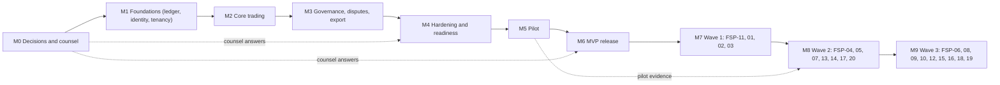
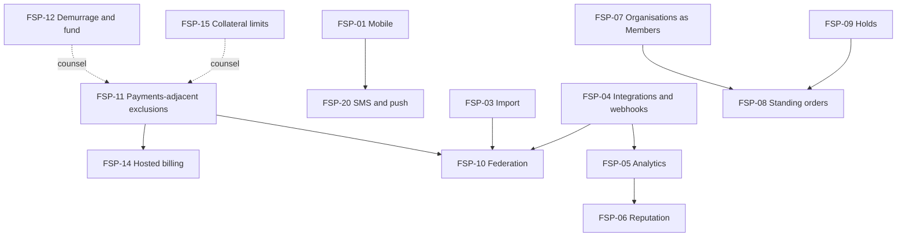

# 13 — Assumptions, Risks, Decisions and Roadmap

| Field | Value |
|---|---|
| Status | Draft |
| Owner role | Product owner (register keeper); Product architect for roadmap sequencing |
| Last updated | 2026-10-21 |
| Scope | The authoritative registers of assumptions (`ASM-`), risks (`RSK-`) and decisions (`DEC-`) for Circula; the decision-log and ADR process; the roadmap separating MVP foundations from deferred sub-specifications, with milestones M0 to M6 and a dependency graph |
| Depends on | [00 — Conventions](00-conventions.md) (canon 5.5 and 5.8 item 8); all other specs 01 to 19 as sources; [prior-art note](../notes/research-prior-art-mutual-credit.md) |
| Open questions | This document is the home of open questions: see section 5 (decisions). Legal questions are held in [19](19-legal-and-regulatory-open-questions.md) and cross-linked here |

## 1. Purpose and scope

Other specifications state uncertain choices as local labels (`VIS-OD-n`, `SEC-OD-n`, `DEC-DAT-n`, assumption labels such as `A-DAT-3`) and defer to this document. This document:

1. Registers every **assumption** the design relies on (section 3).
2. Registers **risks** of every kind, including the mutual-credit failure modes documented in the prior-art note (section 4).
3. Registers every **decision**: the 14 canon baseline defaults D-01 to D-14, every local open decision labelled `*-OD-n` across the specs (107 labels: 97 in docs 01 to 11, 15 and 17, and 10 in doc 12), the `DEC-DAT-n` and `DEC-PRT-n` constants, and the flagged decisions in docs 03, 10, 15 and 16, grouped by theme, de-duplicated, and cross-referenced by alias (section 5).
4. Defines the decision-log template and the ADR process (section 6; ADR folder [`docs/decisions/`](../decisions/README.md)).
5. Sets the roadmap: MVP foundations, a list of deferred sub-specifications with dependency order, and milestones M0 to M6 with entry and exit criteria (section 7).

Nothing here is a legal conclusion. Legal, tax and regulatory matters are routed to [19](19-legal-and-regulatory-open-questions.md); where a decision depends on counsel its status says so.

## 2. Definitions used here

Terms are defined in [14 — Glossary](14-glossary.md); this document adds only register vocabulary.

| Term | Meaning |
|---|---|
| **Alias** | A local label used in another document (for example `SEC-OD-6`, `POL-A2`, `DEC-DAT-4`) that maps to exactly one `DEC-` or `ASM-` entry here. Aliases are never reused or renumbered. |
| **Merged decision** | One `DEC-` entry that answers several aliases because they ask the same question. All aliases are listed on the entry. Where merged aliases disagree on the default, the entry says **RECONCILE** and section 5.5 lists it. |
| **Owner role** | The accountable role, not a person. Roles: Product owner, Product architect, Engineering lead, Security lead, Operations lead, UX lead, QA lead, Data protection lead, Governance lead (Network admin representative), Counsel (via product owner). |
| **Needed-by** | The milestone (M0 to M6, section 7.3) by whose **entry** the decision must be Accepted (or deliberately kept as a default with the owner's sign-off). |
| **Roadmap labels** | `FSP-nn` identifies a future feature specification in section 7.2. These are roadmap labels, not requirement-ID prefixes (they are not in the [prefix registry](00-conventions.md#21-prefix-registry-owner-document)). |

Priority and rating scales used in the risk register: Likelihood and Impact are **Low / Medium / High**; exposure is the pair, reviewed at every milestone exit.

## 3. Assumption register

An assumption is a premise the design depends on that is not itself a requirement. If it proves false, the impact column says what breaks. Local assumption labels from other documents (for example `A-DAT-1`, `A-PRT-2`, `A-1` of doc 17) are mapped to these entries in section 5.4; local labels that offered alternatives are registered as decisions instead.

| ID | Statement | Source | Impact if wrong | Validation method | Owner role |
|---|---|---|---|---|---|
| ASM-001 | Typical Networks have 30 to 300 Members; the design envelope is 10 to 2,000 Members per Network and 1 to several hundred Networks per deployment (planning figures, not promises). | 01 section 4; VIS-OD-2 | Performance, ledger serialisation and support models mis-sized; DEC-016 must be re-decided | Pilot sizing at M5; load tests against the committed envelope (ARC-040) | Product owner |
| ASM-002 | Networks are run by volunteer administrators with limited time; admin tooling must reduce routine work rather than assume dedicated staff. | 01; 02; prior-art note 2.4 | Admin workload features (approvals, reminders, delegation) are insufficient; burnout (RSK-004) | Admin interviews in M5 pilot; median application-approval time (VIS-032) | Product owner |
| ASM-003 | Members have an email address and a current evergreen browser; responsive web is sufficient for MVP (no native app). | 01 section 10; 08; DEC-112 | Adoption excluded for part of the audience; PWA/native work (FSP-01) pulled forward | Pilot onboarding survey; browser statistics | UX lead |
| ASM-004 | A Platform Operator organisation for hosted use exists outside this repository; its staffing, funding and legal form are not specified here. | 11 section 15 | Hosted mode cannot launch; hosting terms and support SLAs cannot be offered; RSK-027 | Confirm operator entity and funding before M4; decide DEC-001 scope accordingly | Product owner |
| ASM-005 | The chosen datastore supports consistent backups, point-in-time recovery and the per-account serialisation needed by posting. | 11 section 15; 06 | Recovery and posting guarantees (INV-002, INV-009) cannot be met on the chosen stack | Stack ADR spike at M1 entry: serialisation, PITR and restore-with-reconciliation proof | Engineering lead |
| ASM-006 | The deployment has a working message transport (for example SMTP or a provider); if not, the degraded mode of NTF-049 applies. | 17 A-2 | Email-dependent flows (invitations, recovery, notices) fail; Members miss deadlines (RSK-025) | Deployment checklist and transport health check in M4 | Operations lead |
| ASM-007 | MVP verified channels are in-app notifications and the sign-in email only. | 17 A-1; DEC-132 | Recovery and security alerts depend on one channel; account takeover resilience weaker (RSK-033) | Security review at M4; pilot incident log | Security lead |
| ASM-008 | The Member display name is the only person-identifying text in notices. | 17 A-3 | Notices leak identity or Network membership; privacy complaints | Notice template review (NTF) and privacy review at M2 | Data protection lead |
| ASM-009 | Event keys in doc 17 are catalogue identifiers, not requirement IDs. | 17 A-4 | Traceability check reports false dangling references | Traceability check configuration at M0 | Product architect |
| ASM-010 | Time-sortable identifiers expose the creation time of Memberships and Listings to anyone who sees the identifier (accepted under D-03). | 06 A-DAT-1 | Privacy objection; need UUIDv4 for member-facing entities | Privacy review of identifier exposure at M1; counsel note via LEG-Q-25 | Data protection lead |
| ASM-011 | Network administrators can read all Journal Entries of their Network irrespective of balance_visibility (canon 5.8 item 6). | 06 A-DAT-9; 18 A-PRT-4; 00 5.8 | Admin-visibility promise conflicts with Member privacy expectations; FR-EXP-008 wording must change | Counsel review of privacy notice (LEG-Q-25); usability test of disclosure copy | Product owner |
| ASM-012 | Pseudonymous references to a closed person (ordinal, context in descriptions) may let counterparties infer identity; the design reduces but does not eliminate this. | 06 A-DAT-8; D-09 | Erasure claims overstated; regulator or member complaint (RSK-042) | Counsel review (LEG-Q-27); anonymity-set analysis in M3 | Data protection lead |
| ASM-013 | Ordering uses per-Account sequence and (posted_at, journal_entry_id); no Network-wide gapless commit order is required. | 06 A-DAT-7 | Auditors or integrations expecting a global sequence reject exports | Review with early adopters; export-schema review (PRT) | Product architect |
| ASM-014 | ZIP is an acceptable container for export packages. | 18 A-PRT-1 | Tooling friction for some environments | Test with target tools at M3 | Engineering lead |
| ASM-015 | Seven days is the maximum lifetime of any generated export artifact. | 18 A-PRT-2 | Members miss download; support load | Pilot feedback; compare with DEC-141 | Product owner |
| ASM-016 | Exports for users who are only applicants contain application data only. | 18 A-PRT-3; PER-032 | Subject-access request incomplete | Counsel check against LEG-Q-28 | Data protection lead |
| ASM-017 | Hash and digest definitions are defined once in doc 06 and cited by doc 18. | 18 A-PRT-5 | Divergent definitions break verification tools | Traceability check; cross-doc review at each baseline | Product architect |
| ASM-018 | The credit unit is a community accounting unit with no stated equivalence to national currency; Members accept this and Networks do not market it as an investment or money (INV-014). | 00 5.4; 16 POL-A9 | Regulatory classification risk rises (RSK-040, RSK-048); preset values read as prices | Counsel review of copy and presets (LEG-Q-18); comprehension test (VIS-027) | Counsel (via product owner) |
| ASM-019 | Members accept that every member-initiated Trade needs counterparty acceptance (no unilateral debit) even though it adds friction. | 00 D-06 | Abandonment of proposals; expiry rate above 30 percent | Proposal outcome measure (VIS-028) in pilot | Product owner |
| ASM-020 | Without holds (D-05), two pending Trades can each pass proposal checks and only those that fit at acceptance time succeed; Members tolerate the resulting rejections. | 03 A-6; D-05 | Frustration, support tickets; pressure to add reservations (FSP-09) | Pilot support-ticket analysis; usability test on rejection messaging | UX lead |
| ASM-021 | Canon amendments in 5.8 (INV-015, INV-016, extra System Account, transaction types, INV-003 exceptions, identity on the Network record) are accepted by the canon owner and every doc follows them. | 00 5.8; 03 A-3, A-4; 06 A-DAT-2, A-DAT-6 | Specs diverge; traceability failures | Canon owner sign-off at M0; traceability check | Product architect |
| ASM-022 | Per-account serialisation of postings suffices at the committed envelope without sharding or a single global writer. | 05 section 7; 06 | Throughput or latency targets (VIS-024) missed; re-architecture | Load test at M4; soak test (VIS-036) | Engineering lead |
| ASM-023 | Counsel can be engaged for at least the pilot jurisdiction(s) before M4, and answers to launch-blocking LEG-Q questions arrive in time. | 19; 00 section 4 | Launch delayed or shipped with unreviewed legal exposure (RSK-054) | Engagement letter and question triage at M0 | Counsel (via product owner) |
| ASM-024 | Pilot Networks are small, non-commercial communities (time-banks, local trading circles) rather than large business exchanges. This is a planning assumption, not a legal conclusion. | 01 VIS-OD-5; 19 | Pilot may trigger reporting or licensing duties assumed absent; LEG-Q-01 to LEG-Q-15 | Counsel triage by jurisdiction before pilot recruitment | Counsel (via product owner) |
| ASM-025 | Most Members act in good faith and join through existing social ties; abuse is a minority behaviour mitigated by limits, visibility and moderation. | prior-art note 2.4 | Higher fraud and conflict than controls handle (RSK-009, RSK-005) | Pilot abuse log; velocity/concentration alert tuning (SEC-OD-7) | Security lead |
| ASM-026 | Transactional email deliverability is adequate for security-critical flows such as the 72-hour recovery notifications. | 09; 17 | Recovery and invitations silently fail (RSK-025, RSK-032) | Deliverability monitoring in pilot (NTF bounce thresholds) | Operations lead |
| ASM-027 | Pilot Networks operate in English; no right-to-left or non-Latin layout is needed in MVP (D-13). | 00 D-13 | Pilot recruitment limited; pressure to ship a second language | Pilot recruitment screen; FSP-02 trigger | Product owner |
| ASM-028 | An on-call rota for Sev-1 incidents on hosted deployments can be staffed outside business hours. | 11; DEC-023 | Hosted SLOs missed (RSK-028) | Roster confirmed before M5 | Operations lead |
| ASM-029 | WCAG 2.2 AA is achievable for MVP journeys with responsive web and no native client. | 08; D-14 | VIS-033 gate fails; rework | Early accessibility prototype review at M2; audit at M4 | UX lead |
| ASM-030 | An open-source licence can be chosen that satisfies adopters, contributors and counsel. | 01 VIS-OD-1 | Contributions and hosted forks blocked (RSK-045) | ADR at M0 | Product owner |
| ASM-031 | Time-bank style 'hour' units (60-minute convention) are a Network matter, not a Platform rule. | 01 VIS-OD-5 | Preset copy implies an equivalence the Platform does not intend | Preset review with counsel; pilot feedback | Product owner |
| ASM-032 | The repository currently has no code and no licence; the spec set (docs 00 to 19, notes) is the only input to engineering. | 01 VIS-OD-1; 00 | Hidden prior decisions surface late | Repository audit at M0 | Product architect |
| ASM-033 | Policy presets are unit-relative; limits expressed as multiples of typical activity are a human choice by the Network. | 16 POL-A9 | Networks copy preset numbers as if they were prices | Preset copy review; usability test | Product owner |
| ASM-034 | The prior-art research note relied on search summaries rather than primary sources; its claims marked UNVERIFIED are not design inputs until checked. | notes/research-prior-art-mutual-credit.md (method caveat, section 8) | Mitigations based on shaky evidence (for example Sardex limit ratios) | First-hand verification of cited sources before M0 exit; record result in the notes | Product architect |

## 4. Risk register

Categories: product, technical, operational, legal, security, adoption (combinations noted). Mutual-credit failure modes are marked **mutual-credit** and are derived from the [prior-art note](../notes/research-prior-art-mutual-credit.md) section 2.4 (note: several source claims there are marked UNVERIFIED, see ASM-034). Linked IDs reference requirements, invariants, decisions, assumptions and legal questions that exist in the specs. Residual exposure is reviewed at each milestone exit (section 7.3).

| ID | Category | Risk | Likelihood | Impact | Mitigation | Trigger (early warning) | Owner role | Linked IDs |
|---|---|---|---|---|---|---|---|---|
| RSK-001 | Adoption / mutual-credit | Critical mass and thin liquidity: too few Offers and Requests for Members to trade, so the Network stalls (failure mode in LETS studies). | High | High | Directory with Offers/Requests (FR-LST); onboarding prompts to post an Offer; pilot sized to existing communities; activation target tracked (VIS-026) | Activation below 40 percent at 30 days or fewer than 1 completed Trade per 5 Members per month | Product owner | VIS-026, VIS-028, DEC-017, DEC-025 |
| RSK-002 | Adoption / mutual-credit | Permanent deficits: Members stay at their negative floor while creditors become disenchanted and leave. | High | High | Configurable credit_limit and max_balance; balance visibility to admins; limit tightening by admins; departure settlement modes; flags for stagnant deficits (FR-MEM-020 style visibility) | Share of Members at floor above Network-set threshold for 90 days; creditor departure rate | Network Administrator | INV-005, INV-006, FR-ADM-001, DEC-060, DEC-032 |
| RSK-003 | Product / mutual-credit | Credit limits set arbitrarily or opaquely (too high invites default, too low suppresses trade). | Medium | High | Presets as starting points not advice (POL-A9); visible limits; change-notice rules (D-11); research-backed guidance in help text; policy history | Dispute or write-off rate spike; Admin requests for limit guidance | Product owner | DEC-025, DEC-011, ASM-033 |
| RSK-004 | Operational / mutual-credit | Volunteer-admin burnout and key-person risk: the Network collapses when its only administrator leaves. | High | High | Admin quorum and delegation, audit log, reminders (FR-NET-007, FR-ADM-011, FR-ADM-019, FR-NTF-007); recovery nomination procedure (doc 10); recommend 2+ admins | Single admin active for over 60 days; admin inactivity flag | Network Administrator | DEC-024, DEC-071, ASM-002 |
| RSK-005 | Adoption / mutual-credit | Trust deficit among strangers leads Members to avoid trading with unknown peers. | Medium | Medium | Invite or approval default (D-10); profiles; lower initial limits; dispute path; visible history | Proposal decline rate high for new Members | Product owner | DEC-010, DEC-025 |
| RSK-006 | Adoption / mutual-credit | Offers and needs mismatch; time-rich/time-poor or money-rich disengagement; no non-trade contribution path. | Medium | Medium | Requests (not only Offers); categories; moderation; deferred matching (FSP-06 and listings extension); Network-run events outside the Platform | More than half of published Listings have no Trade in 60 days | Product owner | FR-LST-001, VIS-028 |
| RSK-007 | Product / mutual-credit | Hoarding: Members accumulate positive balances and stop spending, starving liquidity. | Medium | Medium | Optional max_balance; balance visibility; reminders; deferred demurrage/community fund replenishment (FSP-12) with counsel gate | Share of balance held by top 10 percent of Members above Network threshold | Network Administrator | INV-006, DEC-050, INV-014 |
| RSK-008 | Adoption / mutual-credit | Dormant members: inactive Members hold balances or limits, and the directory fills with stale Listings. | High | Medium | inactivity_threshold_days; dormancy flag (FR-MEM-020, flag only); listing archive; reactivation prompts | Dormant share above 30 percent | Network Administrator | FR-MEM-020, FR-LST-001 |
| RSK-009 | Security / mutual-credit | Collusive balance inflation, sybil accounts, or a bad actor taking credit then disappearing. | Medium | High | Approval or invite membership; new-member limits; admin alerts on velocity and counterparty concentration (SEC-OD-7); dispute path; quorum for large Adjustments; audit | Alerts on concentration; repeated disputes against one Member | Security lead | DEC-072, DEC-025, INV-012, ASM-025 |
| RSK-010 | Product / mutual-credit | Member departs with a negative balance (or a large positive one) and the loss is socialised or disputed. | Medium | High | Explicit versioned departure_settlement_mode (settle, write_off, community_fund); INV-016 zero balance on closure; settlement window; counsel on write-offs (LEG-Q-23) | Departing Memberships with unsettled balance at window end | Governance lead (Network admin representative) | INV-016, DOM-037, DEC-032, LEG-Q-23 |
| RSK-011 | Operational / mutual-credit | Single-maintainer software: project depends on one or two people; documentation or domain lapses (Community Forge, Credit Commons pattern). | Medium | High | Spec-first project; open governance; permissive contribution path once licence settled; ADR record; documented self-host path (D-01, ARC-028) | Fewer than 2 active maintainers for 90 days | Product owner | DEC-015, DEC-001, ASM-030 |
| RSK-012 | Legal / adoption | Lack of institutional recognition and tax uncertainty discourages business Members. | Medium | Medium | Export for Members' own record-keeping (doc 18); no tax assertions; counsel on LEG-Q-01 to LEG-Q-05; clear disclaimers | Pilot Members ask for tax guidance; counsel advises reporting duties | Counsel (via product owner) | LEG-Q-01, LEG-Q-02, LEG-Q-03, LEG-Q-04, LEG-Q-05, ASM-024 |
| RSK-013 | Legal / product | Unit perceived as money, a debt, a deposit or an investment (wording such as Earned/Spent, 'owe', 'balance', 'pay') attracts regulatory or consumer-law exposure. | Medium | High | Banned terms in glossary; INV-014 (no redemption, interest, fiat conversion); comprehension test (UX-112); counsel copy review; reserved-term warnings | Counsel advises wording risk; user test shows money framing | UX lead | INV-014, DEC-114, DEC-117, DEC-061, LEG-Q-08, LEG-Q-09, LEG-Q-18 |
| RSK-014 | Operational / mutual-credit | Dispute backlog and conflicted reviewers: small Networks have no unconflicted Reviewer; remedies stall. | Medium | Medium | Conflict check, auto-escalation, SLA tracking (VIS-029), response period, two-step execution; outside-process route in doc 10 | Disputes older than 2 x SLA | Governance lead (Network admin representative) | DEC-029, DEC-046, DEC-028, VIS-029 |
| RSK-015 | Product / UX | Members misread balance and available credit (positive versus negative, limit remaining). | Medium | High | Balance semantics in UI, meaning sentence, usability study with 90 percent comprehension target (VIS-027, UX-112) | Comprehension below target; support tickets on balance meaning | UX lead | VIS-027, UX-112, DEC-117 |
| RSK-016 | Technical | Concurrent Trades overdraw a Member or break limits. | Low | High | Atomic ordered-lock posting (ARC-009); INV-005/006; concurrency and soak tests (VIS-036, LIF-051) | Any limit-breach or duplicate posting in test or production | Engineering lead | ARC-009, INV-002, INV-005, DEC-086, DEC-092 |
| RSK-017 | Technical | Ledger corruption or cache drift not detected, so balances differ from the sum of postings. | Low | High | Reconciliation R1 to R14 (DAT-045); automatic halt on Critical failure (DAT-047); restore with reconciliation; INV-008 | Reconciliation fail; VIS-031 non-zero | Engineering lead | INV-007, INV-008, DAT-045, DEC-094, DEC-095 |
| RSK-018 | Technical | Load exceeds design envelope or latency target is missed. | Medium | Medium | Committed envelope and tests (VIS-024, ARC-040); per-account serialisation; capacity monitoring | p95 completion latency over 2 s | Product architect | DEC-016, ARC-040, ASM-022, VIS-024 |
| RSK-019 | Technical | Client retries cause duplicate postings or conflicting idempotency semantics across docs. | Medium | High | INV-009; idempotency keys (API-085, API-086); reconcile TTL differences; contract tests | Duplicate Journal Entry detected; key reuse errors in logs | Engineering lead | INV-009, API-085, API-086, DEC-090 |
| RSK-020 | Technical | Migrations pause or corrupt ledger data. | Low | High | Rehearsal on production-sized copy (DAT-086); reconciliation after migration; INV-003 migration exception audited | Migration exceeds pause bound | Operations lead | DAT-086, DEC-105, INV-003 |
| RSK-021 | Technical / schedule | Reference stack decision delayed or mismatched with assumed capabilities (PITR, row policies, serialisation). | Medium | High | Stack ADR with spike at M1 entry; ADR process (0001); keep specs neutral (D-02) | No stack ADR 4 weeks after M0 exit | Engineering lead | DEC-002, ASM-005, DEC-080 |
| RSK-022 | Product / process | Specification inconsistency across documents (for example differing defaults for step-up recency, export window, idempotency TTL, API deprecation) causes rework or untestable requirements. | High | Medium | Reconciliation list in section 5.5 of this register; traceability check; single owner per rule (00 section 2.2) | Traceability check failures; conflicting tests | Product architect | DEC-067, DEC-119, DEC-108, DEC-090, VIS-037 |
| RSK-023 | Technical | Export/import does not reproduce balances, losing trust and portability promise. | Low | High | Round-trip test (VIS-035); schema versioning; ledger recomputation check | Round-trip mismatch | Engineering lead | VIS-035, DEC-136 |
| RSK-024 | Product | Policy changes surprise Members (notice, versioning) causing disputes. | Medium | Medium | Prospective changes with notice (D-11); reminder (NTF-OD-5); policy_version stamp on Trades | Disputes citing policy change | Product owner | DEC-011, DEC-127, DEC-058 |
| RSK-025 | Operational | Notification failure or delay means Members miss proposals, expiries, disputes or recovery notices. | Medium | Medium | Outbox and degraded mode (ARC-006, NTF-049); in-app mirror; retry and bounce policy; dispatch latency monitoring | Dispatch latency above floor; bounce rate high | Operations lead | DEC-123, DEC-130, ASM-006, ASM-026 |
| RSK-026 | Operational | Backup is unusable when needed (restore failure, missing reconciliation). | Low | High | Restore drills (OPS-026), RPO/RTO, restore-then-reconcile, VIS-034 | Failed drill | Operations lead | OPS-026, DEC-120, DEC-122, VIS-034 |
| RSK-027 | Operational | Hosted Platform Operator lacks funding, staff or legal form to run hosted Networks. | Medium | High | Self-host path from same artifact (D-01, ARC-028); Network package export; defer subscriptions; confirm operator before M4 | No operator entity by M3 | Product owner | ASM-004, DEC-001, DEC-020, ARC-028 |
| RSK-028 | Operational | Support load or Sev-1 coverage exceeds capacity during pilot. | Medium | Medium | Runbooks, support tiers, business-hours plus Sev-1 on-call, in-product help | Ticket backlog; missed Sev-1 response | Operations lead | DEC-023, ASM-028 |
| RSK-029 | Operational | Self-hosters misconfigure, skip patches or skip backups. | High | Medium | Secure defaults, install checks, upgrade guidance, documented minimum RPO/RTO | Deployment audit finds unpatched or unbacked-up installs | Operations lead | DEC-120, DEC-075 |
| RSK-030 | Operational | Hosted operator disappears or abandons the project; Networks are stranded. | Low | High | Complete Network package export (ARC-024, ARC-046); self-host import; escrowed docs | Operator notice of closure | Product owner | ARC-024, ARC-046, DEC-119 |
| RSK-031 | Security | Operator or support break-glass access misused to read content or change balances. | Low | High | No posting powers for operators (INV-012); break-glass logging, notice and expiry; dual control for hosted | Break-glass event without incident ticket | Security lead | DEC-073, DEC-079, ARC-014, ARC-026 |
| RSK-032 | Operational | Single email provider or sub-processor dependency creates outage or compliance exposure. | Medium | Medium | Message transport abstraction; degraded mode; sub-processor list (LEG-Q-31) | Provider outage or policy change | Operations lead | ASM-006, LEG-Q-31 |
| RSK-033 | Security | Account takeover via weak authentication or recovery flow. | Medium | High | Passkey/TOTP; 72-hour recovery delay with notifications; restricted period; rate limits (SEC-055) | Anomalous recovery attempts; takeover report | Security lead | DEC-065, DEC-066, DEC-069, DEC-069 |
| RSK-034 | Security | Compromised or malicious administrator makes harmful Adjustments, especially in single-admin Networks. | Low | High | Adjustments are visible to the Member (INV-012); quorum; delayed large Adjustments; alerts; audit | Adjustments above alert threshold | Security lead | DEC-071, DEC-072, INV-010, INV-012 |
| RSK-035 | Security | Tenant isolation failure exposes one Network's data to another. | Low | High | Application tenancy checks; optional second layer (row policies); isolation tests; INV-011 | Cross-tenant read in test or production | Security lead | DEC-080, INV-011 |
| RSK-036 | Security | Dispute evidence uploads carry malware or personal data, or leak through logs and email. | Medium | Medium | File type/size limits; scanning; field-level encryption option; no free text in email | Malware detection; evidence in log | Security lead | DEC-045, DEC-076, DEC-129 |
| RSK-037 | Security | Directory scraping, enumeration or abuse of public listings. | Medium | Medium | directory_visibility default members; rate limits; neutral errors | Scraping alerts | Security lead | DEC-070, DEC-010 |
| RSK-038 | Security | Supply-chain compromise of dependencies or build pipeline. | Medium | High | Build integrity target (SLSA L2), dependency review, SBOM | Advisory affecting a dependency | Security lead | DEC-077, DEC-075 |
| RSK-039 | Security / adoption | Phishing or social engineering exploits notification emails and member trust. | Medium | Medium | No balances or links to sensitive actions in email; neutral subjects option; step-up for sensitive actions | Phishing reports | Security lead | DEC-124, DEC-134, DEC-067 |
| RSK-040 | Legal | Regulatory classification (money transmission, deposit, lending, payment service, barter exchange) in some jurisdictions. | Medium | High | No redemption/cash-out/interest/fiat (INV-014); counsel triage by pilot jurisdiction; no funds held by operator | Counsel flags classification risk; any proposal to add fees or redemption | Counsel (via product owner) | LEG-Q-01, LEG-Q-06, LEG-Q-07, LEG-Q-08, LEG-Q-09, LEG-Q-10, LEG-Q-12, VIS-039 |
| RSK-041 | Legal | Tax and barter reporting duties (income tax, VAT/GST, marketplace reporting) on Members or Networks. | Medium | Medium | No tax assertions in product; export support; counsel; disclaimers | Counsel advice or Member queries | Counsel (via product owner) | LEG-Q-02, LEG-Q-03, LEG-Q-05 |
| RSK-042 | Legal / privacy | Erasure requests conflict with the append-only ledger and audit retention. | Medium | High | Pseudonymise on closure (D-09); opaque IDs in ledger; two-phase erasure (DAT-073); counsel | Counsel disagrees with design; complaint | Data protection lead | DEC-009, DEC-101, DEC-106, LEG-Q-27 |
| RSK-043 | Legal / privacy | Controller/processor allocation unclear between Network, admins and Operator. | Medium | High | D-08 default; DPA template; privacy notices; counsel | Counsel changes allocation | Counsel (via product owner) | DEC-008, LEG-Q-24, LEG-Q-25 |
| RSK-044 | Legal | Minors join despite policy, or youth accounts requested by time-banks. | Low | Medium | Minimum age 18; terms; defer youth model | Network requests youth accounts | Counsel (via product owner) | DEC-074, LEG-Q-30 |
| RSK-045 | Legal / product | Licence choice blocks contributors or hosted forks, or has unreviewed legal consequences. | Medium | Medium | Decide at M0 with counsel; document contribution model | No licence at first external contribution | Product owner | DEC-015, ASM-030 |
| RSK-046 | Legal | Accessibility law scope (EAA, ADA, Equality Act) applies to hosted web app. | Medium | Medium | WCAG 2.2 AA target (D-14); audit; accessibility statement; counsel | Complaint or audit failure | UX lead | DEC-014, VIS-033, LEG-Q-34 |
| RSK-047 | Legal | Terms of service, liability allocation and unfair-terms exposure for Operator, admins and Members. | Medium | Medium | Terms drafted by counsel before hosted launch; Network charter templates | No reviewed terms at M4 | Counsel (via product owner) | LEG-Q-20, LEG-Q-21, DEC-020 |
| RSK-048 | Legal / product | Marketing or copy implies investment, appreciation, interest or fiat redemption. | Low | High | Copy review gate; banned terms; counsel on LEG-Q-18; VIS-039 gate | Marketing draft mentions value or returns | Product owner | INV-014, LEG-Q-18, VIS-039 |
| RSK-049 | Legal | AML/sanctions or geographic restrictions apply to onboarding across borders. | Low | Medium | Counsel triage; no funds flows; geographic scope of pilot limited | Cross-border Network proposed | Counsel (via product owner) | LEG-Q-35, LEG-Q-06 |
| RSK-050 | Product | Scope creep adds money-like or unilateral features (Out items) without a decision. | Medium | High | VIS-039 gate; register process; ADR for any Out item; roadmap in section 7 | Request for payments-adjacent or unilateral features | Product owner | VIS-039, VIS-022 |
| RSK-051 | Adoption | English-only MVP limits recruitment of target communities. | Medium | Medium | i18n-ready from day one (D-13); localisation spec (FSP-02) triggered by demand | Two or more serious pilot candidates need another language | Product owner | DEC-013, ASM-027 |
| RSK-052 | Adoption / product | Pilot evidence invalid: very small, self-selected or unrepresentative pilot Networks. | Medium | Medium | Pilot entry criteria; success thresholds read as indicators; two or more Networks; qualitative interviews | Fewer than 2 Networks or 50 Members active | Product owner | DEC-017, VIS-026 |
| RSK-053 | Adoption / privacy | Telemetry opt-in yields no data, so success measures cannot be computed. | Medium | Low | Per-Network aggregate computation for that Network's own admins (VIS-010); opt-in aggregate to Operator | No Network opts in | Product owner | DEC-018, VIS-010 |
| RSK-054 | Schedule / legal | Counsel availability delays launch-blocking answers. | Medium | High | Early engagement; question triage by milestone gate; pilot limited to low-risk jurisdictions | Open launch-blocking LEG-Q at M3 exit | Product owner | ASM-023, ASM-024, LEG-Q-08, LEG-Q-27, LEG-Q-33 |

## 5. Decision register

### 5.1 Conventions

- **Status values:** *Proposed default* (a recommended default exists and is used by the specs until changed); *Accepted* (approved by the decision owner, ADR or dated sign-off linked); *Rejected*; *Superseded by DEC-nnn*; *Withdrawn*. Every entry below is **Proposed default**; status changes are made in the same change as the ADR or sign-off (section 6). A default marked *counsel* additionally needs written advice recorded against the cited `LEG-Q-nn` ([19](19-legal-and-regulatory-open-questions.md)) before it is Accepted.
- **Needed-by** uses milestones M0 to M6 (section 7.3). "Consequence of delay" says what cannot be baselined, built or tested if the decision stays open.
- **Source** gives the owning document number and section of the original label; the original document keeps its own text and defers to this register.
- **De-duplication:** an entry lists all aliases. Search this page for any local label (for example `UX-OD-12`) to find its `DEC-` entry, or use the crosswalk in section 5.4.
- Where the same question has different defaults in different documents the entry shows **RECONCILE** (see 5.5). Until reconciled, the lower-numbered owning document in the Source column is not authoritative; this register is.

### 5.2 Summary

The register holds **152 decisions** (DEC-001 to DEC-152) covering 196 aliases (14 canon defaults, 107 `*-OD-n` labels, 20 `DEC-DAT-n`, 14 `DEC-PRT-n`, and 41 other flagged labels from docs 03, 10, 15, 16 and 06). Counts are checked by the traceability script (section 5.4).

### 5.3 Register by theme

#### A. Canon baseline defaults (D-01 to D-14)

Registered from [00 section 5.5](00-conventions.md#55-baseline-defaults-to-be-registered-as-dec--entries-with-status-proposed-default-in-doc-13). DEC-001 to DEC-014 map one-to-one to D-01 to D-14 (same number).

| DEC | Aliases | Question | Options | Recommended default | Consequence of delay | Decision owner | Needed by | Status | Source |
|---|---|---|---|---|---|---|---|---|---|
| DEC-001 | `D-01` | Deployment model | Hosted-only; self-host-only; one codebase supporting both Operator-hosted multi-tenant and self-hosted installs (hosted subscriptions out of MVP) | One codebase, both models; no hosted subscriptions in MVP | Topology scope (ARC), runbooks (OPS) and hosting terms cannot be fixed; M4 operations work stalls | Product owner | M0 | Proposed default | 00 5.5 |
| DEC-002 | `D-02` | Technology neutrality and reference stack | Commit a stack now; keep specs technology-neutral and choose a reference stack by ADR | Technology-neutral specs; reference stack chosen by ADR at M1 entry | No code can start; datastore-dependent requirements (serialisation, PITR, row policies) stay unverified | Product architect | M1 | Proposed default | 00 5.5 |
| DEC-003 | `D-03` | Identifier format | UUIDv7; UUIDv4; ULID | Opaque, time-sortable, non-guessable (UUIDv7 recommended) | Schema cannot be frozen; a later change is a ledger migration (see A-DAT-1 in ASM) | Engineering lead | M1 | Proposed default | 00 5.5 |
| DEC-004 | `D-04` | Ledger model | Double-entry Journal Entry + Postings with transactionally maintained cached balance; event-sourced only; balance-only | Double-entry with cached balance per account | Blocks DAT work and every posting requirement; INV-001 to INV-008 cannot be built | Product architect | M1 | Proposed default | 00 5.5 |
| DEC-005 | `D-05` | Funds holds and reservations | No holds (limits enforced at posting time); reserve on proposal | No holds in MVP; pending Trades informational | Trade UX copy and FR-TRD proposal checks stay ambiguous; consequence in ASM (no-holds race) | Product owner | M0 | Proposed default | 00 5.5 |
| DEC-006 | `D-06` | Counterparty acceptance | Counterparty must accept every member-initiated Trade; pre-authorised standing orders | Acceptance required; standing orders deferred (FSP-08) | Trade state machine and INV-012 wording cannot be baselined | Product owner | M0 | Proposed default | 00 5.5 |
| DEC-007 | `D-07` | Identity model | Email account with passkey/TOTP-capable authentication, one login many memberships; per-Network accounts only | One login, many memberships; email + passkey/TOTP | Authentication, recovery and session specs cannot be baselined; affects data export scope | Security lead | M0 | Proposed default | 00 5.5 |
| DEC-008 | `D-08` | Data controller split | Network (admins) controller and Operator processor for hosted; joint controllers | Network as controller, Operator as processor (hosted); needs counsel (LEG-Q-24) | Privacy notices, DPA, erasure procedure and support-access rules cannot be finalised; launch blocked | Counsel (via product owner) | M0 | Proposed default (counsel) | 00 5.5 |
| DEC-009 | `D-09` | Erasure versus ledger | Anonymise/pseudonymise personal data at closure, ledger keeps opaque IDs only; retain identity for a fixed period | Anonymise on closure; ledger keeps opaque account IDs | Phase-1/Phase-2 erasure design (DAT-073 onward) and export content cannot be fixed; counsel review (LEG-Q-27) blocked | Data protection lead | M0 | Proposed default | 00 5.5 |
| DEC-010 | `D-10` | Network participation default | Invite or admin-approval default, open sign-up optional; open-only | Invite or approval default; open optional | membership_mode default and onboarding journeys unbaselined | Product owner | M0 | Proposed default | 00 5.5 |
| DEC-011 | `D-11` | Policy change notice | Prospective after notice (default 14 days) except safety fixes; immediate | 14-day default notice, safety fixes excepted | policy_notice_days default and notification set (NTF) cannot be fixed | Product owner | M0 | Proposed default | 00 5.5 |
| DEC-012 | `D-12` | Disputes and balances | Disputes do not freeze balances (remedy by Reversal/Adjustment); freeze counterparty funds | No freeze in MVP | Dispute lifecycle and remedy mechanics unbaselined; frozen-funds design would add holds (D-05) | Product owner | M0 | Proposed default | 00 5.5 |
| DEC-013 | `D-13` | Localisation | English-only UI with i18n-ready code; multi-language MVP | i18n-ready, English only in MVP | Strings may be hard-coded; later translation becomes a rewrite | UX lead | M1 | Proposed default | 00 5.5 |
| DEC-014 | `D-14` | Accessibility target | WCAG 2.2 AA; AAA partial | WCAG 2.2 Level AA | Design system and test plan lack a target; release gate VIS-033 undefined | UX lead | M0 | Proposed default | 00 5.5 |

#### B. Product scope, licensing and business model

Questions about who the Platform serves first, how it is licensed and hosted, and what is measured.

| DEC | Aliases | Question | Options | Recommended default | Consequence of delay | Decision owner | Needed by | Status | Source |
|---|---|---|---|---|---|---|---|---|---|
| DEC-015 | `VIS-OD-1` | Open-source licence and contribution model (repository has none yet) | Permissive (Apache-2.0, MIT); strong copyleft (AGPL-3.0); source-available | Strong copyleft closing the network-service gap; confirm with owner. Licensing has legal consequences: counsel | Contributors and adopters cannot lawfully reuse code; external contributions blocked | Product owner | M0 | Proposed default (counsel) | 01 12 |
| DEC-016 | `VIS-OD-2`, `ARC-OD-1` | Design envelope: Members per Network, Networks per deployment, trades per day (and the performance targets in ARC-040) | (a) 300 / 50 / 1,000; (b) 2,000 / 500 / 20,000; (c) larger | (b) as committed upper design limit; (a) as pilot envelope; (c) not precluded | Performance tests (VIS-024, ARC-040) and capacity sizing (OPS) have no target | Product architect | M0 | Proposed default | 01 12; 05 12 |
| DEC-017 | `VIS-OD-3` | Pilot success thresholds (activation 40 percent, expiry 30 percent, dispute rate 3 per 100) | Stricter; looser; report-only | Keep provisional; revisit after first pilot wave | M5 exit criteria cannot be judged; pilot may be declared a success or failure by opinion | Product owner | M4 | Proposed default | 01 12 |
| DEC-018 | `VIS-OD-4` | Telemetry: usage data flowing to the Platform Operator beyond operational necessity | None; aggregate opt-in per Network; aggregate default-on | Aggregate, opt-in per Network, no personal data | Analytics design (FSP-05) and privacy notices unbaselined; success measures (VIS-026) may lack a data source | Product owner | M2 | Proposed default | 01 12 |
| DEC-019 | `VIS-OD-5` | Intended first audience: time-banks, local trading circles, or both | Hours-only template; both with Network-chosen unit | Both; unit_scale default 2 with a one-click 'hours' preset | Preset library (POL) and onboarding copy (UX) unbaselined | Product owner | M0 | Proposed default | 01 12 |
| DEC-020 | `VIS-OD-6` | Whether the Operator may host Networks for non-member third parties in MVP | Operator-hosted only; self-host only; both (D-01) | Both per D-01; hosting terms are a business and legal matter | Hosting terms and LEG-Q-17 scope remain open; first hosted pilot cannot sign up Networks | Product owner | M4 | Proposed default | 01 12 |
| DEC-021 | `PER-OD-5` | Self-service Network creation | Operator-provisioned only; self-service with approval; open self-service | Operator-provisioned, or deployment-flag self-service (setup wizard for single-Network self-host) | FR-NET provisioning journeys and abuse controls unbaselined | Product owner | M1 | Proposed default | 02 11 |
| DEC-022 | `ARC-OD-4` | Supported topologies in MVP (T1 single-Network self-host, T2 multi-Network self-host, T3 operator multi-tenant) | T1 only; T1+T2; T1+T2+T3 | T1+T2 fully supported; T3 supported as configuration, no hosted subscriptions (D-01) | Test matrix and runbooks cannot be scoped | Product architect | M1 | Proposed default | 05 12 |
| DEC-023 | `OPS-OD-10` | Hosted support hours and Sev-1 staffing | Business hours only; extended; 24x7 | Business hours plus on-call for Sev-1 only; revisit with scale | Support SLAs in hosting terms and on-call roster cannot be committed | Operations lead | M4 | Proposed default | 11 15 |

#### C. Roles, governance and membership lifecycle

Network governance, admin powers, membership timers and departure handling. Day-count constants owned by [10](10-governance-and-network-operations.md) are bundled.

| DEC | Aliases | Question | Options | Recommended default | Consequence of delay | Decision owner | Needed by | Status | Source |
|---|---|---|---|---|---|---|---|---|---|
| DEC-024 | `PER-OD-1` | Minimum number of Network Administrators before a Network opens to Members | 1; 2 | Allow 1 with persistent warning; recommend 2 (GOV recommends 3 above 30 Members) | Network opening gate (FR-NET) unbaselined; key-person risk (RSK-004) stays unmitigated | Product owner | M2 | Proposed default | 02 11 |
| DEC-025 | `PER-OD-6` | New-member limits (probation) | None; lower initial credit_limit; limited trade counts | Lower initial credit limit via default_credit_limit; no extra mechanism | Onboarding and fraud mitigation (RSK-009) lack an agreed control | Product owner | M2 | Proposed default | 02 11 |
| DEC-026 | `PER-OD-7` | Counter-proposals on Trades | Not in MVP; single counter-offer; negotiation thread | Not in MVP (decline with note and re-propose) | Trade state machine scope uncertain; risk of scope creep | Product owner | M2 | Proposed default | 02 11 |
| DEC-027 | `PER-OD-8` | May Members see the identity of the Reviewer before assignment | Yes; no | Yes, with a right to object for conflict | Reviewer assignment flow (GOV, FR-DSP) unbaselined | Governance lead (Network admin representative) | M3 | Proposed default | 02 11 |
| DEC-028 | `PER-OD-3`, `15: L-4`, `GOV-A3` | Who executes the ledger remedy of an upheld Dispute, handling of limit breach, and how an overturned outcome is executed | Reviewer-triggered automatic; Administrator-executed; Administrator-executed with limit override via Adjustment. Overturn: counter-Adjustment vs re-open Dispute | Administrator-executed under quorum (two-step: reviewer decides, admins execute); breach handled as Adjustment never by bypassing INV-005 on a Trade; overturn by counter-Adjustment | Dispute-resolution flow and Adjustment mechanics (DOM-028, DOM-029) unbaselined; M3 slips | Product owner | M0 | Proposed default | 02 11; 15 11; 10 14 |
| DEC-029 | `PER-OD-4` | Behaviour when no unconflicted Dispute Reviewer exists | Escalate to another Administrator; escalate to external process; auto-escalated | Auto-escalated to non-party Administrators, otherwise the Network's outside process (doc 10) | Small Networks with party-admins stall disputes (RSK-014) | Governance lead (Network admin representative) | M3 | Proposed default | 02 11 |
| DEC-030 | `FR-OD-1`, `15: invitation validity` | Invitation lifetime | 3 / 14 / 30 days (7 / 14 / 30 in doc 15) | 14 days | Invitation expiry and reminder timers unbaselined | Product owner | M2 | Proposed default | 04 11; 15 11 |
| DEC-031 | `FR-OD-2` | Member invitation quota (and whether Members may invite at all in MVP) | 1 / 3 / 10 open invitations; doc 10 flags 'administrators only in MVP' | 3 open per Member where Member invitation is enabled; RECONCILE with the doc 10 default of administrators-only | Onboarding and abuse limits conflict between 04 and 10 | Product owner | M2 | Proposed default | 04 11; 10 14 |
| DEC-032 | `03: settlement window length`, `15: settlement window length` | How long a departing Membership waits for settle before the departure settlement mode is applied | 14 / 30 / 60 days | 30 days | Departure flow (DOM-037) and closure timers unbaselined | Governance lead (Network admin representative) | M3 | Proposed default | 03 10; 15 11 |
| DEC-033 | `FR-OD-8`, `POL-A4` | Quorum timeout for admin_quorum actions, and degraded quorum when too few admins remain | 3 / 7 / 14 days; degrade vs block | 7 days; degrade (documented in doc 16 section 6.1) | Sensitive-action approvals (FR-ADM-002) can stall indefinitely | Governance lead (Network admin representative) | M3 | Proposed default | 04 11; 16 9 |
| DEC-034 | `15: pending approval lifetime` | Lifetime of pending Adjustment/Reversal approvals (AJ5/RV5) | 3 / 7 / 14 days | 7 days | Pending admin actions accumulate; expiry notices (NTF) unbaselined | Governance lead (Network admin representative) | M3 | Proposed default | 15 11 |
| DEC-035 | `15: applicant review reminder` | Reminder to admins about unreviewed applications | 3 / 7 / 14 days | 7 days | Applicant journey may stall; notification catalogue incomplete | Product owner | M2 | Proposed default | 15 11 |
| DEC-036 | `GOV-A2`, `GOV-A10`, `POL-A1`, `10: flagged constants` | Platform-constant bundle in doc 10 (governance summary cadence quarterly; policy approval timeout 7 days; objection threshold 10 percent and at least 3 Members; recommended admin count; admin inactivity flag 60 then 30 days; recovery nomination threshold and 7-day wait; reviewer assignment 2 days; objection period 2 days; minimum reasoning length; Appeal windows; closure notice). Decide whether these stay platform constants or become Network parameters | Constants; add to catalog as parameters | Platform constants in MVP (smaller catalog, POL-A1); revisit after pilots | Each constant stays unverifiable; GOV and NTF timers cannot be tested | Governance lead (Network admin representative) | M3 | Proposed default | 10 14; 16 9 |
| DEC-037 | `GOV-A5` | Whether Trades that move both balances toward zero are allowed during Network closure | Settlement Trades allowed; full block (settle only by write_off or community_fund) | Settlement Trades allowed (GOV-079); doc 04 FR-NET-011 wording to be aligned | Closure procedure contradicts FR-NET-011 until aligned | Product owner | M3 | Proposed default | 10 14 |
| DEC-038 | `GOV-A9` | Member-run voting | In MVP; P2 | P2 (FSP-16) | Governance scope creep; low | Product owner | M0 | Proposed default | 10 14 |
| DEC-039 | `15: L-3`, `03: rescind departure` | Rescinding a departure (departing back to active) | Unsupported (rejoin = new Membership); allow before settlement | Unsupported in MVP | Lifecycle diagram and canon 5.3 unbaselined | Product owner | M2 | Proposed default | 15 11; 03 10 |
| DEC-040 | `15: L-5` | When the Member Account is created | At applicant (inert until active); at approve | At applicant | Schema and account-creation timing unbaselined | Engineering lead | M1 | Proposed default | 15 11 |

#### D. Trades, disputes and ledger rules

Domain rules, limits on user input and anti-abuse quotas that shape the Trade and Dispute flows.

| DEC | Aliases | Question | Options | Recommended default | Consequence of delay | Decision owner | Needed by | Status | Source |
|---|---|---|---|---|---|---|---|---|---|
| DEC-041 | `03: description length limit` | Maximum Trade description length (DOM-024) | 140 / 500 / 2,000 characters | 500 | API and UI field limits unbaselined | Product owner | M1 | Proposed default | 03 10 |
| DEC-042 | `FR-OD-6`, `15: max open proposals per member` | Proposal rate limits and open-proposal quota (TR1 anti-abuse) | 5 / 20 / unlimited open; hourly rate various | 20 open, 10 per hour | Spam and DoS protection (FR-TRD-018) unspecified | Product owner | M2 | Proposed default | 04 11; 15 11 |
| DEC-043 | `15: expiry sweep latency` | Cadence of the proposal-expiry sweep | 1 / 5 / 15 minutes | 5 minutes | Expiry behaviour in tests and notifications unbaselined | Engineering lead | M2 | Proposed default | 15 11 |
| DEC-044 | `FR-OD-10` | Dispute response period | Fixed; fraction of SLA | Half of dispute_review_sla_days | Dispute timers (FR-DSP-004) unbaselined | Governance lead (Network admin representative) | M3 | Proposed default | 04 11 |
| DEC-045 | `FR-OD-11` | Dispute evidence limits | Various | 3 files, 5 MB, image/PDF | Upload design and malware-scan scope (RSK-036) unbaselined | Security lead | M3 | Proposed default | 04 11 |
| DEC-046 | `15: automatic escalation threshold` | When open Disputes auto-escalate | None / 2x SLA / 3x SLA | 2 x dispute_review_sla_days | Stalled disputes have no backstop | Governance lead (Network admin representative) | M3 | Proposed default | 15 11 |
| DEC-047 | `15: L-2` | Outcome record of an escalated Dispute | Keep escalated terminal; allow escalated to resolved_* | Keep terminal in MVP; allow resolved_* (P1) only if canon 5.3 is amended | Dispute record may not show a final outcome; canon amendment needed first | Product architect | M3 | Proposed default | 15 11 |
| DEC-048 | `03: A-5` | Joint Reversal within dispute_window_days without a Dispute (DOM-028 a) | Joint reversal allowed; all Reversals require a Dispute | Joint reversal allowed | Reversal journeys (FR-TRD, FR-DSP) unbaselined | Product owner | M2 | Proposed default | 03 10 |
| DEC-049 | `03: A-2`, `A-DAT-4` | Limit handling for Reversal and Adjustment (exempt from INV-005/006) and the limit_flag values | Block vs flag; add limit_exceeded_by_adjustment vs reuse one value | Flag, never block the correction; add limit_exceeded_by_adjustment | Correction flows can deadlock on limits; DAT enumeration unbaselined | Product architect | M1 | Proposed default | 03 10; 06 15 |
| DEC-050 | `03: A-1` | community_fund replenishment (voluntary contributions as a distinct transaction type) | Deferred; in MVP | Deferred (P2); the System Account exists from MVP | No effect on MVP; informs FSP-12 | Product owner | M6 | Proposed default | 03 10 |
| DEC-051 | `15: L-6` | Audit Events for ordinary Trade transitions | History records only; Audit Event per transition | History only (INV-010 does not require more) | Audit volume and audit view scope unbaselined | Product architect | M1 | Proposed default | 15 11 |
| DEC-052 | `15: L-1`, `GOV-A1`, `GOV-A4` | Whether Adjustment/Reversal statuses, Appeal statuses and Network operating statuses stay local to docs 15/10 or are folded into canon 5.3 | Keep local; fold into canon | Keep local; fold into canon at next revision (canon 5.8 item 4 already points to docs 15/10/16) | Naming drift across docs; traceability check noise | Product architect | M0 | Proposed default | 15 11; 10 14 |
| DEC-053 | `FR-OD-3` | Listing photos in MVP | Yes; no | No (text only); FSP-17 | Storage, moderation and malware scope grow if undecided | Product owner | M1 | Proposed default | 04 11 |
| DEC-054 | `FR-OD-4` | Listing field limits | Various | Title 100, description 2,000 characters | API schema and UI limits unbaselined | Product owner | M2 | Proposed default | 04 11 |
| DEC-055 | `FR-OD-5` | Search freshness bound | 1 / 5 / 30 seconds | 5 seconds | Search design (index vs direct query) unbaselined | Engineering lead | M2 | Proposed default | 04 11 |
| DEC-056 | `15: max Listings per member` | Maximum Listings per Member (LS1) | 20 / 50 / unlimited | 50 | Anti-abuse quota unbaselined | Product owner | M2 | Proposed default | 15 11 |
| DEC-057 | `FR-OD-7`, `API-OD-5` | Page sizes: history default page size (FR-BAL-005) and API default/maximum page size (API-100) | 25 / 50 / 100 default; 25/100, 50/200, 100/500 for API | History default 50; API default 50, maximum 200 | List endpoints and UI paging unbaselined | Engineering lead | M2 | Proposed default | 04 11; 07 17 |
| DEC-058 | `A-DAT-3`, `POL-A3` | Which policy version governs dispute_window_days for a Trade | Snapshot of the version at completion; current version at dispute time | Snapshot at completion (policy_version stamped on the Trade) | Dispute eligibility becomes ambiguous after policy changes | Product architect | M1 | Proposed default | 06 15; 16 9 |

#### E. Network policy catalog

Parameter bounds and defaults owned by [16](16-network-policy-catalog.md).

| DEC | Aliases | Question | Options | Recommended default | Consequence of delay | Decision owner | Needed by | Status | Source |
|---|---|---|---|---|---|---|---|---|---|
| DEC-059 | `POL-A2` | Overrides above a lowered max_credit_limit | Clamp at activation (not restored); block the change; keep and cap at read | Clamp | Policy-edit validation (FR-ADM-001 to 004) unbaselined | Product owner | M2 | Proposed default | 16 9 |
| DEC-060 | `POL-A5` | Classify min_trade_amount as a sensitive (quorum) parameter | Sensitive (Q); ordinary (A) | Sensitive (Q), matching doc 10 section 4.1 | Quorum rules for policy edits unbaselined | Governance lead (Network admin representative) | M2 | Proposed default | 16 9 |
| DEC-061 | `POL-A6` | Reserved-term check on unit_name | Warn with acknowledgement; hard-reject | Warn for unit_name; hard-reject only for unit_symbol | Unit-naming flow and INV-014 risk (RSK-013) unbaselined; reserved-term list needs counsel input | Counsel (via product owner) | M2 | Proposed default | 16 9 |
| DEC-062 | `SEC-OD-14`, `GOV-A8`, `POL-A7` | Default balance_visibility | self; admins; members | admins (authority: doc 16); admins see flags under self (PER-030) | Default Network setup, privacy notice and UX balance views unbaselined | Product owner | M0 | Proposed default | 09 10; 10 14; 16 9 |
| DEC-063 | `POL-A8` | Lower bound of dispute_window_days | 3 / 7 / 14 days | 7 days | Policy validation unbaselined | Product owner | M2 | Proposed default | 16 9 |
| DEC-064 | `UX-OD-5` | Unit grammar: singular and plural forms of unit_name | Add singular/plural to unit configuration; symbol only; locale templates | Add singular/plural forms on the Network identity record, fall back to symbol (canon 5.8 item 5 already places identity on the Network) | UI copy and API unit object unbaselined | UX lead | M1 | Proposed default | 08 16 |

#### F. Identity, access and security

Authentication strength, recovery, monitoring and security-operations thresholds owned by [09](09-security-privacy-and-abuse.md), with API and ops overlaps merged.

| DEC | Aliases | Question | Options | Recommended default | Consequence of delay | Decision owner | Needed by | Status | Source |
|---|---|---|---|---|---|---|---|---|---|
| DEC-065 | `SEC-OD-1` | Password minimum length | (a) 15 for all; (b) 15 password-only, 8 with a second factor | (a) 15 for all | Authentication requirements (SEC) cannot be baselined | Security lead | M1 | Proposed default | 09 10 |
| DEC-066 | `SEC-OD-2` | Second factor for ordinary Members; ASVS level | (a) optional for Members, mandatory for roles; (b) mandatory for all; (c) ASVS L3 for admin/operator functions | (a) with ASVS L2 | Onboarding friction and account-takeover risk (RSK-033) unbalanced | Security lead | M1 | Proposed default | 09 10 |
| DEC-067 | `API-OD-1`, `FR-OD-9`, `DEC-PRT-9` | Step-up re-authentication recency for sensitive operations (policy, Adjustment, role, export). RECONCILE: API 15 min; FR and PRT 10 min; SEC 'as stated' (SEC-009) | 5 / 10 / 15 / 30 / 60 minutes; per operation | One platform value; 10 minutes (FR, PRT) or 15 (API): pick one and cite SEC-009 as owner | Three documents disagree; API tests and security tests fail on whichever is wrong | Security lead | M1 | Proposed default | 07 17; 04 11; 18 13; 09 10 |
| DEC-068 | `SEC-OD-3`, `UX-OD-6` | Session idle/absolute timeouts and session-expiry warning lead time (SEC-OD-3 also covers the step-up window, decided in the step-up entry) | Timeouts per SEC-014; warning 1, 2 or 5 minutes | As stated in SEC-014; warning 2 minutes | Session UX (UX) and security tests unbaselined | Security lead | M1 | Proposed default | 09 10; 08 16 |
| DEC-069 | `PER-OD-2`, `SEC-OD-5` | Account recovery assurance, cool-off and restricted period when no second factor or recovery code remains | Email-only immediate; email plus 72 h delay with all-channel notification; Administrator-vouched. (a) 72 h / 24 h; (b) 24 h / 24 h; (c) 7 d / 72 h | (a) email plus 72 h delay and 24 h restricted period, trade cap 10 percent of credit_limit; no admin-vouched recovery in MVP | Recovery flow unbaselined; account-takeover exposure (RSK-033) | Security lead | M1 | Proposed default | 02 11; 09 10 |
| DEC-070 | `SEC-OD-4`, `API-OD-6` | Rate-limit defaults and dispute cap (SEC-055, SEC-050; API-110) | Tighter or looser than the starting points | Starting points in SEC-055 / API-110, tuned in first beta | Abuse protection untested; pilot may expose scraping or lockout issues | Security lead | M4 | Proposed default | 09 10; 07 17 |
| DEC-071 | `SEC-OD-6` | Single-administrator Network safeguards and last-admin lockout | (a) delayed large Adjustments plus transparency; (b) require two admins before Adjustments; (c) none | (a); lockout via two-operator procedure | Insider-risk mitigation (RSK-034) unbaselined; PER-OD-1 interacts | Security lead | M3 | Proposed default | 09 10 |
| DEC-072 | `SEC-OD-7` | Admin-activity alert thresholds | Count/amount per 30 days | 5 actions or 10 x max_trade_amount | Detection rules cannot be implemented or tested | Security lead | M4 | Proposed default | 09 10 |
| DEC-073 | `SEC-OD-8`, `NTF-OD-6` | Break-glass duration, Network consent and audience of the security.break_glass notice | (a) 4 h default / 24 h max, consent only outside Sev-1; (b) always require consent; (c) operator-only. Audience: admins only; all Members | (a); notify admins and Members of the Network (SEC-031) | Operator support-access rules and notice catalogue unbaselined; RSK-031 | Security lead | M3 | Proposed default | 09 10; 17 14 |
| DEC-074 | `SEC-OD-10` | Minimum age and minors | 18 / 16 / guardian sub-accounts later | 18; defer youth model; LEG-Q-30 | Terms and sign-up validation unbaselined | Counsel (via product owner) | M0 | Proposed default | 09 10 |
| DEC-075 | `SEC-OD-11`, `OPS-OD-9` | Vulnerability response, patch SLAs, safe harbour and bounty | Critical 7 d / high 30 d, or 3 d / 14 d; SEC-085, SEC-087, SEC-089 | Critical 7 days, high 30 days; no bounty or immunity until counsel reviews | Security policy and release process unbaselined | Security lead | M4 | Proposed default (counsel) | 09 10; 11 15 |
| DEC-076 | `SEC-OD-12`, `ARC-OD-6` | Field-level (application) encryption scope | None / dispute evidence and admin notes / all free text | Dispute evidence and admin notes (P1); optional mechanism | Data-model design for notes and evidence unbaselined | Security lead | M3 | Proposed default | 09 10; 05 12 |
| DEC-077 | `SEC-OD-13` | Build-integrity target | SLSA v1.0 Build L1 / L2 / L3 | L2 | CI design and supply-chain risk (RSK-038) unbaselined | Security lead | M1 | Proposed default | 09 10 |
| DEC-078 | `SEC-OD-15`, `OPS-OD-7` | Source-address handling and log retention | Truncate /24 and /48; keyed hash; full for 14 days; as-proposed log retention | Truncate in application logs; full only in edge log for 14 days; final per doc 09 | Logging design and privacy notice unbaselined | Data protection lead | M2 | Proposed default | 09 10; 11 15 |
| DEC-079 | `ARC-OD-5` | Production data access by operators | Single approver with logging; dual control | Dual control for hosted (T3); single with logging acceptable in T1 | Operator access procedures unbaselined | Security lead | M4 | Proposed default | 05 12 |
| DEC-080 | `ARC-OD-7` | Second tenant-isolation enforcement below the application | None; datastore-level row policies or equivalent | Include where the chosen datastore supports it | Isolation risk (RSK-035) stays single-layer; depends on stack ADR | Product architect | M1 | Proposed default | 05 12 |
| DEC-081 | `OPS-OD-2` | Service credential rotation interval | 6 / 12 / 24 months | 12 months and on events | Secrets runbook unbaselined | Operations lead | M4 | Proposed default | 11 15 |

#### G. Architecture and engineering

Structural choices and engineering quality thresholds.

| DEC | Aliases | Question | Options | Recommended default | Consequence of delay | Decision owner | Needed by | Status | Source |
|---|---|---|---|---|---|---|---|---|---|
| DEC-082 | `ARC-OD-3` | Modular monolith versus services | Modular monolith; services | Modular monolith with enforced boundaries (ADR to record) | Repository layout and CI unbaselined; M1 start blocked | Product architect | M1 | Proposed default | 05 12 |
| DEC-083 | `ARC-OD-8`, `UX-OD-10` | Rendering approach and progressive enhancement (do sign-in and read-only views work without client scripts) | Server-rendered with progressive enhancement; client-rendered SPA. Required; not required | Server-rendered with progressive enhancement for core journeys; no-script not required, semantic HTML throughout | Front-end architecture and accessibility test approach unbaselined | Product architect | M1 | Proposed default | 05 12; 08 16 |
| DEC-084 | `ARC-OD-9`, `QA-OD-4` | Coverage, mutation-testing and flake thresholds. RECONCILE: ARC says as in ARC-044; QA recommends 95 percent branch coverage on critical modules, 80 percent overall, 0 flakes in critical suites and 1 percent elsewhere | As in ARC-044; stricter; branch coverage 80/90/95 percent; flake rate 0/1/2 percent | QA values (95 / 80 percent; 0 / 1 percent flakes) as the single set, cited from ARC-044 and doc 12 | Quality gates (doc 12) lack thresholds | QA lead | M1 | Proposed default | 05 12 |
| DEC-085 | `ARC-OD-2`, `OPS-OD-6` | Hosted availability objective for write and sign-in paths | 99.5 percent; 99.9 percent | 99.5 percent, revisit after a measured quarter | SLO, alerting and hosting terms unbaselined | Operations lead | M4 | Proposed default | 05 12; 11 15 |
| DEC-086 | `15: iterations per race test`, `QA-OD-2` | Iterations per concurrency race test (LIF-051, QA-040) | 100 / 1,000 / 10,000 | 1,000 on release candidate; 100 per PR for touched areas | Test plan (doc 12) lacks a threshold | QA lead | M1 | Proposed default | 15 11 |

#### H. Ledger, reconciliation, retention and erasure constants (doc 06)

DEC-DAT-n labels from [06](06-data-ledger-and-audit.md) section 15; some overlap with security, API and ops entries.

| DEC | Aliases | Question | Options | Recommended default | Consequence of delay | Decision owner | Needed by | Status | Source |
|---|---|---|---|---|---|---|---|---|---|
| DEC-087 | `DEC-DAT-1` | Maximum postings per opening_balance entry | Recommended 500 | 500 | Opening-balance import limits unbaselined | Engineering lead | M1 | Proposed default | 06 15 |
| DEC-088 | `DEC-DAT-2` | Maximum Posting amount (DAT-009) | Recommended 10^12 minor units | 10^12 minor units | Overflow tests unbaselined | Engineering lead | M1 | Proposed default | 06 15 |
| DEC-089 | `DEC-DAT-3` | max_posting_unit_duration (DAT-017) | Recommended 30 seconds | 30 seconds | Lock-hold bounds and export snapshot cut unbaselined | Engineering lead | M1 | Proposed default | 06 15 |
| DEC-090 | `DEC-DAT-4`, `API-OD-3`, `API-OD-4` | Idempotency: record TTL, whether rejected requests consume a key, retention of non-posting keys. RECONCILE: DAT 24 h / 72 h / 7 d (recommend 72 h); API 24 h with 7 days for exports | TTL 24 h / 72 h / 7 d; store all final responses vs success only | Success only; 72 hours for posting keys (DAT); 24 hours non-posting, 7 days exports (API) pending reconciliation | INV-009 test vectors and client retry guidance differ between docs | Engineering lead | M1 | Proposed default | 06 15; 07 17 |
| DEC-091 | `DEC-DAT-5` | Transparent retry count on deadlock or serialisation failure (DAT-032) | Recommended 5 | 5 | Fault-injection tests unbaselined | Engineering lead | M1 | Proposed default | 06 15 |
| DEC-092 | `DEC-DAT-6` | Lock wait timeout (DAT-033) | Recommended 5 seconds | 5 seconds | Fault tests unbaselined | Engineering lead | M1 | Proposed default | 06 15 |
| DEC-093 | `DEC-DAT-7` | Maximum posting delay during recompute (DAT-043) | Recommended 50 ms at p99, 1 million Postings | 50 ms p99 | Reconciliation performance test unbaselined | Engineering lead | M4 | Proposed default | 06 15 |
| DEC-094 | `DEC-DAT-8` | Minimum reconciliation frequency (DAT-045) | Daily and on every restore or migration | Daily and on every restore or migration | Ops schedule (doc 11) unbaselined | Operations lead | M3 | Proposed default | 06 15 |
| DEC-095 | `DEC-DAT-9` | Automatic posting halt on a Critical reconciliation failure (DAT-047) | Automatic halt; alert only | Automatic halt with operator-cleared procedure | Integrity-breach response and Sev-1 runbook unbaselined | Product architect | M3 | Proposed default | 06 15 |
| DEC-096 | `DEC-DAT-10` | Reconciliation run duration at 1 million Postings (DAT-049) | Recommended 10 minutes | 10 minutes | Performance test unbaselined | Engineering lead | M4 | Proposed default | 06 15 |
| DEC-097 | `DEC-DAT-11` | External anchoring of IntegrityCheckpoint digests (DAT-053) | Not in MVP; optional publication | Not in MVP (FSP-19) | Low; informs tamper-evidence extension | Security lead | M6 | Proposed default | 06 15 |
| DEC-098 | `DEC-DAT-12` | Retention of rejected applicant data | Recommended 30 days | 30 days | Retention schedule and privacy notice unbaselined; counsel (LEG-Q-33) | Data protection lead | M3 | Proposed default | 06 15 |
| DEC-099 | `DEC-DAT-13` | Erasure Phase 2 execution slack (DAT-073) | Recommended 24 hours | 24 hours | Erasure job design unbaselined | Data protection lead | M3 | Proposed default | 06 15 |
| DEC-100 | `DEC-DAT-14` | Retention of member-authored dispute text for an erased party after resolution (DAT-076) | Recommended 90 days | 90 days then tombstone | Pending-dispute erasure design unbaselined; LEG-Q-27 | Data protection lead | M3 | Proposed default | 06 15 |
| DEC-101 | `DEC-DAT-15`, `SEC-OD-9` | Retention schedule per entity (audit, disputes, exports, notifications, backups) | Per section 7.1 of doc 09 and section 13 of doc 06 | As proposed, subject to counsel (LEG-Q-33) | Cannot publish privacy notice or build disposal jobs; launch blocked on counsel | Data protection lead | M0 | Proposed default (counsel) | 06 15; 09 10 |
| DEC-102 | `DEC-DAT-16` | closed_archive_period after Network closure | Recommended 12 months for hosted Networks | 12 months after closure export acknowledged; self-host: operator's choice | Closure procedure (GOV) unbaselined | Data protection lead | M3 | Proposed default | 06 15 |
| DEC-103 | `DEC-DAT-17` | Retention of export/security/platform Audit Events | 24 months | 24 months | Audit store sizing and disposal job unbaselined | Data protection lead | M3 | Proposed default | 06 15 |
| DEC-104 | `DEC-DAT-18` | Retention of notifications | 90 days after sent or read | 90 days | Notification store and privacy notice unbaselined | Data protection lead | M3 | Proposed default | 06 15 |
| DEC-105 | `DEC-DAT-19` | Maximum posting pause during a migration (DAT-086) | Recommended 60 seconds or announced window | 60 seconds | Release runbooks (OPS) unbaselined | Operations lead | M4 | Proposed default | 06 15 |
| DEC-106 | `DEC-DAT-20`, `A-DAT-5` | Handling of Trade descriptions at erasure | Tombstone member-authored; retain all; tombstone on request | Tombstone member-authored text; counterparty-authored text remains | Erasure design and LEG-Q-27 advice cannot be applied | Data protection lead | M3 | Proposed default | 06 15 |

#### I. API and integration contract

Wire-level and lifecycle choices owned by [07](07-api-and-integration-contract.md).

| DEC | Aliases | Question | Options | Recommended default | Consequence of delay | Decision owner | Needed by | Status | Source |
|---|---|---|---|---|---|---|---|---|---|
| DEC-107 | `API-OD-2` | Amount wire format | (a) integer string plus scale object; (b) integer string only; (c) decimal string | (a): self-describing; unit_scale_mismatch detection | API contract and client libraries cannot be frozen | Engineering lead | M1 | Proposed default | 07 17 |
| DEC-108 | `API-OD-7`, `OPS-OD-8` | Minimum API deprecation notice and release support window. RECONCILE: API 12 months hosted (N and N-1 majors self-hosted); OPS 6 months, latest and previous MINOR | 6 / 12 / 24 months; latest-only | 12 months hosted for MAJOR API removals; OPS 6-month notice to apply to non-API features | Contradictory commitments in hosting terms | Product architect | M4 | Proposed default | 07 17; 11 15 |
| DEC-109 | `API-OD-8` | OpenAPI baseline version | 3.1.x; 3.2.0 | 3.1.x now, revisit when tooling supports 3.2 | Tooling selection and docs pipeline unbaselined | Engineering lead | M1 | Proposed default | 07 17 |
| DEC-110 | `API-OD-9` | Whether propose_trade returns advisories about limits | None; caller's own account only; both parties | Caller's own account only, never the counterparty's | Privacy leak or poor UX if guessed (UX-OD-11 interacts) | Product architect | M2 | Proposed default | 07 17 |

#### J. UX and accessibility

Thresholds and wording owned by [08](08-ux-and-accessibility.md). Counsel review applies where wording could read as money-like (INV-014).

| DEC | Aliases | Question | Options | Recommended default | Consequence of delay | Decision owner | Needed by | Status | Source |
|---|---|---|---|---|---|---|---|---|---|
| DEC-111 | `UX-OD-1` | Breakpoint classes | Content-driven only; fixed 600/1024 classes | Fixed 600 and 1024 CSS px classes with content-driven adjustments | Design system unbaselined | UX lead | M1 | Proposed default | 08 16 |
| DEC-112 | `UX-OD-2` | Browser support | Latest two majors; latest only; broader legacy | Latest and previous major of evergreen browsers; readable message otherwise | Test matrix unbaselined | UX lead | M1 | Proposed default | 08 16 |
| DEC-113 | `UX-OD-3`, `QA-OD-5` | Screen-reader/browser pairs for the manual audit | Two pairs; three or more (2 / 3 / 4) | Two pairs minimum (one desktop, one mobile), refined at test time | Accessibility audit (VIS-033) unscoped | UX lead | M4 | Proposed default | 08 16 |
| DEC-114 | `UX-OD-4` | Direction vocabulary: Earned/Spent versus Received/Given | Earned/Spent (money-like); Received/Given (neutral) | Earned/Spent per the brief with unit explanation one action away; comprehension test (UX-112); counsel review (INV-014) | Copy cannot be locked; legal risk of money-like wording (RSK-013) | UX lead | M4 | Proposed default (counsel) | 08 16 |
| DEC-115 | `UX-OD-7` | Reading-level target | Grade 8; grade 6 | Grade 8; grade 6 for error and notice strings | Content guidelines unbaselined | UX lead | M2 | Proposed default | 08 16 |
| DEC-116 | `UX-OD-8` | Usability thresholds | Recommended values in doc 08 section 15 | Adopt as written; revise after pilot | UX-112 gate has no pass mark | UX lead | M4 | Proposed default | 08 16 |
| DEC-117 | `UX-OD-9`, `UX-OD-12` | State label wording ('You owe the network' vs neutral 'Net receiver') and whether 'owe' wording is acceptable from a legal-risk view | Plain-speech labels; neutral technical labels; 'balance below zero' | Plain-speech labels with meaning sentence and unit note, tested per UX-112; counsel to review (doc 19) | Balance views cannot be built with final copy; legal exposure on debt language (RSK-013) | UX lead | M4 | Proposed default (counsel) | 08 16 |
| DEC-118 | `UX-OD-11` | Display of the other party's resulting balance in Review | Never; only if balance_visibility permits | Only if permitted; never inferable from error messages | Information-leak risk in the Trade review step | UX lead | M2 | Proposed default | 08 16 |

#### K. Operations and recovery

Deployment, backup, recovery and export-window decisions owned by [11](11-deployment-operations-and-support.md).

| DEC | Aliases | Question | Options | Recommended default | Consequence of delay | Decision owner | Needed by | Status | Source |
|---|---|---|---|---|---|---|---|---|---|
| DEC-119 | `OPS-OD-1`, `FR-OD-13`, `DEC-PRT-1` | Post-closure/termination export window. RECONCILE: FR and PRT 30 days; OPS 30 days minimum, 90 recommended | 14 / 30 / 90 days; indefinitely on request | 30 days minimum, 90 days recommended for hosted (set 30 in policy, 90 in hosting terms) | Closure notice, hosting terms and archive disposal timers unbaselined | Operations lead | M3 | Proposed default | 11 15; 04 11; 18 13 |
| DEC-120 | `OPS-OD-3` | RPO/RTO per tier | Stricter (1 min / 1 h hosted); looser | Hosted 5 min / 4 h; self-host recommended 15 min / 8 h; minimum 24 h / 24 h | Backup design, VIS-034 restore objective and hosting terms unbaselined | Operations lead | M0 | Proposed default | 11 15 |
| DEC-121 | `OPS-OD-4` | Backup retention | PITR 7/14/30 days; monthly 6 or 12 | PITR 14 days, daily 14, weekly 8, monthly 12; shorter on request to support erasure | Storage planning and erasure-versus-backup counsel question (LEG-Q-33) stalled | Operations lead | M4 | Proposed default | 11 15 |
| DEC-122 | `OPS-OD-5`, `QA-OD-6` | Restore drill frequency (OPS-026; QA-061); QA-OD-6 also asks for tier RPO/RTO, which is decided in the OPS-OD-3 entry. Also run a drill on every release candidate in staging | Weekly / monthly / quarterly | Hosted weekly (automated); self-host quarterly | Restore readiness (RSK-026) unverifiable | Operations lead | M4 | Proposed default | 11 15 |

#### L. Notifications and communications

Decisions owned by [17](17-notifications-and-communications.md). Assumptions A-1 to A-4 of doc 17 are in the assumption register.

| DEC | Aliases | Question | Options | Recommended default | Consequence of delay | Decision owner | Needed by | Status | Source |
|---|---|---|---|---|---|---|---|---|---|
| DEC-123 | `NTF-OD-1`, `FR-OD-14` | Notification dispatch latency target. RECONCILE: 60 s (95 percent) vs 10-minute operational floor from OPS | 10 s / 60 s / 5 min | 60 s for 95 percent of events; 10-minute floor | Latency monitoring and expiry-reminder timing unbaselined | Product architect | M2 | Proposed default | 17 14; 04 11 |
| DEC-124 | `NTF-OD-2` | Network name in email subjects | Always / per-Network switch / never | Included by default with a neutral_subjects switch for sensitive Networks; propose neutral_subjects to doc 16 | Privacy for sensitive Networks; doc 16 catalog unbaselined | Product owner | M2 | Proposed default | 17 14 |
| DEC-125 | `NTF-OD-3` | Trade proposal expiry reminder | None / once at 24 h / once at half-life | Once when remaining life is at most 24 h and original life over 48 h; default off | Notification catalogue unbaselined | Product owner | M2 | Proposed default | 17 14 |
| DEC-126 | `NTF-OD-4` | Limit warning threshold | 10 percent / 20 percent / none | 10 percent of credit_limit available; default off | Notification catalogue unbaselined | Product owner | M2 | Proposed default | 17 14 |
| DEC-127 | `NTF-OD-5` | Policy change reminder timing | None / 3 days / 7 days | 3 days before the effective date, one email | D-11 notice flow incomplete | Product owner | M2 | Proposed default | 17 14 |
| DEC-128 | `NTF-OD-7` | Maintenance notice to Members | Admins only; Members when writes are off over 15 minutes; always | Members when writes are disabled more than 15 minutes | Maintenance runbook (OPS) unbaselined | Operations lead | M4 | Proposed default | 17 14 |
| DEC-129 | `NTF-OD-8`, `FR-OD-15` | Free text and verbatim rejection reasons in notification emails | None / truncated / full; in-app only vs in email | No free text in email (FR-NTF-005); verbatim reason in-app only, application.rejected after counsel review | Privacy leakage via email; template design unbaselined | Data protection lead | M2 | Proposed default (counsel) | 17 14; 04 11 |
| DEC-130 | `NTF-OD-9` | Retry and bounce thresholds | Per NTF-045; aggressive; minimal | 6 attempts over 24 h; mandatory daily for 7 days; three soft bounces in 72 h count as hard | Delivery behaviour and RSK-025 mitigation unbaselined | Engineering lead | M2 | Proposed default | 17 14 |
| DEC-131 | `NTF-OD-10` | Notification rate limits | Per-recipient 10/h, 40/d; Broadcast 2 per 7 days | As listed | Spam/abuse control unbaselined | Product owner | M2 | Proposed default | 17 14 |
| DEC-132 | `NTF-OD-11` | Second verified channel (SMS or push) | None in MVP; SMS; push | None in MVP (FSP-20) | Recovery and alerts remain email-only (ASM-007) | Product owner | M0 | Proposed default | 17 14 |
| DEC-133 | `NTF-OD-12` | Per-Network switch to disable Broadcasts | Yes / no | Yes | Admin settings and consent model unbaselined | Product owner | M2 | Proposed default | 17 14 |
| DEC-134 | `NTF-OD-13` | Amount in the residual-entry email (GOV-081) | In-app only with email link; amount in email | In-app only until counsel reviews (email carries no balances, NTF-024) | Departure notices (GOV) unbaselined | Data protection lead | M3 | Proposed default (counsel) | 17 14 |

#### M. Export, portability and import

Decisions owned by [18](18-data-export-and-portability.md). DEC-PRT-1, DEC-PRT-5 and DEC-PRT-9 are merged into entries elsewhere (see the crosswalk).

| DEC | Aliases | Question | Options | Recommended default | Consequence of delay | Decision owner | Needed by | Status | Source |
|---|---|---|---|---|---|---|---|---|---|
| DEC-135 | `DEC-PRT-2` | Export memory bound | 256 MB / 512 MB / 1 GB | 512 MB | Export job sizing unbaselined | Engineering lead | M3 | Proposed default | 18 13 |
| DEC-136 | `DEC-PRT-3` | MAJOR export-schema overlap period | 6 / 12 / 24 months | 12 months | Schema-versioning commitments unbaselined | Product architect | M3 | Proposed default | 18 13 |
| DEC-137 | `DEC-PRT-4` | Manifest signing | None / Network key / Platform key | None in MVP | Export authenticity claims unbaselined | Security lead | M3 | Proposed default | 18 13 |
| DEC-138 | `DEC-PRT-5`, `FR-OD-12` | Asynchronous export threshold | 1,000 / 10,000 / 100,000 rows | 10,000 | Export UX (sync vs async) unbaselined | Engineering lead | M3 | Proposed default | 18 13; 04 11 |
| DEC-139 | `DEC-PRT-6` | Allowed posting degradation during export | 5 / 10 / 25 percent at p99 | 10 percent | Export performance test unbaselined | Engineering lead | M4 | Proposed default | 18 13 |
| DEC-140 | `DEC-PRT-7` | Exports per requester per day | 3 / 5 / 10 | 5 | Abuse control for exports (SEC-105) unbaselined | Security lead | M3 | Proposed default | 18 13 |
| DEC-141 | `DEC-PRT-8` | Download link validity | 1 h / 24 h / 72 h | 24 h (maximum 72 h) | Delivery design unbaselined | Security lead | M3 | Proposed default | 18 13 |
| DEC-142 | `DEC-PRT-10` | Counterparty names in a member export | Reference only / display name as visible / none | Display name as visible; LEG-Q-28 | Export content and subject-access advice cannot be applied | Data protection lead | M3 | Proposed default | 18 13 |
| DEC-143 | `DEC-PRT-11` | Administrator export of contact data | Never / opt-in with audit / default | Opt-in with audit | Admin export content unbaselined | Data protection lead | M3 | Proposed default | 18 13 |
| DEC-144 | `DEC-PRT-12` | Export time budget at 1 million Postings | 10 / 30 / 60 minutes | 30 minutes | Performance test unbaselined | Engineering lead | M4 | Proposed default | 18 13 |
| DEC-145 | `DEC-PRT-13` | Import depth | Balances-only; full history | Balances-only (FSP-03) | Scope of the later import spec | Product owner | M6 | Proposed default | 18 13 |
| DEC-146 | `DEC-PRT-14` | Imported members before consent | Invitation-then-post; unclaimed Membership | Invitation-then-post | Import privacy design and counsel input (LEG-Q-25) | Data protection lead | M6 | Proposed default | 18 13 |

#### N. Quality strategy and test plan

Decisions owned by [12](12-quality-strategy-and-test-plan.md). QA-OD-2, QA-OD-4, QA-OD-5 and QA-OD-6 are merged into entries in themes G, J and K.

| DEC | Aliases | Question | Options | Recommended default | Consequence of delay | Decision owner | Needed by | Status | Source |
|---|---|---|---|---|---|---|---|---|---|
| DEC-147 | `QA-OD-1` | Race-test gate IDs: doc 15 defines the race requirement as LIF-051 (with LIF-052, LIF-053, LIF-055) and no dedicated gate requirements above LIF-057 | (a) keep LIF-051 as the single authority and map it to QA-GATE-05; (b) add dedicated race-gate requirements to doc 15 | (a); doc 15 owner to confirm | Gate mapping in doc 12 refers to requirements that may not exist | QA lead | M1 | Proposed default | 12 section 7.1 |
| DEC-148 | `QA-OD-3` | Property-test volume (ARC-036) | 100,000 per release; per-PR volume 1,000 / 5,000 / 20,000 | 100,000 per release candidate, 5,000 per PR | Gate QA-GATE-02 has no threshold | QA lead | M1 | Proposed default | 12 |
| DEC-149 | `QA-OD-7` | Soak duration (QA-022) | 1 / 4 / 24 hours | 4 hours per release candidate, 24 hours quarterly | VIS-036 soak evidence unscoped | QA lead | M4 | Proposed default | 12 |
| DEC-150 | `QA-OD-8` | Production synthetic probes (dedicated test Network in production) | None; read-only probes; full synthetic Network | None for MVP self-hosted; read-only probes for hosted | Monitoring design (doc 11) unbaselined | Operations lead | M4 | Proposed default | 12 section 11.2 |
| DEC-151 | `QA-OD-9` | Traceability tool and location (docs/plans/traceability.md does not yet exist) | Create plans document and tool in the first implementation increment; defer | Create before the first P0 implementation merge; manual matrix until then | Dangling-reference check cited by doc 00 cannot run; VIS-037 unverifiable | QA lead | M1 | Proposed default | 12 (QA-101) |
| DEC-152 | `QA-OD-10` | Independent verifier ownership for export round-trip (QA-070) | Same team different module; separate repository; external | Separate module with no shared export code, reviewed by someone outside the export change | VIS-035 round-trip evidence lacks independence | QA lead | M3 | Proposed default | 12 (QA-070) |

### 5.4 Alias crosswalk

Every local label in the specs maps to one entry. Labels `*-OD-n` are listed first (107), then the other aliases.

| Alias | Entry | Alias | Entry | Alias | Entry |
|---|---|---|---|---|---|
| API-OD-1 | DEC-067 | API-OD-2 | DEC-107 | API-OD-3 | DEC-090 |
| API-OD-4 | DEC-090 | API-OD-5 | DEC-057 | API-OD-6 | DEC-070 |
| API-OD-7 | DEC-108 | API-OD-8 | DEC-109 | API-OD-9 | DEC-110 |
| ARC-OD-1 | DEC-016 | ARC-OD-2 | DEC-085 | ARC-OD-3 | DEC-082 |
| ARC-OD-4 | DEC-022 | ARC-OD-5 | DEC-079 | ARC-OD-6 | DEC-076 |
| ARC-OD-7 | DEC-080 | ARC-OD-8 | DEC-083 | ARC-OD-9 | DEC-084 |
| FR-OD-1 | DEC-030 | FR-OD-2 | DEC-031 | FR-OD-3 | DEC-053 |
| FR-OD-4 | DEC-054 | FR-OD-5 | DEC-055 | FR-OD-6 | DEC-042 |
| FR-OD-7 | DEC-057 | FR-OD-8 | DEC-033 | FR-OD-9 | DEC-067 |
| FR-OD-10 | DEC-044 | FR-OD-11 | DEC-045 | FR-OD-12 | DEC-138 |
| FR-OD-13 | DEC-119 | FR-OD-14 | DEC-123 | FR-OD-15 | DEC-129 |
| NTF-OD-1 | DEC-123 | NTF-OD-2 | DEC-124 | NTF-OD-3 | DEC-125 |
| NTF-OD-4 | DEC-126 | NTF-OD-5 | DEC-127 | NTF-OD-6 | DEC-073 |
| NTF-OD-7 | DEC-128 | NTF-OD-8 | DEC-129 | NTF-OD-9 | DEC-130 |
| NTF-OD-10 | DEC-131 | NTF-OD-11 | DEC-132 | NTF-OD-12 | DEC-133 |
| NTF-OD-13 | DEC-134 | OPS-OD-1 | DEC-119 | OPS-OD-2 | DEC-081 |
| OPS-OD-3 | DEC-120 | OPS-OD-4 | DEC-121 | OPS-OD-5 | DEC-122 |
| OPS-OD-6 | DEC-085 | OPS-OD-7 | DEC-078 | OPS-OD-8 | DEC-108 |
| OPS-OD-9 | DEC-075 | OPS-OD-10 | DEC-023 | PER-OD-1 | DEC-024 |
| PER-OD-2 | DEC-069 | PER-OD-3 | DEC-028 | PER-OD-4 | DEC-029 |
| PER-OD-5 | DEC-021 | PER-OD-6 | DEC-025 | PER-OD-7 | DEC-026 |
| PER-OD-8 | DEC-027 | QA-OD-1 | DEC-147 | QA-OD-2 | DEC-086 |
| QA-OD-3 | DEC-148 | QA-OD-4 | DEC-084 | QA-OD-5 | DEC-113 |
| QA-OD-6 | DEC-122 | QA-OD-7 | DEC-149 | QA-OD-8 | DEC-150 |
| QA-OD-9 | DEC-151 | QA-OD-10 | DEC-152 | SEC-OD-1 | DEC-065 |
| SEC-OD-2 | DEC-066 | SEC-OD-3 | DEC-068 | SEC-OD-4 | DEC-070 |
| SEC-OD-5 | DEC-069 | SEC-OD-6 | DEC-071 | SEC-OD-7 | DEC-072 |
| SEC-OD-8 | DEC-073 | SEC-OD-9 | DEC-101 | SEC-OD-10 | DEC-074 |
| SEC-OD-11 | DEC-075 | SEC-OD-12 | DEC-076 | SEC-OD-13 | DEC-077 |
| SEC-OD-14 | DEC-062 | SEC-OD-15 | DEC-078 | UX-OD-1 | DEC-111 |
| UX-OD-2 | DEC-112 | UX-OD-3 | DEC-113 | UX-OD-4 | DEC-114 |
| UX-OD-5 | DEC-064 | UX-OD-6 | DEC-068 | UX-OD-7 | DEC-115 |
| UX-OD-8 | DEC-116 | UX-OD-9 | DEC-117 | UX-OD-10 | DEC-083 |
| UX-OD-11 | DEC-118 | UX-OD-12 | DEC-117 | VIS-OD-1 | DEC-015 |
| VIS-OD-2 | DEC-016 | VIS-OD-3 | DEC-017 | VIS-OD-4 | DEC-018 |
| VIS-OD-5 | DEC-019 | VIS-OD-6 | DEC-020 |  |  |

Other aliases: `D-01` = DEC-001; `D-02` = DEC-002; `D-03` = DEC-003; `D-04` = DEC-004; `D-05` = DEC-005; `D-06` = DEC-006; `D-07` = DEC-007; `D-08` = DEC-008; `D-09` = DEC-009; `D-10` = DEC-010; `D-11` = DEC-011; `D-12` = DEC-012; `D-13` = DEC-013; `D-14` = DEC-014; `15: L-4` = DEC-028; `GOV-A3` = DEC-028; `15: invitation validity` = DEC-030; `03: settlement window length` = DEC-032; `15: settlement window length` = DEC-032; `POL-A4` = DEC-033; `15: pending approval lifetime` = DEC-034; `15: applicant review reminder` = DEC-035; `GOV-A2` = DEC-036; `GOV-A10` = DEC-036; `POL-A1` = DEC-036; `10: flagged constants` = DEC-036; `GOV-A5` = DEC-037; `GOV-A9` = DEC-038; `15: L-3` = DEC-039; `03: rescind departure` = DEC-039; `15: L-5` = DEC-040; `03: description length limit` = DEC-041; `15: max open proposals per member` = DEC-042; `15: expiry sweep latency` = DEC-043; `15: automatic escalation threshold` = DEC-046; `15: L-2` = DEC-047; `03: A-5` = DEC-048; `03: A-2` = DEC-049; `A-DAT-4` = DEC-049; `03: A-1` = DEC-050; `15: L-6` = DEC-051; `15: L-1` = DEC-052; `GOV-A1` = DEC-052; `GOV-A4` = DEC-052; `15: max Listings per member` = DEC-056; `A-DAT-3` = DEC-058; `POL-A3` = DEC-058; `POL-A2` = DEC-059; `POL-A5` = DEC-060; `POL-A6` = DEC-061; `GOV-A8` = DEC-062; `POL-A7` = DEC-062; `POL-A8` = DEC-063; `DEC-PRT-9` = DEC-067; `15: iterations per race test` = DEC-086; `DEC-DAT-1` = DEC-087; `DEC-DAT-2` = DEC-088; `DEC-DAT-3` = DEC-089; `DEC-DAT-4` = DEC-090; `DEC-DAT-5` = DEC-091; `DEC-DAT-6` = DEC-092; `DEC-DAT-7` = DEC-093; `DEC-DAT-8` = DEC-094; `DEC-DAT-9` = DEC-095; `DEC-DAT-10` = DEC-096; `DEC-DAT-11` = DEC-097; `DEC-DAT-12` = DEC-098; `DEC-DAT-13` = DEC-099; `DEC-DAT-14` = DEC-100; `DEC-DAT-15` = DEC-101; `DEC-DAT-16` = DEC-102; `DEC-DAT-17` = DEC-103; `DEC-DAT-18` = DEC-104; `DEC-DAT-19` = DEC-105; `DEC-DAT-20` = DEC-106; `A-DAT-5` = DEC-106; `DEC-PRT-1` = DEC-119; `DEC-PRT-2` = DEC-135; `DEC-PRT-3` = DEC-136; `DEC-PRT-4` = DEC-137; `DEC-PRT-5` = DEC-138; `DEC-PRT-6` = DEC-139; `DEC-PRT-7` = DEC-140; `DEC-PRT-8` = DEC-141; `DEC-PRT-10` = DEC-142; `DEC-PRT-11` = DEC-143; `DEC-PRT-12` = DEC-144; `DEC-PRT-13` = DEC-145; `DEC-PRT-14` = DEC-146.

Local assumption labels registered as assumptions (not decisions): doc 17 `A-1` to `A-4` (doc 17 only) = ASM-007, ASM-006, ASM-008, ASM-009; doc 06 `A-DAT-1` = ASM-010, `A-DAT-2` and `A-DAT-6` = ASM-021, `A-DAT-7` = ASM-013, `A-DAT-8` = ASM-012, `A-DAT-9` = ASM-011; doc 18 `A-PRT-1`..`A-PRT-5` = ASM-014, ASM-015, ASM-016, ASM-011, ASM-017; doc 03 `A-3`, `A-4` = ASM-021, `A-6` = ASM-020; doc 16 `POL-A9` = ASM-033; doc 11 assumptions = ASM-004, ASM-005; doc 10 `GOV-A6` and `GOV-A7` (accepted as stated; no alternatives offered) are covered by the corresponding invariants and doc 11 and carry no separate entry.

Verification: the traceability check ([plans/traceability](../plans/traceability.md)) is expected to confirm that `grep -ohE '\b[A-Z]{2,4}-OD-[0-9]+' docs/specs/*.md | sort -u` returns only aliases listed above, and that no `DEC-` number is cited that does not exist here.

### 5.5 Conflicts to reconcile at M0

These are cases where merged aliases currently disagree. Until resolved, tests and copy must not hard-code either value.

| Topic | Entry | Conflict | Proposed resolution |
|---|---|---|---|
| Step-up recency | DEC-067 (API-OD-1) | API says 15 minutes; FR-OD-9 and DEC-PRT-9 say 10 minutes; SEC defers to SEC-009 | One platform constant owned by doc 09 (SEC-009); cite elsewhere |
| Idempotency retention | DEC-090 (DEC-DAT-4) | DAT recommends 72 hours; API recommends 24 hours (7 days for exports) | Posting keys 72 hours; non-posting 24 hours; exports 7 days; doc 07 cites doc 06 |
| API deprecation window | DEC-108 (API-OD-7) | API 12 months (hosted); OPS 6 months; PRT schema overlap 12 months | 12 months for MAJOR API removal; 6 months for other feature removals; align doc 11 |
| Post-closure export window | DEC-119 (OPS-OD-1) | FR/PRT 30 days; OPS 30 minimum, 90 recommended | Policy minimum 30 days; hosted terms recommend 90 |
| Member invitations | DEC-031 (FR-OD-2) | FR allows 3 open per Member; doc 10 flags administrators-only in MVP | Decide whether Member invitation exists in MVP; if yes keep 3 |
| Dispatch latency | DEC-123 (NTF-OD-1) | 60 s target (FR, NTF) vs 10-minute operational floor (OPS) | Target 60 s p95; alert floor 10 minutes |
| Invitation lifetime | DEC-030 (FR-OD-1) | Doc 15 lists 7 / 14 / 30; FR lists 3 / 14 / 30; both default 14 | 14 days; fix option lists |
| Patch SLAs | DEC-075 (SEC-OD-11) | SEC-085 text vs OPS 7/30 days | Single table in doc 09; doc 11 cites it |

## 6. Decision-log template and ADR process

### 6.1 Decision-log entry (register row)

Every `DEC-` row carries the fields in section 5.3. To add a decision, append a row to the matching theme (or create a theme), assign the next free number (never reuse or renumber), list aliases, and cross-reference merged duplicates.

| Field | Content |
|---|---|
| DEC | `DEC-nnn`, stable |
| Aliases | Local labels in other docs that mean the same question |
| Question | One sentence, no solution wording |
| Options | Two or three concrete alternatives, baseline first |
| Recommended default | What the specs assume until decided |
| Consequence of delay | What is blocked or untestable |
| Decision owner | Role |
| Needed by | Milestone M0 to M6 |
| Status | Proposed default / Accepted / Rejected / Superseded by DEC-nnn / Withdrawn |
| Source | Origin document and section |
| Decision record | When Accepted: link to ADR, or approver role and date for small constants |

### 6.2 Decision log (accepted decisions)

Accepted decisions are appended here in date order; the register rows above are updated at the same time. The rows below are the only Accepted decisions at the date of this document.

| Date | DEC | Decision | Record | Approver role |
|---|---|---|---|---|
| 2026-10-21 | DEC-002 (partial: ADR mechanism) | Architectural and register decisions are recorded as ADRs indexed by this register; stack choice itself remains open | [ADR-0001](../decisions/0001-record-architecture-decisions.md) | Product architect |

### 6.3 ADR process

- Format: MADR-style, [template](../decisions/0000-template.md); process and rules: [ADR-0001](../decisions/0001-record-architecture-decisions.md); index: [decisions README](../decisions/README.md).
- **ADR required** for: any change to a canon baseline default (D-01 to D-14); changes to architecture sections 4 to 8 of doc 05 (`ARC-035`); technology, vendor, licence or topology choices; security, privacy, retention or availability thresholds marked `[DECISION NEEDED]`; deviations from a SHOULD ([00 section 1](00-conventions.md#1-normative-language)). Small constants can be Accepted by editing the row with approver role and date.
- **Lifecycle:** Proposed default -> ADR Proposed -> ADR Accepted -> register row Accepted -> spec text updated to remove `[DECISION NEEDED]` -> traceability check passes. An Accepted ADR is superseded, never edited.
- **Legal gate:** entries marked (counsel) cannot move to Accepted without written advice recorded against the cited `LEG-Q-nn`; the ADR cites it and asserts no legal conclusion.
- **Milestone gate:** at each milestone entry the owner checks that every decision with that "Needed by" value is Accepted or its default is explicitly confirmed.

## 7. Roadmap

### 7.1 MVP foundations (in scope)

The MVP is the P0/P1 scope in [01 section 10](01-product-vision-and-scope.md). The work is grouped into workstreams that map to the capability areas and owning documents; each is built in the milestone shown.

| Workstream | Content | Owning docs | Built in |
|---|---|---|---|
| WS-1 Ledger core | Journal Entry/Posting, atomic Trade posting, cached balances, idempotency, reconciliation, invariants INV-001 to INV-016 | [03](03-domain-model-and-mutual-credit-rules.md), [06](06-data-ledger-and-audit.md), [05](05-architecture-and-trust-boundaries.md) | M1 |
| WS-2 Identity and tenancy | Accounts, passkey/TOTP, sessions, recovery, roles, Network isolation, policy engine and versions | [09](09-security-privacy-and-abuse.md), [16](16-network-policy-catalog.md), [02](02-personas-roles-and-journeys.md) | M1 |
| WS-3 Membership and listings | Invitation/approval/open sign-up, Offers/Requests, directory | [04](04-functional-requirements.md) FR-MEM, FR-LST, FR-NET | M2 |
| WS-4 Trades and balances | Propose/accept/decline/cancel/expire, limits, history, statements | [04](04-functional-requirements.md) FR-TRD, FR-BAL; [15](15-lifecycle-state-machines.md) | M2 |
| WS-5 Notifications | In-app and email, outbox, preferences | [17](17-notifications-and-communications.md) | M2 |
| WS-6 Governance and disputes | Admin controls, Adjustments, Reversals, quorum, disputes, departure and closure, Appeals | [10](10-governance-and-network-operations.md), [04](04-functional-requirements.md) FR-ADM, FR-DSP | M3 |
| WS-7 Audit and export | Audit Events, Member/Network exports, Network package | [06](06-data-ledger-and-audit.md), [18](18-data-export-and-portability.md) | M3 |
| WS-8 Operations and hardening | Deployment (T1 to T3), backup/restore, monitoring, security testing, accessibility audit, usability study | [11](11-deployment-operations-and-support.md), [08](08-ux-and-accessibility.md), [12](12-quality-strategy-and-test-plan.md) | M4 |

### 7.2 Deferred sub-specifications (future specs to author)

Each item is "Deferred (designed-for)" or "Out unless re-decided" in [01 section 10](01-product-vision-and-scope.md) (satisfies `VIS-038`). The **extension point** is what the MVP must keep open. Specs are authored in the wave order shown; within a wave, order by the Depends-on column. `INV-014` and `VIS-039` apply to every item: nothing here adds redemption, interest, fiat conversion or unilateral debit without a recorded decision and counsel advice.

| Label | Future feature spec | Extension point kept open in MVP | Depends on | Gating decisions / counsel | Wave |
|---|---|---|---|---|---|
| FSP-01 | Mobile: installable PWA, then native apps | Responsive web; documented API (doc 07); accessible semantic HTML | MVP API stable (M6); DEC-083 | DEC-112; store terms | 1 |
| FSP-02 | Multi-language and right-to-left localisation | Externalised strings, locale-aware formats (D-13) | MVP UX stable; FSP-01 optional | DEC-013; translation governance | 1 |
| FSP-03 | Import from other mutual-credit tools | Documented export schema and opening_balance entries (doc 18) | WS-7 export; FSP-04 optional | DEC-145, DEC-146; LEG-Q-25, LEG-Q-28 | 1 |
| FSP-04 | Integrations and webhooks (outbound events, tokens, partner apps) | Event catalogue (doc 17), stable versioned API, idempotency (doc 07) | MVP API and notification catalogue; M4 security hardening | DEC-108; SEC token model; third-party accounting integrations remain Out | 2 |
| FSP-05 | Analytics and reporting (trends, scheduled statements, Network health dashboards) | Per-Network aggregate measures (VIS-010); export schema | WS-7; FSP-04 optional | DEC-018; privacy review LEG-Q-26 | 2 |
| FSP-06 | Reputation, endorsements and trust signals | Audit and dispute outcome data; no ratings in MVP (Out) | FSP-05; dispute data from pilot | Counsel on DPIA (LEG-Q-26); fairness review | 3 |
| FSP-07 | Organisations as Members and sub-accounts | Membership separate from person (canon 5.1); Member Account per membership | MVP governance stable; FSP-04 optional | New role model; LEG-Q-01, LEG-Q-03 (business tax); DEC-024 | 2 |
| FSP-08 | Standing orders and recurring Trades | Trade acceptance model (D-06); idempotency | FSP-07 optional; holds decision FSP-09 | DEC-006; counsel (pre-authorised debit, LEG-Q-08) | 3 |
| FSP-09 | Holds and reservations on pending Trades | Pending Trades informational (D-05) | WS-1, WS-4 proven in pilot | DEC-005; concurrency risk RSK-016 | 3 |
| FSP-10 | Federation and inter-Network clearing | Per-Network ledgers, INV-011, opaque IDs (D-03); Credit Commons style protocol study | FSP-04; all Network isolation proven; FSP-11 review | New canon decision; LEG-Q-24, LEG-Q-31; Out in MVP | 3 |
| FSP-11 | Payments-adjacent exclusions: a standing spec of what is prohibited (redemption, cash-in/out, interest, fiat fees, operator-held funds) and the counsel gate that any proposal must pass | INV-014, VIS-039; no funds flows in the design | none (author early; reviewed before each wave) | LEG-Q-06 to LEG-Q-16, LEG-Q-19 | 1 |
| FSP-12 | Demurrage and community-fund replenishment (anti-hoarding) | `community_fund` System Account, `departure_settlement` (canon 5.8) | WS-6; pilot data on hoarding (RSK-007) | DEC-050; counsel (interest-like treatment) | 3 |
| FSP-13 | Single sign-on and social login | Identity model D-07 allows multiple credentials per login | WS-2 | DEC-007 | 2 |
| FSP-14 | Hosted subscriptions and billing | D-01 keeps hosted subscriptions out | Operator entity (ASM-004); FSP-04 | LEG-Q-16, LEG-Q-17; DEC-020 | 2 |
| FSP-15 | Collateral-backed and bilateral trust-line limits | credit_limit per account; policy versions | WS-6; pilot limit data | Counsel (LEG-Q-08, LEG-Q-09) | 3 |
| FSP-16 | Member-run voting and panel/jury dispute review | Admin quorum, conflict register (doc 10) | WS-6 | DEC-038; fairness review | 3 |
| FSP-17 | Images and media on Listings; map/location search; matching | Listing model; text-only MVP | WS-3 | DEC-053; moderation capacity | 2 |
| FSP-18 | External mediation integration | Escalation hand-off (doc 10) | WS-6 | LEG-Q-22 | 3 |
| FSP-19 | Tamper-evidence anchoring and SIEM export | IntegrityCheckpoints (doc 06) | WS-1, WS-7 | DEC-097; LEG-Q-19 if any distributed ledger | 3 |
| FSP-20 | Additional notification channels (SMS, push) | Channel abstraction (doc 17) | FSP-01 (push) | DEC-132; consent and cost | 2 |

Wave 1 (after MVP release, M7): FSP-11, FSP-01, FSP-02, FSP-03. Wave 2 (M8): FSP-04, FSP-05, FSP-07, FSP-13, FSP-14, FSP-17, FSP-20. Wave 3 (M9): FSP-06, FSP-08, FSP-09, FSP-10, FSP-12, FSP-15, FSP-16, FSP-18, FSP-19. A wave starts only when its dependencies are specified and the pilot evidence in the previous milestone supports it.

### 7.3 Milestone sequence

| Milestone | Name | Entry criteria | Exit criteria |
|---|---|---|---|
| **M0** | Decisions and counsel | Specs 00 to 19 drafted; this register published | (1) All DEC entries with Needed-by M0 Accepted or default confirmed by owner; (2) conflicts in section 5.5 resolved; (3) ADR process live (ADR-0001) and licence ADR accepted (DEC-015); (4) counsel engaged and launch-blocking LEG-Q questions triaged with dates (ASM-023); (5) canon 5.8 confirmed (ASM-021); (6) prior-art claims verified or marked non-inputs (ASM-034); (7) doc 12 (quality strategy) reviewed and its QA-OD decisions registered; traceability tool location decided (DEC-151) |
| **M1** | Foundations | M0 exit; reference stack ADR spike done (DEC-002) | Stack, datastore, topology (T1/T2) ADRs Accepted; WS-1 and WS-2 built: atomic posting, idempotency, reconciliation R1-R14 passing, INV-001 to INV-016 tests green, concurrency soak (VIS-036) passing, authentication and tenancy tests; CI with build-integrity target (DEC-077) |
| **M2** | Core trading | M1 exit; Needed-by M1 decisions Accepted | WS-3, WS-4, WS-5 built; journeys Join, Offer/Request, Propose-and-accept, Review balances pass E2E; policy parameters and notice flow operate; accessibility prototype review (ASM-029) |
| **M3** | Governance and trust | M2 exit; Needed-by M2 decisions Accepted | WS-6 and WS-7 built; disputes, Adjustments, Reversals, departure and closure flows tested; exports reproduce balances (VIS-035); erasure Phase 1 and 2 tested; retention schedule implemented (DEC-101) |
| **M4** | Hardening and readiness | M3 exit; Needed-by M3 decisions Accepted; operator entity confirmed if hosted (ASM-004) | Security testing against ASVS level (DEC-066); accessibility audit 0 blocker/serious (VIS-033); usability study meets targets (UX-112, VIS-027); backup/restore drill passed (VIS-034, OPS-026); load/soak at design envelope; runbooks, support model and terms reviewed by counsel; open Critical/High risks have owners and dates |
| **M5** | Pilot | M4 exit; at least 2 pilot Networks recruited within counsel-cleared jurisdictions (ASM-024); success thresholds agreed (DEC-017) | Pilot run for the agreed period; activation, dispute and expiry measures reported (VIS-026, VIS-028, VIS-030); no Sev-1 ledger incident; zero silent-change defects (VIS-031); pilot findings feed decision reviews; risk register re-scored |
| **M6** | MVP release | M5 exit; all launch-blocking LEG-Q questions answered and recorded | Every P0 requirement verified (doc 12); Accepted status for all Needed-by M0 to M6 decisions or recorded deviations; release notes; hosted terms and privacy notices published; deferred-spec backlog (section 7.2) confirmed |
| **M7** | Wave 1 specs and delivery | M6 exit | FSP-11 spec baselined; FSP-01, FSP-02, FSP-03 specs Baseline and delivered per owner priorities |
| **M8** | Wave 2 | M7 exit; pilot evidence supports | FSP-04, 05, 07, 13, 14, 17, 20 specs Baseline and delivered as prioritised |
| **M9** | Wave 3 | M8 exit; new canon decisions where noted | Items in wave 3 specified; any item touching INV-011 or INV-014 has a Baseline decision and counsel advice |

### 7.4 Dependency graph

In words: the sequence is linear from M0 to M6; counsel answers gate M4 (readiness) and M6 (release) in parallel; post-release waves follow M6 and each uses evidence from the previous stage.

Feature-spec dependency order inside the waves:

Text: federation (FSP-10) needs integrations, import conventions and the exclusions spec; standing orders (FSP-08) need organisations (FSP-07) and holds (FSP-09); reputation (FSP-06) needs analytics (FSP-05); mobile push (FSP-20) needs the PWA (FSP-01); demurrage and collateral limits are always gated by counsel through FSP-11.

## 8. Assumptions and open decisions

This document is the register; its own assumptions are:

- The register is maintained by the Product owner; a decision is not Accepted by silence. Accepted dates and approvers are recorded in section 6.2.
- Milestone names M0 to M9 are planning labels; calendar dates are set once owners and funding exist (ASM-004). Effort and date estimates are intentionally omitted.
- Open decision for this document: none beyond the register process; testing thresholds stay in this register (themes G and N) and doc 12 cites the DEC entries.

## 9. References

Internal: [00 — Conventions](00-conventions.md) · [01 — Vision](01-product-vision-and-scope.md) · [02](02-personas-roles-and-journeys.md) · [03](03-domain-model-and-mutual-credit-rules.md) · [04](04-functional-requirements.md) · [05](05-architecture-and-trust-boundaries.md) · [06](06-data-ledger-and-audit.md) · [07](07-api-and-integration-contract.md) · [08](08-ux-and-accessibility.md) · [09](09-security-privacy-and-abuse.md) · [10](10-governance-and-network-operations.md) · [11](11-deployment-operations-and-support.md) · [12 — Quality strategy](12-quality-strategy-and-test-plan.md) · [14 — Glossary](14-glossary.md) · [15](15-lifecycle-state-machines.md) · [16](16-network-policy-catalog.md) · [17](17-notifications-and-communications.md) · [18](18-data-export-and-portability.md) · [19 — Legal questions](19-legal-and-regulatory-open-questions.md)

Research: [prior art: mutual credit](../notes/research-prior-art-mutual-credit.md) · [regulatory and privacy questions](../notes/research-regulatory-privacy-questions.md) · [technical standards](../notes/research-technical-standards.md)

Decisions: [ADR folder](../decisions/README.md) · [ADR template](../decisions/0000-template.md) · [ADR-0001](../decisions/0001-record-architecture-decisions.md)

External: MADR <https://adr.github.io/madr/> (accessed 2026-10-21)

