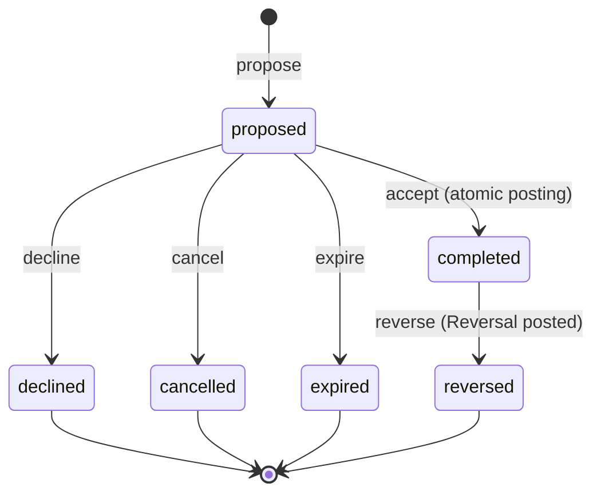
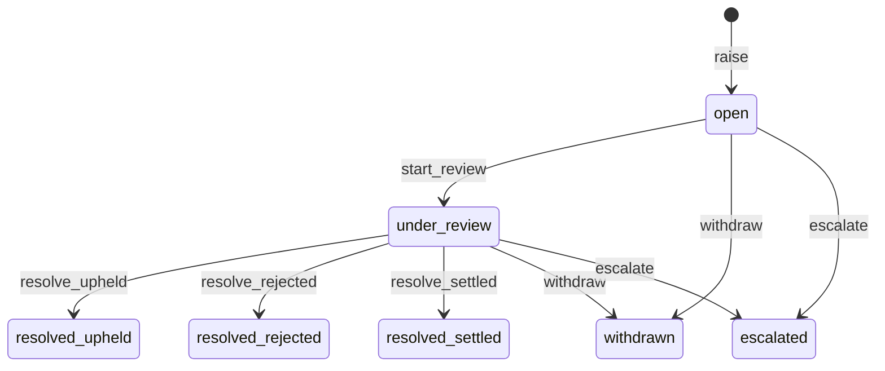
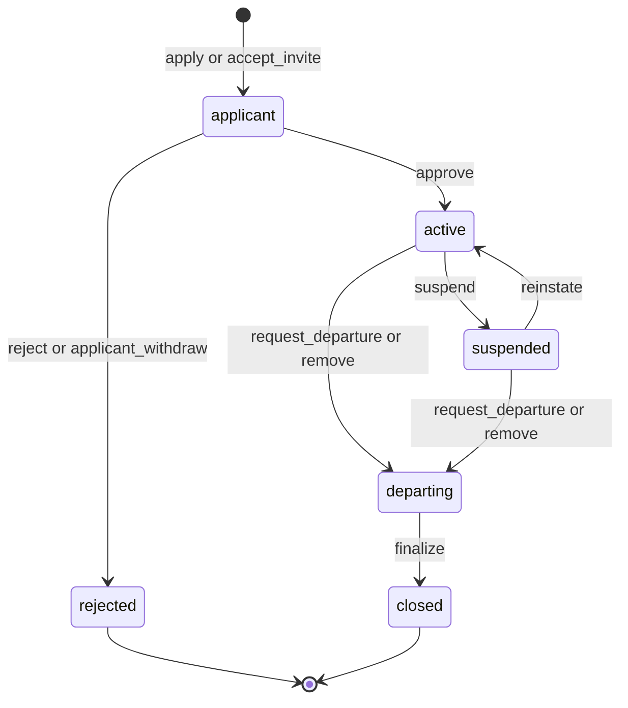
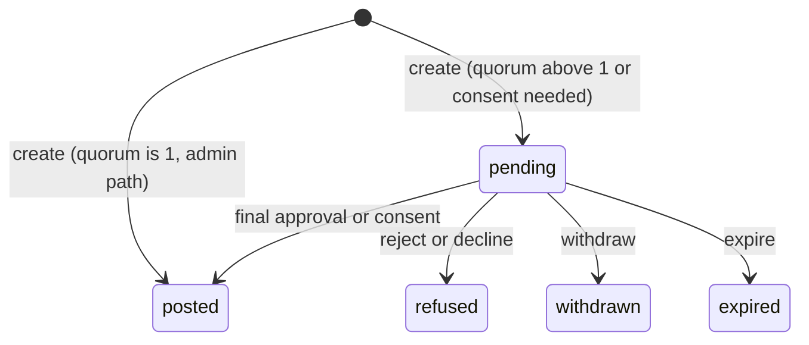
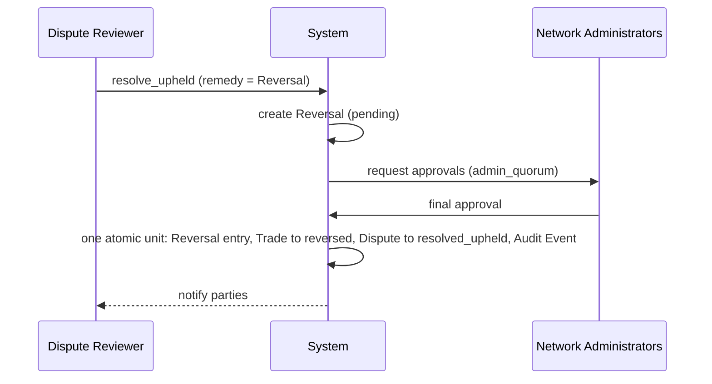
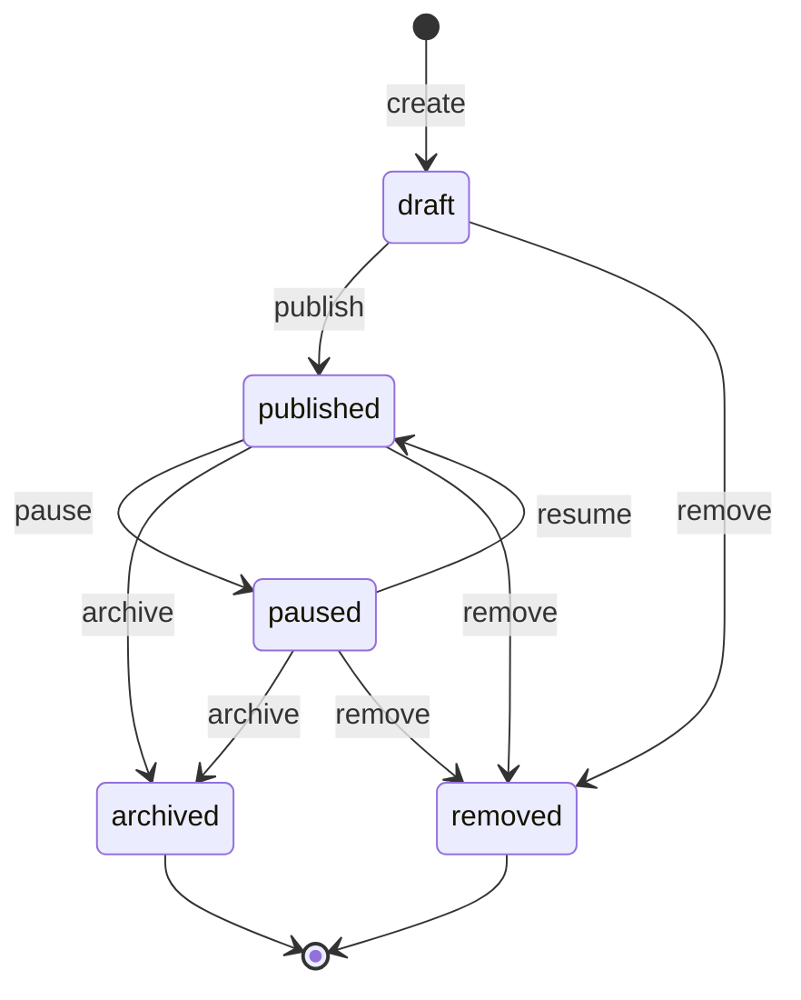

# 15 — Lifecycle State Machines

| Field | Value |
|---|---|
| Status | Draft |
| Owner role | Domain architect (ledger and rules) |
| Last updated | 2026-10-21 |
| Scope | State machines for Trade, Dispute, Membership and Listing, plus the Adjustment and Reversal flows: states, transitions, actors, guards, side effects (ledger posting, Audit Event, notification), terminal states, timeouts, concurrency and illegal-transition handling |
| Depends on | [00 — Conventions and canon](00-conventions.md), [03 — Domain model and mutual-credit rules](03-domain-model-and-mutual-credit-rules.md) |
| Open questions | See section 11 below; consolidated in [13 — Assumptions, risks, decisions](13-assumptions-risks-decisions-roadmap.md) |

## 1. Purpose and scope

This document is the single authoritative home for **which states exist, which transitions are legal, who may cause them and what each one does**. State names for Trade, Dispute, Membership and Listing are fixed by [canon 5.3](00-conventions.md) and are used here exactly. Monetary meaning (balances, limits, invariants) is defined in [03](03-domain-model-and-mutual-credit-rules.md); this document cites it by ID and does not restate it. Notification content belongs to [17](17-notifications-and-communications.md); audit record fields to [06](06-data-ledger-and-audit.md); error format to [07](07-api-and-integration-contract.md); governance procedure around disputes and suspensions to [10](10-governance-and-network-operations.md).

Where this document needs a status vocabulary that the canon does not provide (Adjustment and Reversal flows, section 7) it defines a small flow-local set and records that as an assumption in section 11.

## 2. Definitions used here

Terms (Trade, Dispute, Member, Provider, Recipient, Proposer, Counterparty, Journal Entry, Audit Event, System Account) are as in [canon 5.1](00-conventions.md) and [14](14-glossary.md).

| Term | Meaning in this document |
|---|---|
| **Event** | A named request to change state (for example `accept`). Events are caused by an **actor**: a role-holder, or `system` (a timer or a consequence of another transition). |
| **Guard** | A condition evaluated inside the transition's atomic unit; failing a guard rejects the event and changes nothing. |
| **Side effect** | Everything a successful transition does besides changing state: ledger posting, Audit Event, history record, notification, derived changes in other machines. |
| **History record** | Append-only per-object log of transitions (from, to, event, actor, time, reason). Not an Audit Event. |
| **Terminal state** | No outgoing transitions exist. Terminal objects are never edited, except descriptive annotations that do not change state. |
| **Atomic unit** | A single transaction in which state change, ledger posting, Audit Event and history record commit together or not at all. |

Transition labels (TR1, DS1, MB1, AJ1, RV1, LS1) are local to this document and are not requirement IDs.

## 3. Rules common to all machines

| ID | Pri | Requirement | Rationale | Verification |
|---|---|---|---|---|
| LIF-001 | P0 | Every lifecycle object MUST carry exactly one current state from its machine and a monotonically increasing `state_version`. State MUST change only through the transitions tabulated in this document. | A closed, enumerable machine is testable and auditable. | Test: model-based test enumerates (state, event) pairs and compares results to the tables; no code path writes state outside the transition function (inspection) |
| LIF-002 | P0 | A transition MUST execute as one atomic unit that includes the state change, any Journal Entry and Postings, the Audit Event (where the table requires one), the history record and the `state_version` increment. If any element cannot be written, none is. | INV-002, INV-010 [03](03-domain-model-and-mutual-credit-rules.md). | Failure injection at each element; verify nothing persisted |
| LIF-003 | P0 | Concurrent events on the same object MUST be serialised by compare-and-set on `state_version` (or an equivalent mechanism). Exactly one of several competing events whose guards depend on the same prior state commits; the others fail as illegal transitions (LIF-005) reporting the new current state. | Resolves races deterministically (section 9). | Concurrency tests listed in section 9 |
| LIF-004 | P0 | Evaluation order for every event MUST be: (1) authenticate actor; (2) authorise actor for that object and event, without revealing the object's state to an unauthorised actor; (3) check the event is legal from the current state; (4) evaluate guards in the table's order; (5) execute side effects. | Prevents state leakage and makes error precedence predictable. | Test: unauthorised actor on an illegal-state object receives the same error as on a legal-state object |
| LIF-005 | P0 | An event that is not legal from the current state MUST be rejected with error class `illegal_transition` carrying `current_state`, `state_version` and the set of events currently allowed to that actor. The rejection MUST have no side effects other than a rate-limited security log entry (and an Audit Event only where the actor attempted an admin action without authority, per [09](09-security-privacy-and-abuse.md)). Error code spelling and transport mapping are owned by [07](07-api-and-integration-contract.md). | Clear, non-destructive failure. | Test every table cell marked "illegal" in section 9.2 |
| LIF-006 | P0 | Repeating an event that already took effect for the same actor (same idempotency key per INV-009, or the same event by the same actor when the object is already in that event's target state) MUST return the original outcome without a second side effect. The same event by a different actor, or a different event, MUST follow LIF-005. | Safe retries; no duplicate posting. | Replay tests; double-submit test |
| LIF-007 | P0 | Time-dependent guards and timers MUST use the platform clock in UTC at the instant the transaction commits, not the client clock. Guards MUST NOT depend on the timer job having run (a deadline is enforced at event time; the timer only records the resulting state). | Deterministic behaviour despite job delay. | Test with paused timer job and controlled clock |
| LIF-008 | P0 | Every transition MUST append a history record (from, to, event, actor identity or `system`, time, reason or reason code, `state_version`). History records are immutable and visible to the parties to the object. | Traceability to the people affected. | Inspection and test |
| LIF-009 | P0 | An object in a terminal state MUST reject all events except idempotent repeats (LIF-006) and descriptive annotations (notes, attachments) that do not change state. | Finality. | Test |
| LIF-010 | P0 | Timers and `system` events MUST NOT create Journal Entries other than the ones enumerated in this document: Trade `accept`-driven postings are member-initiated; the only system-initiated postings are the `departure_settlement` entries of MB7 and the Reversal/Adjustment postings that complete an approved flow (RV2, AJ2). No timer MAY post to any account. | DOM-015 (no silent balance mutation). | Test: idle Network for simulated years yields no postings |

## 4. Trade lifecycle

States (canon 5.3): `proposed`, `completed`, `declined`, `cancelled`, `expired`, `reversed`. There is no persisted `accepted` state, and `disputed` is not a Trade state; Disputes link to Trades (section 5).

Text description: a Trade is created `proposed`. From there exactly one of four things happens: the Counterparty accepts (and the Journal Entry is posted in the same step, giving `completed`), the Counterparty declines, the Proposer cancels (or the system cancels for a listed reason), or the deadline passes. A `completed` Trade stays `completed` until a posted Reversal makes it `reversed`.

### 4.1 Transition table

Roles: **Proposer** and **Counterparty** are the two parties ([canon 5.1](00-conventions.md)); which of them is Provider or Recipient depends on `initiated_by`. No admin or Operator role appears as an actor on TR1–TR3 (INV-012).

| # | From | Event | Actor | Guards (in order) | Side effects |
|---|---|---|---|---|---|
| TR1 | (none) | `propose` | Member who is a party; Membership `active` | Counterparty is a distinct member of the same Network with Membership `active`; amount valid (integer ≥ 1 minor unit, within `min_trade_amount`/`max_trade_amount`) per INV-015 (early feedback only, DOM-014); open-proposal quota not exceeded [DECISION NEEDED: max open proposals per member, recommended 20]; idempotency key unused or matching (INV-009) | Create Trade `proposed`; set `expires_at = now + proposal_expiry_days`; **no posting**, `available_to_spend` unchanged (DOM-010, DOM-022); history record; notify Counterparty. Audit Event: none |
| TR2 | `proposed` | `accept` | Counterparty only | `now < expires_at` (LIF-007); `state_version` and `proposal_version` match what the Counterparty saw (DOM-018); both Memberships `active` (or `departing` satisfying DOM-035); INV-015; INV-005 for the Recipient; INV-006 for the Provider; DOM-012/013 over-limit rules | In one atomic unit: Journal Entry with Postings `−amount` Recipient, `+amount` Provider (DOM-023); update cached balances (INV-008); state → `completed`; history record. Notify Proposer. Audit Event: none (the Journal Entry and history are the record) |
| TR3 | `proposed` | `decline` | Counterparty only | Not past `expires_at` (otherwise the Trade is already `expired`, LIF-005 applies) | State → `declined`; optional reason text stored; no posting; notify Proposer |
| TR4 | `proposed` | `cancel` | Proposer; or `system` with a reason code | Actor is Proposer, or system reason code is one of `member_departing` (DOM-035), `dispute_upheld` (DS3, DOM-047), `membership_closed`; not past `expires_at` for the Proposer path | State → `cancelled`; reason code stored; no posting; notify Counterparty (and the Proposer when system-caused) |
| TR5 | `proposed` | `expire` | `system` | `now ≥ expires_at` | State → `expired`; no posting; notify both parties |
| TR6 | `completed` | `reverse` | Executed only by the Reversal flow (RV2) | A Reversal in status `pending` meets all of RV2's guards (DOM-025..DOM-028) | Reversal Journal Entry posted (exact negation, linked, DOM-025); Trade → `reversed`; Audit Event (INV-010); notify both parties; same atomic unit |

### 4.2 Terminal states, timers, concurrency

- **Terminal:** `declined`, `cancelled`, `expired`, `reversed`. `completed` is final for purposes of balance but not terminal, because TR6 is possible.
- **Timeouts:** `expires_at` is fixed at creation (DOM-021) and is not moved by later changes to `proposal_expiry_days`. Acceptance after `expires_at` MUST fail even if TR5 has not yet been recorded (LIF-007). Expiry notification latency target: TR5 recorded within the sweep latency [DECISION NEEDED: expiry sweep latency; recommended ≤ 5 minutes]; correctness never depends on it.
- **Acceptance failures leave the Trade `proposed`.** A failed guard on TR2 (for example `credit_limit_exceeded`, Example B in [03](03-domain-model-and-mutual-credit-rules.md)) does not decline, cancel or modify the Trade, so the parties can resolve the cause or let it expire.
- **Races (summary; full matrix in section 9):** accept/cancel/decline/expire compete for the single `proposed` state; the first to commit wins and the others fail with `illegal_transition` naming the new state. Two accepts of different Trades by the same Recipient are serialised by account (DOM-020).
- **Illegal examples:** `accept` by the Proposer; `cancel` by the Counterparty (use `decline`); `cancel` of a `completed` Trade (use a Reversal); `accept` of a `reversed` Trade; any event on `declined`/`cancelled`/`expired`; `reverse` of a `proposed` Trade.

| ID | Pri | Requirement | Rationale | Verification |
|---|---|---|---|---|
| LIF-011 | P0 | The Trade machine MUST implement exactly the states and transitions TR1–TR6, with no persisted `accepted` or `disputed` state. | Canon 5.3. | Model-based test (LIF-001) |
| LIF-012 | P0 | TR2 MUST be atomic with the Journal Entry (LIF-002, INV-002) and MUST re-evaluate every guard in the table at commit time using the committed balances (DOM-019, DOM-020). | Concurrency-safe limit enforcement. | Failure injection; 100-way concurrent accept test (DOM-020) |
| LIF-013 | P0 | Only the Counterparty MAY perform TR2 or TR3; only the Proposer MAY perform the Proposer path of TR4; no role MAY perform TR1–TR3 on behalf of a member. | INV-012, D-06. | Authorisation matrix test for all roles including `network_admin`, `dispute_reviewer`, `platform_operator` |
| LIF-014 | P0 | A guard failure on TR2 MUST return the specific failing guard (limit exceeded, cap exceeded, not active, stale version, expired, amount out of bounds) and MUST leave the Trade unchanged. | Actionable errors ([08](08-ux-and-accessibility.md)); Example B. | Test per guard |
| LIF-015 | P0 | TR5 MUST fire for every `proposed` Trade whose `expires_at` has passed; a missed run MUST be corrected by the next run without affecting the outcome of any accept attempted meanwhile (LIF-007). | Eventual consistency of state without correctness dependence. | Test with timer job stopped, then restarted |
| LIF-016 | P0 | TR4 by `system` MUST occur in the same atomic unit as the event that causes it (member entering `departing`, dispute remedy, Membership `closed`), so no `proposed` Trade of a closed Membership can persist. | Prevent orphan proposals. | Test per reason code |
| LIF-017 | P1 | A Trade proposal MAY be `cancelled` or `declined` after a Dispute is raised on it; the Dispute then continues and the reviewer sees the Trade state. | Disputes do not freeze (D-12). | Test |
| LIF-018 | P1 | The history record of TR2 SHOULD include the `proposal_version` accepted and the balances of both parties before and after, to support dispute review without recomputation. | Reviewer efficiency; reconstructable evidence. | Inspection of record |

## 5. Dispute lifecycle

States (canon 5.3): `open`, `under_review`, `resolved_upheld`, `resolved_rejected`, `resolved_settled`, `withdrawn`, `escalated`. A Dispute is raised by a party to a Trade (DOM-045); the other party is the **respondent**. Domain rules (who may raise, remedy set, reviewer impartiality) are DOM-045..DOM-048; this section adds the mechanics.

Text description: a Dispute is `open` until a Dispute Reviewer starts review. A decision is only possible from `under_review`. At any time before a decision the raiser can withdraw, or the Dispute can be escalated. All of `resolved_*`, `withdrawn` and `escalated` are terminal in this machine.

### 5.1 Transition table

| # | From | Event | Actor | Guards (in order) | Side effects |
|---|---|---|---|---|---|
| DS1 | (none) | `raise` | A party to the linked Trade; Membership `active` | Trade exists in the same Network; Trade is `proposed`, or `completed` within `dispute_window_days` of completion (DOM-045); a Trade `reversed`, `declined`, `cancelled` or `expired` cannot be disputed; no non-terminal Dispute by the same raiser on the same Trade; reason text required | Create Dispute `open`; history record; notify respondent and make visible to `dispute_reviewer` role-holders and `network_admin`; **no posting, no balance freeze** (D-12); Trade state unchanged |
| DS2 | `open` | `start_review` | `dispute_reviewer` (self-assigning or assigned by `network_admin`) | Actor is not a party to the Dispute or to the Trade (DOM-046); actor Membership `active`; no reviewer already assigned (else the assigned reviewer is the only valid actor) | State → `under_review`; `reviewer` recorded; history record; notify both parties |
| DS3 | `under_review` | `resolve_upheld` | Assigned `dispute_reviewer` | Written reasoning present; a remedy chosen from the closed set in DOM-047; remedy preconditions met (below); actor not a party | Atomic with remedy (5.2); Audit Event (INV-010: actor, time, reason, target); notify both parties |
| DS4 | `under_review` | `resolve_rejected` | Assigned `dispute_reviewer` | Written reasoning present; actor not a party | State → `resolved_rejected`; no ledger effect; Audit Event (INV-010); notify |
| DS5 | `under_review` | `resolve_settled` | Assigned `dispute_reviewer` | Written settlement terms; **both** parties have recorded their consent to those terms; remedy chosen (may be "no ledger remedy") and preconditions met | Atomic with remedy (5.2); Audit Event; notify |
| DS6 | `open` or `under_review` | `withdraw` | Raiser only | Not yet in a `resolved_*`, `withdrawn` or `escalated` state | State → `withdrawn`; reason optional; if an unposted remedy request exists for this Dispute (5.2) it is moved to `withdrawn`; notify respondent and reviewer; history record. Audit Event: none |
| DS7 | `open` or `under_review` | `escalate` | Assigned `dispute_reviewer` (conflict, complexity, party is also a reviewer-eligible admin), `network_admin`, or `system` (SLA rule, section 10) | Reason code required; for `system`, the escalation threshold has passed | State → `escalated`; handed to `network_admin` or the outside process defined by Network governance ([10](10-governance-and-network-operations.md)); Audit Event; notify both parties |

### 5.2 Remedy mechanics

| Remedy (DOM-047) | Precondition | Execution |
|---|---|---|
| Reversal | Linked Trade is `completed`; no other Reversal for it; neither Membership `closed` (DOM-026) | DS3/DS5 creates a Reversal request (flow RV, path b) in status `pending`, approvals by `network_admin` per `admin_quorum`. The Dispute **stays `under_review`** until the Reversal is `posted`; the system then performs DS3/DS5 in the same atomic unit as RV2. If the Reversal is `refused`, `withdrawn` or `expired`, the Dispute remains `under_review`, and the reviewer and raiser are notified so the reviewer can choose another remedy or `escalate`. If the reviewer is also a `network_admin` and `admin_quorum` is 1, the whole sequence commits in one step. |
| Adjustment | Member Account not `closed` | Same pattern with flow AJ. |
| Cancel the still-`proposed` Trade | Trade is `proposed` | TR4 with reason `dispute_upheld`, system actor, in the same atomic unit as DS3/DS5. No quorum (no ledger effect). |
| No ledger remedy | — | DS3/DS4/DS5 commit alone. |

### 5.3 Terminal states, timers, concurrency, illegal transitions

- **Terminal:** `resolved_upheld`, `resolved_rejected`, `resolved_settled`, `withdrawn`, `escalated`. Canon 5.3 defines no transition out of `escalated`; the outcome of an escalated Dispute is recorded by the receiving process as an Audit Event and, if ledger action is needed, as an Adjustment or Reversal that references the Dispute (see assumption in section 11).
- **Timers:** at `dispute_review_sla_days` after `open` the Dispute is flagged to `dispute_reviewer`s and `network_admin`s and a reminder is sent; no state changes. At the escalation threshold [DECISION NEEDED: automatic escalation threshold; recommended 2 × `dispute_review_sla_days`] the system performs DS7. A Dispute is never auto-resolved and never auto-upheld.
- **Races:** `withdraw` vs `resolve_*`: first to commit wins (LIF-003); the loser receives `illegal_transition` with the new state. Two reviewers: only the assigned reviewer may decide; a second `start_review` fails. A decision racing with the linked Trade changing state: the decision's remedy preconditions are re-checked at commit; if the Trade has meanwhile become `reversed` (by joint Reversal) the remedy "Reversal" fails its precondition and the reviewer picks another.
- **Illegal examples:** deciding from `open`; `start_review` by a party; `withdraw` by the respondent; `resolve_settled` without both consents; any event from a terminal state.

| ID | Pri | Requirement | Rationale | Verification |
|---|---|---|---|---|
| LIF-019 | P0 | The Dispute machine MUST implement exactly the states and transitions DS1–DS7. | Canon 5.3. | Model-based test |
| LIF-020 | P0 | A Dispute MUST NOT change any balance by itself and MUST NOT block, hold or reorder Trades (D-12). Balance effects occur only through the remedy's own Journal Entry. | INV-004; D-12. | Test: balances before/after DS1, DS2 |
| LIF-021 | P0 | DS3, DS4 and DS5 MUST write an Audit Event and (for DS3/DS5) the remedy in one atomic unit (LIF-002). | INV-010. | Failure injection |
| LIF-022 | P0 | A reviewer who is a party to the Dispute, the Trade, or a remedy beneficiary MUST NOT perform DS2–DS5; if the only eligible reviewers are parties, DS7 with reason `no_eligible_reviewer` MUST be used. | DOM-046 impartiality. | Authorisation tests; small-Network scenario |
| LIF-023 | P0 | DS5 MUST NOT commit unless both parties' consent to the exact recorded terms is stored with timestamps. | A settlement is a mutual agreement. | Test |
| LIF-024 | P0 | The SLA flag and the escalation rule MUST be computed from `open` time and the policy values snapshotted at DS1 (`dispute_review_sla_days`), not the current policy. | Fairness to disputants. | Test with policy change mid-dispute |
| LIF-025 | P1 | Respondent submissions and evidence MAY be added in `open` and `under_review` without changing state; they MUST NOT be possible after a terminal state except as annotations. | Fair hearing without state churn. | Test |
| LIF-026 | P1 | A Dispute SHOULD remain visible to both parties for as long as the Trade is visible to them, subject to export and retention rules ([06](06-data-ledger-and-audit.md), [18](18-data-export-and-portability.md)). | Evidence continuity. | Inspection |

## 6. Membership lifecycle

States (canon 5.3): `applicant`, `active`, `rejected`, `suspended`, `departing`, `closed`. `banned` is a **flag with reason**, not a state. **Inactive** (DOM-043) is a derived flag, not a state. The Member Account is created with the Membership in `applicant` state (DOM-003) and is inert (cannot be a Trade party, INV-015) until `active`.

### 6.1 Transition table

`admin_quorum` approvals apply to every row marked "quorum", counted from distinct `network_admin` Memberships (the initiating admin counts as one; an admin cannot approve an action targeting their own Membership).

| # | From | Event | Actor | Guards (in order) | Side effects |
|---|---|---|---|---|---|
| MB1 | (none) | `apply` / `accept_invite` | Person with a platform login (D-07) | `membership_mode` permits: `open` any person; `approval` any person (goes to review); `invite` only with a valid, unexpired, unused invitation [DECISION NEEDED: invitation validity; recommended 14 days]; person has no non-terminal Membership in this Network | Create Membership `applicant` and Member Account with balance 0 (DOM-003); history record; notify admins. If `membership_mode = invite` or `open`, the system immediately performs MB2 in the same atomic unit with actor `system` (reason `auto_admit`) |
| MB2 | `applicant` | `approve` | `network_admin`, or `system` for auto-admit | Not the applicant themself; Network not in a closing state ([10](10-governance-and-network-operations.md)) | State → `active`; effective `credit_limit` set to `default_credit_limit` (DOM-011); roles: `member`; Audit Event (role change, INV-010); welcome notification |
| MB3 | `applicant` | `reject` / `applicant_withdraw` | `network_admin` (with reason) / the applicant | Reason code required for `reject`; none for withdraw | State → `rejected` (reason `withdrawn_by_applicant` if withdrawn); account stays at balance 0 and unused (INV-016 holds trivially); Audit Event for `reject`; notify applicant |
| MB4 | `active` | `suspend` | `network_admin` (quorum) | Reason required; target is not the last `network_admin` unless another is designated (LIF-033) | State → `suspended`; optional ban flag with reason; Listings become not visible (derived, section 8); session/permissions limited to read-only own balance, history and appeals (DOM-042); Audit Event; notify member with reason and appeal route |
| MB5 | `suspended` | `reinstate` | `network_admin` (quorum) | Reason required; ban flag, if set, explicitly cleared in the same step with reason | State → `active`; Audit Event; notify |
| MB6 | `active` or `suspended` | `request_departure` / `remove` | Member themself / `network_admin` (quorum, reason) | Not the last `network_admin` (LIF-033); for a member's own request with a non-zero balance, the settlement disclosure (DOM-038) has been acknowledged | State → `departing`; snapshot `departure_settlement_mode` into the Membership (DOM-039); Listings → `archived` (LS5, system); open `proposed` Trades not satisfying DOM-035 → `cancelled` (TR4, system); Audit Event (mode, balance, initiator); notify |
| MB7 | `departing` | `finalize` | `system` when balance is 0 (any mode); `system` at end of settlement window for `write_off`/`community_fund`; the departing member or `network_admin` earlier for `write_off`/`community_fund` | For `settle` mode: balance is exactly 0 (the settlement window ending with balance ≠ 0 does **not** finalize, DOM-037); a pending admin decision to switch mode is recorded with quorum | Atomic unit: if balance ≠ 0 post `departure_settlement` Journal Entry against `network_clearing` (`write_off`) or `community_fund` (`community_fund`) (DOM-036, Example E in [03](03-domain-model-and-mutual-credit-rules.md)); state → `closed`; roles removed; sessions for this Network revoked; personal data scheduled for anonymisation (D-09; timing in [09](09-security-privacy-and-abuse.md)/[18](18-data-export-and-portability.md)); Audit Event; notify |

Flag operations (no state change; each requires reason and writes an Audit Event): `set_ban` (on `suspended` or `closed`), `clear_ban` (admin, quorum), `set_roles` (admin; grant of `network_admin` or `dispute_reviewer`). A `closed` Membership keeps its ban flag.

### 6.2 Terminal states, timers, concurrency, illegal transitions

- **Terminal:** `rejected`, `closed`. A person who wants to rejoin after either creates a **new** Membership with a new Member Account; history of the old one is not merged (canon 5.3 has no `departing` → `active`; see section 11).
- **Timers:** (a) invitation expiry (MB1 guard); (b) settlement window for `departing` (DOM-037): at its end `write_off`/`community_fund` finalize automatically via MB7; `settle` remains `departing` and notifies admins; (c) pending `applicant` has no automatic expiry, but admins are reminded after [DECISION NEEDED: applicant review reminder; recommended 7 days]. Inactivity never changes state (DOM-044).
- **Races:** `finalize` evaluated while a Trade by the departing member is completing: the balance is read inside the finalize unit; a Trade that commits first changes the balance and `finalize` re-evaluates; one that commits after finds the Membership `closed` and fails INV-015. `suspend` racing `accept` on a Trade: ordering decides (section 9). Two admins performing `suspend` and `remove` at once: CAS, the loser sees the new state.
- **Illegal examples:** `approve` from `suspended`; `reinstate` from `departing`; `suspend` of a `closed` Membership; `request_departure` from `applicant` (use `applicant_withdraw`); any event from `rejected` or `closed`.

| ID | Pri | Requirement | Rationale | Verification |
|---|---|---|---|---|
| LIF-027 | P0 | The Membership machine MUST implement exactly the states and transitions MB1–MB7; `banned` and `inactive` MUST be flags, never states. | Canon 5.3; DOM-043. | Model-based test |
| LIF-028 | P0 | Only `active` Memberships MAY be parties to new Trades (INV-015); `departing` Memberships MAY only perform Trades permitted by DOM-035; `suspended` Memberships are bound by DOM-042; `applicant`, `rejected` and `closed` MUST NOT trade. | Safe participation boundary. | Table-driven test over (state × role in Trade) |
| LIF-029 | P0 | MB7 MUST be atomic with the `departure_settlement` Journal Entry (LIF-002) and MUST require balance exactly 0 after the entry (INV-016). | No closed account with residual balance. | Failure injection; invariant check |
| LIF-030 | P0 | `departure_settlement_mode` applied by MB7 MUST be the value snapshotted at MB6 (DOM-039), unless a `network_admin` quorum decision recorded after MB6 selects another mode for that member with reason and Audit Event (DOM-037). | Predictability with a transparent exception. | Test |
| LIF-031 | P0 | Each of MB2, MB4, MB5, MB6 (when by admin), MB7 and each flag operation MUST write an Audit Event naming actor, time, reason and target; member-initiated MB6 MUST write an Audit Event naming the member as actor. | INV-010. | Coverage query |
| LIF-032 | P0 | The affected person MUST be notified of MB3 (`reject`), MB4, MB5, MB6 and MB7, stating the reason and the route to challenge it ([10](10-governance-and-network-operations.md)). | Due process. | Notification tests ([17](17-notifications-and-communications.md)) |
| LIF-033 | P0 | A transition MUST be rejected if it would leave the Network with no `active` Membership holding `network_admin`, unless it is part of the Network closure procedure defined in [10](10-governance-and-network-operations.md). Admin succession (designating another admin) is a flag operation allowed before such a transition. | Prevents orphan Networks. | Test: last-admin suspend/remove/depart rejected |
| LIF-034 | P0 | While `suspended` or `departing`, the member MUST retain read access to their own balance, history, Disputes, exports and appeals. | Fairness; portability (D-09 interplay, [18](18-data-export-and-portability.md)). | Access tests |
| LIF-035 | P1 | `applicant` Memberships SHOULD be visible only to `network_admin`s and the applicant; applicant data is minimised ([09](09-security-privacy-and-abuse.md)). | Privacy. | Inspection |
| LIF-036 | P1 | A person's logins in other Networks MUST be unaffected by any transition in this Network. | INV-011; D-07. | Test |

## 7. Adjustment and Reversal flows

Adjustment and Reversal are Transactions (DOM section 2) that are *requested*, may need consent or approvals, and are then *posted*. Their status vocabulary is local to this section (canon 5.3 defines none; see assumption in section 11): `pending`, `posted`, `refused`, `withdrawn`, `expired`. `posted` is the only status with a Journal Entry. All five are terminal except `pending`.

### 7.1 Adjustment flow (type `adjustment`)

| # | From | Event | Actor | Guards (in order) | Side effects |
|---|---|---|---|---|---|
| AJ1 | (none) | `create` | `network_admin` | Reason code and free-text reason present; target Member Account Membership is not `closed` (INV-016); exactly one Member Account and one System Account involved (DOM-030); amount ≥ 1 minor unit; initiator is not the target member; no Platform Operator role | Create Adjustment `pending`; if `admin_quorum` ≤ 1, AJ2 is performed in the same atomic unit (status never observable as `pending`); Audit Event `adjustment.requested` only when it remains `pending`; notify other admins |
| AJ2 | `pending` | `approve` (final) | `network_admin`, distinct from earlier approvers and not the target member | Approvals count (initiator included) reaches `admin_quorum`; target account still not `closed`; if the result is outside limits, `override_reason` present (DOM-033) | In one atomic unit: Journal Entry (Member ± amount, System Account ∓ amount; Example D in [03](03-domain-model-and-mutual-credit-rules.md)); status → `posted`; Audit Event (INV-010); Member notified and entry visible in their history with reason (DOM-031) |
| AJ3 | `pending` | `reject` | Any `network_admin` other than the initiator (and not the target) | Reason | Status → `refused`; Audit Event; notify initiator |
| AJ4 | `pending` | `withdraw` | Initiating admin | — | Status → `withdrawn`; history record |
| AJ5 | `pending` | `expire` | `system` | `now ≥ created_at +` pending lifetime [DECISION NEEDED: pending approval lifetime; recommended 7 days] | Status → `expired`; notify initiator |

### 7.2 Reversal flow (type `reversal`)

Two paths (DOM-028): **path a**, joint — a party requests and the other party consents within `dispute_window_days`; **path b**, admin — approvals per `admin_quorum`, only as the remedy of a Dispute decided `resolved_upheld`/`resolved_settled` (so the requester is the Dispute remedy mechanism of section 5.2, executed by `network_admin`s).

| # | From | Event | Actor | Guards (in order) | Side effects |
|---|---|---|---|---|---|
| RV1 | (none) | `create` | Path a: either party to the Trade. Path b: `network_admin` acting on a Dispute remedy | Trade is `completed`; no other `pending` or `posted` Reversal exists for this Trade (DOM-025, uniqueness); neither Membership `closed` (DOM-026); path a: within `dispute_window_days`; path b: linked Dispute is `under_review` with remedy "Reversal" decided; reason present | Create Reversal `pending` (path b with quorum 1 performs RV2 in the same atomic unit); notify the other party (path a) or other admins (path b). Audit Event only when it remains `pending` and is path b |
| RV2 | `pending` | `accept` (path a) / `approve` (path b, final) | Path a: the other party (never the requester). Path b: `network_admin`s, distinct, not a party to the Trade, not the Dispute reviewer's own account interest | Trade still `completed`; neither Membership `closed`; path a: still within window; path b: approvals reach `admin_quorum` | In one atomic unit: Reversal Journal Entry with the exact negation of the Trade's Postings, linked (DOM-025, not subject to limits, DOM-027, flagged if outside); Reversal → `posted`; Trade → `reversed` (TR6); for path b the linked Dispute → `resolved_upheld` or `resolved_settled` (DS3/DS5); Audit Event; notify both parties |
| RV3 | `pending` | `decline` (path a) / `reject` (path b) | Path a: the other party. Path b: any eligible `network_admin` | Reason | Status → `refused`; path b: Audit Event and Dispute stays `under_review`; notify |
| RV4 | `pending` | `withdraw` | Requester (path a) / initiating admin (path b) | — | Status → `withdrawn`; notify |
| RV5 | `pending` | `expire` | `system` | Path a: `now` ≥ the earlier of the pending lifetime (as AJ5) and the end of `dispute_window_days`; path b: pending lifetime | Status → `expired`; notify |

### 7.3 Terminal states, timers, concurrency, illegal transitions

- **Terminal:** `posted`, `refused`, `withdrawn`, `expired` (for both flows). A `refused`, `withdrawn` or `expired` Reversal may be re-requested as a new object if its guards still hold.
- **Timers:** pending lifetime (AJ5/RV5); path a also ends at window expiry (DOM-028).
- **Races:** (i) last two approvals arriving together: approvals are counted atomically; exactly one transition to `posted` commits and a unique constraint on "Journal Entry per Adjustment/Reversal" makes a second posting impossible; (ii) `approve` vs `withdraw`: CAS; (iii) two Reversal requests for one Trade: the uniqueness guard in RV1 lets exactly one exist; (iv) Reversal vs a new Trade by the Provider that spends the credited funds: Reversal proceeds and may leave the Provider over limit (DOM-027); (v) Reversal vs closure of a party's Membership: both read inside their units; whichever commits first decides, the other fails its guard (DOM-026 or LIF-029).
- **Illegal examples:** `approve` by the initiator alone when quorum is 2; `approve` by the target member; Reversal of a `proposed`, `declined`, or `reversed` Trade; Reversal of an Adjustment (use a new Adjustment, DOM-029); `accept` by the requester on path a; any event on a non-`pending` object.

| ID | Pri | Requirement | Rationale | Verification |
|---|---|---|---|---|
| LIF-037 | P0 | Adjustment and Reversal flows MUST implement exactly AJ1–AJ5 and RV1–RV5 with statuses `pending`, `posted`, `refused`, `withdrawn`, `expired`. | Closed, testable vocabulary. | Model-based test |
| LIF-038 | P0 | A Journal Entry MUST be created only at AJ2 or RV2 (or at AJ1/RV1 where they perform AJ2/RV2 in the same unit). The status `posted` and the existence of exactly one linked Journal Entry MUST be equivalent. | INV-004 traceability. | Reconciliation query |
| LIF-039 | P0 | The distinct-approver rule MUST be enforced: the initiator counts once; no approver MAY approve an object affecting their own Member Account or Trade; the Platform Operator role MUST NOT be accepted as an approver. | DOM-032, INV-012. | Authorisation tests with quorum 1, 2, 3 |
| LIF-040 | P0 | RV2 MUST perform the Trade transition TR6 and (path b) the Dispute transition DS3/DS5 in the same atomic unit as the Reversal Journal Entry. | Consistency across machines. | Failure injection |
| LIF-041 | P0 | AJ2 and RV2 MUST write the Audit Event and notify the affected Member(s); an Adjustment or Reversal MUST NOT be settable as hidden or silent. | INV-010, INV-012, DOM-031. | Test: no suppression flag exists |
| LIF-042 | P0 | Guards against a `closed` Membership MUST be re-evaluated at AJ2/RV2 commit, not only at creation. | INV-016. | Test: close between request and approval |
| LIF-043 | P1 | Reversal path a SHOULD show the other party the Trade, the amount, the exact resulting balance change for each side, and the requester's reason before consent. | Informed consent ([08](08-ux-and-accessibility.md)). | UX acceptance |
| LIF-044 | P1 | Pending Adjustment and Reversal objects SHOULD be listed to eligible admins with age, so quorum stalls are visible. | Governance hygiene. | Inspection |

## 8. Listing lifecycle

States (canon 5.3): `draft`, `published`, `paused`, `archived`, `removed`. Listings have no ledger effect (DOM-006). A Listing's **effective visibility** is derived, not stored: it is visible in the directory only if state is `published`, the owner Membership is `active`, and `directory_visibility` permits the viewer.

### 8.1 Transition table

| # | From | Event | Actor | Guards (in order) | Side effects |
|---|---|---|---|---|---|
| LS1 | (none) | `create` | Member with Membership `active` | Kind is `offer` or `request`; draft quota not exceeded [DECISION NEEDED: max Listings per member; recommended 50 non-terminal] | Create `draft`; visible only to owner; history record |
| LS2 | `draft` | `publish` | Owner | Required fields present (title, kind, description, at least one category or tag if the Network defines them); content passes the Network's basic validation (length, no disallowed fields such as payment/bank details in structured fields, [09](09-security-privacy-and-abuse.md)); owner `active` | State → `published`; becomes visible per `directory_visibility`; history record |
| LS3 | `published` | `pause` | Owner | — | State → `paused`; hidden from directory; history record |
| LS4 | `paused` | `resume` | Owner | Owner `active` | State → `published`; history record |
| LS5 | `published` or `paused` | `archive` | Owner, or `system` (reason `member_departing` on MB6, `membership_closed` on MB7) | — | State → `archived`; hidden; retained for owner history; history record |
| LS6 | `draft`, `published` or `paused` | `remove` | `network_admin` acting as moderator (quorum not required) | Reason code and text required; actor is not the Listing owner | State → `removed`; hidden; Audit Event (governance action, INV-010); notify owner with reason and appeal route ([10](10-governance-and-network-operations.md)) |

Edits to a `published` or `paused` Listing do not change state; each edit creates a new version in the history record. A `draft` may be deleted by its owner (not a state: it never existed to others). To reuse an `archived` Listing, the owner uses `duplicate`, which creates a new `draft` (LS1).

### 8.2 Terminal states, timers, concurrency, illegal transitions

- **Terminal:** `archived`, `removed`. Neither can be reopened (a `removed` Listing's content can be copied by its owner into a new `draft` only if moderation policy allows; [10](10-governance-and-network-operations.md)).
- **Timers:** none change state in MVP. P2: a stale-Listing reminder to the owner after a Network-set age; the reminder never pauses or archives.
- **Suspension:** when the owner is `suspended`, Listings keep state `published` but are not visible (derived rule); on `reinstate` they are visible again with no further action.
- **Races:** `publish` vs `remove`: CAS; if `remove` commits first `publish` fails with `illegal_transition`. Owner `pause` vs admin `remove`: same.
- **Illegal examples:** `publish` from `paused` (use `resume`); `resume` from `archived`; `pause` from `draft`; any event from `removed`.

| ID | Pri | Requirement | Rationale | Verification |
|---|---|---|---|---|
| LIF-045 | P0 | The Listing machine MUST implement exactly LS1–LS6; no transition out of `archived` or `removed`. | Canon 5.3. | Model-based test |
| LIF-046 | P0 | Directory visibility MUST be computed from state, owner Membership state and `directory_visibility` on every read; state `published` alone MUST NOT make a Listing visible. | Prevents leaking suspended/closed members' Listings. | Test across Membership states |
| LIF-047 | P0 | LS6 MUST write an Audit Event and notify the owner with reason and challenge route. | INV-010; due process. | Test |
| LIF-048 | P0 | LS5 by `system` MUST occur in the same atomic unit as the causing Membership transition. | No visible Listing of a departing member. | Test |
| LIF-049 | P1 | Listing changes MUST NOT alter or pre-fill amounts on existing `proposed` Trades. | DOM-006. | Test |
| LIF-050 | P2 | Per-Listing expiry dates and renewal reminders MAY be added; they MUST use the reminder-only pattern in 8.2. | Designed-for, deferred. | — |

## 9. Cross-machine interactions and concurrency

### 9.1 Effects between machines

| Cause | Effect on other machines |
|---|---|
| Membership MB4 `suspend` | Listings hidden (derived); `proposed` Trades unaffected but cannot be accepted by the suspended member (INV-015) and can be declined/cancelled by the other party; Disputes unaffected |
| Membership MB6 `departing` | Listings → `archived` (LS5); non-conforming `proposed` Trades → `cancelled` (TR4) |
| Membership MB7 `closed` | Remaining `proposed` Trades → `cancelled` (TR4, `membership_closed`); open Disputes in which the member is a party stay and continue with the member's data pseudonymised (D-09); Reversal path involving this account is blocked (DOM-026) |
| Trade TR6 `reversed` | Linked open Disputes remain open and are flagged `remedy_already_applied`; the reviewer decides; no automatic transition |
| Dispute DS3/DS5 with Reversal | Reversal flow RV (section 7); atomic completion of Dispute and Trade at RV2 |
| Dispute DS3/DS5 with cancel remedy | TR4 `dispute_upheld` |

### 9.2 Race matrix

"Winner" is whichever event commits first (LIF-003). "Loser" always receives `illegal_transition` (LIF-005) except where noted, and has no side effects.

| # | Competing events | Resolution |
|---|---|---|
| R1 | Trade `accept` vs `cancel` | CAS on Trade; winner takes effect; if accept wins the Trade is `completed` and cancel fails (correction is a Reversal) |
| R2 | Trade `accept` vs `expire` | Decided in the accept transaction by `now < expires_at`; if at or past, accept fails with `expired` reported and TR5 is recorded |
| R3 | Trade `accept` vs `decline` | CAS |
| R4 | Trade `accept` double-submit (same actor) | LIF-006: second returns the first outcome, no second posting |
| R5 | Two `accept`s by the same Recipient on different Trades near the floor | Account-level serialisation (DOM-020); loser fails the limit guard and its Trade stays `proposed` |
| R6 | `accept` vs counterparty or proposer `suspend`/`remove` | Order of commit; if the Membership change commits first accept fails `not active`; if accept commits first the Trade stays `completed` |
| R7 | `accept` vs credit limit lowered or `max_balance` changed | Order of commit; the guard reads the policy in force at commit (DOM-014) |
| R8 | `accept` vs Proposer edit of description | `proposal_version` mismatch rejects accept; Counterparty reloads and re-accepts (DOM-018) |
| R9 | `accept` vs member entering `departing` | Guard DOM-035 evaluated inside the accept unit against the Membership state at commit |
| R10 | `reverse` requests (two) for one Trade | RV1 uniqueness; one exists; second fails |
| R11 | `reverse` vs new Trade spending the Provider's credit | Reversal not limit-bound (DOM-027); may flag and leave Provider over limit |
| R12 | Dispute `withdraw` vs `resolve_*` | CAS on Dispute |
| R13 | Two reviewers `start_review` | CAS; second fails; only assigned reviewer may resolve |
| R14 | Last two admin approvals of one Adjustment/Reversal | Atomic count; single posting guaranteed by uniqueness; the later request returns the posted outcome idempotently (LIF-006) if it came from a distinct approver already counted, otherwise `illegal_transition` |
| R15 | `approve` vs `withdraw` (Adjustment/Reversal) | CAS |
| R16 | `finalize` vs a final settlement Trade | The balance is read inside the finalize unit; if a Trade commits after, the Membership is `closed` and the Trade fails INV-015 |
| R17 | Listing `publish` vs `remove` / `pause` vs `remove` | CAS |
| R18 | `suspend` vs `remove` of the same Membership | CAS; loser sees new state |

| ID | Pri | Requirement | Rationale | Verification |
|---|---|---|---|---|
| LIF-051 | P0 | Each row R1–R18 MUST be covered by an automated concurrency test that runs the competing events in parallel at least [DECISION NEEDED: iterations per race test; recommended 1,000] times and asserts the stated resolution, no partial effects and INV-001/INV-007 afterwards. | Races are the principal ledger risk ([12](12-quality-strategy-and-test-plan.md)). | CI gate |
| LIF-052 | P0 | Cross-machine effects in 9.1 MUST commit in the same atomic unit as their cause (LIF-002). | No window with inconsistent machines. | Failure injection |
| LIF-053 | P0 | The model-based test (LIF-001) MUST include every (state × event × actor class) combination and fail the build if a combination not listed as legal succeeds. | Prevents accidental transitions. | CI gate |
| LIF-054 | P1 | Operators and admins SHOULD be able to list objects stuck `pending` or `under_review` beyond their timers, with ages. | Operability ([11](11-deployment-operations-and-support.md)). | Inspection |

## 10. Timers and system events summary

| Timer / system event | Machine | Trigger | Effect | Policy source |
|---|---|---|---|---|
| Proposal expiry | Trade | `now ≥ expires_at` | TR5 | `proposal_expiry_days` (fixed at creation) |
| Dispute SLA flag | Dispute | `open` age ≥ `dispute_review_sla_days` | Flag and reminder; no state change | `dispute_review_sla_days` (snapshotted at DS1) |
| Dispute auto-escalation | Dispute | `open` age ≥ threshold [DECISION NEEDED] | DS7 `system` | Derived from `dispute_review_sla_days` |
| Dispute window | Dispute/Reversal | Trade completion + `dispute_window_days` | DS1 and Reversal path a no longer permitted | `dispute_window_days` |
| Invitation expiry | Membership | Invitation age | Invitation unusable; no Membership exists | Per-invitation setting |
| Settlement window | Membership | `departing` age ≥ window [DECISION NEEDED: 30 days] | MB7 for `write_off`/`community_fund`; notify admins for `settle` | `departure_settlement_mode` snapshot |
| Applicant reminder | Membership | `applicant` age | Reminder to admins; no state change | [DECISION NEEDED: 7 days] |
| Inactivity flag | Membership (derived) | No activity for `inactivity_threshold_days` | Flag and notification; no state change | `inactivity_threshold_days` |
| Pending lifetime | Adjustment/Reversal | `pending` age | AJ5/RV5 | [DECISION NEEDED: 7 days] |
| Policy notice | Policy | `policy_notice_days` | Activation of a scheduled policy change (not a state machine here; see [16](16-network-policy-catalog.md)) | `policy_notice_days` |

| ID | Pri | Requirement | Rationale | Verification |
|---|---|---|---|---|
| LIF-055 | P0 | Every timer in the table MUST be idempotent, safe to run concurrently on multiple workers, safe to run late, and MUST only cause the effect listed. | Operational robustness. | Test: duplicate and delayed runs |
| LIF-056 | P0 | Timer-driven state changes MUST appear in history records with actor `system` and the reason code `timer:<name>`. | Traceability. | Inspection |
| LIF-057 | P1 | Timer lag beyond the stated sweep latency SHOULD raise an operational alert ([11](11-deployment-operations-and-support.md)). | Detects stuck jobs. | Monitoring test |

## 11. Assumptions and open decisions

| Ref | Item | Options | Recommended default |
|---|---|---|---|
| [DECISION NEEDED: max open proposals per member] | Anti-abuse quota (TR1) | 5 / 20 / unlimited | 20 |
| [DECISION NEEDED: expiry sweep latency] | Timer cadence (4.2) | 1 / 5 / 15 min | 5 minutes |
| [DECISION NEEDED: automatic escalation threshold] | When `open` disputes auto-escalate (5.3) | none / 2× SLA / 3× SLA | 2 × `dispute_review_sla_days` |
| [DECISION NEEDED: invitation validity] | MB1 | 7 / 14 / 30 days | 14 days |
| [DECISION NEEDED: applicant review reminder] | MB timers | 3 / 7 / 14 days | 7 days |
| [DECISION NEEDED: settlement window length] | Shared with [03](03-domain-model-and-mutual-credit-rules.md) | 14 / 30 / 60 days | 30 days |
| [DECISION NEEDED: pending approval lifetime] | AJ5/RV5 | 3 / 7 / 14 days | 7 days |
| [DECISION NEEDED: max Listings per member] | LS1 | 20 / 50 / unlimited | 50 |
| [DECISION NEEDED: iterations per race test] | LIF-051 | 100 / 1,000 / 10,000 | 1,000 |
| Assumption L-1 | Adjustment and Reversal statuses (`pending`, `posted`, `refused`, `withdrawn`, `expired`) are flow-local because canon 5.3 defines none. Canon owner should confirm or fold into 5.3. | Fold in / keep local | Keep local |
| Assumption L-2 | Canon 5.3 gives `escalated` no outgoing transition. This document keeps it terminal and records the outcome through an Audit Event and linked remedy. Alternative: allow `escalated` → `resolved_*` so the Dispute record shows the final outcome. | Terminal / allow resolution | Allow `escalated` → `resolved_*` (P1) if canon is amended; MVP keeps terminal |
| Assumption L-3 | No `departing` → `active` (canon). Rejoin means a new Membership. Alternative: allow members to rescind before settlement. | Unsupported / allow | Unsupported |
| Assumption L-4 | A Dispute remedy that needs a Reversal or Adjustment requires `network_admin` approvals even after a reviewer's decision (reviewer decides, admins execute under quorum). Alternative: reviewer decision alone authorises. | Two-step / reviewer-only | Two-step |
| Assumption L-5 | The Member Account is created at `applicant` (DOM-003) and is inert until `active`. Alternative: create at `approve`. | At applicant / at approve | At applicant |
| Assumption L-6 | Ordinary Trade transitions (TR1–TR5) write history records but not Audit Events; INV-010 does not require them. Alternative: Audit Event per Trade transition (higher volume). | History only / audit all | History only |
| Legal | Whether any transition (especially balance release at departure, suspension with a negative balance, or ban) has legal or consumer-protection consequences in a jurisdiction: a question for counsel ([19](19-legal-and-regulatory-open-questions.md)). | — | — |

Cross-doc needs: [06](06-data-ledger-and-audit.md) for history-record and state-version fields; [07](07-api-and-integration-contract.md) for the `illegal_transition` error shape and event endpoints; [16](16-network-policy-catalog.md) for the snapshot rules (LIF-024, LIF-030); [17](17-notifications-and-communications.md) for each notification named here; [12](12-quality-strategy-and-test-plan.md) for LIF-051 and LIF-053 as gates.

## 12. References

- [00 — Conventions and canon](00-conventions.md)
- [03 — Domain model and mutual-credit rules](03-domain-model-and-mutual-credit-rules.md)
- [10 — Governance and network operations](10-governance-and-network-operations.md)
- [16 — Network policy catalog](16-network-policy-catalog.md)
- [19 — Legal and regulatory open questions](19-legal-and-regulatory-open-questions.md)
