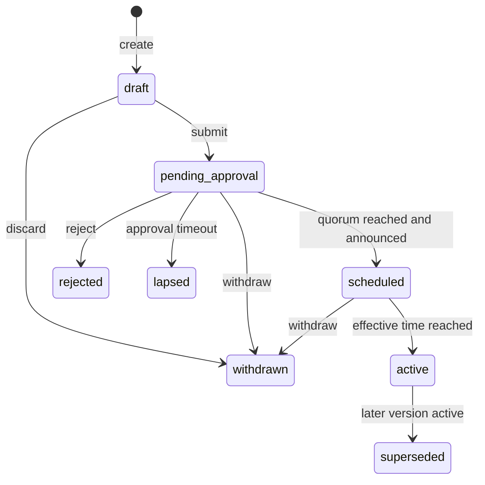

# 16 — Network Policy Catalog

| Field | Value |
|---|---|
| Status | Draft |
| Owner role | Governance and community-operations lead (catalog); Domain architect (bounds) |
| Last updated | 2026-10-21 |
| Scope | Every Network policy parameter named in [canon 5.6](00-conventions.md): name, type, unit, allowed range, defaults (platform and per archetype), mutability, who may change, effect on existing data, validation, audit and announcement behaviour, dependent requirements; the policy document format, versioning and effective-dating rules; cross-parameter validation; safety-fix eligibility; archetype presets with example JSON |
| Depends on | [00 — Conventions and canon](00-conventions.md), [03 — Domain model](03-domain-model-and-mutual-credit-rules.md), [10 — Governance](10-governance-and-network-operations.md), [15 — Lifecycle state machines](15-lifecycle-state-machines.md) |
| Open questions | See section 9; consolidated in [13 — Assumptions, risks, decisions](13-assumptions-risks-decisions-roadmap.md) |

## 1. Purpose and scope

[03 section 9](03-domain-model-and-mutual-credit-rules.md) states which rules are configurable and which are fixed. [10](10-governance-and-network-operations.md) specifies the human procedure for changing them. This document is the **single authoritative home for the parameters themselves**: what values are legal, what each does to data that already exists, and how a policy change is stored, dated and resolved at any moment in time.

The catalog contains exactly the 18 parameters of canon 5.6: three **Network identity parameters** (`unit_name`, `unit_symbol`, `unit_scale`, section 4.2; stored on the Network record, not in versioned policy, [canon 5.8](00-conventions.md) item 5) and 15 versioned policy parameters. No additional *policy* parameter is introduced; the few non-policy **Network settings** that other documents need (invitations by Members, `neutral_subjects`, Broadcast controls) are listed separately in section 4.10 and are not part of any policy version; values that other documents leave as `[DECISION NEEDED]` platform constants (for example invitation validity or the settlement window) are listed in section 6.4 as *not* Network-configurable in MVP.

Nothing here lets a policy weaken an invariant (INV-001..INV-014, [03 section 4](03-domain-model-and-mutual-credit-rules.md)). Where a legal question arises from a value (for example whether a credit limit amounts to lending) it is routed to [19](19-legal-and-regulatory-open-questions.md) as a question for counsel; no value is asserted to be lawful.

## 2. Definitions used here

Terms as in [00 section 5.1](00-conventions.md), [14](14-glossary.md) and [10 section 2](10-governance-and-network-operations.md). Additional terms:

| Term | Meaning |
|---|---|
| **Policy set** | The complete set of the 15 versioned policy parameter values of a Network at one moment (the three Network identity parameters are held on the Network record and shown beside it). |
| **Policy version** | An immutable, numbered, full snapshot of the policy set with metadata and an `effective_at` time (section 5). |
| **Minor units** | Integer amounts of the Network's credit unit scaled by `unit_scale`; all amount parameters are stored in minor units (DOM-008). |
| **Whole-unit notation** | Decimal text used in this document and in UI, for example `50.00` for 5000 minor units at `unit_scale` 2. |
| **In force** | A policy version is in force at time *t* if it is the version with the greatest `effective_at` not later than *t* among versions that reached effect (section 5.4). |
| **Sensitive parameter** | One whose change needs `admin_quorum` approvals and step-up authentication (marked in 4.1, rule in 6.2; the step-up recency is owned by [09](09-security-privacy-and-abuse.md) SEC-009). |
| **Safety-eligible change** | A change in a tightening direction that may skip the notice period under a recorded safety fix (section 6.3). |
| **Over limit / over cap** | Account states of DOM-012 and DOM-013. |
| **Platform constant** | A value fixed by the Platform in MVP and not a Network policy (section 6.4). |

## 3. Conventions used by the catalog

### 3.1 Mutability classes

| Class | Name | Rule |
|---|---|---|
| **L** | Locked after first Journal Entry | Editable only while the Network has no Journal Entry (INV-013). During `setup`, takes effect immediately. After the Network is `open` but before the first Journal Entry, a change takes effect immediately, requires a reason, an Audit Event and a notice to Members, and still requires `admin_quorum` approvals. After the first Journal Entry: rejected. |
| **N** | With notice | Scheduled policy version, effective at least `policy_notice_days` after approval (D-11); prospective only. |
| **N+S** | With notice; safety-eligible | As N, and a defined tightening direction may be applied as a safety fix without notice (6.3). |

Exception for all classes: while the Network is in operating status `setup` ([10 section 11.1](10-governance-and-network-operations.md)), every parameter change takes effect immediately, because no Member or ledger can be affected. The transition `setup` → `open` publishes the first policy version as `active`.

### 3.2 Who may change

| Code | Meaning |
|---|---|
| **A** | Any single `network_admin`, with reason; not a sensitive parameter. |
| **Q** | `admin_quorum` approvals from distinct `network_admin`s and step-up authentication (FR-ADM-002, FR-ADM-018), with reason. When `admin_quorum` is 1, Q still requires step-up. |

The Platform Operator MUST NOT be able to change any parameter. Member voting is not a software mechanism in MVP ([10 section 5.2](10-governance-and-network-operations.md)).

### 3.3 Effect on existing data

| Code | Meaning |
|---|---|
| **P** | Prospective: applies to events occurring after `effective_at`; no existing Journal Entry, Trade, Dispute or Membership value is changed. |
| **P-C** | Prospective with consequences: as P, but existing balances may become over limit or over cap (DOM-012, DOM-013) or per-member values may be clamped. Balances are never altered. |
| **P-S** | Prospective with snapshot: the value in force at a named event is bound to that object and later policy changes do not alter it (section 5.6). |
| **V** | View: affects presentation of existing data from `effective_at` (visibility) without changing any record. |

No parameter has a retroactive effect on posted ledger data (DOM-049).

### 3.4 Catalog conventions

- Defaults are given as: **Platform** default (used when a Network is created without a preset) and three archetype presets: **LETS** (small neighbourhood), **TB** (time bank), **BIZ** (small-business trade network). Rationale for the presets is in [10 section 13](10-governance-and-network-operations.md).
- Amounts are written in whole-unit notation; stored values are minor units.
- A range stated "N..M" is inclusive. "null" means the feature is off.

| ID | Pri | Requirement | Rationale | Verification |
|---|---|---|---|---|
| POL-001 | P0 | The Platform MUST accept only the 15 policy parameters of canon 5.6 in a policy set (and the three identity parameters only on the Network record), MUST reject unknown keys, and MUST validate every value against the type, range and cross-parameter rules of this document before accepting a draft. | A closed schema keeps governance inside platform bounds. | Test: unknown key rejected; boundary values accepted and rejected as stated |
| POL-002 | P0 | Every amount parameter MUST be an integer in minor units with no floating-point representation, within `0..9007199254740991` (2^53 − 1) so that JSON consumers can represent it exactly; the representation used on the wire (number or decimal string) is owned by [07](07-api-and-integration-contract.md). | DOM-008; interoperability. | Test: 9007199254740992 rejected; round-trip through JSON parser |
| POL-003 | P0 | The admin interface and API MUST, for each parameter shown or edited, expose: current value, scheduled values with dates, allowed range, default, mutability class, who may change, effect on existing data, and a plain-language impact preview computed from current data where computable. | JRN-006 step 1 and 2; FR-ADM-001. | Demo for all 18 parameters |
| POL-004 | P0 | Every accepted change MUST generate Audit Events (INV-010) naming actor, time, reason, target Network, parameter, old value and new value; for scheduled changes events are generated at proposal, approval, activation, lapse and withdrawal. | Governance accountability. | Test: event set per lifecycle path |
| POL-005 | P0 | Every policy change MUST be announced to all Members under [10 GOV-010](10-governance-and-network-operations.md); a policy version MUST NOT reach `scheduled` without a recorded announcement. | FR-ADM-014. | Test: announcement absence blocks scheduling |
| POL-006 | P0 | The impact preview MUST be computed and stored with the version at approval time (counts and lists of affected Members are stored as counts only plus a re-computable query definition, to avoid duplicating personal data). | Reviewable record without data duplication. | Inspection |

## 4. The catalog

### 4.1 Summary

| # | Parameter | Type / unit | Range | Platform default | Class | Who (sensitive = Q) | Effect |
|---|---|---|---|---|---|---|---|
| 1 | `unit_name` | string | 1..40 characters | none (required) | L | Q (sensitive) | P (frozen) |
| 2 | `unit_symbol` | string | 1..6 characters | none (required) | L | Q (sensitive) | P (frozen) |
| 3 | `unit_scale` | integer, decimal places | 0..4 | 2 | L | Q (sensitive) | P (frozen) |
| 4 | `membership_mode` | enum | `invite`, `approval`, `open` | `approval` | N+S | Q (sensitive) | P-S |
| 5 | `default_credit_limit` | integer, minor units | 0..`max_credit_limit` | 50.00 | N+S | Q (sensitive) | P-C |
| 6 | `max_credit_limit` | integer, minor units | `default_credit_limit`..2^53−1 | 200.00 | N+S | Q (sensitive) | P-C |
| 7 | `max_balance` | integer minor units or null | 1..2^53−1 or null | null | N+S | Q (sensitive) | P-C |
| 8 | `min_trade_amount` | integer, minor units | 1..`max_trade_amount` | 0.01 (1 minor unit) | N | Q (sensitive) | P |
| 9 | `max_trade_amount` | integer minor units or null | `min_trade_amount`..2^53−1 or null | null | N+S | Q (sensitive) | P |
| 10 | `proposal_expiry_days` | integer, days | 1..90 | 14 | N | A (not sensitive) | P-S |
| 11 | `dispute_window_days` | integer, days | 7..365 | 30 | N | Q (sensitive) | P-S |
| 12 | `dispute_review_sla_days` | integer, days | 2..30 | 7 | N | A (not sensitive) | P-S |
| 13 | `balance_visibility` | enum | `self`, `admins`, `members` | `admins` | N+S | Q (sensitive) | V |
| 14 | `directory_visibility` | enum | `members`, `public_listings` | `members` | N+S | Q (sensitive) | V |
| 15 | `inactivity_threshold_days` | integer days or null | 30..730 or null | 180 | N | A (not sensitive) | P |
| 16 | `departure_settlement_mode` | enum | `settle`, `write_off`, `community_fund` | `settle` | N | Q (sensitive) | P-S |
| 17 | `policy_notice_days` | integer, days | 7..90 | 14 | N | Q (sensitive) | P-S |
| 18 | `admin_quorum` | integer | 1..number of `active` `network_admin` | 1 | N | Q (sensitive) | P-S |

Archetype presets are in section 7. Rows 1 to 3 are the Network identity parameters; rows 4 to 18 are versioned policy parameters. Sensitivity is repeated in 6.2.

### 4.2 Network identity parameters (parameters 1 to 3)

These three are stored on the Network record, not in a policy version ([06](06-data-ledger-and-audit.md) A-DAT-2, DAT-037; canon 5.8 item 5), so no policy version can change them and they are not rolled back with policy. `unit_name` carries singular and plural forms: `unit_name_singular` and `unit_name_plural` (each 1..40 characters, same character rules as `unit_name`); `unit_name` is the canonical label, and when a form is omitted it defaults to `unit_name`. UI copy chooses the form by quantity (locale rules for plurals are a UX matter, [08](08-ux-and-accessibility.md)). All forms freeze with `unit_name` (INV-013).

| Aspect | `unit_name` | `unit_symbol` | `unit_scale` |
|---|---|---|---|
| Type, unit | Unicode string, NFC-normalised | Unicode string, NFC-normalised | integer, decimal places |
| Allowed range | 1..40 characters (also each of `unit_name_singular`, `unit_name_plural`); no control characters; no leading or trailing whitespace; no line breaks | 1..6 characters; no whitespace; no character in Unicode general category Sc (currency symbol); not equal (case-insensitively) to an ISO 4217 alphabetic code | 0..4 |
| Default | None: required. Presets: LETS "seeds"; TB "hours"; BIZ "credits" (illustrative) | None: required. Presets: `sd`; `h`; `cr` | 2 (all presets) |
| Mutability | L | L | L |
| Who | Q (at `setup` finalisation) | Q | Q |
| Effect on existing data | P: frozen once any Journal Entry exists (INV-013; DOM-007 blocks even label edits in MVP) | Same | Same; changing it before the first entry invalidates all stored amount parameters (see validation) |
| Validation | Warning requiring acknowledgement if the name matches a maintained list of currency or crypto terms [DECISION NEEDED: reserved-term list]; the acknowledgement text says the unit is an accounting unit (DOM-001) | Hard rejection of currency symbols and ISO 4217 codes (INV-014) | A change of `unit_scale` in the same version MUST also supply new values for every amount parameter; the old amounts are not rescaled automatically |
| Audit / announce | Audit Event; announced only at `setup` finalisation (no Members yet) and, in the L pre-ledger window, to Members | Same | Same |
| Dependent requirements | DOM-001, DOM-007, FR-NET-004, FR-NET-006 | DOM-001, DOM-007 | DOM-008, INV-013 |
| Impact preview | "No postings exist; Members: n" | Same | "All amount parameters must be re-entered" |

### 4.3 Membership (parameter 4)

| Aspect | `membership_mode` |
|---|---|
| Type | Enum: `invite` (admission only via valid invitation), `approval` (application reviewed by an admin), `open` (any person with a platform login is admitted automatically) |
| Default | Platform `approval`; LETS `approval`; TB `approval`; BIZ `invite` (D-10: invite or approval by default) |
| Mutability / who | N+S; Q. Safety-eligible direction: `open` → `approval` → `invite` (stricter) |
| Effect on existing data | P-S: the mode in force at the moment of `apply` or `accept_invite` is used (MB1). Existing Memberships and existing `applicant` records are unaffected; invitations already issued remain usable until their expiry |
| Validation | `open` requires a published Charter and a published Network contact route; warning, with acknowledgement, if `open` is combined with `default_credit_limit` > 0 ("any registrant could incur an obligation of up to the limit") |
| Audit / announce | Audit Event; Members notified; applicants waiting are not notified of the change |
| Dependent requirements | MB1 and MB2 in [15](15-lifecycle-state-machines.md), D-10, FR-MEM, GOV-032 |
| Impact preview | "n applicants waiting; n unused invitations; open sign-up exposes the Network to unknown registrants" |

### 4.4 Exposure parameters (parameters 5 to 9)

| Aspect | `default_credit_limit` | `max_credit_limit` | `max_balance` |
|---|---|---|---|
| Type, unit | integer, minor units | integer, minor units | integer minor units, or null |
| Range | 0..`max_credit_limit` | `default_credit_limit`..2^53−1 | 1..2^53−1, or null; if set, ≥ `min_trade_amount` (error) and ≥ `max_trade_amount` when that is set (warning) |
| Defaults | Platform 50.00; LETS 50.00; TB 10.00; BIZ 1000.00 | Platform 200.00; LETS 200.00; TB 20.00; BIZ 5000.00 | Platform null; LETS null; TB 100.00; BIZ 10000.00 |
| Mutability / who | N+S; Q. Safety direction: lower | N+S; Q. Safety direction: lower | N+S; Q. Safety direction: lower, or null → value |
| Effect on existing data | P-C: applies from `effective_at` to Members with no per-member override (DOM-050). Overrides are not changed. A lowered default leaves accounts whose balance is below the new floor **over limit**: no further debit, creditable, balance unchanged (DOM-012) | P-C: per-member overrides above the new maximum are **clamped** to the new maximum at `effective_at`, each clamp being an Audit Event and a notice to that Member; overrides are not restored if the maximum is later raised. Accounts below the new floor become over limit (DOM-012) | P-C: accounts above the new cap become **over cap**: not creditable by Trades, still debitable (DOM-013). Raising or removing: P |
| Validation | `default_credit_limit` ≤ `max_credit_limit` in the resulting policy set (hard error, FR-ADM-001); warning when the new value is below the current floor of any Member, listing the count; if `membership_mode` is `open`, warning when > 0 | Cannot be lower than `default_credit_limit` of the same set; preview lists count of overrides to be clamped and of Members who would become over limit | Hard error if lower than `min_trade_amount`; preview lists count of accounts to become over cap; a cap lower than `max_credit_limit` is allowed (warning: debit-heavy Members cannot rebuild above it) |
| Audit / announce | Audit Event; Members notified; per-Member override changes are separate audited admin actions (DOM-011) | Same, plus a notice to each clamped Member | Same |
| Dependent requirements | DOM-010, DOM-011, DOM-012, DOM-050, INV-005, FR-ADM-006, MB2 | DOM-011, DOM-012, INV-005 | DOM-013, INV-006, DOM-027, DOM-033 |
| Impact preview | "n Members (without overrides) change from X to Y; m become over limit" | "n overrides clamped; m over limit" | "n accounts over cap" |

| Aspect | `min_trade_amount` | `max_trade_amount` |
|---|---|---|
| Type, unit | integer, minor units | integer minor units, or null |
| Range | 1..`max_trade_amount` (or 1..2^53−1 if null) | `min_trade_amount`..2^53−1, or null |
| Defaults | Platform 0.01 (1 minor unit); LETS 1.00; TB 0.25; BIZ 1.00 | Platform null; LETS 100.00; TB 8.00; BIZ 2500.00 |
| Mutability / who | N; Q | N+S; Q. Safety direction: lower, or null → value |
| Effect on existing data | P: evaluated at acceptance (DOM-014); `proposed` Trades outside new bounds can no longer be accepted and remain `proposed` until declined, cancelled or expired | Same |
| Validation | Must be a multiple of 1 minor unit by definition; warning if not a "round" number for the scale (informational) | Hard error if lower than `min_trade_amount`; warning if greater than `max_balance` (when set), because a Trade above the cap can never complete |
| Audit / announce | Audit Event; Members notified; count of `proposed` Trades outside the new bounds shown in the preview | Same |
| Dependent requirements | INV-015, DOM-014, TR1, TR2 | INV-015, DOM-014, TR2 |
| Impact preview | "n proposed Trades will become unacceptable" | Same |

### 4.5 Trade timing (parameter 10)

| Aspect | `proposal_expiry_days` |
|---|---|
| Type, unit | integer, days (24 h, UTC) |
| Range | 1..90 |
| Defaults | Platform 14; LETS 14; TB 14; BIZ 7 |
| Mutability / who | N; A |
| Effect on existing data | P-S: `expires_at` is fixed at creation and is not moved by later changes (DOM-021, 15 section 4.2). New proposals use the value in force at proposal time |
| Validation | Integer in range |
| Audit / announce | Audit Event; Members notified |
| Dependent requirements | DOM-021, DOM-022, TR1, TR5 |
| Impact preview | "Open proposals keep their expiry; new proposals will expire after N days" |

### 4.6 Disputes (parameters 11 and 12)

| Aspect | `dispute_window_days` | `dispute_review_sla_days` |
|---|---|---|
| Type, unit | integer, days | integer, days |
| Range | 7..365 [DECISION NEEDED: lower bound; floor protects Members from windows shorter than a week] | 2..30 |
| Defaults | Platform 30; LETS 30; TB 30; BIZ 60 | Platform 7; LETS 7; TB 7; BIZ 5 |
| Mutability / who | N; Q (it is a Member right) | N; A |
| Effect on existing data | P-S: a Trade carries the `policy_version` in force at its completion; the window for disputing it, and for the joint Reversal path (DOM-028 a), uses that version's value. Changes never shorten or extend the window of an already completed Trade | P-S: snapshotted onto the Dispute at `raise` (LIF-024); SLA flag, reminder, response period (half of SLA) and automatic escalation (2 x SLA) all use the snapshot |
| Validation | Integer in range; shortening takes effect only for Trades completed after `effective_at` | Integer in range |
| Audit / announce | Audit Event; Members notified, with the statement that the change applies only to future Trades | Audit Event; Members notified |
| Dependent requirements | DOM-045, DOM-028, DS1, RV1, RV5, FR-DSP-001 | DOM-048, LIF-024, FR-DSP-004, FR-DSP-013, GOV-057 |
| Impact preview | "Trades completed from the effective date use N days" | "Disputes opened from the effective date use N days" |

### 4.7 Visibility (parameters 13 and 14)

| Aspect | `balance_visibility` | `directory_visibility` |
|---|---|---|
| Type | Enum: `self` (a Member sees only their own balance and history), `admins` (also Network Administrators), `members` (all Members) | Enum: `members` (Listings and directory visible to Members only), `public_listings` (published Listings visible to non-members; Member identity limited to fields the owner chose to make public) |
| Default | Platform `admins` (**proposed default**: [canon 5.6](00-conventions.md) lists the options but defines no default; [09](09-security-privacy-and-abuse.md) SEC-OD-14 and SEC-101 recommend the most restrictive value that keeps administrator duties, which is `admins`; recorded for [13](13-assumptions-risks-decisions-roadmap.md)); LETS `members`; TB `admins`; BIZ `admins` | Platform `members`; all presets `members` |
| Mutability / who | N+S; Q. Safety direction: more private (`members` → `admins` → `self`) | N+S; Q. Safety direction: `public_listings` → `members` |
| Effect on existing data | V: the value in force at each read decides what is shown; no stored record changes. A Member always sees their own balance and history and every Adjustment or Reversal touching them (DOM-031). Under `self`, administrators still see aggregate and flag-level information (PER-030, FR-BAL-008) | V: from `effective_at`, non-members can see published Listings; before it they cannot. Moving to `members` hides them immediately at `effective_at`; caches and search-engine copies outside the Platform cannot be recalled |
| Validation | Loosening (`self` → `admins` → `members`) is not safety-eligible and MUST show a warning that existing balances become visible to more people. Whether loosening requires fresh Member consent is a question for counsel (LEG-Q-25) | Moving to `public_listings` MUST require that the Network has a published privacy description (FR-NET-006) |
| Audit / announce | Audit Event; Members notified individually with a plain statement of who can see what after the date | Same |
| Dependent requirements | FR-BAL-007, FR-BAL-008, PER-030, DOM-031 | FR-LST-015, LIF-046 |
| Impact preview | "n Members' balances become visible to (x)" | "n published Listings become visible/hidden to non-members" |

### 4.8 Lifecycle and governance (parameters 15 to 18)

| Aspect | `inactivity_threshold_days` | `departure_settlement_mode` |
|---|---|---|
| Type, unit | integer days, or null (feature off) | Enum: `settle`, `write_off`, `community_fund` |
| Range | 30..730, or null | Three values |
| Defaults | Platform 180; LETS 180; TB 180; BIZ 90 | Platform `settle`; LETS `settle`; TB `community_fund`; BIZ `settle` |
| Mutability / who | N; A | N; Q |
| Effect on existing data | P: the derived inactive flag is recomputed from `effective_at` using the new threshold; no balance, limit or state changes (DOM-044) | P-S: snapshotted into the Membership when it enters `departing` (DOM-039); changes never alter a Membership already `departing`, except by the quorum decision of DOM-037 |
| Validation | Integer in range or null | Enum; the change preview MUST state that `write_off` and `community_fund` absorb negative balances at the Network level, and that no mode redeems a positive balance (DOM-038) |
| Audit / announce | Audit Event; Members notified | Audit Event; Members notified; Charter section 10 link shown ([10 Appendix A](10-governance-and-network-operations.md)) |
| Dependent requirements | DOM-043, DOM-044 | DOM-036..DOM-040, MB6, MB7, LIF-030, GOV-016 |
| Impact preview | "n Members would be flagged inactive" | "Members who depart after the date use the new mode; n `departing` are unaffected" |

| Aspect | `policy_notice_days` | `admin_quorum` |
|---|---|---|
| Type, unit | integer, days | integer (number of distinct approving admins) |
| Range | 7..90 (platform floor 7 [DECISION NEEDED: platform notice floor]; 0 is allowed only during `setup`) | 1..number of `active` `network_admin` Memberships |
| Defaults | Platform 14; LETS 14; TB 14; BIZ 30 | Platform 1; LETS 1; TB 1; BIZ 2 |
| Mutability / who | N; Q | N; Q |
| Effect on existing data | P-S: the value in force at approval of a change governs that change's notice (GOV-009). A change to this parameter uses the larger of old and new as its own notice | P-S: pending quorum actions created before the change use the higher of the quorum at their creation and the current quorum (6.1 rule R5) |
| Validation | Integer in range | Hard error if greater than the number of `active` `network_admin`s (FR-ADM-003, DOM table 9); warning if equal to the number of administrators and greater than 1 ("one absent administrator blocks all sensitive actions") |
| Audit / announce | Audit Event; Members notified | Audit Event; Members notified; public administrators list shows the current quorum |
| Dependent requirements | D-11, FR-ADM-004, GOV-009 | DOM-032, FR-ADM-002, FR-ADM-003, LIF-039, GOV-047, GOV-049 |
| Impact preview | "Future changes need N days notice" | "Sensitive actions need N distinct approvals; administrators: n" |

### 4.9 Parameter requirements

| ID | Pri | Requirement | Rationale | Verification |
|---|---|---|---|---|
| POL-007 | P0 | `unit_name`, `unit_symbol` and `unit_scale` MUST be required to finish `setup`, MUST obey the ranges and validations in 4.2, and MUST be rejected after the first Journal Entry (INV-013). A `unit_symbol` that is a currency symbol or ISO 4217 code MUST be rejected. | Unit identity and no money-like presentation (DOM-001, INV-014). | Test per rule |
| POL-008 | P0 | A change to `unit_scale` before the first Journal Entry MUST require re-entry of every amount parameter in the same policy version and MUST fail otherwise. | Prevents silent rescaling of limits. | Test |
| POL-009 | P0 | `membership_mode` MUST be evaluated at the time of `apply` or `accept_invite`; the Platform MUST NOT alter applicants or Memberships already created when the mode changes. | Predictability. | Test with mode change mid-application |
| POL-010 | P0 | `default_credit_limit` and `max_credit_limit` MUST satisfy `0 ≤ default_credit_limit ≤ max_credit_limit`; at activation any per-member override above `max_credit_limit` MUST be clamped with one Audit Event and one notice per Member; no balance MUST change. | DOM-011; bounded exposure. | Test: clamp, audit, notice, balances identical |
| POL-011 | P0 | When a lowered `default_credit_limit`, a clamp or a lowered `max_balance` leaves accounts over limit or over cap, the Platform MUST apply DOM-012 and DOM-013 from `effective_at`, MUST flag such accounts to administrators, and MUST NOT change any balance. | No silent balance mutation. | Test (DOM-012/013 scenarios) |
| POL-012 | P0 | `min_trade_amount` and `max_trade_amount` MUST be evaluated at acceptance against the policy in force at commit (DOM-014); a `proposed` Trade outside the bounds MUST remain `proposed` and unacceptable until it ends. | Policy may change during a proposal's life. | Test |
| POL-013 | P0 | `max_balance`, when not null, MUST be at least `min_trade_amount`; the Platform SHOULD warn when it is below `max_trade_amount`. | Prevents a cap that makes the minimum Trade impossible. | Test |
| POL-014 | P0 | `proposal_expiry_days` changes MUST NOT change the `expires_at` of any existing Trade (DOM-021). | Determinism. | Test |
| POL-015 | P0 | Each Trade MUST record the `policy_version` in force at its completion, and `dispute_window_days` for that Trade and for the joint Reversal path MUST be taken from that version. | Fairness: rules known at the time of the Trade. Adopted: stamp stored as `Trade.policy_version_id` ([06](06-data-ledger-and-audit.md) DAT-093; DOM-052). | Test: change the window after a Trade completes; the Trade keeps its window |
| POL-016 | P0 | `dispute_review_sla_days` MUST be snapshotted onto a Dispute at `raise` and all SLA, reminder, response-period and escalation computations for it MUST use the snapshot (LIF-024). | Fairness to disputants. | Test |
| POL-017 | P0 | `balance_visibility` and `directory_visibility` MUST be evaluated on every read against the policy in force at the time of the read (LIF-046). Loosening MUST NOT be safety-eligible. | Visibility is a view, not a record. | Test; negative test for safety flag |
| POL-018 | P1 | Moving `directory_visibility` to `public_listings` SHOULD require the Network's privacy description to be published, and the question whether visibility loosening needs fresh consent is a question for counsel (LEG-Q-25). | Privacy by default; no legal conclusion. | Test; cross-reference |
| POL-019 | P0 | `inactivity_threshold_days` MUST affect only the derived inactive flag and its notifications; it MUST NOT trigger any state change or posting (DOM-044). | No automatic consequences. | 5-year idle simulation |
| POL-020 | P0 | `departure_settlement_mode` in force at the transition to `departing` MUST be stored on the Membership and MUST be the mode used at finalisation unless a recorded quorum decision (DOM-037) overrides it. | DOM-039; LIF-030. | Test |
| POL-021 | P0 | `policy_notice_days` MUST be at least the platform minimum of 7 days outside `setup` (the minimum is a platform constant; a Network MAY choose up to 90) and the default is 14 (D-11); a policy change that alters `policy_notice_days` MUST use as its own notice the larger of the old and new values. | Prevents notice-shortening bypass. | Test |
| POL-022 | P0 | `admin_quorum` MUST satisfy `1 ≤ admin_quorum ≤` number of `active` `network_admin` Memberships when set; a role change that would reduce `active` administrators below `admin_quorum` MUST be rejected, except by the closure and recovery procedures of [10](10-governance-and-network-operations.md). | Avoids deadlock and bypass (FR-ADM-003). | Test |

### 4.10 Network settings outside the policy set

These settings are stored on the Network record (not in a policy version), changed with an Audit Event, take effect when saved unless stated, and are not subject to `policy_notice_days` because they do not alter Member rights over balances. Members are informed of changes to the invitation and Broadcast settings through the ordinary announcement channel. They are not canon 5.6 parameters; [00 section 5.6](00-conventions.md) is unchanged.

| Setting | Type, range | Default | Who | Used by |
|---|---|---|---|---|
| `member_invitations_enabled` | bool; effective only when `membership_mode` = `invite` (an invite-only Network MAY let Members, not only administrators, create invitations) | false (administrators only) | Q (sensitive: it widens who can admit people) | FR-MEM-007, FR-MEM-008 in [04](04-functional-requirements.md); API `create_invitation` |
| `member_invitation_quota` | integer 1..10, open (unused, unexpired) invitations per Member | 3 | A | FR-MEM-008 (resolves DEC-031 on the MVP side: Member invitation is supported as an option, off by default) |
| `neutral_subjects` | bool | false (Network name appears in email subjects) | A | NTF-023 in [17](17-notifications-and-communications.md) |
| `broadcasts_enabled` | bool (per-Network switch; when false, Broadcasts and Broadcast banners are unavailable) | true | A | NTF-085 |
| `broadcast_limit_7d`, `broadcast_limit_30d` | integer; platform maximum 2 and 6 respectively; a Network MAY set lower values, never higher | 2 and 6 | A (lowering) | NTF-080 |

| ID | Pri | Requirement | Rationale | Verification |
|---|---|---|---|---|
| POL-042 | P0 | The settings of 4.10 MUST be validated against their ranges, MUST NOT be accepted inside a policy version, and each change MUST produce an Audit Event with old and new value. `member_invitations_enabled` MUST be rejected unless `membership_mode` = `invite`, and MUST be forced false if the mode changes away from `invite`. | Keeps the closed policy schema (POL-001) while giving other documents their switches. | Test per setting; mode-change test |
| POL-043 | P0 | When `member_invitations_enabled` is true, a Member MUST NOT hold more than `member_invitation_quota` open invitations, and every invitation MUST record its inviter (FR-MEM-008). Revoking the option MUST NOT invalidate invitations already issued, which expire normally. | Bounds growth through personal networks. | Test at quota |
| POL-044 | P1 | Broadcast limits MUST never exceed the platform maxima of NTF-080; the admin console MUST show the remaining allowance. | Abuse control. | Test |

### 4.11 Platform-fixed boundaries (from doc 03 section 9)

A policy value is valid only inside these bounds ([03 section 9](03-domain-model-and-mutual-credit-rules.md), DOM-049); none can be configured away.

| Parameter | Bound (owner) |
|---|---|
| `unit_name`, `unit_symbol`, `unit_scale` | Immutable once a Journal Entry exists (INV-013, DOM-007); never presented as money (DOM-001); integer arithmetic only (DOM-008) |
| `membership_mode` | Every Member has an identified, authenticated Membership (D-07); lifecycle fixed in [15](15-lifecycle-state-machines.md) |
| `default_credit_limit`, `max_credit_limit` | `0 ≤ credit_limit ≤ max_credit_limit` (DOM-011); limits bind Trade postings only (INV-005); System Accounts exempt |
| `max_balance` | Applies to Trade postings only (INV-006, DOM-027) |
| `min_trade_amount`, `max_trade_amount` | Amount at least 1 minor unit (INV-015) |
| `proposal_expiry_days` | Proposals always expire; expiry has no ledger effect (DOM-021, DOM-022) |
| `dispute_window_days`, `dispute_review_sla_days` | Disputes never mutate balances directly; remedies limited to DOM-047 |
| `balance_visibility`, `directory_visibility` | A Member always sees their own balance and history and every Adjustment or Reversal touching them (DOM-031); Network Administrators see all ledger entries (DOM-053, canon 5.8 item 6) |
| `inactivity_threshold_days` | No automatic balance effect (DOM-044) |
| `departure_settlement_mode` | Balance zero at close (INV-016); no cash-out (INV-014) |
| `policy_notice_days` | Platform minimum 7 days outside `setup` |
| `admin_quorum` | At least 1 and at most the number of `active` `network_admin` Memberships; Operator holds no ledger powers (INV-012) |

### 4.12 Snapshotting for disputes and departures

| ID | Pri | Requirement | Rationale | Verification |
|---|---|---|---|---|
| POL-045 | P0 | At Dispute `raise` the Platform MUST record the `policy_version` in force and use it for `dispute_review_sla_days`; the Trade's stamped version (POL-015) governs the dispute window. At the transition to `departing` the `departure_settlement_mode` MUST be copied to the Membership. Later policy versions MUST NOT alter either (POL-016, POL-020). | Predictable rules for people already in a process. | Change policy mid-Dispute and mid-departure; outcomes unchanged |

## 5. Policy document, versioning and effective dating

### 5.1 Document format

A policy version is a JSON document with the following members. Field names are normative; the transport and schema versioning of the API are owned by [07](07-api-and-integration-contract.md), and storage by [06](06-data-ledger-and-audit.md).

| Member | Type | Meaning |
|---|---|---|
| `schema` | string | Document schema identifier, for example `circula.network-policy/1` |
| `network_id` | opaque identifier | The Network (D-03) |
| `policy_version` | integer ≥ 1 | Monotonic per Network; assigned at submission; never reused |
| `supersedes` | integer or null | The version this one builds on (the head when submitted) |
| `status` | string | One of section 5.3 |
| `reason` | string | Mandatory written reason for the change |
| `safety_fix` | object or null | `{ "justification": string }` when applicable |
| `ratification_reference` | string or null | Free text pointing to a members' decision outside the Platform |
| `proposed_by` | membership reference | Proposing admin |
| `approvals` | array | `{ "membership": ref, "at": UTC time }` |
| `approved_at` | UTC time or null | Time quorum was reached |
| `announced_at` | UTC time or null | Time the Member notice was sent |
| `effective_at` | UTC time or null | Time the version becomes in force |
| `parameters` | object | Full snapshot of the 15 policy parameters (identity parameters are on the Network record and are not part of a policy version) |
| `changes` | array | Derived diff against `supersedes`: `{ "parameter", "old", "new" }` (not authoritative; recomputable) |
| `impact` | object | Stored counts from the impact preview (POL-006) |

All times are ISO 8601 UTC with `Z`. Amount parameters are integers in minor units.

### 5.2 Example policy version

An ordinary (non-safety) change by a business network raising `dispute_window_days` and `max_trade_amount`:

```json
{
  "schema": "circula.network-policy/1",
  "network_id": "0192f6b0-7c3e-7a52-9d1f-5b6a3c8e4f10",
  "policy_version": 7,
  "supersedes": 6,
  "status": "scheduled",
  "reason": "Members asked for longer delivery periods; larger invoices are being raised.",
  "safety_fix": null,
  "ratification_reference": "General meeting minutes 2026-10-14, item 5",
  "proposed_by": "0192f6b0-8a11-7c01-b0a2-1a2b3c4d5e6f",
  "approvals": [
    { "membership": "0192f6b0-8a11-7c01-b0a2-1a2b3c4d5e6f", "at": "2026-10-21T09:12:44Z" },
    { "membership": "0192f6b0-9d42-7e83-8c55-6f7a8b9c0d1e", "at": "2026-10-21T10:03:10Z" }
  ],
  "approved_at": "2026-10-21T10:03:10Z",
  "announced_at": "2026-10-21T10:03:12Z",
  "effective_at": "2026-11-20T10:03:10Z",
  "parameters": {
    "membership_mode": "invite",
    "default_credit_limit": 100000,
    "max_credit_limit": 500000,
    "max_balance": 1000000,
    "min_trade_amount": 100,
    "max_trade_amount": 500000,
    "proposal_expiry_days": 7,
    "dispute_window_days": 90,
    "dispute_review_sla_days": 5,
    "balance_visibility": "admins",
    "directory_visibility": "members",
    "inactivity_threshold_days": 90,
    "departure_settlement_mode": "settle",
    "policy_notice_days": 30,
    "admin_quorum": 2
  },
  "changes": [
    { "parameter": "dispute_window_days", "old": 60, "new": 90 },
    { "parameter": "max_trade_amount", "old": 250000, "new": 500000 }
  ],
  "impact": { "members_affected": 41, "accounts_over_limit_after": 0, "proposed_trades_outside_bounds": 0 }
}
```

Network identity (`unit_name` "credits", `unit_symbol` "cr", `unit_scale` 2) is held on the Network record and is therefore absent from `parameters`. Here `effective_at` is 30 days after approval because `policy_notice_days` in force at approval was 30. The example is illustrative; values are not recommendations beyond section 7.

### 5.3 Statuses and transitions



Statuses: `draft`, `pending_approval`, `scheduled`, `active`, `superseded`, `rejected`, `lapsed`, `withdrawn`. Terminal: `superseded`, `rejected`, `lapsed`, `withdrawn`. `active` has exactly one instance per Network at any time. The `setup` → `open` transition creates version 1 directly as `active`.

| ID | Pri | Requirement | Rationale | Verification |
|---|---|---|---|---|
| POL-023 | P0 | A policy version MUST be immutable once it leaves `draft`; the only changes permitted afterwards are status changes in 5.3 and appended approvals. | A history that cannot be rewritten. | Test: mutation attempt rejected |
| POL-024 | P0 | A Network MUST have at most one version in `draft` or `pending_approval` at a time, and a new draft MUST be based on the latest version in `scheduled` or `active` (the head). | Linear chain; no merge conflicts. | Test |
| POL-025 | P0 | The `parameters` member MUST always be a full snapshot; the `changes` member is derived and MUST be ignored on input. | A version is self-contained. | Test: input `changes` ignored; recomputed diff equals |
| POL-026 | P0 | `pending_approval` MUST lapse if quorum is not reached within the approval timeout (GOV-013); the lapse MUST be an Audit Event. | FR-ADM-002. | Test with clock control |
| POL-027 | P0 | `effective_at` MUST be at least `approved_at` plus `policy_notice_days` (as in force at approval) unless `safety_fix` is set and valid (6.3) or the Network is in `setup`; MUST be strictly later than the `effective_at` of every other `scheduled` version; and MUST NOT be more than 180 days after approval [DECISION NEEDED: maximum lead time]. | D-11; ordering; no forgotten changes. | Test each bound |
| POL-028 | P0 | Withdrawing a `scheduled` version MUST be allowed only if no later version is `scheduled` (withdraw latest first), MUST follow the same quorum as approval, and MUST notify Members. | Chain integrity. | Test |
| POL-029 | P0 | Version numbers MUST be monotonic and never reused, including for `rejected`, `lapsed` and `withdrawn` versions. | Stable references in Audit Events. | Test |

### 5.4 Resolving the policy in force

```
policy_in_force(network, t):
    candidates = versions of network with status in {active, superseded, scheduled}
                 and effective_at <= t
    return the candidate with the greatest effective_at
```

Evaluation MUST use the platform clock in UTC at the instant the deciding transaction commits (LIF-007). The timer that sets `scheduled` → `active` and the previous `active` → `superseded` is a recording step only (LIF-055): correctness never depends on it having run.

| ID | Pri | Requirement | Rationale | Verification |
|---|---|---|---|---|
| POL-030 | P0 | Every guard that reads a policy parameter MUST read it through `policy_in_force` at commit time, except where section 5.6 binds an earlier snapshot. | One resolution rule everywhere. | Test: boundary tests at `effective_at` minus and plus one second with the timer stopped |
| POL-031 | P0 | The timer activating a version MUST be idempotent, safe to run concurrently and late, and MUST produce an Audit Event `policy.activated` with actor `system` and reason `timer:policy_activation`. | LIF-055, LIF-056. | Test: duplicate and delayed runs |
| POL-032 | P0 | The Platform MUST expose the policy in force, the head, and the complete chain with statuses to administrators, and the in-force version and the scheduled versions with dates to all Members (POL-005, GOV-015). | Transparency. | Test: Member view |

### 5.5 Rollback

A policy cannot be rolled back; the previous values are re-applied by a new version. A reverting version follows the same notice rule unless it is a safety fix. An `active` version is never edited, deleted or marked `withdrawn`.

### 5.6 Binding of values to events (snapshots)

| Parameter | Bound at | Object carrying the binding | Later changes affect it? |
|---|---|---|---|
| `proposal_expiry_days` | Trade `propose` (TR1) | Trade (`expires_at`) | No |
| `min_trade_amount`, `max_trade_amount`, `default_credit_limit` (effective limit), `max_credit_limit`, `max_balance` | Trade `accept` commit (TR2) | Evaluated, not stored | Yes: next event uses the new policy |
| `dispute_window_days` | Trade completion | Trade (`policy_version_id`, [06](06-data-ledger-and-audit.md) DAT-093); `dispute_window_ends_at` snapshotted | No |
| `dispute_review_sla_days` | Dispute `raise` (DS1) | Dispute | No |
| `departure_settlement_mode` | Membership `request_departure`/`remove` (MB6) | Membership (`departure_mode_snapshot`) | No (except DOM-037 quorum decision) |
| `membership_mode` | `apply`/`accept_invite` (MB1) | Evaluated, not stored | Yes for later applicants |
| `inactivity_threshold_days` | Each recomputation | Derived flag | Yes |
| `balance_visibility`, `directory_visibility` | Each read | None | Yes (view) |
| `policy_notice_days` | Policy approval | Policy version (`effective_at`) | No |
| `admin_quorum` | Creation of a pending quorum object and its final approval | Pending object (quorum at creation) | Higher of the two applies (R5) |
| `unit_*` | `setup` | Network | Locked after first entry |

| ID | Pri | Requirement | Rationale | Verification |
|---|---|---|---|---|
| POL-033 | P0 | Each binding in 5.6 MUST be implemented as stated; a test per row MUST change the parameter between the binding event and the consuming event and assert the result. | Rules that apply to the future only. | One test per row |

## 6. Validation, sensitive changes, safety fixes and platform constants

### 6.1 Cross-parameter rules

| Rule | Condition | Level |
|---|---|---|
| R1 | `default_credit_limit` ≤ `max_credit_limit` | Error |
| R2 | `min_trade_amount` ≤ `max_trade_amount` when the latter is not null | Error |
| R3 | `max_balance` ≥ `min_trade_amount` when not null | Error |
| R4 | `max_balance` ≥ `max_trade_amount` when both not null | Warning (acknowledge) |
| R5 | A pending quorum object uses `max(quorum at creation, current quorum)` | Rule |
| R6 | `admin_quorum` ≤ count of `active` `network_admin` | Error |
| R7 | `admin_quorum` = count of administrators and > 1 | Warning |
| R8 | `membership_mode` = `open` and `default_credit_limit` > 0 | Warning |
| R9 | `unit_scale` changed: all amount parameters supplied in the same set | Error |
| R10 | `inactivity_threshold_days` not null and < `proposal_expiry_days` | Warning (a Member could be flagged inactive while a proposal is open) |
| R11 | `dispute_review_sla_days` > `dispute_window_days` | Error |
| R12 | `policy_notice_days` ≥ 7 outside `setup` | Error |
| R13 | `directory_visibility` = `public_listings` without published privacy description | Error |

Errors block submission; warnings require an explicit acknowledgement recorded in the version.

#### Degraded quorum

If the number of `active` `network_admin` Memberships is smaller than `admin_quorum` (for example after a lock-out), the effective quorum is the number of active administrators (minimum 1) and every administrator sees a "degraded quorum" banner; the state also appears in the policy history. This rule exists so that the recovery procedure of [10 section 8.3](10-governance-and-network-operations.md) can restore function; the 72-hour restrictions of GOV-053 apply to recovery-granted administrators. [DECISION NEEDED: degraded quorum behaviour; alternative: block all sensitive actions until the quorum is restored by recovery.]

| ID | Pri | Requirement | Rationale | Verification |
|---|---|---|---|---|
| POL-034 | P0 | The Platform MUST implement rules R1 to R13 at submission and again at approval and again at activation (state may have changed); a version that fails an error rule at activation MUST NOT activate and MUST raise an alert to administrators. | Time-of-check versus time-of-use. | Test: reduce admins between approval and activation |
| POL-035 | P0 | Warnings MUST be shown in plain language with the counts they depend on, and MUST be acknowledged by each approving administrator. | Informed approval. | Test |
| POL-036 | P1 | The effective quorum under degraded quorum MUST be computed per this section; a Network in degraded quorum MUST NOT silently continue: all Members MUST be notified within 24 hours. | Transparency about reduced protection. | Test |

### 6.2 Sensitive parameters

Sensitive (Q): `unit_name`, `unit_symbol`, `unit_scale`, `membership_mode`, `default_credit_limit`, `max_credit_limit`, `max_balance`, `min_trade_amount`, `max_trade_amount`, `dispute_window_days`, `balance_visibility`, `directory_visibility`, `departure_settlement_mode`, `policy_notice_days`, `admin_quorum`.
Not sensitive (A): `proposal_expiry_days`, `dispute_review_sla_days`, `inactivity_threshold_days`.

A version containing at least one sensitive change needs Q for the whole version, including step-up authentication within the window owned by SEC-009 ([09](09-security-privacy-and-abuse.md)). Approval always requires a mandatory reason. The Network settings of 4.10 are not policy parameters; those marked sensitive there also need Q.

### 6.3 Safety-eligible changes

A safety fix MAY skip the notice period only for a change from the "from" to the "to" values below, and only if the justification is recorded and the approvals of GOV-012 are met. Any other change in the same version makes the whole version ineligible.

| Parameter | Eligible direction |
|---|---|
| `membership_mode` | `open` → `approval`; `open` → `invite`; `approval` → `invite` |
| `default_credit_limit` | lower value |
| `max_credit_limit` | lower value |
| `max_balance` | lower value, or null → value |
| `max_trade_amount` | lower value, or null → value |
| `balance_visibility` | `members` → `admins`; `members` → `self`; `admins` → `self` |
| `directory_visibility` | `public_listings` → `members` |

Not eligible: any loosening; `departure_settlement_mode`; `dispute_window_days`; `policy_notice_days`; `admin_quorum`; `unit_*`; trade-timing, SLA and inactivity parameters. A safety fix takes effect at approval time; clamps, over-limit consequences and notices follow the normal rules.

| ID | Pri | Requirement | Rationale | Verification |
|---|---|---|---|---|
| POL-037 | P0 | The Platform MUST reject a `safety_fix` flag on a version containing any change not listed in 6.3, or lacking a justification of at least 50 characters [DECISION NEEDED: justification length], or lacking two distinct approvals when two or more administrators are `active` (GOV-012). | Emergency tightening without an arbitrary fast lane. | Table-driven tests |
| POL-038 | P0 | A safety fix MUST be marked as such in the policy history, MUST notify all Members at approval stating the justification, and MUST be listed in the quarterly governance summary (GOV-005). | Accountability. | Test |

### 6.4 Platform constants (not Network policy in MVP)

These values are used by the lifecycle and governance documents. They are not parameters; changing them is a software release decision. Their owning definition is cited; none is redefined here.

| Constant | Value (recommended) | Owner |
|---|---|---|
| Max open proposals per Member | 20 | [15 section 11](15-lifecycle-state-machines.md) |
| Max Listings per Member | 50 | [15](15-lifecycle-state-machines.md) |
| Trade description length | 500 characters | [03 section 10](03-domain-model-and-mutual-credit-rules.md) |
| Expiry sweep latency | 5 minutes | [15](15-lifecycle-state-machines.md) |
| Invitation validity | 14 days | [15](15-lifecycle-state-machines.md) |
| Settlement window for `departing` | 30 days | [03](03-domain-model-and-mutual-credit-rules.md), [15](15-lifecycle-state-machines.md) |
| Applicant review reminder | 7 days | [15](15-lifecycle-state-machines.md) |
| Pending Adjustment/Reversal lifetime | 7 days | [15](15-lifecycle-state-machines.md) |
| Dispute automatic escalation | 2 x `dispute_review_sla_days` | [15](15-lifecycle-state-machines.md) |
| Step-up authentication window | Single constant owned by SEC-009 | [09](09-security-privacy-and-abuse.md) (cited by FR-ADM-018 and [07](07-api-and-integration-contract.md)) |
| Policy approval timeout | 7 days | [04](04-functional-requirements.md) (FR-ADM-002), GOV-013 |
| Appeal windows, due times, recovery thresholds, closure notice | See [10 sections 6, 8.3, 11.4](10-governance-and-network-operations.md) | [10](10-governance-and-network-operations.md) |
| Platform notice floor | 7 days | This document (`policy_notice_days`) |

## 7. Archetype presets

Presets are starting policy sets for a Network's first version. They are recommendations, not requirements; every value remains a `[DECISION NEEDED: archetype preset values]` and is unit-relative (the unit has no assumed money value, INV-014). Rationale: [10 section 13](10-governance-and-network-operations.md).

### 7.1 Comparison

| Parameter | Platform default | LETS | TB | BIZ |
|---|---|---|---|---|
| `unit_name` / `unit_symbol` | required | seeds / sd | hours / h | credits / cr |
| `unit_scale` | 2 | 2 | 2 | 2 |
| `membership_mode` | `approval` | `approval` | `approval` | `invite` |
| `default_credit_limit` | 50.00 | 50.00 | 10.00 | 1000.00 |
| `max_credit_limit` | 200.00 | 200.00 | 20.00 | 5000.00 |
| `max_balance` | null | null | 100.00 | 10000.00 |
| `min_trade_amount` | 0.01 | 1.00 | 0.25 | 1.00 |
| `max_trade_amount` | null | 100.00 | 8.00 | 2500.00 |
| `proposal_expiry_days` | 14 | 14 | 14 | 7 |
| `dispute_window_days` | 30 | 30 | 30 | 60 |
| `dispute_review_sla_days` | 7 | 7 | 7 | 5 |
| `balance_visibility` | `admins` | `members` | `admins` | `admins` |
| `directory_visibility` | `members` | `members` | `members` | `members` |
| `inactivity_threshold_days` | 180 | 180 | 180 | 90 |
| `departure_settlement_mode` | `settle` | `settle` | `community_fund` | `settle` |
| `policy_notice_days` | 14 | 14 | 14 | 30 |
| `admin_quorum` | 1 | 1 | 1 | 2 |

### 7.2 Preset documents (`parameters` member only; scale 2)

In each document the `unit_*` members are the Network identity set at `setup` and stored on the Network record; they are shown here for completeness and are not stored in the policy version.

Small neighbourhood LETS:

```json
{
  "unit_name": "seeds", "unit_symbol": "sd", "unit_scale": 2,
  "membership_mode": "approval",
  "default_credit_limit": 5000, "max_credit_limit": 20000, "max_balance": null,
  "min_trade_amount": 100, "max_trade_amount": 10000,
  "proposal_expiry_days": 14, "dispute_window_days": 30, "dispute_review_sla_days": 7,
  "balance_visibility": "members", "directory_visibility": "members",
  "inactivity_threshold_days": 180, "departure_settlement_mode": "settle",
  "policy_notice_days": 14, "admin_quorum": 1
}
```

Time bank:

```json
{
  "unit_name": "hours", "unit_symbol": "h", "unit_scale": 2,
  "membership_mode": "approval",
  "default_credit_limit": 1000, "max_credit_limit": 2000, "max_balance": 10000,
  "min_trade_amount": 25, "max_trade_amount": 800,
  "proposal_expiry_days": 14, "dispute_window_days": 30, "dispute_review_sla_days": 7,
  "balance_visibility": "admins", "directory_visibility": "members",
  "inactivity_threshold_days": 180, "departure_settlement_mode": "community_fund",
  "policy_notice_days": 14, "admin_quorum": 1
}
```

Small-business trade network:

```json
{
  "unit_name": "credits", "unit_symbol": "cr", "unit_scale": 2,
  "membership_mode": "invite",
  "default_credit_limit": 100000, "max_credit_limit": 500000, "max_balance": 1000000,
  "min_trade_amount": 100, "max_trade_amount": 250000,
  "proposal_expiry_days": 7, "dispute_window_days": 60, "dispute_review_sla_days": 5,
  "balance_visibility": "admins", "directory_visibility": "members",
  "inactivity_threshold_days": 90, "departure_settlement_mode": "settle",
  "policy_notice_days": 30, "admin_quorum": 2
}
```

Each preset satisfies rules R1 to R13 except that the BIZ preset requires at least two `active` administrators before `setup` can finish (R6), and the LETS preset's `members` balance visibility is a deliberate transparency choice that triggers the visibility warning of 4.7 only on later loosening.

| ID | Pri | Requirement | Rationale | Verification |
|---|---|---|---|---|
| POL-039 | P0 | The setup flow MUST offer the platform default and the three presets of 7.1 as starting points, MUST show every value with its range and rationale link, and MUST NOT apply a preset without the administrator confirming each sensitive value (FR-NET-003). | Informed configuration. | Demo; test that unconfirmed values block `setup` finalisation |
| POL-040 | P0 | Preset names and values MUST be data in the Platform release (versioned with it), not hard-coded into Network records; a Network's policy set never changes because a preset changed in a later release. | Releases must not rewrite Network policy. | Test: upgrade; Network policy unchanged |
| POL-041 | P1 | The Platform SHOULD show, next to a preset's units, the statement that the unit is an accounting unit with no assumed monetary value (DOM-001), and MUST NOT display any currency equivalent for amounts. | INV-014. | Copy audit |

## 8. Interaction with other documents

| Need | Owner | What is needed |
|---|---|---|
| Entity for policy version, `policy_version_id` stamp on Trade, Audit Event kinds `policy.*`, Network identity attributes | [06](06-data-ledger-and-audit.md) | Fields in 5.1; stamp per POL-015 and DAT-093 |
| Wire representation of amounts and policy endpoints | [07](07-api-and-integration-contract.md) | Per POL-002 and section 5 |
| UI for impact previews, warnings and acknowledgement | [08](08-ux-and-accessibility.md) | POL-003, POL-035 |
| Notices | [17](17-notifications-and-communications.md) | Policy notice content (GOV-010), clamp notices, degraded quorum notice |
| Test of snapshots and boundary timing | [12](12-quality-strategy-and-test-plan.md) | POL-030, POL-033 |
| Network status `setup` and `open` | [10](10-governance-and-network-operations.md) | Section 11.1 |
| Degraded quorum | [03](03-domain-model-and-mutual-credit-rules.md), [04](04-functional-requirements.md) | Awareness: DOM-032 and FR-ADM-003 assume quorum ≤ active admins |

## 9. Assumptions and open decisions

| Ref | Item | Options | Recommended default |
|---|---|---|---|
| POL-A1 | No policy parameter beyond canon 5.6 is added; timing constants in 15 are platform constants (6.4); non-policy Network settings are in 4.10. | Constants / parameters | Constants |
| POL-A10 | Member invitations are an option under `membership_mode` = `invite` (off by default, quota 3), resolving DEC-031 for MVP; doc 10 still treats administrators as the default inviters. | Option / admins only / always on | Option, off |
| POL-A11 | Network identity (`unit_*`, incl. singular and plural forms) lives on the Network record, so the policy snapshot has 15 members. | Network / policy copy | Network |
| POL-A2 | Overrides above a lowered `max_credit_limit` are clamped at activation and not restored. Alternative: block the change until overrides are lowered; or keep overrides and cap at read. | Clamp / block / cap-at-read | Clamp |
| POL-A3 | A Trade carries the `policy_version` at completion, used for `dispute_window_days`. Alternative: use the version in force when the Dispute is raised. | Stamp / current | Stamp (needs 06) |
| POL-A4 | Degraded quorum (6.1). | Degrade / block | Degrade |
| POL-A5 | `min_trade_amount` is classed sensitive (Q) because it can exclude small contributors; this matches [10 section 4.1](10-governance-and-network-operations.md). | A / Q | Q |
| POL-A6 | Reserved-term check on `unit_name` is a warning with acknowledgement, because genuine local units are named after places or traditions; hard-reject only for `unit_symbol`. | Warn / reject | Warn |
| POL-A7 | Platform default `balance_visibility` is `admins`. The canon has no default; this is a **proposed default** recommended by [09](09-security-privacy-and-abuse.md) (SEC-OD-14) and GOV-A8. | `self` / `admins` / `members` | `admins` |
| POL-A8 | A single `dispute_window_days` lower bound of 7 days. | 3 / 7 / 14 | 7 |
| POL-A9 | Presets are unit-relative; no equivalence to money is stated. Limits expressed as multiples of typical activity are a human choice. | — | Accept |

Decisions flagged in the text: reserved-term list for `unit_name`; platform notice floor (7); `dispute_window_days` lower bound; policy version stamp on Trade; maximum lead time (180 days); degraded quorum; safety-fix justification length (50 characters); archetype preset values.

Legal and regulatory: whether any limit value amounts to lending or credit provision (LEG-Q-08), whether visibility changes require fresh consent (LEG-Q-25), and any consequence of a given `departure_settlement_mode` (LEG-Q-23) are **questions for counsel** in [19](19-legal-and-regulatory-open-questions.md). This catalog asserts none of them.

## 10. References

- [00 — Conventions and canon](00-conventions.md) (sections 5.2, 5.3, 5.5 D-10 and D-11, 5.6)
- [03 — Domain model and mutual-credit rules](03-domain-model-and-mutual-credit-rules.md) (section 9, DOM-007, DOM-011..DOM-014, DOM-039, DOM-049, DOM-050)
- [04 — Functional requirements](04-functional-requirements.md) (FR-ADM-001..004, FR-NET-003)
- [10 — Governance and network operations](10-governance-and-network-operations.md)
- [15 — Lifecycle state machines](15-lifecycle-state-machines.md) (TR1, TR2, MB1, MB6, DS1, LIF-007, LIF-024, LIF-055)
- [19 — Legal and regulatory open questions](19-legal-and-regulatory-open-questions.md)
- Prior-art research (accessed 2026-10-21; items there marked unverified are not relied on): [research-prior-art-mutual-credit](../notes/research-prior-art-mutual-credit.md), section 2.1 (credit-limit patterns; no single typical default was found, so the presets above are unit-relative starting points, not benchmarks) and section 3 (recommendations 2 and 4: policy as versioned configuration, asymmetric limits)
- Regulatory and privacy research: [research-regulatory-privacy-questions](../notes/research-regulatory-privacy-questions.md)
- ISO 4217 currency codes (referenced for the `unit_symbol` rule): <https://www.iso.org/iso-4217-currency-codes.html> (accessed 2026-10-21)
