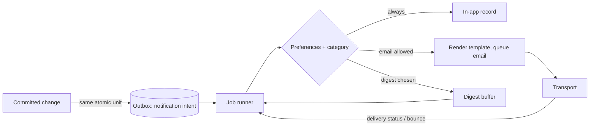
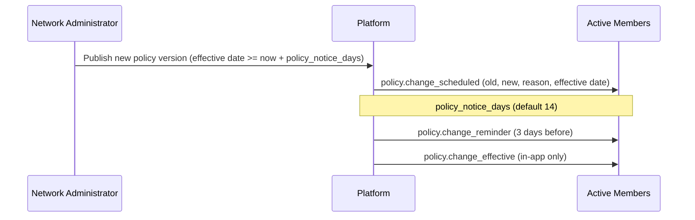

# 17 — Notifications and Communications

| Field | Value |
|---|---|
| Status | Draft |
| Owner role | Product architect (with Network governance lead for wording) |
| Last updated | 2026-10-21 |
| Scope | Which events notify whom, on which channel, with what content; mandatory versus optional notices; preferences; delivery guarantees; rate limiting and digests; content, template, localisation and accessibility rules; failure and bounce handling; Network Administrator broadcasts and policy-change notices; abuse controls on Network-to-Member messaging; privacy; verification |
| Depends on | [00 Conventions](00-conventions.md), [03 Domain model](03-domain-model-and-mutual-credit-rules.md), [04 Functional requirements](04-functional-requirements.md) (FR-NTF-001 to FR-NTF-008), [05 Architecture](05-architecture-and-trust-boundaries.md), [06 Data, ledger and audit](06-data-ledger-and-audit.md), [08 UX and accessibility](08-ux-and-accessibility.md), [09 Security, privacy and abuse](09-security-privacy-and-abuse.md), [15 Lifecycle state machines](15-lifecycle-state-machines.md) |
| Open questions | NTF-OD-1 to NTF-OD-13 in section 14 |

## 1. Purpose and scope

People in a mutual-credit Network trust it when nothing about their account changes silently, and lose that trust when they are spammed, impersonated or surprised. This document turns the high-level notification rules of [04 section 10.3](04-functional-requirements.md) (FR-NTF-001 to FR-NTF-008) into a complete, testable specification: the **event catalogue**, recipients, channels, preferences, delivery semantics, content and template rules, failure handling, administrator broadcasts, abuse controls and verification.

**In scope (MVP):** in-product notifications and transactional email; digests; administrator announcements to a Network's Members; policy-change notices (D-11); security notices; notices from the Platform Operator to Network Administrators.

**Designed for, deferred (P2):** push notifications to a future mobile client, SMS, webhooks to integrations ([07 section 15](07-api-and-integration-contract.md)), Member-to-Member free-text messaging, quiet hours, per-Network sender domains.

**Out of scope:** marketing or promotional messages (the Platform sends none in MVP, NTF-050); the wording of legal notices (a question for counsel, see [19](19-legal-and-regulatory-open-questions.md)); transport vendor choice (D-02); what an email provider may technically see (stated honestly in [05 section 6](05-architecture-and-trust-boundaries.md), ARC-016).

## 2. Definitions used here

Terms are defined in [14 — Glossary](14-glossary.md); canon terms are in [00 section 5.1](00-conventions.md). Terms specific to this document, also listed in the glossary:

| Term | Meaning |
|---|---|
| **Event** | A committed occurrence in the Platform (a state transition of [15](15-lifecycle-state-machines.md), a policy publication, a security occurrence) that may produce notifications. Identified by an **event key** such as `trade.proposed`. |
| **Notification** | One message to one recipient for one event, shown in-product and optionally delivered on a further channel. Stored as the Notification record of [06 section 4](06-data-ledger-and-audit.md) with status `queued`, `sent`, `delivered`, `failed`, `read` or `suppressed`. |
| **Notification intent** | The Outbox record written in the same atomic step as the originating change (DAT-016, ARC-006); the Job runner turns it into Notifications. |
| **Channel** | `in_app` or `email` in MVP; `push` and `sms` deferred. |
| **Category** | The preference grouping of an event (section 5.2). |
| **Mandatory notice** | A notification whose email delivery cannot be turned off by preferences (section 5.3). |
| **Digest** | One message that summarises several optional notifications or pending items for one recipient. |
| **Broadcast** | An administrator-authored announcement to all active Members of one Network (section 11). |
| **Template** | A versioned, localisable message definition identified by a `template_key`, rendered from typed parameters. |
| **Transport** | The external message-delivery service behind the message-transport interface (Zone Z5 of [05](05-architecture-and-trust-boundaries.md)). |
| **Undeliverable address** | A sign-in email address for which delivery has failed permanently (section 8.3). |

## 3. Principles

1. **No silent change.** Anything that changes someone's balance, standing, rights, limits or credentials produces a notification that states what changed, why and how to challenge it (FR-NTF-001, UX-098).
2. **The notification is never the authority.** Notifications inform; they cannot approve, accept, post or alter anything (INV-012; API-145). A link opens the review step, never executes (UX-010).
3. **Minimum necessary content.** Email is not a secure channel (ARC-017, FR-NTF-005); put the minimum in it and the detail behind the sign-in.
4. **Delivery failure never harms the ledger.** Posting is independent of notifications (ARC-003, DAT-016, FR-NTF-008).
5. **Quiet by default for optional matter, loud for security and standing.** Members control optional categories; they cannot be made to miss a security or ledger-affecting change.
6. **One source of wording.** Email and in-product text come from one copy catalogue and the same formatters (UX-095), obeying the term rules of UX-109 and the copy lint of UX-029.

### 3.1 Delivery flow

Text: a change and its notification intents commit together (DAT-016). The Job runner expands each intent into one Notification per recipient, always creates the in-app record, applies preferences and rate limits, renders the template, and hands email to the transport. Transport receipts and bounces return to the Job runner and update the Notification status. If the transport is down, intents wait in the Outbox and are retried; nothing in the posting path waits for them.

## 4. Channels

| Channel | MVP | Use | Notes |
|---|---|---|---|
| `in_app` | Yes, P0 | Every event in the catalogue creates an in-app record for every recipient who has a Membership (or login, for security events) | Source of truth for what the Platform told the user. Readable after sign-in only. Unread count and list: SCR-14 in [08](08-ux-and-accessibility.md), UX-021. |
| `email` | Yes, P0 | Sent to the sign-in email address (the only verified channel in MVP) | Transactional only. Plain text part always present. |
| `push` | P2 | Mobile client | Designed for: preferences model (section 6) already has a channel dimension. Payloads MUST follow the same minimum-content rules as email. |
| `sms` | P2 | Possible second verified channel for security events | Deferred: phone numbers add personal data and cost [DECISION NEEDED: NTF-OD-11]. |
| Webhook | P2 | Integrations | [07 section 15](07-api-and-integration-contract.md); reuses the event record. |

| ID | Pri | Requirement | Rationale | Verification |
|---|---|---|---|---|
| NTF-001 | P0 | Every event marked in the catalogue (section 5) **MUST** create an `in_app` Notification for each recipient, regardless of email preferences or email deliverability. | FR-NTF-001 needs a record that email cannot lose; email may bounce. | Test: set all email preferences off and make the address undeliverable; trigger each event; in-app records exist. |
| NTF-002 | P0 | Email **MUST** be sent to the sign-in email address of the recipient's login only; the Platform **MUST NOT** send email to any address supplied by another Member or by an administrator other than the invitee address of an invitation (SEC-048). | Prevents the notification system becoming a relay (threat T32 in [09](09-security-privacy-and-abuse.md)). | Inspection of recipient resolution; test with crafted inputs. |
| NTF-003 | P0 | Where more than one verified channel exists for the recipient, security notices **MUST** go to all of them (SEC-031). In MVP, `in_app` plus the sign-in email satisfy this; adding a channel in P2 **MUST** extend this requirement automatically (by category, not by event). | Single source for the security rule. | Configuration test: add a stub second channel; security events reach it. |
| NTF-004 | P1 | The message-transport interface **MUST** be replaceable without changes to templates, preferences or the catalogue, and **MUST** accept: recipient address, rendered subject, plain part, HTML part, a deduplication key, headers, and return a provider message reference and later receipts. | D-02 technology neutrality; ARC-029. | Contract test with a fake transport and an alternative stub. |

## 5. Event catalogue

Event keys are stable strings (`domain.event`). Adding or changing an event key follows the template governance rules of section 9. "Recipients" use the roles of [02](02-personas-roles-and-journeys.md): *Proposer* and *Counterparty* as in the canon; *Party* means Provider or Recipient of the Trade; *Admins* means all active `network_admin` Memberships of that Network. Unless stated, a Network event notifies only active, suspended or departing Memberships of that Network (section 6.1 covers closed and applicant states).

Columns: **Cat** is the category (section 5.2); **Email** is `M` mandatory (cannot be turned off), `O` optional (default on), `D` optional (default off), or `-` none; every row also creates an in-app record (NTF-001).

### 5.1 Catalogue tables

**Trades (source: [15 section 4](15-lifecycle-state-machines.md), TR1 to TR6)**

| Event key | Trigger | Recipients | Cat | Email | Content summary (see section 7) |
|---|---|---|---|---|---|
| `trade.proposed` | TR1 | Counterparty | trade | O | Proposer name, direction (what the recipient of this message would be asked to give or receive), amount, expiry date-time, link to the review step |
| `trade.completed` | TR2 | The Party who did **not** perform the acceptance (the Proposer); the accepting Party gets an in-app receipt only | trade | O | Counterparty name, direction word, amount, time, link |
| `trade.declined` | TR3 | Proposer | trade | O | Counterparty name, amount, link; declined reason only if the Counterparty supplied one, and only in-app |
| `trade.cancelled` | TR4 | Counterparty when cancelled by Proposer; both Parties when cancelled by `system` | trade | O | Who or what cancelled (Proposer, or system reason in plain words: member leaving, dispute outcome, membership closed), amount, link |
| `trade.expired` | TR5 | Both Parties | trade | O | Amount, original expiry, "nothing was posted", link to propose again |
| `trade.expiring_soon` | Timer: remaining life ≤ 24 h, only if original life > 48 h [DECISION NEEDED: NTF-OD-3] | Counterparty (once per proposal) | reminder | D | Amount, proposer name, expiry date-time, link |
| `trade.reversed` | TR6 (via Reversal) | Both Parties | ledger | **M** | Original Trade reference, amount, direction in words ("added"/"deducted" for the viewer), reason category, link. Resulting balance is **not** in email. |
| `reversal.requested` | RV1 path a | The other Party | trade | O | Requester name, Trade reference, amount, link to respond, response deadline |
| `reversal.declined` / `reversal.withdrawn` / `reversal.expired` | RV3, RV4, RV5 | The requester (and the other Party on withdrawal) | trade | O | Outcome, Trade reference, link |
| `reversal.approval_requested` | RV1 path b | Admins other than the initiator and not a Party | admin_work | O (digest) | Count and link only |

**Adjustments (source: [15 section 7](15-lifecycle-state-machines.md), AJ1 to AJ5; DOM-031, LIF-041)**

| Event key | Trigger | Recipients | Cat | Email | Content summary |
|---|---|---|---|---|---|
| `adjustment.posted` | AJ2 | Affected Member | ledger | **M** | Direction in words ("added to" / "deducted from" your account), amount with unit, reason category, acting capacity ("a network administrator"), link to the full reason and history entry. Sent before or when the balance change becomes visible (DOM-031). |
| `adjustment.approval_requested` | AJ1 when `admin_quorum` > 1 | Eligible Admins (not the initiator, not the target) | admin_work | O (digest) | Count and link |
| `adjustment.refused` / `adjustment.expired` | AJ3, AJ5 | Initiating admin | admin_work | O | Outcome, link |

**Disputes (source: [15 section 5](15-lifecycle-state-machines.md), DS1 to DS7)**

| Event key | Trigger | Recipients | Cat | Email | Content summary |
|---|---|---|---|---|---|
| `dispute.raised` | DS1 | The other Party; Admins (queue) | standing | **M** (other Party), O/digest (Admins) | Neutral summary "A dispute was raised about a trade of {amount} on {date}" (no claim text in email), response deadline as absolute date-time, link |
| `dispute.reviewer_assigned` | DS2 | Assigned Dispute Reviewer; both Parties | dispute | O | Reviewer's display name is shown only if Network policy shows it; otherwise "a dispute reviewer" |
| `dispute.response_reminder` | Timer before response deadline | Party who has not responded | reminder | O | Deadline, link |
| `dispute.sla_reminder` | Timer: `dispute_review_sla_days` reached | Assigned reviewer, else Admins | admin_work | O | Count of disputes near or past SLA, link |
| `dispute.settlement_consent_requested` | DS5 preparation | Both Parties | standing | **M** | "Settlement terms need your agreement", link, deadline. No terms in email. |
| `dispute.resolved` | DS3, DS4, DS5 | Both Parties | standing | **M** | Outcome in words (upheld / rejected / settled), link to written reasoning and any resulting Reversal or Adjustment, appeal or escalation route |
| `dispute.withdrawn` | DS6 | Other Party; assigned reviewer | dispute | O | Outcome, link |
| `dispute.escalated` | DS7 | Both Parties; Admins | standing | **M** | Reason code in plain words, who handles it next, link |

**Membership and account standing (source: [15 section 6](15-lifecycle-state-machines.md), MB1 to MB7; LIF-032)**

| Event key | Trigger | Recipients | Cat | Email | Content summary |
|---|---|---|---|---|---|
| `application.received` | MB1 | Applicant; Admins | account | M (applicant confirmation), O/digest (Admins) | Confirmation and email-verification step (single-use verification link where verification is needed); for Admins a count and link |
| `application.approved` | MB2 | Applicant | account | **M** | Welcome, Network name, link to first steps, starting credit limit stated in words and unit, unit explanation link |
| `application.rejected` | MB3 | Applicant | account | **M** | Decision, recorded reason shown verbatim, how to ask again or challenge |
| `application.reminder` | Timer: `applicant` age ≥ reminder age [DECISION NEEDED: 7 days, see 15 section 10] | Admins | admin_work | O (digest) | Count and link |
| `invitation.sent` | Invitation created | Invitee address | account | M | Fixed template, inviter display name only if inviter consented in profile policy, Network name, expiry date-time, single-use link. No inviter free text (SEC-048). |
| `invitation.accepted` | MB1 via invitation | Inviting Member/Admin | account | O | "{Name} joined" only if the invitee agreed to be named; otherwise count only |
| `membership.suspended` / `membership.reinstated` | MB4, MB5 | Affected Member | standing | **M** | State, reason as recorded, what it means (balances unchanged; what is disabled), how to contact or appeal, export availability (UX-100) |
| `membership.departure_requested` | MB6 (member request) | Member (confirmation); Admins | standing | **M** (Member), O (Admins) | Settlement mode in words, what happens to balance, deadline |
| `membership.departure_balance_notice` | MB6 when the Member's balance is non-zero (once; GOV-039) | Departing Member | standing | **M** | Settlement mode in words, what happens next, deadline, link to the full disclosure in-app (amount and sign shown in-app only). This is the only Platform-generated notification about the balance of a departing Member (NTF-091). |
| `membership.settlement_window_ending` | Timer: 7 days before the settlement window ends (15 section 10) | Departing Member; Admins | standing | **M** (Member), O (Admins) | Date the departure completes and what the Member can still do (export); no balance figure and no demand wording |
| `membership.closed` | MB7 | Former Member (final) | standing | **M** | Closure confirmed, export route, what data is removed and when (D-09). Last email to that address from this Network except export notices. |
| `membership.inactive_reminder` | Inactivity flag (DOM-043) | The inactive Member, once per flag cycle | reminder | D | Friendly check-in; no consequences stated unless Network policy defines them |
| `role.granted` / `role.revoked` | Role change | Affected Member; other Admins | standing | **M** (Member), O (Admins) | Role in plain words, who acted (capacity), link |
| `limit.changed` | `credit_limit` or `max_balance` per-Member change | Affected Member | standing | **M** | Old and new value, effective date, reason; "Your balance has not changed" where true |
| `limit.approaching_floor` | `available_to_spend` ≤ 10% of `credit_limit` after a posting [DECISION NEEDED: NTF-OD-4] | Affected Member, at most once per 7 days | reminder | D | "You can now spend up to {amount} {unit} more." Wording avoids debt language (UX-029). |
| `limit.approaching_cap` | Balance ≥ 90% of `max_balance` (only if set) | Affected Member, at most once per 7 days | reminder | D | "Your account can receive up to {amount} more before it reaches the network's limit." |
| `listing.removed` | LS6 moderation | Listing owner | standing | **M** | Listing title, reason, challenge route (LIF-047) |
| `report.received` | SEC-049 | Admins | admin_work | O (digest) | Count and link; reporter identity never in the message |
| `report.resolved` | Admin resolves | Reporter | account | O | Neutral outcome, no details about the reported party |

**Policy and Network changes (source: D-11; FR-NET-008, FR-NTF-002)**

| Event key | Trigger | Recipients | Cat | Email | Content summary |
|---|---|---|---|---|---|
| `policy.change_scheduled` | Policy version published with effective date | All active Members of the Network (and `departing` Members) | policy | **M** | Parameter name in plain words, old value, new value, reason, effective date-time, what it means for the recipient where computable, link (section 11) |
| `policy.change_reminder` | Timer: 3 days before effective date [DECISION NEEDED: NTF-OD-5] | Same | policy | **M** (in-app banner plus one email) | Same facts, shorter |
| `policy.change_effective` | Effective date reached | Same | policy | in-app only (`-`) | "This change is now in effect" banner |
| `policy.safety_change` | Immediate safety fix (D-11 exception) | Same | policy | **M** | Value change, reason, effective immediately, who authorised (capacity) |
| `rules.text_changed` | Rules text version published (FR-NET-008) | Same | policy | **M** | Summary of change, effective date, link to diff and plain-language summary (UX-110) |
| `network.state_changed` | Network paused, resumed, closing, closed, or suspended by Operator | All Members; Admins | policy | **M** | State, what is disabled, export availability |

**Governance decisions, appeals and Network status (source: [10](10-governance-and-network-operations.md), GOV-010 to GOV-084)**

Every notice of a Decision (application rejected, suspension, removal, Listing removal, limit lowered, Adjustment, Dispute resolution) is the matching `standing` or `ledger` row above, and **MUST** additionally state the appeal route and filing window (GOV-023, NTF-089). The rows below add the events specific to governance.

| Event key | Trigger | Recipients | Cat | Email | Content summary |
|---|---|---|---|---|---|
| `appeal.filed` | Appeal filed (GOV-024) | Appellant (confirmation); assigned reviewers | standing | **M** (appellant), O (reviewers) | Decision appealed, filing time, expected decision date, link. No grounds text in email. |
| `appeal.decided` | Appeal outcome recorded | Appellant; any Member whose position changes as a result | standing | **M** | Outcome in words, link to written reasons and any resulting reinstatement or counter-Adjustment |
| `admin_recovery.requested` | Admin-loss recovery procedure requested (GOV-050) | All active Members; any reachable Admin immediately | standing | **M** | Request, nominee display name, the waiting period end date-time, how to object, how an Admin can cancel |
| `admin_recovery.completed` / `admin_recovery.stopped` | Procedure executed or stopped by objections or cancel | All active Members | standing | **M** | Outcome, link to the Audit Event the Members can see (GOV-051) |
| `network.hold_applied` / `network.hold_lifted` | Operator hold (`read_only` or `suspended`; GOV-075) | Admins by every verified channel before or at application (within 24 hours if urgent security response); Members in-app | policy | **M** (Admins), O (Members) | Hold type in words, reason category, review date, export availability |
| `network.closure_notice` | Closure announced (GOV closure plan; minimum notice in [10 section 11](10-governance-and-network-operations.md)) | All Members | policy | **M** | Plan with dates, export link, what happens to balances in plain words; no redemption wording |
| `departure.residual_notice` | At least 14 days before a residual entry posts (GOV-081) | Each affected Member | standing | **M** | Notice that an entry to a System Account will be made on a date and that the Platform provides no redemption or cash-out; amount and sign in-app only; the email is neutral (no amount, sign or balance) and links to the in-app notice |

**Security and sign-in (source: [09 section 6](09-security-privacy-and-abuse.md), SEC-006, SEC-027 to SEC-032)**

Security events belong to the **login**, not to a Membership, and mention no Network name.

| Event key | Trigger | Recipients | Cat | Email | Content summary |
|---|---|---|---|---|---|
| `security.new_device_signin` | Sign-in from an unrecognised device | The login | security | **M** | Time, approximate region, device type (no IP address in the message body), "not you?" route to secure the account |
| `security.credential_changed` | Passkey, password or TOTP added, removed or changed (SEC-006) | The login | security | **M** | What changed, time, "other sessions were signed out", "not you?" route |
| `security.email_change_requested` / `security.email_changed` | SEC-032 | Old address (with revert link valid 72 hours) and new address | security | **M** | What changed, time, revert link to old address only |
| `security.recovery_requested` | SEC-026 to SEC-029 | The login (all verified channels, old email) | security | **M** | Request time; cancel link that works without sign-in during cool-off (SEC-029) |
| `security.recovery_cooloff` | Cool-off running | Same | security | **M** | Remaining time, cancel link; sent at start and at 24 h before completion |
| `security.recovery_completed` / `security.recovery_cancelled` | Completion or cancel | Same | security | **M** | Outcome, sessions revoked, restricted period explained (SEC-030) |
| `security.verification` | Email verification, step-up code, recovery token | The address being verified | security | **M** | Single-use link or code; the only message type allowed to carry a token (NTF-031) |
| `security.break_glass` | Operator break-glass access to a Network (SEC-042 in [09](09-security-privacy-and-abuse.md)) | Network Administrators of the Network, and each affected Member when the access includes that Member's content (SEC-042, SEC-031); not all Members | security | **M** | Time window, reason category, who approved (capacity), link to the Network's audit view |

**Exports and data (source: [18](18-data-export-and-portability.md))**

| Event key | Trigger | Recipients | Cat | Email | Content summary |
|---|---|---|---|---|---|
| `export.ready` | ExportJob `ready` | Requester | export | O | Type of export, as-of time, link requiring sign-in; link expiry date-time; no file contents |
| `export.failed` / `export.expired` | `failed`, `expired` | Requester | export | O | Outcome, how to retry |
| `export.network_requested` / `export.network_downloaded` | Network-level export (PRT-033) | All Admins | security | **M** (for Admins) | Requester (capacity and display name), scope, time ("watching the watchers") |

**Operator to Network Administrators (source: [11 section 11](11-deployment-operations-and-support.md), OPS-076, OPS-077)**

| Event key | Trigger | Recipients | Cat | Email | Content summary |
|---|---|---|---|---|---|
| `ops.incident` | Sev-1 confirmed (within 1 hour) | Admins of affected Networks | operator | **M** | Plain language: what is affected, what is not, whether balances are safe, next update time |
| `ops.data_exposure` | Personal-data exposure confirmed (within 24 hours) | Admins of affected Networks | operator | **M** | Facts known, what the Network can do; whether legal duties apply is a question for counsel ([19](19-legal-and-regulatory-open-questions.md)) |
| `ops.maintenance` | Planned maintenance | Admins (and Members only if writes are disabled for more than 15 minutes [DECISION NEEDED: NTF-OD-7]) | operator | O | Window start and end in UTC and local time |
| `ops.restore_loss_window` | Restore with data loss (OPS-030, OPS-031) | Admins; affected Members | operator | **M** | Window, what may need re-entry |
| `ops.delivery_degraded` | Transport down or bounce spike (section 8.3) | Admins | operator | O | "Email notices are delayed; in-app notices are unaffected" |

**Announcements and digests**

| Event key | Trigger | Recipients | Cat | Email | Content summary |
|---|---|---|---|---|---|
| `announcement.broadcast` | Admin publishes a Broadcast (section 11) | Active Members | announcement | O (default on) | Fixed template with plain-text body from the Admin; labelled "Message from the administrators of {Network}" |
| `digest.member` | Schedule chosen by Member | Member | digest | O | Counts and links of optional notifications held back (section 6.3) |
| `digest.admin` | Schedule (default daily) | Admins | admin_work | O | Counts only: pending applications, reports, Adjustments awaiting approval, Disputes near or past SLA, delivery failures (FR-NTF-007) |

### 5.2 Categories

| Category | Contains | Member can switch email off? |
|---|---|---|
| `security` | All `security.*`, `export.network_*` | No |
| `ledger` | `adjustment.posted`, `trade.reversed` | No |
| `standing` | Suspension, reinstatement, departure, closure, limit changes, role changes, Listing removal, Dispute raised/resolved/escalated/settlement consent | No |
| `policy` | Policy, rules-text and Network-state notices | No |
| `account` | Application and invitation messages, report outcome | Verification and decision messages: No; others: Yes |
| `operator` | `ops.*` | Admins cannot switch off `ops.incident`, `ops.data_exposure`, `ops.restore_loss_window`; others yes |
| `trade` | Trade proposals, outcomes, reversal requests | Yes |
| `dispute` | Dispute progress that does not change standing | Yes |
| `reminder` | Expiry reminders, response reminders, limit warnings, inactivity check-in | Yes |
| `export` | Export lifecycle (except Network-level watch) | Yes |
| `announcement` | Broadcasts | Yes |
| `admin_work` | Pending-item digests and reminders for Admins | Yes |
| `digest` | Member digests | Yes |

### 5.3 Mandatory versus optional

| ID | Pri | Requirement | Rationale | Verification |
|---|---|---|---|---|
| NTF-005 | P0 | The email for every event marked **M** in section 5.1 **MUST** be sent regardless of preferences, and the preference interface and API **MUST** reject an attempt to disable it with the error `notice_not_optional` ([07 section 6.12](07-api-and-integration-contract.md)). | FR-NTF-004; no member may miss a security, ledger or standing change. | Test: set every optional preference off; trigger each mandatory event; email present. API test for the error. |
| NTF-006 | P0 | A mandatory email **MUST NOT** be converted into a digest, delayed by quiet hours, or dropped by the rate limits of section 8; it **MAY** be merged with other mandatory notices for the same recipient and the same event within 60 seconds only if each is separately listed. | Mandatory means timely. | Test: 30 mandatory events in a minute produce 30 listed items, none lost. |
| NTF-007 | P0 | Free-text broadcasts and any message whose body is authored by a person **MUST NOT** be categorised as mandatory. | Prevents "mandatory" being used to bypass consent for communications (section 11). | Inspection of catalogue; test attempting to mark a Broadcast mandatory. |
| NTF-008 | P0 | Suppression due to bounce or complaint (section 8.3) **MUST** apply to optional email only; the in-app record still **MUST** be created, and mandatory email attempts **MUST** continue unless the address is undeliverable. | Safety before preference. | Test with a complaint on an optional category. |

## 6. Recipients, preferences and digests

### 6.1 Recipient resolution

| ID | Pri | Requirement | Rationale | Verification |
|---|---|---|---|---|
| NTF-009 | P0 | Recipients **MUST** be resolved at dispatch time from current state, not at event time alone: a Membership that is `closed` at dispatch **MUST** receive only `membership.closed`, `export.*` and `security.*` addressed to its login; an `applicant` **MUST** receive only `application.*`, `invitation.*`, `security.*`. | Closed members must not see Network content (DAT-072). | Test: close a membership between event and dispatch. |
| NTF-010 | P0 | A person with Memberships in several Networks **MUST** receive separate notifications per Network; no email **MAY** combine content of two Networks or reveal that the recipient belongs to another one. Security notices (login level) mention no Network. | ARC-025 cross-Network privacy. | Test: member in two Networks, events in both; inspect emails. |
| NTF-011 | P0 | Notices about a Member's account that go to Admins (counts, digests) **MUST** respect `balance_visibility`: no balance, limit headroom or Trade detail reaches an Admin who could not see it in-product (SEC-103). | One visibility rule on all surfaces. | Test with `balance_visibility` = `self`. |
| NTF-012 | P0 | A Party who is not permitted to see the counterparty's display name (for example `directory_visibility` rules or a block under SEC-051) **MUST** receive the neutral wording "another member" in place of the name. | Blocks and visibility cannot leak through notices. | Test: blocked relation; unlisted member. |
| NTF-013 | P1 | A reporter's identity **MUST NOT** appear in any notification to the reported Member or to non-administrators. | SEC-049. | Test. |

### 6.2 Preferences

Preferences are stored per login with an optional per-Membership override, exposed through `get_notification_preferences` / `update_notification_preferences` ([07 section 6.12](07-api-and-integration-contract.md)).

| ID | Pri | Requirement | Rationale | Verification |
|---|---|---|---|---|
| NTF-014 | P0 | For each optional category, a Member **MUST** be able to choose email `immediate`, `digest` or `off`, per Network. Defaults: `trade` immediate; `reminder` immediate; `dispute` immediate; `export` immediate; `announcement` immediate; `digest` off. Limit warnings and inactivity check-ins are `off` (rows marked **D**). | Control without losing the useful default. | Test per category and mode. |
| NTF-015 | P0 | The preference screen **MUST** list mandatory categories as read-only with a one-line reason each ("We always email you about changes to your account and security."), and **MUST** be reachable by keyboard and screen reader (D-14). | Honest control; accessibility. | Inspection; screen-reader test. |
| NTF-016 | P0 | Every non-mandatory email **MUST** contain a one-step link (no sign-in required, bound to the category and recipient, single purpose) to turn off that category, and **MUST** carry the `List-Unsubscribe` and `List-Unsubscribe-Post` headers for one-click unsubscribe (RFC 8058) for broadcast and digest categories. The link **MUST NOT** change mandatory categories. | Member control; mailbox-provider expectations. | Header inspection; test the link signed out. |
| NTF-017 | P0 | A preference change **MUST** take effect for events committed after the change and **MUST** be recorded (who, when, old, new) in the Member's own record; it **MUST NOT** generate an Audit Event (it is not a governance action) but **SHOULD** appear in the security log if made through an API credential. | Traceability without audit noise. | Test. |
| NTF-018 | P1 | New optional categories added in a release **MUST** default to `off` for existing users unless the Network Administrator-visible release note says otherwise and counsel has reviewed it. | No consent by surprise. | Release checklist. |
| NTF-019 | P2 | Quiet hours (no optional email between two local times; held until the end) and per-channel overrides **MAY** be added; mandatory notices **MUST** still be sent. | Deferred; designed for. | — |

### 6.3 Digests

| ID | Pri | Requirement | Rationale | Verification |
|---|---|---|---|---|
| NTF-020 | P1 | A Member in `digest` mode **MUST** receive at most one digest per Network per selected period (daily or weekly, default daily at 08:00 local time) and **MUST NOT** receive an empty digest. | Reduces noise. | Test: no events, no digest; many events, one digest. |
| NTF-021 | P1 | A digest **MUST** list items by count and category with links, **MUST NOT** contain amounts, names or free text, and **MUST** state the time of the oldest item. | Minimum content (section 7) with a usable summary. | Template review; golden-file test. |
| NTF-022 | P1 | `digest.admin` **MUST** be sent only when at least one pending item exists, show counts and the age of the oldest item for each queue, and **MUST** highlight items past SLA (`dispute_review_sla_days`). | FR-NTF-007; admin burnout. | Test with seeded queues. |

## 7. Content rules

### 7.1 General content

| ID | Pri | Requirement | Rationale | Verification |
|---|---|---|---|---|
| NTF-023 | P0 | **Subject lines MUST NOT contain amounts, counterparty names, balances, free text, reasons or Dispute details.** Subjects state only the category in plain words ("You have a new trade proposal", "A change to your account", "Security notice"). The Network name **MAY** be included, controlled by a per-Network switch `neutral_subjects` (default: Network name included; when `neutral_subjects` is on, subjects carry the category only and no Network name) [DECISION NEEDED: NTF-OD-2]. | Subjects appear on lock screens, in notification previews and in shared mailboxes. | Subject lint over every template; render-all test. |
| NTF-024 | P0 | Email bodies for Trade events **MUST** contain only: recipient greeting by display name, direction in words, amount with unit and unit symbol, counterparty display name (subject to NTF-012), the date-time, and a deep link. They **MUST NOT** contain the Trade description or note, any Listing text, the resulting balance, or the credit limit. | FR-NTF-005 and decision FR-OD-15 default; A5 sensitivity of relationship data. | Render test with hostile notes containing markers; marker never appears in email. |
| NTF-025 | P0 | The direction **MUST** be stated in words from the recipient's point of view using the canonical terms of UX-109 and [08 section 6.4](08-ux-and-accessibility.md): for a Provider "you earned" or "added to your account", for a Recipient "you spent" or "deducted from your account", never a bare sign or colour. Amounts **MUST** be formatted by the locale-aware formatter with exactly `unit_scale` decimals and the unit (UX-088). | A signed number in a lock-screen preview is ambiguous; consistency with the UI. | Golden-file tests per direction and locale; compare with web client formatter. |
| NTF-026 | P0 | Every notification **MUST** carry an absolute deep link to the specific object (stable URL, UX-010). A link into a state-changing action **MUST** open the review step and **MUST NOT** execute the action. Links **MUST NOT** contain personal data or session tokens, except the single-use tokens of `security.verification`, invitations, recovery cancel/revert and export download (section 7.2). | Safe links. | Link audit; test that clicking executes nothing. |
| NTF-027 | P0 | Messages **MUST NOT** use the words on the prohibited list of UX-029 (for example pay, payment, money, funds, interest, debt, price) and **MUST** call the unit by `unit_name` or "credits". They **MUST NOT** state or imply that the unit is redeemable for money (INV-014). See the discouraged-terms table in [14](14-glossary.md). | Consistency with canon and legal posture. | Catalogue copy lint (UX-029) in CI; legal copy review for rights/remedies wording (UX-097). |
| NTF-028 | P0 | Negative-balance and limit messaging **MUST** say "you can spend up to {amount} {unit} more" or "your account is {amount} {unit} below zero, within your limit" and **MUST NOT** use "owe", "overdue", "arrears" or "default". | A negative balance is an obligation to provide goods or services, not debt (canon 5.2). | Copy lint; template review. |
| NTF-029 | P0 | Reasons recorded by administrators (rejection, suspension, Listing removal, Adjustment) **MUST** be shown verbatim to the affected Member in-app; in email they **MUST** be replaced by a reason category and a link, except for `application.rejected` where [DECISION NEEDED: NTF-OD-8] the verbatim reason is allowed in email. The administrator form **MUST** warn that the Member will read it (UX-099). | Dignity and due process versus email exposure of sensitive text. | Test with a long hostile reason; inspect email. |
| NTF-030 | P0 | Every notification **MUST** answer: what happened, to which object, what it means for the reader, whether anything is needed from them (and by when, as absolute date-time with time zone, UX-104), and where to ask for help or challenge it. | Usable notices; LIF-032 route to challenge. | Template checklist in review; inspection. |

### 7.2 Security content

| ID | Pri | Requirement | Rationale | Verification |
|---|---|---|---|---|
| NTF-031 | P0 | A message **MUST NOT** contain a password, TOTP seed or code (other than the one-time code or single-use link the recipient requested), recovery code, session identifier or API credential. No message **MUST** ask the recipient to reply with, or type into a page opened from the message, any secret other than the single-use verification or recovery flow (SEC-031). | Anti-phishing and anti-impersonation (T20). | Template review; automated secret scan of rendered output. |
| NTF-032 | P0 | All email **MUST** be sent from a domain authenticated with SPF, DKIM and DMARC aligned (SEC-031). A message **MUST** carry the sender display name "{Network name} via Circula" or the deployment's configured name, and a footer stating that the Platform will never ask for a password. | Recognisable sender; anti-spoofing. | Header inspection in CI against a test transport; deployment checklist ([11](11-deployment-operations-and-support.md)). |
| NTF-033 | P0 | Single-use links in security messages **MUST** follow the token rules of SEC-027 (at least 128 bits of entropy, hashed at rest, 15-minute maximum for verification and recovery) and **MUST** work on a second device without sign-in only for cancel and revert actions (SEC-029, SEC-032). | Tokens are the sensitive part. | Test expiry, reuse and second-device behaviour. |
| NTF-034 | P0 | Messages **MUST NOT** contain tracking pixels, open tracking, third-party link-wrapping or analytics identifiers. All links **MUST** point directly to the deployment's domain. | Privacy; avoids redirect-based phishing. | HTML scan of rendered templates. |

### 7.3 Localisation, plain language and accessibility

| ID | Pri | Requirement | Rationale | Verification |
|---|---|---|---|---|
| NTF-035 | P0 | All message text **MUST** be externalised in the copy catalogue keyed by `template_key` and locale, with typed parameters only (API-036); no sentence **MAY** be assembled by concatenating fragments in code. MVP ships English only (D-13); adding a language **MUST** require no code change. | D-13; word order differs across languages. | Pseudo-locale render test (UX-093); code scan for string concatenation. |
| NTF-036 | P0 | Dates, times, numbers, amounts and lists **MUST** be formatted for the recipient's locale and time zone; UTC time **MUST** also be given for deadlines on security and Dispute notices. A recipient's locale **MUST** be the login's persisted locale (UX-096); if no template exists in it, fall back to English and record the fallback. | Correctness; D-13. | Test across locales with different separators and calendars. |
| NTF-037 | P0 | Member-facing text **MUST** meet the reading-level target of UX-108 (grade 8 or lower, average sentence ≤ 20 words), one idea per sentence where practical, no abbreviations unless expanded (UX-111), no idioms. | Broad community audience. | Automated readability check on catalogue in CI. |
| NTF-038 | P0 | Every email **MUST** have a plain-text part carrying the complete content, and an HTML part that: uses semantic markup (headings, lists, real links with descriptive text, never "click here"); conveys nothing by colour or image alone; has alt text for any non-decorative image and none is required to understand the message; meets contrast 4.5:1 for text; reflows at 320 CSS px without horizontal scroll; sets `lang` and `dir` for the locale. | D-14 (WCAG 2.2 AA) applied to email; assistive technology users. | Automated checks (contrast, structure) plus manual screen-reader review of each template family. |
| NTF-039 | P0 | In-app notification lists and toasts **MUST** be keyboard operable, announce new items politely to assistive technology without moving focus (UX-021, SC 4.1.3), expose read/unread as text, and not disappear on a timer shorter than the user needs (SC 2.2.1). | Accessible status messages. | Screen-reader and keyboard tests per [08](08-ux-and-accessibility.md). |
| NTF-040 | P1 | User-generated text embedded in a message (display names, Network names) **MUST** be escaped for the target format and bidi-isolated so it cannot reorder surrounding text or inject markup, links or line breaks into headers. | Injection via names (T31, SEC-052). | Test names with HTML, newlines and RTL control characters. |

## 8. Delivery guarantees, rate limiting and failure handling

### 8.1 Delivery semantics

Semantics: **at-least-once** hand-off to the transport, with **deduplication** so that the recipient sees each Notification once in-app and, normally, once by email. "Exactly once" email cannot be guaranteed across a third-party transport; the design tolerates rare duplicates and never tolerates loss of a committed mandatory notice.

| ID | Pri | Requirement | Rationale | Verification |
|---|---|---|---|---|
| NTF-041 | P0 | A notification intent **MUST** be written in the same unit of work as the change that causes it, and a committed intent **MUST** eventually yield its in-app Notification and (if applicable) email even after a crash; a rolled-back change **MUST** yield none (DAT-016, FR-NTF-003). | No false or lost notices. | Crash-between-commit-and-send test; rollback test. |
| NTF-042 | P0 | Each Notification **MUST** have a deterministic deduplication key of (`event id`, `recipient`, `channel`, `template_key`); the Job runner **MUST** make creation idempotent on it, and the same key **MUST** be sent to the transport as an idempotency reference where supported and added as a message header for support tracing. | Retries and replays must not create duplicates (INV-009 spirit). | Test: reprocess the same Outbox record 20 times; one Notification per key. |
| NTF-043 | P0 | A replay of an idempotent API request (INV-009) **MUST NOT** create a notification (API-083). | No duplicate notices from client retries. | Test: 50 replays, one notification set. |
| NTF-044 | P0 | Dispatch latency: the in-app Notification **MUST** exist and email **MUST** be handed to the transport within 60 seconds of commit for 95% of events under normal load [DECISION NEEDED: NTF-OD-1, per FR-NTF-003]; the p95 target is 60 seconds; the alert floor of OPS ([11 section 7](11-deployment-operations-and-support.md)) is a 10-minute dispatch latency, and an Outbox event older than 15 minutes is a ticket-level condition. | Timeliness; consistent with the OPS SLO. | Load test measuring commit-to-hand-off; monitoring query. |
| NTF-045 | P0 | Email hand-off failures **MUST** be retried with exponential backoff (initial 1 minute, factor 5, up to 6 attempts over about 24 hours) [DECISION NEEDED: NTF-OD-9]; after the last attempt the Notification **MUST** have status `failed`, and the in-app record **MUST** remain. Mandatory notices **MUST** keep one daily retry for 7 days before `failed` is final. | FR-NTF-008; mandatory notices deserve more effort. | Fault-injection test with transport down. |
| NTF-046 | P0 | Delivery failure **MUST NOT** block, delay or roll back the originating business action, and **MUST NOT** change its outcome (ARC-003). The Ledger module **MUST NOT** depend on the transport. | Availability and integrity. | Dependency check; transport-down test completes a Trade. |
| NTF-047 | P0 | The expiry and reminder timers of [15 section 10](15-lifecycle-state-machines.md) **MUST** produce at most one notification per (object, reminder type, recipient) even when the timer job runs late, twice or concurrently (LIF-055). | Idempotent timers. | Duplicate and delayed timer tests. |
| NTF-048 | P1 | A Notification in `sent` for more than 72 hours without a receipt **MUST** be treated as `delivered` for reporting but flagged `no_receipt`; transports without receipts **MUST** be declared in configuration so monitoring does not alarm. | Receipts are best effort. | Configuration test. |
| NTF-049 | P0 | If the message transport is not configured, the Platform **MUST** operate with in-app notifications only, show administrators a persistent warning that email is off, and show Members at sign-in that they will not receive email; security-critical flows that require email (verification, recovery) **MUST** be disabled with an explanation rather than fail silently (ARC-029). | Graceful degradation; no false assurance. | Test with transport unset. |

### 8.2 Rate limiting and noise control

| ID | Pri | Requirement | Rationale | Verification |
|---|---|---|---|---|
| NTF-050 | P0 | The Platform **MUST NOT** send marketing, promotional, survey or "we miss you" email of its own, nor Network-wide mail other than the catalogue events and Broadcasts. | Trust; scope control; legal posture (counsel to confirm). | Catalogue inspection. |
| NTF-051 | P0 | Per recipient and Network, optional immediate email **MUST** be capped at 10 per hour and 40 per day by default [DECISION NEEDED: NTF-OD-10]; excess **MUST** roll into the next digest-style summary message ("N more notifications, see your list") rather than be dropped. In-app records are never capped. Mandatory email is never capped (NTF-006). | Prevents notification storms, including from a hostile proposer. | Load test: 100 proposals to one Member. |
| NTF-052 | P0 | Notifications triggered by one Member's action toward another (proposals, reversal requests, invitations, reports) **MUST** be subject to the sender-side limits of SEC-055 (for example `propose_trade` at 20 per hour, `create_invitation` at 20 per day) *before* the notification is created, and a Counterparty who has blocked the sender (SEC-051) **MUST** receive neither email nor in-app notification, while the sender sees a neutral failure. | Closes the spam-through-notification path (T29, T32). | Test at and above each limit; blocked case. |
| NTF-053 | P1 | When three or more `trade.proposed` events for the same recipient occur within 10 minutes, the Platform **SHOULD** send one grouped email ("3 new trade proposals") listing names and amounts only per NTF-024, instead of one per proposal, and **SHOULD** group `trade.expired` similarly. | Reduces volume while keeping content rules. | Test with bursts. |
| NTF-054 | P0 | A single recipient **MUST NOT** receive duplicate content for one event across the roles they hold (for example Member and Dispute Reviewer, Admin and Party): one Notification, listing the capacity. A reviewer or Admin who is a Party to the object **MUST NOT** receive the reviewer or admin variant (conflict rules, DOM-046). | Noise and conflict-of-interest leakage. | Test with overlapping roles. |

### 8.3 Bounce, complaint and address handling

| ID | Pri | Requirement | Rationale | Verification |
|---|---|---|---|---|
| NTF-055 | P0 | The Platform **MUST** ingest transport delivery status notifications and bounces (standard delivery status notifications, RFC 3464) and classify them as hard (permanent, such as unknown mailbox) or soft (temporary, such as full mailbox). A soft bounce **MUST** be retried per NTF-045; three consecutive soft bounces over at least 72 hours **MUST** be treated as hard [DECISION NEEDED: NTF-OD-9]. | Sender reputation and honest status. | Bounce simulation test. |
| NTF-056 | P0 | On a hard bounce the sign-in address **MUST** be marked `undeliverable` on the login; all further email to it **MUST** stop (including mandatory notices, to protect sender reputation), while in-app notices continue; the Member **MUST** be shown a persistent in-app banner at next sign-in asking them to correct their address (a step-up-protected change under SEC-032); and Admins of their Networks **MUST** see only a flag "member email undeliverable", never the address or the bounce text. | Reputation protection; visibility without exposure. | Test: hard bounce; follow-up events; banner; admin view. |
| NTF-057 | P0 | While an address is `undeliverable`, flows that rely on email (recovery, email verification) **MUST** state that the Member needs administrator-assisted recovery (SEC-033) or to correct the address while still signed in, and the Platform **MUST NOT** reveal to an unauthenticated requester that the address is flagged (SEC-056). | Recovery without enumeration. | Test: recovery request for flagged and unflagged addresses returns identical responses. |
| NTF-058 | P0 | A spam complaint (feedback-loop report) **MUST** set all optional categories for that login to `off` across the deployment, keep mandatory notices flowing, and be recorded in the security log without the message body. | Respect the signal; limited retention of data. | Test with simulated complaint. |
| NTF-059 | P1 | Operators **SHOULD** see aggregate delivery health per deployment (sent, delivered, hard bounce, soft bounce, complaint, suppressed counts; never recipients) and Network Administrators **SHOULD** see per-Network counts and the count of members with `undeliverable` addresses (FR-NTF-007 digest). | Operability; R7 in [11](11-deployment-operations-and-support.md). | Dashboard inspection. |
| NTF-060 | P0 | Auto-reply and out-of-office replies **MUST NOT** trigger further sends; messages **MUST** carry `Auto-Submitted: auto-generated` (RFC 3834) and a no-reply reply-to unless the deployment configures a monitored support address. | Prevents mail loops. | Header inspection. |
| NTF-061 | P0 | When a Member changes the sign-in email, the `undeliverable` flag on the old address **MUST** be cleared, and pending optional notifications held for it **MUST NOT** be re-sent to the new address. | No stale surprises. | Test. |

## 9. Template governance

| ID | Pri | Requirement | Rationale | Verification |
|---|---|---|---|---|
| NTF-062 | P0 | Every template **MUST** be identified by `template_key`, have an integer `template_version`, an owner role, a list of typed parameters, and the event keys it serves, held in the copy catalogue (UX-095, UX-097). The Notification record **SHOULD** store `template_version` (a cross-document need on [06](06-data-ledger-and-audit.md)). | Reproducibility: "what exactly did we tell the Member?" | Catalogue schema check; sample audit. |
| NTF-063 | P0 | A change to any template for a `security`, `ledger`, `standing`, `policy` or `operator` event **MUST** be reviewed and signed off by the Network-governance owner and, for wording on rights, remedies or data handling, by counsel ([19](19-legal-and-regulatory-open-questions.md)), before release; sign-off **MUST** be recorded in the release checklist. | UX-097; these messages carry duties. | Release gate evidence. |
| NTF-064 | P0 | CI **MUST** fail on: a catalogue event with no template in the default locale; a template referencing an undeclared parameter; a subject containing a parameter other than Network name; prohibited words (UX-029); readability failures (UX-108) without a recorded exception; an HTML part without a plain-text equivalent; a link not on the deployment domain. | Automated governance. | CI run on a seeded failing template. |
| NTF-065 | P0 | Networks **MAY** customise only: display name, `unit_name`, `unit_symbol`, contact email shown in the footer, and a plain-text footer of at most 300 characters. They **MUST NOT** edit bodies or subjects of mandatory-category templates, and footers **MUST** be rendered as escaped plain text. | Prevents a Network softening a legal notice or injecting content. | Test: attempt to edit; HTML in footer is escaped. |
| NTF-066 | P1 | Retiring or renaming an event key **MUST** follow the stability rule of [00 section 2](00-conventions.md): the key remains valid for in-flight Notifications, and queued messages are rendered with the template version they were created under. | Safe upgrades. | Upgrade test with queued messages. |
| NTF-067 | P0 | Every event in [15](15-lifecycle-state-machines.md) whose side effects say "notify" **MUST** map to an event key in section 5.1; a traceability check **MUST** fail on an unmapped transition or an event key with no originating transition. | Completeness: no silent transition. | Traceability script ([plans/traceability](../plans/traceability.md)). |

## 10. Privacy of notifications

| ID | Pri | Requirement | Rationale | Verification |
|---|---|---|---|---|
| NTF-068 | P0 | Data sent to the transport **MUST** be limited to: recipient address, rendered message, deduplication key, and technical headers. It **MUST NOT** include internal identifiers beyond opaque object IDs in deep links, Network member lists, balances, credentials or attachments (ARC-017). No message **MUST** carry an attachment; exports are always downloaded after sign-in. | A8 minimal data; transport is a third party. | Payload inspection of transport calls; test for attachments. |
| NTF-069 | P0 | The Notification record **MUST** store identifiers, codes and typed parameters only; rendered display text is produced at send time and **MUST NOT** be stored in logs; transport request bodies **MUST NOT** be logged. | Data minimisation (06 Notification class; SEC log rules). | Log scan; DB inspection. |
| NTF-070 | P0 | Notification records **MUST** be deleted 90 days after sent or read [DECISION NEEDED: DEC-DAT-18], and **MUST** be erased or shown to contain none of a closed Member's personal data when erasure applies (DAT-077). | Retention and erasure. | Retention job test; erasure test. |
| NTF-071 | P0 | A Member's blocking, visibility settings and a Network's `directory_visibility` and `balance_visibility` **MUST** be re-evaluated at render time so that a notice rendered after a setting change does not reveal data the setting now hides (SEC-103). | Consistent privacy. | Test: change visibility between event and render. |
| NTF-072 | P0 | The email footer **MUST** state why the recipient received the message (the Network and the reason category), and who the sender is; it **MUST NOT** include a postal address of the Network unless the Network supplied one in its footer. | Transparency. | Template inspection. |
| NTF-073 | P0 | Invitation email to a person with no account **MUST** use the fixed template, must not include inviter free text, and **MUST** return the same response to the inviter whether or not the address is already registered (SEC-056); at most one reminder **MAY** be sent per invitation. | Enumeration and relay control. | Test with known and unknown addresses. |

## 11. Administrator broadcasts, policy notices and abuse controls

### 11.1 Policy-change notices (D-11)

| ID | Pri | Requirement | Rationale | Verification |
|---|---|---|---|---|
| NTF-074 | P0 | Publishing a new policy version **MUST** create `policy.change_scheduled` for every active and departing Member at publication, containing for each changed parameter its plain-language name, old value, new value, the administrator's reason (required, plain text), the effective date-time, and for the recipient the effect where computable ("Your credit limit stays 100.00 hours" or "You are currently above the new maximum balance; you can still spend but cannot receive until below it"). | FR-NTF-002; D-11. | Test per parameter of [16](16-network-policy-catalog.md). |
| NTF-075 | P0 | The effective date **MUST NOT** be earlier than publication plus `policy_notice_days`, except for a declared safety fix, which **MUST** be marked, carry a reason, require `admin_quorum`, produce `policy.safety_change` and an Audit Event (INV-010). The notification **MUST** make clear that the change is a safety exception. | D-11 exception; transparency. | Test with a short effective date; safety flag path. |
| NTF-076 | P0 | If the policy change is withdrawn or replaced before it takes effect, a `policy.change_scheduled` correction **MUST** be sent to the same recipients stating that the previous notice is cancelled or superseded, with the same field set. | Avoid stale expectations. | Test. |
| NTF-077 | P0 | A Member who joins during the notice period **MUST** receive the pending change notice at activation, and the first-sign-in screen **MUST** show active and pending policy values (UX-098). | Fairness to new members. | Test. |
| NTF-078 | P0 | Rules-text changes **MUST** use `rules.text_changed` with a diff link and a plain-language summary (UX-110); acceptance of new rules, where the Network requires it, **MUST** be recorded with version and time (not part of this document's delivery mechanism). | FR-NET-008. | Test. |

### 11.2 Broadcasts

| ID | Pri | Requirement | Rationale | Verification |
|---|---|---|---|---|
| NTF-079 | P1 | A `network_admin` **MAY** publish a Broadcast to all active Members of their Network. A Broadcast has a title (≤ 80 characters), a plain-text body (≤ 1,500 characters) and an optional expiry for the in-app banner; HTML, attachments, images and embedded forms are not supported, and URLs are shown as plain text without automatic fetching (SEC-052). | Simple, safe announcements. | Test with markup and long input. |
| NTF-080 | P1 | Broadcast sending **MUST** be rate limited per Network: at most 2 per rolling 7 days and 6 per 30 days by default [DECISION NEEDED: NTF-OD-10]; the Network admin console **MUST** show the remaining allowance. Broadcasts to more than 500 recipients, or the third within the window, **MUST** require `admin_quorum` approval when `admin_quorum` > 1. | Prevents Network-to-Member spam and takeover abuse. | Test at limits. |
| NTF-081 | P1 | Each Broadcast **MUST** be sent from a fixed template that labels it "Message from the administrators of {Network}" and states the acting capacity but not the administrator's private details; it **MUST** have no reply path other than the Network contact email; it **MUST** carry the category-off link of NTF-016; and it **MUST NOT** be able to carry a mandatory flag (NTF-007). | Reduces impersonation (T20) and respects consent. | Template inspection; test. |
| NTF-082 | P1 | Each Broadcast **MUST** produce an Audit Event with actor, time, audience count and a content digest, and the full text **MUST** remain viewable by Admins for the retention period of Audit Events. A Broadcast **MUST NOT** target individual Members or segments in MVP (no "all members with a negative balance"). | Accountability; prevents shaming or targeting. | Test; absence of targeting inputs. |
| NTF-083 | P1 | Broadcast content **MUST NOT** include a Member's balance, Trade or Dispute details, or the name of a Member subject to a governance action; Admins **SHOULD** see a pre-send warning listing these rules, and a Member **MUST** be able to report a Broadcast through the report mechanism (SEC-049). | Dignity; harassment control. | Inspection of the compose form; test of the report path. |
| NTF-084 | P1 | Admins **MUST NOT** be able to see the list of recipients' email addresses; only the count of recipients, deliveries and undeliverable flags. | Contact data minimisation. | Test. |
| NTF-085 | P1 | A Network **MAY** disable Broadcasts entirely via policy [DECISION NEEDED: NTF-OD-12]; when disabled, in-app banners from the same console **MUST** also be unavailable. | Some Networks prefer no mass messaging. | Test. |

### 11.3 Operator and Network communications

| ID | Pri | Requirement | Rationale | Verification |
|---|---|---|---|---|
| NTF-086 | P0 | The Platform Operator **MUST** be able to send operational messages (`ops.*`) to Network Administrators of affected Networks, and **MUST NOT** have a capability to send free-text messages to Members of a Network; Operator messaging to Members is limited to the catalogue events above, delivered via the Network's own Administrators when human communication is needed. | The operator has no default access to Network content and must not be a spam or phishing source (canon 5.1). | Capability inspection; authorisation test for `platform_operator`. |
| NTF-087 | P2 | If Member-to-Member free-text messaging is added, it **MUST** use platform relays (no exposure of email addresses), respect blocks (SEC-051), obey the rate limits of NTF-052, be reportable, and be off by default. | Pre-approved design constraints. | Design review before enablement. |
| NTF-088 | P0 | The only Member-authored text that appears in a notification **MUST** be the display name, and, for `application.rejected` and similar admin decisions, text authored by Admins as governed by NTF-029; Trade notes, Listing text, Dispute text and profile text **MUST NOT** appear in email in MVP (FR-OD-15 default). | Injection and privacy control. | Test with marker strings. |

### 11.4 Governance notices

| ID | Pri | Requirement | Rationale | Verification |
|---|---|---|---|---|
| NTF-089 | P0 | The notice of every Decision defined in [10 section 6.2](10-governance-and-network-operations.md) **MUST** state the reason (subject to NTF-029), the filing window in absolute date-time with time zone, and the appeal route, and the in-app Notification **MUST** link to the Decision's detail page where the appeal route remains visible while the window is open. | GOV-023; LIF-032, LIF-047. | Test per Decision type. |
| NTF-090 | P0 | Appeal notices **MUST** go to the appellant in every status that may appeal (including `suspended`, `departing`, `rejected` applicants), and **MUST NOT** go to any person excluded by conflict rules (GOV-025). | GOV-024 access irrespective of status. | Test from each status; conflict test. |
| NTF-091 | P0 | The Platform **MUST NOT** send a departing Member more than one Platform-generated notification about their balance (`membership.departure_balance_notice`), **MUST NOT** send recurring reminders, escalating tones, "overdue" wording, or notices to third parties about a Member's balance, and **MUST NOT** run any dunning-like schedule. Residual-entry notices (`departure.residual_notice`) are a separate, legally distinct disclosure required by GOV-081 and **MUST** appear in-app and by email. | GOV-039; DOM-040; avoid Platform-run collection (a question for counsel: LEG-Q-08, LEG-Q-23). | Count test across a full departure; copy lint. |
| NTF-092 | P0 | For `admin_recovery.requested` the Platform **MUST** notify every active Member at the start of the waiting period, remind them once at the midpoint, and notify any reachable Admin immediately; the message **MUST** state that objection stops the procedure. | GOV-050; prevents capture of an unattended Network. | Test with a fake clock. |
| NTF-093 | P0 | An Operator hold notice to Admins **MUST** use every verified channel and **MUST** be sent before or at application, except an urgent security response where the notice follows within 24 hours; a Network with no deliverable admin address **MUST** show the hold to Members in-app at once. | GOV-075; SEC-059. | Test, including undeliverable admin address. |
| NTF-094 | P0 | Network operating status changes (`paused`, `closing`, `closed`, and a cancelled closure) **MUST** produce `network.state_changed` or `network.closure_notice` for all Members with the dates, what is disabled and export availability; a closure notice **MUST** repeat at 14 days and 3 days before the end of the notice period. | GOV-073, GOV-084 (cancellation is also notified), closure schedule in 10 section 11; avoids surprise loss of access. | Fake-clock test. |

## 12. Verification

| ID | Pri | Requirement | Rationale | Verification |
|---|---|---|---|---|
| NTF-095 | P0 | The release suite **MUST** include a catalogue completeness test (NTF-067), a render-all test producing every template in every supported locale with representative and hostile parameters, and the checks of NTF-064. | Prevent regressions in the most sensitive text. | CI. |
| NTF-096 | P0 | The release suite **MUST** include fault-injection tests: process crash between commit and hand-off; transport outage during a Trade; transport returning hard, soft and complaint signals; duplicate Outbox processing; timer jobs running twice. | NTF-041 to NTF-048. | CI nightly plus release. |
| NTF-097 | P0 | The release suite **MUST** include privacy scans: rendered emails and transport payloads for every template contain none of the following test markers: password, token (except allowed flows), description, note, balance, other-Network name, administrator reason text (except NTF-029 exception), email address of anyone other than the recipient. | NTF-023, NTF-024, NTF-068. | Automated scan with seeded markers. |
| NTF-098 | P0 | Accessibility checks **MUST** run on every HTML template (structure, contrast, link text, lang) and a manual screen-reader pass **MUST** be recorded per template family per release; the in-app list **MUST** pass the keyboard and screen-reader scenarios in [08](08-ux-and-accessibility.md). | D-14; NTF-038, NTF-039. | CI and manual record. |
| NTF-099 | P1 | Deliverability **SHOULD** be checked on a test domain at each release: SPF, DKIM and DMARC alignment, list-unsubscribe headers and rendering in at least three mainstream mail clients plus a plain-text client. | NTF-032. | Release checklist. |
| NTF-100 | P0 | Acceptance scenarios in [12](12-quality-strategy-and-test-plan.md) **MUST** cover at least: Trade proposed to accepted with both parties notified; blocked sender; Adjustment with mandatory email and all optional categories off; policy change with 14-day notice; recovery with cool-off and cancel link; hard bounce and recovery path; Broadcast rate limit; transport outage during Trade. | End-to-end confidence. | Scenario IDs recorded in 12. |

## 13. Requirements traceability

| Source | Satisfied by |
|---|---|
| FR-NTF-001 (notify events) | Section 5.1; NTF-001, NTF-067 |
| FR-NTF-002 (policy notices) | NTF-074 to NTF-078 |
| FR-NTF-003 (latency, no false sends) | NTF-041, NTF-044 |
| FR-NTF-004 (mandatory) | NTF-005 to NTF-008 |
| FR-NTF-005 (minimum content) | NTF-023, NTF-024, NTF-088 |
| FR-NTF-006 (in-app list) | NTF-001, NTF-039 |
| FR-NTF-007 (admin digests) | NTF-022, `digest.admin` |
| FR-NTF-008 (failure does not block) | NTF-045, NTF-046 |
| SEC-031 (security notices, authenticated sender) | NTF-003, NTF-031, NTF-032 |
| LIF-032, LIF-041, LIF-047 (notify on standing/Adjustment/removal) | Section 5.1 rows |
| UX-095, UX-097, UX-098 (single catalogue, review, first-screen notice) | NTF-062, NTF-063, NTF-077 |
| ARC-017 (data to transport) | NTF-068 |

## 14. Assumptions and open decisions

Assumptions: **A-1** MVP verified channels are in-app and the sign-in email only. **A-2** The deployment has a message transport; if not, the degraded mode of NTF-049 applies. **A-3** Display name is the only person-identifying text in notices. **A-4** Event keys here are catalogue identifiers, not requirement IDs. Register as ASM entries in [13](13-assumptions-risks-decisions-roadmap.md).

Canon observation: the canon does not define a `neutral_subjects` Network setting or notice-related policy parameters; this document introduces `neutral_subjects` and the Broadcast limits as deployment or Network settings and proposes that [16](16-network-policy-catalog.md) lists them (not added to 00 §5.6, which is exact for policy parameters; `policy_notice_days` is used as defined there).

| ID | Decision | Options | Recommended default |
|---|---|---|---|
| NTF-OD-1 | Dispatch latency target | 10 s / 60 s / 5 min | 60 s for 95% of events (aligned to FR-OD-14); 10-minute operational floor from OPS |
| NTF-OD-2 | Network name in email subjects | Always / per-Network switch / never | Included by default with `neutral_subjects` switch for sensitive Networks |
| NTF-OD-3 | Trade proposal expiry reminder | None / once at 24 h / once at half-life | Once, when remaining life ≤ 24 h and original life > 48 h; default off for the Member |
| NTF-OD-4 | Limit warning threshold | 10% / 20% / none | 10% of `credit_limit` available; default off |
| NTF-OD-5 | Policy change reminder timing | None / 3 days / 7 days | 3 days before the effective date, one email |
| NTF-OD-6 | Audience of `security.break_glass` | Admins only / all Members / Admins plus affected Members | Network Administrators plus each affected Member for content access (decided in SEC-042 with rationale) |
| NTF-OD-7 | Maintenance notice to Members | Admins only / Members when writes off more than 15 minutes / always | Members when writes are disabled more than 15 minutes |
| NTF-OD-8 | Verbatim rejection reason in email | In-app only / in email | In-app only for all except `application.rejected` after counsel review; start in-app only |
| NTF-OD-9 | Retry and bounce thresholds | Per NTF-045 / aggressive / minimal | 6 attempts over 24 h; mandatory daily for 7 days; three soft bounces in 72 h = hard |
| NTF-OD-10 | Rate limits | Per-recipient 10/h, 40/d; Broadcast 2 per 7 days | As listed |
| NTF-OD-11 | Second verified channel (SMS or push) | None in MVP / SMS / push | None in MVP |
| NTF-OD-12 | Per-Network switch to disable Broadcasts | Yes / no | Yes |
| NTF-OD-13 | Amount in the residual-entry email (GOV-081) | In-app only with email link / amount in email | In-app only; email neutral because email carries no balances (NTF-024, GOV-081) |

Questions for counsel (never asserted here): whether any message type is a "commercial electronic message" under local anti-spam law; unsubscribe and consent rules for Network announcements; wording of dispute and suspension notices; retention of notification records. See [19](19-legal-and-regulatory-open-questions.md), notably LEG-Q-25 (transparency), LEG-Q-33 (retention) and LEG-Q-32 (breach notification).

## 15. References

Internal: [00 Conventions](00-conventions.md) · [02 Personas](02-personas-roles-and-journeys.md) · [03 Domain model](03-domain-model-and-mutual-credit-rules.md) · [04 Functional requirements](04-functional-requirements.md) · [05 Architecture](05-architecture-and-trust-boundaries.md) · [06 Data, ledger and audit](06-data-ledger-and-audit.md) · [07 API](07-api-and-integration-contract.md) · [08 UX and accessibility](08-ux-and-accessibility.md) · [09 Security](09-security-privacy-and-abuse.md) · [10 Governance](10-governance-and-network-operations.md) · [11 Operations](11-deployment-operations-and-support.md) · [12 Quality](12-quality-strategy-and-test-plan.md) · [13 Assumptions and decisions](13-assumptions-risks-decisions-roadmap.md) · [14 Glossary](14-glossary.md) · [15 Lifecycle](15-lifecycle-state-machines.md) · [16 Policy catalog](16-network-policy-catalog.md) · [18 Export](18-data-export-and-portability.md) · [19 Legal questions](19-legal-and-regulatory-open-questions.md)

External standards (cited by number; the author's attempt to re-fetch the texts on 2026-10-21 was blocked by the network proxy, so verify the exact wording at the URLs before relying on section-level detail):

- RFC 8058, Signaling One-Click Functionality for List Email Headers: <https://www.rfc-editor.org/rfc/rfc8058>
- RFC 3464, An Extensible Message Format for Delivery Status Notifications: <https://www.rfc-editor.org/rfc/rfc3464>
- RFC 3834, Recommendations for Automatic Responses to Electronic Mail (`Auto-Submitted`): <https://www.rfc-editor.org/rfc/rfc3834>
- RFC 7208 (SPF): <https://www.rfc-editor.org/rfc/rfc7208>; RFC 6376 (DKIM): <https://www.rfc-editor.org/rfc/rfc6376>; RFC 7489 (DMARC): <https://www.rfc-editor.org/rfc/rfc7489>
- W3C WCAG 2.2: <https://www.w3.org/TR/WCAG22/>
- Research notes: [technical standards](../notes/research-technical-standards.md) (account recovery notification practice), [regulatory and privacy questions](../notes/research-regulatory-privacy-questions.md) (breach notification, lawful basis), [prior art](../notes/research-prior-art-mutual-credit.md).
