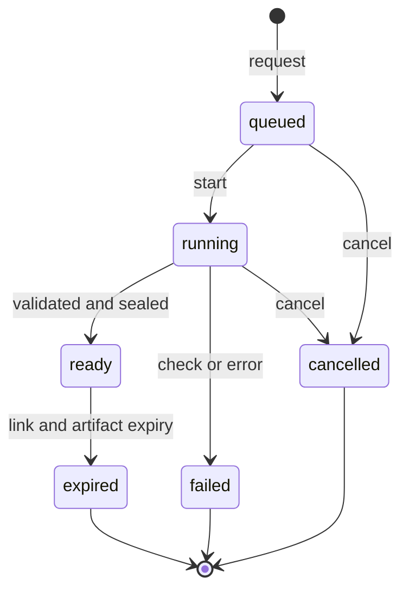

# 18 — Data Export, Portability and Import

| Field | Value |
|---|---|
| Status | Draft |
| Owner role | Data and ledger architect |
| Last updated | 2026-10-21 |
| Scope | Member self-export, Network-administrator export, Network closure export, full-Network archival; package format (CSV and JSON with versioned schema); the reconciliation proof carried in every ledger export; per-role inclusion and exclusion of personal data; export job handling and security; import and migration from other systems (P2, with design-for hooks); verification |
| Depends on | [00 — Conventions and canon](00-conventions.md), [03 — Domain model](03-domain-model-and-mutual-credit-rules.md), [06 — Data, ledger and audit](06-data-ledger-and-audit.md), [04 — Functional requirements](04-functional-requirements.md) |
| Open questions | See section 13; consolidated in [13 — Assumptions, risks, decisions](13-assumptions-risks-decisions-roadmap.md) |

## 1. Purpose and scope

Circula makes three promises about leaving: a Member can take their own records with them; a Network can take its whole community's records with it (including to another deployment, D-01); and anyone can check that an exported ledger is internally honest without trusting the Platform. This document specifies the exports, their formats and proof, who gets which data, how export jobs are run safely, and how data from other systems could be brought in later.

Functional behaviour of exports (who may click what) is in [04 FR-EXP](04-functional-requirements.md); this document makes those requirements concrete and cites them. Entities and attributes exported are those of [06](06-data-ledger-and-audit.md). Exports never present the credit unit as money (`INV-014`, [DOM-001](03-domain-model-and-mutual-credit-rules.md)); the manifest and the human-readable statement carry the accounting-unit notice. Whether any export or retention practice satisfies a data-protection, tax or accounting law in a jurisdiction is a question for counsel ([19](19-legal-and-regulatory-open-questions.md): LEG-Q-27, LEG-Q-28, LEG-Q-33); nothing here asserts compliance.

Out of scope: external analytics feeds, federation, live integrations ([07](07-api-and-integration-contract.md) covers API access), and the legal characterisation of imported legacy balances.

## 2. Definitions used here

| Term | Meaning |
|---|---|
| **Export type** | One of `member_self`, `network_admin`, `network_closure`, `network_archive` (section 3), plus `audit_events` (a filtered Audit Event export, [FR-AUD-008](04-functional-requirements.md)). Stored as `ExportJob.scope` ([06 section 4.6](06-data-ledger-and-audit.md)). |
| **Package** | The single archive file an export job produces: manifest, schemas, dataset files, optional attachments, README. |
| **Dataset** | One entity-shaped table in the package (for example `journal_entries`). Each dataset appears as CSV and as JSON Lines. |
| **As-of** | The consistent snapshot instant (UTC) from which every dataset in a package is read. |
| **Reconciliation proof** | The manifest blocks and verification algorithm of section 6 that allow independent recomputation of totals, balances and digests. |
| **Verifier** | A standalone program or documented algorithm that checks a package using nothing but the package (section 6.4). |
| **Source system** | A non-Circula system from which an import originates (section 11). |

Entity and invariant terms are as in [06](06-data-ledger-and-audit.md) and [00 section 5](00-conventions.md).

## 3. Export types

| Type | Who may request | Contents (summary) | Approval | Notes |
|---|---|---|---|---|
| `member_self` | The Member (`active`, `suspended`, `departing`; a `closed` Member during the post-closure window; an `applicant` for application data only) | Own profile, Listings, Trades and Journal Entries touching own Account, statement, own Disputes, Audit Events about them, consents, notification log (P2) | None | [FR-EXP-001](04-functional-requirements.md), [FR-EXP-006](04-functional-requirements.md), PER-032 |
| `network_admin` | A `network_admin` of that Network | Members (minimised), Accounts and balances, Journal Entries and Postings, Transactions and Trades, Listings, Disputes (state and decisions), Audit Events, PolicyVersions, checkpoints | One administrator; step-up authentication | [FR-EXP-003](04-functional-requirements.md), PER-033 |
| `network_closure` | System-initiated by the closure procedure of [10](10-governance-and-network-operations.md), delivered to administrators | Everything in `network_admin`, plus full Dispute texts, final reconciliation, final checkpoints, member-export offer status | `admin_quorum` | Produced after posting is quiesced; one package per designated recipient |
| `network_archive` | A `network_admin` | Everything needed to restore the Network into an empty deployment: all datasets, all PolicyVersions, all Audit Events and HistoryRecords, Attachments, id mapping; no secrets | `admin_quorum` | Basis for self-hosted/hosted portability (D-01) |
| `audit_events` | A `network_admin` | Filtered Audit Events with the same count as the on-screen filter | One administrator | The export is itself audited |

The Platform Operator has no export of Network content (`INV-012`, [FR-AUD-006](04-functional-requirements.md)). Platform-level events (deployment, access) are outside every type above.

| ID | Pri | Requirement | Rationale | Verification |
|---|---|---|---|---|
| PRT-001 | P0 | A Member MUST be able to request a `member_self` export covering every record of theirs in the Network in the datasets of section 8, in the formats of section 4, without administrator involvement. | Portability and trust; FR-EXP-001. | Test: Member with Trades, Listings, a Dispute and an Adjustment receives all of them and nobody else's personal data |
| PRT-002 | P0 | A Network Administrator MUST be able to request a `network_admin` export covering members (minimised), the full ledger, audit events and policy history, and each request MUST create an Audit Event naming scope, filters, as-of, row counts and manifest hash. | FR-EXP-003; accountability. | Test: counts equal live counts; audit event exists |
| PRT-003 | P0 | The `network_closure` and `network_archive` types MUST require approval from `admin_quorum` distinct administrators (the requester counts as one); an administrator MUST NOT be the sole approver of an export they requested when `admin_quorum` is greater than 1. | Whole-Network data including personal data is high risk; quorum is the Network's own sensitive-action control ([DOM-032](03-domain-model-and-mutual-credit-rules.md) pattern). | Authorisation tests with quorum 1, 2, 3 |
| PRT-004 | P0 | A Member whose Membership is `suspended` or `departing` MUST retain `member_self` export; a `closed` Member MUST retain it for the post-closure window [DECISION NEEDED: DEC-PRT-1, window length; options 14 / 30 / 90 days; recommended 30 days, matching FR-OD-13 in [04](04-functional-requirements.md)] even though they cannot otherwise sign in, using a login restricted to export access. After the window, requests MUST be denied. | Exit with data; [LIF-034](15-lifecycle-state-machines.md); D-09 sealed profile (DAT-072). | Test: closed Member can export at day 29 and not at day 31 |
| PRT-005 | P0 | During Network `closing` and for the closed-archive period, Members MUST be offered `member_self` export, and administrators MUST be offered `network_closure`; the Platform MUST NOT dispose of Network data ([06 section 13.4](06-data-ledger-and-audit.md)) until an administrator has acknowledged receipt of a verified closure package. | No data loss at closure; PER-054. | Scenario test: disposal blocked without acknowledgement |
| PRT-006 | P0 | Export types MUST NOT cross Networks: a package contains data of exactly one Network (plus the requester's login-level data in `member_self` only where listed in section 8). | `INV-011`, [DOM-002](03-domain-model-and-mutual-credit-rules.md). | Test with Members in two Networks: each export contains one Network |

## 4. Formats

### 4.1 Package layout

A package is one ZIP archive ([ZIP appnote](https://pkware.cachefly.net/webdocs/casestudies/APPNOTE.TXT), background knowledge) with deterministic member order and fixed timestamps for reproducibility:

```
circula-export-<type>-<job-short-id>-<yyyymmdd>.zip
  manifest.json            integrity and totals (section 6)
  README.txt               plain-language description, accounting-unit notice, how to verify
  schema/<dataset>.schema.json    JSON Schema per dataset, plus manifest.schema.json
  data/csv/<dataset>.csv
  data/jsonl/<dataset>.jsonl
  attachments/<attachment_id>      (network_closure, network_archive only)
  statement.html           member_self only: human-readable statement (section 4.4)
```

File names contain no personal data (no names, no emails).

### 4.2 Dataset encodings

Both encodings carry the same rows in the same order and the same column names, which are the attribute names of [06 section 4](06-data-ledger-and-audit.md).

| Aspect | CSV | JSON Lines |
|---|---|---|
| Role | Spreadsheet use, human audit | Canonical machine form, streamable |
| Syntax | [RFC 4180](https://www.rfc-editor.org/rfc/rfc4180) with UTF-8 without BOM, a header row, comma separator, CRLF record separator, all text fields quoted when they contain separators, quotes or line breaks | One JSON object per line, UTF-8, validated by JSON Schema draft 2020-12 |
| Amounts | Integer minor units as decimal digits with optional leading `-`, no separators, no exponent | Integer minor units **as strings** (no JSON numbers, so no precision loss in 53-bit consumers) |
| Unit scale | In the manifest (`network.unit_scale`), never applied in data files | Same |
| Timestamps | RFC 3339 UTC with `Z` and microseconds | Same |
| Identifiers | Canonical lowercase hyphenated form ([DAT-003](06-data-ledger-and-audit.md)) | Same |
| Enumerations | Canon spellings (`proposed`, `network_clearing`, ...) | Same |
| Null | Empty unquoted field | JSON `null` |
| Sets | Values joined by `;` in sorted order | JSON array in sorted order |

RFC 4180 and RFC 3339 are background knowledge; the sandbox could not reach rfc-editor.org on 2026-10-21, so re-check before external citation.

| ID | Pri | Requirement | Rationale | Verification |
|---|---|---|---|---|
| PRT-007 | P0 | Every dataset MUST be provided in both CSV and JSON Lines with identical rows, row order and column names, and a JSON Schema describing the JSON Lines form and the CSV columns. | CSV for people, JSON for tools, one truth. | Test: parse both, compare row-for-row; validate against schema |
| PRT-008 | P0 | No amount, balance or total in any file or manifest MAY be a floating-point number or carry a currency symbol, locale-formatted separator or rounding. | `DOM-008`; exactness; avoids money-like presentation. | Schema test: amount fields typed as digit strings; round-trip property test |
| PRT-009 | P0 | CSV text fields whose first character is `=`, `+`, `-`, `@`, tab or carriage return MUST be written with a leading apostrophe prefix and the README and schema MUST document that rule and that JSON Lines holds the unprefixed value. Numeric columns (amount fields) are exempt because they contain only digits and a leading `-`. | Spreadsheet formula injection from member-authored text (OWASP "CSV Injection", background knowledge). | Test with `=HYPERLINK(...)` payloads in every free-text field; open in a spreadsheet test harness, no formula evaluates |
| PRT-010 | P0 | Exports MUST be streamed or chunked so memory use does not grow with Network size, and a package MUST be generated from one consistent snapshot (as-of): all datasets agree with each other and with the ledger totals in the manifest even while postings continue. | Large Networks; correctness under load. | Test: export 1 million Postings with concurrent postings; manifest totals recompute exactly; peak memory below [DECISION NEEDED: DEC-PRT-2, memory bound; recommended 512 MB] |
| PRT-011 | P1 | Ledger datasets MUST be ordered by `(posted_at, journal_entry_id)` for entries and `(journal_entry_id, account_id)` for Postings; other datasets by their identifier. Given the same Network, scope and as-of, every ledger dataset MUST be byte-identical across runs apart from the manifest's `generated_at`, `export_job_id` and `package_id`. As-of values later than now minus `max_posting_unit_duration` ([DAT-017](06-data-ledger-and-audit.md)) are rejected. | FR-EXP-007; verification and tests. | Run twice, compare checksums |

### 4.3 Schema versioning

`schema_version` follows semantic versioning of the **export format** (distinct from the data model's `data_model_version`, [DAT-087](06-data-ledger-and-audit.md), which the manifest also records).

| Change | Version part |
|---|---|
| Removing or renaming a dataset or column; changing a type, unit or meaning; changing sort order, canonicalisation or digest definitions | MAJOR |
| Adding an optional column, a dataset, or an enumeration value | MINOR |
| Documentation or description fixes | PATCH |

| ID | Pri | Requirement | Rationale | Verification |
|---|---|---|---|---|
| PRT-012 | P0 | Every package MUST embed its schema files and declare `schema_version` and `data_model_version` in the manifest; the schema files MUST be published in the repository at a stable path per version and kept for all versions ever released. | Packages are self-describing and readable decades later. | CI: schema files for every released version present and valid |
| PRT-013 | P1 | After a MAJOR release the Platform MUST still be able to produce the previous MAJOR version on request for at least [DECISION NEEDED: DEC-PRT-3, overlap period; options 6 / 12 / 24 months; recommended 12 months], and consumers MUST be told by the manifest which version they hold. | Gives consumers time to migrate. | Test: both versions produced and verified |
| PRT-014 | P0 | Each MINOR/PATCH change MUST pass a compatibility test: a consumer built against the earlier schema of the same MAJOR version reads the new package, ignoring unknown columns and datasets. | Keeps MINOR additive. | CI contract test with the previous release's reader |
| PRT-015 | P0 | CSV and JSON files MUST validate against the embedded schema before the package is marked `ready`; a validation failure fails the job. | Never deliver a malformed package. | Fault-injection test |

### 4.4 Human-readable statement (member_self)

| ID | Pri | Requirement | Rationale | Verification |
|---|---|---|---|---|
| PRT-016 | P1 | A `member_self` package SHOULD include a period-selectable statement in an accessible HTML form ([08](08-ux-and-accessibility.md), WCAG 2.2 AA per D-14) showing opening balance, each Posting in `account_seq` order with its counterparty label, closing balance and the identity `opening + Σ amounts = closing` ([DAT-052](06-data-ledger-and-audit.md)), headed with the accounting-unit notice (no redemption claim). | Journey "review balances and history" step 5 ([02](02-personas-roles-and-journeys.md)). | Accessibility audit; arithmetic test |

## 5. Data contents by dataset

Dataset names equal entity names in snake_case. "Columns" means the attributes of [06 section 4](06-data-ledger-and-audit.md) except those excluded in section 8.

| Dataset | Source entity | Notes |
|---|---|---|
| `network` | Network | Unit identity and scale included |
| `policy_versions` | PolicyVersion | All versions, with `effective_at` |
| `accounts` | MemberAccount, SystemAccount | `balance`, `last_account_seq`, `posting_count`, `account_checksum` (section 6.2) |
| `memberships` | Membership (core) | Anonymised labels for erased members |
| `member_profiles` | MemberProfile | Role-dependent (section 8) |
| `transactions`, `trades`, `adjustments`, `approvals`, `reversal_links` | Corresponding | |
| `journal_entries`, `postings` | JournalEntry, Posting | Contain no free text or personal data |
| `listings`, `listing_versions` | Listing, ListingVersion | |
| `disputes`, `dispute_events`, `attachments` | Dispute, DisputeEvent, Attachment | Visibility per role |
| `audit_events` | AuditEvent | |
| `history_records` | HistoryRecord | |
| `integrity_checkpoints`, `reconciliation_runs` | IntegrityCheckpoint, ReconciliationRun | |
| `consents` | ConsentRecord | |
| `export_jobs` | ExportJob metadata | Admin types only |

## 6. Ledger export correctness: the reconciliation proof

### 6.1 Manifest

`manifest.json` contains the following blocks (amounts are digit strings):

| Block | Contents |
|---|---|
| `package` | `package_id`, `export_job_id`, `export_type`, `schema_version`, `data_model_version`, `generated_at`, `as_of`, `hash_version` |
| `network` | `network_id`, `slug`, `unit_name`, `unit_symbol`, `unit_scale`, accounting-unit notice text |
| `requester` | Requester's opaque `membership_id` and role; no personal data |
| `scope` | Filters and dataset list with `visibility_profile` applied (section 8) |
| `files` | For each file: path, media type, byte size, row count, SHA-256 |
| `ledger_totals` | `entry_count`, `posting_count`, `sum_of_all_postings`, `sum_of_all_balances` (both MUST be `"0"`), `sum_of_positive_balances`, `sum_of_negative_balances` |
| `account_proof` | `account_count`, `balances_digest` (6.2), list of any Accounts over limit or cap at as-of |
| `ledger_digest` | Digest over `entry_hash` values (6.3) equal to the IntegrityCheckpoint digest when as-of matches |
| `reconciliation` | Latest ReconciliationRun result, time, checks R1 to R14 summary ([06 section 9.2](06-data-ledger-and-audit.md)) |
| `redaction` | Count of anonymised or erased Members shown as "Former member #n"; visibility profile |

Illustration (Riverbend Example A of [03](03-domain-model-and-mutual-credit-rules.md), amounts in minor units, digests elided):

```json
{
  "ledger_totals": {
    "entry_count": "1", "posting_count": "2",
    "sum_of_all_postings": "0", "sum_of_all_balances": "0",
    "sum_of_positive_balances": "3000", "sum_of_negative_balances": "-3000"
  },
  "account_proof": { "account_count": "3", "balances_digest": "sha256:…" }
}
```

(In that sketch Alice +3000, Bob −2500, `network_clearing` −500: the positive and negative sums are 3000 and −3000 and the total is 0.)

### 6.2 Per-account checksum

For each Account: `account_checksum = SHA-256(UTF-8(account_id + ":" + balance + ":" + posting_count + ":" + last_account_seq))`, hexadecimal, where numbers are decimal text. `balances_digest = SHA-256` over the concatenation of `account_checksum + "\n"` for all Accounts in ascending `account_id` order. Any single changed balance, missing Posting or reordered sequence changes the digest.

### 6.3 Ledger digest

`ledger_digest` is defined exactly as the ledger-scope IntegrityCheckpoint digest of [06 section 9.4](06-data-ledger-and-audit.md): SHA-256 over the concatenated `entry_hash` values ordered by `journal_entry_id`, where `entry_hash` follows [06 section 6.4](06-data-ledger-and-audit.md) (RFC 8785 canonical JSON, then SHA-256).

### 6.4 Verification algorithm and verifier

A verifier MUST perform these steps using only the package:

| Step | Check |
|---|---|
| V1 | Every file's SHA-256 and byte size match `files` |
| V2 | Every dataset validates against its embedded schema; CSV and JSON Lines rows match |
| V3 | Every Journal Entry's Postings sum to zero (`INV-001`); no entry has two Postings on one Account; Trade entries have exactly two Postings |
| V4 | All Postings of an Account, sorted by `account_seq`, have gapless sequence from 1, and each `balance_after` equals the previous plus `amount` |
| V5 | Each Account's final `balance_after` equals `accounts.balance`; `posting_count` and `last_account_seq` agree |
| V6 | `sum_of_all_balances` is 0 (`INV-007`), and sums and counts in `ledger_totals` equal recomputed values |
| V7 | Each Journal Entry referencing `reverses_journal_entry_id` negates the original exactly; no entry is reversed twice |
| V8 | Recomputed `entry_hash` equals stored for every entry; recomputed `ledger_digest` equals manifest; `balances_digest` equals manifest |
| V9 | Referential integrity: every Posting's entry and Account exist; every entry's Transaction exists; no closed Account has Postings after `closed_at` (`INV-016`) |
| V10 | Every IntegrityCheckpoint in the package whose entry range is fully included reproduces its digest |

| ID | Pri | Requirement | Rationale | Verification |
|---|---|---|---|---|
| PRT-017 | P0 | Every export type that includes the ledger (`network_admin`, `network_closure`, `network_archive`) MUST include the `ledger_totals`, `account_proof`, `ledger_digest` and `reconciliation` blocks, computed from the same snapshot as the datasets. | FR-EXP-004; verifiability. | Test: recompute V1 to V10 externally, results equal manifest |
| PRT-018 | P0 | `member_self` packages MUST include the Member's own Account line (`account_checksum`), the Member's Postings with `balance_after`, and the Network's latest `ledger_digest` and checkpoint identifier, but MUST NOT include other Accounts' balances unless the Member could see them under `balance_visibility`. | A Member can verify their own arithmetic and anchor it to the Network history without exposing others. | Test under `balance_visibility = self` and `members` |
| PRT-019 | P0 | The Platform MUST fail the export job (state `failed`, no artifact) if any of its own pre-delivery checks V3, V4, V5, V6 or V9 fails on the snapshot, and MUST raise the failure as an operational alert and, for Critical ledger failures, follow [DAT-047](06-data-ledger-and-audit.md). | Never ship a proof that does not hold. | Seeded-fault tests |
| PRT-020 | P1 | The Platform SHOULD ship a standalone open-source verifier implementing V1 to V10 that has no dependency on the Platform, together with test vectors (the Riverbend examples A to E of [03](03-domain-model-and-mutual-credit-rules.md) plus deliberately corrupted packages with expected failure ids), and the README in every package MUST explain how to run it. | Trust without the Platform; community audit. | CI runs verifier against vectors; corrupted vectors fail with the expected step |
| PRT-021 | P0 | The verifier algorithm in this section is normative; the manifest `hash_version` MUST identify the digest definitions so verifiers of older packages remain valid. | Long-lived archives. | Test: verify packages produced by older `hash_version` |
| PRT-022 | P2 | A manifest SHOULD be signed (detached signature) with a Network- or Platform-held key whose public part is published, [DECISION NEEDED: DEC-PRT-4, signing key owner; options Network / Platform / none; recommended none in MVP]. Until then, the manifest hash recorded in the Audit Event ([PRT-032](#7-export-job-handling-and-security)) is the integrity anchor. | Tamper evidence of the package itself. | Inspection |

## 7. Export job handling and security

States of `ExportJob.state`: `queued` → `running` → `ready` → `expired`; `running` → `failed`; `queued`/`running` → `cancelled`. Notifications for each are in [17](17-notifications-and-communications.md).



Text description: a request creates a queued job; a worker reads one snapshot, writes the package to temporary storage, validates it (PRT-015, PRT-019), and then marks it ready; links stay valid until expiry, after which the artifact is deleted.

| ID | Pri | Requirement | Rationale | Verification |
|---|---|---|---|---|
| PRT-023 | P0 | Exports above a size threshold [DECISION NEEDED: DEC-PRT-5, recommended 10,000 rows, as FR-OD-12 in [04](04-functional-requirements.md)] MUST run asynchronously with visible progress (percent or dataset), a completion notification, and a cancel action; smaller exports MAY be synchronous but MUST still create an ExportJob and Audit Events. | FR-EXP-002. | Test above and below threshold |
| PRT-024 | P0 | Export workers MUST NOT hold Account serialisation or otherwise delay postings; posting latency during a running export of a 1-million-Posting Network MUST stay within [DECISION NEEDED: DEC-PRT-6, recommended no more than 10% degradation at p99]. | Exports must not become an availability attack. | Load test |
| PRT-025 | P0 | Per requester, at most one running job per scope, and at most [DECISION NEEDED: DEC-PRT-7, recommended 5 per 24 hours] new exports per requester per Network; limits MUST be enforced server-side and return a retryable error stating when the next export is allowed. | Abuse and cost control ([09](09-security-privacy-and-abuse.md)). | Test |
| PRT-026 | P0 | Packages MUST be stored encrypted at rest under per-artifact keys in a non-public store, never in a store that is world-listable, and MUST NOT be included in backups. | Limits blast radius; the artifact is a regenerable copy. | Inspection; backup inventory |
| PRT-027 | P0 | Download MUST require **both** an authenticated session of the requester (or the restricted export-only login of a closed Member, PRT-004) **and** a valid signed link bound to (`export_job_id`, `artifact_id`, requester, expiry). Possession of the link alone MUST NOT grant access. | Leaked links are common (email, chat, browser history). | Test: link without session denied; session of another user with link denied |
| PRT-028 | P0 | Signed links MUST expire after at most [DECISION NEEDED: DEC-PRT-8, link validity; options 1 h / 24 h / 72 h; recommended 24 hours, maximum 72 hours]; artifacts MUST be deleted at expiry of the last link and in any case no later than 7 days after creation; expired links MUST return the same response as invalid links; a limited number of downloads [recommended 3] MAY be enforced. | FR-EXP-002 links expire; minimal retention ([06 section 13.1](06-data-ledger-and-audit.md)). | Clock-controlled test; storage inspection after expiry |
| PRT-029 | P0 | Network-level exports (`network_admin`, `network_closure`, `network_archive`, `audit_events`) MUST require step-up authentication within the last [DECISION NEEDED: DEC-PRT-9, recommended 10 minutes] before request and before download, per [09](09-security-privacy-and-abuse.md). | Whole-Network data is the highest-value target. | Test |
| PRT-030 | P0 | Download responses MUST send non-cacheable headers and the package MUST carry no personal data in its file name or URL. | Browser and proxy cache hygiene. | Header inspection |
| PRT-031 | P0 | Cancelling a job, failing a job, or Phase 2 erasure of the requester ([06 section 12.3](06-data-ledger-and-audit.md)) MUST delete temporary and final artifacts and verify the deletion. | No orphaned copies. | Test: no residual files after each path |
| PRT-032 | P0 | Each of `export.requested`, `export.approved`, `export.delivered`, `export.downloaded`, `export.expired`, `export.failed` MUST create an Audit Event with requester membership, scope, filters, as-of, row counts and **manifest hash**, and no data content ([06 section 10](06-data-ledger-and-audit.md)). A failed audit write MUST block delivery. | FR-AUD-001, FR-AUD-009; the hash is the integrity anchor. | Coverage query; forced audit failure blocks download |
| PRT-033 | P1 | When a Network-level export is requested or downloaded, all `network_admin` Memberships of that Network SHOULD receive a notification naming requester and scope ("watching the watchers"). | Collusion and insider risk. | Notification test |
| PRT-034 | P0 | The Platform Operator MUST NOT have access to package contents in normal operation; job metadata visible to the Operator MUST be limited to counts, sizes and timing, and any content access is break-glass with an Audit Event visible to the Network's administrators ([DAT-064](06-data-ledger-and-audit.md)). | Separation of platform and Network. | Authorisation test |
| PRT-035 | P0 | Export jobs MUST be idempotent on the request key ([DAT-024](06-data-ledger-and-audit.md)): a retried request returns the existing job. | Duplicate large exports are costly. | Replay test |

## 8. Personal data included and excluded per role

Visibility profiles: **M** = `member_self`; **A** = `network_admin`; **C** = `network_closure`; **R** = `network_archive`. "Visible rule" means only what the requester could see in the UI at as-of ([FR-EXP-008](04-functional-requirements.md)).

| Data | M | A | C | R |
|---|---|---|---|---|
| Own profile (name, contact fields, bio) | Yes | n/a | n/a | n/a |
| Other Members' display names | Counterparty label as visible in UI [DECISION NEEDED: DEC-PRT-10, options ref only / display name as visible / none; recommended display name as visible, never contact fields] | Yes (for active Members) | Yes | Yes |
| Other Members' contact data (email, phone) | **Never** | **Excluded by default**; included only with an explicit `include_contact` option, recorded in the Audit Event, for Members whose contact fields are visible to administrators [DECISION NEEDED: DEC-PRT-11] | As A | As A |
| Login email and Credentials | Own login email only | **Never** | **Never** | **Never** |
| Session, IP, device, authentication logs | Never (subject access to these is a question for counsel, LEG-Q-28) | Never | Never | Never |
| Erased or closed Members | "Former member #n" only | Same | Same | Same |
| Own balance and Postings | Yes | All (see A-DAT-9) | All | All |
| Other Members' balances and Postings | Only if `balance_visibility` allows; otherwise the counterparty leg of own entries shown without the counterparty's balance | All | All | All |
| Trades, Journal Entries touching the Member | Yes | All | All | All |
| Listings | Own (all states); others as `directory_visibility` allows | All states | All states | All states and versions |
| Disputes | Those the Member is party to, with the texts they may see | State, parties, resolution codes; full texts only to administrators who are not parties | Full texts | Full texts and Attachments |
| Audit Events | About the Member ([FR-AUD-004](04-functional-requirements.md)) | All Network events | All | All |
| Consents | Own | Aggregate counts | Aggregate | All, opaque |
| Invitations | Own, if any | Pending and used, invitee email excluded | Same | Same |
| Notifications | Own log (P2) | No | No | No |
| IdempotencyRecords | Never | Never | Never | Never |
| PolicyVersions | Yes | Yes | Yes | Yes |
| ExportJobs | Own | Network | Network | Network |
| Free text authored by others | Visible-to-both items only (for example a Trade description shared with the Member) | Visible to administrators | Same | Same |

| ID | Pri | Requirement | Rationale | Verification |
|---|---|---|---|---|
| PRT-036 | P0 | The export of any dataset MUST apply the same projection, field-level visibility and anonymisation as the corresponding API and UI view for the requester's role ([FR-EXP-005](04-functional-requirements.md), [FR-EXP-008](04-functional-requirements.md), [DAT-072](06-data-ledger-and-audit.md)); an export MUST NOT be a route to data the requester could not otherwise view. | No visibility bypass. | Differential test: every field in an export is retrievable by the same requester through the UI/API; and the converse for excluded fields |
| PRT-037 | P0 | Credentials, secret material, session data, IdempotencyRecords and security logs MUST never appear in any package. | Secrets are not portable data. | Automated content scan of all export types with seeded secrets |
| PRT-038 | P0 | Counterparty personal data in a `member_self` export MUST be limited to the label permitted by DEC-PRT-10 plus text the Member could already see; contact fields MUST be excluded. | Subject access must not expose third parties; LEG-Q-28 is open. | Test with a counterparty who has all fields populated |
| PRT-039 | P0 | `include_contact` for administrator exports MUST require step-up authentication (PRT-029), MUST be recorded in the Audit Event, MUST be refused for Members whose contact visibility excludes administrators, and the README MUST state the recipient's data-protection responsibilities. | Controller duties sit with the Network (D-08). | Test; README inspection |
| PRT-040 | P0 | Packages MUST list in `redaction` the number of anonymised Members and the visibility profile used, so a recipient can tell what was withheld. | Honest completeness. | Manifest test |

## 9. Closure and full-Network archival

Closure procedure (governance side) is owned by [10](10-governance-and-network-operations.md); this section states the data steps.

| Step | Data action |
|---|---|
| 1 | Network enters `closing` ([10](10-governance-and-network-operations.md)); Members notified; `member_self` export prompted |
| 2 | Postings quiesced; final reconciliation (R1 to R14) and final IntegrityCheckpoints sealed |
| 3 | `network_closure` package generated for each designated recipient after `admin_quorum` approval; manifest hash recorded in Audit Event |
| 4 | Recipient verifies (verifier or manual V1 to V10) and records acknowledgement (administrator action, audited) |
| 5 | Network enters `closed`; read-only export access continues for the closed-archive period ([06 section 13.1](06-data-ledger-and-audit.md), DEC-DAT-16) |
| 6 | Disposal procedure after the period ([06 section 13.4](06-data-ledger-and-audit.md)) |

| ID | Pri | Requirement | Rationale | Verification |
|---|---|---|---|---|
| PRT-041 | P0 | The `network_closure` package MUST be generated from a snapshot taken after postings are halted for the Network, and its `ledger_digest` MUST equal the final ledger IntegrityCheckpoint. | A closed Network's history is fixed and verifiable. | Test |
| PRT-042 | P0 | The `network_archive` package MUST contain every dataset needed to reconstruct the Network in an empty deployment (all of section 5 except secrets), preserving original identifiers, and MUST pass the verifier V1 to V10. | Portability between hosted and self-hosted (D-01) and a disaster-recovery cross-check. | Test: package of a populated Network verified; compare entity counts to live |
| PRT-043 | P1 | The Platform SHOULD provide an **archive import** that restores a verified `network_archive` into an empty Network or deployment, rejecting the import if any verifier step fails, and rerunning reconciliation (R1 to R14) afterwards. Designed-for in MVP; the feature is P2 unless pulled forward by decision. | Closes the portability loop. | Round-trip test: export, import into empty deployment, re-export, compare digests |
| PRT-044 | P0 | Credentials and session material MUST NOT be exported or restored; users of an imported Network MUST re-authenticate through recovery or invitation flows ([09](09-security-privacy-and-abuse.md)). | Security. | Test |
| PRT-045 | P0 | Where a Network is hosted by a Platform Operator, closure MUST NOT delete data before PRT-005's acknowledgement, and the Operator MUST NOT retain a usable copy beyond the closed-archive period without the Network's recorded instruction. | Data custody; controller/processor split pending counsel (D-08, LEG-Q-24). | Procedure inspection |

## 10. Verification of this document

| Test class | What is tested | Pass criterion |
|---|---|---|
| Golden packages | Riverbend examples A to E of [03](03-domain-model-and-mutual-credit-rules.md) exported and verified | V1 to V10 pass; totals equal hand computation |
| Corruption detection | Change one Posting amount; delete one Posting; swap two sequence numbers; duplicate a reversal; edit `balances_digest`; edit a file byte | Verifier fails at the expected step ([PRT-020](#6-ledger-export-correctness-the-reconciliation-proof)) |
| Live parity | Counts and balances in export vs live database at as-of | Exactly equal |
| Concurrency | Export during 1,000 concurrent postings | Manifest totals recompute; no partial entry (DAT-012) |
| Reproducibility | Same scope and as-of twice | Ledger datasets byte-identical (PRT-011) |
| Role matrix | Section 8 for every role and `balance_visibility` / `directory_visibility` value | No field outside the allowed set; no allowed field missing |
| Erasure | Phase 1 and 2 members in each export type | Only "Former member #n"; zero personal data |
| Injection | Formula payloads in every free-text field | PRT-009 |
| Security | Link without session, wrong user, expired link, replay of download count, cancelled job | Denied; artifacts deleted |
| Schema | Each released MAJOR/MINOR against previous readers | PRT-014 |
| Performance | 1 million Postings | Time budget [DECISION NEEDED: DEC-PRT-12, recommended 30 minutes] and PRT-010, PRT-024 |
| Audit | Every export action | PRT-032 |

These feed the test plan in [12](12-quality-strategy-and-test-plan.md), which owns gates and acceptance scenarios.

| ID | Pri | Requirement | Rationale | Verification |
|---|---|---|---|---|
| PRT-046 | P0 | Export correctness tests of the classes above MUST be part of the release gate, and a release MUST NOT ship if the golden-package, corruption-detection or role-matrix classes fail. | Export correctness is a quality-strategy topic in the foundational brief. | CI gate ([12](12-quality-strategy-and-test-plan.md)) |

## 11. Import and migration from other systems (P2, designed for in MVP)

Import is deferred (P2) but the MVP model carries hooks so that it can be added without migrating ledger tables: nullable `external_ref` and `import_batch_id` on Membership and Transaction, reserved `effective_at` on JournalEntry, the `opening_balance` transaction type ([DOM-034](03-domain-model-and-mutual-credit-rules.md)), the ImportBatch entity ([06 section 4.8](06-data-ledger-and-audit.md)), and `network_archive` packages as a lossless import format.

### 11.1 Sources and approach

| Source | Typical content | Approach |
|---|---|---|
| LETS or timebank spreadsheet | Member list and a balance column, sometimes a transaction log | Generic CSV mapping (11.2). Balance-only import recommended |
| Cyclos export | Member and account/balance or transfer listings in CSV | Same adapter with a saved mapping. Cyclos export columns and licence terms were not retrieved from primary sources in the research notes ([prior-art note](../notes/research-prior-art-mutual-credit.md), section 1.2: **[UNVERIFIED]**); the Platform therefore MUST NOT hard-code assumptions and MUST rely on the user-defined mapping, with a vendor-specific preset added only after sample files are verified |
| Circula archive | `network_archive` package | Lossless restore (PRT-043) |
| Other mutual-credit tools | Arbitrary CSV | Generic mapping |

The decision on how much history to import is open: **balances-only opening** (each person's legacy balance becomes one `opening_balance` Journal Entry against `network_clearing`, and the legacy history is attached read-only as a document), or **full history** (each legacy transfer becomes a Journal Entry with `effective_at` set to the original date). [DECISION NEEDED: DEC-PRT-13, import depth; options balances-only / full history; recommended balances-only]. Full history would need a new transaction type and exemption rules for limits on historic entries and so would extend the canon ([03](03-domain-model-and-mutual-credit-rules.md) assumption A-4).

### 11.2 Mapping and validation

Required logical fields: source member reference; display name; legacy balance as decimal text. Optional: email (for invitations), credit limit, join date. Rules: decimal text is converted using the target `unit_scale` and rejected when it has more fractional digits (`DOM-008`); balances are summed and the opposite total is posted to `network_clearing` so the Network sums to zero (`INV-007`); a negative legacy balance beyond `max_credit_limit` is reported and requires an explicit decision (raise per-member limit with Audit Event, or reject).

| ID | Pri | Requirement | Rationale | Verification |
|---|---|---|---|---|
| PRT-047 | P2 | Import MUST proceed in two steps: a **dry run** that parses, maps and validates the file and produces a report (row counts, rejected rows with reasons, balance totals, projected clearing balance, Members over limit) without writing ledger rows, and a **commit** that is all-or-nothing for the batch. | Safe migration of a community's books. | Test: dry-run writes no Journal Entry; failure injection during commit leaves nothing |
| PRT-048 | P2 | Balance imports MUST be allowed only in the Network's setup phase (before the first Trade) or as Adjustments afterwards, MUST use `opening_balance` entries against `network_clearing`, and MUST NOT bypass `INV-001`, `INV-007`, `INV-011` or `INV-013`. | [DOM-034](03-domain-model-and-mutual-credit-rules.md). | Test: import after first Trade is routed through Adjustment flow |
| PRT-049 | P2 | Imported people MUST NOT be silently activated: each imported person receives an Invitation and becomes `active` only through the normal Membership flow ([MB1/MB2](15-lifecycle-state-machines.md)); the opening balance is posted when the Membership becomes `active`. [DECISION NEEDED: DEC-PRT-14, options invitation-then-post / pre-provisioned unclaimed Membership; recommended invitation-then-post.] | Consent and authentication (D-07); avoids accounts without a person behind them. | Scenario test |
| PRT-050 | P2 | The source file and the dry-run report MUST be deleted at most 7 days after commit or abandonment; the persistent ImportBatch record MUST hold only counts, a file hash and the result, and Memberships created MUST keep `external_ref` and `import_batch_id` for traceability. | Minimisation; imported files contain personal data of people who have not yet consented (lawful basis: a question for counsel, [LEG-Q-25](19-legal-and-regulatory-open-questions.md)). | Retention test |
| PRT-051 | P2 | Import MUST create an Audit Event `import.committed` with batch identifier, counts, totals and file hash, and each opening entry MUST link to the Audit Event via the Transaction reason. | `INV-010`. | Coverage query |
| PRT-052 | P1 | MVP implementation MUST include the hook attributes (`external_ref`, `import_batch_id`, `effective_at`), unused and nullable, so that adding import later requires no migration of ledger tables ([DAT-084](06-data-ledger-and-audit.md)). | Design-for without building. | Schema inspection |
| PRT-053 | P2 | Import MUST support a repeatable mapping file (saved per source) and MUST be idempotent on (`network_id`, source label, `external_ref`): re-running the same file creates no duplicates. | Safe retries ([INV-009](00-conventions.md)). | Test: second commit is a no-op |

## 12. Interaction with other documents

| Topic | Owner |
|---|---|
| Entities, hashes, checkpoints, reconciliation checks, retention, erasure | [06](06-data-ledger-and-audit.md) |
| Export endpoints, job resources, error formats, download headers | [07](07-api-and-integration-contract.md) |
| Accessibility of statement and export UI | [08](08-ux-and-accessibility.md) |
| Step-up authentication, rate-limit policy, secure logging, break-glass | [09](09-security-privacy-and-abuse.md) |
| Closure procedure, quorum, closed-archive decisions | [10](10-governance-and-network-operations.md) |
| Storage for artifacts, backup exclusion, disposal runbook | [11](11-deployment-operations-and-support.md) |
| Export tests as gates | [12](12-quality-strategy-and-test-plan.md) |
| Notification texts for export states | [17](17-notifications-and-communications.md) |

## 13. Assumptions and open decisions

| Ref | Item | Options | Recommended default |
|---|---|---|---|
| DEC-PRT-1 | Post-closure member export window | 14 / 30 / 90 days | 30 days |
| DEC-PRT-2 | Export memory bound | 256 MB / 512 MB / 1 GB | 512 MB |
| DEC-PRT-3 | MAJOR schema overlap period | 6 / 12 / 24 months | 12 months |
| DEC-PRT-4 | Manifest signing | none / Network key / Platform key | None in MVP |
| DEC-PRT-5 | Asynchronous threshold | 1,000 / 10,000 / 100,000 rows | 10,000 |
| DEC-PRT-6 | Allowed posting degradation during export | 5% / 10% / 25% at p99 | 10% |
| DEC-PRT-7 | Exports per requester per day | 3 / 5 / 10 | 5 |
| DEC-PRT-8 | Download link validity | 1 h / 24 h / 72 h | 24 h (max 72 h) |
| DEC-PRT-9 | Step-up recency | 5 / 10 / 30 minutes | 10 minutes |
| DEC-PRT-10 | Counterparty names in member export | ref only / display name as visible / none | Display name as visible |
| DEC-PRT-11 | Administrator export of contact data | never / opt-in with audit / default | Opt-in with audit |
| DEC-PRT-12 | Time budget at 1 million Postings | 10 / 30 / 60 minutes | 30 minutes |
| DEC-PRT-13 | Import depth | balances-only / full history | Balances-only |
| DEC-PRT-14 | Imported members before consent | invitation-then-post / unclaimed Membership | Invitation-then-post |

Assumptions. **A-PRT-1**: The ZIP container is acceptable for packages (alternative tar); chosen for tool ubiquity. **A-PRT-2**: Seven days is the maximum artifact lifetime. **A-PRT-3**: `member_self` exports of users who are `applicant` contain application data only (PER-032). **A-PRT-4**: Administrators see all Journal Entries in their Network regardless of `balance_visibility` (A-DAT-9); [04](04-functional-requirements.md) FR-EXP-008 should say so for the admin role. **A-PRT-5**: Hash and digest definitions here duplicate no text from [06](06-data-ledger-and-audit.md): they cite it.

Legal: whether exports meet subject-access or portability duties, whether counterparty data may appear in them, whether retention after closure is compatible with erasure duties, and whether imports of personal data of non-consenting people are lawful are questions for counsel ([19](19-legal-and-regulatory-open-questions.md): LEG-Q-24, LEG-Q-25, LEG-Q-27, LEG-Q-28, LEG-Q-33).

Cross-document needs: [04](04-functional-requirements.md) to align FR-EXP-001 to FR-EXP-008 with PRT IDs and section 3 types; [07](07-api-and-integration-contract.md) to define job and download endpoints; [09](09-security-privacy-and-abuse.md) to own step-up and rate limits; [10](10-governance-and-network-operations.md) to reference PRT-005 and section 9 in closure; [12](12-quality-strategy-and-test-plan.md) to adopt PRT-046.

## 14. References

- [00 — Conventions and canon](00-conventions.md); [03 — Domain model](03-domain-model-and-mutual-credit-rules.md); [04 — Functional requirements](04-functional-requirements.md) (FR-EXP, FR-AUD); [06 — Data, ledger and audit](06-data-ledger-and-audit.md); [15 — Lifecycle state machines](15-lifecycle-state-machines.md); [19 — Legal and regulatory open questions](19-legal-and-regulatory-open-questions.md)
- Research notes: [technical standards](../notes/research-technical-standards.md) (sections 1, 6, 8); [regulatory and privacy questions](../notes/research-regulatory-privacy-questions.md) (section 2.5, portability and counterparty data); [prior art](../notes/research-prior-art-mutual-credit.md) (Cyclos entries are unverified)
- External standards cited from background knowledge and **not** re-fetched on 2026-10-21 (the sandbox could not resolve rfc-editor.org, owasp.org); re-check before external citation: RFC 4180 CSV <https://www.rfc-editor.org/rfc/rfc4180>; RFC 3339 timestamps <https://www.rfc-editor.org/rfc/rfc3339>; RFC 8785 JSON Canonicalization Scheme <https://www.rfc-editor.org/rfc/rfc8785>; JSON Schema 2020-12 <https://json-schema.org/draft/2020-12>; OWASP CSV Injection <https://owasp.org/www-community/attacks/CSV_Injection>; WCAG 2.2 <https://www.w3.org/TR/WCAG22/>
